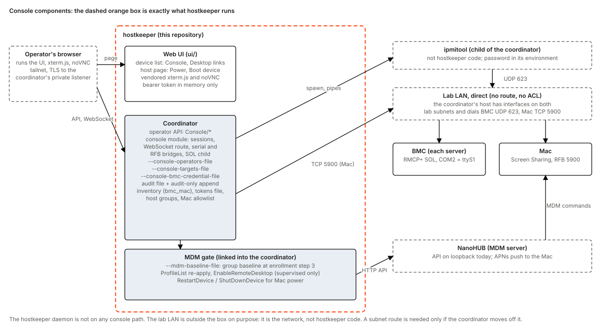
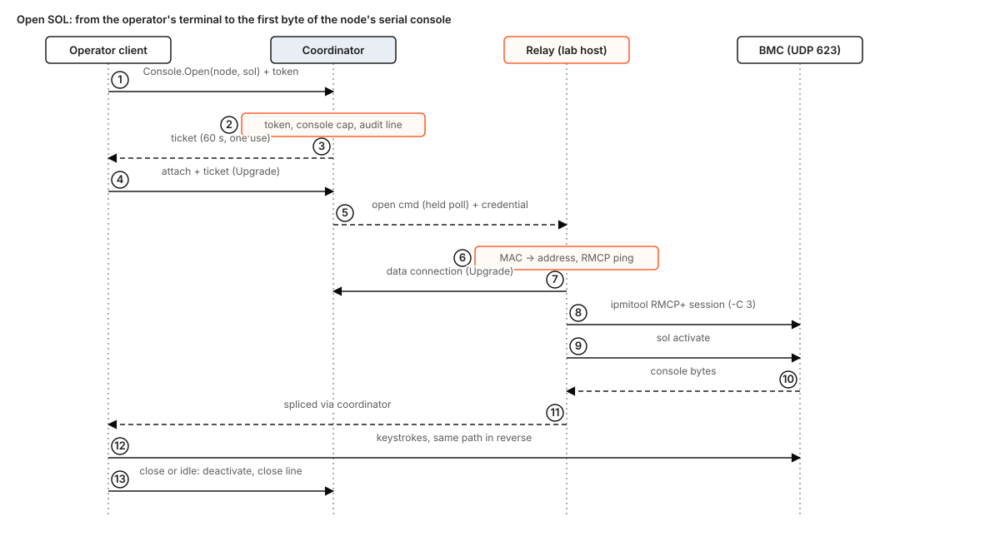
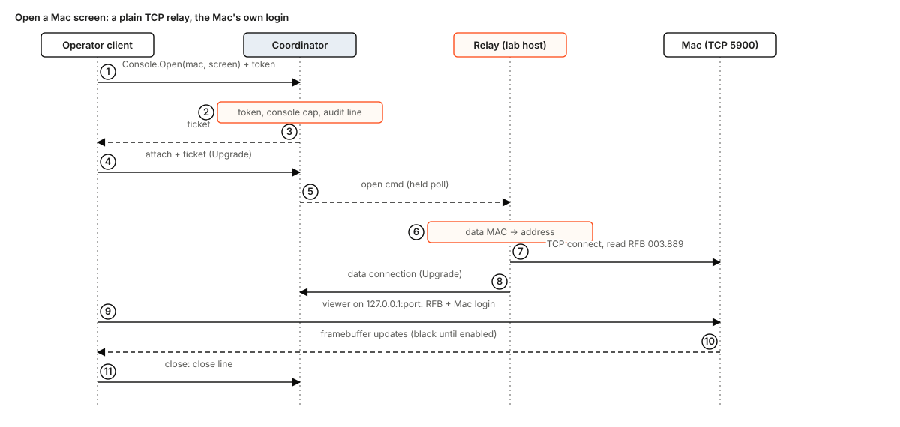
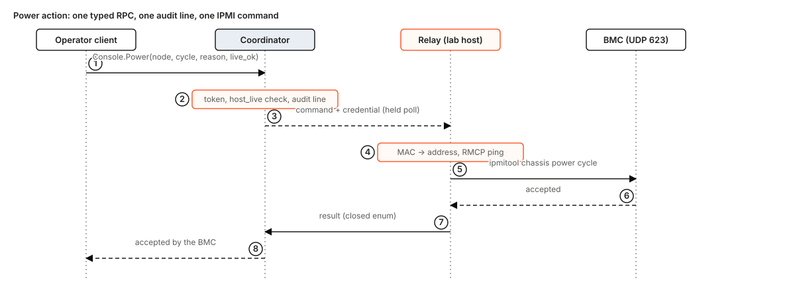
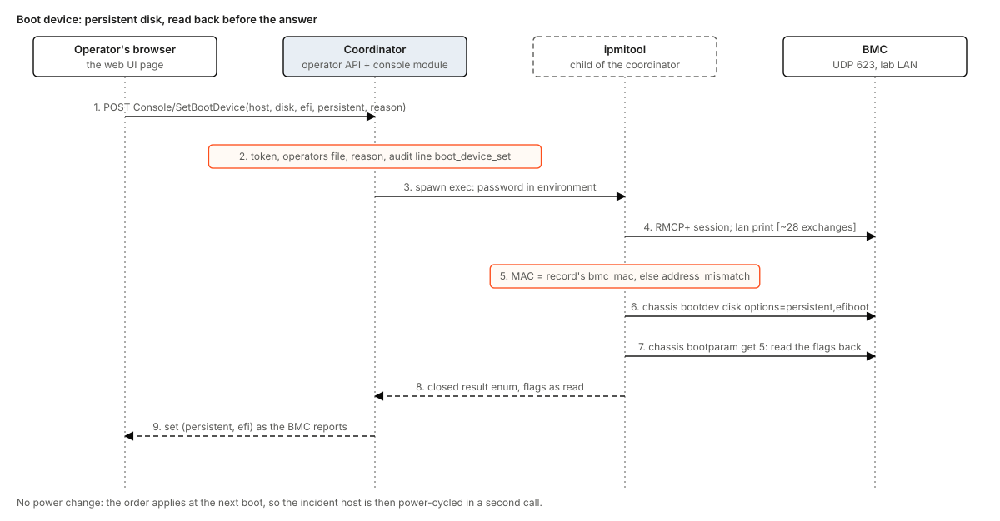
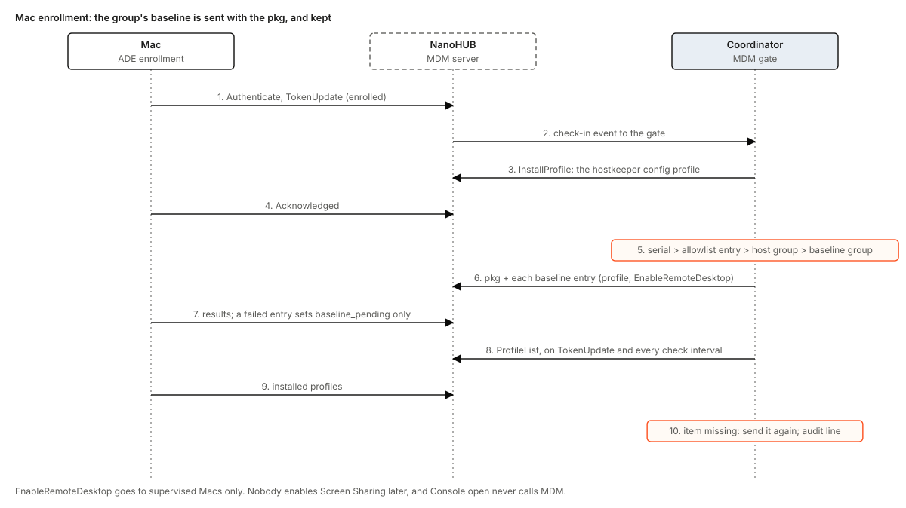

# hostkeeper console design

> **Update 2026-11-14.** The MDM baseline (`--mdm-baseline-file`) and the policy gate it ran in are gone. The MDM was removed from the coordinator and the repository (`docs/design/coordinator-mdm.md`, superseded); Macs enroll through the bootstrap package (`docs/design/mac-bootstrap.md`). Where this document describes the MDM, its kit, its policy gate or the `mdm` package, it describes what was removed; the rest stands.

Status: design, for the maintainers' comments. Nothing in this document is built unless it is tagged **Built** with a path. It extends [hostkeeper-design.md](hostkeeper-design.md) section 12.1 ("power control through the BMC") and [network-install.md](network-install.md) section 10 ("BMC power and boot-device control"), and ties into hostkeeper-mdm.md (hostkeeper-mdm.md, removed) for the Macs.

How to read it: **Built** is code on `main` (with a path). **Designed** is this document's proposal. **Measured** is a fact read from the lab on 2026-11-10, or in task C0 on 2026-11-18 (section 17 has C0's results and how each was taken). **Inferred** is a figure derived from protocol structure or from numbers in this repository and not yet measured (task C0 measured most of them; section 17.8 lists what is still open). **Unverified** is a claim taken from vendor documentation, a forum or a library's README that no one has run against the lab's firmware or the operators' browsers. Test names are in code font and are **(to build, Cn)** unless they exist. The repository is public: this document uses `<bmc-ip>`, `<mac-ip>`, `<lab-subnet>` and the documentation address ranges, never a lab address or host name.


## 1. Problem

A server that has stopped answering can only be fixed from its BMC, and a Mac that has lost its session can only be fixed from its screen. Today neither can be reached by an operator who is not standing in the lab.

The motivating incident: node-02 was force-rebooted, came back at the PXE menu, and needed its boot order changed. The BMCs sit on the lab LAN, not on the tailnet. Fixing it meant going to the lab, or logging in to some other machine on the LAN first and opening the BMC web UI from there.

The coordinator already knows which machine is which: each server's data MAC and BMC MAC are in its inventory record (**Built**: `crates/hostkeeper-coordinator/src/inventory.rs`, `Hosts.Get` and `Hosts.List`). It stores no address, and nothing in it carries an interactive byte stream (section 4).

## 2. Goals and non-goals

Decisions in brief:

1. **Everything goes through the coordinator.** No relay binary or role, no command line, no new hostkeeper daemon code, no daemon-to-coordinator stream. Authentication and audit are at the coordinator and nowhere else.
2. **The coordinator reaches the lab LAN itself.** Default: direct. The coordinator's host has interfaces on both lab subnets (**Measured**), so it dials the BMCs (UDP 623) and the Macs (TCP 5900) itself; no Tailscale subnet route and no ACL rule. Alternative, only for a coordinator moved off the lab LAN: a subnet route with an ACL (section 9.1).
3. **Linux servers: Console only.** IPMI 2.0 Serial over LAN (SOL) bridged by the coordinator over a WebSocket to an in-page terminal (xterm.js). The serial port is the second one, COM2 = `ttyS1`, on every Linux server (section 5). Power and boot device are typed calls (`Console/Power`, `Console/SetBootDevice`) with a reason and an audit line.
4. **Macs: Desktop only.** noVNC in the page, bridged by the coordinator to RFB on TCP 5900. Power is MDM `RestartDevice` and `ShutDownDevice` through the gate, supervised Macs only. **Apple Silicon Macs have no BMC and no serial console: a hung or unbooted Mac has no remote console.**
5. **The BMC's HTML5 KVM is dropped from the build** (fragile, section 6.2).
6. **Mac enrollment sets up all configuration**, including Screen Sharing; nobody enables it later and opening a Desktop never touches MDM (section 10).
7. Smallest usable first: C1 and C2 give the power and boot-device buttons on the host page, with no WebSocket (section 15).

Goals: an operator in the coordinator's web UI opens a serial Console on any Linux server or a Desktop on any Mac, and power-cycles a server or changes its boot device, from anywhere on the tailnet. All of it is also in the operator API, for automation. The BMC password is never shown to the operator. Every open and every typed power action is one audit line. The serial console is a login prompt on the host, so what an operator types in it is the host's own accounting; the audit records who opened it, when, from where and for how long.

Decided by the owner and not reopened: **one shared BMC username and password for every BMC, held by the coordinator.** No rotation, no vault, no per-host secret. A Mac is reached with the Mac's own login; the coordinator holds no Mac credential.

Non-goals: Redfish, the BMC's HTML5 KVM and web page in this build, a command-line client, a relay or any process on the lab LAN, recording a session's content, Mac High Performance mode, waking a sleeping Mac, a shared operator machine (section 13).

Future items, not designed here: native RMCP+ in place of `ipmitool`; an SSH-backed **Terminal** link for Macs; a switched PDU outlet for a hard-hung Mac; at most a plain link that opens the BMC's own web UI in a new tab (section 6.2).

## 3. What an operator sees

In the coordinator's web UI (`https://<private-address>/ui/`, the page the operator already signs in to with a pasted token) the **device list** has one row per host. A row has a link by platform:

- **Console**, on a Linux server's row: a page with a terminal on the server's serial port, and beside it **Power** (status, on, soft shutdown, off, cycle, reset) and **Boot device** (PXE, disk or BIOS; efi; one-time or persistent).
- **Desktop**, on a Mac's row: a page with the Mac's screen in a noVNC viewer, and **Power** (restart, shut down). The Mac's own login is typed into the viewer.

Each power or boot-device button asks for a reason (required, 1 to 256 bytes, as for every `Console/Open`, `Console/Power` and `Console/SetBootDevice` call) and confirms first; the confirm is a courtesy, not a control. The page lists who holds which session, since when, with a **Close** control. The host page (the one a row opens) carries the same Power and Boot device section without the terminal, which is the first slice (C2).

For automation the same calls are typed methods of the operator API (`Console/Open`, `Console/Power`, `Console/SetBootDevice`, `Console/List`, `Console/Close`), so the existing generated client and `hk`'s proto-generated command table list them. No `hk` change is part of this design. A serial or screen session is a WebSocket that `Open` hands out and any WebSocket client can attach.

Before: go to the lab. After: the operator's browser, over the tailnet, by host id. What does not change: the update path, the operator token, the tokens file and every existing listener. An operator who is not in the operators file (D9) is refused; with no file, nobody has console access.

For the incident: **Boot device: disk, persistent**, then **Power: cycle**, then **Console** to watch it boot, if the host's BIOS redirects its screens to the serial port the BMC carries (section 5). A one-time boot device would fix this boot only; the incident was a boot order that stayed wrong, so the persistent form is the fix.

## 4. State today

- **Operators.** One class: a named bearer token (**Built**: `crates/hostkeeper-coordinator/src/tokens.rs`, `OperatorTokens::name_of`). Authorization is the token name; there are no roles. `Caller` is `Operator | Ci | Anonymous` (`src/operator.rs`). The private listener (`--private-listen`) is TLS server-auth only, reached over the tailnet. `RawToken` in `tokens.rs` is `deny_unknown_fields`, so **a new key in the tokens file would be refused by the previous release**; the design leaves that file alone (D9). The same holds for `InventoryRecord` (`inventory.rs`): a new field is refused by the release before once it is written, so the design leaves the record alone too (D8).
- **The web app.** Static files served from `--ui-dir` under `/ui/` on the private listener (**Built**: `src/ui.rs`). The operator pastes a token; the app keeps it in memory only (`ui/session.js`: no storage, no cookie, not in the address) and POSTs JSON with `Authorization: Bearer` (`ui/api.js`, the one data layer, over the client generated from the protos). Every answer carries `default-src 'self'; frame-ancestors 'none'` (`CONTENT_SECURITY_POLICY`). There is no `connect-src` and no cookie ([ui-serving.md](../ui-serving.md)).
- **The UI scan.** `crates/hostkeeper-ui-tests/src/scan.rs` refuses, in the app's sources, `WebSocket`, `EventSource`, `XMLHttpRequest`, `sendBeacon`, any other-origin URL, `eval(`, `innerHTML`, inline script and style, token keepers, and any `fetch` outside the data layer and the entry module. Section 8.2 says what changes.
- **Listeners.** `src/listen.rs` serves the private listener over HTTP/2 or HTTP/1.1 by ALPN and closes a connection `CLIENT_PATIENCE` (10 s) after its handshake unless it is a registered long wait (`Releases.WaitConverged`, `src/wait.rs`). Nothing upgrades a connection or splices two streams today.
- **Audit.** Every ops change is one `AuditEntry` (`seq, by, action, service?, node_id?, host_group?, reason?`) and one fsynced JSON line in `<ops-file>.audit` (**Built**: `src/ops.rs`, `src/audit_file.rs`). A line is the by-product of an `OpsStore` change. **There is no audit-only append** (C1 adds one: **Built**, `OpsStore::append_audit_only` in `src/ops_audit_only.rs`). `action` is a free string, so a new action name is additive.
- **Daemon channel.** The daemon connects out and speaks four unary RPCs (**Built**: `agent.proto`). This design adds nothing to it. It uses what the daemon already reports: the BMC MAC (`crates/hostkeeper-daemon/src/ipmi.rs`) and a Mac's serial and platform UUID.
- **Addresses.** **No IP address of a host or a BMC is stored.** `Claims.addresses` is link-layer addresses only.
- **Records.** A host's `Host` message carries `data_macs` and `bmc_mac` only when exactly one inventory record matches. The six lab nodes enrolled before records existed; each now has a record (`Enrollment.AddRecord` with the role empty, [enrollment.md](../operations/enrollment.md)) whose `bmc_mac` equals the MAC its BMC reports (**Measured**, C0, section 17.1; the records were in place before C0 ran).
- **MDM.** The gate is linked into the coordinator and talks to NanoHUB on loopback only (**Built**: `src/mdm.rs`, `crates/hostkeeper-mdm-gate/src/command.rs`). `COMMAND_TYPES` has five types (`DeviceInformation`, `SecurityInfo`, `InstallProfile`, `RemoveProfile`, `InstallEnterpriseApplication`), pinned by `the_gate_enqueues_only_its_five_command_types`; `QUERIES` has three (`SerialNumber`, `UDID`, `IsSupervised`), pinned by `a_command_is_the_xml_plist_nanohub_takes`. Enrollment step 3 installs the config profile and then the pkg (hostkeeper-mdm.md (hostkeeper-mdm.md, removed) section 2).
- **Install.** `--serial-console ttyS<n>` makes the seed write the installed kernel's `console=tty0 console=ttyS<n>,115200n8` and enable `serial-getty@ttyS<n>`, and on a `ttyS<n>` port the GRUB serial terminal lines of section 5.2 with `--unit=<n>` (**Built**, C8: `crates/hostkeeper-pxe-seed/src/seed.rs`), and the getty drop-in of section 5.2 that holds the port at 115200 baud (**Built**, C8 follow-up). The runbook's install configuration sets `ttyS1` (section 5.3).

## 5. The serial standard: COM2 on every Linux server

### 5.1 What was measured

**Measured on all six lab nodes (2026-11-10):**

- All six are Supermicro X10 boards: node-01 an X10DRW-NT, the others X10DRH-iT; BIOS 3.2 or 3.4a.
- SOL is enabled on the BMC (read in-band, so far on nodes 01, 04 and 05).
- `ttyS0` at 0x3f8 and `ttyS1` at 0x2f8 are both present.
- Today's kernel command line is `console=tty1 console=ttyS0` with a getty on `ttyS0`; node-02 has no `console=` and no serial getty.
- One node earlier: `ipmitool lan print` lists RMCP+ cipher suites 1, 2, 3, 6, 7, 8, 11, 12 (suite 17 is not offered, 3 is); SOL at 115.2 kbit/s, privilege OPERATOR; `/dev/ipmi0` works.

Supermicro BMCs carry SOL on the board's second serial port, COM2, which Linux names `ttyS1` (**Measured** in C0 on node-04 and node-06: a line written to `ttyS1` arrives over SOL, and a key sent over SOL reaches the getty on `ttyS1`; section 17.2). C0 also found the installed systems further along than the list above: all six now carry the `ttyS1` kernel console and GRUB lines and run `serial-getty@ttyS1`, and four of them boot with it (section 17.2). Two settings still blank a SOL session today: the stock getty drops the line to 9600 at the first Enter, and GRUB's menu is hidden (section 5.2, item 3).

### 5.2 The standard

**SOL is the second serial port, COM2 = `ttyS1`, on every Linux server**, a fleet rule and not a per-model value. Three settings must agree, and the first two are the same on every host:

1. **BMC SOL bit rate 115.2 kbit/s.** Set by the coordinator through standard IPMI, no vendor tool: `ipmitool sol set volatile-bit-rate 115.2` and `sol set non-volatile-bit-rate 115.2`, checked and repaired at each Console open (the non-volatile rate once per BMC; it is read with `sol info`).
2. **BIOS console redirection to COM2** at 115200 8N1. **This is not settable by standard IPMI on the X10:** Supermicro's SUM needs a per-node licence, and the X10's Redfish (version 1.0.1) has no BIOS resource: `/redfish/v1/Systems/1/Bios` answers 404 on node-04's and node-06's BMCs, firmware 3.91 like four of the six (**Measured**, C0; node-01's firmware 3.90 was not read through Redfish). No other reading of the setting without a reboot was found: the standard IPMI commands do not carry BIOS settings, and Supermicro's own tool needs a per-node licence. It is a one-time BIOS setting per node. C0 found it **on for node-06**, by watching that node boot over SOL (section 17.2); for the other five it is still open, and the only remote check is watching each one boot (section 17.8). Without it the kernel and the login still reach SOL; the firmware's own screens (POST, PXE menu, setup) do not.
3. **The installed system**: kernel `console=tty0 console=ttyS1,115200n8`, GRUB `GRUB_TERMINAL="console serial"` and `GRUB_SERIAL_COMMAND="serial --unit=1 --speed=115200"` (so GRUB's output shows too), and `serial-getty@ttyS1` **with its speed fixed at 115200** by a drop-in, `/etc/systemd/system/serial-getty@ttyS1.service.d/99_hostkeeper.conf`, with `ExecStart=` and then `ExecStart=-/sbin/agetty -o '-p -- \\u' 115200 - $TERM`: the stock unit's `--keep-baud 115200,57600,38400,9600` moves the line to 9600 at the first empty Enter, and SOL then shows NUL bytes (**Measured**, C0, section 17.2). GRUB's menu shows only with a visible timeout (`GRUB_TIMEOUT_STYLE=menu`, `GRUB_TIMEOUT` above 0); the installed systems have `hidden` and 0, so nothing of GRUB reaches SOL and it cannot be stopped from there (**Measured**, C0). The seed writes the getty drop-in (section 5.3) and no menu timeout; section 17.9 says what a timeout would cost.

**Edge case: no output on the wrong port.** A host whose console is still on `ttyS0` shows a blank terminal over SOL, with no error anywhere. The coordinator cannot detect it. The page says, beside the terminal, "no output yet: the host's serial port must be ttyS1" after `--console-quiet-s` (default 10) with no byte; the install baseline (C8) is the fix. **Built in C7:** the flag (1 to 3600) reaches the page as `OpenConsoleResponse.quiet_secs` (a new field, number 4; 0 for a screen session), and the page shows "No output yet: the host's serial port must be ttyS1." when no byte has come that long after its socket opened, and takes it away at the first byte (`ui/pages/serialconsole.js`).

### 5.3 The install baseline

[network-install.md](../operations/network-install.md) and its install configuration move to `--serial-console ttyS1` for every Linux server, and the seed writes the two GRUB lines above beside the kernel `console=` and the getty, and the getty's drop-in. That is a change to the seed's golden and to the doc's "serial console" paragraph and its board check (**Built**, C8: `the_seed_writes_the_grub_serial_terminal_for_ttyS1` in `crates/hostkeeper-pxe-seed/tests/seed.rs`, `the_farm_install_configuration_sets_ttyS1` in `crates/hostkeeper-pxe/src/runbook_tests.rs`; the drop-in in its follow-up: `the_seed_holds_the_ttyS1_getty_at_115200_baud` and `the_getty_drop_in_is_the_ports_own_and_absent_without_a_console` in `crates/hostkeeper-pxe-seed/tests/seed.rs`). An Arm `ttyAMA<n>` port keeps the kernel `console=`, the getty and its drop-in alone: GRUB's `--unit` numbers the PC's COM ports, not the Arm one. The six existing nodes were not installed that way: they move to the baseline by editing `/etc/default/grub`, writing the getty's drop-in and enabling the getty once each, a step in the operations doc (C9), and C0 tries it on one node first. **Built in C9:** [console.md](../operations/console.md), "Moving a server to the serial baseline", writes the seed's own two files (`/etc/default/grub.d/99_hostkeeper.cfg` and the drop-in) rather than editing `/etc/default/grub`, after taking out every other `console=`, `GRUB_TERMINAL` and `GRUB_SERIAL_COMMAND` line, and runs the seed's three commands and a restart of the running getty; `the_runbooks_hand_step_writes_and_runs_what_the_seed_does` (`crates/hostkeeper-pxe-seed/tests/seed/console_runbook.rs`) holds its files and commands to the seed's. The six nodes: section 17.10.

## 6. What each device offers

### 6.1 Serial over LAN and power

SOL is IPMI 2.0 RMCP+ on UDP 623. On this board it needs `-C 3` (HMAC-SHA1, AES-CBC-128); the cipher suite is a flag (`--console-ipmi-cipher`, default 3), not a constant, because suite 17 appears on later boards and some firmware turns suite 3 off (**Unverified**). The privilege level is a flag too (`--console-ipmi-privilege`, default ADMINISTRATOR); SOL itself needs only OPERATOR (Measured).

- **One SOL payload per BMC.** A holder outside the coordinator (someone running `ipmitool` in the lab) is BMC-side state. On this firmware a second `sol activate` is not refused: it takes the payload from the first holder, which learns only at its next send (**Measured**, C0). The coordinator sees a holder by reading Get Payload Activation Status (one exchange) before it activates, and shows it as `bmc_sol_busy` (sections 12 and 17.3). An instance whose holder died without a deactivate stays marked active until someone deactivates it (**Measured**, C0).
- **A BMC allows 16 concurrent IPMI sessions** on this class of board (Get Session Info; **Measured**, C0). Every power command and every SOL uses one while it runs. A full BMC is `bmc_busy`; a session whose client died without closing it is freed by the BMC within a minute (section 17.3).
- **`ipmitool` over pipes: decided in C0, pipes, no pty.** `sol activate` on pipes prints one `tcgetattr` warning on stderr and works; the host's bytes are flushed per SOL packet, and only `ipmitool`'s own banner line is buffered. The escape character is read in-band on a pipe too, so it is set by `-e` to the byte 0xff, which UTF-8 never contains, and the bridge drops 0xff from client input (**Measured**; section 17.3).
- **The coordinator runs `ipmitool`**, a program its image must carry (`--console-ipmitool`, a path), spawned with a closed argument list.
- **Power and boot device** are `chassis power status|on|off|cycle|reset|soft` and `chassis bootdev pxe|disk|bios`: RMCP+ and the same credential, so they work with the host down. `bootdev` applies to the next boot only unless `options=persistent` is set; on a UEFI board `options=efiboot` is needed or the order may be ignored (C0: node-01 and node-02 boot UEFI, nodes 03 to 06 legacy, so the mode is per host); and `chassis power cycle` is ignored by some BMCs when the host is off, so the coordinator reads `status` first and sends `on` to an off host. `chassis bootparam get 5` reads back exactly the flags set (**Measured**, C0). `soft` is a power-button press: the BMC answers at once, the host's OS shuts down in its own time, which took over five minutes on one node (section 17.3).

### 6.2 The BMC's own web page: dropped

A BMC's HTML5 KVM is vendor firmware: the X10 serves the ATEN console with its own login, a secure websocket, root-relative links, cookie and Origin checks and one viewer at a time (**Unverified**: vendor documentation and forum reports), and it differs between firmware releases. Embedding it behind an automatic login is the fragile part of the first draft (cookies, CSRF, `frame-ancestors`). Serial console and power cover the incident without it. **It is dropped from the build.** At most a later plain link that opens the BMC's web UI in a new tab, reached through the same route, not embedded and not auto-logged-in, with the operator typing the BMC login. It would need a TCP tunnel and is not designed here.

### 6.3 Mac: Desktop, and what a Mac does not have

Screen Sharing is RFB on TCP 5900. Auth runs inside the stream (Apple's types, including the ARD Diffie-Hellman type), so a bridge that reads nothing but carries the bytes carries it unchanged. noVNC supports RFB over a WebSocket and, in recent releases, Apple's ARD authentication (**Unverified** against the lab's macOS: not measured in C0, section 17.6; noVNC 1.7.0's source handles Apple's type 30, section 17.5).

- **A Mac has no BMC and no serial console.** Apple Silicon Macs offer no out-of-band management. A Mac that is hung, unbooted, at recovery or at the FileVault pre-boot screen cannot be reached by this design, and nothing the coordinator can do changes that. What it can do: Desktop to a running macOS, and MDM restart or shutdown to a Mac that still checks in. The two future items for the gap are an SSH-backed Terminal link (for a Mac whose screen is stuck but whose network is up) and a switched PDU outlet (for a hard hang).
- **Black screen.** Enabled from the command line, Screen Sharing gives a black screen until someone approves at the Mac, or MDM enables it (**Measured** on the farm Mac, macOS 27; Apple stopped letting `kickstart` enable it from 12.1). Section 10 makes the enrollment baseline enable it.
- **Approval prompt.** With a console user logged in, Screen Sharing may still ask that user to approve even when MDM enabled the service (**Unverified**; not measured in C0, section 17.6).
- **Credentials.** The Mac's login is typed into the viewer, which encrypts it before it leaves the page (**Unverified** that the types the Mac offers are the encrypted ones). The bridge sees ciphertext.
- **A sleeping Mac** does not answer on 5900. The coordinator does not wake it.

## 7. Decisions

| # | Question | Decision | Why |
|---|---|---|---|
| D1 | Where does the code live? | In the coordinator. A pure library crate `hostkeeper-console` (session table, timers, targets and operators file parsers, the `ipmitool` port and its closed result enum, the credential newtype, the bridge loops over in-memory streams) and the coordinator's `src/console/` (the operator calls, the WebSocket route, the `ipmitool` spawn, the TCP dials). No new binary, no daemon change, no daemon-to-coordinator stream. | The owner's direction. The coordinator already holds the tokens, the audit, the inventory and the MDM gate. `service.rs`, `config.rs` and `operator.rs` are each near 1000 lines (R12), so the code goes in a directory and a library crate, which also keeps coverage (T1) per crate. |
| D2 | How is a session opened? | Two steps. **`Console/Open{host_id, reason}`** is a typed unary call (POST JSON, `Authorization: Bearer`, as every call). It checks the operators file, finds the host and its address, takes the one-session-per-host slot, writes the audit line, and returns the `kind` (`serial` for Linux, `screen` for a Mac), a `session` (256 random bits) and `expires_in_secs` (default 30, `--console-attach-s`; `_secs`, the operator API's unit suffix). The client then opens **`GET /console/v1/stream/<session>`** as a WebSocket on the private listener, the UI's origin. **Built in C2: the unary half** (`crates/hostkeeper-coordinator/src/console/sessions.rs`). `Open` takes the host's slot, writes `console_open` with the session's id and kind, and contacts no device. A session nothing attaches to ends after `--console-attach-s`; the sweep (every 5 s) or the first `Console` call after that writes its `console_close` by `coordinator`, with the time it ended (`ended_unix`). `List` and `Close` are served; `Close` of an unattached session writes `console_close` by the closer, and of an attached one closes its stream 4007, whose end writes that line. **Built in C4: the WebSocket half** (`crates/hostkeeper-coordinator/src/console/route.rs`, `stream.rs`, `device.rs`, `sweep.rs`). | A typed `Open` is what the UI and a script share, and every error short of the stream is a normal refusal with a reason (a browser's WebSocket cannot read an HTTP status). The session id is not a credential: attach also needs the bearer of the token name that opened it (D3), or, since C7, the sign-in of the user who opened it (section 8.2). |
| D3 | How does a browser WebSocket authenticate? | The bearer travels in `Sec-WebSocket-Protocol`: the page offers `["hostkeeper.console.v1", "bearer.<base64url of the token>"]` and the coordinator answers with the first only, so the token is never echoed. The upgrade is accepted only when the token is a valid operator token, its name opened the session, the `Origin` is the listener's own origin, and the session is unattached and inside its window. A refusal is a plain `401`/`403`/`404` before the upgrade; a failure after is a WebSocket close with a code (section 12). | A browser WebSocket cannot set `Authorization`; a token in the address would reach history and logs (the UI scan refuses it). The app still has no cookie. The session id plus the matching token name closes replay: a second attach is refused. The coordinator logs no request headers (a test asserts it). **Built in C4** (`src/console/route.rs`): the refusals, in this order, are 400 `bad_request` (not an HTTP/1.1 WebSocket opening, or no `hostkeeper.console.v1` offered), 401 `unauthorized` (no `bearer.` offer, or not an operator's token), 403 `bad_origin`, 403 `no_console_access`, 404 `no_session` (no such id, or its window has passed), 403 `forbidden` (another name opened it) and 403 `already_attached`, each `{"error":"<code>"}` with no subprotocol. Base64url is read with or without its padding. **Changed in C7** (section 8.2): the app no longer holds a token or lacks a sign-in (operator login gave it an HttpOnly session and a CSRF token), so a request with no `bearer.` offer may attach with that session instead: it then also needs the offer `csrf.<the session's CSRF token>` (403 `csrf`) and no password change owed (403 `password_change_required`), both after `bad_origin`; 401 `unauthorized` is then neither a valid bearer nor a live session. The page offers `["hostkeeper.console.v1", "csrf.<token>"]`. |
| D4 | Lifetime and audit | **One reason rule: every `Console/Open`, `Console/Power` and `Console/SetBootDevice` call carries a non-empty reason of at most 256 bytes (`reason_required`, `reason_too_long`; no action is exempt, `status` and `on` included) and writes its audit line.** Idle 30 min, total 8 h, both flags. `console_open` is one audit line written **before** the device is contacted; no line, no session (`audit_unavailable`). Close is one best-effort line. **Built in C2**: `power_action` (the action) and `boot_device_set` (the device and its options) are written after the BMC's lock is taken and before the BMC is contacted; `console_denied` is written for refusals of an operator the file lists, not for a malformed request and not for `audit_unavailable`. A refusal after the token is known and the caller is in the operators file is one best-effort `console_denied` line with the cause. New actions: `console_open`, `console_close`, `console_denied`, `power_action`, `boot_device_set`, `console_coordinator_start`, `mdm_baseline` (section 10). Session id, kind, the attaching peer, duration and bytes go into `reason`, after the operator's reason, cut at 256 bytes. | C1 adds an **audit-only append** to `audit_file.rs`: a numbered line that changes no ops state and does not enter the `/v1/status` ring, so a burst of console lines cannot push ops changes out of it. |
| D5 | Where is the one BMC credential? | `--console-bmc-credential-file`: a secret file read by `hostkeeper_wire::secret::read_secret`, mode 0600 or 0400 (as `--mdm-api-key-file`), re-read on the TLS-reload tick. A newtype with a redacting `Debug` and no `Display` or `Serialize`. It goes to the child's environment and nowhere else: not to the browser, a log or an error. **Built in C2**: the file is re-read on the `--tls-reload-secs` tick; a refused file keeps the one in use, and at start it stops the coordinator naming its flag (`crates/hostkeeper-coordinator/src/console/files.rs`). | The owner's decision. A flag naming a file satisfies S1 and S2. |
| D6 | How do SOL and power run? | `ipmitool -I lanplus -C <cipher> -L <privilege> -N <timeout> -R <retries>` as a child of the coordinator, the password with `-E` (environment), never `-P` (argv). Timeout and retries are flags (`--console-ipmi-timeout-s` 1, `--console-ipmi-retries` 2) so the worst case in section 11 is a sum. The result maps to a closed error enum; the tool's stderr is never echoed (it contains the user name). Spawn is behind a port with a scripted double. A native RMCP+ client is later. No Redfish. **Built in C2** (`crates/hostkeeper-console/src/ipmi.rs`, `bmc.rs`, `scripted.rs`; the process in `crates/hostkeeper-coordinator/src/console/ipmitool.rs`): one `ipmitool ... shell` session per call, on pipes, with `--console-ipmitool` (default `/usr/bin/ipmitool`), `--console-ipmi-cipher` (3) and `--console-ipmi-privilege` (administrator) beside the two above. The user name is `-U`, since `ipmitool` takes it nowhere else (its shell opens the session before it reads a command, so `set username` is too late); the password is only in the environment (`-E`, `IPMI_PASSWORD`). At its default verbosity the tool prints one line both for no answer and for a refused credential, so a session failure its text does not name is followed by one `-v` run that opens a session and sends no command; its RAKP texts name a refused credential (`bmc_auth_failed`), anything else is `device_unreachable` (those `-v` texts are **Unverified** against the lab's BMCs; `insufficient resources for session` is `bmc_busy`, **Measured**, C0). Each wait for the prompt has a deadline of `timeout * (retries + 1) * 8 + 10` seconds (34 by default); past it the tool is killed and the call is `device_unreachable`. **Built in C4**: a serial console's checks are one such shell session, and its `sol activate` a run of its own with `-e` 0xff, killed (never sent `exit`) when the stream ends, the payload then deactivated in a shell session of its own (`crates/hostkeeper-console/src/sol.rs`). | The workspace pins `ipmi-rs` to its device-file connection only and leaves out its RMCP+ client (root `Cargo.toml`). A native client is weeks; `ipmitool` is days and was measured working. Every tunable is config with a default from the start. |
| D7 | The BMC's web page | Dropped from the build (section 6.2). | Fragile; serial and typed power cover the incident. Adding a kind later is additive (B8). |
| D8 | Where is a device's address, and how is it checked? | **Found, not configured, for a BMC** (section 9.2): the lab's DHCP server cannot reserve an address, so a BMC's lease can move and its MAC cannot. The daemon on each Linux server, as root, reads its BMC's address and MAC in-band (Get LAN Configuration Parameters 3 and 5 over `/dev/ipmi0`, no credential) and reports them in its heartbeats (`HeartbeatRequest.bmc`); the coordinator keeps the last report with the host's enrollment (`Running.bmc` of the enrollment store, shared by every coordinator on one database). A BMC is tried at, in order: the address `--console-targets-file` gives its MAC, alone, when it gives one (an optional override); else the address its host last reported for the record's `bmc_mac`, marked stale while the host is not heartbeating; then the address the coordinator's neighbour table (`/proc/net/arp`) holds for the MAC. For a Mac, the targets file gives a data MAC's address or the Mac's tailnet name. **Before each command to a BMC the coordinator reads the BMC's MAC in the same `ipmitool shell` session as the command and compares it with the record's `bmc_mac`;** a difference sends nothing and the next address is tried; at the last, `address_mismatch`. **Built in C2** as the one-exchange raw read `raw 0x0c 0x02 0x01 0x05 0x00 0x00` (Get LAN Configuration Parameters, parameter 5; section 17.3), not `lan print`, which takes 23 exchanges (`crates/hostkeeper-console/src/bmc.rs`). Each answer names the address it used and its source (`ConsoleAddress`). | A configured address breaks the console at every lease change (the coordinator finds another MAC there and refuses). A down host does not report, so its last report is kept and the neighbour table is the fallback; the MAC check, not the source, decides what is sent. A new inventory field is refused by the previous release once written (section 4), so the report rides in the host's running record, which the previous release reads and rewrites without it (B8). The targets file is **Built** in C1 and read by the coordinator in C2; discovery replaced the DHCP reservations it assumed. |
| D9 | Who may open a console? | `--console-operators-file` (TOML): `[[operator]]` with `name` (a user's name, which also covers each API token the user owns, or a tokens file token's name) and `power` (default true; false allows opening a console but not power or boot-device calls). Absent file or name means no console. The tokens file is not changed. | A key in `[[token]]` is refused by the previous release (`deny_unknown_fields`), which breaks rollback (B8). Whether this is enough for off, cycle and reset is Q3. **Built in C2**: the coordinator reads it (`--console-operators-file`), and the flag requires `--console-bmc-credential-file` beside it (`--console-targets-file` is optional since BMC addresses are found, D8); with no operators file the other two are not read and nobody has console access. The three files are re-read on the `--tls-reload-secs` tick. |
| D10 | Mac power | `Console/Power` on a Mac maps `restart` and `shutdown` to MDM `RestartDevice` and `ShutDownDevice` through the gate, to a supervised Mac only (`not_supervised` otherwise). The call is answered when the command is queued. | The owner's direction; the gate already knows supervision. A Mac has no other power control. |
| D11 | Two operators on one device | One session per host, held by the coordinator. A second open is refused `console_busy`; `Console/List` names the holder's token name and start time (a refusal's message is its token alone). The operator closes the first (`Console/Close`, audited with the closer's name) and opens again. No takeover flag. | A BMC allows one SOL payload; deciding in the coordinator is predictable and audited. |
| D12 | Bounds | `--console-max-sessions` 8, WebSocket frames at most 64 KiB, `--console-connect-timeout-s` 5. The bridge is a bounded-buffer copy that stops reading one side while the other's write is blocked. An upgraded connection leaves the listener's `CLIENT_PATIENCE` rule and counts against the session cap instead. | A slow browser must not grow memory. **Built in C4**: the bridge (`crates/hostkeeper-console/src/bridge.rs`) takes a message from one side only when the other side's channel of one message has room, and each side's reader reads only once it handed on what it read last; a device read is at most 16 KiB, and the coordinator's writes to an upgraded console connection are released from the listener's write deadline (`listen.rs`, `Patience`). The idle and total limits are `--console-idle-s` (1800) and `--console-total-s` (28800); `--console-connect-timeout-s` (5) bounds the Mac's TCP dial, and a BMC's setup is bounded by the tool's own deadline of D6 instead. |

## 8. Components



The dashed orange box is exactly what hostkeeper runs: the coordinator with its console module, the web UI it serves, and the MDM gate linked into it. Outside it: the operator's browser, `ipmitool` (a program the coordinator starts), the lab LAN, which the coordinator's host is directly on (section 9), the BMC, the Mac and NanoHUB. The hostkeeper daemon is on no console path.

New code. Built in C2: the library's `ipmitool` port, BMC calls and session table, and the coordinator's `Console` calls except the WebSocket route; **Designed**: the rest.

- **`crates/hostkeeper-console`** (library; **Built**, C1, C2 and C4: the parsers, the reason cut, `ipmi.rs`, `bmc.rs`, `session.rs` and the `scripted` double under feature `testing`; in C4 `sol.rs`, `bridge.rs`, `close.rs` and the session's attach and timers): the session table with the one-per-host rule and timers on an injected clock; the operators and targets file parsers; the credential newtype; the `ipmitool` port with a scripted double; the two bridge loops. Pure: no socket, no process, no clock of its own.
- **Coordinator `src/console/`** (**Built**, C2: `mod.rs`, `power.rs`, `sessions.rs`, `files.rs`, `flags.rs`, `ipmitool.rs`; C4: `route.rs`, `stream.rs`, `device.rs`, `sweep.rs` and `listen.rs`'s patience release): the `Console/*` calls (`console.proto`, a new file; no existing message changes, B8), the WebSocket route and its upgrade, the `ipmitool` spawn, the TCP dials, and in `listen.rs` the upgrade path.
- **Gate** (`crates/hostkeeper-mdm-gate`): the baseline (section 10) and the Mac power commands.
- **Web UI** (`ui/`; the **Power and boot** tab of the host page is **Built**, C2: `ui/pages/host.js`, `powerSection`; the rest is C5 to C7): the Console and Desktop links in the device list, the Console and Desktop pages, `ui/console_socket.js` (the one module that opens a WebSocket), and vendored xterm.js and noVNC. **Built in C7:** the Console link and page (`ui/pages/home.js`, `ui/pages/serialconsole.js`) and vendored xterm.js; the one opener is `ui/main.js` (section 8.2).

### 8.1 The private listener

The WebSocket route is on the private listener's `Surface::Control`, the UI's own origin. The listener's HTTP/1.1 path serves with upgrades; an HTTP/2 connection cannot upgrade (the browser opens a fresh HTTP/1.1 connection for a WebSocket). An upgraded connection is taken off the patience timer and counted against `--console-max-sessions`; this is a change to `listen.rs` with its tests (**Built**, C4: the route releases the connection's `Patience` before its `101`, and the attached session holds one of the sessions the cap counts).

### 8.2 The UI scan and the CSP

- **A `sockets` rule** in `scan.rs`, mirroring the existing `fetches` rule: `WebSocket` is refused everywhere in `ui/` and allowed in exactly one file, `ui/console_socket.js`, which holds exactly one `new WebSocket(`, built from the page's own host, a fixed path prefix and a session id matching `^[0-9a-f]{64}$`. `ws://` and `wss://` literals join the other-origin needles in every file. `EventSource`, `XMLHttpRequest` and `sendBeacon` stay refused. **Built in C5, in the file the Remote SSH terminal had already made the one opener:** that terminal (komira-ai/hostkeeper#428) merged first with the one `new WebSocket(` in `ui/main.js` (`ctx.openSocket(path, handlers)`, handed to the pages as `fetch` is) and the scan's `WebSocket` and `ws://`/`wss://` needles, so the one file is `ui/main.js`, not a second file `ui/console_socket.js`. Its one call's argument must be `socketAddress(window.location, path)` (`opener` in `scan.rs`), and `ui/socket_address.js` builds that address from the page's own host and refuses any path that is not the terminal's `/v1/ssh/terminal?host=<host id>` or the fixed prefix `/console/v1/stream/` and a session id matching `^[0-9a-f]{64}$`. What the console pages need of the opener beyond that (the subprotocols, the open socket object for the libraries) is C6's and C7's.
- **Vendored libraries** (xterm.js, noVNC) live in a directory `ui/vendor/` pinned by SHA-256 in a file the scan test reads (a change to a library is a reviewed change to that file). `console_socket.js` builds the one socket (token in the subprotocol) and hands the **open socket object** to noVNC's `RFB` and to the xterm.js attach code; neither library is given a URL. The directory is exempt from the **needle scan** (minified third-party code trips license URLs and `console.`); it is still scanned for inline script, `on*` handlers and `new WebSocket(`, which no vendored file may contain (digest-pinned, and the scan fails if one appears). **Built in C5:** the pins are `crates/hostkeeper-ui-tests/vendor.sha256` (`sha256sum` lines run in `ui/`; every file under `ui/vendor/` has one and every pin names a file); `scan_file` gives a vendored file `vendored_code` alone. Its `on*` handlers are those made from text (an `on*` attribute in HTML or set with `setAttribute`), which the policy refuses; an `.on*` property set to a function is not inline code, and xterm.js 5.5.0 sets dozens on its emitters, as noVNC's `core/websock.js` does on its socket. Read against the published files: xterm.js 5.5.0, addon-attach 0.11.0 and noVNC 1.7.0's `core/rfb.js` pass the vendored rules; noVNC 1.7.0's `core/websock.js` holds one `new WebSocket(uri, protocols)` (in `open`, which a page that hands `RFB` an open socket never calls), which the rule refuses, so C6 cannot vendor that file unchanged.
- **The CSP** gains an explicit `connect-src 'self'` so a same-origin WebSocket is allowed: `default-src 'self'; connect-src 'self'; frame-ancestors 'none'`. CSP3 lets `'self'` cover `ws`/`wss` to the same host and port, but older Safari matched it late (**Unverified**), so **it is tested in Chrome, Firefox and Safari**; the fallback is naming the `wss` origin. C0 measured Chrome 154 and Firefox 157: `'self'` allows the same-origin `wss` socket and refuses `ws`; Safari is still open (section 17.5). Anything else the two libraries need is added as one line each, with a test that pins the whole string. C0 found two: `img-src 'self' data:` for noVNC (its cursor and every JPEG rectangle) and `style-src 'self' 'unsafe-inline'` for xterm.js's DOM renderer (two `<style>` elements and a style attribute per coloured cell). The whole string that works for both in both browsers is `default-src 'self'; connect-src 'self'; frame-ancestors 'none'; style-src 'self' 'unsafe-inline'; img-src 'self' data:` (**Measured**, section 17.5). Script rules do not loosen: no `'unsafe-eval'`, no `'unsafe-inline'` for script. **Built in C5:** `CONTENT_SECURITY_POLICY` in `crates/hostkeeper-coordinator/src/ui.rs` is that string, pinned whole by `the_csp_string_is_pinned_whole`; Safari is still open (section 17.8).
- **The token** stays in `ui/session.js` memory. `console_socket.js` reads it as `api.js` does and passes it only in the subprotocol. **Changed in C7:** the app no longer holds a bearer: since operator login ([operator-login.md](operator-login.md)) it signs in with a user name and password and holds an HttpOnly session and a CSRF token, as the Remote SSH terminal's socket does. So the stream also takes a signed-in browser (`src/console/route.rs`): with no `bearer.` offer, the session the request's sign-in names, the listener's own `Origin` (403 `bad_origin`), an offer `csrf.<the session's CSRF token>` (403 `csrf` when missing or wrong), no password change owed (403 `password_change_required`), and the session's user as the operator name, which must have opened the session. A `bearer.` offer is read first and the sign-in is then not read; the 101 still selects only `hostkeeper.console.v1`. A stream attached with a sign-in closes 4008 `token_revoked` once that session ends (sign-out, expiry), on the sweep, as a token's stream does once the token is gone. The page offers `["hostkeeper.console.v1", "csrf.<token>"]`; the CSRF token is in no address and no message.
- `docs/ui-serving.md` ("no cookie and no session") stays true; it gains a sentence that the app opens one WebSocket kind (**Built**, C5, with the policy, the socket's two path shapes and the vendored directory).

## 9. Reaching and finding a device

### 9.1 The network path

The coordinator reaches the BMCs (UDP 623) and the Macs (TCP 5900), which are on the lab LAN. Both are configuration and no hostkeeper code.

**Default: direct.** The coordinator's host has interfaces on both lab subnets, the BMC subnet and the servers' data subnet (**Measured**, 2026-11-10), and the farm Mac is on the lab LAN as well as the tailnet (**Measured**). The coordinator dials the reserved addresses straight over the lab LAN. No subnet route, no router host, no ACL rule and no tailnet change. The operator's browser still reaches the coordinator over the tailnet, and the BMCs and Macs are never exposed to it. A Mac is dialled at its lab address, not its tailnet name, so the path does not depend on the tailnet being up.

**Alternative: a Tailscale subnet route with an ACL,** for a coordinator moved off the lab LAN.

1. A lab host that is always on advertises the lab subnet (`--advertise-routes=<lab-subnet>`, IP forwarding on); a second lab host advertises the same route so the path survives one being power-cycled (Tailscale fails over between routers of one route; the failover time is **Unverified**). Subnet traffic is source-translated by default, so the BMCs need no route back.
2. The coordinator's host accepts the route (`--accept-routes`).
3. The tailnet policy grants **only the coordinator's tag** the BMC and Mac addresses and ports: one rule, `src: tag:<coordinator>`, `dst: <bmc-range>:623` plus `<mac-range>:5900`, and no rule that grants any other member the subnet. The ranges are those the lab's DHCP server gives the BMCs and the Macs.

Rejected: a route with no ACL (any tailnet member could reach every BMC with only the shared password between them and power); a relay or the daemon as a forwarder (the owner's direction; the root daemon would gain a listener); our own site-to-site WireGuard; one route per BMC.

What it costs: direct, nothing beyond the lab LAN's own round trip (**R**, section 11). The coordinator's host must stay on the lab LAN; moving it makes every device `device_unreachable` until the alternative is set up.

### 9.2 The address

The lab's DHCP server cannot reserve an address (Q2), so a BMC's address is found (D8; `crates/hostkeeper-coordinator/src/console/address.rs`):

1. **The targets file** (`--console-targets-file`, optional), when it names the BMC's MAC: that address alone. It is the override for a BMC whose host runs no daemon, or a coordinator reached through the route of section 9.1.
2. **The host's report.** The daemon reads its BMC's LAN settings in-band (`crates/hostkeeper-daemon/src/bmc.rs`: parameter 5 on channels 1 to 11, then parameter 3 of the channel that gave the MAC, as the enrollment claim reads the MAC) at its first heartbeat and then every ten minutes, keeping the last report when a read finds nothing, and sends it in every gRPC heartbeat. The coordinator keeps a report that names a usable IPv4 address and a MAC with the host's enrollment, written when it changes, and uses it only when its MAC is the record's `bmc_mac`. While the host is not heartbeating (no heartbeat within 45 seconds that this coordinator knows of) the address is the last known one and is answered as stale.
3. **The neighbour table** of the coordinator's host, read from `/proc/net/arp` at each call: a complete entry for the BMC's MAC at an address not already tried. Nothing probes to fill it, so it holds a BMC spoken to in the last minutes: the stale address of a down host that answered once at its new address, or a BMC whose host never reported. It holds nothing through the route of section 9.1.

No source is trusted for what is at an address: the MAC read of D8 decides, at each address in turn, and a power command is sent only to the BMC whose MAC is the record's. Verification is that check on every BMC command; a host without a `bmc_mac` in its record is `no_bmc_mac`, refused (this is why C0 adds the records), and a BMC with no address from any source is `no_address`.

A Mac's screen is not tied to a MAC: RFB carries none and the Mac's own login authenticates the connection, so a wrong address reaches the wrong Mac's login prompt and nothing more.

Considered and not taken: DHCP reservations (the lab's router cannot make them); a probe sweep to fill the neighbour table (`arping` or ping needs `CAP_NET_RAW` and a tool in the coordinator's image, and a BMC may ignore ICMP); a new field on `InventoryRecord` (breaks rollback, B8); reading the lab's DHCP leases (needs a credential on the DHCP server).

## 10. Mac enrollment sets up everything

Screen Sharing and any other Mac configuration are set **at enrollment**, by the gate. Nobody enables Screen Sharing later, and `Console/Open` on a Mac never touches MDM: if Screen Sharing is off the open fails `mac_screen_sharing_off` and the device shows `baseline_pending`.

**The baseline file.** `--mdm-baseline-file` (TOML) on the coordinator: one `[[group]]` per host group, each with entries, an entry being `remote_desktop` or `profile = "<path>"` (for example the `com.apple.NSExtension` allow list an FSKit extension needs later):

```toml
[[group]]
host_group = "farm-macs"

[[group.entry]]
remote_desktop = true

[[group.entry]]
profile = "/etc/hostkeeper/baseline/fskit-extension.mobileconfig"
```

**When it is sent.** In enrollment step 3, after the config profile is acknowledged, with the pkg. The group comes from the serial's Mac allowlist entry (`host_group`, [hostgroups.md](hostgroups.md) section 1.2). A profile entry is an `InstallProfile`; `remote_desktop` is `EnableRemoteDesktop`, sent only to a supervised Mac (the gate already reads supervision from `DeviceInformation`).

**When it is kept.** The gate re-applies on missing items: a `ProfileList` query on each `TokenUpdate` and every `--mdm-baseline-check-s` (default 21600) compares the installed profiles with the group's baseline and re-sends what is missing. `EnableRemoteDesktop` has no profile to list; whether a `DeviceInformation` query reads Screen Sharing's state back is **Unverified** (C3 looks), and if none does it is re-sent with every check (idempotence is **Unverified**).

**What a failure does.** A baseline failure does not fail enrollment: the Mac is approved and runs; the device shows `baseline_pending` until the next check succeeds. Each send is one best-effort audit line (`mdm_baseline`).

**The pinned lists.** The gate's counts change, and the pinned tests move with them. `COMMAND_TYPES` goes from 5 to **9**: `EnableRemoteDesktop`, `ProfileList` (a command in its own right, not a `DeviceInformation` query), `RestartDevice` and `ShutDownDevice` are added, and `the_gate_enqueues_only_its_five_command_types` becomes `..._its_nine_command_types`. `QUERIES` goes from 3 to 4 only if C3 finds a `DeviceInformation` query that reads Screen Sharing back; otherwise it stays 3 (`a_command_is_the_xml_plist_nanohub_takes` is updated either way). The command names `EnableRemoteDesktop`, `RestartDevice`, `ShutDownDevice` and `ProfileList` are read from Apple's MDM reference first (**Unverified** until then).

Macs already enrolled before this change (the farm's) get the baseline on their next `TokenUpdate`, through the same re-apply path; no enrollment is repeated. Where the coordinator runs: the gate talks to NanoHUB on loopback only (hostkeeper-mdm.md (hostkeeper-mdm.md, removed) section 3), so the coordinator and NanoHUB are on one host today, which the farm already is.

## 11. Operations: sequences and latency budgets

Common to all: a unary call arrives on the connection the UI already holds (HTTP/2, warm), one round trip. A WebSocket needs a new connection: TCP plus TLS 1.3 is two round trips, the upgrade one more. Every budget is a sum of named terms; no probe, poll or dial-back term. The example values and totals below are the design's first estimates (**Inferred**); C0 measured the terms and the exchange counts, and section 17.4 has the measured values and the totals recomputed from them (about 0.07 s plus F for a Console open on the lab, not 4 s).

Terms. **T**: a browser-to-coordinator round trip over the tailnet. **R**: a coordinator-to-device round trip on the lab LAN (direct; through the route in the alternative). **F**: one audit fsync. **B**: a BMC's service time per IPMI exchange. **S**: exchanges to set up an RMCP+ session (capabilities, open session, RAKP 1 to 4, set privilege; about 8; C0 measured 10 with the close, section 17.4). **L**: exchanges of `ipmitool lan print` (about 20, **Inferred**: it reads each LAN parameter in turn; C0 measured 23, and the same MAC is one exchange as a raw read, which C0 found is the read to take, section 17.3, and C2 builds: its L is 1). **N**: a lost packet, the `-N` timeout. Example values: T = 30 ms, R = 25 ms, F = 10 ms, B = 0.1 s, so one exchange R + B = 0.125 s.

### 11.1 Console open (serial)



(1) the Console link calls `Console/Open`, `T + F` (token, operators file, address, audit line; no device contact). (2) The WebSocket: `3T`. (3) One `ipmitool` session: `S` setup, `L` for the MAC check, `sol info` (1) to check the bit rate (a set is 2 more, on a miss only), `sol activate` (2): `(S + L + 3)(R + B)`. (4) The page sends a carriage return and the prompt is the first byte back: `T`.

**Total: `5T + F + (S + L + 3)(R + B)`** = 0.15 + 0.01 + 31 x 0.125 = **about 4.0 s**; with the one-exchange MAC read, 12 x 0.125 gives about 1.7 s. Worst case: `+ N` per lost packet in setup. Steady state is the BMC's 115.2 kbit/s; per keystroke the cost is one-way browser-coordinator, coordinator-BMC and back.

### 11.2 Desktop open (Mac)



(1) `Console/Open`: `T + F`. (2) The WebSocket: `3T`. (3) The coordinator's TCP connect: `R`. (4) RFB runs end to end through the bridge: version exchange, the Mac's security type, Apple's DH exchange (two more round trips), `ServerInit`, first framebuffer update: about 5 round trips of `T + R`. **Total: `4T + F + R + 5(T + R)`** = 0.12 + 0.01 + 0.025 + 0.275 = **about 0.45 s** to the Mac's login prompt, plus the Mac's and the viewer's first-frame time (not measured in C0, section 17.6). Added latency per input event: one-way browser-to-coordinator plus coordinator-to-Mac. No MDM call, so no APNs term.

### 11.3 Power



No stream; the call answers when the command has its result. (1) `Console/Power`: `T`. (2) The audit line: `F`. (3) One `ipmitool shell` session (**Built**, C2): `S` for setup, the one-exchange MAC read (1), `status` (1) and the command (1): `(S + 3)(R + B)`. **Total: `T + F + (S + 3)(R + B)`** = 0.03 + 0.01 + 11 x 0.125 = **about 1.4 s** (the design's first figure, 3.8 s, was with `lan print`'s 20 exchanges). `cycle` on an off host is `on` instead; the answer is the BMC's acknowledgement, not the host's state: the operator watches `Hosts.Get` `live` come back.

For a Mac the budget is `T + F + G`, where **G** is the gate's loopback enqueue to NanoHUB (a few milliseconds, **Inferred**); the Mac acts after an APNs push and check-in (seconds, unmeasured, not on the call's path).

### 11.4 Boot device



(1) `Console/SetBootDevice`: `T`, (2) `F`, (3) one session: `S` setup, the MAC read (1), `chassis bootdev` (1), `bootparam get 5` to read the flags back (1). **Total: `T + F + (S + 3)(R + B)`**, the same 1.4 s. Read-back means the answer states what the BMC holds, so "set persistent" is not taken on faith.

### 11.5 Baseline at enrollment



Not on an operator's path. From the config profile's `Acknowledged`, the gate queues the pkg and the group's `k` entries together; NanoHUB delivers them over the Mac's check-in as one push and a chain of command and result round trips. **Time: `A + (k + 1) M + I`**, where **A** is the APNs push to check-in (seconds, unmeasured), **M** one command round trip from the Mac to NanoHUB (about 0.1 s, **Inferred**) and **I** the pkg's download and install (**Inferred** tens of seconds, the dominant term and already in enrollment today). The check adds one `ProfileList` round trip, `A + M`, every `--mdm-baseline-check-s` and on each `TokenUpdate`.

## 12. Failure modes and edge cases

**What is audited.** Every refusal after the token is known and the caller is in the operators file is a best-effort `console_denied` line with its cause (`bmc_failed`, `bmc_busy`, `bmc_auth_failed`, `busy`, `no_address`, `no_bmc_mac`, `address_mismatch`, `device_unreachable`, `ambiguous_record`, `power_not_permitted`, `not_supervised`); `console_open` is the one line that must be written before anything happens. Not audited: a token that does not exist, a malformed request, a connection that never authenticates (a rate-limited log line only), `Console/List` (a read). A failure after the upgrade is a WebSocket close with a code and a reason token: 4001 `device_unreachable`, 4002 `bmc_sol_busy`, 4003 `bmc_busy`, 4004 `bmc_auth_failed`, 4005 `idle`, 4006 `total_limit`, 4007 `closed_by_operator`, 4008 `token_revoked`, 4009 `address_mismatch`, 4010 `coordinator_stopping`, 4011 `mac_screen_sharing_off`, 4012 `mac_unreachable_or_asleep`, and (added in C4, for the refusal `bmc_failed` of the unary calls) 4013 `bmc_failed`. A client that breaks the protocol is closed 1002 `protocol_error`, one whose message is over 64 KiB 1009 `message_too_big`; a client that leaves is `client_left` in the close line, and a Mac that closes its connection 1000 `device_closed` (**Built**, C4: `crates/hostkeeper-console/src/close.rs`). Each end writes one `console_close` line with the cause, the attaching peer when known, the seconds attached and the bytes each way.

| Case | Mechanism |
|---|---|
| SOL shows nothing | The host's console is not on `ttyS1`, or no getty (section 5.2). Blank terminal, no error; the page's "no output yet" note after `--console-quiet-s`; the fix is the install baseline. |
| SOL shows nothing after the first Enter, or NUL bytes | The stock serial getty moved `ttyS1` to 9600 (section 5.2, item 3; **Measured**, C0). The fix is the getty drop-in with the one speed 115200. |
| SOL shows the OS but not the BIOS screens | BIOS console redirection to COM2 is off or on another port; the one-time BIOS setting, on for node-06 (C0) and open for the other five (section 17.8). |
| BMC unreachable (powered off, cable, wrong address) | Close 4001 once the tool gives up (its `-N`/`-R` retries, within the deadline of D6; **Built**, C4: `--console-connect-timeout-s` bounds a Mac's dial only); if every BMC fails the same way, check that the coordinator's host is still on the lab LAN. |
| Alternative only: subnet router down, or ACL wrong | The second advertising host takes the route; with both down every device is `device_unreachable`. |
| Address wrong, or the lease moved | The MAC the BMC reports differs from the record: nothing sent, and the next address found is tried (section 9.2); at the last, `address_mismatch`. A host that heartbeats reports the new address within ten minutes. A Mac at a wrong address reaches another Mac's login and nothing more. |
| Host down, its lease moved since | Its last reported address is tried and answered as stale, then the neighbour table's; a BMC in neither is `device_unreachable` or `address_mismatch` until the host reports again or the targets file names it. |
| Host unknown; no address found; no `bmc_mac`; several records match | `host_not_found`, `no_address`, `no_bmc_mac`, `ambiguous_record`, each a closed error naming the fix. |
| Coordinator restart | All sessions end with 4010 and their `ipmitool` children die. A killed `ipmitool` leaves its RMCP+ session open at the BMC until the BMC times it out (within about a minute), and leaves its SOL instance marked active with no end: the payload status read refuses every open with `bmc_sol_busy` until the instance is deactivated (**Measured**, C0, section 17.3). The coordinator can tell such an orphan from a live holder (the instance's owning session no longer exists), and `sol deactivate` clears it; whether the coordinator clears an orphan it cannot prove it started is C4's decision. **Decided in C4: it does not.** An active instance at an attach is `bmc_sol_busy`, orphan or not; the coordinator deactivates only the payloads of its own streams, at their end and at its drain (every stream closes 4010 and is deactivated before the stop goes on, for 40 s at most), so only a coordinator that died without its drain leaves orphans, which `sol deactivate` by hand clears (C9; **Built**: [console.md](../operations/console.md), "A Serial over LAN session left behind"). On start the coordinator writes `console_coordinator_start`; any `console_open` before it with no close ended there. No second coordinator exists. |
| SOL held at the BMC by someone outside | `sol activate` does not report it on this firmware: it takes the payload (**Measured**, C0). The coordinator reads Get Payload Activation Status first and refuses with `bmc_sol_busy` when an instance is active (**Built**, C4: the read is in the checks' shell session, and `sol activate` is a run of the tool of its own a few milliseconds later, not a command of that shell: a shell whose SOL ended would take a client's bytes as `ipmitool` commands, `chassis power off` among them. The gap is one session's setup, in which a lab user's activation is not seen). The coordinator does not deactivate or take a session it did not start. The other way round, someone in the lab can still take the coordinator's session: its next send fails, and the session closes with 4002. |
| BMC has no free session slot | `bmc_busy` (`insufficient resources for session`; 16 slots, **Measured**, C0). Commands to one BMC are serialized by the coordinator, so a burst of power clicks queues. |
| Two operators on one device | D11: `console_busy` naming the holder. |
| Shared-NIC BMC | A BMC in shared-NIC mode answers on the host's NIC and may be unreachable from the coordinator if the coordinator is that host itself, or, in the alternative, from the route if the router is that host (C0: all six are set to failover; which port carries the BMC's traffic was not determined from software, and the coordinator's host is not one of the six, so the case does not arise in the default path; section 17.1). |
| Wrong shared credential | `bmc_auth_failed`, with no text from the tool (found by the `-v` run of D6); fix the file and the reload tick. |
| Credential in logs or errors | Only in the child's environment. A test formats every wire struct that can carry it and asserts the output has no credential; a wrong-password test asserts the whole message by exact equality (T13). |
| Operator token revoked mid-session | Tokens and the operators file are re-read every `--tls-reload-secs`; that name's sessions close with 4008 and `sol deactivate` is run (**Built**, C4: checked on the sweep, every 5 s). A stream attached with a browser's sign-in closes the same way once that session ends (**Built**, C7). |
| Tab closed or network lost | The bridge ends, the coordinator runs `sol deactivate`, the close line is written. |
| `Origin` not the listener's; second attach; attach after the window | `403`, `403`/`404`, `404` before the upgrade. |
| Listener flooded | A connection that has not sent its head closes at `CLIENT_PATIENCE`; upgraded connections are capped by `--console-max-sessions`. |
| Audit unavailable | No audit line, no session or power action (`audit_unavailable`). |
| The tool cannot be run, its answer cannot be read, or the BMC does not acknowledge the command | `bmc_failed` (**Built**, C2; a refusal added to `console.proto` in C2, number 20, additive). The tool's text is in no answer; the coordinator logs the step. Audited as `console_denied`. |
| The enrollment store cannot be read, a session id cannot be drawn, or the call cannot finish | `store_failed` (**Built**, C2; number 21, additive). |
| A session nothing attaches to | It ends after `--console-attach-s`; `console_close` by `coordinator` is written by the sweep (every 5 s) or the next `Console` call, whichever comes first, with `ended_unix`. |
| The tool does not print its prompt | The wait has a deadline of `timeout * (retries + 1) * 8 + 10` s (34 s by default); past it the tool is killed and the call is `device_unreachable`. |
| Mac screen black | Screen Sharing not enabled or not approved. Enrollment enables it (section 10); a Mac that missed it shows `baseline_pending` and the next check repairs it. The approval prompt (section 6.3) may remain. |
| Mac port closed | 4011 `mac_screen_sharing_off`; the device shows `baseline_pending`. Opening does not enable it. |
| Mac asleep, off or unbooted | 4012 `mac_unreachable_or_asleep`. A hung or unbooted Mac has no console (section 6.3); the future Terminal and PDU items are the answer. |
| Mac not supervised | `RestartDevice`, `ShutDownDevice` and `EnableRemoteDesktop` are refused or not sent: `not_supervised`. |
| A browser that does not match `'self'` for `wss` | The console does not open and the browser reports CSP. C0 found Chrome 154 and Firefox 157 match `'self'` for `wss` (Safari open, section 17.8); the fallback is the explicit `wss` origin, spelled with the page's own host name (another name for the same address is refused). |

## 13. Threat model

[hostkeeper-design.md](hostkeeper-design.md) section 5.1 already says a compromised coordinator is root on any host through signed packages. This adds:

- **A compromised coordinator:** raw BMC power and serial on every server, every Mac's screen (the Mac's login still stands), the shared BMC password, and the baseline file. There is no relay host besides it.
- **A stolen operator token in the operators file:** the same consoles; the audit shows its name. A serial console is a login on the host, whose own accounting records what is done there.
- **The tailnet policy,** only in the alternative: a rule that grants another member the lab subnet exposes every BMC to a holder of the shared password, with no coordinator check and no audit. The default has no such rule; the coordinator's host is the only path.
- **Anyone on the lab LAN:** the IPMI 2.0 RAKP exchange lets a party who captures a handshake guess the password offline, and one shared password is one password for every BMC. The lab LAN is trusted and the password must be long and random. The MAC check (D8) ties an address to a BMC.
- **A host that reports a false BMC address** (its daemon, or root on it): the coordinator opens an RMCP+ session at that address with the shared user, which names the user to whatever answers there; the handshake proves the password to the client only after the BMC proves it knows it (RAKP 2 before RAKP 3), so a false BMC learns no more of the password than any lab host can already ask a real BMC for. The report is used only for the record's BMC MAC, and the MAC check decides what is sent, so the host can deny its own console (`address_mismatch`, `device_unreachable`), not steer another host's. A link-local, loopback, multicast or broadcast address is refused at the heartbeat.
- **The subprotocol header** carries the token once at the upgrade, over TLS, on the tailnet, and is never echoed or logged.

The guard is the coordinator, per the owner. A per-host or rotating secret would change none of the first row for an attacker who owns the coordinator. The operator's machine is trusted: a shared operator machine is out of scope.

## 14. Tests, per piece

Hermetic and deterministic (T12): no network, no real BMC or Mac, no fixed ports, no sleeps (T10). Timers use an injected clock; the latency budgets in section 11 are design figures, **not tests**, measured once by hand in C0. Names of tests not yet written are **(to build)**; C1 and C2's exist.

- **Files and audit** (C1): `a_name_not_in_the_operators_file_is_refused`, `no_operators_file_means_nobody`, `power_calls_need_the_power_flag`, `a_target_maps_a_mac_to_an_address`, `console_open_is_not_made_when_the_audit_line_cannot_be_appended`, `an_audit_only_line_takes_the_next_seq_and_stays_out_of_the_status_ring`, `a_reason_over_the_cap_is_cut`, `the_credential_formats_redacted`. B8: the tokens file and the inventory record are not changed; `console.proto` is a new file and the compat baseline is updated additively; `the_previous_release_still_reads_every_file_this_release_writes` runs the previous release's parsers with the new files present.
- **`ipmitool` port and calls** (C2, **Built**): the scripted double returns each outcome. In `crates/hostkeeper-console/src/bmc_tests.rs`: `power_cycle_builds_exactly_the_typed_command`, `every_power_action_sends_its_command_and_needs_its_acknowledgement`, `cycle_on_an_off_host_sends_on`, `bootdev_persistent_and_efi_build_their_options`, `the_boot_flags_are_read_back_into_the_answer`, `an_unread_boot_answer_fails_at_its_step`, `a_mac_that_differs_from_the_records_sends_nothing`, `the_mac_read_runs_in_the_commands_session` (was `lan_print_runs_in_the_commands_session`, section 17.9), `a_wrong_password_maps_to_bmc_auth_failed_without_the_tools_text` (exact equality), `a_bmc_that_does_not_answer_is_unreachable`, `a_full_bmc_is_busy_and_a_missing_tool_fails_at_the_start`, `a_session_lost_or_unread_midway_sends_nothing_more`. In `src/ipmi_tests.rs`: `the_password_is_in_the_childs_environment_and_not_in_argv`, `the_settings_and_the_address_reach_their_flags`, `the_tools_text_prints_as_its_length_only`. In `crates/hostkeeper-coordinator/src/console/power_tests.rs`: `power_writes_one_audit_line_with_actor_host_and_action`, `every_power_and_boot_device_call_needs_a_reason`, `a_reason_over_256_bytes_is_refused`, `a_ci_token_is_forbidden`, `commands_to_one_bmc_are_serialized`, `a_bmc_failure_is_its_refusal_and_is_audited`, `no_audit_line_means_no_power_action`, `power_follows_the_operators_file_in_use`. `ipmitool_tests.rs` (the real process over the test binary as its child): `the_credential_is_in_the_childs_environment_and_not_in_argv` (the password: the user name is `-U`, an argument), `a_tool_with_no_prompt_by_the_deadline_is_killed`, `the_deadline_covers_the_tools_own_retries`. Sessions (`sessions_tests.rs`, `session_tests.rs`): `an_open_session_is_listed_and_audited_without_contacting_the_device`, `a_second_session_for_a_host_is_busy_and_names_the_holder`, `an_unattached_session_ends_at_its_window`, `console_open_is_not_made_when_the_audit_line_cannot_be_appended`. Files and flags (`files_tests.rs`, `crates/hostkeeper-coordinator/tests/console_flags.rs`): `a_reload_takes_a_changed_file_and_keeps_the_last_good_one`, `a_broken_file_refuses_the_start_naming_its_flag`, `the_operators_file_needs_the_other_two`. The host page's tab (`crates/hostkeeper-ui-tests/tests/host_power_page.rs`): `every_power_button_sends_its_action_with_the_trimmed_reason_and_says_what_the_bmc_reported`, `a_no_to_the_question_sends_nothing_and_says_so`, `set_boot_device_sends_the_chosen_flags_and_says_what_the_bmc_reads_back`.
- **Gate** (C3): `the_gate_enqueues_only_its_nine_command_types`, `remote_desktop_is_sent_only_to_a_supervised_mac`, `the_baseline_follows_the_config_profile_ack_and_the_group_of_the_serial`, `a_missing_profile_is_sent_again_on_a_profile_list_check`, `a_baseline_failure_does_not_fail_enrollment_and_shows_baseline_pending`, `restart_and_shutdown_need_a_supervised_mac`, `the_baseline_file_refuses_an_unknown_group`.
- **Sessions and bridge** (C4, **Built**: `crates/hostkeeper-console/src/{session,bridge,sol,close}_tests.rs`, `crates/hostkeeper-coordinator/src/console/{route,stream,sweep,device}_tests.rs`, `listen_tests.rs`, `tests/console_flags.rs`): over in-memory transports: `a_second_session_for_a_host_is_busy_and_names_the_holder`, `idle_and_total_timers_close_a_session`, `an_upgraded_connection_leaves_the_patience_timer_and_counts_against_the_session_cap`, `the_bearer_in_the_subprotocol_is_read_and_never_echoed`, `an_origin_that_is_not_the_listeners_is_refused`, `a_token_of_another_name_cannot_attach`, `a_second_attach_is_refused`, `bytes_cross_the_bridge_both_ways_unchanged`, `reads_pause_while_the_write_side_blocks`, `sol_deactivates_when_the_browser_leaves`, `a_foreign_sol_holder_is_bmc_sol_busy_and_is_not_deactivated`, `a_failure_after_the_upgrade_is_a_close_code_and_reason`, `the_token_is_in_no_log_line`, `a_rejected_upgrade_401_403_404_carries_neither_the_token_nor_the_bearer_subprotocol`, `the_101_selects_only_hostkeeper_console_v1`, `an_offer_without_hostkeeper_console_v1_is_refused_and_echoes_nothing`.
- **UI scan and CSP** (C5, **Built**; the one opener is `ui/main.js`, section 8.2): in `crates/hostkeeper-ui-tests/tests/sources.rs`, `only_the_entry_module_opens_a_socket_and_it_opens_exactly_one` (was `websocket_is_allowed_only_in_console_socket_js`), `vendored_files_match_their_pinned_digests`, `no_vendored_file_calls_new_websocket`, `every_ui_file_passes_the_scan_of_its_directory`; in `src/scan/tests.rs`, `a_second_websocket_in_the_opener_is_refused` (was `a_second_websocket_in_that_file_is_refused`), `a_socket_address_built_any_other_way_is_refused`, `a_socket_is_refused_in_every_file_but_the_entry_module` (which is `ws_and_wss_urls_are_other_origins_everywhere`), `the_vendor_directory_is_exempt_from_the_needle_scan_only`; in `src/vendor/tests.rs`, the pins' reading and `a_changed_unpinned_or_missing_vendored_file_is_found`; in `tests/socket_address.rs`, `the_ssh_terminal_and_a_console_stream_open_on_the_pages_own_host` and `a_path_of_no_fixed_shape_is_refused`; in `crates/hostkeeper-coordinator/src/http_tests/ui.rs`, `the_csp_string_is_pinned_whole`.
- **Pages** (C6, C7): against a fake socket: `the_bearer_goes_only_in_the_subprotocol`, `signing_out_closes_every_open_console`, `a_close_code_shows_its_reason`, `the_page_opens_exactly_one_socket_and_gives_it_to_the_viewer` (C6 and C7); Mac: `the_stream_is_bridged_from_the_first_byte_unread`, `a_refused_connection_is_mac_screen_sharing_off`. **Built in C7** (`crates/hostkeeper-ui-tests/tests/serial_console_page.rs`; `the_bearer_goes_only_in_the_subprotocol` is `the_csrf_token_goes_only_in_the_subprotocol`, since the app holds no bearer, section 8.2): `the_page_opens_exactly_one_socket_and_gives_it_to_the_viewer`, `the_csrf_token_goes_only_in_the_subprotocol`, `a_close_code_shows_its_reason`, `signing_out_closes_every_open_console`, `leaving_the_page_closes_its_console`, `no_output_for_the_quiet_seconds_shows_the_ttys1_note_and_a_byte_clears_it`, `the_servers_list_links_each_linux_servers_console` and the page's refusals, reason, list and Close; the stream's sign-in attach in `src/console/route_tests.rs` (`a_signed_in_browser_attaches_with_its_session_and_csrf_offer`, `a_browser_without_the_right_csrf_offer_is_refused_and_not_attached`, `a_browser_session_is_held_to_origin_password_name_and_opener`, `a_bearer_offer_is_read_before_the_cookie_and_no_credential_is_401`, `a_coordinator_with_no_sign_in_takes_no_cookie`) and `sweep_tests.rs` (`a_stream_attached_with_a_session_lives_and_dies_with_that_session`). **Built in C6** (`crates/hostkeeper-ui-tests/tests/desktop_page.rs`, the Desktop page): `the_csrf_goes_only_in_the_subprotocol`, `the_page_opens_exactly_one_socket_and_gives_it_to_the_viewer`, `a_close_code_shows_its_reason`, `signing_out_closes_every_open_console`, `the_desktop_link_is_on_a_macs_row_only_and_opens_its_page`, `opening_needs_a_reason_and_sends_nothing_without_one`, `the_macs_login_goes_to_the_viewer_and_is_not_kept`, `a_refused_open_says_why_and_opens_no_socket`, `a_host_that_is_not_a_mac_gives_the_session_back`, `the_holder_of_the_macs_console_is_named_with_a_close_that_asks_first`, `closing_the_desktop_ends_the_viewer_and_the_socket`, `a_refused_login_stays_said_and_an_ended_desktop_leaves_no_screen`, `an_open_closed_before_its_answer_is_given_back_before_another_open`, `the_viewer_is_built_on_the_open_socket_and_says_what_the_library_says` and `the_vendored_socket_layer_refuses_an_address_and_attaches_an_open_socket` (noVNC's own `core/websock.js`, run); in `tests/novnc_viewer.rs`, `the_vendored_viewer_answers_a_macs_handshake_and_draws_its_first_frame` (`screenViewer` over the pinned `RFB` itself in a fake browser: an RFB 3.8 handshake from the server's first byte and a Raw frame read back from the canvas); the Mac's `the_stream_is_bridged_from_the_first_byte_unread` in `src/console/stream_tests.rs`.
- **Install** (C8): `the_seed_writes_the_grub_serial_terminal_for_ttyS1` (the seed's golden moves), `the_farm_install_configuration_sets_ttyS1`; the getty at 115200 baud: `the_seed_holds_the_ttyS1_getty_at_115200_baud`, `the_getty_drop_in_is_the_ports_own_and_absent_without_a_console`.
- **Coverage.** Each touched crate at 99% lines and branches (T1, T3, T4). The real `ipmitool`, a real BMC and a real Mac are never run by a test.

## 15. Tasks, one pull request each, in order

Smallest usable first. Interfaces land before the code that uses them (P7). Sizes: S under a day, M one to three days, L three to five.

| # | Task | Size | Needs |
|---|---|---|---|
| C0 | Lab spike, no code merged, results written into this document: inventory records (BMC MACs) for the six nodes; DHCP reservations; measure T, R, the exchange counts S and L and every **Inferred** figure; a byte sent to `ttyS1` seen over SOL; BIOS console redirection to COM2 on all six; GRUB and getty change by hand on one node; `ipmitool` power, `lan print`, `exec` and SOL through pipes against a pty, escape handling, output buffering; UEFI or legacy boot mode; shared-NIC question; Screen Sharing through a plain TCP-to-WebSocket forward with noVNC, with a user logged in and at the login window, and its first-frame time; `wss` against `'self'` in Chrome, Firefox and Safari, and the CSP needs of xterm.js and noVNC. | S | none |
| C1 | `console.proto` (`Open`, `Power`, `SetBootDevice`, `List`, `Close`; no behaviour), the operators, targets and credential file parsers, the audit-only append with its tests, the audit action names. Additive; compat baseline and generated client updated. **Built**: `crates/hostkeeper-proto/proto/hostkeeper/operator/v1/console.proto` (served by the coordinator's `src/console/`, which refuses every operator `no_console_access` until C2 reads the operators file), `crates/hostkeeper-console` (the three parsers and the reason cut), `src/ops_audit_only.rs` and `src/audit_actions.rs` in the coordinator; the compat baseline stays the last release's (`src/compat.rs`: writing one is the release's step), and the new descriptors pass it. | M | none |
| C2 | The `ipmitool` port, the `hostkeeper-console` crate's session types, `Console/Power` and `Console/SetBootDevice`, `List`, `Close`, the MAC check (the raw parameter 5 read in the command's session, not `lan print`), `--console-*` flags, and the **Power and Boot device section on the host page** (no WebSocket). **First usable slice: the node-02 class of incident is fixed from the browser or the API.** **Built**: `crates/hostkeeper-console/src/{ipmi,bmc,session,scripted}.rs`; the coordinator's `src/console/{mod,power,sessions,files,flags,ipmitool}.rs` (`Power`, `SetBootDevice`, `List`, `Close` and `Open`'s unary half; `--console-operators-file`, `--console-targets-file`, `--console-bmc-credential-file`, `--console-ipmitool`, `--console-ipmi-cipher`, `--console-ipmi-privilege`, `--console-ipmi-timeout-s`, `--console-ipmi-retries`, `--console-attach-s`, `--console-max-sessions`); `console.proto`'s two refusals `bmc_failed` (20) and `store_failed` (21); `ui/pages/host.js` (`powerSection`, the **Power and boot** tab). The `Console/Open` WebSocket half, and a Mac's power, are not in C2 (C4, C3). | M | C1 |
| C3 | MDM baseline: `--mdm-baseline-file`, the group baseline in enrollment step 3, `ProfileList` re-apply on `TokenUpdate` and every `--mdm-baseline-check-s`, `EnableRemoteDesktop` (supervised only), `RestartDevice` and `ShutDownDevice`, `baseline_pending`, `COMMAND_TYPES` 5 to 9, pinned tests; Mac power in `Console/Power`. | M | C1 |
| C4 | Sessions and the WebSocket route: `listen.rs` upgrade and the patience exemption, the subprotocol bearer, `Origin` check, the bridge loops, SOL with its cleanup, the Mac TCP bridge. Usable with any WebSocket client. **Built**: `crates/hostkeeper-console/src/{sol,bridge,close}.rs` and the attach and timers of `session.rs`; the coordinator's `src/console/{route,stream,device,sweep}.rs`, `listen.rs`'s `Patience`, the route `GET /console/v1/stream/<session>`, `--console-idle-s`, `--console-total-s` and `--console-connect-timeout-s`, the start line `console_coordinator_start` and the drain at stop. | L | C2 |
| C5 | UI scan and CSP: the `sockets` rule, `connect-src 'self'` (tested in three browsers: Chrome and Firefox in C0, Safari still open, section 17.8), the vendored-directory exemption with pinned digests, `docs/ui-serving.md`. | M | C4, C0 |
| C6 | Mac **Desktop** page: noVNC vendored, the Desktop link in the device list, the Mac Power buttons. **Built** but the Mac Power buttons, which follow C3: `ui/pages/desktop.js`, `ui/screen.js` (`ctx.viewScreen`, injected by `ui/main.js` as C7's terminal is), noVNC 1.7.0 under `ui/vendor/novnc/` (`core/websock.js`'s `open` throws instead of opening a socket, marked in the file), the Desktop link on a Mac's row of Home's list, over C7's opener and the stream's sign-in attach. | M | C3, C5 |
| C7 | Linux **Console** page: xterm.js vendored, the Console link, the terminal and the "no output yet" note. **Built**: `ui/pages/serialconsole.js` (the page, with the host page's Power and boot section and the open sessions), the Console link of Home's list (`ui/pages/home.js`, a Linux host's row), xterm.js 5.5.0 and addon-attach 0.11.0 under `ui/vendor/` (pinned in `crates/hostkeeper-ui-tests/vendor.sha256`), `ui/main.js`'s opener with the subprotocols, `ui/terminal_port.js` (`openTerminal`, tested with the vendored addon in `crates/hostkeeper-ui-tests/tests/terminal_port.rs`), `--console-quiet-s` and `OpenConsoleResponse.quiet_secs`, and the stream's sign-in attach (section 8.2). | M | C5 |
| C8 | Install baseline for `ttyS1`: the seed's GRUB serial lines, the farm install configuration, [network-install.md](../operations/network-install.md) and its board check; the golden moves. | S | none |
| C9 | `docs/operations/console.md`: the direct path and its requirement that the coordinator's host stays on the lab LAN (the route and ACL rule as the alternative), how each BMC's address is found (once DHCP reservations, which the lab's router cannot make), the three files, `ipmitool` in the coordinator's image, BMC bit rate and BIOS COM2 setting, moving the six nodes to the baseline. **Built**: [console.md](../operations/console.md); its examples of the three files are read by their parsers (`every_console_file_example_of_the_runbook_is_read_by_its_parser`, `crates/hostkeeper-console/tests/runbook.rs`), and its move to the baseline is held to the seed (section 5.3). The release image carries no `ipmitool`: the doc builds an image that does from the release image and Debian 13. The six nodes moved: section 17.10. | S | C7 |

C0 status: done as written except the items section 17.8 lists (BIOS redirection on five nodes, `efiboot`, `cycle` on an off host, the DHCP reservations, the Mac and Safari items), which need a reboot of a node running shared services or a person at a Mac.

Later, not scheduled: native RMCP+ SOL and power in place of `ipmitool` (L, only if the tool becomes a burden); an SSH-backed Terminal link for Macs; a switched PDU outlet for hard-hung Macs; a plain link to the BMC's web UI in a new tab.

Stale text to fix (T19, P10): done in the pull request of C2 (they now point here and say power and boot device are built): [hostkeeper-design.md](hostkeeper-design.md) sections 5.7 ("The BMC MAC's later use") and 12.1 (the BMC bullet), and [network-install.md](network-install.md) section 10, each pointing here; in C8, [network-install.md](network-install.md)'s `--serial-console` paragraph ("depends on the board model") and item 8 of its board check, which say the port varies and must say COM2 = `ttyS1`.

## 16. Open questions

- **Q1.** Gate counts, awaiting the owner's confirmation. The direction said `COMMAND_TYPES` 5 to 6; section 10 counts 9 (`EnableRemoteDesktop`, `ProfileList`, `RestartDevice`, `ShutDownDevice`) because `ProfileList` is a command, not a `DeviceInformation` query. C3 is not sized until the owner confirms the count and the names are read from Apple's reference.
- **Q2.** Who writes the DHCP reservations for the BMCs and Macs? The server is the lab's gateway router, with one-hour leases, and every BMC takes its address from it (**Measured**, C0); its administration is not reachable from the lab hosts, so no reservation was made in C0. **Answered: nobody.** The router cannot reserve addresses, so a BMC's address is found instead (D8, section 9.2); a Mac's stays in the targets file. (The network path and the farm Mac's placement are answered: section 9.1.)
- **Q3.** Is the operators file enough for `off`, `cycle` and `reset`, or do those need a second operator's confirmation? The design assumes enough: the audit line and the reason that every call requires are the check.
- **Q4.** May `ui/vendor/` carry xterm.js (MIT) and noVNC (MPL-2.0, file-level copyleft, files unmodified)? R6 speaks of crates; this is the first vendored browser code, pinned by digest.

## 17. C0: what the lab showed

Task C0 ran on 2026-11-18. Every figure in this section is **Measured** unless it is tagged otherwise. How it was taken: the six nodes were read in-band as root (`ipmitool` over `/dev/ipmi0`, which needs no BMC credential); the out-of-band checks ran `ipmitool` 1.8.19 (the distribution's package) with `-I lanplus -C 3 -L OPERATOR`, from a host on the same lab segment as the coordinator's host (not the coordinator's host itself), as a temporary BMC user made on each BMC used and removed after it. The BMCs run firmware 3.91, except node-01's, which runs 3.90 (read in-band on each). The browser checks ran Chrome 154 and Firefox 157, headless, against a page and a socket on one https origin on loopback, each with a negative control that showed a blocked socket is seen. No code was merged.

### 17.1 Records and addresses

- **Records.** All six nodes have an inventory record with a `bmc_mac`, and each equals the MAC its BMC reports in-band (`lan print 1`). `Hosts.List` shows the `bmc_mac` of each. The records were in place before C0 ran; nothing had to be added.
- **The coordinator's host** is itself an enrolled host. Its record's data MAC is on the lab LAN, where it holds an address in each of the two lab subnets, which confirms section 9.1's default path.
- **DHCP.** Every BMC takes its address by DHCP (`IP Address Source: DHCP Address`). The measuring host's own lease on the same segment is from the lab's gateway router, for one hour; that the BMCs' leases come from the same server is **Inferred** (a BMC's DHCP server was not read). **No reservation was made:** the router's administration is not reachable from the lab hosts (Q2, section 17.8).
- **BMC LAN.** RMCP+ cipher suites 1, 2, 3, 6, 7, 8, 11 and 12 on all six (no 17), as on 2026-11-10.
- **NIC mode.** Supermicro's NIC-mode read (`raw 0x30 0x70 0x0c 0`) answers `02`, failover, on all six, and the host NICs' OS-to-BMC counters are zero. Which port carries a BMC's traffic was not determined from software. The shared-NIC row of section 12 does not arise on the default path, because the coordinator's host is not one of the six, and every BMC answers RMCP+ from the coordinator's segment.
- **Boot mode.** node-01 and node-02 boot UEFI, nodes 03 to 06 legacy BIOS (`/sys/firmware/efi`). The mode is per host, so `options=efiboot` is a per-host choice.

### 17.2 The serial console

- **`ttyS1` is the SOL port** (node-04 and node-06). A line written to `/dev/ttyS1` on node-06 arrived over SOL 50 to 83 ms later (4 lines, `ipmitool` on pipes; both clocks NTP-synchronised within 6 ms). A carriage return sent over SOL reached the getty on `ttyS1`, whose login prompt came back 21 to 26 ms after the key with `ipmitool` on pipes, and 71 to 100 ms with it on a pty.
- **SOL settings, all six:** enabled, privilege OPERATOR, volatile and non-volatile bit rate 115.2 kbit/s (nothing to repair today). `ttyS0` at 0x3f8 and `ttyS1` at 0x2f8 on all six.
- **The installed systems.** All six carry a GRUB drop-in with the kernel's `console=tty0 console=ttyS1,115200n8` and both GRUB serial lines, and run `serial-getty@ttyS1`. node-01, node-03, node-05 and, after C0's reboot, node-06 boot with it. node-02 and node-04 have not rebooted since it was written: node-04 still boots `console=tty1 console=ttyS0`, and node-02 boots with no `console=`.
- **The stock serial getty breaks SOL at the first Enter.** `serial-getty@ttyS1` runs `agetty --keep-baud 115200,57600,38400,9600`. On a line at 115200, one empty Enter sent over SOL made agetty answer, then move the line to 9600. Its prompt left at 9600 and arrived over SOL as NUL bytes, and the line stayed at 9600 (node-04, three times; node-02 and node-06 were found at 9600 before any C0 test touched them). A drop-in that gives agetty the one speed 115200, `ExecStart=-/sbin/agetty -o '-p -- \\u' 115200 - $TERM`, fixes it: every Enter gave a readable prompt and the line stayed at 115200, on node-04 and on node-06, before and after its reboot (Ubuntu 24.04, util-linux 2.39.3, systemd 255). Section 5.2, item 3 now names the drop-in.
- **GRUB's menu is hidden.** All six have `GRUB_TIMEOUT_STYLE=hidden` and `GRUB_TIMEOUT=0` (node-02's generated `grub.cfg` has a 30 s timeout, still hidden: it was not regenerated after its drop-ins), so even with the serial terminal configured GRUB shows nothing on SOL and cannot be stopped from it. With `menu` and 5 s set for one boot of node-06, the GRUB 2.12 menu and its countdown came over SOL; that setting was then removed.
- **BIOS console redirection to COM2: on for node-06.** During node-06's boot, before GRUB, SOL carried the firmware's screen-control sequences and the network card's boot agent banner (`Initializing Intel(R) Boot Agent XE ...`, `Press Ctrl+S to enter the Setup Menu`), which only the firmware's console redirection carries. AMI's own POST screen gave no text (a logo screen). None of the six has an ACPI SPCR table, which says only that the firmware's EMS redirection is off and does not decide COM2 redirection; Redfish has no BIOS resource (section 5.2). So the only remote check is watching a node boot over SOL. The other five were not rebooted in C0 (section 17.8).
- **Boot timeline over SOL** (node-06, X10DRH-iT), from power on: the SOL watch attached at 73 s, so firmware output first seen at 76 s is an upper bound; GRUB menu at 93 s, the first kernel line at 101 s, the login prompt at 132 s.

### 17.3 `ipmitool`

- **Pipes are enough; no pty.** Over plain pipes `sol activate` prints `tcgetattr: Inappropriate ioctl for device` on stderr and works. The host's bytes are written and flushed per SOL packet: a host line arrived in one read, as fast as with a pty. Only `ipmitool`'s own banner, `[SOL Session operational.  Use ~? for help]`, is buffered on a pipe and comes out with the first host bytes. It is on stdout, so the bridge must drop that first line or pass it on knowingly (C4: **Built**, the bridge drops it).
- **Escape.** The default escape `~` is read in-band on a pipe as well: `CR ~ .` ends `ipmitool`, which deactivates the payload as it exits. With `-e` set to the byte 0xff, `~.` reaches the host as data, and only `0xff .` ends the session. UTF-8 never contains 0xff, so a browser terminal never sends it; the bridge still drops 0xff from client input, because any WebSocket client can attach (D2).
- **Check and command in one session.** `ipmitool exec <file>` runs all its commands in one RMCP+ session: the MAC read plus `power status` is 12 exchanges on the wire, not 22. It cannot stop between its commands. `ipmitool shell` on pipes answers one command at a time at an `ipmitool> ` prompt. A small driver read the MAC, compared it, and sent `power status` only on a match: 12 exchanges in one session on a match, 11 (nothing after the MAC read) on a mismatch (node-06). That is D8's check in one session.
- **The MAC in one exchange.** `raw 0x0c 0x02 0x01 0x05 0x00 0x00` (Get LAN Configuration Parameters, parameter 5) answers `11` and the six MAC bytes in one exchange; `lan print` takes 23.
- **A second `sol activate` takes the payload** (node-04). While one session holds SOL, a second `sol activate` (another `ipmitool`, the same user) reports the session operational, and the first learns only at its next send (`Error sending SOL data: FAIL`, `SOL session closed by BMC`). So `sol activate` does not report a foreign holder, and a coordinator that simply activates would take over a lab user's session. Get Payload Activation Status (`raw 0x06 0x4a 0x01`) answers `01 00 00` with SOL free and `01 01 00` with an instance active: one exchange before `sol activate` is how the coordinator sees a holder (section 12). A `power status` from another session works while SOL is active.
- **An orphaned SOL instance stays active.** After its holder was killed without a deactivate, Get Payload Activation Status still answered `01 01 00` after more than 12 minutes (node-06). Get Payload Instance Info (`raw 0x06 0x4b 0x01 0x01`) names the instance's owning session; Get Session Info by that session ID (`raw 0x06 0x3d 0xff <id>`) returned the session while the holder lived, and still 2 s after the kill, and no session 62 s after it. So an instance whose owner session no longer exists is an orphan; `sol deactivate` cleared it at once. The payload status read alone would hold a host `bmc_sol_busy` until someone deactivates it.
- **Sessions.** Get Session Info (`raw 0x06 0x3d 0x00`) reports 16 session slots on node-04's and node-06's BMCs (both firmware 3.91). On node-04's, a full BMC refused a new session with `insufficient resources for session` (`bmc_busy`), and the sessions of killed `ipmitool` clients were gone 30 to 50 s later (one run, polled every 5 s). A new `sol activate` succeeded 0.1 s after the SOL holder was killed (it takes over, above).
- **Boot device.** `chassis bootdev disk options=persistent`, `bootdev bios` and `bootdev pxe options=efiboot` each read back from `chassis bootparam get 5` exactly as set (flag valid, next boot or all future boots, legacy or EFI, the device), and Set System Boot Options parameter 5 with all zeros restores "no override". The BMC accepts the EFI flag on a legacy-boot node; whether the UEFI nodes' firmware honours it is open (section 17.8). The node was left with no override.
- **Power.** `chassis power soft` is a press of the power button: the BMC answers at once, and node-06's OS began its shutdown 14 s later. That shutdown was still running five minutes later; a storage service's stop running through two systemd stop timeouts accounts for about 170 s of it. A `cycle` sent then, with the host still on, cut the end of that shutdown, and the node's data filesystem replayed its log on the next boot. So the answer to `soft` says nothing about when the host is off, and an `off`, `cycle` or `reset` after a `soft` cuts a shutdown still running. Whether `cycle` is ignored on a host that is already off is open (section 17.8).

### 17.4 Latency terms

| Term | Design (section 11) | Measured | How |
|---|---|---|---|
| T | 30 ms (example) | 0.8 to 3.8 ms, mean 1.3 ms | Tailnet ping to the coordinator's host from a host on its segment (direct path). A remote operator's T is that operator's own round trip and was not measured. |
| R | 25 ms (example) | 0.25 to 0.68 ms, mean 0.32 ms | ICMP to each of the six BMCs, 20 times each. |
| R + B, one exchange | 0.125 s | median 0.76 ms; 5th to 95th percentile 0.51 to 1.91 ms; maximum 17 ms | Request-to-reply times of 480 exchanges, packet capture of 5 runs of each of 6 commands (node-04). |
| S | about 8 | 10 | Exchanges of a session whose one command is a no-op, less one: 4 in the clear (channel authentication capabilities, Open Session, RAKP 1/2, RAKP 3/4) and 6 encrypted (set privilege, `ipmitool`'s own reads, close). |
| L | about 20 | 23 (`lan print`); 1 (the raw parameter 5 read) | Packet count. |
| `sol info` | 1 | 9 | Packet count; it reads each SOL parameter. Reading only the bit rate as a raw parameter is 1 (**Inferred**). |
| F | 10 ms | not measured | The coordinator's disk was not reached. |
| N | the `-N` timeout | not measured | No packet was lost in the runs. |

Whole `ipmitool` runs, each its own session: `power status` 29 to 43 ms, the raw MAC read 28 to 39 ms, `lan print` 57 to 75 ms, `sol info` 49 to 59 ms, the MAC read plus `power status` in one session 30 ms. `sol activate` reported operational 30 to 60 ms after it started.

The totals of section 11, recomputed with the raw MAC read (sums of the measured terms, **Inferred**: the whole open sequence was not run as one):

- **Console open (11.1):** `5T + F` plus one session of `S` + the MAC read + the payload status + the bit-rate read + `sol activate` (2), about 15 exchanges, which with process start is 0.03 to 0.06 s. On the lab that is about 0.07 s plus F; at T = 30 ms about 0.2 s plus F (the design estimated 4.0 s, or 1.7 s with the raw read).
- **Power (11.3) and boot device (11.4):** `T + F` plus one session of about 13 exchanges (the measured MAC read plus `power status` is 12 exchanges in about 30 ms; one-command sessions 29 to 43 ms): about 0.05 s plus F on the lab (the design estimated 3.8 s). For `soft`, the host's state follows minutes later (section 17.3).
- **Desktop open (11.2):** not measured (section 17.6).

The BMC part of every budget is tens of milliseconds, so the operator's T and the audit fsync F dominate. The raw MAC read is still the one to use, for 1 exchange against 23.

### 17.5 Browsers and the CSP

- **`wss` and `'self'`.** In Chrome 154 and Firefox 157, `connect-src 'self'` allows a `wss://` WebSocket to the page's own host and port, and so does today's policy, which has `default-src 'self'` and no `connect-src`. A `ws://` socket from the https page is refused by `'self'`. A `wss` origin that names another host name for the same address and port is refused, so the fallback's explicit origin is spelled with the page's own host name. An offered subprotocol passes through unchanged.
- **xterm.js 5.5.0** (MIT), with addon-attach 0.11.0 (MIT) and the default DOM renderer, needs `style-src 'self' 'unsafe-inline'`. It creates two `<style>` elements (`style-src-elem`) and sets truecolour cells with a style attribute (`style-src-attr`; run in both browsers; that 256-colour cells take the same path is read from its source). Either half alone leaves the other's violations, and the library has no nonce option. Without it the text reaches the terminal's buffer, but rows and colours are drawn wrong.
- **noVNC 1.7.0** (MPL-2.0; its bundled pako is MIT) needs `img-src 'self' data:`, for the remote cursor and for every JPEG rectangle; without it a JPEG frame is never drawn. It takes an already open WebSocket object, `new RFB(target, socket)`, so it is never given a URL. Its `RFB` must exist before the server's first byte arrives, since an RFB server speaks first, so the page builds it in the socket's `open` handler. It has handled Apple's security type 30 (ARD Diffie-Hellman) since 1.4.0 (read from its source; not run against a Mac).
- Neither library uses `eval`, `new Function`, workers or `blob:` URLs (read from their sources; at run time, the final policy below still refused `eval` and `new Function` with both libraries working).
- **The policy** that works for both libraries in both browsers, with `eval`, `new Function` and inline script still refused: `default-src 'self'; connect-src 'self'; frame-ancestors 'none'; style-src 'self' 'unsafe-inline'; img-src 'self' data:`. `'unsafe-inline'` is for style only.

### 17.6 The Mac: not measured

Screen Sharing through a plain TCP-to-WebSocket forward with noVNC, at the login window and with a user logged in, its first-frame time, and the Safari check of section 8.2 were not measured. The coordinator's MDM is gone (the update at the top). The Macs ran hostkeeper 0.1.340, from before the operator keys of komira-ai/hostkeeper#421, so nobody in the lab has a shell on them. And signing in to Screen Sharing needs the Mac's own login. These need a person who has a Mac's login, on one Mac, with Screen Sharing turned on by hand at that Mac, and a Mac for Safari.

What the hostkeeper daemon would need to turn it on (**Inferred** from section 6.3; not run): as root it can start the service the way it starts `sshd` for Remote Login, by enabling and bootstrapping the `com.apple.screensharing` launchd job, which opens TCP 5900. Since macOS 12.1, though, a service enabled from the command line shows a black screen until it is approved at the Mac or enabled by MDM (section 6.3, **Measured** on the farm Mac). So the daemon alone cannot finish it. It needs one approval at each Mac, or an MDM's `EnableRemoteDesktop` from the Macs' MDM, which is now outside hostkeeper. Where Screen Sharing is limited to some users, the daemon would also add the login account to that access group, as the operator keys do for `com.apple.access_ssh` (**Unverified** that these Macs limit it).

### 17.7 What C0 changed on the farm

- node-04 and node-06: the `serial-getty@ttyS1` drop-in with the one speed 115200. It stays, as it is the baseline's fix.
- node-06: one reboot through the BMC, which made its `ttyS1` kernel console and GRUB lines live (and took a pending kernel update). It was a `soft` power-off whose shutdown was cut by a `cycle` (section 17.3); on the next boot the data filesystem replayed its log. The menu setting for that one boot was removed.
- Each BMC used: a temporary OPERATOR user, removed after. A boot-device override set in the tests was cleared.
- No BIOS setting, SOL setting or network setting was changed. Each node was out of placement while it was worked on and put back after.

### 17.8 Still open after C0

- **BIOS console redirection to COM2 on node-01 to node-05,** and whether the two UEFI nodes honour `efiboot`. Each needs one reboot watched over SOL, and each of these nodes runs shared services that a reboot interrupts. C9 reboots every node to move it to the baseline, so this check rides on that reboot. **Still open after C9** (section 17.10): C9 rebooted only node-02 and node-04, the two whose kernel console needed it, and watched neither over SOL, as no BMC user was made for it. The check now rides on each node's next reboot with its Console open ([console.md](../operations/console.md), step 5 of the move).
- **`cycle` on a host that is already off.**
- **Why node-02 did not come back from C9's reboot** (section 17.10), read from its BMC.
- **DHCP reservations** for the six BMCs (and the Macs), on the gateway router (Q2): **withdrawn**, the router cannot make them; the BMCs' addresses are found (D8, section 9.2).
- **The Mac and Safari items** of section 17.6.
- **F,** and a remote operator's T.

### 17.9 What the results change in the later tasks

- **C2:** read the MAC with the raw parameter 5 read in an `ipmitool shell` session, and send the command in that session only when it matches (D8); where D8, section 11, section 14 (`lan_print_runs_in_the_commands_session`) and C2's row say `lan print`, C2 builds the raw read instead (**Built**, `bmc.rs`) and renames that test to `the_mac_read_runs_in_the_commands_session`; `soft` answers at once and says nothing about when the host is off; read boot flags back with `chassis bootparam get 5`.
- **C4:** pipes, no pty; `-e` with 0xff, and the bridge drops 0xff from client input; drop or knowingly pass `ipmitool`'s banner line; read Get Payload Activation Status before `sol activate` for `bmc_sol_busy`, and decide what to do with an orphaned instance (17.3); a send failure in the middle of a session (someone else took the payload) closes it with 4002; a session left by a killed child is freed by the BMC within a minute.
- **C5:** the CSP string of section 17.5, pinned whole.
- **C6:** build noVNC's `RFB` in the socket's `open` handler.
- **C8** merged before these results, without them: it enabled the stock `serial-getty@ttyS1` and writes no GRUB menu timeout. Its follow-up makes the seed write the getty drop-in with the one speed 115200 (**Built**, section 5.3); a visible GRUB menu timeout, if the menu is to be usable from the Console (the cost is that many seconds on every boot), is not written; C9 applies the drop-in by hand to the six nodes, and the timeout too if it is chosen.
- **C9:** node-02 and node-04 need their reboot for the `ttyS1` kernel console; every node's reboot is also its BIOS redirection check. **Done in C9** but the BIOS check (section 17.10).

### 17.10 C9: the six nodes moved to the baseline

Task C9 ran on 2026-11-19, one node at a time, each out of placement first and back after, by the procedure of [console.md](../operations/console.md) ("Moving a server to the serial baseline"), steps 2 to 4 run as written. Every figure here is **Measured**.

- **What was found.** All six had C0's hand-made `/etc/default/grub.d/90-serial-console-ttyS1.cfg` (the kernel consoles in `GRUB_CMDLINE_LINUX_DEFAULT`, both GRUB serial lines); five (all but node-02) also had the cloud image's `50-cloudimg-settings.cfg` with `console=tty1 console=ttyS0` and `GRUB_TERMINAL=console`, earlier in name order; node-04 and node-06 had C0's getty drop-in under another name (`10-console-115200.conf`), the other four none. `/etc/default/grub` holds `quiet splash` on five nodes, overridden by the cloud image's file, so no node boots quiet; the step keeps that by taking only the `console=` arguments out of that file's line.
- **What was changed.** On each: the hand-made GRUB file and drop-in removed, the cloud image's console arguments and terminal line taken out, the seed's `99_hostkeeper.cfg` and getty drop-in written, `update-grub`, `daemon-reload`, the getty enabled and restarted. Afterwards on each, only `99_hostkeeper.cfg` names a console, every kernel line of the generated menu ends `console=tty0 console=ttyS1,115200n8`, GRUB's serial line is `serial --unit=1 --speed=115200`, the getty runs `agetty ... 115200` with no `--keep-baud`, and `ttyS1` is at 115200 baud. The files before the change are kept under `/root/console-baseline-before/` on each node.
- **Reboots.** node-01, node-03, node-05 and node-06 already booted `console=tty0 console=ttyS1,115200n8` (the hand-made file's line), so the change left their kernel command line as it was and they were not rebooted. node-04 (`console=tty1 console=ttyS0`) and node-02 (no `console=`) were rebooted from their own shell with `systemctl reboot`, node-04 first. node-04 came back in 3.5 minutes with `console=tty0 console=ttyS1,115200n8`, the kernel's `printk: console [ttyS1] enabled`, and the getty at 115200 baud. **node-02 did not come back:** its tailnet address was last seen about 4 minutes into its shutdown, and its lab address gave no answer for the next 70 minutes. Its services' stop limits allow a long shutdown (`postgresql@16-swfs` one hour, `kbf-storage-and-daemon` none), and without a BMC credential nothing showed whether it was still stopping, held in firmware or GRUB, or off; it was not power-cycled. Its files were changed and checked before the reboot as on the others (an EFI stub that loads `/boot/grub/grub.cfg`, which `update-grub` wrote). Where it stopped is open (section 17.8).
- **After a reboot.** Every service that ran before ran after, and every disk was mounted. One shared service needed a second start: `tierstore-fs@a`, the build file system, timed out at its first start at boot (90 s) and came up on systemd's automatic restart (node-04; node-06 did the same after C0's reboot). `tierstore@a` is not enabled at boot on these nodes, yet came back on its own on node-04. Rootless containers of the login account do not restart on their own.
- **Not done: the BIOS redirection check** (section 17.8). No reboot was watched over SOL: watching needs a BMC credential, and C9 made no BMC user. node-06's redirection stays the one seen (C0).
- **Not chosen: a visible GRUB menu.** No node has a GRUB menu timeout; console.md says how to show the menu for one boot.

