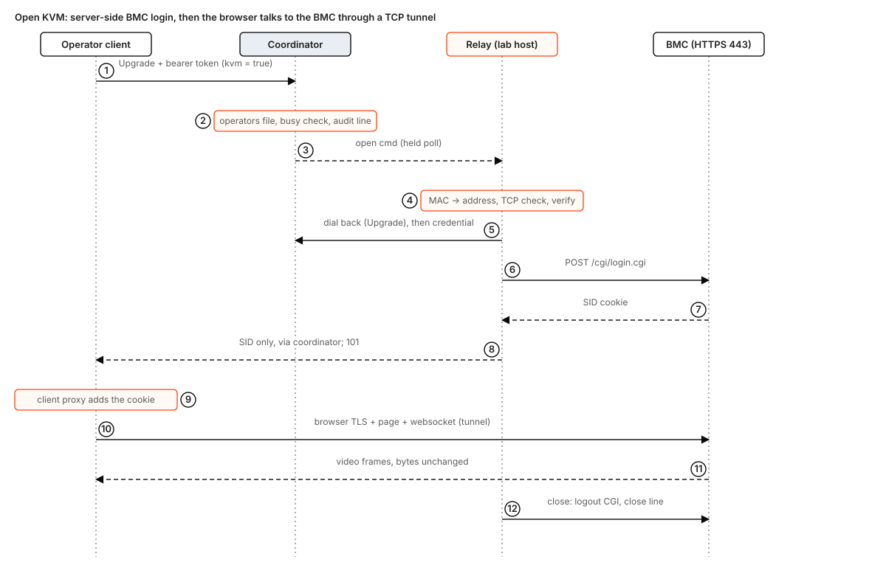

# hostkeeper console broker design

Status: design, for the maintainers' comments. Nothing in this document is built unless it is tagged **Built** with a path. It extends [hostkeeper-design.md](hostkeeper-design.md) section 12.1 ("power control through the BMC") and [network-install.md](network-install.md) section 10 ("BMC power and boot-device control"), and ties into [hostkeeper-mdm.md](hostkeeper-mdm.md) for the Macs.

How to read it: **Built** is code on `main` (with a path). **Designed** is this document's proposal. **Measured** is a fact read from the lab on 2026-11-10. **Inferred** is a figure derived from protocol structure or from numbers in this repository and not yet measured (task C0 measures them). **Unverified** is a claim taken from vendor documentation or a forum that no one has run against the lab's firmware. Test names are in code font and are **(to build, Cn)** unless they exist. The repository is public: this document uses `<bmc-ip>`, `<mac-ip>` and the documentation address ranges, never a lab address or host name.

## 1. Problem

A server that has stopped answering can only be fixed from its BMC, and a Mac that has lost its session can only be fixed from its screen. Today neither can be reached by an operator who is not standing in the lab.

The motivating incident: node-02 was force-rebooted, came back at the PXE menu, and needed its boot order changed. The BMCs sit on the lab LAN, not on the tailnet. Fixing it meant going to the lab, or logging in to some other machine on the LAN first and opening the BMC web UI from there.

The coordinator already knows which machine is which: each server's data MAC and BMC MAC are in its inventory record (**Built**: `crates/hostkeeper-coordinator/src/inventory.rs`, `Hosts.Get` and `Hosts.List`). It stores no address (section 4), and nothing in hostkeeper carries an interactive byte stream (section 4).

## 2. Goals and non-goals

Goals, in the owner's order:

1. From any machine on the tailnet, an operator opens, for a Linux server: the serial console (SOL), the BMC's HTML5 KVM and web UI, and power control; for a Mac: its screen through Screen Sharing (RFB, TCP 5900).
2. The guard is the coordinator: who may open a console is decided by the operator token and the console operators file (D12), and every open and every typed power action is one audit line. **What the audit does not see:** inside a KVM session the operator holds the shared BMC admin login and can power-cycle, mount media or change BMC users from the BMC's own page. Only the open and the close of a KVM session are audited. That is why KVM is a separate permission (D12).
3. Built fast: a first vertical slice (the Mac screen) in five pull requests, C1 to C5, after a no-code lab spike C0, with no new network device and no change to the daemon.

Decided by the owner and not reopened: **one shared BMC username and password for every BMC.** There is no rotation, no vault, no per-host secret. The Mac is reached with the Mac's own login; the broker holds no Mac credential.

Non-goals: Redfish (D7), a browser terminal or noVNC in the first build (D3), recording a session's content, Mac High Performance mode, waking a sleeping Mac, a shared operator machine (section 11), and holding the BMC off the tailnet by any means other than not routing it (section 11).

## 3. What an operator sees

```
hostkeeper console sol   node-02            # serial console in this terminal
hostkeeper console kvm   node-02            # opens the BMC's KVM in the browser
hostkeeper console mac   farm-mac-1         # opens Screen Sharing on this Mac
hostkeeper console power node-02 cycle --reason "stuck at PXE"
hostkeeper console bootdev node-02 disk --persistent --reason "fix boot order"
hostkeeper console list                     # open sessions: who, what, since
hostkeeper console close <session>
```

Before: go to the lab. After: the operator's own terminal and browser, over the tailnet, for one node or Mac by its host id. The BMC password is never shown. What does not change: the daemon, the update path, the operator token, `hkctl`, the tokens file and every existing listener. An operator who is not in the console operators file (D12) is refused; with no file, nobody has console access.

For the incident: `console bootdev node-02 disk --persistent` (one IPMI command, no screen), then `console power node-02 cycle`, then `console sol node-02` to watch it boot if the kernel prints to the serial port (section 5.1). A one-time `bootdev` would fix this boot only; the incident was a boot order that stayed wrong, so the persistent form is the fix.

## 4. State today

- **Operators.** One class: a named bearer token (**Built**: `crates/hostkeeper-coordinator/src/tokens.rs`, `OperatorTokens::name_of`). The private listener (`--private-listen`) is TLS server-auth only, reached over the tailnet. Authorization is the token name; there are no roles. `Caller` is `Operator | Ci | Anonymous` (`src/operator.rs`). `RawToken` in `tokens.rs` is `deny_unknown_fields`, so **a new key in the tokens file would be refused by the previous release**; the design leaves that file alone (D12).
- **Audit.** Every ops change is one `AuditEntry` (`seq, by, action, service?, node_id?, host_group?, reason?`) and one fsynced JSON line in `<ops-file>.audit` (**Built**: `src/ops.rs`, `src/audit_file.rs`). A line is the by-product of an `OpsStore` change: it takes its `seq` under the ops lock and lands in the ring that `/v1/status` shows. **There is no audit-only append** and no typed field for a session id or a kind. A change whose line cannot be appended is not made (`audit_unavailable`). `action` is a free string, so a new action name is additive. Nothing audited today is a read or a stream.
- **Daemon channel.** The daemon connects out, listens on no port, and speaks four unary RPCs; a heartbeat reply carries at most one order from a closed set of verbs (**Built**: `agent.proto`, `crates/hostkeeper-link/src/heartbeater.rs`, 15 s period). **No order can carry a command or a stream.** The daemon is root. Putting a byte relay in it would give the root process a listener or a long-lived stream, which its design excludes ([hostkeeper-design.md](hostkeeper-design.md) section 3).
- **Listeners.** `src/listen.rs` closes a connection `CLIENT_PATIENCE` (10 s) after the handshake unless it is a registered long wait (`Releases.WaitConverged`, `src/wait.rs`, at most `MAX_WAITS` held). `--lan-listen` is the precedent for an extra listener: one interface, a wildcard address refused, its own `Surface`.
- **Addresses.** **No IP address of a host or a BMC is stored.** `Claims.addresses` is the link-layer addresses read from `/sys/class/net/*/address`. The daemon reads the BMC MAC only (`DevIpmi` in `crates/hostkeeper-daemon/src/ipmi.rs`, parameter 5, channels 1 to 11); it does not read the BMC's IP (parameter 3). A Mac claims only its serial and platform UUID.
- **Records.** A host's `Host` message carries `data_macs` and `bmc_mac` only when exactly one inventory record matches it. The six lab nodes enrolled before records existed, so their `bmc_mac` is empty until the operator adds a record (`Enrollment.AddRecord`, leaving the role empty so no approval window opens, [enrollment.md](../operations/enrollment.md)). That is the bootstrap, task C0.
- **UI.** The static UI refuses `new WebSocket(`, other-origin URLs, inline scripts and tokens in the address (`crates/hostkeeper-ui-tests/src/scan.rs`), and sends `default-src 'self'`. A console page does not fit it as is.
- **MDM.** The gate is linked into the coordinator and talks to NanoHUB on loopback only (**Built**: `crates/hostkeeper-coordinator/src/mdm.rs`, `crates/hostkeeper-mdm-gate/src/command.rs`: `COMMAND_TYPES` has five types, pinned by `the_gate_enqueues_only_its_five_command_types`; `QUERIES` has three, pinned by `a_command_is_the_xml_plist_nanohub_takes`).
- **Lab (Measured, one node of six).** The board is a Supermicro X10 with BMC firmware 3.91, IPMI 2.0. The BMC takes a DHCP address on the same LAN as the host. `ipmitool lan print` lists RMCP+ cipher suites 1, 2, 3, 6, 7, 8, 11, 12: **suite 17 is not offered, suite 3 is.** SOL is enabled at 115.2 kbit/s, privilege OPERATOR. The kernel command line is `console=tty1 console=ttyS0`. The host's neighbour table holds the BMCs and hosts as MAC and address pairs, mostly STALE, and **one MAC maps to several addresses** (a host on two subnets). `/dev/ipmi0` works. The other five nodes, any Redfish endpoint, the BMC's HTTPS behaviour, the boot mode (UEFI or legacy) and the Mac's network are not measured.

## 5. What each device offers, and the constraints that follow

### 5.1 Serial over LAN

SOL is IPMI 2.0 RMCP+ on UDP 623. On this board it needs `-C 3` (HMAC-SHA1, AES-CBC-128); the cipher suite is a flag (`--console-ipmi-cipher`, default 3), not a constant, because suite 17 appears on later boards and some firmware turns suite 3 off (**Unverified**, vendor notes). The privilege level is a flag too (`--console-ipmi-privilege`, default ADMINISTRATOR, passed to `ipmitool -L`), because the shared user may hold less than the default and SOL itself needs only OPERATOR (Measured).

Facts the operator must know:

- **SOL shows boot output only if the kernel has `console=ttyS<n>`** on its command line, with `n` the port the BMC wires to SOL (board-specific). Nodes built by `hostkeeper-pxe` get it only when `--serial-console` was passed (**Built**: `hostkeeper-pxe-seed`). The six existing nodes were not installed that way; one of them has it (Measured).
- **The firmware's own screens (POST, the PXE menu, setup) appear on SOL only if the BIOS has console redirection enabled.** Not measured. For the incident, where the node sat at the PXE menu, KVM is the dependable screen; SOL is for the kernel and the login.
- **One SOL payload per BMC.** A holder outside the broker (someone running `ipmitool` in the lab) is BMC-side state the coordinator cannot see; the relay finds it as `bmc_sol_busy` (section 10).
- **A BMC allows few concurrent IPMI sessions** (about four on this class of board, **Unverified**). Every power command and every SOL uses one while it runs, and a dead relay leaves its session until the BMC times it out. The relay maps "no free slot" to `bmc_busy`.
- **`ipmitool` over pipes.** `sol activate` expects a terminal: its escape sequence (`~.`) is read in-band, and its stdout may be block-buffered when it is not a terminal. Whether a pipe is enough, with the escape character set by `-e` to a byte the client never sends, or a pty is needed (a crate; this workspace adds no `unsafe`, R2), is **Unverified** and decided in C0.

### 5.2 KVM and web UI

The X10 firmware 3.91 serves the ATEN HTML5 console on HTTPS with its own login (`/cgi/login.cgi` returning a `SID` cookie) and a secure websocket after it (**Unverified**: vendor documentation, forum reports). Reports say an HTTP-aware reverse proxy breaks it on some firmware and a TCP-level proxy does not. **Which ports and paths the console uses is not known**: 443 only, or also the iKVM and virtual-media ports (the ATEN iKVM historically uses separate TCP ports for them, **Unverified**). C0 finds out before D8 is final; the tunnel takes a list of target ports. The BMC allows one KVM viewer at a time, and a second viewer kicks the first (**Unverified**).

### 5.3 Power and boot device

IPMI `chassis power status|on|off|cycle|reset|soft` and `chassis bootdev pxe|disk|bios` need only RMCP+ and the same credential, so they work with the host down. Three facts shape the typed calls (D10): `bootdev` applies to the next boot only unless `options=persistent` is set; on a UEFI board `options=efiboot` is needed or the order may be ignored (the six nodes' boot mode is unmeasured, C0); and `chassis power cycle` is ignored by some BMCs when the host is already off, so the relay reads `status` first and sends `on` to an off host.

### 5.4 Mac screen

Screen Sharing is RFB on TCP 5900. Auth runs inside the stream (Apple's types, including the ARD Diffie-Hellman type), so a TCP relay that reads nothing carries it unchanged (**Unverified** end to end, task C0). Four limits:

- **Black screen.** Enabled from the command line, Screen Sharing gives **a black screen until someone approves at the Mac, or MDM enables it** (**Measured** on the farm Mac, macOS 27; Apple stopped letting `kickstart` enable it from 12.1). The broker cannot fix a black screen.
- **Approval prompt.** On a Mac with a console user logged in, Screen Sharing may still ask that user to approve the connection even when the service is enabled by MDM; enabling the service does not approve a connection (**Unverified**; C0 tests a Mac with a logged-in user and one at the login window).
- **Viewer.** `vnc://` opens the system viewer on a Mac operator machine only. On Linux or Windows the client prints the local address and the operator runs a VNC client that supports Apple's auth (**Unverified** which).
- **High Performance mode** may use a different transport. It is out of scope and the client does not claim it.

A sleeping Mac does not answer on 5900. The broker does not wake it (section 10).

## 6. Decisions

| # | Question | Decision | Why |
|---|---|---|---|
| D1 | Where does the relay run? | A new unprivileged binary, `hostkeeper-console-relay`, run on a lab-LAN host as its own system user (hostkeeper delivers it as a package, like any service). It **dials out** to the coordinator. Not in the daemon, not a subnet router. It must be on the same L2 segment as the BMCs (section 8). | The daemon is root, listens on nothing and carries no stream (section 4); adding that is the largest change to its trust. A subnet router makes every BMC reachable by any tailnet member with the shared password, with no coordinator check and no audit: it defeats the owner's guard. A relay needs no inbound port on the lab host and no new device. `hostkeeper-pxe` is the precedent for an operator-run LAN-side process. A down node (node-02) has no daemon, so the BMC path cannot depend on one. |
| D2 | How does the coordinator reach the relay, and how is a relay trusted? | The relay holds one long poll open to the coordinator (`/console/v1/relay/wait`, at most 25 s, then re-issued); an open command is the reply and carries the session id (256 random bits), the kind and the MACs, **never the credential**. The relay dials back `/console/v1/relay/<session>` (HTTP/1.1 `Upgrade: hostkeeper-console/1`) with its relay token. The coordinator accepts the dial-back only from **the relay name the command was sent to**, and only once per session; then it sends the credential as the first frame on that stream, and splices it to the operator's connection. | The pull idiom delivers a command at once, not at the next 15 s heartbeat. Binding the session to one relay and sending the secret only after attach means a stolen relay token cannot claim another relay's session and a poll reply never holds the password. The coordinator picks exactly one relay before sending (not the first to answer). No WebSocket crate in the first build. Needs a console listener (D3) because `listen.rs` closes ordinary connections after `CLIENT_PATIENCE`. |
| D3 | How does the operator connect? | A CLI first. `hostkeeper console sol|kvm|mac <host>` dials `--console-listen` and sends the operator **bearer token on the `Upgrade` request itself**. The coordinator authorizes, finds the host, writes the audit line, commands the relay, and answers `101 Switching Protocols` only when the relay has the device (an error status before that). The client serves the stream on `127.0.0.1:<port>` (SOL needs no port; it uses the terminal). The web page comes later (C10), with one-time tickets, because a browser WebSocket cannot send `Authorization`, the UI scan refuses `new WebSocket(`, and the UI's CSP is `default-src 'self'`. | A CLI can send the header, so tickets (mint, redeem, expiry, a table, tests, and one more round trip per open) are machinery for a client that does not exist yet (B20, R9). The verbs: `sol`, `kvm`, `mac`, `power`, `bootdev`, `list`, `close`; the last four are unary RPCs on the private listener. |
| D4 | Session lifetime and audit | Idle 30 min, total 8 h, both flags. Open is one audit line written **before** the relay is commanded; no line, no session (`audit_unavailable`). Close is one best-effort line (cannot refuse a close). Refusals after the token is known are one best-effort `console_denied` line with the cause. New actions: `console_open`, `console_close`, `console_denied`, `power_action`, `boot_device_set`, `console_coordinator_start`. Session id, kind, peer address, duration and bytes go into `reason` (capped at 256 bytes; operator text is untrusted). | C1 adds an **audit-only append** to `audit_file.rs`: a numbered line that changes no ops state and does not enter the `/v1/status` ring, so a burst of console lines cannot push ops changes out of it. Typed fields for session and kind are a later additive change. See section 10 for exactly what is and is not audited. |
| D5 | Where is the one BMC credential? | `--console-bmc-credential-file` on the coordinator: a secret file read by `hostkeeper_wire::secret::read_secret`, mode 0600/0400 (as `--mdm-api-key-file`). It is sent only on the dial-back stream (D2), over TLS, held in the relay's memory for that session, and never logged. The operator never receives it. The credential is a newtype with a redacting `Debug` and no `Display` or `Serialize`; the relay runs as its own user with `LimitCORE=0` in its unit. | The owner's decision. A flag naming a file satisfies S1 and S2. Sending it per open keeps it off the relay host's disk. Section 11 states what the relay host can read. |
| D6 | SOL and power through | `ipmitool -I lanplus -C <cipher> -L <privilege> -N <timeout> -R <retries>` run as a child of the relay, the password given with `-E` (environment variable `IPMI_PASSWORD`), never `-P` (argv). Timeout and retries are flags (`--console-ipmi-timeout-s` default 1, `--console-ipmi-retries` default 2) so the worst case in section 9 is a sum, not a guess. A native RMCP+ client is later (C12). | The workspace pins `ipmi-rs` to its device-file connection only and leaves out its RMCP+ client (root `Cargo.toml`, MD5). A native client is weeks; `ipmitool` is days and was measured working on the lab. The environment of a child is readable through `/proc/<pid>/environ` by the same user and root, so the relay's user runs nothing else (section 11). The relay maps the tool's result to a closed error enum and **never echoes its stderr** (it contains the user name). The spawn is behind a port with a scripted double, as `Ipmi` is in `hostkeeper-enroll`. |
| D7 | SOL vs Redfish | IPMI. No Redfish. | IPMI covers serial, power and boot device, and is measured on the lab. Redfish on this firmware is a separate download and unconfirmed (**Unverified**), and the broker needs nothing it adds. |
| D8 | KVM | A TCP tunnel to `<bmc-ip>:<port>` for each port C0 finds (443 at least), with no HTTP rewriting, and a **server-side login**: the relay posts the credential to `/cgi/login.cgi` itself and returns only the `SID`. **Default (if C0 shows it works):** the client runs a small local proxy that adds `Cookie: SID=...` to the requests it forwards, so the browser never holds the SID. **Fallback:** a one-shot plain-HTTP page on the loopback sets the cookie and redirects to the tunnel. The local port for a host is stable (derived from the host id), so the browser's self-signed-certificate warning is once per host, not once per open. On any close (operator, idle, total, `console close`, token revocation, `relay_lost`) the relay logs the SID out (the BMC's logout CGI); the SID is a bearer credential until then. | The operator never sees the password. A `SID` that dies at close is bounded; a password is not. On the fallback path cookies are not isolated by port, so any other local service on that loopback host sees the SID, and two tunnels share one cookie name; the proxy default avoids both. **Unverified:** cookie names, `Secure`, Origin and Host checks, the logout CGI, the ports. All in C0. |
| D9 | Mac screen | A plain TCP relay to `<mac-ip>:5900`. The relay reads nothing from the stream: a successful TCP connect is the check, and the stream is spliced from its first byte. The Mac's own login authenticates. The client serves `127.0.0.1:<port>`, accepts **one** connection and closes the listener, and on a Mac operator machine opens `vnc://127.0.0.1:<port>`. | RFB authenticates inside the stream. No credential in the broker. A relay that consumed the banner would break the stream. A browser client is not planned: noVNC's support for Apple's auth types is unconfirmed. |
| D10 | Power actions | Typed RPCs, not a console: `Console/Power{host, action, reason}` and `Console/SetBootDevice{host, device, efi, persistent, reason}`. `action` is a closed enum (status, on, off, cycle, reset, soft); `device` is pxe, disk or bios. `off`, `cycle`, `reset` and any `persistent` change need a `reason`. `cycle` on an off host becomes `on`. | Each is one audit line with the actor, host and action. The audit line and the required reason are the review of an accident; no live-host refusal is added (the owner's guard is the coordinator and its audit, and a flag the same operator sets would not be a check). A second confirmation is Q3. |
| D11 | Locating a device | By MAC, section 8, on every open, with no cache. | The owner's decision; the MAC is the stable key and the address is derived. The kernel's neighbour table already is the cache, and the device check catches a stale hit. |
| D12 | Who may open a console | A new file, `--console-operators-file` (TOML, reloaded with the tokens): one `[[operator]]` per token name, `name` and `kvm` (default false). Absent file or absent name means no console. `kvm = true` is required for the BMC web UI. The tokens file is not changed. | A key in `[[token]]` is refused by the previous release (`deny_unknown_fields`, section 4), which breaks rollback (B8). A new file is read only by the new release, and the default is nobody. KVM is split off because it can do what the typed audit cannot see (goal 2): a power-only operator should not hold the BMC admin page. |
| D13 | Two operators on one device | One SOL session and one KVM session per host, held by the coordinator. A second open is refused `console_busy`, naming the holder's token name and start time. The operator runs `console close <session>` (audited as `console_close` with the closer's name) and opens again. No takeover flag. | BMCs allow one SOL payload and one KVM viewer; deciding in the coordinator is predictable and audited, and `close` already exists. A holder the coordinator cannot see is `bmc_sol_busy` (section 10). Read-only observers are later. |

## 7. Components


The orange dashed box is exactly what hostkeeper runs: the client verb on the operator's machine, the coordinator's console module, and the relay. Outside it: the tools that are not hostkeeper (`ipmitool`, the browser, the Screen Sharing viewer), the BMC, the Mac, and NanoHUB.

New code, all designed:

- **`crates/hostkeeper-console`** (library): the session table, the one-session-per-host rule, idle and total timers, the closed error enum, the credential newtype, the frame types between client, coordinator and relay. Pure; time comes from an injected clock.
- **Coordinator, `src/console/`** (a directory, because `service.rs`, `config.rs` and `operator.rs` are each near 1000 lines): `Console/*` operator RPCs (`console.proto`, a new file: `Power`, `SetBootDevice`, `List`, `Close`), the operators file, the console listener (`--console-listen`: one interface, which is the tailnet one; a wildcard refused; TLS server-auth with the private listener's certificate), the relay long poll and the splice. Limits: `--console-max-sessions` default 8, `--console-max-relays` default 4, `--console-preauth-max` default 16 connections that have not yet authenticated, `--console-header-deadline-s` default 5, header size at most 8 KiB.
- **`hostkeeper-console-relay`** (binary, forwards to a library): relay token file, the resolver (section 8), the ipmitool port, the SID login and logout, TCP dials, a state file in a tmpfs it owns (sessions it holds at the BMC, for crash cleanup).
- **`hostkeeper console`** (a verb of the existing `hostkeeper` binary, `crates/hostkeeper`): the client. `hkctl` is a bash and curl script generated from the command table and cannot carry a stream; it gets `console power`, `bootdev`, `list` and `close` for free from the proto.

Relay authentication: `--console-relay-tokens-file`, the same hashed-token TOML as `tokens.rs`, one name per relay; a relay token opens nothing else, and an operator token cannot act as a relay. The relay passes its own `--host-id` so the coordinator can avoid it as the relay for its own host (section 10). The splice is a bounded-buffer copy in both directions that stops reading one side while the other side's write is blocked, so a slow operator on a KVM stream cannot grow memory. A relay is gone when its poll socket closes, not on a timer.

## 8. Finding a device by MAC

The coordinator gives the one relay it chose the MACs (the BMC MAC for SOL, KVM and power; the data MACs for a Mac) and the relay returns an address. A relay whose `--host-id` is the target is not chosen; if it reports `device_not_found`, the coordinator tries the next relay once.

1. **Neighbour table.** The relay reads `/proc/net/arp` (no tool, no `unsafe`, no root). A complete entry for the MAC is a candidate. Cost: one file read.
2. **Several addresses for one MAC** (Measured: a host on two subnets). The relay checks each candidate against the device: for a BMC, an RMCP presence ping (ASF, UDP 623, 12 bytes); for KVM, a TCP connect to the console port; for a Mac, a TCP connect to 5900. The first that answers wins.
3. **Probe on a miss, once.** The relay sends a one-byte UDP datagram to each address of its scan range so the kernel resolves each by ARP, waits `--console-probe-ms` (default 1000), reads the table again and repeats step 2. The range is `--console-scan-cidr` (repeatable, **prefix at least /24**, so at most 254 datagrams per range and well under the kernel's neighbour-table threshold of 1024), sent at most `--console-probe-pps` (default 250) per second. No raw socket. Two misses: `device_not_found`.
4. **Verify after connect.** After the device side is connected, the relay reads the table again; the entry for the chosen address must still carry the requested MAC, and if it changes during the session the relay closes it `address_changed`. A presence ping proves something at that address answers, not whose MAC it is; this check is what ties the address to the MAC.

There is no cache: the table is the cache, and step 2 catches a stale hit. The BMC's address is DHCP-assigned (Measured), so it can change; only the MAC is stored. The relay sees only its own L2 segments; a BMC on another VLAN is `device_not_found`, and the lab runbook says so. A BMC in shared-NIC mode answers on the host's NIC and may not be reachable from that same host (section 10).

**Macs.** A Mac is found by its inventory data MAC in the same way, which assumes the Mac is on the lab LAN and that the MAC in the record is the one the relay sees. Neither is measured: Wi-Fi with Private Wi-Fi Address on presents another MAC, so use the Ethernet MAC. **If the Mac is on the tailnet**, the relay dials its tailnet name instead and the resolver is skipped for Macs; the coordinator still does the authorization, the audit and the splice, and the broker adds only audit. C0 asks which of the two the farm Mac is on, and which interface and MAC it uses; Q2 repeats it. The Mac's MAC enters the record by the operator now (a Mac still matches enrollment by serial, **unverified** that an added data MAC does not change that match, task C5) and from MDM later (section 12).

## 9. Operations

Common to all four: the coordinator checks the token and the operators file, finds the host with `Hosts.Get`, takes the one-session-per-host slot, writes the audit line, picks one relay and sends the command (D2). Hops are numbered in the diagrams. Every budget is a sum of named terms; the values below are **Inferred** until C0 measures them, and C0 produces T and L.

Terms. **T**: a tailnet round trip, operator to coordinator. **L**: a lab LAN round trip, relay to device. **F**: one audit fsync. **B**: a BMC's service time per IPMI exchange (Inferred 0.1 to 0.3 s on an X10). **P**: a probe, at most `--console-probe-ms` plus datagrams at the pps cap, about 1.3 s with the defaults; zero on a table hit. **N**: one lost IPMI packet, the `-N` timeout, 1 s by default (`-R 2` allows two). **C**: a TCP plus TLS handshake, 2 round trips. A new connection to the coordinator costs `C = 2T`; the request is half a round trip each way.

Common prefix to the first device contact: client connect and request `2T + 0.5T`, `F`, the poll reply `0.5T`, `P`, the relay's dial-back and attach `2T + 0.5T`, so **`5.5T + F + P`**.

### 9.1 Open SOL


Serial hops: (1) the prefix `5.5T + F + P`; (2) the `ipmitool` RMCP+ session, about 8 exchanges (capabilities, open session, RAKP 1 to 4, set privilege, then `sol activate`), each `L + B`: **`8(L + B)`**, Inferred 1 to 3 s; (3) the `101` and the first byte: the client sends a carriage return and the prompt is the first byte, `T` for the round trip through the splice. **Total: `6.5T + F + P + 8(L + B)`.** With T = 30 ms, F = 10 ms, L = 1 ms, B = 0.25 s: 0.2 + 0.01 + 2.0 = **about 2.2 s on a table hit, 3.5 s with a probe**. Worst case, one lost packet in the setup: `+ N` (1 s). Throughput is 115.2 kbit/s at the BMC; the relay adds no buffering beyond one frame, but `ipmitool`'s own output buffering over a pipe is **Unverified** (C0).

### 9.2 Open KVM



Hops: (1) the prefix `5.5T + F + P`; (2) the relay's TCP and TLS to `<bmc-ip>:443` and `POST /cgi/login.cgi`: `C_l + B_login`, where `C_l` is 2L and `B_login` on an X10 is **Inferred 1 to 5 s** (a slow CPU; reports of several seconds); (3) the client starts the proxy and the browser opens, local; (4) the browser's TLS to the BMC through the tunnel `2(T + L)`, the page load (**Inferred 3 to 10 s** on this class of BMC), then the websocket upgrade `T + L`; (5) the first frame. **Total: `5.5T + F + P + B_login + 3(T + L) + page`**, Inferred 6 to 16 s, dominated by the BMC's login and page load. Video is a few Mbit/s and crosses the coordinator in both directions.

### 9.3 Power action and boot device


No stream; the RPC answers when the relay has the result. Hops: (1) `Console/Power` on a new connection `2.5T`; (2) the audit line `F`; (3) the poll reply `0.5T`; (4) `P`; (5) the dial-back and attach `2.5T`; (6) `ipmitool`: `status` first for `cycle` (the off-host rule, D10), then the command, about 9 exchanges `9(L + B)`; (7) the result returns `T`. **Total: `6.5T + F + P + 9(L + B)`**, about 2.5 s on a hit, 3.8 s with a probe. A `cycle` answers when the BMC accepted it; the BMC's own few seconds to acknowledge a power change are inside B for that exchange. The answer is the BMC's acknowledgement, not the host's state: the operator watches `Hosts.Get` `live` come back. Worst case: `+ N`.

### 9.4 Open a Mac screen


Hops: (1) the prefix `5.5T + F + P`; (2) the relay's TCP connect to `<mac-ip>:5900`, `L` (a refusal is `mac_screen_sharing_off`; a timeout after `--console-connect-timeout-s`, default 5, is `mac_unreachable_or_asleep`); (3) the `101`, then the viewer's RFB runs end to end through the splice: the version exchange, the Mac's auth (Apple's type; the Diffie-Hellman exchange adds two round trips, each `T + L`), then the first framebuffer update. **To the login prompt: `5.5T + F + P + L + 4(T + L)`**, about 0.4 s on a table hit with the example values. The first frame after login is the Mac's and the viewer's, to measure (C0). Added latency per input event: the one-way client-to-coordinator plus coordinator-to-relay times.

## 10. Failure modes and edge cases

**What is audited.** Every refusal after the token is known and the caller is in the operators file is a best-effort `console_denied` line with its cause (`busy`, `no_relay`, `no_bmc_mac`, `no_mac`, `ambiguous_record`, `device_not_found`, `kvm_not_permitted`); `console_open` is the one line that must be written before anything happens. Not audited: a token that does not exist, a malformed request or a connection that never authenticates (logged as a rate-limited line only), `Console/List` (a read). `Console/Close` is audited with the closer's name. A power action refused for `no_relay_other_than_target` is a `console_denied` line, not a `power_action` line: "every typed power action is one audit line" means every action that was sent.

| Case | Mechanism |
|---|---|
| BMC unreachable (powered off, cable, wrong subnet, other VLAN) | Section 8 fails after one probe: `device_not_found`, `P` plus the checks. The `console_open` line is already written; the close line says `device_not_found`. |
| MAC moved or DHCP address changed | The table has the new address; a stale one fails its device check (section 8 step 2); one probe re-resolves; a second failure is `device_not_found`. |
| One MAC maps to several addresses | The device check picks the one that answers on the right port; the MAC is verified after connect. |
| Rogue device claims the BMC's IP or MAC on the lab LAN | The verify-after-connect check rejects an address whose MAC differs. A device that claims both receives the shared password; the lab LAN is trusted (section 11). |
| Host id unknown; host has no `bmc_mac`; a Mac has no data MAC | `host_not_found`, `no_bmc_mac`, `no_mac`, each a closed error naming the fix (add the inventory record). |
| More than one inventory record matches the host | `Host` carries no MACs in that case (section 4), so the broker says `ambiguous_record` and names it. |
| No relay connected | `no_relay`. A relay is present while its poll socket is open (D2); one that has closed it is not picked. |
| Relay host is the target (power cycle of the host that runs the only relay) | The coordinator never picks a relay for its own `--host-id`; with a second relay, that one serves. With only one, `Console/Power` is refused `no_relay_other_than_target`. A relay cycled by a second relay loses its sessions: its poll stops, the coordinator closes its sessions `relay_lost` and writes their close lines. |
| Relay crashes or restarts mid-SOL or mid-KVM | The BMC keeps the SOL payload and the SID until its own timeout. On start the relay reads its tmpfs state file and runs `sol deactivate` and the KVM logout for each session it held. If the state file is gone (the relay's host rebooted), the next open sees `bmc_sol_busy` until the BMC times out, or the operator uses KVM. |
| SOL held at the BMC by someone outside the broker | `sol activate` reports it; the relay returns `bmc_sol_busy`. The broker does not deactivate a session it did not start, so as not to disconnect a person; the holder ends it, or the operator uses KVM. |
| BMC has no free session slot | `bmc_busy`; the audit line says so. A burst of power commands is serialized per BMC by the relay (one IPMI session per BMC at a time). |
| Two operators on one SOL or one KVM | D13: `console_busy`; `console close <session>`, then open. |
| A host reaching its own BMC through a shared NIC | Many BMCs cannot be reached from their own host. The relay is never the target host (above); the lab's NIC mode is unmeasured (C0). |
| SOL shows nothing | No `console=ttyS` on the kernel, or BIOS redirection off (section 5.1). Not detectable by the broker; the doc says so and the audit shows the session opened. KVM is the screen. |
| Wrong shared credential | `ipmitool` or the login fails; the relay maps it to `bmc_auth_failed` and returns no text from the tool. A fix is the coordinator's credential file and a reload (`--tls-reload-secs`, as tokens). |
| Credential leak into logs or errors | The credential is only in the child's environment, the login request body and the dial-back's first frame. The relay's HTTP client logs no request bodies or TLS stream. A test formats every wire struct that can carry it and asserts the output has no credential (the newtype redacts); a wrong-password test asserts the whole message by exact equality (T13). |
| Operator token revoked mid-session | The coordinator re-reads tokens and the operators file every `--tls-reload-secs` and closes that name's sessions `token_revoked`; the relay logs the BMC session out. |
| Operator disconnects | The splice ends, the relay closes the device side (`sol deactivate`, the KVM logout), the close line is written. |
| Terminal state after `sol` | The client restores the tty on every exit path (normal, error, signal), forwards Ctrl-C to the remote console, and handles its own escape (`Enter ~ .`) locally; the escape character of `ipmitool` is not reachable from the keyboard. |
| Local port reachable by another local user | SOL has none. The Mac listener accepts one connection and closes. The KVM proxy port is open to local users for the session; a shared operator machine is out of scope (section 11). |
| Console listener flooded | A connection that has not authenticated is closed after `--console-header-deadline-s`; headers over 8 KiB are refused; unauthenticated connections are capped at `--console-preauth-max` and do not count against `--console-max-sessions`, which counts only after the token is accepted. |
| Audit unavailable | No audit line, no session or power action (`audit_unavailable`); a close is still attempted. |
| Coordinator restart | All sessions end; relays re-poll at once and run their cleanup (above). On start the coordinator writes `console_coordinator_start`; any `console_open` before it with no `console_close` ended there, and its duration is unknown. No second coordinator exists (no HA). |
| Mac screen black | Screen Sharing enabled but not approved. The cause is outside the broker; section 12 removes it for MDM-managed Macs. The approval prompt (section 5.4) can remain. |
| Mac port closed | `mac_screen_sharing_off` (connection refused); the operator enables it at the Mac or by MDM. |
| Mac asleep or off the network | A connect timeout is `mac_unreachable_or_asleep`. Waking is out of scope; Wake-on-LAN or MDM are later. |

## 11. Threat model

[hostkeeper-design.md](hostkeeper-design.md) section 5.1 already says a compromised coordinator is root on any host through signed packages. This adds rows to "what a compromise gets":

- **A compromised coordinator:** raw BMC power, KVM and every Mac's screen (the Mac's login still stands), and the shared BMC password.
- **A compromised relay host, or a stolen relay token:** the shared BMC password for every BMC for each session that relay is sent, and any command sent to that relay. A stolen token cannot claim another relay's session (D2 binds a session to its relay and one attach) and cannot read the password from a poll reply, but it can ask for a session of its own only if the coordinator sends it one. The relay's user runs nothing else, so the password in a child's environment is readable only by root and that user.
- **A stolen operator token in the operators file:** the same consoles, and the audit shows its name. With `kvm = true`, the BMC admin page, whose actions the audit cannot see (goal 2).
- **Anyone on the lab LAN:** the IPMI 2.0 RAKP exchange lets a party who captures a handshake guess the password offline, and one shared password makes that one password for every BMC. The lab LAN is therefore trusted, and the shared password must be long and random. The same holds for a device that answers ARP for a BMC's address. The design pins no certificate or per-host key; the owner decided there are no per-host secrets, and verify-after-connect (section 8) ties the address to the MAC.

The guard is the coordinator, per the owner. A per-host or rotating secret would change none of the first row for an attacker who owns the coordinator, which is why the design does not add one. Keeping the BMCs off the tailnet is what makes the guard real: do not advertise the lab subnet as a tailnet route. Supermicro's iKVM has had weak launch tokens (a 2026 CVE report, **Unverified**), another reason the BMC is reached only through the relay. The operator's machine is trusted: the KVM proxy port and the SID in the browser (fallback path) are visible to other local users, so a shared operator machine is out of scope.

## 12. How it fits MDM

The Macs join MDM ([hostkeeper-mdm.md](hostkeeper-mdm.md)), on Path B for the farm's existing Macs. Section 6 of that document already lists Remote Desktop as "yes" under A and B1 and "only if supervised" under B2. The design adds:

1. **`EnableRemoteDesktop`** (Apple's `remotedesktop.enable`; the exact command name is **Unverified**, read from Apple's MDM reference first) as a sixth entry of `COMMAND_TYPES` in `crates/hostkeeper-mdm-gate/src/command.rs`, and an update of `the_gate_enqueues_only_its_five_command_types` (renamed for six). The gate sends it only to a Mac that `IsSupervised` reports supervised (**Built** check in `answer.rs`). With it, Screen Sharing works with no click and the black screen goes away; the approval prompt of section 5.4 may remain. What the command sets, and whether it covers every local user, is **Unverified**.
2. **Opening a Mac screen on an MDM-managed Mac** that has not been enabled enqueues `EnableRemoteDesktop` once (idempotent, one audit line `mdm_enable_remote_desktop`), then proceeds. Until the Macs are in MDM, the operator approves at the Mac once.
3. **The Mac's MAC** from `DeviceInformation`: `EthernetMACs` first, `WiFiMAC` second (section 8), instead of the operator typing it. Both are additions to `QUERIES` (`[&str; 3]` in `command.rs`, exported by `lib.rs`), pinned by an assertion and the plist constant in `a_command_is_the_xml_plist_nanohub_takes` (`crates/hostkeeper-mdm-gate/tests/events.rs`); C11 updates both.
4. **Where the coordinator runs.** The gate talks to NanoHUB on loopback only (`--mdm-api-url`), and "a coordinator elsewhere is a later change" ([hostkeeper-mdm.md](hostkeeper-mdm.md) section 3). The farm's coordinator is on the dev box. Items 1 to 3 therefore need either the coordinator and NanoHUB on one host, or the loopback rule replaced by an authenticated remote API URL. Q1.

The openable Macs are the hosts with platform Mac; nothing new is stored.

## 13. Tests, per piece

Hermetic and deterministic (T12): no network, no real BMC or Mac, no fixed ports, no sleeps (T10). Timers use an injected clock; the latency budgets in section 9 are design figures, **not tests**, and are measured once by hand in C0. All names **(to build)**.

- **`hostkeeper-console`** (C2): `a_second_sol_open_is_busy_and_names_the_holder`, `a_second_kvm_open_is_busy_and_names_the_holder`, `idle_and_total_timers_close_a_session`, `no_wire_struct_formats_the_credential`, `an_error_message_never_contains_the_credential` (exact equality).
- **Operators file and audit** (C1): `a_name_not_in_the_operators_file_is_refused`, `no_operators_file_means_nobody`, `kvm_needs_the_kvm_flag`, `console_open_is_not_made_when_the_audit_line_cannot_be_appended`, `an_audit_only_line_takes_the_next_seq_and_stays_out_of_the_status_ring`, `a_reason_over_the_cap_is_cut`. B8: the tokens file is not changed, so `the_previous_release_still_reads_the_tokens_file` is the existing tokens test unchanged; `console.proto` is a new file and the compat baseline is updated additively.
- **Listener and splice** (C3): over an in-memory transport with a scripted relay: `a_held_poll_is_not_closed_at_the_patience`, `bytes_cross_the_splice_both_ways_unchanged`, `a_relay_token_cannot_attach_as_an_operator_and_conversely`, `a_dial_back_from_another_relay_is_refused`, `a_second_attach_to_a_session_is_refused`, `the_credential_is_sent_only_after_attach`, `a_lost_relay_closes_its_sessions`, `the_session_cap_counts_after_authentication`, `a_slow_header_is_closed_at_the_deadline`, `an_oversized_header_is_refused`, `reads_pause_while_the_write_side_blocks`, `a_coordinator_start_line_ends_open_sessions`, `a_denied_open_writes_a_denied_line_with_its_cause`.
- **Client** (C4): `the_bearer_goes_on_the_upgrade_request`, `the_tty_is_restored_on_every_exit_path`, `the_local_mac_listener_accepts_one_connection`.
- **Resolver** (C5): `a_complete_arp_entry_resolves`, `a_miss_probes_once_then_reads_again`, `several_addresses_pick_the_one_that_answers`, `a_changed_mac_after_connect_closes_the_session`, `a_prefix_shorter_than_24_is_refused`, `the_probe_is_rate_limited` (fake table and fake clock).
- **ipmitool port** (C6, C7): a scripted double returns each outcome: `power_cycle_builds_exactly_the_typed_command`, `cycle_on_an_off_host_sends_on`, `bootdev_persistent_and_efi_build_their_options`, `a_wrong_password_maps_to_bmc_auth_failed_without_the_tools_text`, `the_credential_is_in_the_childs_environment_and_not_in_argv`, `sol_deactivates_when_the_operator_disconnects`, `a_foreign_sol_holder_is_bmc_sol_busy_and_is_not_deactivated`, `a_restarted_relay_deactivates_the_sessions_in_its_state_file`.
- **KVM** (C8): against a fake BMC web server: `the_login_returns_only_the_sid`, `the_proxy_adds_the_cookie_and_nothing_else`, `tunnel_bytes_are_not_rewritten`, `the_sid_is_logged_out_on_every_close_cause`.
- **Mac** (C5): against a fake RFB peer: `the_stream_is_spliced_from_the_first_byte_unread`, `a_refused_connection_is_mac_screen_sharing_off`, `a_connect_timeout_is_mac_unreachable_or_asleep`.
- **Gate** (C11): `the_gate_enqueues_only_its_six_command_types`, `remote_desktop_is_sent_only_to_a_supervised_mac`, and the pinned `QUERIES` assertion and plist updated in `a_command_is_the_xml_plist_nanohub_takes`.
- **Coverage.** Each touched crate at 99% lines and branches (T1, T3, T4); the relay's `main.rs` only forwards to its library. The real `ipmitool` and the real BMC are never run by a test.

## 14. Tasks, one pull request each, in order

Interfaces land before the code that uses them (P7). Sizes: S under a day, M one to three days, L three to five. The first slice, the Mac screen, is C1 to C5: five pull requests.

| # | Task | Size | Needs |
|---|---|---|---|
| C0 | Lab spike, no code merged: add inventory records for the six nodes; measure T and L and every **Inferred** figure here; on a node other than the target run `ipmitool` SOL and power and check pipes against a pty, escape handling and output buffering; walk the KVM login, the cookie and the proxy by hand, find the ports and paths the HTML5 console uses and the logout CGI; check BIOS redirection, UEFI or legacy boot mode, and the shared-NIC question; is the farm Mac on the lab LAN, the tailnet or both, which interface and MAC, with a console user logged in and at the login window; connect Screen Sharing through a plain TCP forward. Results go into this document. | S | none |
| C1 | `console.proto` (`Power`, `SetBootDevice`, `List`, `Close`), the operators file, the audit-only append to `audit_file.rs` with its tests, the audit action names. Additive; compat baseline updated. | M | none |
| C2 | `hostkeeper-console` crate: session table, one-per-host rule, timers, error enum, credential newtype, with fakes. Adds its row to the README crate table. | M | C1 |
| C3 | Coordinator console listener, relay long poll, relay binding and splice, relay tokens, limits; a scripted relay in tests. | L | C1, C2 |
| C4 | `hostkeeper console` client: bearer on the upgrade, attach, local port, tty handling. | M | C3 |
| C5 | `hostkeeper-console-relay` with the resolver and the Mac/TCP target. Adds its row to the README crate table. **First vertical slice: a Mac's screen works end to end.** | M | C3, C4 |
| C6 | Relay ipmitool port: `Power` and `SetBootDevice`. Fixes the incident. | M | C5 |
| C7 | SOL, with relay crash cleanup. | M | C6 |
| C8 | KVM tunnel, server-side login and logout, the client proxy. | M | C5, C0 |
| C9 | `docs/operations/console.md`; the relay's package and unit (`LimitCORE=0`, own user). | S | C7, C8 |
| C10 | Web page: a console route outside `ui/`, its own static root, scan and CSP, a ws crate, and the one-time ticket for browsers. Only if wanted after C4 is in use. | L | C4 |
| C11 | MDM: `EnableRemoteDesktop`, `EthernetMACs` and `WiFiMAC` (both the `QUERIES` constant and the command-type constant, with their pinned tests), the auto-enable on a Mac open. After the Macs are in MDM. | M | C5, Q1 |
| C12 | Native RMCP+ SOL and power in place of `ipmitool`. Only if the tool becomes a burden. | L | C7 |

Stale text to fix in the same pull request as C6 (T19, P10): [hostkeeper-design.md](hostkeeper-design.md) sections 5.7 ("The BMC MAC's later use") and 12.1 (the BMC bullet), and [network-install.md](network-install.md) section 10 (BMC power and boot-device control), each pointing here.

## 15. Questions for the maintainers

- **Q1.** The coordinator is on the dev box and NanoHUB's API is loopback-only. For section 12, do we put the coordinator and the MDM host together, or replace the loopback rule with an authenticated remote URL? Section 12 items 1 to 3 wait on the answer; C1 to C10 do not.
- **Q2.** Which lab host runs the relay, and which is the second? Two are needed for section 10's "relay host is the target"; each must be on the BMCs' L2 segment. Does the dev box have an interface on the lab LAN (not verified)? Is the farm Mac on the lab LAN, the tailnet, or both (section 8)?
- **Q3.** Is the operators file enough, with `kvm` split off, or does `off`, `cycle` and `reset` need a second operator's confirmation? The design assumes enough; the audit line and the required reason are the check, and KVM remains outside the typed audit unless `kvm = false`.
