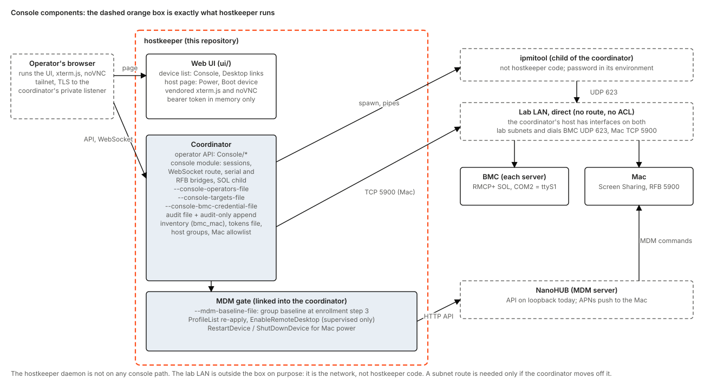
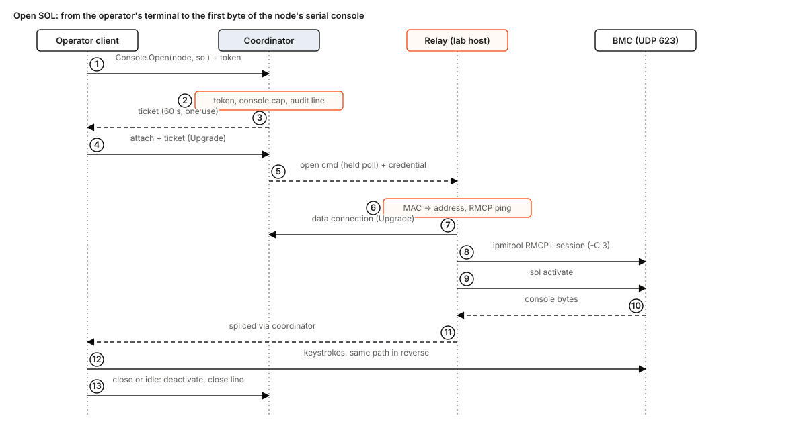
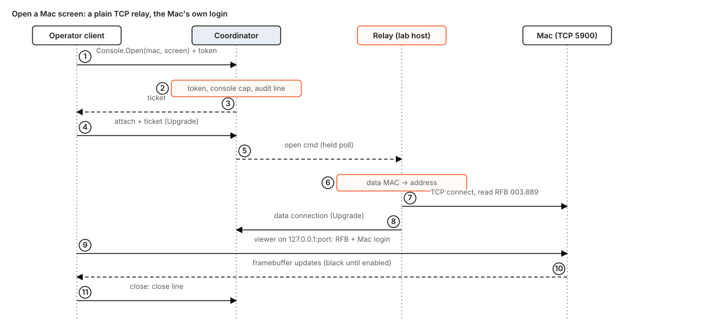
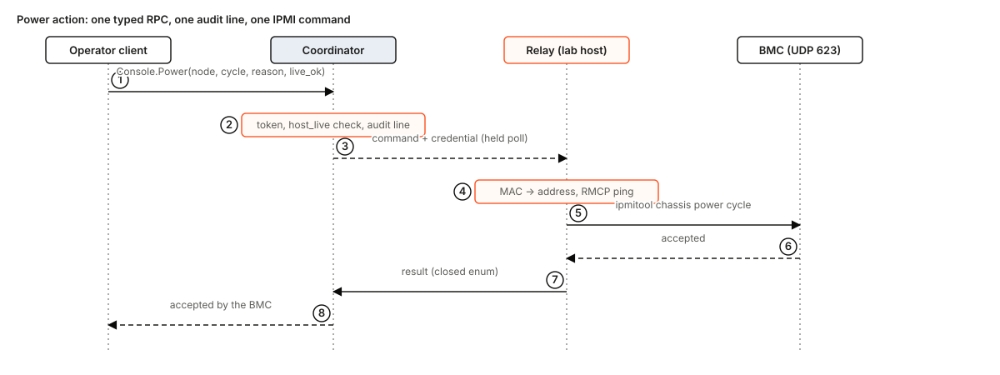
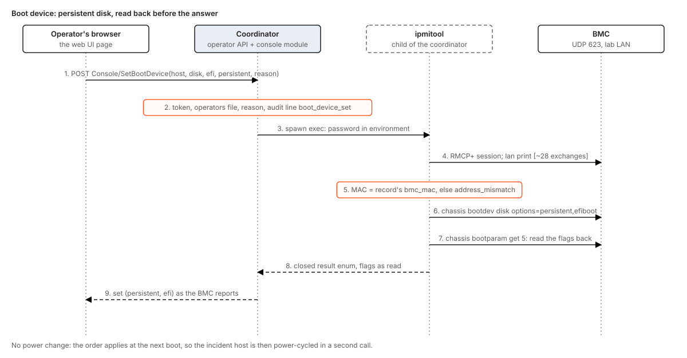
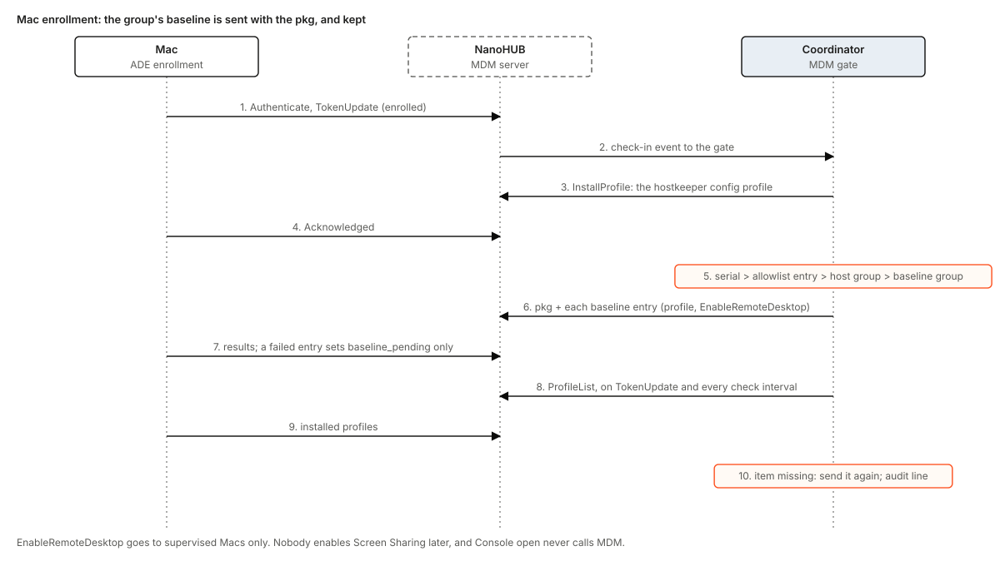

# hostkeeper console design

Status: design, for the maintainers' comments. Nothing in this document is built unless it is tagged **Built** with a path. It extends [hostkeeper-design.md](hostkeeper-design.md) section 12.1 ("power control through the BMC") and [network-install.md](network-install.md) section 10 ("BMC power and boot-device control"), and ties into [hostkeeper-mdm.md](hostkeeper-mdm.md) for the Macs.

How to read it: **Built** is code on `main` (with a path). **Designed** is this document's proposal. **Measured** is a fact read from the lab on 2026-11-10. **Inferred** is a figure derived from protocol structure or from numbers in this repository and not yet measured (task C0 measures them). **Unverified** is a claim taken from vendor documentation, a forum or a library's README that no one has run against the lab's firmware or the operators' browsers. Test names are in code font and are **(to build, Cn)** unless they exist. The repository is public: this document uses `<bmc-ip>`, `<mac-ip>`, `<lab-subnet>` and the documentation address ranges, never a lab address or host name.


## 1. Problem

A server that has stopped answering can only be fixed from its BMC, and a Mac that has lost its session can only be fixed from its screen. Today neither can be reached by an operator who is not standing in the lab.

The motivating incident: node-02 was force-rebooted, came back at the PXE menu, and needed its boot order changed. The BMCs sit on the lab LAN, not on the tailnet. Fixing it meant going to the lab, or logging in to some other machine on the LAN first and opening the BMC web UI from there.

The coordinator already knows which machine is which: each server's data MAC and BMC MAC are in its inventory record (**Built**: `crates/hostkeeper-coordinator/src/inventory.rs`, `Hosts.Get` and `Hosts.List`). It stores no address, and nothing in it carries an interactive byte stream (section 4).

## 2. Goals and non-goals

Decisions in brief:

1. **Everything goes through the coordinator.** No relay binary or role, no command line, no new hostkeeper daemon code, no daemon-to-coordinator stream. Authentication and audit are at the coordinator and nowhere else.
2. **The coordinator reaches the lab LAN itself.** Default: direct. The coordinator's host has interfaces on both lab subnets (**Measured**), so it dials the BMCs (UDP 623) and the Macs (TCP 5900) itself; no Tailscale subnet route and no ACL rule. Alternative, only for a coordinator moved off the lab LAN: a subnet route with an ACL (section 9.1).
3. **Linux servers: Console only.** IPMI 2.0 Serial over LAN (SOL) bridged by the coordinator over a WebSocket to an in-page terminal (xterm.js). The serial port is the second one, COM2 = `ttyS1`, on every Linux server (section 5). Power and boot device are typed calls (`Console/Power`, `Console/SetBootDevice`) with a reason and an audit line.
4. **Macs: Desktop only.** noVNC in the page, bridged by the coordinator to RFB on TCP 5900. Power is MDM `RestartDevice` and `ShutDownDevice` through the gate, supervised Macs only. **Apple Silicon Macs have no BMC and no serial console: a hung or unbooted Mac has no remote console.**
5. **The BMC's HTML5 KVM is dropped from the build** (fragile, section 6.2).
6. **Mac enrollment sets up all configuration**, including Screen Sharing; nobody enables it later and opening a Desktop never touches MDM (section 10).
7. Smallest usable first: C1 and C2 give the power and boot-device buttons on the host page, with no WebSocket (section 15).

Goals: an operator in the coordinator's web UI opens a serial Console on any Linux server or a Desktop on any Mac, and power-cycles a server or changes its boot device, from anywhere on the tailnet. All of it is also in the operator API, for automation. The BMC password is never shown to the operator. Every open and every typed power action is one audit line. The serial console is a login prompt on the host, so what an operator types in it is the host's own accounting; the audit records who opened it, when, from where and for how long.

Decided by the owner and not reopened: **one shared BMC username and password for every BMC, held by the coordinator.** No rotation, no vault, no per-host secret. A Mac is reached with the Mac's own login; the coordinator holds no Mac credential.

Non-goals: Redfish, the BMC's HTML5 KVM and web page in this build, a command-line client, a relay or any process on the lab LAN, recording a session's content, Mac High Performance mode, waking a sleeping Mac, a shared operator machine (section 13).

Future items, not designed here: native RMCP+ in place of `ipmitool`; an SSH-backed **Terminal** link for Macs; a switched PDU outlet for a hard-hung Mac; at most a plain link that opens the BMC's own web UI in a new tab (section 6.2).

## 3. What an operator sees

In the coordinator's web UI (`https://<private-address>/ui/`, the page the operator already signs in to with a pasted token) the **device list** has one row per host. A row has a link by platform:

- **Console**, on a Linux server's row: a page with a terminal on the server's serial port, and beside it **Power** (status, on, soft shutdown, off, cycle, reset) and **Boot device** (PXE, disk or BIOS; efi; one-time or persistent).
- **Desktop**, on a Mac's row: a page with the Mac's screen in a noVNC viewer, and **Power** (restart, shut down). The Mac's own login is typed into the viewer.

Each power or boot-device button asks for a reason (required, 1 to 256 bytes, as for every `Console/Open`, `Console/Power` and `Console/SetBootDevice` call) and confirms first; the confirm is a courtesy, not a control. The page lists who holds which session, since when, with a **Close** control. The host page (the one a row opens) carries the same Power and Boot device section without the terminal, which is the first slice (C2).

For automation the same calls are typed methods of the operator API (`Console/Open`, `Console/Power`, `Console/SetBootDevice`, `Console/List`, `Console/Close`), so the existing generated client and `hkctl`'s proto-generated command table list them. No `hkctl` change is part of this design. A serial or screen session is a WebSocket that `Open` hands out and any WebSocket client can attach.

Before: go to the lab. After: the operator's browser, over the tailnet, by host id. What does not change: the daemon, the update path, the operator token, the tokens file and every existing listener. An operator who is not in the operators file (D9) is refused; with no file, nobody has console access.

For the incident: **Boot device: disk, persistent**, then **Power: cycle**, then **Console** to watch it boot, if the host's BIOS redirects its screens to the serial port the BMC carries (section 5). A one-time boot device would fix this boot only; the incident was a boot order that stayed wrong, so the persistent form is the fix.

## 4. State today

- **Operators.** One class: a named bearer token (**Built**: `crates/hostkeeper-coordinator/src/tokens.rs`, `OperatorTokens::name_of`). Authorization is the token name; there are no roles. `Caller` is `Operator | Ci | Anonymous` (`src/operator.rs`). The private listener (`--private-listen`) is TLS server-auth only, reached over the tailnet. `RawToken` in `tokens.rs` is `deny_unknown_fields`, so **a new key in the tokens file would be refused by the previous release**; the design leaves that file alone (D9). The same holds for `InventoryRecord` (`inventory.rs`): a new field is refused by the release before once it is written, so the design leaves the record alone too (D8).
- **The web app.** Static files served from `--ui-dir` under `/ui/` on the private listener (**Built**: `src/ui.rs`). The operator pastes a token; the app keeps it in memory only (`ui/session.js`: no storage, no cookie, not in the address) and POSTs JSON with `Authorization: Bearer` (`ui/api.js`, the one data layer, over the client generated from the protos). Every answer carries `default-src 'self'; frame-ancestors 'none'` (`CONTENT_SECURITY_POLICY`). There is no `connect-src` and no cookie ([ui-serving.md](../ui-serving.md)).
- **The UI scan.** `crates/hostkeeper-ui-tests/src/scan.rs` refuses, in the app's sources, `WebSocket`, `EventSource`, `XMLHttpRequest`, `sendBeacon`, any other-origin URL, `eval(`, `innerHTML`, inline script and style, token keepers, and any `fetch` outside the data layer and the entry module. Section 8.2 says what changes.
- **Listeners.** `src/listen.rs` serves the private listener over HTTP/2 or HTTP/1.1 by ALPN and closes a connection `CLIENT_PATIENCE` (10 s) after its handshake unless it is a registered long wait (`Releases.WaitConverged`, `src/wait.rs`). Nothing upgrades a connection or splices two streams today.
- **Audit.** Every ops change is one `AuditEntry` (`seq, by, action, service?, node_id?, host_group?, reason?`) and one fsynced JSON line in `<ops-file>.audit` (**Built**: `src/ops.rs`, `src/audit_file.rs`). A line is the by-product of an `OpsStore` change. **There is no audit-only append.** `action` is a free string, so a new action name is additive.
- **Daemon channel.** The daemon connects out and speaks four unary RPCs (**Built**: `agent.proto`). This design adds nothing to it. It uses what the daemon already reports: the BMC MAC (`crates/hostkeeper-daemon/src/ipmi.rs`) and a Mac's serial and platform UUID.
- **Addresses.** **No IP address of a host or a BMC is stored.** `Claims.addresses` is link-layer addresses only.
- **Records.** A host's `Host` message carries `data_macs` and `bmc_mac` only when exactly one inventory record matches. The six lab nodes enrolled before records existed, so their `bmc_mac` is empty until the operator adds a record (`Enrollment.AddRecord` with the role empty, [enrollment.md](../operations/enrollment.md)). Part of C0.
- **MDM.** The gate is linked into the coordinator and talks to NanoHUB on loopback only (**Built**: `src/mdm.rs`, `crates/hostkeeper-mdm-gate/src/command.rs`). `COMMAND_TYPES` has five types (`DeviceInformation`, `SecurityInfo`, `InstallProfile`, `RemoveProfile`, `InstallEnterpriseApplication`), pinned by `the_gate_enqueues_only_its_five_command_types`; `QUERIES` has three (`SerialNumber`, `UDID`, `IsSupervised`), pinned by `a_command_is_the_xml_plist_nanohub_takes`. Enrollment step 3 installs the config profile and then the pkg ([hostkeeper-mdm.md](hostkeeper-mdm.md) section 2).
- **Install.** `--serial-console ttyS<n>` makes the seed write the installed kernel's `console=tty0 console=ttyS<n>,115200n8` and enable `serial-getty@ttyS<n>` (**Built**: `crates/hostkeeper-pxe-seed/src/seed.rs`). It does not write the GRUB serial terminal lines (section 5.3).

## 5. The serial standard: COM2 on every Linux server

### 5.1 What was measured

**Measured on all six lab nodes (2026-11-10):**

- All six are Supermicro X10 boards: node-01 an X10DRW-NT, the others X10DRH-iT; BIOS 3.2 or 3.4a.
- SOL is enabled on the BMC (read in-band, so far on nodes 01, 04 and 05).
- `ttyS0` at 0x3f8 and `ttyS1` at 0x2f8 are both present.
- Today's kernel command line is `console=tty1 console=ttyS0` with a getty on `ttyS0`; node-02 has no `console=` and no serial getty.
- One node earlier: `ipmitool lan print` lists RMCP+ cipher suites 1, 2, 3, 6, 7, 8, 11, 12 (suite 17 is not offered, 3 is); SOL at 115.2 kbit/s, privilege OPERATOR; `/dev/ipmi0` works.

Supermicro BMCs carry SOL on the board's second serial port, COM2, which Linux names `ttyS1` (**Inferred** for these nodes from the vendor's usual wiring; C0 confirms by sending a byte to `ttyS1` and seeing it over SOL). The present setup uses `ttyS0`, so **today a SOL session on these nodes probably shows nothing**.

### 5.2 The standard

**SOL is the second serial port, COM2 = `ttyS1`, on every Linux server**, a fleet rule and not a per-model value. Three settings must agree, and the first two are the same on every host:

1. **BMC SOL bit rate 115.2 kbit/s.** Set by the coordinator through standard IPMI, no vendor tool: `ipmitool sol set volatile-bit-rate 115.2` and `sol set non-volatile-bit-rate 115.2`, checked and repaired at each Console open (the non-volatile rate once per BMC; it is read with `sol info`).
2. **BIOS console redirection to COM2** at 115200 8N1. **This is not settable by standard IPMI on the X10:** Supermicro's SUM needs a per-node licence, and whether the X10's Redfish exposes BIOS attributes is **Unverified**. It is a one-time BIOS setting per node, likely on by default (**Unverified**), and **C0 checks it** on all six nodes. Without it the kernel and the login still reach SOL; the firmware's own screens (POST, PXE menu, setup) do not.
3. **The installed system**: kernel `console=tty0 console=ttyS1,115200n8`, GRUB `GRUB_TERMINAL="console serial"` and `GRUB_SERIAL_COMMAND="serial --unit=1 --speed=115200"` (so GRUB's menu shows too), and `serial-getty@ttyS1`.

**Edge case: no output on the wrong port.** A host whose console is still on `ttyS0` shows a blank terminal over SOL, with no error anywhere. The coordinator cannot detect it. The page says, beside the terminal, "no output yet: the host's serial port must be ttyS1" after `--console-quiet-s` (default 10) with no byte; the install baseline (C8) is the fix.

### 5.3 The install baseline

[network-install.md](../operations/network-install.md) and its install configuration move to `--serial-console ttyS1` for every Linux server, and the seed gains the two GRUB lines above (today it writes only the kernel `console=` and the getty). That is a change to the seed's golden and to the doc's "serial console" paragraph and its board check (**Designed**, C8). The six existing nodes were not installed that way: they move to the baseline by editing `/etc/default/grub` and enabling the getty once each, a step in the operations doc (C9), and C0 tries it on one node first.

## 6. What each device offers

### 6.1 Serial over LAN and power

SOL is IPMI 2.0 RMCP+ on UDP 623. On this board it needs `-C 3` (HMAC-SHA1, AES-CBC-128); the cipher suite is a flag (`--console-ipmi-cipher`, default 3), not a constant, because suite 17 appears on later boards and some firmware turns suite 3 off (**Unverified**). The privilege level is a flag too (`--console-ipmi-privilege`, default ADMINISTRATOR); SOL itself needs only OPERATOR (Measured).

- **One SOL payload per BMC.** A holder outside the coordinator (someone running `ipmitool` in the lab) is BMC-side state the coordinator cannot see; it shows as `bmc_sol_busy` (section 12).
- **A BMC allows few concurrent IPMI sessions** (about four on this class of board, **Unverified**). Every power command and every SOL uses one while it runs. A full BMC is `bmc_busy`.
- **`ipmitool` over pipes.** `sol activate` expects a terminal: its escape sequence is read in-band, and its stdout may be block-buffered on a pipe. Whether a pipe is enough, with the escape character set by `-e` to a byte the browser terminal never sends, or a pty is needed (a crate; this workspace adds no `unsafe`, R2), is **Unverified** and decided in C0.
- **The coordinator runs `ipmitool`**, a program its image must carry (`--console-ipmitool`, a path), spawned with a closed argument list.
- **Power and boot device** are `chassis power status|on|off|cycle|reset|soft` and `chassis bootdev pxe|disk|bios`: RMCP+ and the same credential, so they work with the host down. `bootdev` applies to the next boot only unless `options=persistent` is set; on a UEFI board `options=efiboot` is needed or the order may be ignored (the nodes' boot mode is unmeasured, C0); and `chassis power cycle` is ignored by some BMCs when the host is off, so the coordinator reads `status` first and sends `on` to an off host.

### 6.2 The BMC's own web page: dropped

A BMC's HTML5 KVM is vendor firmware: the X10 serves the ATEN console with its own login, a secure websocket, root-relative links, cookie and Origin checks and one viewer at a time (**Unverified**: vendor documentation and forum reports), and it differs between firmware releases. Embedding it behind an automatic login is the fragile part of the first draft (cookies, CSRF, `frame-ancestors`). Serial console and power cover the incident without it. **It is dropped from the build.** At most a later plain link that opens the BMC's web UI in a new tab, reached through the same route, not embedded and not auto-logged-in, with the operator typing the BMC login. It would need a TCP tunnel and is not designed here.

### 6.3 Mac: Desktop, and what a Mac does not have

Screen Sharing is RFB on TCP 5900. Auth runs inside the stream (Apple's types, including the ARD Diffie-Hellman type), so a bridge that reads nothing but carries the bytes carries it unchanged. noVNC supports RFB over a WebSocket and, in recent releases, Apple's ARD authentication (**Unverified** against the lab's macOS; C0 tests it).

- **A Mac has no BMC and no serial console.** Apple Silicon Macs offer no out-of-band management. A Mac that is hung, unbooted, at recovery or at the FileVault pre-boot screen cannot be reached by this design, and nothing the coordinator can do changes that. What it can do: Desktop to a running macOS, and MDM restart or shutdown to a Mac that still checks in. The two future items for the gap are an SSH-backed Terminal link (for a Mac whose screen is stuck but whose network is up) and a switched PDU outlet (for a hard hang).
- **Black screen.** Enabled from the command line, Screen Sharing gives a black screen until someone approves at the Mac, or MDM enables it (**Measured** on the farm Mac, macOS 27; Apple stopped letting `kickstart` enable it from 12.1). Section 10 makes the enrollment baseline enable it.
- **Approval prompt.** With a console user logged in, Screen Sharing may still ask that user to approve even when MDM enabled the service (**Unverified**; C0 tests a Mac with a logged-in user and one at the login window).
- **Credentials.** The Mac's login is typed into the viewer, which encrypts it before it leaves the page (**Unverified** that the types the Mac offers are the encrypted ones). The bridge sees ciphertext.
- **A sleeping Mac** does not answer on 5900. The coordinator does not wake it.

## 7. Decisions

| # | Question | Decision | Why |
|---|---|---|---|
| D1 | Where does the code live? | In the coordinator. A pure library crate `hostkeeper-console` (session table, timers, targets and operators file parsers, the `ipmitool` port and its closed result enum, the credential newtype, the bridge loops over in-memory streams) and the coordinator's `src/console/` (the operator calls, the WebSocket route, the `ipmitool` spawn, the TCP dials). No new binary, no daemon change, no daemon-to-coordinator stream. | The owner's direction. The coordinator already holds the tokens, the audit, the inventory and the MDM gate. `service.rs`, `config.rs` and `operator.rs` are each near 1000 lines (R12), so the code goes in a directory and a library crate, which also keeps coverage (T1) per crate. |
| D2 | How is a session opened? | Two steps. **`Console/Open{host_id, reason}`** is a typed unary call (POST JSON, `Authorization: Bearer`, as every call). It checks the operators file, finds the host and its address, takes the one-session-per-host slot, writes the audit line, and returns the `kind` (`serial` for Linux, `screen` for a Mac), a `session` (256 random bits) and `expires_in_s` (default 30, `--console-attach-s`). The client then opens **`GET /console/v1/stream/<session>`** as a WebSocket on the private listener, the UI's origin. | A typed `Open` is what the UI and a script share, and every error short of the stream is a normal refusal with a reason (a browser's WebSocket cannot read an HTTP status). The session id is not a credential: attach also needs the bearer of the token name that opened it (D3). |
| D3 | How does a browser WebSocket authenticate? | The bearer travels in `Sec-WebSocket-Protocol`: the page offers `["hostkeeper.console.v1", "bearer.<base64url of the token>"]` and the coordinator answers with the first only, so the token is never echoed. The upgrade is accepted only when the token is a valid operator token, its name opened the session, the `Origin` is the listener's own origin, and the session is unattached and inside its window. A refusal is a plain `401`/`403`/`404` before the upgrade; a failure after is a WebSocket close with a code (section 12). | A browser WebSocket cannot set `Authorization`; a token in the address would reach history and logs (the UI scan refuses it). The app still has no cookie. The session id plus the matching token name closes replay: a second attach is refused. The coordinator logs no request headers (a test asserts it). |
| D4 | Lifetime and audit | **One reason rule: every `Console/Open`, `Console/Power` and `Console/SetBootDevice` call carries a non-empty reason of at most 256 bytes (`reason_required`, `reason_too_long`; no action is exempt, `status` and `on` included) and writes its audit line.** Idle 30 min, total 8 h, both flags. `console_open` is one audit line written **before** the device is contacted; no line, no session (`audit_unavailable`). Close is one best-effort line. A refusal after the token is known and the caller is in the operators file is one best-effort `console_denied` line with the cause. New actions: `console_open`, `console_close`, `console_denied`, `power_action`, `boot_device_set`, `console_coordinator_start`, `mdm_baseline` (section 10). Session id, kind, the attaching peer, duration and bytes go into `reason`, after the operator's reason, cut at 256 bytes. | C1 adds an **audit-only append** to `audit_file.rs`: a numbered line that changes no ops state and does not enter the `/v1/status` ring, so a burst of console lines cannot push ops changes out of it. |
| D5 | Where is the one BMC credential? | `--console-bmc-credential-file`: a secret file read by `hostkeeper_wire::secret::read_secret`, mode 0600 or 0400 (as `--mdm-api-key-file`), re-read on the TLS-reload tick. A newtype with a redacting `Debug` and no `Display` or `Serialize`. It goes to the child's environment and nowhere else: not to the browser, a log or an error. | The owner's decision. A flag naming a file satisfies S1 and S2. |
| D6 | How do SOL and power run? | `ipmitool -I lanplus -C <cipher> -L <privilege> -N <timeout> -R <retries>` as a child of the coordinator, the password with `-E` (environment), never `-P` (argv). Timeout and retries are flags (`--console-ipmi-timeout-s` 1, `--console-ipmi-retries` 2) so the worst case in section 11 is a sum. The result maps to a closed error enum; the tool's stderr is never echoed (it contains the user name). Spawn is behind a port with a scripted double. A native RMCP+ client is later. No Redfish. | The workspace pins `ipmi-rs` to its device-file connection only and leaves out its RMCP+ client (root `Cargo.toml`). A native client is weeks; `ipmitool` is days and was measured working. Every tunable is config with a default from the start. |
| D7 | The BMC's web page | Dropped from the build (section 6.2). | Fragile; serial and typed power cover the incident. Adding a kind later is additive (B8). |
| D8 | Where is a device's address, and how is it checked? | `--console-targets-file` (TOML): `[[target]]` with `mac` and `address`. For a Linux server `mac` is the BMC MAC (the record's `bmc_mac`); for a Mac it is a data MAC from the record or the Mac's tailnet name as `address`. Addresses are DHCP reservations. **Before each command to a BMC the coordinator runs `ipmitool lan print`, in the same session as the command, and compares the MAC with the record's `bmc_mac`;** a difference is `address_mismatch` and nothing is sent. | A neighbour table is a poor source (section 9.2), and the daemon cannot report a BMC address a down node would not be there to report. A new inventory field is refused by the previous release once written (section 4); a new file read only by the new release breaks nothing on rollback (B8). A power command at the wrong BMC power-cycles the wrong server, hence the check on every command. |
| D9 | Who may open a console? | `--console-operators-file` (TOML): `[[operator]]` with `name` (a token name) and `power` (default true; false allows opening a console but not power or boot-device calls). Absent file or name means no console. The tokens file is not changed. | A key in `[[token]]` is refused by the previous release (`deny_unknown_fields`), which breaks rollback (B8). Whether this is enough for off, cycle and reset is Q3. |
| D10 | Mac power | `Console/Power` on a Mac maps `restart` and `shutdown` to MDM `RestartDevice` and `ShutDownDevice` through the gate, to a supervised Mac only (`not_supervised` otherwise). The call is answered when the command is queued. | The owner's direction; the gate already knows supervision. A Mac has no other power control. |
| D11 | Two operators on one device | One session per host, held by the coordinator. A second open is refused `console_busy`, naming the holder's token name and start time. The operator closes the first (`Console/Close`, audited with the closer's name) and opens again. No takeover flag. | A BMC allows one SOL payload; deciding in the coordinator is predictable and audited. |
| D12 | Bounds | `--console-max-sessions` 8, WebSocket frames at most 64 KiB, `--console-connect-timeout-s` 5. The bridge is a bounded-buffer copy that stops reading one side while the other's write is blocked. An upgraded connection leaves the listener's `CLIENT_PATIENCE` rule and counts against the session cap instead. | A slow browser must not grow memory. |

## 8. Components



The dashed orange box is exactly what hostkeeper runs: the coordinator with its console module, the web UI it serves, and the MDM gate linked into it. Outside it: the operator's browser, `ipmitool` (a program the coordinator starts), the lab LAN, which the coordinator's host is directly on (section 9), the BMC, the Mac and NanoHUB. The hostkeeper daemon is on no console path.

New code, all **Designed**:

- **`crates/hostkeeper-console`** (library): the session table with the one-per-host rule and timers on an injected clock; the operators and targets file parsers; the credential newtype; the `ipmitool` port with a scripted double; the two bridge loops. Pure: no socket, no process, no clock of its own.
- **Coordinator `src/console/`**: the `Console/*` calls (`console.proto`, a new file; no existing message changes, B8), the WebSocket route and its upgrade, the `ipmitool` spawn, the TCP dials, and in `listen.rs` the upgrade path.
- **Gate** (`crates/hostkeeper-mdm-gate`): the baseline (section 10) and the Mac power commands.
- **Web UI** (`ui/`): the Console and Desktop links in the device list, the Console and Desktop pages, `ui/console_socket.js` (the one module that opens a WebSocket), and vendored xterm.js and noVNC.

### 8.1 The private listener

The WebSocket route is on the private listener's `Surface::Control`, the UI's own origin. The listener's HTTP/1.1 path serves with upgrades; an HTTP/2 connection cannot upgrade (the browser opens a fresh HTTP/1.1 connection for a WebSocket). An upgraded connection is taken off the patience timer and counted against `--console-max-sessions`; this is a change to `listen.rs` with its tests.

### 8.2 The UI scan and the CSP

- **A `sockets` rule** in `scan.rs`, mirroring the existing `fetches` rule: `WebSocket` is refused everywhere in `ui/` and allowed in exactly one file, `ui/console_socket.js`, which holds exactly one `new WebSocket(`, built from the page's own host, a fixed path prefix and a session id matching `^[0-9a-f]{64}$`. `ws://` and `wss://` literals join the other-origin needles in every file. `EventSource`, `XMLHttpRequest` and `sendBeacon` stay refused.
- **Vendored libraries** (xterm.js, noVNC) live in a directory `ui/vendor/` pinned by SHA-256 in a file the scan test reads (a change to a library is a reviewed change to that file). `console_socket.js` builds the one socket (token in the subprotocol) and hands the **open socket object** to noVNC's `RFB` and to the xterm.js attach code; neither library is given a URL. The directory is exempt from the **needle scan** (minified third-party code trips license URLs and `console.`); it is still scanned for inline script, `on*` handlers and `new WebSocket(`, which no vendored file may contain (digest-pinned, and the scan fails if one appears).
- **The CSP** gains an explicit `connect-src 'self'` so a same-origin WebSocket is allowed: `default-src 'self'; connect-src 'self'; frame-ancestors 'none'`. CSP3 lets `'self'` cover `ws`/`wss` to the same host and port, but older Safari matched it late (**Unverified**), so **it is tested in Chrome, Firefox and Safari in C0**; the fallback is naming the `wss` origin. Anything else the two libraries need (`img-src 'self' data:` for noVNC's cursor, a style rule for xterm.js's DOM renderer) is found in C0 and added as one line each, with a test that pins the whole string. Script rules do not loosen: no `'unsafe-eval'`, no `'unsafe-inline'` for script.
- **The token** stays in `ui/session.js` memory. `console_socket.js` reads it as `api.js` does and passes it only in the subprotocol.
- `docs/ui-serving.md` ("no cookie and no session") stays true; it gains a sentence that the app opens one WebSocket kind (C5).

## 9. Reaching and finding a device

### 9.1 The network path

The coordinator reaches the BMCs (UDP 623) and the Macs (TCP 5900), which are on the lab LAN. Both are configuration and no hostkeeper code.

**Default: direct.** The coordinator's host has interfaces on both lab subnets, the BMC subnet and the servers' data subnet (**Measured**, 2026-11-10), and the farm Mac is on the lab LAN as well as the tailnet (**Measured**). The coordinator dials the reserved addresses straight over the lab LAN. No subnet route, no router host, no ACL rule and no tailnet change. The operator's browser still reaches the coordinator over the tailnet, and the BMCs and Macs are never exposed to it. A Mac is dialled at its lab address, not its tailnet name, so the path does not depend on the tailnet being up.

**Alternative: a Tailscale subnet route with an ACL,** for a coordinator moved off the lab LAN.

1. A lab host that is always on advertises the lab subnet (`--advertise-routes=<lab-subnet>`, IP forwarding on); a second lab host advertises the same route so the path survives one being power-cycled (Tailscale fails over between routers of one route; the failover time is **Unverified**). Subnet traffic is source-translated by default, so the BMCs need no route back.
2. The coordinator's host accepts the route (`--accept-routes`).
3. The tailnet policy grants **only the coordinator's tag** the BMC and Mac addresses and ports: one rule, `src: tag:<coordinator>`, `dst: <bmc-range>:623` plus `<mac-range>:5900`, and no rule that grants any other member the subnet. DHCP reservations in two contiguous blocks keep it to two ranges.

Rejected: a route with no ACL (any tailnet member could reach every BMC with only the shared password between them and power); a relay or the daemon as a forwarder (the owner's direction; the root daemon would gain a listener); our own site-to-site WireGuard; one route per BMC.

What it costs: direct, nothing beyond the lab LAN's own round trip (**R**, section 11). The coordinator's host must stay on the lab LAN; moving it makes every device `device_unreachable` until the alternative is set up.

### 9.2 The address

`--console-targets-file` maps a MAC to an address (D8). The BMCs and Macs hold DHCP reservations, so the address does not move; the operator writes it once beside the inventory record. That is the whole of "lookup": no scan, no probe, no neighbour table.

The coordinator now shares a layer-2 segment with the BMCs, so mapping the record's `bmc_mac` to an address from its own neighbour table (with a probe to fill it) is possible. **It is not taken**, because it is the more fragile option: a neighbour table holds only hosts spoken to recently, so it needs a probe sweep of the subnet (`arping` or ping needs `CAP_NET_RAW` and a coordinator image with the tool); a BMC may ignore ICMP; the coordinator's host has several addresses on one interface, so the right subnet and interface must be chosen; a powered-off or unplugged BMC is simply absent, which a configured address reports as `device_unreachable` and a sweep reports as an unknown host; and it works only on the lab LAN, so it would not survive the alternative of section 9.1. The reservation file is one small TOML file, written once and checked by `lan print` on every command. Verification is the `lan print` check of D8 on every BMC command; a host without a `bmc_mac` in its record is `no_bmc_mac`, refused (this is why C0 adds the records).

A Mac's screen is not tied to a MAC: RFB carries none and the Mac's own login authenticates the connection, so a wrong address reaches the wrong Mac's login prompt and nothing more.

Considered and not taken: the daemon reporting the BMC's address (a daemon change, and a down node reports nothing); a new field on `InventoryRecord` (breaks rollback, B8); reading the lab's DHCP leases (needs a credential on the DHCP server).

## 10. Mac enrollment sets up everything

Screen Sharing and any other Mac configuration are set **at enrollment**, by the gate. Nobody enables Screen Sharing later, and `Console/Open` on a Mac never touches MDM: if Screen Sharing is off the open fails `mac_screen_sharing_off` and the device shows `baseline_pending`.

**The baseline file.** `--mdm-baseline-file` (TOML) on the coordinator: one `[[group]]` per host group, each with entries, an entry being `remote_desktop` or `profile = "<path>"` (for example the `com.apple.NSExtension` allow list an FSKit extension needs later):

```toml
[[group]]
host_group = "farm-macs"

[[group.entry]]
remote_desktop = true

[[group.entry]]
profile = "/etc/hostkeeper/baseline/fskit-extension.mobileconfig"
```

**When it is sent.** In enrollment step 3, after the config profile is acknowledged, with the pkg. The group comes from the serial's Mac allowlist entry (`host_group`, [hostgroups.md](hostgroups.md) section 1.2). A profile entry is an `InstallProfile`; `remote_desktop` is `EnableRemoteDesktop`, sent only to a supervised Mac (the gate already reads supervision from `DeviceInformation`).

**When it is kept.** The gate re-applies on missing items: a `ProfileList` query on each `TokenUpdate` and every `--mdm-baseline-check-s` (default 21600) compares the installed profiles with the group's baseline and re-sends what is missing. `EnableRemoteDesktop` has no profile to list; whether a `DeviceInformation` query reads Screen Sharing's state back is **Unverified** (C3 looks), and if none does it is re-sent with every check (idempotence is **Unverified**).

**What a failure does.** A baseline failure does not fail enrollment: the Mac is approved and runs; the device shows `baseline_pending` until the next check succeeds. Each send is one best-effort audit line (`mdm_baseline`).

**The pinned lists.** The gate's counts change, and the pinned tests move with them. `COMMAND_TYPES` goes from 5 to **9**: `EnableRemoteDesktop`, `ProfileList` (a command in its own right, not a `DeviceInformation` query), `RestartDevice` and `ShutDownDevice` are added, and `the_gate_enqueues_only_its_five_command_types` becomes `..._its_nine_command_types`. `QUERIES` goes from 3 to 4 only if C3 finds a `DeviceInformation` query that reads Screen Sharing back; otherwise it stays 3 (`a_command_is_the_xml_plist_nanohub_takes` is updated either way). The command names `EnableRemoteDesktop`, `RestartDevice`, `ShutDownDevice` and `ProfileList` are read from Apple's MDM reference first (**Unverified** until then).

Macs already enrolled before this change (the farm's) get the baseline on their next `TokenUpdate`, through the same re-apply path; no enrollment is repeated. Where the coordinator runs: the gate talks to NanoHUB on loopback only ([hostkeeper-mdm.md](hostkeeper-mdm.md) section 3), so the coordinator and NanoHUB are on one host today, which the farm already is.

## 11. Operations: sequences and latency budgets

Common to all: a unary call arrives on the connection the UI already holds (HTTP/2, warm), one round trip. A WebSocket needs a new connection: TCP plus TLS 1.3 is two round trips, the upgrade one more. Every budget is a sum of named terms; no probe, poll or dial-back term. Values are **Inferred** until C0 measures **T** and **R** and counts the exchanges.

Terms. **T**: a browser-to-coordinator round trip over the tailnet. **R**: a coordinator-to-device round trip on the lab LAN (direct; through the route in the alternative). **F**: one audit fsync. **B**: a BMC's service time per IPMI exchange. **S**: exchanges to set up an RMCP+ session (capabilities, open session, RAKP 1 to 4, set privilege; about 8). **L**: exchanges of `ipmitool lan print` (about 20, **Inferred**: it reads each LAN parameter in turn; the same MAC is one exchange as a raw read, a fallback C0 evaluates if L dominates). **N**: a lost packet, the `-N` timeout. Example values: T = 30 ms, R = 25 ms, F = 10 ms, B = 0.1 s, so one exchange R + B = 0.125 s.

### 11.1 Console open (serial)



(1) the Console link calls `Console/Open`, `T + F` (token, operators file, address, audit line; no device contact). (2) The WebSocket: `3T`. (3) One `ipmitool` session: `S` setup, `L` for the MAC check, `sol info` (1) to check the bit rate (a set is 2 more, on a miss only), `sol activate` (2): `(S + L + 3)(R + B)`. (4) The page sends a carriage return and the prompt is the first byte back: `T`.

**Total: `5T + F + (S + L + 3)(R + B)`** = 0.15 + 0.01 + 31 x 0.125 = **about 4.0 s**; with the one-exchange MAC read, 12 x 0.125 gives about 1.7 s. Worst case: `+ N` per lost packet in setup. Steady state is the BMC's 115.2 kbit/s; per keystroke the cost is one-way browser-coordinator, coordinator-BMC and back.

### 11.2 Desktop open (Mac)



(1) `Console/Open`: `T + F`. (2) The WebSocket: `3T`. (3) The coordinator's TCP connect: `R`. (4) RFB runs end to end through the bridge: version exchange, the Mac's security type, Apple's DH exchange (two more round trips), `ServerInit`, first framebuffer update: about 5 round trips of `T + R`. **Total: `4T + F + R + 5(T + R)`** = 0.12 + 0.01 + 0.025 + 0.275 = **about 0.45 s** to the Mac's login prompt, plus the Mac's and the viewer's first-frame time (C0 measures). Added latency per input event: one-way browser-to-coordinator plus coordinator-to-Mac. No MDM call, so no APNs term.

### 11.3 Power



No stream; the call answers when the command has its result. (1) `Console/Power`: `T`. (2) The audit line: `F`. (3) One `ipmitool exec` session: `S + L` for setup and the MAC check, `status` (1) and the command (1): `(S + L + 2)(R + B)`. **Total: `T + F + (S + L + 2)(R + B)`** = 0.03 + 0.01 + 30 x 0.125 = **about 3.8 s** (about 1.5 s with the one-exchange MAC read). `cycle` on an off host is `on` instead; the answer is the BMC's acknowledgement, not the host's state: the operator watches `Hosts.Get` `live` come back.

For a Mac the budget is `T + F + G`, where **G** is the gate's loopback enqueue to NanoHUB (a few milliseconds, **Inferred**); the Mac acts after an APNs push and check-in (seconds, unmeasured, not on the call's path).

### 11.4 Boot device



(1) `Console/SetBootDevice`: `T`, (2) `F`, (3) one session: `S + L` setup and check, `chassis bootdev` (1), `bootparam get 5` to read the flags back (1). **Total: `T + F + (S + L + 2)(R + B)`**, the same 3.8 s. Read-back means the answer states what the BMC holds, so "set persistent" is not taken on faith.

### 11.5 Baseline at enrollment



Not on an operator's path. From the config profile's `Acknowledged`, the gate queues the pkg and the group's `k` entries together; NanoHUB delivers them over the Mac's check-in as one push and a chain of command and result round trips. **Time: `A + (k + 1) M + I`**, where **A** is the APNs push to check-in (seconds, unmeasured), **M** one command round trip from the Mac to NanoHUB (about 0.1 s, **Inferred**) and **I** the pkg's download and install (**Inferred** tens of seconds, the dominant term and already in enrollment today). The check adds one `ProfileList` round trip, `A + M`, every `--mdm-baseline-check-s` and on each `TokenUpdate`.

## 12. Failure modes and edge cases

**What is audited.** Every refusal after the token is known and the caller is in the operators file is a best-effort `console_denied` line with its cause (`busy`, `no_address`, `no_bmc_mac`, `address_mismatch`, `device_unreachable`, `ambiguous_record`, `power_not_permitted`, `not_supervised`); `console_open` is the one line that must be written before anything happens. Not audited: a token that does not exist, a malformed request, a connection that never authenticates (a rate-limited log line only), `Console/List` (a read). A failure after the upgrade is a WebSocket close with a code and a reason token: 4001 `device_unreachable`, 4002 `bmc_sol_busy`, 4003 `bmc_busy`, 4004 `bmc_auth_failed`, 4005 `idle`, 4006 `total_limit`, 4007 `closed_by_operator`, 4008 `token_revoked`, 4009 `address_mismatch`, 4010 `coordinator_stopping`, 4011 `mac_screen_sharing_off`, 4012 `mac_unreachable_or_asleep`.

| Case | Mechanism |
|---|---|
| SOL shows nothing | The host's console is not on `ttyS1`, or no getty (section 5.2). Blank terminal, no error; the page's "no output yet" note after `--console-quiet-s`; the fix is the install baseline. |
| SOL shows the OS but not the BIOS screens | BIOS console redirection to COM2 is off or on another port; the one-time BIOS setting C0 checks on all six nodes. |
| BMC unreachable (powered off, cable, wrong address) | Close 4001 after `--console-connect-timeout-s`; if every BMC fails the same way, check that the coordinator's host is still on the lab LAN. |
| Alternative only: subnet router down, or ACL wrong | The second advertising host takes the route; with both down every device is `device_unreachable`. |
| Address wrong, or the lease moved | The `lan print` MAC differs from the record: `address_mismatch`, nothing sent. A Mac at a wrong address reaches another Mac's login and nothing more. |
| Host unknown; no target; no `bmc_mac`; several records match | `host_not_found`, `no_address`, `no_bmc_mac`, `ambiguous_record`, each a closed error naming the fix. |
| Coordinator restart | All sessions end with 4010 and their `ipmitool` children die. The BMC keeps the SOL payload until its own timeout, so the next open sees `bmc_sol_busy` for a while (**Unverified** how long). On start the coordinator writes `console_coordinator_start`; any `console_open` before it with no close ended there. No second coordinator exists. |
| SOL held at the BMC by someone outside | `sol activate` reports it: `bmc_sol_busy`. The coordinator does not deactivate a session it did not start. |
| BMC has no free session slot | `bmc_busy`. Commands to one BMC are serialized by the coordinator, so a burst of power clicks queues. |
| Two operators on one device | D11: `console_busy` naming the holder. |
| Shared-NIC BMC | A BMC in shared-NIC mode answers on the host's NIC and may be unreachable from the coordinator if the coordinator is that host itself, or, in the alternative, from the route if the router is that host (the lab's NIC mode is unmeasured, C0). |
| Wrong shared credential | `bmc_auth_failed`, with no text from the tool; fix the file and the reload tick. |
| Credential in logs or errors | Only in the child's environment. A test formats every wire struct that can carry it and asserts the output has no credential; a wrong-password test asserts the whole message by exact equality (T13). |
| Operator token revoked mid-session | Tokens and the operators file are re-read every `--tls-reload-secs`; that name's sessions close with 4008 and `sol deactivate` is run. |
| Tab closed or network lost | The bridge ends, the coordinator runs `sol deactivate`, the close line is written. |
| `Origin` not the listener's; second attach; attach after the window | `403`, `403`/`404`, `404` before the upgrade. |
| Listener flooded | A connection that has not sent its head closes at `CLIENT_PATIENCE`; upgraded connections are capped by `--console-max-sessions`. |
| Audit unavailable | No audit line, no session or power action (`audit_unavailable`). |
| Mac screen black | Screen Sharing not enabled or not approved. Enrollment enables it (section 10); a Mac that missed it shows `baseline_pending` and the next check repairs it. The approval prompt (section 6.3) may remain. |
| Mac port closed | 4011 `mac_screen_sharing_off`; the device shows `baseline_pending`. Opening does not enable it. |
| Mac asleep, off or unbooted | 4012 `mac_unreachable_or_asleep`. A hung or unbooted Mac has no console (section 6.3); the future Terminal and PDU items are the answer. |
| Mac not supervised | `RestartDevice`, `ShutDownDevice` and `EnableRemoteDesktop` are refused or not sent: `not_supervised`. |
| A browser that does not match `'self'` for `wss` | The console does not open and the browser reports CSP. C0 checks Chrome, Firefox and Safari; the fallback is the explicit `wss` origin. |

## 13. Threat model

[hostkeeper-design.md](hostkeeper-design.md) section 5.1 already says a compromised coordinator is root on any host through signed packages. This adds:

- **A compromised coordinator:** raw BMC power and serial on every server, every Mac's screen (the Mac's login still stands), the shared BMC password, and the baseline file. There is no relay host besides it.
- **A stolen operator token in the operators file:** the same consoles; the audit shows its name. A serial console is a login on the host, whose own accounting records what is done there.
- **The tailnet policy,** only in the alternative: a rule that grants another member the lab subnet exposes every BMC to a holder of the shared password, with no coordinator check and no audit. The default has no such rule; the coordinator's host is the only path.
- **Anyone on the lab LAN:** the IPMI 2.0 RAKP exchange lets a party who captures a handshake guess the password offline, and one shared password is one password for every BMC. The lab LAN is trusted and the password must be long and random. The `lan print` MAC check ties an address to a BMC.
- **The subprotocol header** carries the token once at the upgrade, over TLS, on the tailnet, and is never echoed or logged.

The guard is the coordinator, per the owner. A per-host or rotating secret would change none of the first row for an attacker who owns the coordinator. The operator's machine is trusted: a shared operator machine is out of scope.

## 14. Tests, per piece

Hermetic and deterministic (T12): no network, no real BMC or Mac, no fixed ports, no sleeps (T10). Timers use an injected clock; the latency budgets in section 11 are design figures, **not tests**, measured once by hand in C0. All names **(to build)**.

- **Files and audit** (C1): `a_name_not_in_the_operators_file_is_refused`, `no_operators_file_means_nobody`, `power_calls_need_the_power_flag`, `a_target_maps_a_mac_to_an_address`, `console_open_is_not_made_when_the_audit_line_cannot_be_appended`, `an_audit_only_line_takes_the_next_seq_and_stays_out_of_the_status_ring`, `a_reason_over_the_cap_is_cut`, `the_credential_formats_redacted`. B8: the tokens file and the inventory record are not changed; `console.proto` is a new file and the compat baseline is updated additively; `the_previous_release_still_reads_every_file_this_release_writes` runs the previous release's parsers with the new files present.
- **`ipmitool` port and calls** (C2): a scripted double returns each outcome: `power_cycle_builds_exactly_the_typed_command`, `cycle_on_an_off_host_sends_on`, `bootdev_persistent_and_efi_build_their_options`, `the_boot_flags_are_read_back_into_the_answer`, `a_mac_that_differs_from_the_records_sends_nothing`, `lan_print_runs_in_the_commands_session`, `the_credential_is_in_the_childs_environment_and_not_in_argv`, `a_wrong_password_maps_to_bmc_auth_failed_without_the_tools_text` (exact equality), `commands_to_one_bmc_are_serialized`, `every_power_and_boot_device_call_needs_a_reason`, `a_reason_over_256_bytes_is_refused`, `power_writes_one_audit_line_with_actor_host_and_action`, `a_ci_token_is_forbidden`.
- **Gate** (C3): `the_gate_enqueues_only_its_nine_command_types`, `remote_desktop_is_sent_only_to_a_supervised_mac`, `the_baseline_follows_the_config_profile_ack_and_the_group_of_the_serial`, `a_missing_profile_is_sent_again_on_a_profile_list_check`, `a_baseline_failure_does_not_fail_enrollment_and_shows_baseline_pending`, `restart_and_shutdown_need_a_supervised_mac`, `the_baseline_file_refuses_an_unknown_group`.
- **Sessions and bridge** (C4): over in-memory transports: `a_second_session_for_a_host_is_busy_and_names_the_holder`, `idle_and_total_timers_close_a_session`, `an_upgraded_connection_leaves_the_patience_timer_and_counts_against_the_session_cap`, `the_bearer_in_the_subprotocol_is_read_and_never_echoed`, `an_origin_that_is_not_the_listeners_is_refused`, `a_token_of_another_name_cannot_attach`, `a_second_attach_is_refused`, `bytes_cross_the_bridge_both_ways_unchanged`, `reads_pause_while_the_write_side_blocks`, `sol_deactivates_when_the_browser_leaves`, `a_foreign_sol_holder_is_bmc_sol_busy_and_is_not_deactivated`, `a_failure_after_the_upgrade_is_a_close_code_and_reason`, `the_token_is_in_no_log_line`, `a_rejected_upgrade_401_403_404_carries_neither_the_token_nor_the_bearer_subprotocol`, `the_101_selects_only_hostkeeper_console_v1`, `an_offer_without_hostkeeper_console_v1_is_refused_and_echoes_nothing`.
- **UI scan and CSP** (C5): `websocket_is_allowed_only_in_console_socket_js`, `a_second_websocket_in_that_file_is_refused`, `ws_and_wss_urls_are_other_origins_everywhere`, `vendored_files_match_their_pinned_digests`, `the_vendor_directory_is_exempt_from_the_needle_scan_only`, `no_vendored_file_calls_new_websocket`, `the_csp_string_is_pinned_whole`.
- **Pages** (C6, C7): against a fake socket: `the_bearer_goes_only_in_the_subprotocol`, `signing_out_closes_every_open_console`, `a_close_code_shows_its_reason`, `the_page_opens_exactly_one_socket_and_gives_it_to_the_viewer` (C6 and C7); Mac: `the_stream_is_bridged_from_the_first_byte_unread`, `a_refused_connection_is_mac_screen_sharing_off`.
- **Install** (C8): `the_seed_writes_the_grub_serial_terminal_for_ttyS1` (the seed's golden moves), `the_farm_install_configuration_sets_ttyS1`.
- **Coverage.** Each touched crate at 99% lines and branches (T1, T3, T4). The real `ipmitool`, a real BMC and a real Mac are never run by a test.

## 15. Tasks, one pull request each, in order

Smallest usable first. Interfaces land before the code that uses them (P7). Sizes: S under a day, M one to three days, L three to five.

| # | Task | Size | Needs |
|---|---|---|---|
| C0 | Lab spike, no code merged, results written into this document: inventory records (BMC MACs) for the six nodes; DHCP reservations; measure T, R, the exchange counts S and L and every **Inferred** figure; a byte sent to `ttyS1` seen over SOL; BIOS console redirection to COM2 on all six; GRUB and getty change by hand on one node; `ipmitool` power, `lan print`, `exec` and SOL through pipes against a pty, escape handling, output buffering; UEFI or legacy boot mode; shared-NIC question; Screen Sharing through a plain TCP-to-WebSocket forward with noVNC, with a user logged in and at the login window, and its first-frame time; `wss` against `'self'` in Chrome, Firefox and Safari, and the CSP needs of xterm.js and noVNC. | S | none |
| C1 | `console.proto` (`Open`, `Power`, `SetBootDevice`, `List`, `Close`; no behaviour), the operators, targets and credential file parsers, the audit-only append with its tests, the audit action names. Additive; compat baseline and generated client updated. | M | none |
| C2 | The `ipmitool` port, the `hostkeeper-console` crate's session types, `Console/Power` and `Console/SetBootDevice`, `List`, `Close`, the `lan print` check, `--console-*` flags, and the **Power and Boot device section on the host page** (no WebSocket). **First usable slice: the node-02 class of incident is fixed from the browser or the API.** | M | C1 |
| C3 | MDM baseline: `--mdm-baseline-file`, the group baseline in enrollment step 3, `ProfileList` re-apply on `TokenUpdate` and every `--mdm-baseline-check-s`, `EnableRemoteDesktop` (supervised only), `RestartDevice` and `ShutDownDevice`, `baseline_pending`, `COMMAND_TYPES` 5 to 9, pinned tests; Mac power in `Console/Power`. | M | C1 |
| C4 | Sessions and the WebSocket route: `listen.rs` upgrade and the patience exemption, the subprotocol bearer, `Origin` check, the bridge loops, SOL with its cleanup, the Mac TCP bridge. Usable with any WebSocket client. | L | C2 |
| C5 | UI scan and CSP: the `sockets` rule, `connect-src 'self'` (tested in three browsers), the vendored-directory exemption with pinned digests, `docs/ui-serving.md`. | M | C4, C0 |
| C6 | Mac **Desktop** page: noVNC vendored, the Desktop link in the device list, the Mac Power buttons. | M | C3, C5 |
| C7 | Linux **Console** page: xterm.js vendored, the Console link, the terminal and the "no output yet" note. | M | C5 |
| C8 | Install baseline for `ttyS1`: the seed's GRUB serial lines, the farm install configuration, [network-install.md](../operations/network-install.md) and its board check; the golden moves. | S | none |
| C9 | `docs/operations/console.md`: the direct path and its requirement that the coordinator's host stays on the lab LAN (the route and ACL rule as the alternative), DHCP reservations, the three files, `ipmitool` in the coordinator's image, BMC bit rate and BIOS COM2 setting, moving the six nodes to the baseline. | S | C7 |

Later, not scheduled: native RMCP+ SOL and power in place of `ipmitool` (L, only if the tool becomes a burden); an SSH-backed Terminal link for Macs; a switched PDU outlet for hard-hung Macs; a plain link to the BMC's web UI in a new tab.

Stale text to fix (T19, P10): in the pull request of C2, [hostkeeper-design.md](hostkeeper-design.md) sections 5.7 ("The BMC MAC's later use") and 12.1 (the BMC bullet), and [network-install.md](network-install.md) section 10, each pointing here; in C8, [network-install.md](network-install.md)'s `--serial-console` paragraph ("depends on the board model") and item 8 of its board check, which say the port varies and must say COM2 = `ttyS1`.

## 16. Open questions

- **Q1.** Gate counts, awaiting the owner's confirmation. The direction said `COMMAND_TYPES` 5 to 6; section 10 counts 9 (`EnableRemoteDesktop`, `ProfileList`, `RestartDevice`, `ShutDownDevice`) because `ProfileList` is a command, not a `DeviceInformation` query. C3 is not sized until the owner confirms the count and the names are read from Apple's reference.
- **Q2.** Who runs the DHCP server that holds the reservations for the BMCs and Macs, and who writes them? (The network path and the farm Mac's placement are answered: section 9.1.)
- **Q3.** Is the operators file enough for `off`, `cycle` and `reset`, or do those need a second operator's confirmation? The design assumes enough: the audit line and the reason that every call requires are the check.
- **Q4.** May `ui/vendor/` carry xterm.js (MIT) and noVNC (MPL-2.0, file-level copyleft, files unmodified)? R6 speaks of crates; this is the first vendored browser code, pinned by digest.
