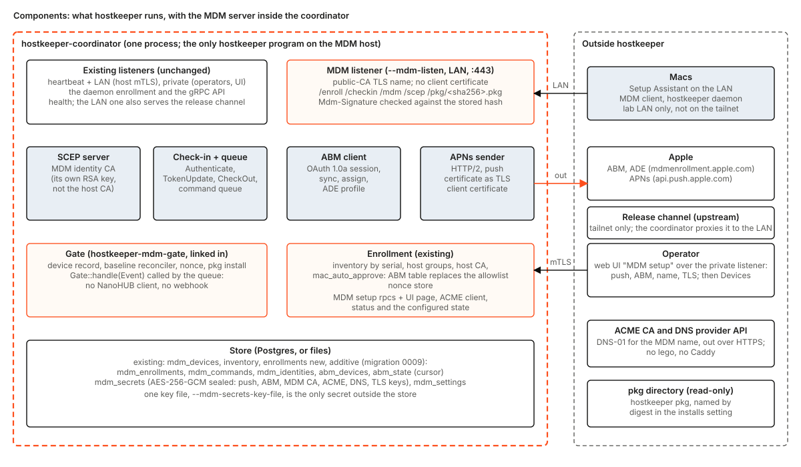
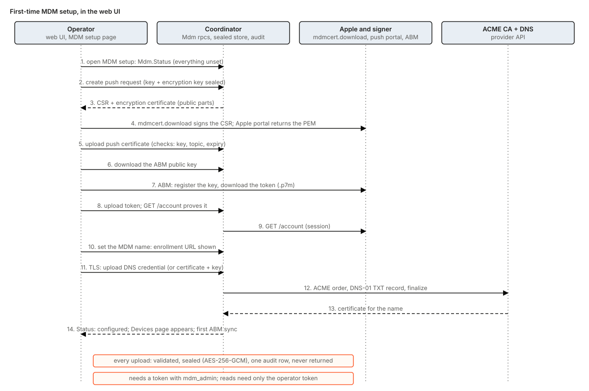
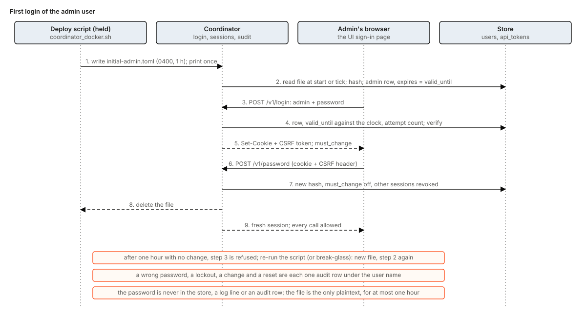
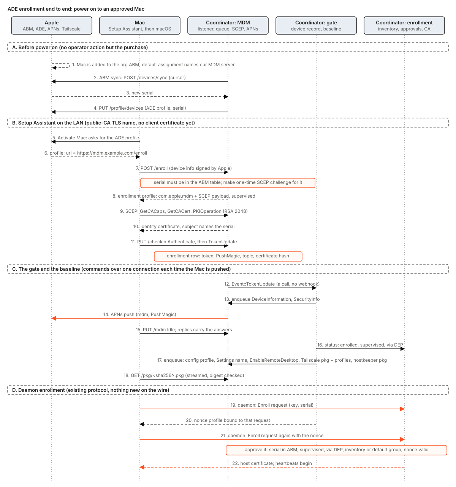
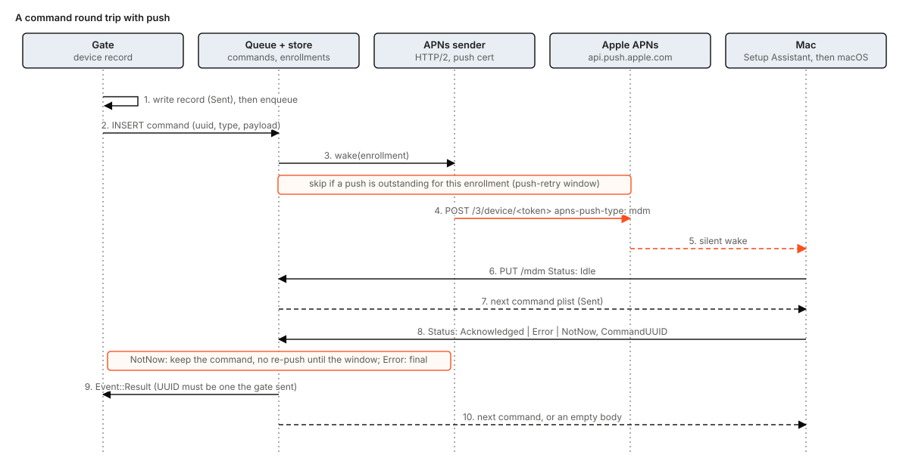
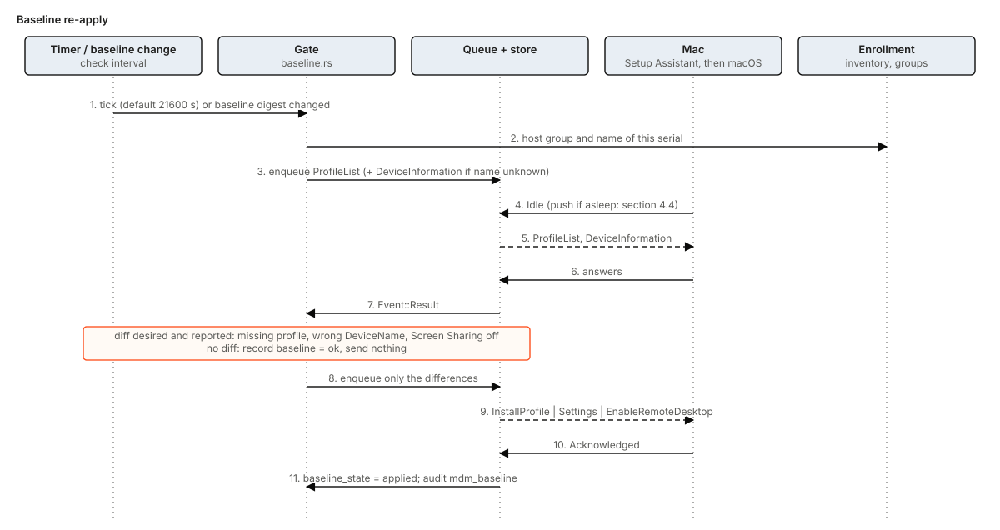
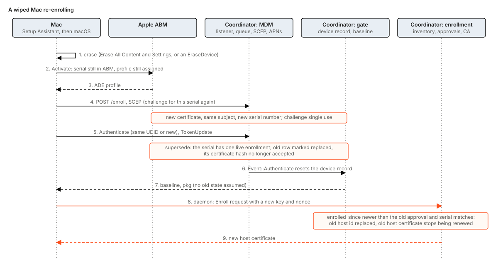
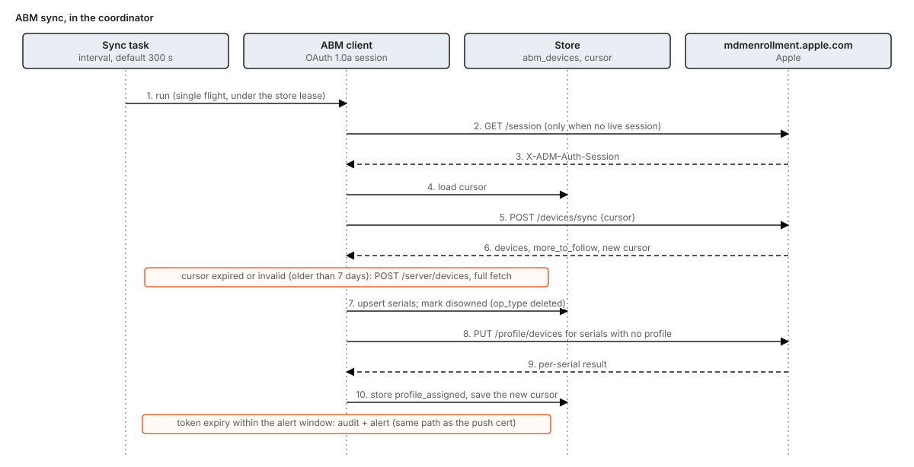

# Coordinator MDM: the MDM server inside the coordinator

Status: design, for the maintainers' comments and the owner's. Nothing in this document is built unless it is tagged **Built** with a
path. It is a living document: when a task below lands, its row changes from **Designed** to **Built** with the path, and the text of the
decision stays.

The owner's direction, in their words: "it's a better model that we just package MDM in the coordinator and then we are in full
control." The target is this path and no other step:

> buy a Mac on the org's Apple account, power it on, it enrolls, it gets hostkeeper, it talks to the coordinator, it receives its
> deployments.

No separate MDM stack for an operator to run, no per-serial list to redeploy, no Mac setting applied by hand.

A second direction (2026-11-10), which shapes sections 1.4, 4.9, 4.10 and 11: "eliminate the need to bring in that other software stack, and
then we can just run the coordinator that has mdm built in. When setting up the coordinator, it could be a thing in the UI to upload all
the necessary info for mdm registration, and then once it's configured, then we can onboard devices." So MDM is **set up in the
coordinator's web UI**, through the operator API behind it, not by flags, files, a held script or `hkctl` verbs, and the page that onboards
Macs appears only once the setup says "configured". The people who set it up sign in with a user name and a password (section 4.11), and
the Macs and wiped hosts take their packages from the coordinator on the lab LAN ([package-proxy.md](package-proxy.md)).

This document supersedes [hostkeeper-mdm.md](hostkeeper-mdm.md) in part. Section 1.4 says which parts. Section 4 of that document (the
daemon's config profile), section 5 (the nonce) and section 7 (the pkg, its signature and its delivery by digest) stand. The gate, its
device record and its decline tokens stand. What goes is the third-party server stack, the kit that installs it, and the loopback hop
between the stack and the gate.

## 1. What an operator sees

### 1.1 Before and after

| | Today (**Built**, as run on the farm) | After this design |
|---|---|---|
| Processes on the MDM host | The coordinator, and five more: `nanohub`, `depserver`, `depsyncer`, `scepserver`, Caddy with `lego` | The coordinator, and nothing else (the certificate is obtained in-process, 4.10) |
| Installed from | the coordinator image, the `mdm` deb or the `hostkeeper-mdm` kit tarball, and four pinned Go tools | the coordinator image |
| A new Mac | its serial is added to ABM, to the coordinator's serial allowlist (a redeploy) and the ADE profile is assigned by hand before the Mac first reaches Activate | the Mac is bought on the org account; nothing else |
| Which Macs are trusted | the serials in `--mac-serial-allowlist` | the serials Apple's ABM lists for the org's MDM server, plus supervision and the nonce; an inventory record may name the Mac |
| Name, group | per allowlist entry | from the Mac's inventory record by serial, else the default rule (section 4.6) |
| Screen Sharing, device name, extra profiles | by hand, or by a hand-made NanoHUB API call | the group baseline, applied at enrollment and re-applied (section 5.3) |
| Setting MDM up | unit files, tool storage and a held script on the MDM host | one page of the coordinator's web UI, "MDM setup" (4.9); Macs are onboarded on a second page that shows once setup says "configured" |
| Push certificate, ABM token, the MDM name's TLS certificate | uploaded into NanoHUB and NanoDEP storage; `lego` settings on the host | uploaded or obtained in the UI, held encrypted in the coordinator's store, never shown again; the operator renews them there |
| Signing in to the UI | pasting an operator token | a user name and password, a browser session; the first user, `admin`, gets a one-hour initial password from the deploy (4.11); tokens remain for automation |
| Packages for Macs and wiped hosts | a tailnet-only download server filled by a sync job | the coordinator's caching package proxy on the lab LAN, reading the public origins ([package-proxy.md](package-proxy.md)) |

What does not change: the Mac sees the same two things it sees today, an ADE profile that points at `https://mdm.example.com/enroll`
and an MDM server on that name. The daemon's enrollment, its nonce, its approval record and its host certificate are unchanged. The
operator API, the UI and `hkctl` gain verbs and pages; they lose none.

### 1.2 Where this came from

The stack in section 2 was proven live on `m3ultra-1` (serial `P24LH9H6JT`): supervised enrollment, `DeviceInformation`,
`EnableRemoteDesktop` and `Settings` (`DeviceName`, `HostName`) all worked through NanoHUB's API. Six things went wrong or were learnt on
the way (section 6 handles each by a mechanism). The owner's conclusion was that the operational shape, five foreign processes and the
gate on the far side of a loopback webhook, is the problem, so the server moves into the process that already owns the inventory, the
groups, the CA, the store and the operator API. The related designs are the console design (hostkeeper#284), whose baseline reconciler is
reused here, and the baseline pull request (hostkeeper#290).

### 1.3 Setting up MDM, as the operator sees it

The operator first signs in (section 4.11): a user name and password, and on the first login of `admin` a forced change of the initial
password. Then one page of the operator UI, **MDM setup**, with four steps and a status panel (section 4.9 has the mechanism, the storage
and the rules). Any signed-in user may do the setup; every step is audited under the user's name.

1. **Push certificate.** *Create the request*: the coordinator makes a key and the request the signing route takes. The route is the
   mdmcert.download service the org used for the current certificate: the page produces what that service needs,
   the operator *uploads the signed reply* it returns, the coordinator decrypts it with its own key, and the operator takes the result to
   Apple's push portal and *uploads the certificate* Apple returns. An Apple MDM vendor certificate is the alternative route (4.4). For
   the migration, *upload an existing certificate and key* instead.
2. **Apple Business Manager.** For the org's existing server entry (`js-mdm`), *upload the existing key pair* (the one NanoDEP holds) and
   the *server token* (NanoDEP keeps it decrypted, as its four parts and their expiry; `cargo xtask abm-takeover-token` assembles the JSON the page takes): ABM needs no change. Only if the key pair cannot be had, *download the
   coordinator's new public key*, add it in ABM as the MDM server's key, and upload the token ABM gives back.
3. **Name.** Set the MDM name (for example `mdm.example.com`). The page shows the enrollment URL the ADE profile will carry, and the DNS
   record the name needs.
4. **TLS certificate for the name.** The coordinator obtains it itself (ACME, DNS-01, section 4.10) from the GoDaddy API key and secret the
   operator uploads, or the operator uploads a certificate and key for the first cut.
5. **Status panel**, always shown: push topic and expiry, ABM token expiry and last sync, TLS expiry, and one word, *configured* or
   *not configured, because ...*, with the days left coloured at the alert thresholds.

Only when the status says *configured* does the **Devices** page of MDM appear: the Macs ABM lists, each one's enrollment state, host id,
group and baseline status. Before that the page says what is missing and links to the step.

### 1.4 What this supersedes in hostkeeper-mdm.md

| Section of hostkeeper-mdm.md | Status after this document |
|---|---|
| 2 State today: the rows for the server stack, TLS, ABM token, ADE profile, MDM kit | Superseded: those pieces are replaced (sections 3 to 5 here). The gate, coordinator-side and daemon-side rows stand |
| 3 Components: the rows "The MDM server stack" and "`hostkeeper-mdm` kit"; the paragraph that keeps NanoHUB's API on loopback | Superseded. "The gate is linked into the coordinator" stands and is extended: the queue it enqueues into is in-process. "What a compromise gets" is amended in section 9.2 |
| 4 Where the daemon config comes from | Stands |
| 5 The nonce | Stands. Only the source of "enrolled and supervised" changes (6.1 below) |
| 6.1 How the gate knows "enrolled and supervised" | Superseded in its source (the webhook becomes a call); its rules stand. 6.2 and 6.3 stand with section 6 here |
| 7 The pkg | Stands; 7.1's Caddy `/pkg` route becomes the coordinator's route (4.7 here) |
| 8 Migrating the live stack | Superseded by section 7 here. The `migrate --from` verb of the kit is not used again |
| 9 DNS for the MDM host | The record stands; the parts about Caddy's bind and `lego` are superseded by 4.1 and 4.10 |
| 10 Tests | The kit's tests go with the kit; the gate's stand |
| 12 Tasks M2 to M5, M6a, M6b, M7 | Superseded by section 11 here. M8's NanoHUB client and webhook are replaced (CM2, CM11a, CM14a) |
| 11, 13 | Stand; Q-numbers carry over |

## 2. What exists today

Facts, with the file that says them. The rest of this document is about the difference.

- **The stack** (the farm's MDM host, as run, from the audit of the go-live and its runbook): NanoHUB (NanoMDM, NanoCMD and KMFDDM behind one
  JSON API and a webhook), `depserver` and `depsyncer` (NanoDEP), `scepserver`, Caddy terminating TLS on the LAN address with a
  `lego` certificate for `mdm.example.com`. The coordinator talks to NanoHUB on loopback and receives its webhook on a loopback
  listener.
- **In this repository** (**Built**): `crates/hostkeeper-mdm-gate` (the NanoHUB client, the webhook, a durable record per Mac, the config
  profile, the nonce, the pkg push), `crates/hostkeeper-mdm-core` (profile and unit rendering, the pins), `crates/hostkeeper-mdm` (the
  install kit), `crates/hostkeeper-mdm-step`, and in the coordinator `src/mdm.rs`, `src/operator_mdm.rs`, `src/enrollment/mac_nonce.rs`,
  `src/enrollment/gate_port.rs`, `src/enrollment/device_state.rs`. The three kit crates together are roughly 12,000 lines of Rust whose
  only job is to install, pin and operate third-party Go binaries (measured with `wc -l` over `src/`: core 3,067, kit 6,833, step 2,096).
- **The coordinator's listeners** (**Built**): heartbeat, private, health, and `--lan-listen`, which serves the heartbeat surface on the
  LAN (`crates/hostkeeper-coordinator/src/config.rs`, `listen.rs`).
- **The coordinator's store** (**Built**): Postgres with `mdm_devices` (migration 0005, `older-releases: may-run`) or the file store;
  inventory records with a unique serial (coordinator-storage.md); host groups (hostgroups.md).
- **What is not there**: any SCEP, ACME, APNs, ABM or plist-protocol code, and any RSA or CMS crate in the workspace.

## 3. Components

The diagram boxes exactly what hostkeeper runs: one process. Everything that moves into it, and why it needs no process of its own:

| Piece | Replaces | Why it is not a process |
|---|---|---|
| MDM listener: `/enroll`, `/scep`, `/checkin`, `/mdm`, `/pkg/<sha256>.pkg`, and the package proxy's `/apt/<repo>/...` | Caddy's routes, NanoHUB's endpoints, `scepserver`, the pkg route, the tailnet download server | request handlers over `hyper`, which the coordinator already runs |
| Package proxy and its cache directory | the tailnet download server and its sync job | a route table, a directory with atomic rename, one origin fetch per key (package-proxy.md) |
| Operator login: users, sessions, API tokens | pasting a token from the tokens file | the login design (operator-login.md): two tables, password hashes, in-memory sessions and a cookie, on the private listener (4.11) |
| Check-in and queue | NanoMDM | a table of enrollments and a table of commands |
| SCEP server and the MDM identity CA | `scepserver` | three request types (`GetCACaps`, `GetCACert`, `PKIOperation`) with a signed and enveloped reply, written here because no Rust SCEP server exists (4.2) |
| APNs sender | NanoMDM's push | one HTTP/2 POST per wake, on `hyper` and `rustls`, which the workspace already has |
| ABM client and sync | `depserver`, `depsyncer` | one timer and six HTTPS calls |
| Gate | the same gate, one hop closer | called by the queue; no NanoHUB client, no webhook |
| MDM setup: secret records, settings, status | unit files, tool storage, the `lego` settings, the held script | a table of encrypted records and a settings row in the store, behind new `Mdm` rpcs and one UI page (4.9) |
| ACME client for the MDM name | Caddy and `lego` | one account, one order, one DNS-01 record through a provider call, on `hyper` and `rustls` (4.10) |

A new crate, `hostkeeper-mdm-server`, holds the protocol: the wire types, the queue, the SCEP request, the APNs and ABM clients. It
reaches the world only through ports (a store, a clock, an APNs sender, an ABM transport), each with a production implementation and a
fake, so the tests of section 10 are hermetic and deterministic (T10, T12). The coordinator links it, as it links the gate.

## 4. Decisions

Each has the reason and what it costs. "Verify" marks a claim that rests on the Apple schema or on source reading and not on a run; section
12 collects them.

### 4.1 Which endpoints, on which listener

**Decision.** A new fourth listener, `--mdm-listen <ip:port>` (a LAN interface address, as `--lan-listen` is checked: no wildcard), a new
`http::Surface::Mdm`, TLS from the certificate of the MDM name (public CA) that the setup holds in the store (4.9, 4.10); the
listener is bound at start, answers nothing until that certificate exists, and serves it, and each renewal, with no restart (a
certificate resolver reading the current one). The address is a flag because where to listen is bootstrap; everything else about MDM is
setup data (4.9). The coordinator takes **port 443 on the LAN address**, which Caddy held before. The container has no capability
below 1024 today (`coordinator_docker.sh`), so the held script lowers the container's own `net.ipv4.ip_unprivileged_port_start`
(a per-container sysctl, which needs the container's own network namespace; with host networking it is the host's sysctl, or a
capability instead). The script is the owner's (S3) and the choice is confirmed on the farm (section 12, item 17). Routes:

| Route | Who calls it | Authentication |
|---|---|---|
| `GET` and `POST /enroll` | Setup Assistant (the ADE profile's `url`) | none at TLS; the POST body is the Apple-signed device-information blob, checked (4.2) |
| `/scep` | the Mac's SCEP client, from the enrollment profile | a one-time challenge bound to the serial |
| `PUT /checkin` | the MDM client | a client certificate of the MDM CA, or the `Mdm-Signature` header; either way the certificate's hash must be the one stored for the enrollment |
| `PUT /mdm` | the MDM client | the same |
| `GET /pkg/<sha256>.pkg` | the MDM client, following `InstallEnterpriseApplication` | the digest is the capability: only files named in the installs setting |
| `GET /apt/<repo>/dists/...` and `/apt/<repo>/pool/...` | a host's apt, including a wiped host before it enrolls | none: public bytes, read-only, by the route shape; the client checks the signatures (package-proxy.md) |

The routes of this table are the whole surface of the listener: the setup rpcs, `/v1/*`, the sign-in routes and `/ui/` are on the private listener only, and on this one every other path answers `404` (a test asserts it for each of those, CM20; **Built**: `http::Surface::Mdm`, which `grpc::route` hands to the JSON router alone, with no gRPC, no gateway, no cookie and no token read, and which answers `404 not_found` to every request until each route of the table lands with its task). Each route family is served when its own prerequisites are set (package-proxy.md section 3): the proxy needs only the name and the certificate.

**Built (CM11a)**: the listener is `--mdm-listen <ip:port>` (a wildcard stops the start; the port is whatever the address says, 443 on the farm, set by the held script K1), `crates/hostkeeper-coordinator/src/mdm_server/`, and serves `PUT /checkin` and `PUT /mdm`. `/enroll` and `/scep` are not served: until CM12c Caddy routes them to the old stack and this listener answers `404` to them, as it does to the proxy's `/apt/` and `/pkg/` (PP2, CM11c). A method other than `PUT` is `405`, a body over 1 MiB is `400`, both before any credential is read. **`CheckOut`**: the live profile has `CheckOutWhenRemoved true` (spike `scep.md`), so a Mac whose profile is removed sends `CheckOut`, which ends its enrollment in one change (commands cancelled, identity retired) and is told to the gate; a Mac that is wiped sends none, and its enrollment is replaced by the next `Authenticate` of its serial (4.2). Whether the new profile keeps the key is CM12c's, and whether a macOS client sends it unprompted is unverified.

**The route-family switch** ([package-proxy.md](package-proxy.md) section 11 item 5, answered): `MdmServer::serves(family)` is asked for each request, so a family whose prerequisites are not met answers `503 unavailable` for each of its routes while the other is served. The proxy family needs the certificate and key of the name (without them no handshake is made at all); the MDM family needs that and a push identity (a push certificate with the key that matches it). Each later task adds its own prerequisite to that one function: the CA of the Macs' identities (CM12c) and the ABM token (CM13). The test `the_mdm_routes_answer_503_while_the_package_routes_are_served` holds it: with the certificate alone the MDM routes answer `503` and the package routes answer `404` (nothing is mounted on them yet), and once a push certificate is stored the MDM routes answer.

**What each route reads of the client certificate** (the table `client_cert`): `/enroll` and `/scep` read none (a Mac at Setup Assistant has none, and a certificate it offers is not looked at); `/checkin` and `/mdm` need a credential, either the TLS client certificate of the connection or an `Mdm-Signature` header (the live profile has `SignMessage true`, spike `scep.md`, so a Mac may present no certificate at all). A request with neither is `401`. Either way the SHA-256 of the certificate must be that of an identity the coordinator issued and that is still `Issued` in the identity table, and the live enrollment of the identity's serial must have been entered with that same certificate: the certificate of a replaced or checked-out enrollment is `401` from then on. The signature is checked by `mdm_server::signature`: CMS SignedData (detached) over the body, one signer found by issuer and serial or by key identifier, SHA-1/256/384/512 with RSA PKCS#1 v1.5, with or without signed attributes; it proves possession of the key, and the identity table, not a chain, says whether the coordinator issued the certificate.

**The TLS** (`mdm_server::tls`): the certificate and key of the name are read from the store for each connection when their versions or the trusted issuers changed, so a certificate uploaded or renewed is served from the next handshake on (a connection that is open keeps what it was accepted under), and a connection that arrives while there is none is closed. The client certificate is optional (rustls `allow_unauthenticated`), the verifier names the trusted issuers as the hint list, and a certificate that does not chain to one is refused at the handshake. The trusted issuers are `trusted_issuers()` in `config_mdm.rs`: empty until CM12c supplies the MDM CA, so until then no client certificate is trusted at the handshake and a Mac authenticates by its `Mdm-Signature` (a client that offers a certificate is then not asked for one). This is the one place the listener is behind the design's text, and it is the CA's.

**Why a listener of its own and not routes on the heartbeat or LAN listener.** The heartbeat surface admits any client certificate of the
host CA and is pinned by every daemon's `ca_sha256`. A Mac at Setup Assistant holds no certificate and trusts only public roots, so its
listener needs a public-CA server certificate and a different client-trust rule. Separating the listeners keeps the host CA's meaning
unchanged (B8) and keeps the Mac-facing surface to the routes above. `--lan-listen` stays for the daemons. Lesson 4 is this decision. The
public-CA certificate is also what lets apt on a host reach the package proxy, since apt trusts the system roots and not the host CA.

**Why public-CA TLS.** A freshly erased Mac trusts the system roots only. The ADE profile's `anchor_certs` is empty today and stays so;
putting a private CA in it is a second trust path to maintain, and the name `mdm.example.com` already has a public-CA certificate
today. The DNS record of hostkeeper-mdm.md section 9 stays, pointing at the new listener's address.

**TLS client-certificate rule.** `/checkin` and `/mdm` must receive the Mac's identity while `/enroll` and `/scep` must accept a client
with none, so the verifier is client-certificate-optional (rustls `allow_unauthenticated`) and each route checks for itself: `/checkin`
and `/mdm` refuse a request with neither a trusted certificate nor a valid `Mdm-Signature`, the other two ignore the certificate. A rustls
verifier sends root hints only for the issuers it is given, and a macOS client may decline to offer an identity that no hint names, so the
hint list holds the MDM CA (and any issuer the migration trusts). Verify with the farm Mac that it offers the identity (section 12, item 10).

**Is the `/enroll` response signed?** For ADE, Apple's text may require the returned enrollment profile to be CMS-signed. If so the signing
key is a second use of the public TLS key that the coordinator reads, and the signing is a task in CM12c. Not established; section 12, item 11.
The capture that decides it is the same capture as for the device blob (CM12a). The live stack's Mac enrolled with an unsigned response, so signing may not be needed. This rests on one Mac and one macOS version (27.0.x), and the POST was not seen (inferred, [coordinator-mdm-cm12a.md](coordinator-mdm-cm12a.md)). **Decided in CM12c: the profile is served unsigned** (a plain XML property list, as the live stack serves it); no signing is built. Item 11 stays open: if the first real enrollment shows a Mac refusing the unsigned profile, signing is a change to `mdm_enroll/enroll.rs` alone.

**An unknown enrollment.** What a Mac does with `401`, `403` or `410` from `/mdm` is not the same: some are read by the MDM client as
"this server no longer manages me" and remove management. The status for an enrollment the table does not know is chosen from Apple's
protocol text before CM11 (a `410` is not used until that text says what it does), and CM11 tests that no Mac-side state is lost on it
(a fake client keeps its profile). Section 12, item 12.

**Decided in CM11a** (Apple's text for the status codes could not be read, so this is the conservative choice, not a verified one): every request on `/checkin` and `/mdm` that the table does not know is answered `401` `{"error":"unauthorized"}`: no credential, a signature that does not verify, a certificate the coordinator did not issue, an identity a replacement or a check-out retired, and the certificate of an enrollment that is no longer the live one. `401` is what an HTTP client reads as "authenticate again"; `410 Gone` is never answered, and `403` is kept for a credential that is valid for something else (another device or serial than the message names, a replacement the rules refuse). The test `an_unknown_enrollment_keeps_the_fake_macs_state` runs a fake client that removes its profile only on `410`. What the real client does on `401` (retry, re-run `Authenticate`, back off) is not established; section 12, item 12 stays open until the farm Mac is observed.

**Certificate renewal.** Decided in 4.10: the coordinator obtains and renews the certificate itself (ACME DNS-01, in process), so no
unit, `lego` or file writer remains. Until that lands the operator can upload a certificate and key in the UI (4.9, step 4); the listener
serves whichever is current.

### 4.2 Device identity: SCEP, issued by its own CA, one identity per serial

**Decision.** SCEP (RFC 8894) served by the coordinator, with a new MDM identity CA that has its own RSA 2048 key, generated by the coordinator the first
time it is needed and held encrypted in the store (4.9). The identity's subject names the serial: `CN=<serial>`, `O=<org>` and an `OU=hostkeeper-mdm`, so there is no
shared empty DN. The challenge is per request: `POST /enroll` verifies the device-information blob, finds the serial in the ABM table,
makes a 32-byte challenge valid for one hour, and builds the enrollment profile with that challenge. The challenge is bound to the
serial, the blob's UDID and the ABM record's `profile_status` (`pushed`). `PKIOperation` is **idempotent**: consumption is keyed on the
challenge and the hash of the CSR's public key, in the transaction that records the issued certificate. A repeat with the same challenge
and key (a client whose CertRep was lost) gets the stored certificate again, **whatever its `transactionID`**, because the Mac's client
opens a new session with a new `transactionID` when it retries (measured on the live stack, `coordinator-mdm-cm12a.md`); a different key
presenting a consumed challenge is refused. A refused request still gets HTTP 200 with a signed FAILURE `CertRep` (what the Mac's client
reads), and a refusal consumes nothing. The library is `hostkeeper-mdm-scep` (CM12b): the challenge store is a port it calls once, atomically
(`Challenges::redeem`), and CM12c implements it on the store. It hashes the signed attributes as received and does not re-encode them, so a
sender's BER encoding does not break a valid message; `cms` (a pinned release candidate under R6, licences and bans pass) has no verify or decrypt
side, which the crate writes, and its builder omits `contentType` and `messageDigest` from a reply with no content, which the crate supplies
(a test checks a failure reply with a verifier of its own). `GetCACaps` answers `POSTPKIOperation`, `SHA-256`, `AES` and `SCEPStandard`; DES3 and
SHA-1 requests are accepted and not advertised, and there is no `Renewal` (renewal is the `InstallProfile` below). Which capabilities the Mac's
client requires is not measured; the first real-Mac run decides whether `DES3`, `SHA-1` or `Renewal` must be advertised.

The crate reads DER only; whether a Mac's CMS stack sends BER (indefinite lengths) is not measured, and a BER request is answered with an HTTP error
until a capture of a real request says otherwise. A `Replayed` verdict proves knowledge of the challenge and of the key's public half and not
possession of the private key (the reply is enveloped to the retry's signer certificate), so CM12c does not mark a device enrolled on it. The
envelope is opened with the CA's RSA key before the challenge can be read, from an unauthenticated signer, so CM12c rate-limits per peer before
calling `pki_operation` and keeps the refusal reason in the audit log, never in the reply. A validity no time can hold (a setting too large) is an error, not a panic.

**Why SCEP and not the alternatives.**

| Option | For | Against |
|---|---|---|
| SCEP (decided) | `com.apple.security.scep` since macOS 10.7; what the live stack runs and proved | no Rust SCEP server exists, so it is written here: `GetCACaps`, `GetCACert`, and a `PKIOperation` that opens a CMS envelope (RSA key transport, DES-EDE3 or AES-CBC content) and returns a signed and enveloped `CertRep`, on `rsa`, `cms`, `des`, `aes` and `cbc` (the RSA advisory is not a blocking one under R6); a CA of its own |
| Per-device PKCS#12 in the enrollment profile | no SCEP code; P-256 possible | the CA generates the private key and ships it inside a profile; whether macOS accepts P-256 as the MDM identity is not known. Verify. Rejected for the key exposure |
| ACME with `Attest` and `HardwareBound` | no shared secret; the certificate is bound to Apple-silicon hardware and the serial; the schema gives `com.apple.security.acme` since macOS 13.1 | no Rust ACME server crate was found; and whether `IdentityCertificateUUID` of `com.apple.mdm` accepts an ACME payload during ADE is not stated by Apple's schema, which says only that it "may also point to a SCEP payload". Verify on the farm Mac. Follow-up CM16 |

**Why a CA apart from the host CA.** The host CA is P-256 only (`ca/profile.rs` refuses other key types), its certificates are
admitted on the mTLS listeners, and every daemon pins it. An MDM identity is RSA, ships to a Mac before it is approved, and must never be
accepted by the heartbeat listener. A second key is additive and changes no pin.

**Verification of the enrolling device, and what happens when it cannot be checked.** The ADE POST to `/enroll` carries a PKCS#7 signed by
the device's Apple-issued identity. The coordinator verifies it against Apple's root and takes the serial and UDID from it, so a client on
the LAN cannot ask for a challenge for a serial it does not own. The blob carries no freshness, so a captured one can be replayed; the
challenge being bound to the UDID and to a serial whose ABM `profile_status` is `pushed` limits what a replay buys, and the nonce (4.6) is
the gate after it. What a replay does buy under owner decision B is stated in 9.2. Rules, which fail closed:

- Task **CM12a** first captures the real POST from the farm Mac and proves that the chain verifies. It comes before any `/enroll` code. The note [coordinator-mdm-cm12a.md](coordinator-mdm-cm12a.md) records that the capture could not be made on the farm Macs (one is not in ABM, the other is enrolled), lists three ways to get it, and recommends a setup-gated raw-body log in the first deployed coordinator. The device-identity intermediates were not found on Apple's CA page (one guessed URL returned 404); whether Apple publishes them elsewhere is unverified (inferred). Verification anchors at the Apple root. The first capture decides between taking the intermediates from the blob and shipping a pinned intermediate bundle; neither is settled.
- If it cannot be verified, `/enroll` **issues no challenge on its own**: the request waits as an operator click (the same place a
  `no_group` request waits), because a serial is not a secret and "the serial is in the ABM table" alone would let a LAN peer who knows one
  obtain an identity.
- **Replacement (owner decision B, 2026-11-10).** A new ADE enrollment (`Authenticate`) for a serial that is in the ABM table
  **replaces that serial's live enrollment automatically**: no operator confirmation, and no requirement that the old enrollment has
  checked out. The goal is that a wiped Mac re-enrolls with no click (5.4). The serial is **read from the ABM table again at the moment
  of replacement**, in the transaction that marks the old row replaced, and not only when `/enroll` issued the challenge: a serial
  removed from ABM in between is refused (audited, and it waits for the operator), because the challenge was issued while the serial was
  in the table and the table is the only thing the coordinator trusts about ownership. A Mac that is **not** in the ABM table never replaces
  a live enrollment by itself; the operator's confirmation stays the path for a Mac outside ABM, and an enrollment the operator confirmed
  replaces without the table. The model check of section 10 holds this rule over every schedule it explores, and finds that the table
  must be read at `Authenticate` and not only at `/enroll` (a serial removed between the two replaced a live enrollment when it was not).
  The price of the rule is stated in 9.2: a replayed blob verifies as well, so a peer that captured one can replace the Mac's enrollment.
  **Built (CM11a)**, `mdm_server/checkin.rs`: the `Authenticate` handler holds the check. It requires an issued identity whose serial and UDID are the message's (`mdm_serial_mismatch` audited otherwise), treats a repeat for the enrollment already live with that certificate as a no-op, and for another live enrollment reads the ABM table (a device listed and not removed) or the identity's operator confirmation before it writes the audit row `mdm_enrollment_replaced` and then replaces: one change of the store ends the old enrollment, cancels its commands and retires its identity, and the gate hears a `CheckOut` of the old id and an `Authenticate` of the new, so the serial is not ambiguous in its records. A refusal is `403` and the audit row `mdm_replace_refused`; a replacement whose audit row cannot be written is `503` and is not made. One `Authenticate` runs at a time. **Limit**: the table store has no call that reads the ABM table and replaces in one transaction, so a sync that removes the serial between the two calls lets one replacement through, which its audit row shows; the next `Authenticate` reads the table again. Closing it takes a store call that does both (not built).
- A request on an identity that is replaced or checked out, or on a certificate this CA did not issue, changes nothing.
- ACME with attestation (CM16) is the real fix for the weaker case, since the certificate is then bound to the hardware. 9.2 says so.

**Built (CM12c)**, `crates/hostkeeper-mdm-ade` (the blob and the profile, pure), `crates/hostkeeper-coordinator/src/mdm_enroll/` (the routes) and `operator_mdm_enroll.rs` (the operator's two rpcs):

- **The blob.** `hostkeeper_mdm_ade::blob::verify` reads the `SignedData` from the bytes as received, checks the `messageDigest` and the signature over the signed attributes as sent (not re-encoded), walks the chain from the signer through the certificates of the blob to one of the roots given (Apple Root CA and Apple Root CA - G3 are shipped, `roots.rs`; a test injects a fake Apple), checks every certificate's validity at the time, requires every issuer in it to be a CA (`basicConstraints` `cA`, `keyUsage` `keyCertSign` when present, `pathLenConstraint` kept) and the signer's own certificate not to be one, and only then reads the plist (`SERIAL`, `UDID`, `PRODUCT`, `VERSION`). It implements RSA with SHA-1, SHA-256, SHA-384 and SHA-512, and ECDSA with P-256 and SHA-256 or P-384 and SHA-384 (the keys of Apple Root CA and of Apple Root CA - G3), DER encodings, and a signer named by issuer and serial. **What a verified blob proves** is that its signer holds a certificate that chains to the root through CAs, not that the certificate is a Mac's device identity: Apple's device-identity CA is not pinned, because no real chain was seen to read its name from, so a certificate Apple issued for another use directly under a CA that also signs device identities would verify. Item 4 of section 12 carries the pin (the issuer of the real device certificate, or its serial against the plist's `SERIAL`) for when a blob is captured. **No real blob was seen** (CM12a), so item 4 of section 12 stays open: the verifier is proved against a fake Apple only. A real blob outside the implemented shape (BER, a signer named by key identifier, another curve, an intermediate that is not in the blob) is **not verified**, and the fail-closed rule below is what the coordinator does then; it never lets such a blob through.
- **`/enroll`** (`POST`; a `GET` is a manual enrollment and is declined `403 serial_not_in_abm`). The order is: the peer's rate (`enroll_rate_per_min`, `429`), the prerequisites (the name `mdm_name`, a push identity for the topic; else `503 unavailable`), the blob, the serial (letters and digits, 1 to 64; else `400`), **the ABM table** (a serial it does not list or lists removed is declined `403 serial_not_in_abm`, verified or not, audited once a window as `mdm_enroll_declined`), then
  - a verified blob: a challenge of 32 random bytes in hex, kept as its SHA-256 only (`mdm_identities`, bound to the serial and the blob's UDID, valid `challenge_ttl_s`, default 3600, `confirmed` false), and the enrollment profile (`hostkeeper_mdm_ade::profile`: a SCEP payload at `https://<mdm_name>/scep` with the challenge, and an MDM payload with `CheckInURL` `/checkin`, `ServerURL` `/mdm`, the push topic and `SignMessage`) as `application/x-apple-aspen-config`, unsigned;
  - an unverified blob: **no challenge**. The request is held in memory (`mdm_enroll/pending.rs`, at most `enroll_pending_max` serials, the oldest unconfirmed dropped for a new one) with the verifier's reason and answered `503 waiting_for_operator`; the first post is audited `mdm_enroll_held`. The list is `Mdm.ListEnrollmentRequests`; **`Mdm.ConfirmEnrollment` (session-only)** reads the ABM table again and, for a serial it lists, marks the row confirmed for `challenge_ttl_s`; the next post of that serial **from the UDID that waited** is given a challenge with `confirmed` true, once, and the row is gone. A restart empties the list (the Mac posts again) and a confirmation with it.
  - **Replay before the first enrollment** (an unverified blob copied by a peer): it holds the serial's place in the list, and what it can win is a confirmation of its own UDID by an operator who sees that UDID listed; it is never an approval (approval is the gate's, from the nonce, CM9) and it creates no challenge, identity or enrollment. A verified blob that is replayed does get a challenge, and the price of that is in 9.2.
- **`/scep`** (`GetCACaps`, `GetCACert`, `PKIOperation` by POST, which is what the Mac sends) over the library of CM12b and the challenges in the tables (`mdm_enroll/scep.rs`, `StoreChallenges`). A refusal consumes nothing. Retry rules, tested: **an unconsumed challenge is redeemed by a retry with the same key in a new session** (a new `transactionID`, as the old stack's journal shows macOS retrying); a **consumed challenge answers the same key with the certificate stored** and **another key with a failure `CertRep`** (`badRequest`); an expired, unknown, retired or dead challenge is a failure `CertRep`; a request that loses a race on the challenge gets the winner's certificate or a failure by the same rule. A message that names no transaction is `400`. Each peer is limited before any RSA operation runs.
- **The identity CA** (`mdm_enroll/ca.rs`): made at the first need (`GetCACert`, a `PKIOperation`, or the first profile), RSA 2048, `CN=hostkeeper MDM CA`, `ca_days` (3650), apart from the host CA; its key and certificate are one sealed secret, `mdm_ca_key` (a four-byte length, the certificate, the PKCS#8 key), stored after an audit row `mdm_ca_created`; two needs at once make one. It is added to the hint list of the listener's TLS (`trusted_issuers`). The identity is `CN=<serial>,O=<identity_org>,OU=hostkeeper-mdm`, RSA 2048, client authentication, `identity_days` (1095).
- **Renewal alert**: `mdm_identity_near_expiry` lists the serials of live enrollments whose identity expires within `renew_alert_days` (90), and the CA when it does; its version is the window or `expired`. That macOS renews a SCEP identity inside the MDM payload is **not established** (item 3), so the way to renew is to enroll the Mac again (a wipe, or an `InstallProfile` of a fresh enrollment profile, which no task here builds): the alert is the only renewal there is.
- **Settings** (each with its default from the start): `identity_days`, `renew_alert_days`, `challenge_ttl_s`, `ca_days`, `identity_org`, `enroll_rate_per_min`, `enroll_pending_max`.
- **Tests**: `mdm_enroll/*_tests.rs`, including `flow_tests.rs`, a fake Mac that runs 5.1 from the blob to the first `TokenUpdate`, and the traces of the model check: a wiped Mac that never checked out, a serial removed from ABM between the challenge and `Authenticate`, an operator-confirmed enrollment past a table that no longer lists the serial, and a replay before the first enrollment.

**Renewal.** Identity validity is the setting `identity_days`, default 1095 (a tunable, with its default from the start, edited on the setup page). At
`renew_alert_days` (default 90) before expiry, the coordinator raises an alert listing the serials, through the path the push certificate
uses (4.4). Whether
macOS renews a SCEP identity inside the MDM payload by itself is not established by anything read. Verify on the farm Mac. If it does not,
renewal is an `InstallProfile` of a fresh enrollment payload for the same topic (Apple's schema says the topic must never change on
update, and it does not), which is one more baseline item. Lesson 2 is this subject rule.

### 4.3 APNs push

**Decision.** An in-process HTTP/2 client on `hyper` and `rustls` (both already in the workspace, `ring` provider), with the MDM push
certificate and key that the setup holds (4.9) as the TLS client identity. `POST https://api.push.apple.com/3/device/<hex token>`
with `apns-topic` the topic of the certificate, `apns-push-type: mdm`, body `{"mdm":"<PushMagic>"}`. One connection is kept and reused.
Verify the header and status details against Apple's documentation, which could not be fetched while this was written; they rest on
Apple's schema, the `a2` crate's source and NanoMDM's behaviour.

**Why not the `a2` crate.** It pins rustls 0.22 and `hyper-rustls` 0.26, a second TLS stack next to the workspace's rustls 0.23, and its
certificate path needs OpenSSL. The in-house client is a few hundred lines with a fake behind the port.

**Rules.**

- One push per wake. A push is "outstanding" for an enrollment until **any request from that enrollment reaches `/mdm`** (the Mac is
  awake and draining its whole queue on one connection, so a command enqueued ten minutes later gets a new push at once).
  the setting `push_retry_s` (default 3600) is only a floor for repeating a push to a Mac that has not connected since the last one.
- **`NotNow` arms the push floor.** `NotNow` keeps the command (back to `Queued`) and arms the floor, so the command gets a later push
  once `push_retry_s` has passed and never one inside it. Without that arm a deferred command has no wake after the Mac closes the
  connection (the model check of section 10 finds it).
- **A command returned to the queue by the timeout is pushed again**: the return (a `Sent` row older than `--mdm-command-timeout-s`) arms the
  same floor, because the Mac may have dropped the connection that held it.
- **A claim skips a command already tried on the same connection** (delivered or deferred on it), so a Mac that answers `NotNow` is not
  handed the same command in a loop; the command waits for the next connection.
- **Delivery is at least once.** A command is held by one connection at a time only while the Mac answers within the timeout or never; a
  slow Mac that answers after the timeout fired sees the command twice. Commands of the pinned list and the gate's handling of a result
  must therefore be safe to repeat (a result for a command already at an end state is dropped, 5.2).
- Each push sets `apns-priority` (the setting `push_priority`, 10 or 5, default 10) and `apns-expiration`: the time APNs keeps the push
  until, which is an **absolute** time (Apple's text for the header, not read here; the spike's `86400` got a `200`, which does not tell
  a 1970 time from a duration), so the header is the clock's now plus `push_expiry_s` (default 86400), and `0` when the setting is 0 (APNs
  tries once and keeps nothing; accepted by APNs, a policy choice and not an API rule). The floor is `push_retry_s` (3600) and the
  connection and answer timeout `push_timeout_s` (30); all four are settings with defaults.
- **What APNs answers** (measured by the spike, except where said). `400 BadDeviceToken` is terminal for that token (an unknown
  token gives `400`, not `410`): the token is dead until the next `TokenUpdate` replaces it, and so is a `410`. `400 TopicDisallowed` is a
  setup mistake (the topic is not the certificate's), the same for every Mac. A certificate APNs refuses by environment arrives as an HTTP/2
  GOAWAY whose payload is `{"reason":"BadCertificateEnvironment"}`, not as a response: a connection error that carries it, or a TLS
  alert about the certificate, is a certificate alert. `403 MissingProviderToken` is what a missing client certificate gets and is not the
  expiry signal; any other `403` is taken as a certificate APNs refuses and raises the certificate alert, **which is unverified**
  (what an expired or revoked certificate gets was not provoked). `429`, `500` and `503` leave the floor armed and are tried again after
  it; `410`, `429` and `503` were not provoked.
- **Built** (CM7, `crates/hostkeeper-mdm-push`): the sender (`apns`), the rules above as a state machine over an injected clock
  (`policy`, with a test named for each rule of the model check) and the sender with that policy (`pusher`). The queue (CM11a) calls it
  when a command is queued, times out or answers `NotNow`, and when a Mac connects. **Built (CM11a)**, `mdm_server/queue.rs`: the in-process queue calls it, and replaces NanoHUB's: the gate puts its commands through the port `CommandQueue` (the NanoHUB client is the other implementation, until CM14a deletes it), a `/mdm` request claims and answers through the table store, and `MdmServer`'s sweep (every `--mdm-queue-sweep-s`) returns the commands whose `--mdm-command-timeout-s` passed and pushes a Mac whose floor elapsed with a command queued. The sweep reads the store, not memory, for who waits (`enrollments_with_queued`: live enrollments holding a `Queued` command): an enrollment new to the process gets its floor armed at its first sweep, so after a restart or deploy a Mac with a command left queued is pushed one `push_retry_s` after the first sweep, not never. A `TokenUpdate` carrying `UserID`, `EnrollmentUserID` or `NotOnConsole` true is a user channel's and never replaces the device's push token. Each invariant of the model check of the queue is a test of `queue_tests.rs` named for it.
- A command that waits without a push-capable token waits for the Mac's next connection. That a Mac polls on any schedule is **not**
  established by anything read (section 12, item 13); the design does not depend on it, and the push is the wake.

### 4.4 The push certificate: where it comes from and how it renews

The push certificate is the only dependency Apple does not let the coordinator remove, and this document does not hide that.

**Facts established from Apple's page and the MicroMDM guide.** A push certificate is created at identity.apple.com from a CSR that must
be signed by an Apple "MDM vendor CSR signing certificate", which the Account Holder of a Developer Program account requests from Apple.
Community signers (the community mdmcert service) exist and the MicroMDM guide labels them for testing and development. ABM does not issue push
certificates. It lasts one year, and it is renewed with the same Apple Account that created it and the same topic. The org's certificate
has the topic `com.apple.mgmt.External.d1801ae1-3ef7-483e-9f6d-4979e2ebfc09`; the audit infers expiry about 2027-11-07 and did not read it.

**Decision.**

1. The coordinator **carries over** the existing certificate and key (section 7): the operator uploads the pair in the UI (4.9), so no new
   certificate is needed for the migration and the topic in every enrollment never changes.
2. The coordinator owns the lifecycle from then on, from the MDM setup page (4.9): *Create the request* makes a key (held encrypted, never
   shown) and returns a CSR to download.
   The vendor's signing step takes that CSR and returns a **plist** (the CSR, the vendor certificate chain and a signature over the
   CSR) that is uploaded to identity.apple.com, which returns the PEM certificate; the page therefore also offers the CSR in the form
   the vendor tool takes, and the exact input and output are read off the vendor tool, not assumed here (the mdmcert.download route is in step 3).
   *Upload the certificate* accepts the PEM Apple returns, checks that it matches the pending key, and on a renewal that its topic equals the
   current topic, and swaps it in atomically; `Mdm.Status` reports topic and expiry (never the key). The coordinator's existing alert path
   (**Built**: `Alerts.List`) raises an alert at `push_alert_days` (default 60) before expiry and again at 14, and the status panel shows
   the days left.
3. **Signing the CSR is outside the coordinator**, by a service or a certificate it does not hold. The org's current certificate came from
   **mdmcert.download** (the org went to the site and did it), so renewal follows that route and the page supports it:
   the coordinator generates, besides the push key and CSR, an encryption key pair, and offers the request the service takes (the CSR
   and the encryption certificate, public parts only). The service signs the CSR and returns it encrypted to that certificate; the operator
   uploads the reply, the coordinator decrypts it with the encryption key (held sealed, 4.9) and offers the signed request as a download
   for Apple's push portal, which returns the PEM that step 1b takes. **Read from the service's own client** (micromdm's
   `mdmctl mdmcert.download`, CM7): the coordinator posts the request itself, `POST https://mdmcert.download/api/v1/signrequest` with the
   JSON `{csr: base64(PEM CSR), email, key: <a public API key every client of the service sends>, encrypt: base64(PEM encryption
   certificate)}`, and the service's answer to the call is only `{"result": "success"}` or a refusal with a `reason`: **the signed request
   arrives by email** to the address in the request, as an attachment, hex text of a PKCS#7 enveloped message encrypted to the encryption
   certificate. The operator uploads the attachment as the mail has it (hex text or raw bytes), and the coordinator decrypts it (RSA key
   transport, then AES-CBC or DES-EDE3-CBC, the ciphers the client's PKCS#7 reader takes) and checks that it is the signed request for the
   pending CSR. The CSR is RSA 2048 with `C=US`, `CN=mdm-push` and the email as `emailAddress`; the encryption certificate is self-signed,
   RSA 2048, `CN=mdmcert.download`, valid a year. **Not verified** (one real request with the owner's email would; none was sent): that the
   API key constant is still accepted, the name and encoding of the attachment beyond the client's source, which content cipher the
   service uses (a cipher that is not read is refused naming its identifier), and the keys of the decrypted property list
   (`PushCertRequestCSR`, `PushCertCertificateChain`, `PushCertSignature`, as the client writes them), so the check is lenient about the
   form of the CSR in it. A first real request is also the test that the coordinator's own CSR is accepted by Apple.
   **The dependency, plainly.** mdmcert.download is a third-party community service, not Apple's; the MicroMDM guide labels such signers
   for testing and development, and the push certificate cannot be renewed in 2027 if the service is gone, so its availability is checked
   before 2027-09 (section 12, item 8). The alternative is an Apple **MDM vendor CSR signing certificate** (requested by the Developer
   Program Account Holder), which the page supports as a second route: the CSR is downloaded and signed outside by whoever holds that
   certificate. The page does not require either; the one rule is that the certificate uploaded matches the key the coordinator made.

### 4.5 ABM sync, in process

**Decision.** A task in the coordinator, single-flight under the store's lease, every `abm_sync_s` (default 300). It speaks to
`https://mdmenrollment.apple.com` with OAuth 1.0a (HMAC-SHA1, the four-part token), exchanging it (`GET /session`) for an `X-ADM-Auth-Session` that it
caches and refreshes. Every call carries `X-Server-Protocol-Version`; a `429` is retried after its `Retry-After`, and an auth-session
error refreshes the session once. These protocol details rest on NanoDEP's source and are unverified (section 12, item 1). HMAC-SHA1 is about sixty lines on `ring`; no OAuth crate is needed.

- **Token and key.** ABM hands over a `.p7m` encrypted to the server entry's public key. **The coordinator takes over NanoDEP's existing key
  pair and token** (section 7): the operator uploads the private key and certificate and the token, and the coordinator keeps the key and the four token parts
  encrypted in the store (4.9); `GET /account` proves them before the upload is accepted. **The token's takeover input is not a `.p7m`** (spike abm, 1):
  NanoDEP keeps the four decrypted parts and the expiry, so the token upload takes a small JSON of them, and the `.p7m` (decrypted with `cms` and `rsa`
  under the coordinator's own key) is the input of the fallback path alone. Because the token is encrypted to that key, ABM's entry (`js-mdm`) needs no change at all. Only as a fallback, when
  the key pair cannot be read out of NanoDEP, the coordinator generates a new RSA key and self-signed certificate (the page's *Download the
  public key* returns the certificate to add in ABM) and the operator uploads the token ABM then returns. Expiry is read from the token and
  alerted at `abm_alert_days` (default 60). The live token expires 2027-10-31.
- **Sync.** `POST /devices/sync` with the stored cursor, new serials upserted into `abm_devices`, devices that ABM reports as removed marked
  so, then the assignment call for every serial that has no profile assigned: `POST /profile/devices` as Apple's current text has it, falling
  back to `PUT` on a `4xx` (NanoDEP uses `PUT`, for the depsim simulator, and says so in its source). A first run, an invalid cursor or one older than seven
  days does a full fetch (`POST /server/devices`), which also returns Macs already assigned. NanoDEP's assigner is the pattern.
- **The ADE profile's UUID** is the column `abm_state.profile_uuid`. NanoDEP's stored profile is not read, so the coordinator defines
  its own profile, stores the new UUID, and the sync reassigns the devices; the devices already assigned to the old profile keep it, and
  it names the same `url`, so they still enroll.
- **The ADE profile** is defined at start if its stored digest differs from the rendered one, from the existing `AdeProfile` renderer
  (**Built**, `crates/hostkeeper-mdm-core/src/profile.rs`, moved into the new crate), `url` being `https://<mdm name>/enroll`, the name set in step 3 of the setup (4.9).
- **ABM's own default device assignment** (Mac devices of a purchase go to an MDM server without a click) is set on the org's tenant
  (it points at `js-mdm`, the MDM server entry of the current stack). So a purchase reaches that server's device list with no operator
  action, and the sync then assigns the ADE profile (lesson 1). The coordinator holds `js-mdm`'s own key pair and token, so ABM's default
  assignment needs no change.

**Built (CM13)** (`crates/hostkeeper-coordinator/src/abm/` and `operator_abm.rs`). The transport is a port (`AbmTransport`) with an HTTPS implementation
(`HttpsTransport`, HTTP/1.1 over rustls, one connection a request, the host's roots, answers read to 16 MiB) and a scripted fake and a simulated ABM for the tests,
so that no test opens a socket. `oauth.rs` signs `GET /session` as the spike measured it (HMAC-SHA1 over `GET&enc(url)&enc(sorted params)`, key
`enc(consumer_secret)&enc(access_secret)`, RFC 3986 encoding). `client.rs` keeps the `X-ADM-Auth-Session` for the token it was made for and sends
`X-Server-Protocol-Version: 3` on every call; a `403`, or a `200` whose body is not JSON, refreshes the session once and repeats the call, and a second one is
surfaced; on `/session` a `403` that says `signature_invalid` is a fault of the credential and one that says `timestamp_refused` a fault of this machine's clock (the upload
answers `abm_credential_refused` and `abm_clock_refused`); a `429` that names `Retry-After` is repeated after it (the setting `abm_retries`, each wait cut to `abm_sync_s`), and a `400` whose body names a cursor (`INVALID_CURSOR`; `EXPIRED_CURSOR`, `EXHAUSTED_CURSOR` and `CURSOR_ALREADY_USED` are matched by name, not verified live) is its own error.
`sync` is `Abm::sync_once`: a full fetch (`POST /server/devices`, pages of 1000) when there is no cursor, the last pass is older than seven days or ABM answers
a cursor error, otherwise `POST /devices/sync` with the cursor; the devices, the serials a full fetch no longer lists (marked removed; a sync's `deleted` also removes, a `profile_status` of `removed` does not, and such a device is assigned the profile again), and the cursor are written in one change
(`abm_apply`). Then, when the setting `mdm_name` names a host name, the ADE profile (`profile.rs`: the live profile's flags, `url` `https://<mdm_name>/enroll`, named by `ade_profile_name`) is defined at ABM when its digest differs
from the stored one (`POST /profile`), and every device that has no profile is given it (`POST /profile/devices`, `PUT` when the `POST` is answered with a `4xx`); a device ABM does not give it (`NOT_ACCESSIBLE`) is tried again by the next pass; a device already on a profile is left on it. **Nothing is written to ABM
until an operator has uploaded a token and named the MDM host; the assignment write was not probed in the spike and runs only against the fake in the tests.** A single timer (`abm_sync_every`, the setting `abm_sync_s`, default 300) runs the passes;
taking them under the store's lease is CM19. `Abm::serial_in_abm` (and `Coordinator::serial_in_abm`) is the read the approval (CM9) and the enrollment (CM12c) ask: a serial in `abm_devices` and not marked removed; one that is not is declined `serial_not_in_abm`.
The two `Mdm` rpcs, both session-only: `PutAbmToken` (the JSON of the four parts and `access_secret_expiry`, or a `.p7m` opened with the `abm_key` held by CMS key transport, RSAES-PKCS1-v1_5 or RSAES-OAEP, and AES-CBC or 3DES-CBC content; the token is proved to Apple with a session and `GET /account` before it is kept, its expiry is the token's own,
and the answer names the server entry and the organisation Apple says it belongs to) and `GetAbmPublicKey` (the certificate of the key pair, made once, RSA 2048, when none is held; calls are serialized, and a certificate held without its key is refused `abm_key_missing`, never replaced). `PutSecret` judges `abm_key` (an RSA private key in PEM, PKCS#1 or PKCS#8) and `abm_cert` (a certificate, made for the key when one is held) at upload.
The `.p7m` decryption rests on the CMS and S/MIME standards and a round trip with a synthetic token; no `.p7m` that Apple made was available. The one-off reader of the takeover is `cargo xtask abm-takeover-token` ([the runbook](../operations/abm-takeover.md)).
The MDM tables are opened only when the database is used or, with files, `--mdm-secrets-key-file` is given (`<state-file>.mdm/`), so a farm that does not use MDM gets no directory. Not built here: the status of the sync for the setup page (`Abm::status` is kept for CM21), the setting `mdm_name` itself (CM21 declares it; the sync reads it as a plain setting until then), and the lease (CM19).

**Cost.** One external request every five minutes when nothing changed, one more per page of changes, one per profile assignment batch.
That is 288 requests a day idle. The interval is a tunable so the cost and the window below can be traded.

### 4.6 Auto-approval of supervised ABM Macs, and how a host gets its name, role and group

The allowlist did three jobs: it said "this serial is ours", it gave a host id, and it gave a group. Each now has a source.

| Job | Today | After |
|---|---|---|
| "ours" | serial is a `[[mac]]` entry | serial is in `abm_devices` for our ABM token, not marked removed |
| host id | `host_id_prefix` plus the lower-cased serial | the inventory record for the serial, if any (`host_id`); else the setting `host_id_prefix` plus the lower-cased serial |
| group | the entry's `host_group` or `role` | the inventory record's `role` read as the group (as the allowlist's `role` is today); else the setting `default_group`; when neither exists the request is declined `no_group` and waits for an operator |

`mac_auto_approve` keeps its order and its nine decline tokens (**Built**: the four `device_*`/`serial_*` tokens and `device_state_unavailable` in `crates/hostkeeper-coordinator/src/enrollment/mac_nonce.rs`, the five `nonce_*` tokens in `crates/hostkeeper-enrollment/src/enroll/mac_nonce.rs`). Only
its first lookup changes, and these are added, additively: `serial_not_in_abm`, `device_not_via_dep`, `no_group`. The tokens form the family of the built ones (`device_*` for what a device reports, `serial_*` for the list, `nonce_*` for the nonce), and a test pins the full list of twelve. The conditions for approval
are all of:

1. the serial is in the ABM table (Apple's attestation of ownership; a stronger claim than "a Mac says it is supervised");
2. the MDM enrollment is the current one for that serial, supervised per `DeviceInformation` `IsSupervised`, and `SecurityInfo` says
   `EnrolledViaDEP` (the gate records both today; **CM3** passes `enrolled_via_dep` through `DeviceStatus`). Both are what the Mac says about itself, so they are evidence only after the identity was issued under the fail-closed rule of 4.2;
3. a group resolves;
4. the nonce, as today: single-use, one hour, bound to the request and the serial, which proves the pkg installed and the daemon runs.

**Name from inventory.** The baseline's `Settings` command sets `DeviceName` to the host id and `HostName` to the same lower-case DNS-safe
string. A Mac without an inventory record gets the default rule's id. Changing the inventory's `host_id` changes the baseline target and
the next re-apply (5.3) sends the new name. The schema's `Settings` entry for macOS is device channel and not user-enrollment, and
Apple's text says `DeviceName` is available on supervised devices only; supervised is what this design assumes anyway.

**The old allowlist** stays one release as an optional override that wins for the serials it lists (B8: no format is removed), and is
deleted in CM14c. A deployment that holds no host groups keeps the allowlist as its only source, because services come only from groups or
from allowlist entries.

**What the owner gives up.** Every Mac in the org's ABM that reaches the MDM server is eligible. The safeguard is `default_group`:
leave it unset and a Mac with no inventory record is declined `no_group` and waits for an operator, which is today's behaviour for an
unlisted Mac, one click instead of a redeploy.

### 4.7 The hostkeeper pkg, the LAN-only Mac and extra profiles

**Pkg delivery** is `InstallEnterpriseApplication` with the inline manifest the gate sends today (**Built**,
`crates/hostkeeper-mdm-gate/src/pkg.rs`), whose `url` is `https://<mdm name>/pkg/<sha256>.pkg`, now served by the MDM listener from
`--mdm-pkg-dir` (a directory of files the host provides, so a flag), streamed with a `Content-Length` and the digest checked, never
buffered whole (the pattern of `repository_serve.rs`). The manifest stays inline: the command schema offers `ManifestURL` too, but an
inline manifest needs no second fetch and no second route. The pkg allowlist becomes the setting `installs`, a list of named installs
(`name, bundle_id, sha256, version, path`, and an optional `url` the package proxy pulls the file from), edited on the setup page and kept in the store; the old file is read once as the starting
value, additively. `pkg.rs` hard-codes `dev.hostkeeper.hostkeeper`; CM8 makes it a list, so a second pkg needs no code. Additive: the old
single-pkg file is read as one install named `hostkeeper`. The pkg files stay a directory because they are files the host provides,
not configuration.

**The Mac is on the lab LAN only** (the coordinator is on the tailnet, the Macs will not be). There is no Tailscale install, no tagged key
and no VPN or system-extension profile in this design, and a Mac holds no secret beyond its own identity. Everything a Mac talks to is on
the LAN: the MDM listener (enrollment, check-in, commands, the pkg, the package proxy) and the LAN listener (the daemon's enrollment and
heartbeats, **Built**).

**Packages on the LAN: the coordinator is a caching proxy, and the download server is gone.** The tailnet-only download server, which a
sync job filled from each release, is retired (the repository side was deleted already; the farm side is in package-proxy.md section 6).
Hosts and Macs pull packages from the public origins (apt from the public repository, the signed macOS pkg from its release host), and so
that a Mac, a wiped host or a bulk update uses the lab network and not the site's uplink (5G against 25 to 100 Gbit inside), the coordinator
answers those requests on the MDM listener from a cache directory and fetches from the origin once per file. It adds no trust: apt checks
the signed `Release` file, the daemon checks every package's digest and attestation against its own trusted signers (hostkeeper-design.md,
"A compromised release channel can only serve bytes", which holds for the proxy as it did for the channel), and the Mac checks the pkg's
signature, so a poisoned cache is refused by the client. The pkg route of 4.1 is the first user: with an origin `url` on an `installs`
entry it pulls the file through and commits it only if its SHA-256 equals the digest in the path. There is no object-store cache for now.
The design, the routes, the cache rules and the tasks are in [package-proxy.md](package-proxy.md) (tasks PP1 to PP6).

**The ordering that makes lesson 5 harmless.** The hostkeeper pkg carries the daemon binary (**Built**, `packaged.rs` seeds it), so the
first daemon runs and enrolls over the LAN listener with no package source at all; it fetches updates through the package proxy afterwards.

**Extra profiles** are baseline items (the baseline pull request's `Item::Profile`): a profile file per group, installed by
`InstallProfile`, checked by `ProfileList`, re-sent on drift.

### 4.8 Commands or DDM for the baseline

**Decision.** Commands now, DDM later.

- **Commands** are proven live and each needed item has one: `InstallProfile`, `InstallEnterpriseApplication`, `Settings`
  (`DeviceName`, `HostName`), `EnableRemoteDesktop`, `ProfileList`, `DeviceInformation`, `SecurityInfo`. `EnableRemoteDesktop` is
  supervised-only, device channel, macOS 10.14.4 and up, and turns Remote Desktop on for all users with observe and control; its
  declarative cousin, `com.apple.configuration.screensharing.host.settings`, sets limits only and has no enable switch, so even under DDM
  this stays a command.
- **DDM** adds a server declaration store and a sync token, and the Mac reports status itself, which would replace the `ProfileList`
  poll. It also offers `com.apple.configuration.package` (macOS 26 and up, supervised) for the pkg. It is a second state machine, so it
  is a later task (CM15) that is model-checked first. The farm Macs run macOS 27, so nothing blocks it later.

The gate's command list grows from five to eight types; the test that pins it (**Built**, `the_gate_enqueues_only_its_five_command_types`
in `crates/hostkeeper-mdm-gate/tests/gate.rs`) changes with CM8 and states the new list.

**Where the secrets live** is section 4.9.

### 4.9 MDM setup in the web UI: what is uploaded, where it lives, who may

**Problem.** Every secret and name MDM needs was a file or a flag on a host: the push certificate and key, the ABM token, the MDM CA key,
the TLS files, the MDM name. That is the operator's last contact with a second system, and a mistake there shows as a Mac that does not
enroll. **Solution.** All of it is **data the operator enters in the coordinator's UI** and the coordinator keeps, validated at entry and
shown as status. A new UI page, "MDM setup", calls new `Mdm` rpcs of the operator API (the page has no logic of its own, as the other
pages; `ui/calls.json` is generated from the API, **Built**).

**The setup, step by step** (the numbers of 1.3; each is one rpc and one audit row):

| Step | Operator does | Coordinator does | Checks at entry |
|---|---|---|---|
| 1a | *Create the push request* (`Mdm.CreatePushRequest`, **Built**) | generates the push key and an encryption key, keeps both sealed, returns the CSR and the encryption certificate (for the mdmcert.download route, or the CSR alone for a vendor certificate, 4.4) | none; replaces a pending request with an audit row |
| 1a' | uploads the signed reply of mdmcert.download (`Mdm.PutPushReply`, **Built**) | decrypts it with the encryption key, offers the signed request to download for Apple's portal | the reply decrypts and holds a signed request for the pending CSR |
| 1b | uploads the certificate Apple returned (`Mdm.PutPushCertificate`, **Built**) | stores it with the pending key | the certificate matches the pending key; not expired; its topic starts `com.apple.mgmt.External.`; on a renewal the topic equals the current one |
| 1b' (migration) | uploads an existing certificate and key (`Mdm.PutPushCertificate` with `key_pem`, **Built**) | stores both | the pair matches; the topic is the one in section 4.4; the key is never returned |
| 2a | uploads the existing ABM key pair (the migration, section 7) | stores the key and certificate sealed; the key is never returned | the key and certificate match |
| 2a' (fallback) | *Download the public key* | generates the ABM server key and a self-signed certificate once, returns the certificate to register in ABM | none |
| 2b | uploads the token JSON (the takeover: NanoDEP's four parts and expiry) or the `.p7m` (the one ABM returned for a new key) | for a `.p7m`, decrypts it with the ABM key; stores the four parts, after `GET /session` and `GET /account` | the file decrypts; Apple accepts the session; expiry read from the token |
| 3 | sets the MDM name | stores it, shows the enrollment URL `https://<name>/enroll` and the DNS record the name needs | a DNS-safe name; refused once any Mac has enrolled (the enrollment profile carries the name; a change is a re-enrollment of every Mac, so it is an explicit later task, not a field) |
| 4 | uploads the GoDaddy API key and secret, or a certificate and key | 4.10 | the certificate chains to a public root, names the MDM name, matches the key, is not expired |

**Configured.** The coordinator computes one state from the records, and nothing else sets it: the push certificate is present and not
expired; the ABM token is present, accepted by Apple, not expired, with a first sync done; the name is set; a TLS certificate for the name
is present and not expired. Each missing condition is named in the status. The state is a computation, so there is no flag to forget or to
leave stale. **Only when it is *configured* does the Devices page show** (1.3): the serials ABM lists, each one's enrollment state
(`Mdm.ListDevices`, extended with the enrollment state, the host id, the group and the baseline status from the gate, additively), and
the actions the operator has on them. A previously configured coordinator whose certificate then expires goes back to *not configured*
and the page says why; enrolled Macs are unaffected (6).

**Status panel and reminders.** `Mdm.Status` returns per secret only: kind, SHA-256 fingerprint, not-before, not-after, the push topic, the
ABM last-sync time and last error, and the TLS names. No endpoint returns a key, a token or a certificate body after upload; the one
download is the public ABM certificate and the push CSR, which are not secret. The expiry thresholds are settings (`push_alert_days` 60
and 14, `abm_alert_days` 60, `tls_renew_days` 30, `identity` as in 4.2); crossing one raises an alert in the existing alerts list and
colours the panel, so a renewal is a reminder in the UI and not a calendar entry. These are what the coordinator can know; it cannot know
that Apple revoked a certificate until APNs answers `403` (4.3), and says so.

**Storage of the secrets.** (**Built**, CM20: `crates/hostkeeper-coordinator/src/{mdm_secrets,mdm_setup,mdm_settings,operator_mdm_setup}.rs`,
`store/mdm_setup/`, migration `0012_mdm_setup`.) One new table, `mdm_secrets` (its own migration, with its file-store family): one row per record kind and version (push key
and certificate, mdmcert encryption key, ABM key, certificate and token, MDM CA key, ACME account key, DNS credential, TLS key and certificate: `push_key`, `push_cert`,
`push_encryption_key`, `abm_key`, `abm_cert`, `abm_token`, `mdm_ca_key`, `acme_account_key`, `dns_credential`, `tls_key`, `tls_cert`; the ABM token is the JSON of its four
OAuth parts and `access_secret_expiry`, the key a PKCS#1 PEM as Apple's tooling and NanoDEP write it), holding the ciphertext, the fingerprint, the
expiry and the version. The file store keeps the same rows in `<state-file>.mdm-setup/secrets.json`. Each value is sealed with AES-256-GCM (`ring`, already in the workspace) under a master key read from one file named
by `--mdm-secrets-key-file` (64 hex digits); the sealed bytes are a random 12-byte nonce, then the ciphertext and its tag; the associated data is a fixed label, the record kind and version, so a row cannot be replayed into another kind or version. The flag
names a file of secret material, an exception S2 allows, and it is the only secret outside the store. Rules:

- The file is created by the coordinator (mode 0600, no symlink) when it is absent **and** the store holds no sealed row; a missing file
  with sealed rows is a start-time error, never a silent new key (that would orphan every secret); so is no flag with sealed rows, and a key
  that opens none of the rows of a kind the store holds (**Built**). Backups of the database hold only
  ciphertext; the key file is backed up apart from it, and the runbook says that losing it loses the MDM CA, which means every Mac
  re-enrolls (an erase), the push certificate and the ABM token are uploaded again.
- Plaintext lives in memory of the coordinator only while in use, in types that print nothing (a redacting `Debug`); a test asserts by
  exact equality that no secret or its base64 appears in a log line, an error, an audit row or any rpc answer (T13).
- Upload bodies are capped (a certificate, a key and a token are each a few kilobytes) and the UI does not keep them: it reads the file,
  sends it, and drops it, with nothing written to browser storage.
- Replacing a record keeps the previous version sealed for one `tls_renew_days`-style grace (default 7 days) so a wrong upload is undone
  by the operator uploading again, not by a database restore; after that it is deleted.

**Audit.** Every setup rpc, success or refusal, is one row in the audit log (**Built**, `Audit`) naming the signed-in user (or the API token, for a read), the action
(`mdm_push_csr`, `mdm_push_reply_put`, `mdm_push_cert_put`, `mdm_abm_cert_get`, `mdm_abm_token_put`, `mdm_name_set`, `mdm_tls_put`, `mdm_acme_credential_put`,
`mdm_setting_set`), the record kind, the fingerprint and the expiry, and never the material. A refused upload (a mismatched key, an expired
certificate) is audited with the reason.

**Who may.** Any signed-in user (4.11). There are no per-user grants and no `mdm_admin` token key: the setup handles the credentials with
which the coordinator can erase every Mac, and the answer to that is that users are named people, each action is audited under the user's
name, and the first user is created by whoever can run the deploy as root. An API token (the automation credential) is refused for every
setup write; it may read `Mdm.Status` and the devices list. Roles are future work (section 13).

**How this fits hostkeeper's configuration rules.** S2 says configuration is passed as flags, not environment variables, with three
exceptions of which secret material is one. It forbids the environment; it does not make the store forbidden, and the coordinator already
keeps operator-owned state as data with an audit trail (host groups, desired versions, holds, [coordinator-storage.md](coordinator-storage.md)).
MDM setup is that kind of state: chosen by an operator at run time, changed without a redeploy, wanted in the audit log. B20 says to fix a
config mistake at its source and check it once; the checks at entry above are that check, done once at upload, and the status is a
display of recorded state, not a runtime probe of Apple or of the stores. **Flags remain only for what must exist before the store can
be read:** the listen addresses (`--mdm-listen`, the existing ones), the store connection, the tokens file, and `--mdm-secrets-key-file`
and `--mdm-pkg-dir` (a file of key material and a directory of files the host provides). The flags of sections 4.1 to 4.8 that earlier
revisions named for tunables and paths (`--mdm-dir`, `--mdm-host`, `--mdm-tls-*`, `--mdm-default-group`, `--mdm-host-id-prefix`,
`--mdm-installs-file`, `--mdm-push-*`, `--mdm-abm-*`, `--mdm-baseline-check-s`, `--mdm-command-timeout-s` and the like) are **settings of the
setup page**, each with its default from the start (the numbers stay as written in this document), kept in `mdm_settings` (one row per setting that was set, a setting with no row having its default, which is what keeps a later release's
new setting additive; **Built** for `push_alert_days`, `abm_alert_days`, `tls_renew_days` and `secret_grace_days`, with CM13 for `abm_sync_s`, `abm_request_timeout_s`, `abm_retries` and `ade_profile_name`, with CM12c for `identity_days`, `renew_alert_days`, `challenge_ttl_s`, `ca_days`, `identity_org`, `enroll_rate_per_min` and `enroll_pending_max`, and for the proxy's `proxy_wait_s`, `proxy_redirects`, `proxy_index_ttl_s`, `proxy_cache_max_bytes` and `proxy_fetches`) and
audited. Nothing was shipped under those flag names, so there is nothing to keep compatible (B8); the NanoHUB client flags of the shipped
coordinator are retired as section 8 says.

**What CM20 built of the rpcs.** Four `Mdm` rpcs over these tables, which the later tasks narrow with the validated ones of their steps (CM7, CM13, CM17, CM21):
`PutSecret` (a kind and the material, 1 byte to 32 KiB, an `abm_token` read as its five-field JSON; answers the kind, version, fingerprint and times) and `PutSetting`, both
**session-only** (`grpc::SESSION_ONLY`: an operator token gets `PERMISSION_DENIED` `session_required`, and CI's token `forbidden`), and `ListSecrets` and `ListSettings`, which
any operator caller reads. A write is audited before the store is touched, under the signed-in user's name, with the action of the kind (`mdm_push_cert_put`, `mdm_abm_token_put`,
`mdm_tls_put`, `mdm_acme_credential_put`, or `mdm_secret_put` for the kinds with no action of their own in the list above), and a refusal after the caller is known, or a store that
then fails, adds an entry of the same action whose reason is the refusal's token; if the entry cannot be written the write is not made (`audit_unavailable`). Reads are not audited: a
panel that polls would fill the log. The Debug and Display of every secret type print nothing of it.

**What CM7 built of the rpcs.** Three more session-only `Mdm` rpcs for the push certificate, each audited at entry under the signed-in
user's name (`mdm_push_csr`, `mdm_push_reply_put`, `mdm_push_cert_put`) with a refusal's token as the reason, and no key, address or
certificate in an answer, an entry or a log line: `CreatePushRequest` (the email; makes both RSA keys, keeps them sealed as `push_pending_key`,
the key with its CSR, and `push_encryption_key`, answers the CSR and the encryption certificate, and with `submit` posts them to
mdmcert.download, a failure leaving the request pending), `PutPushReply` (decrypts the emailed attachment, answers the signed request,
stores nothing) and `PutPushCertificate` (a certificate for the pending key, or with `key_pem` an existing pair; PKCS#1 and PKCS#8 are read;
refused `certificate_invalid`, `key_invalid`, `key_mismatch`, `certificate_expired` and, when a certificate is in use, `topic_changed`).
The key is stored, then the certificate: a failure between the two leaves the new key beside the old certificate; `MdmSetup::push_identity`
pairs the newest certificate with the newest held key that matches it, which is the key it replaced (held for `secret_grace_days`), so the
old identity keeps working until the upload is repeated. The `apns` sender gives each try its own timeout, drops a connection that
timed out, and sends HTTP/2 PINGs every 60 s, also while idle. The settings `push_retry_s`, `push_expiry_s`,
`push_priority` and `push_timeout_s` are new, with their defaults. The alert `push_cert_near_expiry` stands once the certificate in use
expires within the largest of `push_alert_days` (60 and 14), with the smallest threshold reached as its version, so that 14 days is a new
alert, and `expired` after expiry. The production transport to mdmcert.download is built at start, and a
coordinator built with none reaches no network.

**What CM21 built of the status, the name and the device list.** (`mdm_status.rs`, `mdm_certs.rs`, `mdm_name.rs`, `operator_mdm.rs`.) `Mdm.Status` (any operator caller; a read, not audited) computes *configured* at each call from the
records and stores it nowhere. It holds when: the push certificate and key are held, the key is the certificate's (their public keys are compared; a PKCS#1 or PKCS#8 PEM, RSA or P-256) and the certificate has not
expired; the ABM token is held, reads, and its `access_secret_expiry` (RFC 3339, as the spike read `2027-10-31T22:01:36Z`) is in the future; the name is set; and a TLS certificate whose subject alternative
names cover the name (exactly, or by a `*.` wildcard of its first label) and its key are held, a pair, and not expired. Expiry is the certificate's own end of validity, not the `not_after_unix` an uploader gave; a certificate
is expired at the second it ends. Each condition not met is one value of `MdmCondition` in `missing`, in the order push, ABM, name, TLS (`push_cert_missing`, `push_key_missing`, `push_pair_invalid`, `push_cert_expired`,
`abm_token_missing`, `abm_token_unreadable`, `abm_token_expired`, `name_missing`, `tls_cert_missing`, `tls_key_missing`, `tls_pair_invalid`, `tls_cert_expired`, `tls_name_mismatch`, and, added after, `push_cert_not_yet_valid` and `tls_cert_not_yet_valid` for a certificate whose validity has not begun); a row the master key does not open reads as
invalid or unreadable, not missing. The answer also carries the name, its enrollment URL, `name_locked`, what `ListSecrets` shows of each secret in use, the push topic, the three expiries read and the TLS names, and never a value.
Not yet in the computation, since the code that records them is the ABM client's (CM13): that Apple accepts the token and that a first sync was done; they join `missing` as new values then.
`Mdm.PutName` (session-only, audited as `mdm_name_set`) keeps the name in lower case, refusing what is not a DNS name of two or more labels (`invalid_request`); the first name is always taken, because Macs that
enrolled before this setup hold the name they enrolled at and the operator sets that one; once a name is set and a Mac has enrolled (the gate holds a device with a first `TokenUpdate`), another name is `name_locked` and the
same name is taken again. The lock reads the gate's records only and the check and the write are not one transaction: a coordinator with no gate (no `--mdm-api-url`) holds no Mac, so it never locks, and a Mac whose first `TokenUpdate` lands between the check and the write is not seen. CM11a makes the lock a durable store fact set at the first enrollment and checked in the same transaction as the name write. The name is kept among the settings' rows under `mdm_name`, which `PutSetting` refuses and `ListSettings` does not list. `Mdm.ListDevices` still lists the gate's devices whether or not the setup is
configured, so the farm's existing view does not vanish at the upgrade; it adds `configured` and `missing`, which the Devices page (CM23) reads to show *not configured* and what is missing, and per device the `host_id` and `group` of
the one inventory record with its serial and a `baseline` that follows the config profile in this enrollment (none sent, pending, applied, failed). The reconciler's richer baseline states join the enum when it lands. `hkctl` has `mdm status` and `mdm put-name` from the generated table.

**Single node.** The sync, the push sender and the listener are single-node in v1: the coordinator refuses to start the MDM listener
when the store's lease is held by another coordinator that serves MDM (the lease record names whether it does). Because the secrets are
in the store, a second node needs only the same key file, so the earlier "secrets in the store for a second node" task shrinks to lifting
that refusal (CM19).

### 4.10 The TLS certificate for the MDM name, with no separate stack

**Problem.** A Mac at Setup Assistant trusts public roots only (4.1), so the name needs a public-CA certificate that renews. `lego` and
Caddy did that on the host, outside the coordinator. **Decision: in-process ACME with DNS-01, moved ahead of the cutover.** Feasibility,
as read and not yet run (Not verified, 14): the one crate this needs is `instant-acme` (Apache-2.0, an ACME client on `hyper` and `rustls`),
or about the same amount of code written here over the `hyper` and `rustls` the coordinator has; an ACME order is account key, order, a
DNS-01 authorization, a CSR, finalize and download, one HTTPS exchange each.

- **Why DNS-01.** HTTP-01 and TLS-ALPN-01 need the CA's validator to reach the name on port 80 or 443, and the name resolves to a **LAN
  address**, which the validator cannot reach. DNS-01 proves control by a TXT record `_acme-challenge.<name>`, so it works for a
  name that has no public address.
- **The DNS provider is GoDaddy.** The org's zone for the MDM name is hosted there, and the name's current certificate is already renewed
  by `lego` with provider `godaddy` (set in the MDM host's `lego` configuration), using a GoDaddy API key and secret that sit in a root-only
  environment file of that host. That credential is known to be able to edit the zone's TXT records, and it is the one the coordinator
  uses: the operator uploads the key and secret in the UI, and the coordinator's ACME client calls the GoDaddy API (the record-replace
  call for a TXT name; the exact request and the provider's minimum TTL are read from its documentation before CM17, section 12, item 14).
  The coordinator never reads the host's file.
- **What the operator provides in the UI (step 4).** The GoDaddy API key and secret (a sealed record, 4.9, never returned), the ACME
  directory (default Let's Encrypt production; staging is a choice for the first try, because the production CA rate-limits failures), and a
  contact address. The coordinator creates the TXT record, waits for the provider to report it published, answers the challenge, deletes
  the record, and finalizes.
- **Renewal** starts `tls_renew_days` (default 30) before expiry on the coordinator's own timer, single-flight under the store lease, with
  a backoff of `tls_retry_s` (default 3600) after a failure and an alert while the certificate is within the alert window. A new
  certificate is stored and the listener resolver serves it on the next handshake.
- **What remains, plainly.** (1) **The coordinator ships one DNS provider, GoDaddy**; another provider is a small port with a fake, added
  when one is needed. Uploading a certificate and key in the UI (4.9, step 4) and renewing by hand stays as the fallback, which the status
  shows as a reminder; it is workable and is not "no operator work", so it is a fallback and not the plan. (2) The coordinator needs
  outbound HTTPS to the ACME directory and to the GoDaddy API from the MDM host. (3) A zone whose provider has no API could instead delegate
  `_acme-challenge.<name>` by CNAME to a zone the coordinator answers itself; that makes the coordinator a DNS server, so it is not chosen.
  (4) It adds an ACME and a GoDaddy client to the coordinator, with fakes behind ports for tests (T12): no network is touched by a test.

With this, the `lego` unit is not in the plan: the table of 1.1 lists the coordinator alone. The task is CM17, now before the cutover
(section 11).

### 4.11 Operator login: who signs in to set MDM up

Login is specified once, in [operator-login.md](operator-login.md), and this document does not repeat it: a user name and a password,
a browser session, the user `admin` made by the deploy with a random password that is valid for **one hour** and must be changed at
the first login, and API tokens kept for automation and manageable in the UI (the owner's ruling: "really simple login with username
and password to get started; bells and whistles later"). The routes, the cookie, the CSRF checks, the limits, the first-admin file and
its flags, and the tasks that build them (L0 to L9 and K1) are all there; where this document and that one differ, that one wins.

What this design takes from it, and nothing more:

- **Setup is an admin action.** Every write of section 4.9 needs a signed-in user. The rpcs carry the *session only* attribute of
  operator-login.md section 5.3, so a bearer token, from the tokens file or made in the UI, gets `PERMISSION_DENIED` on a setup write
  and can still read the status. There is no `mdm_admin` key in the tokens file and no per-user grant: every user is an administrator
  (roles are future work, section 13). The audit's actor for a setup write is the user's name.
- **Which listener.** Sign-in, `/v1/*`, the setup rpcs and the UI are on the private listener only. The port-443 MDM listener serves
  exactly the routes of the table in 4.1 and answers `404` to anything else (section 4.1, CM20).
- **Order.** Login's migration lands first and the MDM one after it, so the MDM migration needs no login table.

## 5. How each operation works

The budgets count requests, as measured by the structure of the handlers (what each one calls) and not by a run. They are **designed**; the
times are targets to be measured under CM11a and CM12c, not measurements. A store request is one round trip to Postgres.

### 5.1 ADE enrollment end to end

| Step | Store requests | External requests | Target server time |
|---|---|---|---|
| ABM sync finds the serial and assigns the profile | 2 (cursor, upsert) | 2 to Apple | background |
| `POST /enroll` | 1 write (challenge) | 0 | under 50 ms plus the store |
| SCEP: capabilities, CA certificate, `PKIOperation` | 1 write (consume challenge, record identity) | 0 | `PKIOperation` is one RSA 2048 private operation plus a signing, under 100 ms |
| `Authenticate` and `TokenUpdate` | 1 write each (upsert, supersede) | 0 | under 50 ms plus the store |
| gate enqueues, the first push | 2 (record, command) | 1 APNs | background |
| each command drain | 1 claim, 1 result write, 1 gate record write | 0 | under 50 ms plus the store |

The sequence is the same for a Mac the ABM already listed and one that was added a minute ago, with one constraint that no software
here can remove: the ADE profile must be assigned before the Mac first reaches Activate (6.1).

### 5.2 A command round trip with push

Per command: 5 store requests (gate record, command insert, claim, result, gate record) and 1 APNs request when no push is outstanding;
a burst of N commands costs N times 4 plus 1 of each. The claim is one statement, `UPDATE ... WHERE id = (SELECT ... FOR UPDATE SKIP LOCKED)
RETURNING`, so two connections of one Mac cannot take the same command. The gate writes its record before the enqueue and matches a result
only to a command UUID it sent (**Built**, `gate.rs`); the in-process source removes the unsigned webhook that rule defended against, and
the rule stays as depth.

Failure modes: APNs down, the command waits and the next `Idle` or a later push drains it; the Mac `NotNow`, the command is kept, it is
not handed back on that connection, and the answer arms the push floor, so it is pushed again after the window and not inside it (4.3); the Mac `Error`, the result is final and the gate decides whether to re-send under its own rule; a
coordinator restart mid-command, the row is `Sent` and is re-sent on the Mac's next `Idle` because a `Sent` row whose result never came is
returned to the queue after `--mdm-command-timeout-s` (default 86400), and the return pushes again (4.3).

**At least once.** The claim hands a command to one connection at a time, but the timeout can fire while a slow Mac still holds the command, so
a command can be delivered twice; the Mac's late answer then arrives for a command that may be `Queued`, `Sent` again or at an end state.
The result write must change a row only while it is `Sent` and drop any other result (the model's rule); the gate must treat a second
result of one command UUID as a repeat; and each command of the pinned list (4.8) must be safe to run twice. Whether the built gate and
each pinned command already are is for CM2 and CM8 to check against this. The model check holds every other invariant with double
delivery allowed (section 10).

### 5.3 Baseline re-apply

The reconciler is the baseline pull request's (**Built** on that branch, not on `main`: `crates/hostkeeper-mdm-gate/src/baseline.rs`), per
host group: remote desktop, profiles, now also the device name and the installs. A tick (`--mdm-baseline-check-s`, default 21600) or a
baseline-digest change enqueues `ProfileList` and, when the name is unknown, `DeviceInformation`; only a difference enqueues a fix. A
quiet Mac costs 2 commands and 1 push per six hours.

### 5.4 A wiped Mac re-enrolling

A serial has one live enrollment. Under owner decision B (4.2) the new `Authenticate` for a serial that is in the ABM table marks the old
row replaced and its certificate hash is no longer accepted, **with no operator and whether or not the old enrollment checked out**
(`CheckOutWhenRemoved` in the enrollment profile, to be confirmed on the farm Mac, makes the checked-out case the common one but is not
required). A wiped Mac cannot check out, which is why the old rule of waiting for a check-out or a click would have left it waiting for an
operator; now it is "buy, power on, gets hostkeeper", also after a wipe. The ABM table is read again when the old row is replaced; a
serial removed from ABM since the challenge was issued is refused and waits for an operator (the model check of section 10). The
gate's record is reset by `Event::Authenticate` (**Built** behaviour of the gate), and the daemon's re-enrollment replaces the old host id
under the existing rule (**Built**: `enrolled_since_unix` newer than the old approval and the same serial). No allowlist redeploy and no
operator action are involved.

### 5.5 ABM sync

## 6. Edge cases, with the mechanism that handles each

**The six live lessons.**

1. **A Mac must be assigned in ABM and get the ADE profile before it reaches Activate Mac, else setup never asks again.** Mechanism: the
   sync assigns the profile to every serial that has none, at most one interval after ABM lists it, and ABM's default assignment (4.5)
   puts a purchase on our server with no click. Remaining window: a Mac powered on inside that interval, and a Mac that is already past
   Activate. Narrowing: the interval is a tunable and the assign call is one request. For a Mac that missed it, the recovery (assign, then
   erase so it activates again) is the operator's and is confirmed on the farm Mac before this is documented as working. The coordinator
   raises an alert for a serial that is listed and has no profile after two intervals.
2. **SCEP `-allowrenew 14` with a shared empty subject DN refused every Mac after the first ("DN already exists").** Mechanism: the subject
   names the serial, so no two Macs collide; there is no depot uniqueness rule, because the identity store is keyed by serial and
   certificate serial number; a re-enrollment of one serial supersedes its old row and does not depend on the old certificate being
   refused or renewed (5.4).
3. **The gate learned devices only from webhook events, so a Mac enrolled before the gate was on was invisible.** Mechanism: the coordinator's
   `mdm_enrollments` table is the source and the ABM table seeds known serials (the first sync is a full fetch). The one Mac enrolled in the
   old stack is wiped and enrolled through ADE (section 7), which also exercises the real path. A Mac that is enrolled but unknown to the table and presents a valid identity gets a
   answer chosen in 4.1 (not a status that tells the client to drop management); whether the client then re-runs `Authenticate` is
   unverified, and if it does not, only re-enrollment recovers the Mac, which is why section 7 wipes and enrolls the one Mac.
4. **The coordinator listened only on the tailnet, so a wiped Mac needed a new LAN listener.** Mechanism: `--mdm-listen` on the LAN
   address (4.1), a start-time error if it is a wildcard or not an interface's address.
5. **The download server was tailnet-only, and the Macs are not on the tailnet.** Mechanism: the first daemon needs no package source
   (the pkg carries it), the pkg is served by the MDM listener, later packages come through the coordinator's package proxy on the same
   listener (4.7, package-proxy.md), and nothing installs a VPN.
6. **Supervised enrollment, `DeviceInformation`, `EnableRemoteDesktop` and `Settings` proven by hand.** Mechanism: each becomes a typed
   command the gate can enqueue and the fake MDM in the tests can answer; the pinned list of command types is the audit of what the
   gate may send.

**Others.**

| Case | Mechanism |
|---|---|
| A Mac installs the enrollment profile by hand, unsupervised | `IsSupervised` is false: declined `device_not_supervised`; the serial must also be in the ABM table, and a manual install has no ADE record |
| A client on the LAN posts `/enroll` for someone's serial | the blob must verify against Apple (4.2); no challenge otherwise |
| A peer on the LAN replays a blob it captured from a Mac in ABM | accepted risk of owner decision B (9.2): the blob verifies, so the peer gets a challenge and its identity can replace the Mac's live enrollment; its enrollment is never approved (the nonce reaches only the Mac's daemon) and the Mac's next enrollment replaces it again; the audit rows show every replacement |
| A wiped Mac enrolls again, the old enrollment never checked out | the new `Authenticate` replaces the old enrollment with no operator (4.2, 5.4) |
| The serial was removed from ABM after its challenge was issued, and it enrolls | the ABM table is read at the replacement; the enrollment is refused, audited and waits for the operator's confirmation (4.2) |
| `PKIOperation` replayed by an attacker, or retried by the Mac after a lost `CertRep` | consumption is keyed on the challenge and the CSR key hash (4.2): the same key gets the stored certificate, whatever the `transactionID`, a different key is refused; tests for both |
| Identity certificate's serial differs from `Authenticate.SerialNumber` | refused, audited `mdm_serial_mismatch` |
| Two coordinators on one Postgres | MDM is single-node in v1 (4.9): a second coordinator serving MDM refuses to start while the lease holder serves it; the gate's saves run under the lease (**Built**) |
| The push certificate expires | `403` from APNs raises the alert; commands queue; the Macs still `Idle` on their own, so nothing is lost, only delayed |
| The ABM token expires | alert at 60 days and the status panel; the sync fails closed with a named error and the setup goes back to *not configured*; enrolled Macs are unaffected; the operator uploads a new token in the UI |
| The TLS certificate for the name expires, or the DNS credential is revoked | the renewal alerts from 30 days; the listener serves the expired certificate until replaced, which a new Mac refuses, so new enrollments fail and existing Macs, which hold their identity, are unaffected; the status says *not configured, TLS expired* |
| An operator uploads the wrong push certificate | refused at entry if the key or topic does not match; a valid but wrong one is undone by uploading the previous one within the grace (4.9) |
| The master key file is lost | the start refuses with the reason; secrets are uploaded again and the MDM CA is new, so each Mac re-enrolls (4.9) |
| ABM removes a device (disowned) | its `abm_devices` row is marked removed; it is not auto-approved again; its existing approval is the operator's to revoke |
| The ABM cursor is invalid or older than seven days | a full fetch |
| The coordinator is down while a Mac is at Setup Assistant | the Mac retries; no state is lost; nothing is queued |
| Time on the Mac is wrong at first boot | the certificate checks use the Mac's clock; Setup Assistant sets it from the network first |
| An older coordinator release reads the new tables | the new migrations declare `older-releases: may-run` (new tables only, no column of an old table changes) |

## 7. Migrating from the running stack

The live state is one enrolled Mac (`m3ultra-1`, serial `P24LH9H6JT`), the push certificate, the ABM token, the ADE profile "Komira
MDM" and the DNS name.

**The plan: upload two secrets in the UI and wipe the one Mac.** Reading NanoMDM's storage (MySQL, Postgres or files, chosen in a unit file)
would add drivers and a schema coupling to a Go tool that is being deleted, and its code would have to reach 99 percent with fakes. A
transparent takeover would also have to trust the old SCEP CA (every identity it ever signs stays valid), depends on that
certificate's renewal, and cannot be rolled back once the Mac sends a new `TokenUpdate` to the coordinator (NanoMDM's copy is then stale).
So there is no `import-nanohub` verb, no script that copies files into the coordinator and no NanoMDM reader. What must not change is the
topic, and everything else is a fresh upload on the setup page (4.9):

| Item | Where it is today | How |
|---|---|---|
| Push certificate and key | NanoHUB's storage (the audit: "inside NanoHUB storage") | the operator takes the PEM pair from there once and uploads it in step 1b'; the page checks the pair matches and that the topic is the one the Mac was enrolled under, and the key is never shown again |
| ABM key pair and server token | NanoDEP's storage | **taken over.** The operator reads NanoDEP's key pair and the token (which NanoDEP keeps decrypted, as four parts and an expiry, not as a `.p7m`) out of its storage once and uploads both (steps 2a and 2b); the token as the JSON that `cargo xtask abm-takeover-token` assembles; `js-mdm` in ABM needs no change, so no device moves and the default assignment stays. A new key (step 2a', and the token ABM returns for it) is the fallback if the pair cannot be read out; whether ABM then accepts a replaced key for the entry is not read (section 12, item 16). The old stack keeps working with the same token until it is stopped, which is what the rollback of step 5 below relies on |
| ADE profile | NanoDEP's storage under the DEP name | not copied: the coordinator defines its own (4.5) and assigns it to the devices it lists |

The one thing outside the UI is that the operator reads the push pair out of NanoHUB's storage and the key pair and token out of NanoDEP's,
once each, on the host; no script is part of any task here, and the coordinator never reads the old stack's storage itself. If the ABM key
pair cannot be read out, the fallback is a new key on the existing `js-mdm` entry if ABM allows replacing it, and otherwise a new server
entry, to which the default assignment and the devices would then move in ABM, which is an ABM action and is not done in this design.

**Order.**

1. Ship the coordinator with the MDM listener off (no `--mdm-listen`). Nothing changes; the setup page already works and says *not configured*.
2. In the UI, signed in as `admin` (4.11): upload the push pair, the ABM key pair and token and the GoDaddy credential (or a certificate), and set the name, with the coordinator started
   with `--mdm-listen` on a spare port; the status reaches *configured*, and `mdm verify` (CM11b) proves the push certificate by a push to
   the farm Mac, which still talks to the old stack.
3. Cut over: stop Caddy and NanoHUB (leave their units installed), start `--mdm-listen` on the name's address and port 443, which Caddy
   held before (4.1 says how the container gets the port).
4. Erase `m3ultra-1` in ABM-assigned state; it enrolls through 5.1. If its blob does not verify (section 12, item 4: no real blob has been seen), its post is answered `503 waiting_for_operator` and the request is in `Mdm.ListEnrollmentRequests` with the verifier's reason; `Mdm.ConfirmEnrollment` (session-only, `hkctl` cannot make it) lets the Mac's next post through, and the first real post is the capture that item 4 and item 11 wait for. Confirm `Mdm.ListDevices` shows it and a `DeviceInformation` round
   trip returns through APNs.
5. **Rollback holds only until the Mac's first `TokenUpdate` reaches the coordinator.** Before it, stop `--mdm-listen` and start Caddy
   and NanoHUB (their storage is untouched). After it, the way back is to wipe the Mac and enroll it into the old stack again.
6. After a week of green, CM14a and CM14b delete the code and the artifacts; the host's units are removed by the owner's held script.

A real transparent takeover is not offered. If the owner later wants one, it needs a hash-pinned identity (the table already stores
the certificate hash) and the gate's `mdm_devices` record seeded by the import (lesson 3 again); it is future work, not a task.

The coordinator's container is created by a held script of komira (the audit's account of it). That script loses its NanoHUB checks and
gains the key-file mount and the two flags of 4.9; it is a held script by rule S3 and is not part of any task here.

## 8. What is deleted

| What | When |
|---|---|
| `crates/hostkeeper-mdm-gate/src/nanohub.rs` (`NanoHub`, `ApiUrl`, `ApiKey`), `webhook.rs` and their `MdmError` variants | CM14a (replaced by the in-process queue from CM11) |
| The flags `--mdm-api-url`, `--mdm-api-key-file`, `--mdm-webhook-listen` (shipped, so they are the ones that need the deprecation) | CM14a **accepts and ignores them with a logged deprecation for one release**; the release after removes them, as for the allowlist (B8: a deployed unit file that still passes them must start) |
| `crates/hostkeeper-mdm` (the kit), `crates/hostkeeper-mdm-core` (after `AdeProfile` and the enrollment plist move), `crates/hostkeeper-mdm-step`, `pins.txt`, the Caddyfile and unit templates, the `mdm` deb (`cargo xtask release deb --service mdm`), the kit tarball, and their lines in `artifacts.yml`, the workflow lint, the coverage baselines and the README table | CM14b |
| The dev-dependencies on those crates (`hostkeeper-daemon`, `hostkeeper-privileged`, `xtask`'s `mdm-fetch` and `mdm-signing-test`) | CM14b, each ported to the new crate's fakes first |
| `--mac-serial-allowlist` | a release after CM9, with a deprecation note in the release text; B8 forbids removing it in one step |
| `--mdm-pkg-allowlist` | after CM8, replaced by the setup's `installs` setting (4.7), which reads the old file once |
| The `/pkg` route in Caddy, the Caddy and `lego` units | not in this repository; they are the host's, removed by the owner's script after step 6 of section 7. Nothing in the coordinator depends on `lego` (4.10) |
| The tailnet download server (its container, the sync timer and the tree) | not in this repository (the repository side was deleted by #262 and #267); removed on the farm by the owner's script, task PP6 (package-proxy.md section 6) |
| The pasted-token sign-in page of the UI (`ui/app.js` `signInView`, `ui/session.js`) | L8a: replaced by the user name and password form; the token path of the API is unchanged |

**Supersession check (B22).** What each deleted piece did and where the duty goes.

| Deleted | What it did | Owner after |
|---|---|---|
| `hostkeeper-mdm-gate` `nanohub.rs`, `webhook.rs` | sent commands to NanoHUB's API, received its unsigned webhook | the in-process queue and `Gate::handle(Event)` (CM2, CM11a); fake MDM in the gate's tests |
| `hostkeeper-mdm` (kit) | rendered the Caddyfile, units and install of the stack; `mdm verify` of the stack | none needed for the Caddyfile and units (no stack); `mdm verify` returns in CM11b |
| `hostkeeper-mdm-core` | `AdeProfile`, the enrollment plist, shared types | `hostkeeper-mdm-server` (CM5), which receives both renderers first |
| `hostkeeper-mdm-step` | the install steps of the kit | none (the kit is gone); the coordinator's units are the owner's |
| `xtask mdm-fetch`, `mdm-signing-test` | fetched the NanoHUB release pins; tested signed-artifact checks | `mdm-fetch`: none (no external binary); `mdm-signing-test`: ported to the server crate's fakes before deletion |
| workflow-lint, coverage-baseline, `artifacts.yml` and README entries for the above | listed the crates, the deb and the tarball | removed in the same PR as each crate, so the lint and coverage gates stay green (T3: no floor is lowered, a deleted crate has no floor) |

## 9. Compatibility, secrets, security

### 9.1 Compatibility (B8) and formats

- Two migrations add tables only. The login one, first (operator-login.md): `users` and `api_tokens`; sessions are in memory. The MDM one, after it: `mdm_enrollments`, `mdm_commands`,
  `mdm_identities`, `abm_devices`, `abm_state`; `mdm_secrets` and `mdm_settings` are the migration of CM20's own, as 4.9 says. Each table has a file-store family, because both backends exist
  today, and each header is `older-releases: may-run`. **Built (CM6)**: migration `0011_mdm.sql` (it takes the next free number, after the login migration `0010_accounts.sql`, which landed first; no MDM table refers to a login table), the port `MdmStore`
  (`crates/hostkeeper-coordinator/src/store/mdm/`) with its two stores, `FileMdm` (one `<family>.json` file per table in a directory, each
  `{"schema": 1, "rows": [...]}`, replaced whole, the commands written before the enrollments so that a change that stops half way leaves
  commands cancelled under an enrollment that still stands and never the reverse) and `PgMdm`
  (`store/postgres/mdm.rs`), and one conformance suite run against both. The tables keep the rules of the model check of section 10 by
  themselves: one live enrollment per serial (a unique index; the new `Authenticate` retires the old row, cancels its commands and retires
  its identity in one change), enqueue idempotent on the command id and refused for an enrollment that is not live, a claim of one
  `UPDATE ... FOR UPDATE SKIP LOCKED` that takes only a queued command of a live enrollment that the connection has not tried, an
  answer matched only to a command in `Sent` through the enrollment it was sent to (`NotNow` queues it again, marked deferred),
  `requeue_timed_out` that hands back the commands for the caller to push, and a challenge consumed once (keyed on the challenge and the
  hash of the key, so a repeat with the same key gets the stored certificate whatever its `transactionID`, and a refusal changes
  nothing). The store is a table store and does not bind an enrollment to its identity: `replace_live` takes the `cert_sha256` it is given, and an
  enrollment without one retires no identity when it ends. CM11a, which holds the certificate that the Mac presented and looks its identity up, must check before the call that
  the identity is issued and has the serial and the UDID of the enrollment, and must enter every enrollment with its `cert_sha256`. **Built (CM11a)**: `Authenticate` does both. The file store's tables are the directory `<state-file>.mdm/` (operations/coordinator-state.md). `FileMdm` writes back, with their rows,
  the fields of a later release that it read, so that a rollback and a roll forward lose none; a file whose directory could not be synced after the file was put in place is counted
  as written (the change is kept and the failure is logged), since the memory must not differ from what a restart reads. A write that fails before a file is replaced leaves the memory as it was, and
  the families written before it stay until the next change that writes them. `import` and `export` between the stores do not carry these tables yet (no code writes them before CM11a). The device record of the gate, `mdm_devices`,
  gains no required field.
- New flags: `--mdm-listen` (**Built, CM11a**, with `--mdm-command-timeout-s`, default 86400, and `--mdm-queue-sweep-s`, default 60, which need it), `--mdm-secrets-key-file`, `--mdm-pkg-dir`, `--proxy-cache-dir`; the login flags (`--initial-admin-file`, `--initial-password-secs`, the session, lockout and password settings) are listed in operator-login.md section 10; the rest of MDM and of the
  proxy is setup data (4.9). Every existing flag keeps its meaning until the one that is retired, and that retirement is a release later.
- New proto messages and rpcs on `Mdm` (push CSR and certificate, ABM certificate and token, name and settings, TLS certificate and DNS
  credential, status, ABM device list, queued-command list); `ListDevices` gains optional fields and is otherwise unchanged. The tokens file and its format are unchanged (operator-login.md reads it as before). The previous release's `hkctl` and UI run against a new coordinator, and a new `hkctl` or UI against an old
  coordinator gets `UNIMPLEMENTED` for the new verbs (the UI shows the page as unavailable). Each task names the test that runs the previous release on new data and the
  reverse (to build, in each PR).
- The host CA, `ca_sha256` and every daemon config are untouched.
- **CM12c adds no table and no migration**: one method on the table port (`identities_expiring`, a read), two rpcs on `Mdm` (`ListEnrollmentRequests`, `ConfirmEnrollment`), three refusal values (22 to 24; the numbers 7 to 21 are CM7's and CM13's, which no release has shipped), one alert kind (`mdm_identity_near_expiry`), seven settings with defaults, and the secret `mdm_ca_key`, a kind CM20 already holds whose content (a length, the certificate, the key) is documented in operations/coordinator-state.md. An older coordinator
  reads none of them: its `UNIMPLEMENTED` is the answer to the two rpcs, an alert kind it does not know is listed as unspecified, and a row of a kind it does not know is skipped. The test that runs the release before on a database this one wrote is the migration test of CM6 (`0011_mdm`), unchanged by this task.

### 9.2 What a compromise gets, and the new secrets

hostkeeper-mdm.md already says whoever holds the NanoHUB key holds root on the Macs. Built in, the coordinator's own process holds that
capability: it can install any pkg a Mac accepts and erase a Mac. It now also holds secrets: the APNs push key, the ABM token and key,
the MDM CA key, the ACME account key and the DNS credential. All are sealed rows in the store under one master key file (4.9; S1, S2: no
environment variable reads configuration), reachable only through the setup rpcs of a signed-in user (an API token is refused for them), and the gate's pinned list of command types is the bound on what the code can
send. A stolen session or a guessed password can replace the push certificate, the ABM token or the name, so the audit rows (under the user's name) and the status panel are
where it shows; it cannot read a secret back. Passwords are Argon2id hashes in the store, sessions are in memory, and the one plaintext password, the initial one, is on disk for one hour of validity at most and is deleted by the first start or tick after that (operator-login.md section 4). A copy of the database without the key file holds only ciphertext, and with both it holds every
secret, so the two are backed up in different places (4.9). A stolen MDM CA key lets its holder sign identities the coordinator would accept, so `/enroll` (the Apple-signed blob and the ABM
table) and the nonce are the gates that do not depend on that key. If the blob cannot be verified (4.2), `/enroll` issues nothing
without an operator, so the weak case is closed by an operator click and not by the ABM table alone. **Built (CM12c)**: the click reads the ABM table again, is session-only and audited, and admits the
UDID that waited, once; the key of the CA is a sealed secret that is made by the coordinator and never shown or uploaded.

**Threat model of automatic replacement (owner decision B, 2026-11-10; accepted risk).** A new enrollment for a serial in the ABM table
replaces its live enrollment with no operator (4.2). The Apple-signed device-information blob carries no freshness, so a peer on the lab
LAN that captured one Mac's blob (the Mac posts it to a listener the peer can also reach) can replay it,
obtain a challenge for that serial, enroll its own key, and **take over that Mac's identity at the coordinator**: the Mac's live
enrollment is marked replaced, the Mac's commands and results are then matched to the peer's identity, and the peer receives what the
gate sends to that serial. What it still cannot do: it holds no ABM entry, so a serial not in the table gets nothing; it cannot approve
a host, because the nonce of 4.6 reaches only the daemon on the real Mac; and every replacement is an audited row, so the Mac's own next
enrollment (or a wipe) takes the serial back. This is the same lab-LAN trust the owner accepted for the BMC console, the trade being that
a wiped Mac re-enrolls with no click. The UDID and `pushed` bindings limit what one blob buys and do not remove it; ACME with attestation
(CM16), which binds the certificate to the hardware, is the real fix and the way to withdraw the risk.

The RSA decryption in the SCEP envelope is the operation the published RSA timing advisory is about. The private key is internal, the
listener is on the LAN, a challenge is required before any work is done, and `PKIOperation` is rate limited per source. The advisory
does not block a PR under R6; this note is the reason to keep CM12c's limits.

## 10. Tests and model checks

- **Fakes behind ports**: a clock, an APNs sender, an ABM transport, a store, an Apple root for `/enroll`. No network, no DNS, no fixed
  port (T12); no sleeps or elapsed-time assertions, the clock is injected (T10).
- **Wire fixtures** from Apple's machine-readable schemas (apple/device-management, a licensed subset checked in with its notice):
  each check-in message and each command result, plus a negative case per message (T13).
- **Model checks first** (CM4), before CM11a and CM12b are written, because both are state machines:
  - *the command queue*: enqueue, claim, `Acknowledged`, `Error`, `NotNow`, timeout and re-send, a replaced enrollment, a duplicated
    `Idle`. Invariants: a command is delivered to at most one connection at a time; a result is matched only to a command in `Sent`; a
    `NotNow` command is never lost; an acknowledged command is never re-sent.
  - *enrollment*: `/enroll`, SCEP, `Authenticate`, `TokenUpdate`, `CheckOut`, re-enrollment of one serial. Invariants: a challenge is
    consumed at most once; a serial has one live enrollment; a superseded certificate is never accepted.
  - *later*: DDM's sync token (CM15).
- **What the model checks found (CM4, `crates/hostkeeper-mdm-model`)**, measured by exhaustive search; each rule below has a test that
  turns it off and expects the invariant it protects to break:
  - *Queue.* The rules hold for two commands, two enrollments of one serial and two connections (31165 states). Three rules are not in
    4.3 and 5.2 as first written and are now part of them: `NotNow` arms the push floor (otherwise a command that was deferred has no
    wake once the Mac closes the connection); a command returned to the queue by the timeout is pushed; a command deferred on a
    connection is not handed back on that connection. The claim takes only `Queued` commands, a result changes only a command in `Sent`,
    enqueuing an id that exists changes nothing, the gate's enqueue for a replaced enrollment is refused, and a request on the identity of a
    replaced enrollment is refused.
  - *Delivery is at least once.* "At most one connection at a time" holds only while the Mac answers within `--mdm-command-timeout-s`
    or never: when the timeout fires while the Mac still holds the command, it is sent again. Every other invariant still holds in that
    case (97029 states). The gate's commands, and the pinned command types, must tolerate a second delivery.
  - *Enrollment (owner decision B).* The rules hold for two challenges, two identities and a LAN peer that replays a blob (929736
    states). The replacement rule is: replace when the serial is in the ABM table, read again at `Authenticate`, and refuse when it is
    not (unless an operator confirmed). Given up, the shortest trace is two `/enroll` requests, the ABM removing the serial, then both
    `Authenticate`: the second replaces the live enrollment of a serial that is no longer in the table. A serial removed from ABM cannot
    replace, and replaces after an operator confirms. The takeover by a peer that replays a blob is **not** a violation under the rule; a
    test walks it as the accepted risk of 9.2 (the peer's enrollment never approves, and the Mac's own enrollment replaces it).
    A wiped Mac replaces its enrollment with no operator, checked out or not.
- **SCEP tests** (CM12b): a lost `CertRep` retried with the same key, and the same or a new `transactionID`, gets the stored certificate; a different key
  reusing a consumed challenge is refused; `/enroll` issues nothing without verification or an operator, and issues a challenge to a verified
  blob of a serial in the ABM table whether or not it has a live enrollment (4.2). **Listener tests** (CM11a): `/enroll` accepts no client certificate while `/checkin` refuses without one; an unknown
  enrollment keeps the fake Mac's state. **Push tests**: a command after an answered push is pushed at once; `apns-priority` and
  `apns-expiration` are set.
- **Setup tests** (CM20 to CM22): a secret uploaded is not in any rpc answer, log line, error or audit row (exact equality on the full
  message, T13); a row sealed for one kind does not open as another; a missing key file with sealed rows refuses to start; an API token
  is refused for every setup write and allowed every read; the *configured* state follows from the records (each missing
  condition, one case each); a mismatched push key, an expired certificate, a wrong topic on renewal and an undecryptable `.p7m` are refused
  at entry and audited; the name cannot change once a Mac has enrolled; the Devices page rpc answers *not configured* before. ACME
  (CM17): a fake CA and a fake DNS provider run the order, the TXT record is deleted after success and after failure, a failure backs off
  and alerts, and a renewed certificate is served on the next handshake. The UI pages are tested as the existing pages are.
- **Behaviour tests** named in each PR with the behaviour each proves (T8), including the gate's `Event` tests moved to `Gate::handle`,
  the approval conditions of 4.6 one decline token per case, and an end-to-end test against the fake Mac that runs 5.1.
- **Coverage** 99 percent line and branch per crate (T1). **B9**: no macOS job is needed; the new code is platform-independent and
  tested on Linux. A real-Mac run is the owner's held checklist.

## 11. Tasks, one pull request each

Size: S under a day, M a few days, L a week or more. "After" lists prerequisites; the order is smallest first among the tasks whose
prerequisites are done. Each task updates the docs its change makes stale. Status is **Designed** unless noted.

| # | Task | After | Size |
|---|---|---|---|
| CM1 | This design, linked from hostkeeper-mdm.md and the design index | none | S |
| L0 to L9, K1 | **Operator login**, specified and tasked in [operator-login.md](operator-login.md) section 14, and not repeated here. The ids this table depends on: L5 (the first admin and its one-hour file), L6b (sign-in routes, cookie-or-bearer `Caller`, the session-only attribute), L8a (UI sign-in and forced change), L7 and L8b (`Users`, `ApiTokens` and their UI pages), K1 (the held script: mint step, `--reset-admin`, the port-443 setting of 4.1, optional tokens file) | each as listed there | S to L |
| CM2 | Seam: `Gate::handle(Event)`; the webhook becomes a thin adapter over it (a refactor only, P7). Delivery is at least once (4.3, 5.2), so `Gate::handle` of a repeated result or command must change nothing a second time | none | S |
| CM3 | `DeviceStatus` carries `enrolled_via_dep`; decline token `device_not_via_dep`; docs | none | S |
| CM4 | Model checks of the command queue and of enrollment (section 10), with the invariants as the tests' names. **Built**: `crates/hostkeeper-mdm-model` | CM1 | S |
| CM12a | Spike on the farm Mac: capture the `/enroll` POST and prove the Apple chain verifies; read whether the `/enroll` response must be signed; run a SCEP exchange against a library fixture; read which client-auth mode the live profile uses. Output: a note and fixtures, decides 4.2 | CM1 | S |
| CM5 | `hostkeeper-mdm-server`: plist wire types for check-in and results, with Apple-schema fixtures and negative cases | CM1 | M |
| CM6 | The MDM migration (after the login one), the file-store families, conformance tests for both stores, `abm_devices` (with `abm_state.profile_uuid`) and `mdm_enrollments` first | CM4 | M |
| CM20 | (**Built**) **Secrets and settings, no UI yet.** Tables `mdm_secrets` and `mdm_settings`, the AES-256-GCM seal under `--mdm-secrets-key-file` with its start rules, redacting types, the audit actions of 4.9. Setup writes need a signed-in user: the rpcs carry the session-only attribute of L6b, so an API token is refused. Tests: nothing returned after upload, a row does not open as another kind, a missing key refuses to start, a token gets a permission error, and on the MDM listener every path outside the 4.1 table is 404 (setup rpcs, `/v1/*`, `/ui/`) | CM6, L6b | M |
| CM7 | (**Built**) APNs sender (priority, expiry, event-based outstanding) and the push certificate lifecycle as `Mdm` rpcs: create the request (key, CSR, encryption key), the mdmcert.download reply decrypt, certificate and key upload (the migration), expiry alerts. The sender's rules include `NotNow` and a timeout return arming the floor (4.3). Begins by reading mdmcert.download's formats. No `hkctl`-only verbs: the generated CLI gets the rpcs for free | CM5, CM20 | M |
| CM21 | (**Built**) `Mdm.Status`, the name and settings rpcs, the *configured* computation, the extended `ListDevices` (enrollment state, host id, group, baseline status) | CM20 | S |
| CM22a | **UI MDM setup page, first slice** (smallest usable): the status panel with expiry reminders, and the push step (create, mdmcert reply, certificate upload, migration upload). With CM2, CM5 and CM11a this is enough for the interim milestone below | CM7, CM21, L8a | M |
| CM8 | Named installs (the `installs` setting, with the old file read once), `Settings` and the device name in the baseline, the pinned command list of eight | CM2, CM20 | M |
| CM11a | MDM listener: `/checkin`, `/mdm`, the optional-client-certificate verifier with per-route checks and the hint list, TLS from the store with a resolver that serves a renewal at once, the in-process queue replacing `NanoHub` with the rules of 4.3 and 5.2 (a claim skips what the connection tried, `NotNow` and a timeout return arm the push, delivery is at least once) and the replacement of an enrollment under 4.2 (the ABM table read at `Authenticate`), signature or certificate checks, the unknown-enrollment answer. **Built.** The webhook is not used with `--mdm-listen` (CM14a deletes it) | CM2, CM5, CM6, CM7, CM20 | L |
| CM11b | `mdm verify` (reads back the state, sends a push), as a button on the setup page | CM11a, CM22a | S |
| CM11c | `GET /pkg/<sha256>.pkg`, streamed and digest-checked | CM11a, CM8 | S |
| CM13 | (**Built**) ABM client: OAuth session, token decrypt, sync, assign (`POST`, `PUT` fallback), ADE profile definition, the public-key download and token upload as `Mdm` rpcs | CM5, CM6, CM20 | L |
| CM22b | UI: the ABM step (public key, token upload, last sync, expiry) and the name step with the enrollment URL | CM13, CM21, CM22a | S |
| CM12b | SCEP library: `GetCACaps`, `GetCACert`, `PKIOperation`, signed and enveloped `CertRep`, idempotent consumption, fixtures and the farm Mac. Consumption and the issue of a certificate never replace an enrollment (that is `Authenticate`, CM12c) | CM12a, CM5 | L |
| CM12c | (**Built**) `/enroll` wiring: the verified blob, the per-serial challenge, the MDM CA (sealed key), renewal alert, fail-closed rules, and the replacement of 4.2 under owner decision B: `Authenticate` replaces a serial's live enrollment when the serial is in the ABM table, read again in that transaction, with no operator and no check-out; refused and audited when it is not; tests from the model's traces (a wiped Mac that never checked out, a serial removed from ABM between challenge and `Authenticate`, an operator-confirmed enrollment) | CM11a, CM12b, CM6, CM13 | M |
| CM17 | **In-process ACME for the MDM name, moved ahead of the cutover.** Account key, DNS-01 through one DNS provider port with the owner's provider first, renewal timer under the lease, alerts, the credential and directory as setup data; the certificate upload of 4.9 works until it lands. Reads the crate and the provider first (section 12, item 14) | CM20, CM11a | L |
| CM22c | UI: the TLS step, first upload of a certificate and key, then the DNS credential, ACME directory and renewal status | CM11a, CM21, CM22a (CM17 for the second half) | S |
| CM9 | Approval from the ABM table, inventory name and group, the `default_group` setting, the three new tokens (family pinned), the allowlist as override. A Mac whose enrollment replaced another's (4.2, 5.4) is approved by the same conditions of 4.6 and its own nonce: a replacement is not an approval | CM3, CM6, CM13 | M |
| CM23 | **UI Devices page, shown only when the setup says *configured***: ABM-synced Macs with enrollment state, host id, group and baseline status; before that, the page names what is missing | CM21, CM9 | M |
| PP1 to PP6 | **Package proxy on the LAN and the end of the download server**: the cache, the apt and pkg routes on the MDM listener, the docs, the loader, the farm step. Tasks, sizes and order are in [package-proxy.md](package-proxy.md) section 9 | CM20 and CM11a, then each as listed there | S to M |
| CM10 | The cutover runbook, written as [operations/mdm-cutover.md](../operations/mdm-cutover.md): the UI steps of section 7, the port 443 change of the held script, the wipe, the rollback limit; the held script is the owner's | CM7, CM11a, CM12c, CM13, CM17, CM22c, PP3, L7, L8b | S |
| CM14a | Accept and ignore the NanoHUB client flags with a deprecation; delete the NanoHUB client and webhook | CM11a and a week of green on the farm | S |
| CM14b | Delete the kit crates, the pins, the `mdm` deb and kit tarball and their workflow lines, with the supersession table of section 8 | CM14a, CM17 | M |
| CM14c | Remove the three NanoHUB flags and the allowlist flag | one release after CM14a and CM9 | S |
| CM15 | DDM: declaration store, sync token, status ingest, model-checked first | CM11a | L |
| CM16 | ACME identity with attestation, behind the identity port, after a farm-Mac test of `IdentityCertificateUUID` | CM12c | M |
| CM19 | Second node for MDM: lift the single-node refusal (the secrets are already in the store under the shared key file, 4.9) and run the push sender and sync under the lease | CM12c, CM20 | S |

**Smallest usable slice.** L1 to L6b, L8a and K1 (an operator signs in as `admin`), then CM20, CM7, CM21, CM22a: an operator sets the push certificate up in the UI and sees its status, which is all
the interim milestone needs. Then CM13 and CM22b (ABM and the name), CM11a and CM22c's upload (TLS), after which the status reads
*configured* and CM23 shows the devices. CM17 and the package proxy (PP1 to PP3) follow before the cutover; CM17 is large but it is the only thing between
"upload a certificate by hand every cycle" and "no other software".

CM2, CM3, CM4, CM12a, L1 to L3 and PP4 can start at once. **Interim milestone**: CM2, CM5, CM6, CM7 and CM11a move only the commands path, with Caddy
still routing `/enroll` and `/scep` to the old stack: the gate then runs on the in-process queue and the webhook is not needed, long before
the identity work lands. The critical path is L5, L6b, CM4, CM6, CM20, CM11a, CM12b, CM12c, CM13, CM9, CM17, CM10, CM14a, CM14b. CM13 can run beside CM11a
and CM12b. Build while measuring: the farm-Mac checks in section 12 run alongside CM5 to CM7, not before them.

## 12. Open questions and what is not verified

Questions for the owner: none are open. The signed macOS pkg is published to packages.komira.ai, next to the apt
repository ([package-proxy.md](package-proxy.md) section 10).

Not verified. A claim in this document that depends on one of these is marked, and none is stated as fact elsewhere.

1. Apple's own text for APNs, Device Assignment and the MDM protocol reference was not reachable; the endpoint details rest on the
   Apple schema, NanoDEP and `a2` source. For ABM, what spike abm measured is **verified** (OAuth session, the `403` that is not `401`, `timestamp_refused`, `INVALID_CURSOR`, the page limit, the record keys, `GET /account`); what stays unverified is the assignment write (`POST` or `PUT /profile/devices`, never run against ABM), `429` and `Retry-After`, the lifetime of a session, and a `.p7m` that Apple made.
2. Whether `IdentityCertificateUUID` accepts an ACME identity during ADE (CM16).
3. Whether macOS renews a SCEP identity inside the MDM payload on its own (4.2).
4. Whether the signature of the ADE POST can be verified against Apple's root with what the Mac sends (4.2). CM12a could not capture a POST (see its note); open. CM12c built the verifier against a fake Apple, and the fail-closed path for a blob it cannot verify; the first real post decides (the held request's reason says why a blob did not verify), and the design needs no change either way.
5. Measured by CM12a from configuration: the live profile sets `SignMessage true` and the live proxy requests no TLS client certificate. That NanoHUB, run with `-ca`, accepts the requests is the only evidence that `Mdm-Signature` verifies against the device identity; that is inferred. The new profile keeps `SignMessage true`; the listener accepts either (4.1). Before CM11a relies on it, one real `/checkin` request (headers and body) is captured through a logging tap and committed as a redacted fixture for CM5. Open.
6. mdmcert.download's request and reply formats, whether the coordinator may post the request itself, and that it still operates (4.4).
7. Whether a Mac that is enrolled but unknown to the table re-runs `Authenticate` on a refusal (section 6, lesson 3).
8. Whether the community mdmcert service is operating today and whether Apple grants the vendor CSR signing certificate to an organization that
   manages only its own fleet.
9. The licence of KMFDDM, to copy its declaration store design for CM15.
10. Whether a macOS client offers its identity given the root hints of 4.1 (CM11a). Not tested; the live `SignMessage true` mode does not depend on it.
11. Whether the ADE `/enroll` response must be CMS-signed (4.1; CM12a). The live enrollment suggests "no" for one Mac on macOS 27.0.x (an unsigned response enrolled m3ultra-1); the POST was not seen, so this is inferred and stays open. CM12c serves the profile unsigned and builds no signing.
12. What the MDM client does on `401`, `403` and `410` from `/mdm` (4.1). CM11a answers `401` to an unknown enrollment and never `410` (the conservative choice, 4.1); what the client does with `401` is not established.
13. Whether a Mac polls on any schedule of its own (4.3); the design does not depend on it.
14. `instant-acme`'s TLS backend and licence under the workspace's `ring` provider, and GoDaddy's API for TXT records (the call, its minimum
    TTL and how long a record takes to be visible), which `lego` already uses with the org's credential (4.10).
15. ~~That NanoDEP's key pair and token can be read out of its storage and uploaded as they are~~ **Verified** (spike abm, 2026-11-10): the four decrypted parts, used unchanged, authenticate to Apple, the PKCS#1 key and its certificate are readable, and the certificate's expiry is irrelevant to the token. The token's input is the JSON of its parts, not a `.p7m` (4.5).
16. If they cannot: whether ABM lets a server entry's public key be replaced, and whether the old stack's token still works afterwards (7).
17. Which of the per-container sysctl, the host sysctl or a capability gives the coordinator port 443 on the farm's networking (4.1).
18. The licence and `cargo deny` result of the Argon2 and password-hash crates (R6), run first in L3 before any code, and that the `__Host-` cookie prefix is accepted by the
    farm's browsers on the private listener's name (operator-login.md section 5.1).
19. That `apns-expiration` is an absolute time, as Apple's text for the header says and the sender sends (4.3): the spike sent `86400` and
    got a `200`, and no push was seen to be kept or dropped by it. Which `403` an expired or revoked push certificate gets (4.3).

## 13. Future work

- DDM as the baseline's status channel (CM15), then retire the `ProfileList` poll.
- ACME with hardware attestation as the identity (CM16): a certificate bound to a real Apple-silicon Mac and its serial.
- Login beyond the simple one: single sign-on, passkeys, roles (a user who may read and not set up), a per-address attempt limit once the
  access path carries the peer address, and a second factor.
- An object-store cache behind the package proxy, if the coordinator's disk stops being enough.

- Account-driven enrollment for non-ADE Macs, once there is a Mac that is not in ABM (the old route B2 of the go-live).
- `EraseDevice` and `DeviceLock` as audited operator verbs behind a confirmation the console design defines; not built here because
  nothing asks for them yet.
