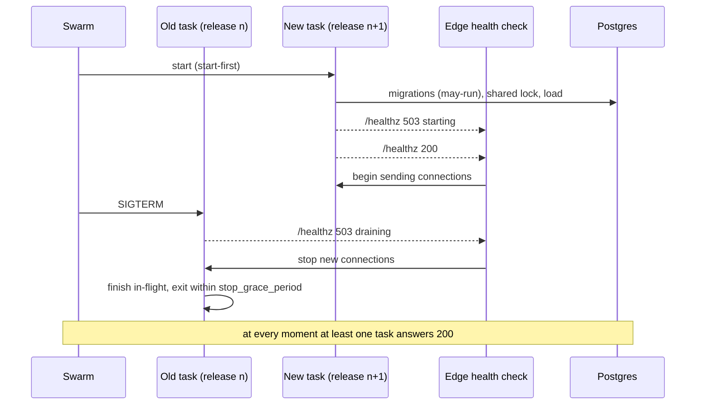

# The coordinator as N instances on one Postgres

Status: design, for the owner's decision. A living document: it is updated in the pull requests that build it. Tags as in
[hostkeeper-design.md](hostkeeper-design.md): **Built** names code on `main` with a path, **Designed** means nothing implements
it yet. Nothing in this document is built.

It changes one decision of [coordinator-storage.md](coordinator-storage.md): that decision's section 5 ("the single writer: an
advisory lock") and the sentence of its section 14 that a heartbeat costs no query. Section 7 of that document designs an
active/standby pair; this document supersedes it (the supersession check is section 18 here). The rest of that document
stands: the schema, the migrations, import/export, the backups.

Direction (owner, 2026-11-15): the coordinator can run as several instances at once, with Postgres as the store. The same
principle as the kbf frontend: a deploy never leaves zero serving instances, and no state lives only in one task's disk or
memory unless it is a cache that can be rebuilt from the database.

## 1. What changes, and what does not

**Before (Built).** One Swarm task, `replicas: 1`, `order: stop-first` (`swarm/hostkeeper-coordinator.yml` of komira-internal).
The task takes a Postgres session advisory lock at start (`store/postgres/writer.rs`, `LOCK_KEY`, `try_lock`) and a second
task that finds it held exits (`DatabaseError::Locked`). Everything the coordinator knows is in that process's memory: the
desired state, the operations state, the accounts and the enrollment records (each loaded once at start and written back as a
diff), and, never stored, the whole live picture of the fleet (`Coordinator.fleet`, `fleet.rs`), the sessions (`session.rs`)
and the rollout queue's order (`queue.rs`). A deploy stops the old task, then starts the new one: the coordinator is away for
the stop, the start and the 30 s quiet start of `QUIET_START`, and hosts retry their heartbeat meanwhile.

**After (Designed).**

- Two or more tasks serve at once, behind the edge that already spreads connections to `tasks.hostkeeper-coordinator_server`.
  Any task answers any heartbeat, any UI page, any API call.
- A deploy is `start-first, parallelism 1`: the new task is healthy before the old one drains. At no moment are there zero
  serving tasks.
- Every fact that two tasks must agree on is a row in Postgres. A task's memory holds only caches that it refreshes when the
  database says they are stale.
- A host sees no difference: same ports, same protocol, same certificate chain, same orders. An operator sees no difference
  except a new "instances" list on the status page. Sessions survive a deploy (today a restart signs everyone out).

**What does not change.** Rollout rules (stages, `min_up`, `max_updating`, one service at a time, FIFO, halts, rollback first),
the proto, the hosts, the file store (still one process, still its file lock, until C9 of coordinator-storage.md deletes it),
and the pure decision code (`stages.rs`, `live.rs`, `halt.rs`): the decision becomes a transaction around the same functions.

**What it is not.** The Swarm has one node today (`controlplane-nuc`), and so does Postgres. N tasks give a deploy with no gap
and the loss of one task without an outage; they do not survive the loss of the node or of the database. The same holds for
the kbf frontend.

## 2. Why this is more than a flag: what two tasks get wrong today

Spot-checked against `main` (1ed6efd). Each row is the failure if a second task simply started.

| State | Where it is now | Failure with two tasks |
|---|---|---|
| Store lock and epoch | advisory lock + `lease` row (`writer.rs:30`, `:220`; `0001_state.sql` trigger `lease_fenced`) | the second task exits; so the lock must stop being exclusive (section 4) |
| Desired, ops, accounts, layout, verdicts | one in-memory copy per store, written as before/after diff (`store/mod.rs`, `rows.rs`); writers serialize in a process mutex (`ops.rs:534`) | A's change never reaches B; a diff from a stale copy overwrites A's change; two read-modify-writes run unserialized |
| Audit numbers | `last_seq + 1` from an in-memory atomic (`postgres/mod.rs:238`, `ops.rs:884`) | both number the same entry; one commit fails on the primary key; facts generations (`ops.rs:633`, `facts.rs:100`) differ per task |
| **Fleet**: last beat of each host, orders, bake counts, tries, canaries, queued orders | `Coordinator.fleet: Mutex<Fleet>`, memory (`service.rs:233`, `fleet.rs:1-23`) | an agent dials a new connection per heartbeat (`hostkeeper-link/src/grpc.rs:157-173`), so each task sees about 1/N of a host's beats: `is_live` (45 s) flaps, bake resets, an order of A is invisible to B, `min_up` counts a partial fleet |
| One service rolling, FIFO, stage slots | computed per heartbeat from the local fleet; queue stamps in memory (`queue.rs:58`) | two tasks each find "nothing live" and order two services (`--live-rollouts 1` broken); queue order differs per task; one slot ordered twice |
| Halts (memory-first, marker file) | `halt.rs`, `ops.rs:500-512`, `--halt-marker-file` | a halt raised on A is in A's memory until its commit lands; B keeps ordering; A's pending halts are lost if A dies |
| Enrollment hosts, deny rows, requests | Postgres, plus an in-memory `Copy` and an in-process mutex (`records.rs:67`, `enroll/store.rs:124`) | a deny on A is not seen by B; two tasks approve one request or issue two certificates for one round |
| Sessions, CSRF, login limiter | memory (`session.rs:163`, `:357`) | a login on A is unknown to B ("signed out" every other request); the failure cap is N times too loose |
| Spent CI token ids | Postgres `ON CONFLICT DO NOTHING` (`postgres/mod.rs:726`) plus an in-memory set | safe in SQL; the in-memory set must not be what decides |
| CA key, server certificate | files on the local volume `hostkeeper-coordinator-state` | each task needs the CA key; two tasks must not write one file |
| Alerts, request expiry, initial admin file | loops in each process (`alerts.rs:838`, `listen.rs:402`, `initial_admin.rs:480`) | duplicated log lines and audit rows; a race on the file's delete |

There is no incremental way to run two tasks with the current `Fleet`: it is the one in-memory state every order decision
reads. So the fleet moves into the database first (section 5), and the rest follows.

## 3. Principles

1. **Postgres decides; a task's memory only caches.** Every write is a short transaction. Every decision that places an order,
   raises a halt or moves a plan is a transaction that reads the rows it decides from.
2. **Time is the database's.** Stored times are unix seconds from `now()` in the transaction; no task clock orders anything.
   `Fleet` today takes `now: Duration` since process start (`fleet.rs`, `config.rs` `origin.elapsed()`); the clock stays
   injected so the decision replays in tests, but its value comes from the database's `now()` fetched in the same statement.
3. **Nothing is elected.** There is no leader and no background rollout loop (decisions are per heartbeat, `service.rs:595`).
   Periodic work is made safe on every task by a conditional write whose result says who did it (section 9).
4. **A task that cannot reach Postgres orders nothing** and answers `/healthz` 503. It does not hold halts or orders in memory
   (it cannot order anyway). This is `Health::Lost` today (`health.rs`).
5. **Additive formats (B8).** New tables and columns only; a name, a number or a meaning that shipped does not change.
6. **No runtime machinery for config mistakes (B20).** Anything a deploy gets wrong is checked once at deploy, not by a gate.

## 4. The store: from one exclusive lock to a shared one

Today's lock is exclusive: one session may hold `pg_try_advisory_lock(LOCK_KEY)`. The trigger `lease_fenced` lets a session
update `lease` only if `pg_locks` shows it holds that key; it does not look at the lock's mode (`0001_state.sql:260-273`).

**Designed.** A task takes the same key in **shared** mode, `pg_try_advisory_lock_shared(LOCK_KEY)`, on each of its sessions.
Postgres itself then gives:

- any number of new tasks hold the key together;
- the release before this one calls `pg_try_advisory_lock` (exclusive) and is refused while any new task is up
  (`DatabaseError::Locked`), and a new task is refused while an old one runs. Old and new never write together, with no
  change to the trigger and no new migration for the fence;
- going back works: stop every new task, the old release takes the exclusive lock and runs on the same database.

Two consequences, both changes of code:

- **`lease.commits` goes.** Every transaction today updates the one row `lease` (`writer.rs:318`), which would serialize all
  writers of all tasks on one row lock. Its job, settling a commit of unknown outcome after a lost session (`writer.rs:374`),
  moves to a ledger: each transaction inserts `tx_ledger(id uuid primary key, at_unix)` with an id the task made before
  `COMMIT`; after a reconnect, `SELECT 1 FROM tx_ledger WHERE id = $1` says whether it landed. Any task prunes rows older than
  an hour in its reload tick (`DELETE ... WHERE at_unix < $1`, idempotent). The `lease` row is left as it is, written once
  by the old release only.
- **"Deposed" goes.** Another task's epoch is normal now (`config.rs:798`, `ops.rs:551`). `Lost`/`Reviving` stay: a task whose
  session is gone orders nothing until it is revived (`writer.rs`), and answers 503 meanwhile.

**Sessions.** The single writing thread becomes a small pool of sessions per task (a config key, section 12), each holding the
shared lock, so heartbeats of one task do not queue behind each other on one session. The pool plus one reader session is
how many connections a task needs; `max_connections` of `lab-postgres` must cover `tasks x (pool + 1)` with room (not
checked, section 13).

**Instances.** Each task has an `instance_id` (random at start) and upserts `instances(id, started_unix, seen_unix, release,
listen)` every few seconds. It is for the status page and for the start rule of section 5; correctness never reads it.

## 5. The fleet moves into Postgres

### 5.1 Tables (all new, additive; migration `0019`, `-- older-releases: may-run`)

| Table | Holds | Logged |
|---|---|---|
| `fleet_hosts(host_id pk, role, beat bytea, seen_unix, healthy_run int, running bytea, repo_report bytea, instance)` | the last heartbeat of each host (the proto, as received), the count of healthy beats in a row (today `Bake`), what it runs and its repository report (today `running.rs:43`, `repository_push.rs:119`) | unlogged, `fillfactor` 50, no index on updated columns (HOT) |
| `fleet_orders(host_id, service, target, uninstall_id, at_unix, try)` | an outstanding order that holds a slot (today `orders`, `ORDER_AGE` 120 s) | logged |
| `fleet_tries`, `fleet_canaries`, `fleet_queued_orders(host_id, service, kind, order_id)`, `fleet_found`, `fleet_defers` | the other maps of `Fleet` (`fleet.rs:180-210`) | logged |
| `cluster_quiet(id, until_unix)` and `fleet_epoch(n)` | the start rule below | logged |
| `desired_seq` (sequence) and columns `set_seq` on `desired`/`group_desired` | the FIFO order of the queue (today `queue.rs:58`, per task) | logged |

`fleet_hosts` is unlogged because it is rebuilt by the next beat of each host within 15 s (`heartbeater.rs:124`); a database
crash empties it. Orders, tries and canaries are decisions and stay logged. A row older than `DOWN_AFTER` (45 s) means down,
as `is_live` says today. Whether unlogged pays for itself is measured before it is chosen (section 7).

**The start rule becomes the cluster's.** Today a restarted task forgets its outstanding orders and waits `QUIET_START` for the
hosts to report. With orders durable that wait is not needed for them; it is needed only when `fleet_hosts` is empty or stale
(a database crash, or the first start). The rule: no order is placed while `cluster_quiet.until_unix` is in the future. Any
task sets it to `now() + quiet` when it finds `fleet_epoch` not matching a sentinel row kept in the unlogged table (the
sentinel vanishes when the table is truncated by a crash). A deploy of one task changes neither, so a deploy no longer
quiets the fleet: that is a gain over today.

### 5.2 The heartbeat, and where decisions run

The decision code stays the pure functions of `stages.rs`, `live.rs`, `halt.rs`, `queue.rs`, fed rows instead of the `Fleet`
mutex's maps.

Two paths:

- **Converged path** (the common one: the host runs what is wanted, nothing is queued for it, no rollout concerns it). One
  statement: upsert the host's `fleet_hosts` row, and in the same statement read the state-version vector (section 6), the
  host's deny row and the host's queued orders. If all are as the task's caches say, reply. No lock, one round trip.
- **Deciding path** (an order, a halt, a plan step may follow). A transaction that takes the one global lock
  `pg_advisory_xact_lock(K_rollout)`, reads the fleet rows and halts it decides from, runs the pure decision, inserts the order
  rows (and audit, and halt) and commits. The lock is held for the read, the decision and the insert, and released by the
  commit. `READ COMMITTED` is enough: the lock is taken before the reads, so every read sees every commit of every earlier
  holder.

One lock, not one per (group, package): the deciding path runs only while something rolls, its transaction is a few
statements, and the one-live-rollout rule is cluster-wide anyway. A finer lock is an optimisation to add if section 7 shows
the wait (B20: no speculative machinery).

```mermaid
sequenceDiagram
    participant H as Host agent
    participant E as Edge (envoy)
    participant A as Task A
    participant B as Task B
    participant P as Postgres
    H->>E: heartbeat (new connection)
    E->>A: tcp, TLS untouched
    A->>P: upsert fleet_hosts + read versions, deny, queued (1 statement)
    P-->>A: versions unchanged, not denied, nothing queued
    A-->>H: reply, no order
    Note over H,E: 15 s later
    H->>E: heartbeat (new connection)
    E->>B: tcp, TLS untouched
    B->>P: upsert + read (1 statement)
    P-->>B: desired version changed, host is behind
    B->>P: BEGIN; pg_advisory_xact_lock(K_rollout)
    B->>P: SELECT fleet rows, halts, plan of the group
    B->>B: pure decision (stages, live, queue)
    B->>P: INSERT fleet_orders, audit; COMMIT
    B-->>H: reply with order
    Note over A,B: a task that crashes after COMMIT before the reply: the host beats again,<br/>the next task finds the order row inside ORDER_AGE and returns the same order
```

**One service at a time, FIFO.** `set_seq` comes from the sequence `desired_seq`, taken in the transaction that sets a desired
version, so the queue is a total order on every task. The existing tie-breaks (`queue.rs:10-12`) remain for rows with no
`set_seq` (written by the release before). The one-live-rollout check reads `fleet_orders` and the plan rows inside the
locked transaction, so two tasks cannot each see "none live".

**Halts are storage-first.** A halt is raised by the deciding transaction that sees the failure, or by an operator call (a
row transaction, section 6). Every deciding transaction reads the halt rows after it holds the lock, so a halt is global from
its commit and no later order of any task precedes it. The marker file and the `pending` retry queue (`halt.rs:15-22`,
`ops.rs:500-512`, `ops_pending.rs`) are not used with Postgres; the file store keeps them until C9. The guarantee memory-first
gave ("a halt stops the service even with the database slow or down") is kept in the other way: with the database down no
task orders (principle 4). With it slow, the halt waits behind the lock for milliseconds, and no order can pass it.

**Other heartbeat caches** (what each host runs, repository reports, facts heard, alerts' `seen`): columns of `fleet_hosts`
or the `alerts` table (section 9), written by the same upsert only when they changed. Counters that are only diagnostics
(`extras_dropped`, `service.rs:257`) and held `WaitConverged` readers (`wait.rs:66`) stay per task; `WaitConverged` answers
from shared rows by polling the version vector.

## 6. Everything else: row transactions and cache versions

**Edits (desired, ops, accounts, layout, verdicts).** The in-memory copy becomes a read cache, and a write is:

```
BEGIN
  pg_advisory_xact_lock(K_part)          -- one lock per part, in a fixed order when an edit spans parts
  reload the part from its rows          -- fresh, under the lock
  apply the existing edit closure to the fresh copy
  diff before/after, write the changed rows (the code of rows.rs)
  UPDATE state_versions SET version = version + 1 WHERE part = $1
  audit, if any (section 8)
COMMIT
```

This is the `writing` mutex of today moved to Postgres, and the closure and the diff are the code that exists, so the call
sites do not change. A part is the unit of lock, cache and version; the parts are `desired`, `ops`, `accounts`, `layout`,
`verdicts`, `enrollment`. A flow across parts (force, retire) takes their locks in the fixed order of that list. A
reload per edit costs one part's rows (operator edits are rare; measured in section 7). `if_generation` on `SetDesired`
(migration `0003`) is unchanged and still the caller's optimistic check.

**Invalidation.** `state_versions(part pk, version bigint)` is read by the heartbeat's statement (section 5.2) and, for the UI
and the API, by one `SELECT` per request; a changed version reloads that part, an unchanged one reads from memory. No
`LISTEN/NOTIFY`: it needs a dedicated connection and a poll fallback anyway (B20). The bound on staleness is zero for the
heartbeat path and one request for the UI.

**Enrollment.** `RecordsLock::in_process` (`records.rs`, `enroll/store.rs:124`) goes. Approve, reject, renew and expire become
conditional writes in a transaction: `UPDATE enrollment_requests SET state='approved' WHERE request_id=$1 AND
state='pending'` and zero rows means the other task won; a host or request row is read `FOR UPDATE` when a check precedes the
write (`store.rs:203, :252, :290, :466, :496`). `take_serial` is already one SQL statement (`records.rs:675`). The `Copy` of
hosts and deny rows becomes a cache under the `enrollment` version. **Deny rows are read fresh on every heartbeat**, in the
heartbeat's one statement (a join on the host id, an indexed read): a denied host is refused by every task from the commit,
at no extra round trip (open question 3).

**Audit numbers.** The audit's `seq` must be dense and in commit order, because `Audit.List` pages by `seq > $1` and a reader
that has seen 11 must not miss a 10 that commits later. A sequence does not give that (a transaction takes 10, another takes
11 and commits first). So the number is taken by `UPDATE audit_counter SET next = next + 1 RETURNING next - 1` as the last
write before `COMMIT`: the row lock is held until the commit, so numbers follow commit order, and a rollback leaves no gap.
Only transactions that write audit lines take it (operator edits, orders, halts, not the converged heartbeat). This keeps
the decision of coordinator-storage.md section 14 ("no gaps"), which only needed its lock replaced. The column and primary key
are unchanged; the release before reads `max(seq)` at start and continues from it. The facts generation of a host (today the
audit number at open plus an in-memory raise, `facts.rs:100-115`) becomes a column `enrollment_hosts.facts_generation`
(default 0) raised in the transaction that changes the host's labels or group, taking at least the audit number as the
release before does, so every task answers the same number and a flip does not refetch facts.

**Spent CI tokens.** The insert's result (`ON CONFLICT DO NOTHING`, rows recorded) decides; the in-memory set is a cache that
can only refuse earlier (`store/mod.rs:296`). No new table.

## 7. Latency budget

Counts are round trips on the unix socket (`/run/lab-postgres`), and the locks held. **They are design counts (inferred from
the flows above), not measurements.** The measurement is part of PR M1 (section 11) on the NUC: round-trip time of the
statements, the wait on `K_rollout` under a 50% stage of the fleet, WAL and vacuum of `fleet_hosts` at 4 upserts per host per
minute for the real host count (not read in this work).

| Operation | Round trips | Locks | Today |
|---|---|---|---|
| Heartbeat, converged | 1 (upsert + versions + deny + queued) | row lock on the host's own row | 0 |
| Heartbeat, a cache is stale | 1 + 1 reload of the changed part | as above | 0 |
| Heartbeat, deciding (order, halt, plan step) | 1 + `BEGIN`, lock, read fleet+halts, insert order+audit, `COMMIT` as 3 to 4 pipelined | `K_rollout` held for the transaction; `audit_counter` row for the last statement | 0 |
| Operator edit (desired, hold, halt clear, user) | `BEGIN`, lock, reload part, write, version, audit, `COMMIT`: 3 to 4 | the part's lock, `audit_counter` | 1 write session |
| UI or API read | 1 (versions) + 1 reload only when changed | none | 0 |
| UI login / request | 1 read of the session row, + 1 write at most every 30 s | the session row | 0 |
| Enrollment approve / renew | 2 to 3 (`FOR UPDATE`, conditional update, audit) | the request or host row | 2 transactions |
| Alert tick, request expiry (per task, every 15 s / reload tick) | 1 each | none (conditional write) | 0 |
| Task start | migrations (idempotent), shared lock, load all parts | shared advisory lock | same plus exclusive lock |

If the heartbeat's converged path is more than a few hundred microseconds, the fallbacks are in this order: the narrow row
and `fillfactor` (done by design), a beat that changes nothing but `seen_unix` skips the write when the stored `seen_unix` is under a few seconds old (a config key), then a per-task read cache of `nodes` with a 1 to 2 s TTL
(config key). A hot-row lock on `K_rollout` is measured, and only then a finer lock considered.

## 8. Sessions and the login limiter

`session.rs` says "a restart ends every session, because nothing is written anywhere". Designed: a table `sessions(id_sha256
bytea pk, user, csrf, created_unix, last_used_unix, serial)` (never the raw cookie id: the key is the SHA-256 the memory table
uses now, `session.rs:163`), and `login_failures(name pk, failures, last_failure_unix, locked_until_unix)`. The idle and
absolute deadlines and the cap on the number of sessions keep their rules, in SQL; `last_used_unix` is written at most once
per 30 s per session. The cookie, its flags and the CSRF token do not change, so nothing browser-visible changes, and a
deploy no longer signs anyone out. Argon2id hashing stays per task (`password.rs:320`, a CPU bound).

```mermaid
sequenceDiagram
    participant U as Operator browser
    participant A as Task A
    participant B as Task B
    participant P as Postgres
    U->>A: POST /login (name, password)
    A->>P: read login_failures(name); check lock
    A->>A: Argon2id verify (this task's CPU)
    A->>P: INSERT sessions(sha256(id), csrf, ...); clear failures
    A-->>U: Set-Cookie (unchanged format)
    U->>B: GET /ui/ (cookie)
    B->>P: SELECT sessions WHERE id_sha256 = sha256(cookie)
    P-->>B: row (idle/absolute deadlines checked)
    B-->>U: page
```

## 9. Periodic work without a leader

| Work | Now | Designed (every task runs it) |
|---|---|---|
| Alert observation, every 15 s (`alerts.rs:838`) | logs `alert=` once per first sight, `Book.seen` in memory | derive from the shared rows; `INSERT INTO alerts(subject, first_unix) ... ON CONFLICT DO NOTHING RETURNING`: the task that inserts logs the line, once; a cleared alert is `DELETE ... RETURNING`. `Alerts.List` reads the table. The watcher of `alert=` lines must read the service's logs, not one task's |
| Request expiry (`expiry.rs:112`) | audits `request_expired` | `UPDATE ... SET state='expired' WHERE state='pending' AND posted_unix < $1 RETURNING request_id`, audit the returned rows in the same transaction: exactly once |
| TLS, tokens file, client CA reload (`listen.rs:402-441`) | per process | per task, unchanged (the files are the same Swarm secrets) |
| Server certificate renewal (`enrollment/mod.rs:220`) | per process | per task, on its own tmpfs (section 10) |
| Initial-admin file (`initial_admin.rs:480`) | adopts the file, audits `user_bootstrap`, deletes the file when expired | adoption is a conditional upsert keyed by the file's `id` (the "record already holds this id" rule exists today) with the audit row only when the upsert changed a row; a failed delete (`ENOENT` or read-only) counts as done. The volume stays mounted by every task for this file alone (open question 5) |
| Rollout driver, queue, halt evaluation | per heartbeat, in the fleet lock | per heartbeat, in the transaction of section 5.2; no loop to elect. A stage that completes while no host beats is not advanced today either (`service.rs:595`); if a periodic advance is later wanted it is the same transaction, guarded by `pg_try_advisory_xact_lock` |
| GitHub release polling, certificate issuance loops | do not exist: CI pushes `Releases.SetDesired` with a GitHub OIDC token, and certificates are issued on Enroll/Poll/Renew | nothing to run once. (The task text assumed both loops; the code has neither.) Each task caches the issuer's keys itself |

## 10. The CA key, the server certificate, secrets

- **CA key and cert.** Today files on the local volume (`--ca-key-file`, and `<ca-key-file>.cert` beside it). Only `--ca-init`
  writes them, and it refuses when either exists (`ca/key.rs:54, :100-123`); `serve` reads them. The key check is mode
  `& 0o077 == 0` and owner uid (`ca/key.rs:42`), which a Swarm secret with `mode: 0400` and the task's uid passes. Designed:
  a Swarm secret `hk-ca-key-v1` at `/run/secrets/hk-ca-key-v1` and the certificate (not secret) as a Swarm config mounted with `target: /run/secrets/hk-ca-key-v1.cert`, so
  `--ca-key-file=/run/secrets/hk-ca-key-v1` finds its pair; `--ca-init` is not
  passed. Created by one reversible step of the infrastructure repository's `cp-edge` flow that copies the existing bytes,
  with the SHA-256 recorded before and after and never printed; the volume's copy stays until the soak ends.
- **Server certificate.** Each task makes its own, with its own new key, from the shared CA, on a per-task tmpfs (`/run/hk`):
  no two tasks write one file. Hosts pin the CA hash, not the server key (`hostkeeper-link/src/grpc.rs:162`), and every
  certificate names the same `--server-name`s, so the edge's SNI match is unchanged. Serials are unique because they come
  from `enrollment_serial` in SQL.
- **Static config** (`hk-oidc-v4`, `hk-tokens-v1`, `hk-tls-cert-v1`, `hk-tls-key-v1`, `hk-client-ca-v1`, `hk-dsn-v1`) is per
  service, identical for every task by construction. One deploy check (B20: fix at the source): a credential-file path that
  a repository row names (`repository_serve.rs` reads it at every request) is a Swarm secret of the stack. Whether any live
  repository uses one was not checked (needs an operator token).
- **The state volume** after this: `initial-admin.toml` only. `halt-unfinished` has no use under Postgres, and the MDM files
  go with the MDM (the retired `--mdm-*` flags are still passed and ignored by `main`; they and the host-mode 443 publish
  leave the stack with that removal, not here).

## 11. Routing, health, deploy

Built today (stack file and the edge's `cds.yaml`/`lds.yaml`, as read, not changed here): agents dial the edge on the
tailnet name at 8443 (heartbeat, mutual TLS) and operators and CI at 8445 (private surface and UI); the listeners match the
SNI and `tcp_proxy` to clusters `hk-heartbeat`, `hk-private`, `STRICT_DNS` on `tasks.hostkeeper-coordinator_server`,
`dns_refresh_rate` 1 s, `LEAST_REQUEST`, with **no active health check** ("there is one task"). TLS is untouched, so the
coordinator sees the client certificate. So 8443 and 8445 already spread over every task Swarm lists.

Needed:

1. **An active health check** on both clusters, as the kbf frontend's clusters have (`/readyz`, `close_connections_on_host_health_failure:
   false`). The coordinator's `/healthz` is on `127.0.0.1:8446` inside the task (`health.rs`): a new additive flag
   `--health-listen` serves the same path on an address of the overlay `cp-hk`. 200 only when the store is `Up`, the
   listeners are bound and the task is not draining.
2. **Update shape:** `replicas: 2`, `order: start-first`, `parallelism: 1`, the Docker healthcheck as the gate (as now: 5 s
   interval, `start_period` 120 s), `stop_grace_period` 60 s (the task answers 503 from SIGTERM, `health.rs` `draining`, so
   the edge stops sending new connections before the old task ends). Long calls (`WaitConverged`) end at the drain and
   callers retry, as they do at a deploy today.
3. **No stickiness.** An agent opens a new connection per heartbeat, so a host's beats alternate between tasks. Source-IP
   affinity would not help: `min_up` and one-live-rollout are cluster-wide. The shared fleet (section 5) is what makes this
   correct.
4. **The Mac listener.** The LAN listener (host-mode publish of 8446 to task port 8447, for Macs) cannot be bound by two
   tasks on one node. Options: (a) the edge serves it as one more SNI chain and cluster, `tcp_proxy` with TLS untouched, so
   the certificate survives; (b) the ingress routing mesh on the service VIP (TCP, TLS untouched, so the certificate should
   survive; not verified); (c) a second one-task service for it, which is a singleton again. Recommendation (a), the edge
   already is the front door (open question 4).
5. **Postgres placement.** The database is reached over the unix socket bind mount `/run/lab-postgres`, so every task runs
   on the NUC (the Swarm has one node; the constraint `cp.site == box` already holds).
6. **The first cutover is stop-first.** The release before holds the exclusive lock; a start-first task would be refused. Every
   later update is start-first, which requires that every migration a release adds is `may-run` (the release before must run
   on the new schema), or that update is stop-first.



## 12. Configuration (every number is a key with a default)

| Key | Default | Meaning |
|---|---|---|
| `--database-pool` | 4 | write/decision sessions per task |
| `--instance-beat-secs` | 5 | `instances.seen_unix` |
| `--health-listen` | none | readiness address on `cp-hk` |
| `--cache-nodes-ttl-ms` | 1000 | per-task cache of read-only parts of the fleet, if section 7 needs it |
| `--session-touch-secs` | 30 | write of `last_used_unix` at most this often |
| existing: `--quiet-secs` (floor in `config.rs:512`), `--tls-reload-secs` | unchanged | the cluster's quiet rule uses `--quiet-secs` |

The flags are additive; no flag is removed or renamed. `--halt-marker-file` is accepted and ignored with Postgres.

## 13. js-server, and what was not checked

**js-server** (Swarm service `js-server_server`, one replica, stop-first, state in `--state-file
/var/lib/js-lease-server/leases.toml` and a `--store` URL secret) is a different codebase and was only seen by its flags. The
owner's direction covers it; it gets its own design in its repository, from this document's checklist: what is only in memory
or on the task's disk, what two tasks decide together (here a lease is the likely one), what a deploy does, how callers
find it. This pull request does not design it.

Not checked, because access was denied or needs a secret, and to be confirmed by the owner or engineering before the cutover:
the files of the state volume (names and sizes are from the service's flags); the socket directory `/run/lab-postgres`;
`max_connections` of `lab-postgres` and the role's connection limit (needs the DSN); live table contents (including the
number of enrolled hosts, which sizes section 7); whether any registry row names a credential file.

## 14. The model check, before code

The protocol to check is the deciding transaction and the conditional writes, not the SQL. Two tools, one idea each:

- **A model of the protocol** (TLA+/PlusCal, `docs/design/models/` in the PR that builds M2; run by an `xtask` verb outside
  the PR gate, since TLC needs Java and B9 allows only build and unit tests with coverage). State: tasks A and B, hosts
  `h1`, `h2`, services `s1`, `s2`, the shared rows (`orders`, `halts`, `desired.set_seq`, `cluster_quiet`), each task's cache
  and version. Steps: a beat arrives on either task at any time; a deciding transaction is one atomic step under `K_rollout`;
  a task may crash after `COMMIT` and before the reply, or before `COMMIT`; an operator raises a halt on either task; a
  desired version changes. Invariants: live rollouts never exceed `--live-rollouts`; updating hosts of a stage never exceed
  `max_updating`; `min_up` holds; an order is never lost or duplicated for one `(host, service, target)` inside `ORDER_AGE`; a
  halt committed before an order's `COMMIT` is read by that order's decision; queue order equals `set_seq` order on every
  task; audit numbers follow commit order. Liveness: a host behind its target gets an order if a slot is free.
- **An exhaustive state-space test in Rust** (the part CI runs, T11, T12): the pure decision functions over an in-memory
  store with transactions at statement granularity, all interleavings of two tasks over a bounded script, checking the same
  invariants. It is the test that the unlocked variant fails (T15: negative case) and the locked one passes.

Sanity run for this document, not the model: a throwaway explicit-state search of two tasks each deciding one of two services
with a limit of one live rollout (script in the author's scratch, not committed) finds the double order when "read the live
count" and "insert the order" are two steps, and finds none when they are one step under the lock. Eight and five states.
The real models are M2.

## 15. Compatibility (B8) and tests

All changes are additive: tables `fleet_*`, `cluster_quiet`, `instances`, `sessions`, `login_failures`, `alerts`,
`state_versions`, `tx_ledger`, `audit_counter`, the sequence `desired_seq`, columns with defaults (`set_seq`,
`facts_generation`). No column renumbered, renamed or re-meant; no proto change. The fence trigger is untouched.
Migration `0019` says `older-releases: may-run` (the migration lint's header rule; `0019` adds only). Why that is safe, and
no `refuse`: while any new task runs it holds the shared lock, so the release before cannot start (exclusive lock refused);
with none running the release before takes the exclusive lock and runs on its own tables, ignoring the new ones, which is
the back-out. What it forgets is the fleet (it never had one stored), as at every start of today.

Tests, named (each asserts the behaviour in its name; the PR bodies list them by name per P2):

- `release_before_is_refused_while_a_shared_holder_runs` and `shared_holder_is_refused_while_release_before_runs`: the
  exclusive and the shared `pg_try_advisory_lock` on one database; the old exclusive path against the new shared one.
- `release_before_runs_on_the_migrated_database_after_new_tasks_stop`: the previous release's store opened on a database
  written by the new release (the old release on new data); and `new_release_migrates_a_database_of_the_release_before`
  (the new release on old data), both against the service container of the `test` job.
- `exported_files_are_read_by_the_strict_readers_of_the_release_before` (exists, coordinator-storage.md section 12) stays green
  with the new tables exported or ignored by the importer.
- `two_tasks_decide_one_rollout_at_a_time`, `halt_before_commit_blocks_the_next_order`, `order_after_crash_is_returned_again`,
  `queue_follows_set_seq_on_both_tasks`, `audit_numbers_follow_commit_order`: the Rust state-space test of section 14.
- `denied_host_is_refused_by_the_other_task`, `one_request_is_approved_once`, `session_is_valid_on_the_other_task`,
  `login_failures_count_across_tasks`, `expiry_audits_each_request_once`, `alert_is_logged_once`.
- `lost_session_orders_nothing_until_revived_and_settles_by_ledger` (replaces the `lease.commits` settle test).
- T5/T13: each test above has a failure case (the lock removed, the conditional write made unconditional).

Coverage is judged per crate as always (T1); the pool, the ledger and the conditional writes are covered by the
service-container tests (T17: no arm covered only by a different binary).

## 16. Cutover and back-out (reversible)

1. Ship the release (PRs M1 to M8 landed, section 17) with Postgres and `replicas: 1`, still `stop-first`: the first
   start migrates and takes the shared lock. Operationally today's shape, with the new code. Soak.
2. Move the CA key to the secret and config (section 10), and `server.pem` to a tmpfs; one reversible edge step each, bytes
   hashed before and after, never printed. Still one replica.
3. Add the health check to the edge's clusters and the readiness flag; deploy (stop-first once, the last).
4. Resolve the Mac listener (open question 4).
5. `replicas: 2`, `order: start-first`. Watch: `instances` rows, no `alert=`, the heartbeat latency (M1's numbers),
   `K_rollout` wait.
6. Soak through a real rollout of each plan kind (single 100%, 50% then 100%), with a halt raised mid-rollout.

**Back-out.** Replicas to 1 and `stop-first` is a service update, no downgrade (the same release). To go back to the release
before: `docker service update --replicas 1 --update-order stop-first --image <release n>`; it takes the exclusive lock once
the new tasks are stopped, runs its single-writer code on the same database (the audit counter and the sequences are ignored;
its next audit number is `max(seq) + 1`), forgets the fleet and quiets 30 s. The CA secret and tmpfs steps are reverted by
the reverse edge step; the volume's copy is why they are reversible. Fix forward is the normal course (the rollout policy of
the farm): the back-out is a stopgap while a fix ships.

## 17. Implementation pull requests, in landing order

| # | Item | After | Size |
|---|---|---|---|
| M1 | Measure on the NUC: round trip on the socket, `fleet_hosts` write cost at the real host count, `max_connections`; a table in this document | none | S |
| M2 | The models of section 14 (spec and Rust state-space test), failing on the unlocked variant | M1 | M |
| M3 | Shared lock and pool: `pg_try_advisory_lock_shared`, the `tx_ledger` settle, no `lease.commits` write, no deposed exit, `instances`; `0019` part 1. Still one task | M2 | L |
| M4 | Row-transaction edits and `state_versions` invalidation for desired, ops, accounts, layout, verdicts; `audit_counter`; `facts_generation` | M3 | L |
| M5 | Enrollment: conditional writes, `FOR UPDATE`, fresh deny read; spent-token cache | M3 | M |
| M6 | The fleet in Postgres: `fleet_*`, `cluster_quiet`, `set_seq`, the deciding transaction, storage-first halts; the converged path | M4, M5 | L |
| M7 | Sessions and login limiter; alerts, expiry and initial-admin made exactly-once | M3 | M |
| M8 | `--health-listen`; docs (`coordinator-state.md`, `rollout-plans.md`, `holds-and-force.md`, `enrollment.md`) updated; this document's tags turned to Built | M6, M7 | S |
| M9 | Infrastructure (komira-internal, outside this repository): CA secret and config, tmpfs, edge health checks and Mac listener, `replicas: 2` start-first. The cutover of section 16 | M8 | M |
| M10 | js-server's design and PRs in its repository | none | not sized |

M3 to M7 are each safe at one task (the same code with one replica); only M9 turns on a second.

## 18. Supersession check (B22)

This supersedes section 7 of coordinator-storage.md (the standby: its takeover, its quiet-start timing bound and its
list-of-addresses option are not needed when every task serves), the second half of section 5 ("the single writer": the lock is
shared, `lease.commits` and the epoch's exit are gone), and these rows of section 14 "What decisions read" (a heartbeat reads
the database), "The audit's numbers" (still gap-free, by a counter row, not by the lock) and "A commit of unknown outcome"
(the ledger). M8 edits those sections to point here. Nothing is deleted from the file store (C9's business).

## 19. Open questions for the owner, each with a recommendation

1. **Is "no order while the database is unreachable" the halt guarantee?** Memory-first existed so a halt still bites with the
   database slow or down. Recommendation: yes. A task that cannot reach Postgres orders nothing (as `Health::Lost` today), so
   a halt that is not yet stored cannot be outrun.
2. **One global lock for every deciding transaction?** Recommendation: yes, one `K_rollout`, measured in M1/M6; split it only
   if the wait shows in the heartbeat's latency.
3. **Staleness of a deny or a revoked token.** Recommendation: zero for hosts (the deny row is read in the heartbeat's one
   statement, no extra round trip) and zero for API tokens (version vector, one `SELECT` per request); no polling bound to
   choose.
4. **The Mac listener.** Recommendation: (a), one more SNI chain and cluster on the edge; (b) only if verified to keep the
   client certificate; not (c).
5. **The initial-admin file.** Recommendation: keep the file and the shared volume for now (idempotent, section 9); retire it
   for a one-shot `hostkeeper-coordinator bootstrap-admin` that writes the database when the farm next needs a first admin.
6. **`fleet_hosts` unlogged?** Recommendation: yes if M1 shows the WAL cost matters; its loss only re-quiets the fleet for
   `--quiet-secs`.
7. **Replica count.** Recommendation: 2 (one drains while the other serves), not 3: one node, one database.
8. **Release rollback.** Recommendation: `may-run` migrations as designed, so the back-out is a service update; confirm the
   facts generation (section 6) never going backward on rollback is acceptable (the host refetches facts once if it does).
