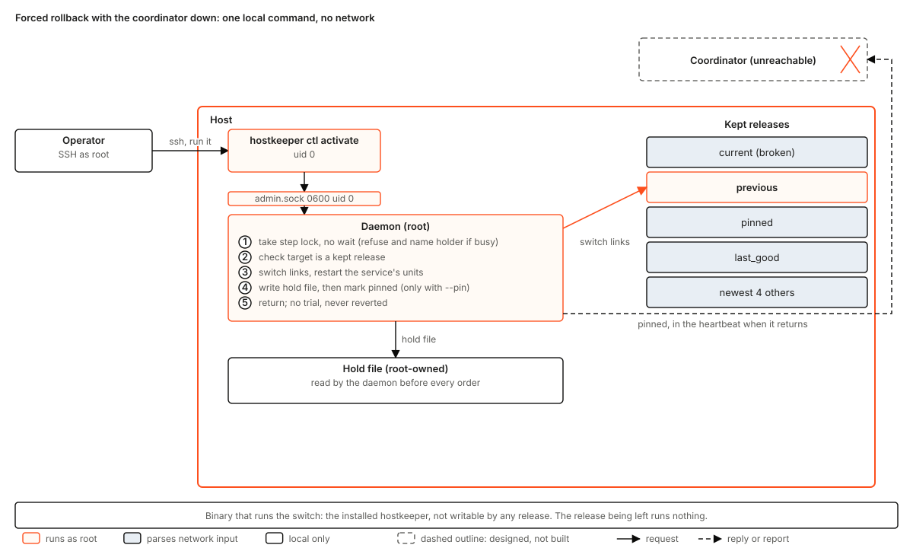
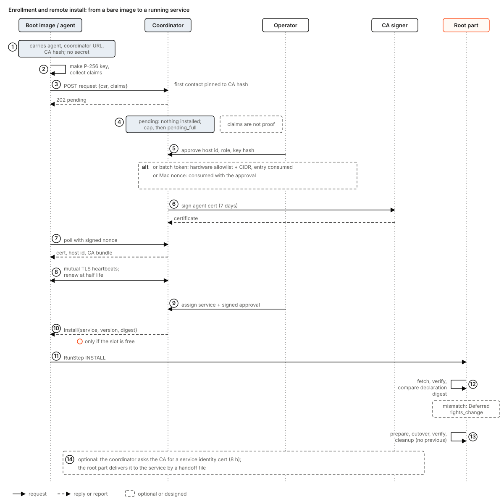

# hostkeeper design

Status: design, for the maintainers' comments. This is the single current design for hostkeeper and the entry point for every other hostkeeper document.

hostkeeper is the generic host lifecycle system: it installs, updates, rolls back, health-observes and retires the services that run on a host. kbf, tierstore and jobscheduler hosts are installed and updated by it. It knows no service by name. Each service tells it what to do through a hook that ships in the service's own release.

## How to read this document

Each statement is tagged where it matters:

- **Built** means the code is on `main` of this repository, with a path.
- **Open PR** means the code exists in a pull request that is not merged: PR #3 (the protobuf crate) and PR #5 (the coordinator import, with the wire types, OIDC verifier and TLS reload).
- **In kbf** means the code exists today in the kbf repository and has not moved yet. Two kinds: the imported tag (the hostkeeper crates on `main` are an import of kbf's updater at one release tag) and kbf `main`, which has moved past that tag. Where they differ the text says so.
- **Designed** means nothing implements it yet. Section 12 says which build item does.

Counts and line numbers are not carried here, because they rot. Re-derive any number before you quote it.

A test name in code font is a test that exists on `main` today unless the text tags it. Every other test name is tagged **(to build, Bn)**, **(open PR #n)** or **(in kbf)**.

The document says where it deliberately differs from a ruling or from the shape a ruling suggests; those places are marked **Deviation** and give the reason.

## What this document replaces

| Document | Status after this one |
|---|---|
| `docs/design/host-updates.md` (in this repository) | Superseded as the entry point and as the statement of decisions. It stays as the long-form mechanism reference for the hook contract (its section 3), the declaration (2.4), the step record and dead-man (3.5), the tierstore and jobscheduler hooks (4.1, 4.2) and the conformance suite (9). Where it disagrees with this document, this document wins. Its sections on the registration socket (2.1 to 2.3, 3.7, 4.1 "registers liveness"), per-service concurrency slots and named pools (5.2 history), and its migration order (8) are void: section 5.7, section 3.4 and section 12 here replace them. Nothing in it is deleted. |
| The earlier internal draft of the hostkeeper design (product, migration, enrollment, API and task table) | Superseded entirely. Its decisions that still hold are restated here; its task table is replaced by section 12. It is not public and nothing should link to it. |
| `README.md`, `MIGRATION.md`, `AGENTS.md` | Remain. They describe what is imported, what was left behind, and the repository rules. |
| The tierstore and jobscheduler update-hook documents | Remain. Each owns its service's hook; this document only states what the hook must satisfy. |

## Contents

1. Problem
2. Goals and non-goals
3. The design in one picture
4. Configurations
5. How each operation works
6. Background work
7. Edge cases handled
8. Races and failures
9. Assumptions
10. State: where each thing lives and who writes it
11. Limits
12. Future work and the build order
13. Open questions
14. Glossary

---

## 1. Problem

A farm of machines runs several long-lived services. Today each service has found its own way to be updated. The ways differ in the ways that hurt:

- Update scripts run per release, are written for that release, and are tested only by running them on the farm.
- A service that has live work (builds running, leases held, connections open) is updated by cutting that work, or by a script that waits for it in a way nobody can see.
- Two services updated at the same moment on one machine, or on two machines that depend on each other, can take the farm down together.
- A broken release of the system that builds the releases cannot build its own fix.
- A new machine is installed by hand: a person copies files, creates accounts, writes a unit, runs a setup tool. Each product has its own setup tool.
- The thing that updates the host has more power than the thing it updates, and nothing says in a file what that power is.

hostkeeper replaces all of that with one agent per host, one coordinator per farm, and a small contract that every service meets.

## 2. Goals and non-goals

### 2.1 Goals

1. **One updater that knows no service.** Per-service behaviour lives in a hook shipped in the service's own release. The updater contains no `if service == ...`.
2. **A fixed, small contract.** Five steps, four exit codes, one JSON line. Every step is safe to run twice. A hook is a subcommand of the service's own binary (no shell script); the declaration names the binary and its arguments.
3. **Rights are data.** What a hook may do is written in a root-owned declaration file. Anything that asks for more than the active declaration is held until an operator approves the exact bytes, locally as root or by a signed approval (section 5.1).
4. **One live update at a time across the whole farm,** every service and every role. No setting widens it.
5. **A release never runs code from the release it leaves,** and a bad release can be put back with the coordinator down.
6. **Work is never cut to finish an update.** A service with live work drains in its own stop path. The default is to wait for the drain with no deadline; a deadline is a per-service option with no ceiling the updater imposes; the updater does not kill the drain at a deadline it chose itself.
7. **Enrollment and remote install.** A host that boots a hostkeeper image appears as pending; an operator approves it; the coordinator installs the services assigned to it through the same path that updates them.
8. **macOS hosts follow the same flow,** with the differences stated in section 5.9.
9. **Service health is observed, not reported by the service.** Liveness, version and health come from the service manager, the step record and a declared health URL.
10. **Every failure has a stated outcome and a test.** Section 8.

### 2.2 Non-goals

- Not a package manager. Release bytes come from a release channel; hostkeeper fetches, verifies and stages them.
- Not a configuration management tool. It does not template a service's configuration files. A hook may write what it owns.
- Not a scheduler. It decides when an update may start, not where work runs.
- Not a high-availability coordinator. One coordinator, one writer (section 11).
- Not a Windows product.
- No remote approval of a privileged action except a signed approval made with an operator's own approval key (section 5.1). A bearer token alone approves nothing privileged on a host.
- No network boot in this document's scope. Section 12 keeps it as a vision, with no build items.

## 3. The design in one picture


There are four programs and one kind of plug-in.

- **The coordinator** (`hostkeeper-coordinator serve`) holds the desired version of each service, the farm's membership and the operator's marks (excluded hosts, halts, bad versions). It decides, per heartbeat, whether to tell a host to update. Its order carries a service name and a version. It never carries a URL, a path or a command.
- **The agent** runs on every host as an unprivileged account. It speaks mutual TLS to the coordinator, parses the coordinator's replies, and passes orders to the root part over a local unix socket. It holds no power over the host.
- **The root part** runs as root, as a second unit of the same binary. It does exactly four things: fetch and verify a release, install a verified declaration, launch a hook step under the rights the declaration grants, and replace its own binary. It accepts no free-form command or path. Its only inputs are "run the update (or install) order for service N at version V" and "tell me your status." Both are protobuf messages on the local socket, like every other hostkeeper API. The root part does not believe the agent: section 5.2 step 3 lists the checks it makes itself.
- **The signer** (`hostkeeper-ca`) is a separate process that holds the CA key and signs certificate requests the coordinator has approved.
- **The hook** is an executable in a service's release. The root part runs it, one step at a time, as a transient unit with only the rights the declaration lists.

Why the agent/root split: the agent parses data from the network (TLS, HTTP, coordinator replies). The root part never does. A parser bug in the agent gives an attacker an unprivileged account that can send two kinds of well-formed request to a socket that validates them again. What a compromised agent can still do is stated in section 5.1: it can start any update the root part's own checks allow, and nothing that needs an approval.

Trust is placed in four things only: the release artifact whose digest and attestation verified, the root-owned declaration, the approval keys pinned on the host, and the operator or CI token on the coordinator's control listener (for what it may do, section 5.1). A service's own files, the network between agent and coordinator, and the agent process are all untrusted from the root part's point of view.

### 3.1 What is built

| Piece | State | Where |
|---|---|---|
| Hook contract, exit codes, last-line JSON, params file, next-step table, conformance harness | Built | `crates/hostkeeper-hook` |
| Declaration, loader, widening check, approval gate, transient-unit launch | Built | `crates/hostkeeper-rights` |
| Step runner, step record, artifact seal, dead-man, self-update layout | Built | `crates/hostkeeper-steps` |
| Test scratch directories | Built | `crates/hostkeeper-testkit` |
| 99% line and branch coverage gate, workflow lint, layering and hygiene tests | Built | `crates/coverage-gate`, `crates/xtask` |
| Coordinator (HTTP/JSON over TLS), wire types, OIDC verifier, TLS reload | Open PR #5 | `crates/hostkeeper-coordinator`, `-wire`, `-oidc`, `-tls` |
| Protobuf APIs, descriptor compatibility check | Open PR #3 | `crates/hostkeeper-proto` |
| Root-part program wiring loader, gate, runner and launcher: boot pass, `Locked` error and lock file, kbf's `Update` and `Status` requests, root socket at mode 0600 owned by the agent uid with no peer-credential check | In kbf (`kbf-updater root`; kbf `main` now runs it on the generic updater stack) | to be imported |
| Agent loop, enrollment client, renew | In kbf (`kbf-updater agent`) | to be imported |
| Release fetch, verify, stage | Designed (kbf has it only inside its own installer, `crates/kbf-installer`) | section 5.5 |
| `hostkeeper ctl admin ...` verbs, `admin.sock`, `Activate`, `Pin`, signed approvals, CA, enrollment surface, remote install, uninstall, service identity | Designed (the one built admin verb is `approve <service> <sha256>` in `crates/hostkeeper-rights/src/cli.rs`) | sections 5.1, 5.6, 5.7 |
| macOS root part, launchd rights | Designed | section 5.9 |
| Packaging, privileged workflow, release automation | Designed | sections 4.6, 12 |

The imported crates keep kbf's wire and disk names on purpose: exit codes 0/1/75/76, the `update-hook` default argument, the reserved `updater.*` parameter keys, `/etc/updater.d`, `/etc/updater.d/approved`, `/var/lib/updater/{state,hooks,releases}`, unit names `updater-<service>-<step>-<generation>`, step record schema 1. Tests pin them (`constants_match_kbf_at_the_tag`, `reads_step_record_written_by_kbf_tag`).

**Where kbf `main` is ahead of the imported tag,** so that "In kbf" is read correctly: (1) a step declared `prepare = 0` is launched with `RuntimeMaxSec=infinity` and kbf's own declaration uses it (test `unbounded_prepare` in kbf's `update-rights`); hostkeeper `main` does not do this and its loader refuses 0 for every step, so it cannot load kbf's declaration as it stands (B2 closes the gap); (2) kbf's root program now runs on the generic updater stack. Anything else kbf `main` gained after the tag is imported with B5, and the import re-checks this list. Renaming a stored or signed format in place is forbidden; formats change by adding fields only (AGENTS.md B8).

### 3.2 Naming

Names that carry the product move to `hostkeeper`: binaries, the `hostkeeper.*.v1` protobuf packages, the `/run/hostkeeper/` sockets, the macOS reverse-DNS prefix, the unprivileged account. Names that are product-neutral and already stored on disks stay `updater`. Both families coexist on one host by design, and section 10 lists which is which.

## 4. Configurations

### 4.1 A Linux host

Two units of one binary, `hostkeeper-agent.service` (user `hostkeeper`) and `hostkeeper-root.service` (root, `Type=notify`, ordered before the agent). Sockets under `/run/hostkeeper/`:

- `root.sock` **(Designed, B5)**, mode 0660, group `hostkeeper`, in a directory of mode 0750. Only the agent's account may connect; the root part reads peer credentials on each connection and closes a connection from any other uid, root included, before reading a byte. The menu is `RunStep` and `Status`. In kbf the socket is mode 0600 owned by the agent uid and carries no peer-credential check; kbf's request names are `Update` and `Status`.
- `admin.sock` **(Designed, B14)**, mode 0600, uid 0 only. A separate service so the agent's channel never carries it: `ApproveDeclaration`, `Pin`, `Unpin`, `Activate`, `Abort`, `ClearHalt`, `ClearRecord`.

Both sockets speak protobuf (`hostkeeper.root.v1`, `hostkeeper.admin.v1`); no hand-written wire format exists on either. The offline-recovery verbs of `ctl admin` are the one place a hand-written command is allowed to exist before its generated form, and they are generated from the same descriptors (B11).

Per service on the host: a declaration `/etc/updater.d/<service>.toml`, a release tree `/var/lib/updater/releases/<service>/<version>/`, a step record directory under `/var/lib/updater/state/<service>/`, and a hook record directory named by the declaration's `state_dir`.

### 4.2 A macOS host

Two launchd jobs: `com.<reverse-dns>.hostkeeper.agent` (account `_hostkeeper`) and `.root`. Paths follow macOS conventions (`/usr/local/etc/updater.d`, `/var/db/updater/...`). Section 5.9 states what differs.

### 4.3 The coordinator

One process, two listeners:

- **heartbeat listener**: mutual TLS, a client certificate chaining to the farm CA; host identity (host id, role) comes from the certificate only.
- **control listener**: TLS without a client certificate; bearer tokens. A CI OIDC token may set a desired version for services its allow-list entry names; every other action needs an operator token. Operator tokens are one per person, listed by name in a tokens file the coordinator reads, each revocable and replaceable without a restart; every action records the token's name in the audit log, and a request with an unlisted token is refused. A shared anonymous token is not supported (**Designed, B7**; PR #5 has one token today). The audit log is an append-only file (`<ops-file>.audit`), not the 64-entry ring of the ops file, which stays as a recent-actions view.

State: the desired file, the ops file and its halts file, and the enrollment store (section 10). All of it is files on the coordinator's disk, written whole by temp file, `fsync` and rename; there is no database. Services are data in a `--services-file`; the coordinator has no built-in service. Services have an ordering scheme (`version_scheme`, default `semver`) the coordinator uses for `min_version`, `last_good` and "older"; a version that does not parse under the scheme is refused by `set-desired` and fails closed everywhere else (section 5.4).

### 4.4 The CA

`hostkeeper-ca serve` is a process separate from the coordinator, with the key owner-only and one sealed offline backup, reachable on a unix socket where the peer uid must be the coordinator's account. It signs three things: an agent client certificate (7 days), a service identity certificate (8 hours), a coordinator server certificate. It enforces a profile of its own and does not rely on the coordinator having checked: P-256 keys only; subject `host:<id>` for an agent and `service:<host id>:<name>` for a service; the matching extended key usage; a validity cap per kind; and it issues once per request id, returning the same certificate if asked again (section 5.7). Designed; no code yet.

### 4.5 A CI client

A release job in a service's repository downloads the hostkeeper release, verifies its provenance (checksums, attestation, signer workflow, attested source commit equal to the pin), and only then requests an OIDC token and runs `hostkeeper ctl releases set-desired --service X --version V`, then polls convergence. Replaces each repository's own deploy client.

### 4.6 Packages

Linux: one deb and one rpm carrying both units, the sysusers entry and no service. macOS: a signed pkg. Both publish into the operator's shared package repositories; hostkeeper owns no repository of its own. Designed.

### 4.7 Declaration, in short

```toml
name = "tierstore"
binary = "tierstore"
hook_args = ["update-hook"]
uid = "tierstore"
state_dir = "/var/lib/updater/hooks/tierstore"
verify_deadline_secs = 1600
promotion_ceiling_secs = 3600
cleanup_retries = 3
boot = "restore"
[signer]
repository = "komira-ai/tierstore"
workflow = ".github/workflows/artifacts.yml"
[hook]
user = "tierstore-update"
capabilities = ["CAP_NET_ADMIN"]
units = ["tierstore@9301.service", "tierstore@9302.service"]
[hook.timeout_secs]
prepare = 0     # drain: no deadline (the default stance, section 8.12)
cutover = 300
verify = 1000
rollback = 600
cleanup = 1300
```

`prepare = 0` is the unbounded form and is valid for `prepare` only; every other step needs a bound from 1 up (B2). Every table refuses unknown keys. `hook.user` may not equal the service account unless it is root, so the service cannot write the record the hook trusts. `verify_deadline_secs` must be at least the verify and rollback bounds together. A declaration that fails any load rule makes that one service unmanaged, with an alert, and the rest of the host loads.

## 5. How each operation works

### 5.1 Who may do what

| Actor | Credential | May |
|---|---|---|
| Agent | client certificate (7 days) | heartbeat, renew, ask for a service certificate, send `RunStep` to its own root part |
| Root part | uid 0 on its host | everything on its host, but only on a verified order |
| Operator | personal operator token (server-only TLS) | exclude, include, label, clear halt, force, mark and unmark bad, approve enrollment, assign services. Cannot approve a declaration by token alone |
| Operator, approval key | the operator's own signing key, held off the coordinator and off every host | sign an approval `{service, declaration_sha256, scope, expiry}` that the coordinator relays and a root part verifies |
| CI | OIDC token, single-use `jti` | set desired version and read convergence, only for services its allow-list entry names |
| Local root | uid 0 on `admin.sock` | approve a declaration digest, pin, unpin, activate a kept release |

**Approval, decided.** A declaration that widens what is active needs approval of its exact digest. There are two channels and no third:

1. **Local root** writes the digest with `ctl admin approve-declaration` over `admin.sock` (built today as `approve <service> <sha256>`).
2. **A signed approval.** The operator signs `{service, declaration_sha256, scope (host, role or all), not_after}` with an approval key. The coordinator stores and relays the signature with the `Install` or `Update` order; the agent hands it to the root part; the root part verifies it against the public keys pinned in `/etc/hostkeeper/approval-keys` (root-owned, installed by the operator) and, only then, appends the digest to `/etc/updater.d/approved`. If that file has no keys, remote approval is off, which is the default. A compromised agent or coordinator can replay a valid approval inside its scope and expiry and can forge none.

**Threat, stated.** Compromise of an operator's approval key is root on every host in the scopes that key signed, and nothing in this design limits that beyond scope, expiry (at most 7 days) and key rotation (the pinned list is edited by local root; a removed key approves nothing from then on). Compromise of an operator bearer token alone is not that: it can order updates and exclusions but not approve rights. Tokens are per person, named, individually revocable and audited (section 4.3).

**What a compromised agent can do (the root part trusts it for nothing).** The root part itself enforces, under the step lock and from its own files: the declaration's `min_version` floor; refusal of a target below the running version unless the order carries a downgrade flag, which any local order from the agent can set, so this is a guard against mistakes and not against a malicious agent; the pin and hold files; an unfinished record of a different release (`busy`); and a standing `Halt` record. It does not know the coordinator's bad marks, `last_good`, canary or single live update; a compromised agent can therefore start any attested release at or above `min_version` of a declared service, one at a time per service. The control that bounds that is `min_version`: the operator raises it when a version must never run again. The release's attestation and digest are verified regardless (section 5.5).

### 5.2 One update, end to end


1. CI sets the desired version of service S to V, with the release digest D that CI computed from the artifact it built and attested, on the coordinator. The coordinator refuses a V below the service's `min_version`, a V it cannot parse, a V marked bad, and a V it already holds with a different D (a re-publish with different bytes is a new version, never a replacement).
2. At the next heartbeat of a host that is behind, `decide()` (section 5.4) checks its rules and, if every one passes, the reply carries `update S to V`. The coordinator records an outstanding order.
3. The agent applies its own local gates (halt, deferral, recent failure of this very version, pin), then sends `RunStep{UPDATE, S, V, release_digest, declaration_digest, order_try, approval?}` to the root part. `release_digest` is the coordinator's D from step 1; `order_try` is assigned by the coordinator as one more than the highest try recorded for that order in the heartbeats it has seen, so a restarted coordinator continues above the host's try and never re-issues a lower one.
4. The root part fetches the release by version, verifies it against D and the attestation (section 5.5), stages it as a read-only tree and writes the seal. Fetch and verify have their own deadlines (section 5.5); they are not hook steps and do not use the dead-man.
5. The root part runs the rights gate. If the release carries a declaration that widens what is active and its digest is not approved, nothing runs and the outcome is Deferred with reason `rights_change`. Otherwise it installs the declaration. The previous one is kept and is put back in these cases and no others: a rollback that completes, a Deferred verdict, a Failed verdict before commit, and a first install that fails (then the declaration is removed). It stays when the verdict is Succeeded or Failed after commit. "An update that never began" (section 6.5) means the record for this order is absent or `pending` with no step started.
6. The step runner writes the step record, then runs `prepare <staged-release>`, `cutover`, `verify`, `cleanup` in order, each as a transient systemd unit with only the declared rights, each preceded by a re-check of the release tree against its seal. The hook is the new release's hook.
7. After each step the runner reads the exit code and last stdout line, and `next()` (a pure function, `crates/hostkeeper-hook/src/next.rs`) says what follows. Failure before commit runs `rollback` and reports Failed. Deferral runs `rollback` for what `prepare` did and reports Deferred.
8. The root part answers the agent with the verdict. The agent puts it in `last_update` in the next heartbeat.
9. If the last verify said `promotion_pending`, a watcher keeps running `verify` until it passes without the flag, or the promotion ceiling passes (Failed after commit, never a rollback), or a new order replaces it.

**What the hook does inside the steps** is the service's own business. For a service with live work, `prepare` is where the drain happens: it cordons its host, waits for work to end, and returns exit 75 if its own drain bound passes while work remains, after lifting the cordon it placed.

The step contract:

| Step | Argument | Meaning |
|---|---|---|
| `prepare` | staged release directory | check preconditions, drain, stage anything that can be undone |
| `cutover` | none | make the new release serve; if this makes the old release unrecoverable, say `reversible:false` here |
| `verify` | none | observe; may be repeated; success means the new release is serving |
| `rollback` | none | return to the state before `prepare`, or say `reversible:false` |
| `cleanup` | none | remove what is no longer needed; if the irreversible act can wait, it belongs here |

Exit codes: 0 success, 1 failure, 75 deferred (nothing irreversible happened), 76 halt (no version can repair this). A signal or timeout is failure. The last non-blank stdout line is one JSON object `{class: release|environment, reason, retry_after_secs, reversible, promotion_pending, detail}`. The updater reads it field by field; a missing line is `{}`; a non-boolean `reversible` reads as false, meaning "a step that might have committed is treated as committed". The updater, not the hook, assigns the phase (`before_commit`, `gate_release`, `gate_environment`, `after_commit`, `halt`).

**Commit point, decided.** The update commits at the first step whose line says `reversible:false`. A hook that never says so never commits: `{}` reads as `reversible:true`, so a failed `verify` or a failed `cleanup` that states `reversible:true` after a successful `cutover` is still rolled back (`next.rs`). A `verify` that fails or runs out of `verify_deadline_secs` is phase `gate_release` or `gate_environment` (before commit) when nothing has committed, and `after_commit` when a step has. A hook that makes the new release irreversible at `cutover` must say so on `cutover`, and the conformance suite checks that a hook which cannot roll back says `reversible:false` (check 4). A cleanup that fails without stating `reversible` is retried forward, never rolled back.

Which hook runs: all five steps use the hook in the **new** release. The **previous** release's hook runs `rollback` only if the new hook cannot start at all (missing, or killed by a signal at launch). An update to an older version is an ordinary update with the older release's hook. A hook's record must be readable one version back, and the conformance suite checks it.

Parameters: the updater writes one TOML file per update and passes it to every step. It holds the declaration's opaque `[hook.params]` (scalars only) plus reserved keys `updater.staged_release`, `updater.previous_release`, `updater.target_version`, `updater.previous_version`, `updater.artifact_digest`, `updater.promotion_ceiling_secs`. A declaration may not set an `updater.*` key. A hook must ignore unknown `updater.*` keys.

### 5.3 Rights: how a hook runs

Built: `crates/hostkeeper-rights/src/launch.rs`. Each step is `systemd-run --system --wait --collect --pipe --unit=updater-<service>-<step>-<generation>` with exactly: `User`, `Group`, `AmbientCapabilities` and `CapabilityBoundingSet` set to the step's capabilities, `NoNewPrivileges`, `ProtectSystem=strict`, `ProtectHome`, `PrivateTmp`, `ReadOnlyPaths`, `ReadWritePaths`, `RestrictAddressFamilies`, an empty environment plus the declared variables, `RuntimeMaxSec` set to the step's declared timeout, and ten fixed hardening properties. `launch.rs` writes `RuntimeMaxSec=<n>` and nothing else: there is no `infinity` in hostkeeper `main`, the declaration loader refuses a timeout of 0 for every step, and the runner treats a bound of 0 as "no time left" and fails the step unstarted. The unbounded `prepare` is **Designed (B2)**: the loader accepts `prepare = 0`, `widening` treats 0 as the highest bound (raising to 0 is widening), the launcher writes `RuntimeMaxSec=infinity`, and the dead-man has no deadline for it. kbf `main` already does this (section 3.1), so today hostkeeper `main` cannot load kbf's own declaration. An unbounded step is ended by the hook returning or by `Admin.Abort` (section 8.7).

Facts the design relies on, each proven by a probe on a real systemd host:

- Ambient `CAP_NET_ADMIN` lets a non-root hook run `nft`.
- A polkit rule scoped to `manage-units` on exactly `hook.units` lets a non-root hook start and stop those units.
- Masking a unit needs `manage-unit-files`, which implies every unit, so a hook never masks.
- `systemd-run --wait --pipe` preserves the exit code and the last stdout line.
- `ReadOnlyPaths` confines nothing under `ProtectSystem=strict`; it states intent. Secrecy rests on file modes.

The fallback when a hook needs more than polkit can scope is `hook.user = root` with every other restriction kept. A root hook's write paths must sit under the service's own name directory, and its parameters may hold numbers and booleans only.

Gate (built, `gate.rs`): a declaration arriving with a release is installed only if its digest is in the root-owned `/etc/updater.d/approved`, or it widens nothing against the active one. "Widens" means any change other than removing an element of a set or lowering a number; unknown fields fail closed; `hook.user`, `binary`, `signer`, accounts, `state_dir`, `boot`, `min_version` and environment values widen on any change. With no active declaration, every first install counts as widening: **every first install of a service on a host needs one approval of its declaration digest**, root hook or not. (The header comment of `gate.rs` reads as if only root hooks are deferred the first time; the code defers every first install, and the code is the decision. B2 rewords the comment.)

Approval is the SHA-256 of the exact bytes of the declaration. The line is written by local root (`approve <service> <sha256>` today, `ctl admin approve-declaration` over `admin.sock` once B14 lands) or by the root part after it verified a signed approval (section 5.1). The file stays root-owned and is replaced by flock, `O_NOFOLLOW`, temp file, `fsync`, rename and directory `fsync` (built, `approval.rs`).

**Deviation:** the declaration travels inside the release and is installed by the root part behind this gate, not installed by a package. The reason is that it must match the hook it describes version by version and must be sealed with the release; the gate makes it at least as strict, since nothing wider than the active file takes effect without an exact-bytes approval. The package installs no service and no declaration (section 4.6).

### 5.4 Which hosts may update now: the coordinator's rules


`decide()` is a pure function (`crates/hostkeeper-coordinator/src/decide.rs`, open PR #5). Per host and service, the first failing rule wins and its name is the reason shown to the operator:

`halted`, `no_definition`, `no_desired`, `not_a_member`, `duplicate`, `waiting_for_operator`, `quiet`, `bad`, `absent`, `updating`, `busy_elsewhere`, `up_to_date`, `failed_here`, `deferred`, `canary_wait`, `no_slot`, `baking`, `waiting_for_role`, `waiting_for_service`, `min_up`.

The slot rule is the one that matters here:

> **One update is live in the whole farm at a time.** A host holds the slot while it is updating, while its last success has promotion pending, after a failed update until it beats healthy, from the moment the order is issued until the host reports it, and while it bakes. A host that holds an order and then goes silent keeps the slot like a host that was updating; the order's age (`ORDER_AGE`, 120 seconds) frees it only while the host is still heartbeating without `updating`. A role's `max_updating` above 1 is read and has no effect; `max_updating = 0` still holds the role. Per-service `max_updating` is on the way out (B7 removes the field from the services file; a legacy value is read and ignored).

This is stricter than "no host is mid-update". Promotion-pending, failed-until-healthy and bake extend the slot past the update itself; they are this design's additions to the one-live-update rule, kept because a release that passes verify and fails shortly after must not reach a second host (Q6 asks whether to keep bake).

This is deliberate and has no setting. Reason: services with different update costs share storage hosts, and a global rule is simpler to reason about than any pair of per-service rules. Consequence, stated up front: a slow drain on one host holds every other service's updates. Section 8.12 and question Q1 say how a service avoids blocking the farm.

Other rules: `quiet` means the first 30 seconds after coordinator start order nothing (the heartbeat interval is 15 seconds, per a comment in PR #5; the quiet start is two intervals, and must stay above one interval plus the time an agent takes to gate and start a step; B8 makes it a flag the coordinator refuses to set below two intervals); `up_to_date`, `failed_here` (this host failed this exact version; a new desired version lifts it); `deferred` (backoff `initial`, `factor`, `max`, from the services file); `canary_wait` (the first N hosts go alone, the rest wait until they converge; a canary host that reports `Failed` of class `release` counts as meeting the rollback threshold on its own and raises an alert, so a failed canary never stalls a rollout forever); `baking` (the host holds the slot until N further heartbeats at the desired version are healthy); `min_up` (never take the last live hosts of a role).

**Replayed verdicts.** The agent resends its `last_update` until the coordinator acknowledges it by order id and try in a heartbeat reply. The coordinator counts a verdict once per (host, order id, try); the whole fleet resending after a coordinator restart changes no count and re-marks nothing (a bad mark already present stays one).

**Deferral ceiling.** A deferral with reason `rights_change` (and any reason that needs a person) does not back off and retry forever: after the first one the host is `waiting_for_operator` for that version. The coordinator stops ordering it, no fetch happens, an alert is logged (`alert="waiting_for_operator"`), and the next approval or a new desired version ends the wait. Other deferrals back off to the services file's `max` (default 1 hour) and no further.

**Version order, decided.** Versions compare by the service's `version_scheme`: `semver` by default (build metadata ignored), or `numeric` (dot-separated integers). `min_version`, "above `last_good`" and "older" use it. A version that does not parse is refused at `set-desired`, never selected as `last_good`, and fails closed at `min_version`.

**Automatic rollback** (services file `rollback = "automatic"`): when failures with phase `after_commit` or `gate_release` and class `release` reach the larger of the configured percent of live hosts and `min_hosts` (defaults 25% and 2), the coordinator marks the desired version bad first, then sets the desired version to `last_good`, if `last_good` is at or above `min_version`. Failures of class `environment`, deferrals and halts do not count. `last_good` advances only when the desired version has converged and baked with no slot held. A restart forgets the bake count; after it, `last_good` does not advance until the fleet has been seen healthy at the desired version for N beats again (bake is rebuilt from heartbeats, never assumed).

**Halt**: a host reporting `Failed{phase: halt}` halts the service for every host. A halt raised by the hook's exit 76 is not lifted by a new desired version; only the operator's `clear_halt` does it. A halt the updater itself raised (a rollback that failed before commit, `artifact_changed`) is lifted by a new desired version from CI as well, since a fix-forward release is the remedy and the operator may be away; a CI identity may therefore end that kind and no other. Every halt is an alert (section 6.7). The mechanism is a per-service generation sent to agents as `halts`, persisted by the agent beside its hold files so an agent restart keeps the generation it holds; an agent lifts its hold only on a strictly greater generation, so a lost heartbeat cannot miss a clear. Raising is recorded in memory first (a failed write must not un-halt); clearing is written first (a failed write must leave the halt standing).

**Force** (`Releases.Force`, designed in the protobuf crate `operator.proto`, not in the imported coordinator, B8): an operator action naming service, version and reason. In one step it records the force, lifts the bad mark of the target, marks the version it leaves bad and held, clears the halt, and sets desired. It passes canary, bake, `min_up`, deferral, bad, halt, failed-here **and the single live update**. It keeps quiet start and one update per host: a host in the middle of a step finishes that step before it takes the forced order, and the forced order is never sent to a host that holds an order. **Decision, and its cost:** a broken release of the system that deploys must be recoverable even when the slot is held by a hung or unbounded `prepare` on another host, so a force does not wait for the slot. The cost is that a forced update can run while another host is mid-update; the operator who forces accepts that, and the force and the slot it passed are recorded in the audit log. A force names a version at or above `min_version`, or states `--below-min-version` and a reason, which is recorded and raises nothing else; `min_version` is the operator's own floor, not a gate the operator cannot move. Automatic rollback is suspended while a force stands; the next CI desired write ends it.

### 5.5 Fetching, verifying and staging a release


Designed in this document; kbf has the logic inside its own installer (`crates/kbf-installer`) and the root part's seal reader is built (`crates/hostkeeper-steps/src/artifact.rs`, with `Staged::check` and the retry of an unreadable tree). The fetch step does not exist yet (B6).

The order carries a service, a version and the release digest D that CI set with the version (section 5.2 step 1). Everything else is derived on the host from the declaration of that service. If the channel serves different bytes for the version, the digest check fails and the outcome is `Failed`, class `release`, reason `digest_mismatch`, before anything is staged; hosts never diverge on one version because every host is held to D.

1. **Resolve.** Release location from the service's release channel configuration (a file the operator installs), not from the order. The coordinator and the agent can name a version and a digest; they cannot name a place.

**Deadlines.** The fetch has a connect timeout of 30 seconds, a total bound derived from the declared maximum size at a floor rate of 256 KiB per second (declaration keys `fetch_timeout_secs` and `attestation_timeout_secs` may raise it; defaults 900 and 60), and the self-report run (step 7) 30 seconds. A timeout or a network error is `Deferred`, class `environment`, reason `fetch_failed`, `attestation_unavailable` or `self_report_timeout`; the slot is freed (a Deferred holds none). A digest, attestation or shape failure is `Failed`, class `release`. Orphan `.stage-*` directories left by a crash are removed at the next root-part start and before each new fetch of the same service, under the service lock.
2. **Fetch** in a child process with no privileges and no access to the staging directory. It writes bytes to a pipe that the root part reads and counts.
3. **Size and digest.** The tarball is bounded by a declared maximum; the SHA-256 of the bytes read equals the digest the order names and the digest the child counted.
4. **Attestation.** Verified offline by a pinned verifier against the declaration's `signer {repository, workflow}`: right repository, right signing workflow, hosted runner, source commit equal to the release's, allowed ref. The provenance must list the tarball's SHA-256.
5. **Shape.** One named regular file for the binary, optional `updater.d/<service>.toml` and `updater.d/<service>.ext.toml`; no links, devices, absolute or `..` paths; nothing after the archive end; on macOS no quarantine attribute and a valid code signature.
6. **Unpack and hash in one pass** into a staging directory under `/var/lib/updater/releases/<service>/.stage-*` owned by root; the tree hash covers sorted names, kind, mode, owner, size or link target, and bytes. This closes the gap noted in the `UpdateOrder` documentation in `runner.rs`: the seal is bound to the stream that was verified, not to a tree read later.
7. **Self-report.** The binary runs unprivileged with an empty environment and names its version, which must equal the order's.
8. **Seal and publish.** Mode 0555, rename into `releases/<service>/<version>/`, write `<version>.seal {tree_digest, artifact_digest}` root-owned. Only now does the release exist.

Every later step re-seals and compares before it runs (`Staged::check`). A tree that changed halts the service with reason `artifact_changed`; a tree that merely cannot be read right now (descriptor exhaustion) is retried and never halts (`a_release_that_cannot_be_read_is_tried_again_and_never_halts`).

Residual trust, stated: the repository's main branch is the signer's trust root; nothing in this design refuses an older attested release, so a downgrade is an ordinary update the operator can order (`min_version` is the floor).

### 5.6 Forced rollback, with the coordinator down



Requirement: a broken release must be recoverable with the coordinator down, with no code from the release being left. Three mechanisms:

**Kept releases.** A host keeps the release it runs, the previous one, every pinned release, the coordinator's `last_good` when known, and the newest four others (never fewer than two beyond those). Pruning happens only after a switch is confirmed, never while one is on trial. A file beside the state file records pins and `last_good`; an unparseable file prunes nothing. Pruning takes the step lock, so it cannot race `Activate` or an update; it never removes the `updater.previous_release` of an unfinished record, a pinned release, or the target of a switch on trial. A release that is not kept cannot be activated: recovery to such a version is an ordinary update through the coordinator, or a fetch by `ctl admin fetch` (Designed, B14), which runs steps 1 to 8 of section 5.5 and stages without switching.

**`Admin.Activate`.** On the host, as root: `hostkeeper ctl admin activate --service S --version V --release-digest D [--pin]`. It runs in the root part, takes the service lock and the step lock without waiting (a live holder is named and the call is refused; a stuck holder is ended with `Abort`), requires the target to be a kept release, installs the declaration that release shipped (through the same gate: local root is the approver, so a declaration that widens the active one and is not approved is refused with its digest named), switches links, restarts the units of the new declaration, and returns. No fetch, no trial, no deadline, never reverted. It is a forced update in the record, so the same step runner's crash safety applies. The binary doing the switch is the installed `hostkeeper` at `/usr/libexec/hostkeeper/hostkeeper`, which a service release cannot write, so the swap runs nothing from the release it leaves.

**Pin.** `--pin` writes a root-owned hold file first and marks the release pinned second, so a crash between the two leaves a pinned host and not an unpinned rolled-back one. `Pin` and `Unpin` take the service lock; the root part checks the hold file again under the step lock before the first step of every order, so a pin written between the agent's check and `RunStep` still stops the order. A pin written while an update is in flight lets that update finish and is reported as `pinned_after_inflight` naming the order. The agent reads the hold file at every heartbeat and again before every order; a regular, root-owned file not writable by group or others counts as a pin, and anything unreadable counts as pinned. A pinned service takes no order. `Unpin` removes the pin mark first, then the hold file; asking again finishes a cut-short run. A forced coordinator order naming exactly the pinned release is the one order a pinned host accepts (B14). The lock order is: service lock, then the step lock. The step lock is global to the host; an unbounded `prepare` on service A therefore blocks `Activate` for service B. That is intended for ordinary orders (one step at a time per host, section 11) and is escaped with `Abort`, which names the holder's service.

**From the coordinator**, when it is up: `Releases.Force` (section 5.4), which passes the slot. The seed-build path that does not depend on the broken system (plain `cargo` on hosted runners) is the release pipeline's, outside this document, and is what produces the release a forced update installs when the last good one is not kept. The operator can reach every host's `admin.sock` over SSH when it is down; the SSH path needs nothing but the installed program and the kept release.

Not covered by rule today: the pin file is at kbf's legacy path. The neutral path `/var/lib/updater/pins/<service>` is the decision; both are read until kbf retires its agent (B14).

### 5.7 Enrollment and remote install



Designed (no code on `main` or in an open PR). The image or package carries the agent, the coordinator URL and the SHA-256 of the CA certificate in `/etc/hostkeeper/bootstrap.toml`. It carries no secret.

1. **Request.** On first start the agent generates a P-256 key on the host, collects claims (machine id, DMI serial and product uuid, network addresses; Mac: serial and platform UUID), and persists the key (written, `fsync`ed, directory `fsync`ed) and only then posts `{csr, claims, image, batch_token?}` to the coordinator, so a crash cannot orphan an approved request; whose certificate is checked against the pinned CA hash. The request id is the SHA-256 of the public key, so a repeated post is the same request. The coordinator answers 202 with the id. The host is pending; nothing is installed. Two hosts that present the same machine id or the same key are not both honoured: the second is `duplicate_claim`, pending with an alert.
2. **Claims are not proof.** Anyone who knows a serial can forge it. Claims help an operator recognise a machine and feed allowlists. They authorise nothing alone.
3. **Approval.** Default: the operator approves a request, naming host id, role, optional services, and the SHA-256 of the pending CSR's public key. An approval for a different key is refused. Optional: a batch token, short-lived, with a mandatory hardware allowlist and a source CIDR; each allowlist entry is consumed by the first approval; an empty allowlist is refused. The assurance level (`operator` or `auto`) is recorded; service certificates are issued only to `operator` hosts, and `Install` orders go only to `operator` hosts unless the assignment says `allow_auto`. A batch-enrolled host is therefore not given a service by default, and an attacker who wins the first-approval race for a real machine's allowlist entry gets a pending-quality host that runs nothing. Host ids are unique: an approval naming an existing id is refused (re-enrollment uses `--replace`), checked under the store lock that also records the approval.
4. **Certificate.** The agent polls with a signed nonce and receives a 7-day certificate, its host id and the CA bundle. Issuance is idempotent: the coordinator records the request id before asking the CA, and the CA returns the same certificate for the same request id, so a coordinator crash never yields two. The agent renews at half life, signing with the key it holds; renewal needs no token. A host offline past expiry cannot renew; it posts a new request marked `renewal_of <host id>` with the same key, and the operator approves it with one command (same key, same host id, no `--replace`); until then it is pending and is ordered nothing. A cloned disk shares the key and certificate: the coordinator sees two live agents on one host id with different machine ids or boot ids, marks the host `duplicate`, orders neither, and alerts; the operator retires the id.
5. **Assignment.** The operator assigns services to the host or to a role. The coordinator emits `Install{service, version, declaration_sha256}`, under the same rules as an update (single live update, role order, halts). The operator reads the declaration digest from the release's own declaration and signs an approval for it (section 5.1); the signed approval travels with the `Install` order. Without a pinned approval key on the host the install is Deferred `rights_change` and waits for local root.
6. **Install.** `RunStep{INSTALL}`. The root part fetches and verifies the release, compares the shipped declaration's digest with an approved or signed-approved one (otherwise Deferred `rights_change`), installs it and its extension record, and runs `prepare`, `cutover`, `verify`, `cleanup` with no `updater.previous_*` keys. A failed first install rolls back or declines with `no_previous_release`.
7. **Service identity.** If the extension record asks for one, the agent requests an 8-hour service certificate and the root part delivers it into the service's state directory, mode 0600, through a handoff file.
8. **Remove.** A retiring host (section 6.1) with an update in flight finishes or aborts that step first, frees its slot only when the step record is final, and is not sent `Uninstall`: retiring revokes the host and leaves its services as they are. `Uninstall{service}` is a separate operator order that runs the additive `uninstall` hook step, enabled only when the extension record says so; otherwise `uninstall_unsupported`. It removes the declaration, the polkit rule, staged releases and `state/<service>`; data directories only if the extension record lists them in `remove_on_uninstall`.

The extension record `updater.d/<service>.ext.toml` ships in the release and is read only from the verified staged tree, never from `/etc/updater.d`, because the loader reads every `*.toml` there as a declaration. Fields: `health_url`, `uninstall`, `identity`, `remove_on_uninstall`. Unknown fields fail closed. `health_url` is not a right; `identity`, `uninstall` and `remove_on_uninstall` are, so their first appearance or change is `rights_change`. `health_ports` is already in the declaration (built, `declaration.rs`); only these four fields are unbuilt. The declaration loader does not know them yet, and `deny_unknown_fields` refuses a declaration that carries them: that is why they live in a second file. Build item B4.

**Deviation:** the ruling is that the declaration names the health URL. Here the URL is in the extension record because a URL's path is the service author's detail that changes with the release, while the declaration is root-owned and approved by digest; putting the URL in the declaration would make every change of path a rights approval. The ports a URL may name are in the declaration (`health_ports`), so the part that confines the probe is root-owned. If the maintainers prefer the field in the declaration, B4 moves it with no other change.

### 5.8 Service health: observed, not reported

Designed (the unit-state, version and health-URL observer is B9); replaces kbf's registration socket (the socket is not carried, section 6.8). The probes need privilege the agent lacks, so the **root part** makes them and reports the result in `Status`; the agent forwards it. The root part's health fetch is confined to the declaration's `health_ports` on loopback. These layers are security and correctness hardening, not config gates: the version check exists because a wrapper binary or a replaced file would otherwise let a host report the new version while running the old, and bake rests on it. The `/proc` hash check is the part with the weakest case and is the first to drop if it proves costly (it is only one input to the `version_mismatch` state).

- **Liveness** comes from the service manager: systemd `ActiveState`/`SubState` of every unit in `hook.units`; launchd job state on macOS.
- **Version** comes from the step record, verified against the main process's executable: the process identity is the pair (pid, start time) read before and after hashing `/proc/<pid>/exe`; if they differ the round is discarded. A wrapper binary shows `version_mismatch`.
- **Health** comes from `health_url` in the extension record: scheme `http`, host the IPv4 or IPv6 loopback literal, port in the declaration's `health_ports` (a `{port}` placeholder is filled from the unit instance name), no redirects, 4 KiB read cap, only 2xx is healthy. A template service is healthy if at least one active unit runs the installed version and all that do answer 2xx.
- States: `absent`, `stopped`, `transitioning`, `unobserved`, `unmonitored` (no declared units), live-with-version-unknown (MainPID is 0). **An observation failure is `unobserved` and is never read as absent or stopped.**

`registration_ttl_secs` is already in the declaration (built: defaulted, range-checked, widening when raised, `declaration.rs` and `widening.rs`); it is accepted and ignored forever.

### 5.9 macOS


The flow is the same; these differ:

| Aspect | Linux | macOS |
|---|---|---|
| Root part and agent | systemd units | launchd daemons, accounts `root` and `_hostkeeper` |
| Step isolation | transient systemd unit with declared properties | no transient unit. Designed: one launchd job per step run as the declared account, with a sandbox profile generated from the declaration's paths and families. Where a property has no macOS equivalent, the declaration is refused on macOS rather than weakened (Q3) |
| Unit control | polkit rule on `hook.units` | the hook runs as root or the declaration names a helper; no scoped grant |
| Process identity | `/proc/<pid>/exe` | `proc_pidpath` plus device and inode check (to verify) |
| Enrollment | operator or batch token | device enrollment through MDM, then a package install, then auto-approval |
| Hand-over of ports | nft redirect | none; tierstore on a Mac updates with a gap |
| Release verification | attestation, archive shape | plus no quarantine attribute and a valid code signature |
| Pre-switch check | hook | hook; a Mac with live leases defers (`leases_live`) |
| Self-update | `OnFailure=` fallback | launchd `KeepAlive` plus a timer job that flips the link back |

Mac enrollment auto-approval, designed: MDM installs the hostkeeper package by allowlisted digest; the gate pushes a per-device one-time nonce as a managed configuration profile; the package's postinstall writes `bootstrap.toml`; the agent enrolls with the nonce; the coordinator auto-approves only if the nonce is valid, unexpired (one hour) and unused, is consumed in the same durable transaction as the approval, was issued for the claimed serial, the gate reports the device enrolled and supervised, and the serial is on the allowlist. **MDM is part of hostkeeper, decided.** The Mac half of the central updater is the policy gate (`InstallPackage`, `PushNonce`, `CheckSerial`) and the installer kit, as components of this repository with their own design document, not an external service. This document states the interface the enrollment path needs from them and no more. The MDM profile identifier is renamed to the hostkeeper reverse-DNS prefix before any Mac enrolls; no Mac enrolls under the old identifier (a build gate on B19).

## 6. Background work

### 6.1 The host lifecycle


States for a host and, within it, a service:

- **Host:** `unenrolled` -> `pending` (request posted) -> `enrolled` (certificate issued) -> `retired` (operator revokes; deny row written; the host loses its certificate by expiry within 7 days and is refused at handshake at once; an update in flight on it finishes or is aborted locally, and its slot is freed when the coordinator abandons the host, section 8.6).
- **Service on a host:** `absent` -> `installing` -> `running` <-> `updating` -> `running` | `rolled back` (still `running` the old release, verdict Failed) | `halted` (held until clear) | `pinned` (held until unpin) -> `removing` -> `absent`.

Each edge is one event: an operator action, an order, a step verdict, or a boot.

### 6.2 The step runner

`StepRunner::run` (`crates/hostkeeper-steps/src/runner.rs`) drives one order of one service to a `Finished{verdict, reason}`:

- It writes `step-record.json` and `params.toml` in the service's private state directory (a real directory owned by the updater, mode with no group or other bits).
- Before each step it writes the record with state `running` and a deadline; after it, `done` with the exit code and last line. Writes are temp file, `fsync`, rename, directory `fsync`.
- On resume the rule is one table, in section 6.5. In short: `pending` is started; `running` means the unit is stopped by name first and, with no reboot, the step is run again (so hooks must be idempotent); `done` recomputes the next step deterministically. The unit-name `<generation>` is a count of step runs persisted in the record before the unit is launched, so a resumed run can name and stop the unit it launched.
- A finished `Succeeded` or `Failed` record answers the same order again without running anything. A `Halt` record holds every later order for that service until cleared. It is cleared by `Admin.ClearHalt` (local root), or by a `RunStep` that carries a halt generation higher than the one in the record, which the agent sends only after the coordinator's `clear_halt` or `Force` raised the generation. The root part honours the second form because all it enables is an update it still vets itself (section 5.1). The root part persists the generation it last saw in the record, and the agent persists the one it holds, so neither can fall below the other. A corrupt record is cleared only by `Admin.ClearRecord` (local root, B21). `Deferred` runs again when the order returns.
- Time is injected: a `Clock` supplies monotonic seconds, boot id and sleep. Elapsed time across a different boot id counts as zero, so the verify window restarts after a reboot.

### 6.3 The dead-man

On its own thread, `Watch` arms with a unit and a monotonic deadline; at the deadline it stops the unit by name. A stop that is under way blocks `disarm`, so a step that ends as its deadline fires is not lost. A unit that cannot be stopped stops the runner with `Unstopped` and leaves the step `running`; the next run stops it first.

The dead-man also bounds verify as a whole: if verify has not succeeded by `verify_deadline_secs`, rollback runs (phase `gate_release` or `gate_environment` if nothing committed, `after_commit` otherwise). A step declared unbounded (`prepare = 0`, B2) has no deadline. When a stop returns `Unstopped`, the runner stops with the step `running` and the root part keeps serving other requests: it holds the service lock, so the operator ends it with `Admin.Abort`, which retries the stop, and if the stop still fails marks the record `Finished{Halt, unstoppable}` and logs an alert. The farm slot stays held until then, which is intended: a unit that cannot be stopped is not a safe moment to update anything else.

### 6.4 The post-success watcher

After `cleanup` succeeds with `promotion_pending`, the runner keeps running `verify` every `retry_after_secs` (30 seconds when the hook gives none, `WATCH_POLL_SECS`; at most 3600; a deferred step with no hint waits 60, `DEFAULT_RETRY_SECS`) until it succeeds without the flag, the promotion ceiling passes, or `verify` fails. Failure after commit is `Failed(after_commit)`: the new release has already committed, so rollback is not an option the updater can take; the coordinator's automatic rollback is.

### 6.5 Boot

**In kbf** (`kbf-updater/src/root/boot.rs`, the `Locked` error and lock file in `root/mod.rs`); hostkeeper `main` has only the runner side (`runner.rs`, `clock.rs` with `boot_id`). B5 imports the rest.

At root-part start, before any unit: lock the state directory, load declarations (a refused one is unmanaged), put back a declaration that was installed for an update that never began (the record is absent, or `pending` with no step started), then read every step record against the boot id. The decision is one table of record state, step and boot change, the same for a crash of the root part and for a reboot:

| Record | Root part or agent died, host did not reboot | Host rebooted (boot id changed) |
|---|---|---|
| `prepare` pending or running | stop the unit by name, run `prepare` again | run `rollback` (undo what `prepare` placed), then report Deferred `rebooted` |
| `cutover` pending or running, nothing committed | stop the unit, run `cutover` again | run `rollback` before any unit starts, then Failed `before_commit` |
| `cutover` or later, a step has committed | run the step again | restart of the new release; continue with the next step |
| `verify` running | run `verify` again | nothing committed: `rollback`, Failed `gate_release`; committed: continue `verify` with a fresh window |
| `rollback` or `cleanup` running | run it again | run it again |
| `done` | recompute the next step | recompute the next step |

The new boot id is written only after every record was read. Then each service's unfinished update runs to its verdict, the verdict's effects are applied again (in case the root part died after the verdict), watchers restart, and the declared `boot` entry runs from the current release with the hook-wide capabilities (tierstore's `restore`). Then `sd_notify` ready; the agent unit starts after. The `current` link flips at the commit point or, when nothing committed, at the success of the update's last step; before that, after any crash, `current` is the release the host ran when the update began.

### 6.6 Updating hostkeeper itself

Never inside the trial it guards. A follow-on after a successful update of the `hostkeeper` service stages the new binary under `versions/<v>`, repoints `current` (keeping `previous`) by symlink rename and directory `fsync`, replies, and exits so the unit restarts. The step record reports Succeeded for version V only after the new binary has run: the follow-on writes `awaiting_restart` and the new binary, on its first start, confirms V in the record. If `OnFailure=` flips the link back, the fallback verb writes the record `Failed(after_commit)` for V and the local pin mark `bad` for V, which the agent reports so the coordinator marks V bad instead of re-ordering it. `OnFailure=` with `StartLimitBurst=3` within 300 seconds runs the previous binary's `self-update-fallback` verb, which flips the link back. Built: `crates/hostkeeper-steps/src/selfupdate.rs`. **Designed (B23):** the update is refused while any other service's step record is `pending` or `running` for `prepare`, `cutover` or `verify`; the swap is taken under the step lock, so it cannot interrupt a step, and the restart happens only when no record is unfinished. Nothing in `selfupdate.rs` implements the refusal today. A `min_updater_protocol` in an order newer than the running root part gives Deferred `updater_old`.

### 6.7 Coordinator background work

Reconcile on every heartbeat: advance `last_good`, mark bad, plan automatic rollback. Reload TLS certificate and key every 60 seconds; a bad pair keeps the one in use. Per-fact bad-heartbeat logging is throttled to once an hour per host and fact. The coordinator has no pager of its own and calls out to nothing: every condition that needs a person (`halt`, `waiting_for_operator`, `duplicate`, a failed canary, a host abandoned while updating) is a log line at error level with an `alert=` field and the operator's monitoring pages on those. The coordinator's own paging is not built and not planned here.

### 6.8 What is not carried

The registration socket (`/run/updater/register.sock`) is not carried. Liveness, version and health come from section 5.8. A new root part unlinks an old socket at start. Services drop their registration clients.

## 7. Edge cases handled

| Case | Behaviour | Where |
|---|---|---|
| Hook prints nothing or garbage | `{}`: class release, reversible true. A step that exited 0 with no line is a success | `line.rs` |
| `reversible` is not a boolean | read as false: treated as committed | `line.rs` |
| Unknown exit code | failure | `exit.rs` |
| Hook exits 75 after commit | treated as failure; deferral is only valid before commit | `next.rs` |
| Old hook never states `reversible` | a failed cleanup is retried forward, never rolled back | `reversible_stated` |
| `prepare` returns 75 | everything it placed is undone first; if undo fails it must exit 1 (accepted cost: Failed before commit, slot held) | contract |
| Rollback itself defers | run again up to three times, then treated as failure | `ROLLBACK_ATTEMPTS` |
| Rollback fails before commit | Halt | `next.rs` |
| Rollback fails after commit | Failed after commit if the hook says `reversible:false`, else Halt | `next.rs` |
| Hook-requested wait too long | clamped to 3600 seconds | `MAX_RETRY_SECS` |
| Two declarations claim one account, unit, port or state directory | both refused; neither has the better claim | `load.rs` |
| Declaration changed or symlink repointed after load | targets re-checked before every launch | `recheck_targets` |
| Newer-schema step record | read, reported, never rewritten | `RecordNewer` |
| Corrupt step record | the run fails; nothing repairs it; the operator acts (B21 adds the operator verb) | `RecordError::Corrupt` |
| First start of an agent not yet enrolled | logs once, calls nothing, retries every few seconds, finishes a half-written enrollment under the store lock | designed from kbf `enrolled.rs` |
| Order for a service the host does not declare | `not_declared`, nothing runs | root part |
| Version string with path characters | refused at the root part by grammar | `is_version` |
| Coordinator restarted | quiet 30 seconds, fleet rebuilt from heartbeats; a host mid-update reports `updating` | `fleet.rs` |
| Heartbeat with a bad optional fact | the fact is dropped, the rest is read, a counter ticks | `wire.rs` |
| Agent speaks protobuf and the coordinator only JSON, or the reverse | features negotiated; new reply fields go only to agents that announced them | section 11.12 |

## 8. Races and failures

Each case has a decision and a test. A test named in `code font` with no tag exists on `main` today; one marked **(to build, Bn)** is a build item in section 12, **(open PR #n)** is in that pull request, **(in kbf)** is in kbf. Every test in this repository is hermetic and asserts no elapsed time: clocks are injected, sequences are driven by handshakes and counters.

### 8.1 Two updates at once

**Two orders for one host.** The coordinator orders a host only if it is not updating and has no outstanding order; one order per heartbeat reply. The agent sends at most one `RunStep` at a time. The root part holds a per-service lock and one step lock; a second order for a different release while one is unfinished is refused `busy`; a repeat of the same order is a resend. **Decision:** the second never runs. Tests: `decide` table test for `updating` and `busy_elsewhere`; `a_second_order_while_one_runs_is_busy` **(to build, B5)**; resend and `try_conflict` cases **(to build, B5)**.

**Two orders on different hosts.** The coordinator holds a single in-flight slot farm-wide (section 5.4). Reads and writes of the slot happen under one lock that heartbeat decisions, CI writes and rollback planning all take. **Decision:** the second host's order is `no_slot`. Test: a fleet fixture with two hosts and two services issues one order and holds the other with reason `no_slot`; releases it when the first reports done **(open PR #5**: `racing_heartbeats_for_two_services_get_one_order`, `a_host_that_leaves_a_service_mid_update_still_holds_the_slot`; the table test for `no_slot` is **to build, B8)**.

**Two coordinators.** Not supported (section 11). A second `serve` against the same state files is refused by taking the files' lock at start. Test: `a_second_coordinator_on_the_same_files_does_not_start` **(to build, B8)**.

**Two root parts.** One lock on the state directory; the second exits `Locked`. **In kbf** (`root/mod.rs`); imported with B5.

**CI write against automatic rollback.** The CI desired write and a heartbeat's rollback planning run under the same lock. A `set-desired` for a version marked bad is refused, so a retried CI job cannot redeploy a version automatic rollback just marked bad; only the operator's unmark (or a `Force`) lifts a mark. Test: `set_desired_of_a_bad_version_is_refused` **(to build, B8)**; the fleet-lock tests of **open PR #5**.

### 8.2 The coordinator dies mid-roll

The agent and root part do not need the coordinator to finish a step. The step runner continues, writes its verdict, and the agent reports it once a heartbeat gets through, resending until acknowledged (section 5.4). The coordinator restarts with an empty fleet and a quiet start of two heartbeat intervals. Rebuilt from the first heartbeats, by fact: the fleet and membership; each host's `updating` state and so the slot; bake (restarted: every host baking is counted from zero and `last_good` does not advance until it is seen again); deferral backoff (reset to `initial`, with a per-host floor of one retry per `initial` so a restart cannot cause a retry storm); outstanding orders (forgotten). Durable: desired state (version and digest), ops file, halts file and the enrollment store. `order_try` is not persisted: the coordinator assigns one more than the highest try it hears from a host, and a host's higher recorded try is read from its heartbeat before an order is issued to it.

A host whose order was lost before it started is ordered again after the order age. An order issued just before the coordinator died, to a host that started it after the restart, is covered by the quiet start: the host's `updating` is seen before any other order is made. A host that was baking loses its bake and so frees the slot at restart; the next host may be ordered once quiet passes. That is a wider window than a coordinator that never restarts, and is accepted: bake is a guard on top of the ruling, and the first host still reports `promotion_pending` if its hook asks.

**Decision:** a restart costs at most the quiet start plus one heartbeat round for orders, and restarts bake for hosts that were baking; it never loses a halt or a bad mark. A halt whose write fails is **held in memory and retried every heartbeat; the coordinator refuses to start if a previous halt write was unfinished** (decided; the earlier open question is closed). Tests: `a_restart_forgets_orders_and_a_beating_host_takes_its_slot_back` **(to build, B8)**; `a_restart_resets_bake_and_last_good_waits` **(to build, B8)**; `an_unwritten_halt_is_retried_and_blocks_start` **(to build, B8)**; `a_crash_around_the_end_of_an_acknowledgement_restarts_on_one_side_of_it` and the `a_crash_*_reached_the_ops_file_*` family (open PR #5, ops crash tests); torn-write cases in the open PR.

### 8.3 The agent dies mid-step

The root part is a separate process. The step's transient unit continues, and the runner writes the result. The agent restarts, sees no answer, and resends the same `RunStep` with the same `order_try`; the root part answers from the record. **Decision:** same try and same fields is a resend (resumes a running order, returns the recorded verdict of an ended one, repeats no committed step); same try with any difference is `try_conflict`; a higher try is a new order once the last has ended; a lower is `stale_try`. Tests: `resend_after_agent_death_returns_the_recorded_verdict`, `same_try_with_a_different_version_is_try_conflict` **(B5)**; `tests/crash.rs` sweeps a crash before and after every record write on four paths.

A call abandoned (connection closed) **before** the step lock is taken never runs; after the lock is taken, the order runs to its end even if the call goes away. Test **(B5)**.

### 8.4 The root part dies mid-step

The runner persists before and after each step. A restarted root part reads the record: a `running` step's unit is stopped by name, then the step is run again. The hook's own lock on its record directory is the backstop: a second copy exits 1 and changes nothing. **Decision:** steps are re-run, never skipped, and a committed step is never undone by resume. Tests: `tests/crash.rs`; `a_launcher_failure_stops_the_runner_and_resume_stops_the_unit_first`; conformance check 5 (crash at every kill point and every step boundary) and check 8 (exclusive lock held, every step exits 1).

### 8.5 The host reboots mid-activate

The table of section 6.5 decides every case. In short: before commit a reboot is an abort (rollback runs before any unit starts, the verdict is Deferred for `prepare` and Failed `before_commit` for the rest); `cleanup` and `rollback` run again; after commit, the reboot is simply a restart of the new release. When a committed update's `verify` is cut by a reboot its window restarts; `verify_deadline_secs` bounds the whole when nothing has committed. For `Admin.Activate`, which has no trial, a reboot after the links moved leaves the target active and the step record `done` forward. **Decision:** reboot before commit is an abort; after commit is a restart. Tests: `the_verify_window_restarts_after_a_reboot`; a boot-id sweep over all step positions and both columns of the table **(to build, B5)**; tierstore's `restore` after reboot-before-`stopping` picks the old slot, after-`stopping` the new (in tierstore's hook suite).

### 8.6 Network partition between coordinator and agent

The agent keeps running whatever step it is in; its work does not depend on the coordinator. It cannot report. The coordinator declares the host down after 45 seconds without a heartbeat. **Decision:** a host that was updating **keeps its slot** while down; the farm does not move on without it, because it cannot be known whether the host is mid-cutover. The same holds for a host that holds an order and goes silent: the coordinator cannot tell whether it started, so it keeps the slot like an updating host. In the imported coordinator an excluded host that was updating also keeps its slot (`fleet.rs`, `decide.rs`), so today nothing ends the wait. **Designed (B8):** the operator ends it with `Hosts.Exclude --abandon`, which drops the host from the slot count and records in the audit log that the host may still be mid-update, so two updates can then overlap; plain `Exclude` keeps the slot. The host is ordered nothing until `Include`. On return, the host reports what happened. Meanwhile the rest of the farm cannot update (consequence of the single live update). A host that was not updating when it went down holds nothing. Tests: `a_down_host_that_was_updating_keeps_the_slot_until_abandoned`, `a_down_host_holding_an_order_keeps_the_slot`, `plain_exclude_keeps_an_updating_hosts_slot`, `abandon_frees_the_slot_and_is_audited` **(to build, B8)**; the keep-the-slot case for a silent updating host is in **open PR #5** (`a_host_that_leaves_a_service_mid_update_still_holds_the_slot`).

### 8.7 A hook hangs or lies

**Hangs.** Every step has `RuntimeMaxSec` from the declaration and the dead-man stops the unit by name at the deadline; timeout is failure. Verify has an overall deadline. **A step declared unbounded (`prepare = 0`)** has neither: a drain has no deadline. Decision: an unbounded step is allowed only for `prepare` (every other step needs a bound, enforced by the loader), and the only endings are the hook returning or the operator's `Admin.Abort` (decided: `Abort` is in the API; it stops the unit, retries the stop if needed, and marks the order `Finished{Halt, aborted_by_operator}`; B21). The unbounded form is Designed (B2); hostkeeper `main` refuses 0 (section 5.3). Tests: `a_step_past_its_own_bound_is_stopped` (`crates/hostkeeper-steps/tests/deadman.rs`); `an_unbounded_prepare_is_never_stopped_by_the_dead_man` **(to build, B2, B5)**; `the_loader_accepts_zero_for_prepare_only` and `widening_treats_zero_as_the_highest_bound` **(to build, B2)**; `abort_stops_an_unbounded_prepare_and_halts_the_order` **(to build, B21)**.

**Lies about class.** A hook calling an environment failure a release failure only lowers the fleet's tolerance (rollback triggers sooner); the reverse hides a bad release from the automatic rollback. Decision: class is the hook's call and is not trusted for promotion. Promotion does not rest on the hook: `baking` counts healthy heartbeats whose health comes from the observation of section 5.8, not from the hook's words.

**Lies about success.** If `verify` exits 0 and the service is dead, the observer reports `stopped` or `unhealthy` at the next heartbeat; the host holds its slot (failed or unhealthy hosts do) and bake does not advance. The automatic rollback counts only reports of failure; a success that is dead is caught by the bake and the health observation, and the operator forces. Decision: the updater never trusts a hook's claim that the service is healthy beyond the update's own verdict. Test: `a_hook_that_says_ok_while_the_service_is_down_never_bakes` **(to build, B9)**.

**Lies about `reversible:true`.** A hook that says rollback is possible and then cannot do it gets the table's treatment: rollback failure before commit halts. Conformance check 4 catches it in the service's own CI (`crates/hostkeeper-hook/tests/conformance.rs`).

**Writes outside its record directory.** Conformance check 3 catches it; at runtime, `ReadWritePaths` confines it.

### 8.8 A bad release that passes health, then fails

verify succeeded, cleanup committed, `promotion_pending` is true for a hook that cannot yet tell. The post-success watcher runs `verify` until it passes without the flag or the ceiling passes (Failed after commit; no rollback by the updater). The coordinator holds the slot through bake. If the service later fails after commit on enough hosts (`after_commit` or `gate_release`, class `release`, at least the larger of the percentage and `min_hosts`), the automatic rollback marks the version bad and sets `last_good`. On a service with `rollback = "manual"`, the operator sees `bad` or `blocked` and uses `Force`. **Decision:** the updater never rolls back after commit; the coordinator does, for fleets, and the operator does for one host. Tests (**open PR #5**): `release_failures_past_the_threshold_roll_desired_back_and_mark_the_version_bad`, `environment_before_commit_deferred_and_halt_outcomes_never_roll_back`; `the_watcher_never_runs_rollback` **(to build, B5)**. A failed canary meeting the threshold alone: `a_failed_canary_meets_the_rollback_threshold` **(to build, B8)**.

### 8.9 Forced rollback while an update is in flight

On the coordinator: `Force` passes the single live update (section 5.4), so it does not wait for a slot held by a hung or unbounded `prepare` elsewhere. A host that is itself mid-step finishes that step before it takes the forced order; the updater does not interrupt a committed step. A host that holds an order is not sent a second one. On a host: `Admin.Activate` takes the service lock and the step lock **without waiting**; a running step is refused with `busy`, naming the step and service. **Decision:** an update in flight is never torn by a force or an activate. If the operator must interrupt it, `Admin.Abort` (decided yes) stops the unit, marks the order `Finished{Halt, aborted_by_operator}`, and `Activate` can then proceed. A forced rollback therefore always has an exit: `Force` on the coordinator, `Abort` plus `Activate` on the host. Tests: `activate_while_a_step_runs_is_busy_and_names_the_step` **(to build, B14)**; `force_passes_the_slot_but_not_a_host_that_holds_an_order` **(to build, B8)**; `abort_then_activate_succeeds` **(to build, B14, B21)**.

### 8.10 The coordinator is unreachable during rollback

`Admin.Activate` and `Pin` work over the local socket without it. The agent notices the hold file and stops taking orders for that service; the coordinator, when it returns, sees `pinned` in the heartbeat and holds the service on that host. Hosts not pinned still follow the farm's desired version; the operator who rolled back one host should pin it, or the coordinator will order it forward at the next opportunity. **Decision:** rollback by hand is a pin; unpin returns the host to the desired version. Tests: `activate_works_with_no_coordinator_and_the_agent_stops_taking_orders` (privileged workflow, **to build, B16**); `a_pinned_host_is_not_ordered` **(to build, B8, once the pinned field is in the protobuf)**; `a_pin_written_before_runstep_is_honoured_under_the_step_lock` **(to build, B14)**.

### 8.11 Enrollment token replay

A batch token approves a request only if the claimed hardware is on the token's allowlist and the source address is inside its CIDR; each allowlist entry is consumed by the first approval, so a copied token or a copied image yields at most pending requests. An empty allowlist is refused. A batch-enrolled (`auto`) host is given no service unless the assignment says `allow_auto` (section 5.7), so winning the first-approval race for a known serial yields a host that runs nothing. The pending queue is capped; at the cap the coordinator refuses new requests (`pending_full`) and keeps existing ones. An approval names the SHA-256 of the pending request's key; an attacker's request with a different key cannot be approved by someone else's approval. Host ids are unique and checked under the store lock. The key is durable before the request is posted, issuance is idempotent per request id, an expired certificate is replaced through a `renewal_of` request, and a cloned disk is detected as `duplicate` (section 5.7). Mac nonces are consumed in the same durable transaction as the approval. Re-enrollment of known hardware is pending by default; `--replace` denies the old key. Tests (all **to build, B17, B18**): `a_consumed_entry_cannot_approve_again`, `approval_for_a_different_key_is_refused`, `a_full_pending_queue_keeps_existing_requests`, `a_nonce_is_consumed_with_the_approval_across_a_restart`, `an_auto_host_gets_no_install_order`, `two_approvals_for_one_host_id_admit_one`, `a_reposted_request_is_the_same_request`, `a_crash_between_approval_and_issue_yields_one_certificate`, `a_host_offline_past_expiry_returns_as_a_renewal_request`, `two_live_agents_on_one_id_are_duplicate`.

CI replay: OIDC `jti` values are spent once; the cache is capped and refuses when full (`ReplayCacheFull`). **Decision:** spent `jti` values are persisted until their expiry (a small append-only file; B8), so a restart opens no replay window. Test: `a_spent_jti_stays_spent_across_a_restart` **(to build, B8)**.

### 8.12 A service with live work that must drain

The hook drains inside `prepare` (cordon, wait for work to end) and the updater does not cut work at a deadline. Three outcomes, chosen by the service in its declaration:

1. **Wait without bound** (declared `prepare = 0`): the order holds the slot as long as work remains. The farm waits.
2. **Wait to a bound, then defer:** `prepare` returns 75 `drain_bound` after lifting its cordon. The slot is freed (Deferred holds none) and the coordinator backs off (`defer_backoff`). Work was not cut. Cost: the drain restarts on the next try.
3. **Drain in the service's own stop path** (tierstore): the update does not need the host drained; the new release starts beside the old and the old exits on its own.

**Decision:** the default is outcome 1: `prepare` waits as long as work remains, and the updater itself never has a deadline for a drain. A bound is an opt-in the service makes in its declaration (outcome 2) and has no ceiling the updater imposes; the 3600-second clamp on a hook's own *requested wait* (`retry_after_secs`, section 7) is a polling interval and not a drain deadline. Question 1 in section 13 asks whether the farm may move on while an unbounded drain waits. Tests: `an_unbounded_prepare_holds_the_slot_and_a_bounded_one_frees_it` **(to build, B8)**; `a_prepare_that_defers_leaves_the_world_as_it_found_it` is conformance check 6, test `a_hook_that_ignores_a_fault_or_keeps_state_after_a_deferral_is_refused` (`crates/hostkeeper-hook/tests/conformance.rs`).

### 8.13 Clock skew

Nothing the updater decides depends on the wall clock. Step deadlines, verify windows, watchers and dead-man use monotonic time plus boot id. Coordinator ages (45, 120, 30 seconds) use the coordinator's own monotonic clock. What does use the wall clock: certificate validity, OIDC token validity (60 seconds leeway, lifetime at most 600 seconds, ceiling 3600), enrollment nonce expiry (one hour, checked by the coordinator). **Decision:** a host with a wrong clock cannot complete a TLS handshake and is silent to the coordinator; it keeps running its current release, and the coordinator shows it as down. Issued certificates have `notBefore` one hour in the past so a host slightly behind enrolls. No host is ever ordered because of a time value it supplied. Tests: `no_decision_reads_the_wall_clock` (a lint in `xtask` that bans `SystemTime::now` outside the TLS and OIDC modules) **(to build, B20)**; `a_token_that_expires_while_its_keys_are_fetched_is_refused` (**open PR #5**, `hostkeeper-oidc`).

### 8.14 Disk full while staging

Staging is into `.stage-*` under `releases/<service>/`. Any write failure with `ENOSPC` removes the staging directory and returns **Deferred, class environment, reason `no_space`** before any hook runs: the host is unchanged. The same applies to the fetch pipe and the seal file. If the step record cannot be written, no hook runs (`journal_unavailable`); if it cannot be written after a hook ran, the hook's outcome is recorded when space returns (`outcome_unrecorded`; a resend finishes it). Kept-release pruning runs only after a confirmed swap and is never used to make room for the update in flight. The hook sees a full disk its own way and says so in its line. Tests: `enospc_during_staging_defers_with_no_space_and_leaves_no_partial_tree`, `enospc_writing_the_record_runs_no_hook` **(to build, B6, B5)**. Question 4 in section 13: should a declaration carry `min_free_bytes` so the check happens before the fetch? Orphan `.stage-*` directories left by a crash are removed as section 5.5 says; test `a_crashed_staging_directory_is_removed_at_start` **(to build, B6)**.

### 8.15 Mac differences

See 5.9. Failure cases specific to it: a service-manager error is `unobserved`; a path replaced while a process runs gives `unobserved`; a Mac with live leases defers rather than cutting them. Test on a real device in the privileged workflow, never in the pull-request set (**B19**); the logic is tested against a fake launchd port in the pull-request set.

### 8.16 Further cases

**Release changed after verification.** Re-seal before every step; mismatch halts with `artifact_changed`. Test: runner tests with a mutated tree.

**A foreign trial or half-finished earlier operation.** `prepare` of a kbf-style hook refuses with `foreign_trial`. The root part refuses a new order for a different release while a record is unfinished.

**Concurrent `approve`.** A lock on the approvals file; read-modify-write; temp, `fsync`, rename, directory `fsync`. An untrusted or garbled approvals file is an error, never "no approvals".

**Handoff files.** Opened with `O_NOFOLLOW|O_NONBLOCK`, `fstat` on the descriptor, size bounded, owner checked, so a symlink, FIFO or growing file is refused.

**Self-update new binary cannot start.** `StartLimitBurst=3` within 300 seconds, then `OnFailure=` runs the previous binary's fallback; the record then says Failed for that version and the version is marked bad locally (section 6.6). Test: the built selfupdate tests; `a_fallback_marks_the_version_bad_and_the_coordinator_stops_ordering_it` **(to build, B23)**.

**Hook output unbounded.** The launcher currently buffers all output; a hook printing without limit could exhaust root's memory. **Decision:** keep the last 1 MiB of output in a ring and parse the last line from it. A last line longer than 64 KiB is cut at 64 KiB, does not parse, and reads as `{}`: the exit code decides, and the cut is logged. B3. Test: `a_hook_that_prints_without_limit_is_bounded_and_its_exit_code_stands` **(to build, B3)**.

**Coordinator restarted between issuing an order and the host starting it.** The order is forgotten; the quiet start covers a host that starts it late; a host that never started it is ordered again after the order age; the root part's resend rule makes the repeat harmless.

**Two services needing each other.** A cycle in the `after` graph is refused when the services file is read.

**An old agent with a new coordinator, and the reverse.** Features: a new coordinator sends `features` and `halts` only to an agent that announced `halt-v1`, `deferred-v1`; an old agent gets the old reply bytes. A new agent with an old coordinator sees no feature advertised and behaves as before. Roll the coordinator first.

### 8.17 Further decided cases

| Case | Decision | Test |
|---|---|---|
| Channel serves other bytes for a version | digest check fails, `Failed` class release `digest_mismatch`, nothing staged; every host is held to the CI digest | `a_changed_artifact_for_a_version_is_refused` **(to build, B6)** |
| Fetch or attestation lookup hangs or is slow | per-stage deadlines; `Deferred` class environment; slot freed | `a_stalled_fetch_defers_and_frees_the_slot` **(to build, B6)** |
| Pin written between agent check and `RunStep` | the root part re-checks the hold file under the step lock | `a_pin_written_before_runstep_is_honoured_under_the_step_lock` **(to build, B14)** |
| `Activate` to a release whose declaration widens | the declaration goes through the gate; refused with its digest named | `activate_with_an_unapproved_wider_declaration_is_refused` **(to build, B14)** |
| Agent resends or the fleet resends verdicts after a restart | counted once per host, order id and try | `a_resent_verdict_counts_once` **(to build, B8)** |
| Failed canary | meets the rollback threshold alone and alerts | `a_failed_canary_meets_the_rollback_threshold` **(to build, B8)** |
| Repeated `rights_change` deferral | `waiting_for_operator`: no more fetches until approval or a new version | `rights_change_stops_retrying` **(to build, B8)** |
| Halt raised by the updater, fix released | a CI desired write of a new version lifts it; a hook's exit-76 halt needs `clear_halt` | `ci_write_lifts_an_updater_halt_but_not_a_hook_halt` **(to build, B8)** |
| Halt generation after the root part's halts are recreated | both sides persist it; the lower never wins | `a_halt_generation_survives_agent_and_root_restarts` **(to build, B5, B10)** |
| `set-desired` below `min_version`, unparseable, or bad | refused | `set_desired_refuses_below_floor_unparseable_and_bad` **(to build, B8)** |
| Forged or replayed approval | signature, scope and expiry are checked by the root part; a copied approval is valid only inside its scope | `a_forged_or_expired_approval_is_refused`, `an_approval_outside_its_scope_is_refused` **(to build, B27)** |
| Agent supplies a declaration digest for a root hook | ignored; only approved or signed-approved digests widen | `an_agent_supplied_digest_approves_nothing` **(to build, B5, B27)** |
| Retiring host mid-update | the step finishes or is aborted; slot freed when the record is final; no `Uninstall` | `a_retired_host_mid_update_frees_its_slot_when_final` **(to build, B17)** |
| Self-update during another service's step | refused; the swap takes the step lock | `self_update_waits_for_an_idle_step_lock` **(to build, B23)** |
| Duplicate host id from a cloned disk | `duplicate`, neither ordered, alert | `two_live_agents_on_one_id_are_duplicate` **(to build, B17)** |

## 9. Assumptions

- systemd 250 or newer on Linux for `systemd-run --wait --pipe` and the properties in 5.3; polkit present when a non-root hook is declared.
- The release channel and the CI provider's attestation service are reachable from hosts at update time; neither is needed for rollback to a kept release.
- The signer workflow's repository branch is protected enough that a commit on it is trusted. Nothing here defends against a compromised signer repository.
- Hosts have a monotonic clock and a boot id that changes on every boot.
- A host's root account is the operator's. hostkeeper defends the host against its services and the network, not against its own root.
- Hooks are idempotent and decide from their own durable record. The conformance suite checks this for hooks that run it, and a hook that does not run it is outside the guarantee.
- Service accounts do not share a uid with hook accounts, and the hook's record directory is not writable by its service.
- One coordinator per farm, on a host whose disk survives a restart.
- Operators' approval keys are held off the coordinator and off every managed host, and the public halves pinned on a host are edited only by that host's root.
- The operator can reach each host as root by some means that does not depend on hostkeeper (SSH, console), because forced rollback with the coordinator down needs it.

## 10. State: where each thing lives and who writes it

| Thing | Location | Writer | Reader | Notes |
|---|---|---|---|---|
| Declaration | `/etc/updater.d/<service>.toml` | root part, from a verified release | root part | root-owned, not group or other writable; previous kept for rollback |
| Approved digests | `/etc/updater.d/approved` | local root; or the root part after verifying a signed approval | root part | one digest per line; untrusted file is an error |
| Approval keys | `/etc/hostkeeper/approval-keys` | local root | root part | public keys only; absent means remote approval is off |
| Extension record | in the staged release `updater.d/<service>.ext.toml` | release author | root part (from the sealed tree) | never read from `/etc` |
| Release tree and seal | `/var/lib/updater/releases/<service>/<version>/`, `<version>.seal` | root part fetch step | root part, hooks (read-only) | mode 0555; `current` link = last release whose update succeeded |
| Step record | `/var/lib/updater/state/<service>/step-record.json`, `params.toml` | root part | root part, `Status` | schema 1; temp, `fsync`, rename, directory `fsync` |
| Boot id | beside the step records | root part | root part | written after all records were read |
| Hook record | the declaration's `state_dir`, e.g. `/var/lib/updater/hooks/<service>` | hook | hook | created by the updater, owned by the hook account, 0750 or 0700 |
| Pins | `/var/lib/updater/pins/<service>` (kbf legacy path read as well) | root through `admin.sock` | agent, root part | root-owned regular file |
| Agent's held halt generation | beside the hold files | agent | agent | persisted so a restart cannot lift a halt wrongly |
| Kept-release marks | beside the state file | root part | root part | unparseable means nothing is pruned |
| Handoff files | `/var/lib/hostkeeper/handoff/` (root:hostkeeper, 1770) | agent (write temp, `fsync`, rename) | root part | `confirm`, service certificates; read with `O_NOFOLLOW|O_NONBLOCK`, `fstat` on the descriptor |
| Agent certificate and key | `/etc/updater/pki/gen-<n>/` with `current` link | agent (renew) | agent | key generated on host and never leaves |
| Desired state | coordinator `--state-file` | coordinator (CI writes through it) | coordinator | one file, replaced whole; version and release digest per service (the digest is an added field; kbf's coordinator ignores it until retired) |
| Operator tokens and audit | `--tokens-file`, `<ops-file>.audit` | operator (tokens); coordinator (audit, append-only) | coordinator | one named token per person; the audit records the name |
| Ops file | coordinator `--ops-file` | coordinator | coordinator | exclusions, labels, bad marks, `last_good`, audit ring of 64; strict reader refuses unknown keys and newer schema |
| Halts file | `<ops-file>.halts` | coordinator | coordinator | committed with the ops file by a staged file naming the ops text's digest |
| Fleet, outstanding orders, bake, deferral | memory | coordinator | coordinator | rebuilt from heartbeats (section 8.2) |
| OIDC `jti` cache | file of spent ids until expiry, plus memory | coordinator | coordinator | capped at 10,000; refuses when full |
| Enrollment requests, deny rows, batch entries | files in the coordinator's state directory | coordinator | coordinator, CA | designed; new on-disk state is binary protobuf with a schema number; no database |
| CA key | CA host, owner-only | CA setup | CA process | one sealed offline backup |

Naming: `updater` names (`/etc/updater.d`, `/var/lib/updater`, unit names, reserved keys) are stored formats and stay. `hostkeeper` names (`/run/hostkeeper`, `/var/lib/hostkeeper`, `/etc/hostkeeper/bootstrap.toml`, protobuf packages) are new. `/run/hostkeeper`, `/var/lib/hostkeeper` and `/var/lib/updater/*` are reserved paths a declaration may not name or contain.

## 11. Limits

1. **One update at a time, farm-wide.** Throughput is one host-update per update duration. A farm of N hosts with a ten-minute update takes at least N times ten minutes for one service. Canary and bake add to it.
2. **A slow drain blocks the farm** unless the service declares a bound (8.12).
3. **Wire.** A heartbeat lists at most 16 services in the imported coordinator (`MAX_SERVICES`, `hostkeeper-wire`); the protobuf schema says 17 (`agent.proto`). They must agree before the protobuf API is served (B1). Heartbeat bodies are capped at 16 KiB, control bodies at 4 KiB, a bearer at 8 KiB. Connections: 1024 per listener, ten seconds patience per phase.
4. **Single coordinator.** No failover. Its state is a handful of files; a restart costs the quiet start.
5. **In-memory fleet.** After a restart nothing is ordered for 30 seconds, bake restarts, and deferral backoff resets.
6. **A global lock around decisions and disk writes.** A slow disk on the coordinator stalls heartbeats. Acceptable at the farm sizes this targets; it is a known cost of the single-writer design.
7. **Hook runs one step at a time per host.** No parallel services on one host.
8. **Pins are per service per host.**
9. **Names.** Service names `[A-Za-z0-9_-]`, versions 1 to 128 characters of `[A-Za-z0-9._+-]`, no leading dot. Roles 1 to 32 bytes, `a-z0-9-`.
10. **macOS** has no transient-unit isolation (5.9) and no hand-over of ports.
11. **Wire compatibility.** Additive only: fields never removed, only reserved; every enum zero is `*_UNSPECIFIED`; breaking changes need a `v2` package. A compatibility test compares each release's descriptor set against the committed baseline, and updating the baseline is the release's step, never a pull request's. Existing JSON routes stay frozen as adapters over the same handlers until every host and the coordinator speak protobuf. Declaration and approval files stay TOML and text; new state is binary protobuf.
12. **Feature negotiation.** Agents announce `deferred-v1`, `halt-v1`, `heartbeat-v2` (and `forced-v1` when force lands); the coordinator advertises only to agents that announced. The protobuf messages carry the same facts as additive optional fields.
13. **Output.** The last stdout line is parsed (at most 64 KiB of it); everything before it is logged; 1 MiB is kept. Until B3, output is unbounded.
14. **Time.** Waits a hook asks for between retries are clamped to an hour. That bounds the polling interval, not a drain.

## 12. Future work and the build order

### 12.1 Not planned in this document

- Network boot from the coordinator (PXE, UEFI HTTP boot): a vision, no build items. Apple silicon cannot net-boot, so Macs stay on MDM.
- A coordinator high-availability design.
- Automated rollback rehearsal in every release: deferred by the maintainers; add when the farm can carry it.
- A read-only web page that shows hosts, pending enrollments and the command to run for each (B26). Loopback by default, no script, no cookie, no login. This is a deliberate subset of the larger vision (an API plus a simple interface to assign and remove services and to approve pending hosts); the API exists first (B11) and the interface that acts is not planned here.
- TPM-based hardware identity for enrollment.

### 12.2 Build order, from today's code to done

Today: the hook, rights and steps crates are on `main`; the protobuf crate and the coordinator are open pull requests. Items are task-sized; each cites the section it implements. "After" lists prerequisites. Size: S under a day, M a few days, L a week or more.

| # | Item | Implements | After | Size |
|---|---|---|---|---|
| B1 | Rebase and merge the protobuf crate; make the service-count limit one number in schema and code; add the wire-name pins | 11.3, 11.11 | none | S |
| B2 | Declaration fixes: gate comment matches code; accept `prepare = 0` (kbf `main` does), refuse 0 for every other step, treat 0 as the highest bound in `widening`, launch with `RuntimeMaxSec=infinity`; add `min_updater_protocol` field; reserve `/run/hostkeeper`, `/var/lib/hostkeeper`; optional `fetch_timeout_secs`, `attestation_timeout_secs` | 5.3, 5.5, 8.7 | none | S |
| B3 | Production `StepLauncher`: adapter from rights' `run_step` plus unit stop; bounded output capture | 5.3, 6.2, 8.16 | B2 | M |
| B4 | Extension record reader (`ext.toml`), `ext_invalid`, rights treatment of its fields | 5.7, 5.8 | B2 | S |
| B5 | Root part program: units, sockets, peer-credential check, `RunStep`/`Status`, per-service and step locks, try semantics, boot pass, watchers; import from kbf and rewire | 4.1, 5.2, 6.5, 8.1 to 8.5 | B1, B3 | L |
| B6 | Release fetch, verify, stage, seal (one-pass hash); release channel config; `no_space` | 5.5, 8.14 | B5 | L |
| B7 | Merge the coordinator import (PR #5); services file as data (`version_scheme`, drop per-service `max_updating`); legacy-service flag; named operator tokens file and append-only audit | 4.3, 5.4 | none | M |
| B8 | Coordinator: file lock at start; `Hosts.Exclude --abandon` frees the slot and an order-holding silent host keeps it; `Force` that passes the single live update; desired state carries the release digest; `set-desired` refusals; persisted `jti`; unwritten-halt rule; replayed-verdict counting; canary-failure rule; `waiting_for_operator`; updater-halt lifted by CI; `quiet` flag floor; bake and slot tests | 5.2, 5.4, 8.1, 8.2, 8.6, 8.9, 8.11, 8.12 | B7 | L |
| B9 | Service-state observer (systemd, launchd ports; health URL probe; bake from observation) | 5.8, 8.7 | B4, B5 | M |
| B10 | Agent loop: heartbeat, order gating, `RunStep` client, resend | 4.1, 5.2, 8.3 | B1, B5, B7 | L |
| B11 | `ctl` generator from descriptors; gRPC serving beside the JSON adapters | 3, 11.11 | B1 | M |
| B12 | Linux packaging: deb, rpm, units, sysusers, polkit template | 4.6 | B5, B10 | M |
| B13 | Privileged workflow on `main`: real systemd, root rig, workload fixture | 8.5, 8.10 | B5 | M |
| B14 | `admin.sock`, kept releases, `Admin.Activate` (gate for its declaration), `ctl admin fetch`, pin under the step lock at the neutral path, force-accepting pinned host | 4.1, 5.6, 8.9, 8.10 | B5 | M |
| B15 | Release automation: version rule, artifacts, attestation, release job, bump notes | 4.5, 4.6 | B12 | M |
| B16 | Privileged proof: end-to-end update of a tierstore-shaped hook; forced rollback with no coordinator | 8.10 | B13, B14 | M |
| B17 | CA process, coordinator server certificate, agent enrollment client, renewal, deny rows | 4.4, 5.7, 8.11 | B10 | L |
| B18 | Approval paths: operator, batch token, Mac nonce; pending cap; security review | 5.7, 8.11 | B17 | M |
| B19 | macOS: launchd root part and agent, per-step job with sandbox profile, device run | 5.9, 8.15 | B5, B9 | L |
| B20 | Lint: no wall-clock reads outside TLS and OIDC | 8.13 | none | S |
| B21 | `Admin.Abort`, `Admin.ClearHalt`, `Admin.ClearRecord` | 6.2, 6.3, 7, 8.7, 8.9 | B5, B14 | S |
| B22 | Adopt hosts that run kbf's agent: one-window move with back-out (Q2) | 12.3 | B10, B14 | L |
| B23 | Self-update of hostkeeper with fallback; protocol check | 6.6 | B5 | M |
| B24 | `Install` and `Uninstall` orders, assignments, service identity delivery | 5.7 | B17, B6 | L |
| B25 | Consumers: services' CI uses `ctl releases set-desired` after provenance check; conformance harness as a dev-dependency in each service | 4.5, 3.1 | B11, B15 | M |
| B26 | Read-only page | 12.1 | B11 | M |
| B27 | Signed approvals: approval-keys file, verifier in the root part, `ctl approvals sign` on the operator's workstation, relay in the coordinator and agent | 5.1, 5.7 | B5, B14, B17 | M |

**Deviation from the generate-the-CLI-from-the-API order:** the ruling is to define the protobuf first and generate the clients and CLI from it. Here the coordinator being imported is HTTP/JSON, so the JSON routes land first (B7) as the adapters section 11.11 names, and the generated CLI (B11) follows the protobuf crate (B1). Until B11 the `ctl` verbs named in this document are the allowed hand-written exception for daemon entry points and offline recovery (`approve`, `admin ...`), and they are replaced by generated verbs without changing their names.

Critical path: B2, B3, B5, B6, B9, B10, B14, B12, B15. First end-to-end proof (a CLI-set version reaches a hook through coordinator, agent, root part and staged release): B10, with B6. First release: B15.

### 12.3 Moving hosts that run kbf's agent

Decision: **a one-window move with a back-out**, not a journaled adopt/reclaim machine. The move for a host: place the hostkeeper program, stop kbf's agent and root part, start hostkeeper's with the shared state directory and certificates, confirm by the host's first heartbeat reporting the new agent; back-out is stopping hostkeeper's units and starting kbf's. The coordinator moves first on kbf's own state files so either agent family is served by the same bytes (`--legacy-service`, prefix flags). Downtime of the updater (not of the services) is minutes. Reason: the services keep running throughout, a failed move leaves the old agent startable, and the machine the journaled version needs is larger than the move. The alternative with its costs is Q2.

Rules that hold either way: the two agents never run together (units `Conflicts=` each other; a lock on the shared state directory); the coordinator writes no key or schema the last kbf coordinator refuses until kbf's agent is retired; a forced-rollback pin is read from both the legacy and the neutral path; certificates move to hostkeeper's CA only after an operator closes the back-out window, and the re-key is a point of no return recorded by a barrier file that kbf's frozen tools read. **Accepted cost:** after the barrier a host cannot be served by kbf's frozen tools, so a rollback of that host is an older hostkeeper release, not a return to kbf's agent. This runs against the preference for additive-only changes with a sure rollback; it is accepted because the back-out window before the barrier is the sure rollback, and the operator closes the window deliberately. The alternative is to run two CAs indefinitely, which Q2 mentions.

## 13. Open questions

Each has options and a recommendation. Until decided, the design behaves as the "now" column. Questions that earlier drafts carried and that this revision decided are listed after the open ones, with the decision and where it is stated. Numbers here are this document's own.

**Q1. May the farm move on while an unbounded drain waits?** Now: no; the slot is held, and the default for a drain is to wait with no deadline. Options: (a) keep, and a service that cannot wait declares a bound and defers; (b) let a host that is in `prepare` with only a drain pending release the slot (a "draining" state that holds no slot but accepts no other order on the same host); (c) per-service lanes (rejected earlier: it brought back the interactions the single rule removed). Recommendation: (a) until the maintainers rule, because (b) changes "one live update" and only a maintainers' ruling can do that; if the cost of (a) shows up in practice, (b) is the next step, implemented in the coordinator by reading the step name from the heartbeat.

**Q2. How are hosts moved from kbf's agent?** Now: 12.3, the one-window move. Option: the journaled adopt with a reclaim timer and a frozen kbf-updater, which gives automatic back-out if the new agent never confirms, at the cost of a large piece of state machinery to build and prove; another: run both CAs indefinitely to avoid the one-way re-key. Recommendation: one-window move with the accepted one-way re-key. The maintainers have said downtime of minutes is acceptable and that fixing forward beats waiting; add the journal only if a host move is ever needed unattended.

**Q3. What is the macOS rights model?** Now: designed as a per-step launchd job with a sandbox profile, and declarations that need more than it can express are refused on macOS. Options: (a) that; (b) run hooks as root on macOS with no confinement and say so; (c) a virtual machine per hook (not practical on a host that already runs jobs in one). Recommendation: (a), with a first version that only refuses and a device test proving the profile confines. Public-interface relevant: the declaration table is the same file on both platforms.

**Q4. Add `min_free_bytes` to the declaration?** Now: no; staging fails with `no_space`. Options: (a) add it; the root part checks before fetch; (b) rely on `no_space`. Recommendation: (b) until a real service needs it; correct-by-construction would size the volume, not add a gate.

**Q5. Do privileged and macOS tests count toward the 99% gate?** Now: no; the gate is on pull-request coverage alone and privileged tests run on `main`. Options: count them; or not. Recommendation: not counted; keep real-OS code in thin adapter modules and fake the ports in the pull-request set.

**Q6. Keep bake?** Bake here means "N further healthy heartbeats at the desired version before the next host", counted by the coordinator, not a duration. It is behaviour added on top of the one-live-update rule (section 5.4). Options: keep; drop and rely on canary. Recommendation: keep; it is what stops a bad release from reaching the second host when it passes verify and fails shortly after. It restarts on a coordinator restart (section 8.2), which is a cost.

### Decided in this revision

| Was open | Decision | Where |
|---|---|---|
| Can an operator abort an update in flight? | Yes: `Admin.Abort` (and `ClearHalt`, `ClearRecord`) | 6.3, 8.7, 8.9, B21 |
| Does `Releases.Force` pass the single live update? | Yes; it does not interrupt a host's running step; the cost is recorded | 5.4, 8.9 |
| Persist the OIDC `jti` cache and outstanding orders? | `jti`: persisted. Orders: not persisted; `order_try` is derived from heartbeats; quiet start covers lost orders | 8.2, 8.11 |
| What if a halt cannot be written? | Hold in memory, retry every heartbeat, refuse to start with an unfinished halt write | 8.2 |
| Is MDM part of hostkeeper? | Yes; the Mac policy gate and installer kit are components here with their own document; the profile identifier is renamed before any Mac enrolls | 5.9 |
| Is hostkeeper built in kbf first or here? | Here; kbf is frozen against hostkeeper-like work; fixes applied in both places until kbf takes hostkeeper by pinned revision | 3.1, 12.3 |
| `admin.sock` and the signer socket as sockets | Sockets (they cross a privilege boundary), speaking protobuf | 4.1, 4.4 |
| How is a remote approval carried safely? | Signed approvals only; a bearer token approves nothing privileged | 5.1 |
| Where does the release digest come from? | CI supplies it with the version; the coordinator holds it | 5.2, 5.5 |
| Version ordering | `version_scheme`, default semver | 4.3, 5.4 |

## 14. Glossary

- **Agent:** the unprivileged per-host program that talks to the coordinator and the root part.
- **Approval:** the SHA-256 of a declaration's exact bytes in `/etc/updater.d/approved`, written by local root or by the root part after it verified a signed approval.
- **Signed approval:** an operator's signature over a service, a declaration digest, a scope and an expiry, checked against the approval keys pinned on the host.
- **Artifact:** a release tarball with an attestation naming its SHA-256.
- **Bake:** the number of healthy heartbeats at the desired version a host keeps its slot for.
- **Canary:** the first hosts of a rollout, updated alone.
- **Commit point:** the first step that reports `reversible:false`. A hook that never says so never commits, and a failed `verify` or a `cleanup` that states `reversible:true` is rolled back.
- **Coordinator:** the farm's single process that decides which host updates next.
- **Cordon:** a renewable lease marking a host as draining.
- **Declaration:** the root-owned file that states a service's hook and rights.
- **Deferred:** exit 75: nothing irreversible happened; try later; holds no slot.
- **Dead-man:** the thread that stops a step at its deadline.
- **Extension record:** `updater.d/<service>.ext.toml` in a release: health URL, uninstall, identity.
- **Halt:** exit 76: stop the service everywhere until an operator clears it. A halt the updater raised itself is also lifted by a CI write of a new version.
- **Hook:** the executable in a release that implements the five steps.
- **Kept release:** a release a host retains for rollback.
- **Live update:** an update from the order to the end of its bake; held through a silence if the host holds an order.
- **Pin:** a root-owned hold that stops a host taking orders for a service.
- **Promotion pending:** the update succeeded but the hook cannot yet call it final; the coordinator holds the slot.
- **Quiet start:** the 30 seconds after coordinator start in which nothing is ordered.
- **Root part:** the root-owned unit that launches hooks and installs verified releases.
- **Seal:** the digest of a staged release tree, written when it was verified.
- **Slot:** the single farm-wide permission to have an update live.
- **Step record:** the durable file that lets the runner resume.
- **Unmanaged:** a service whose declaration was refused at load.
