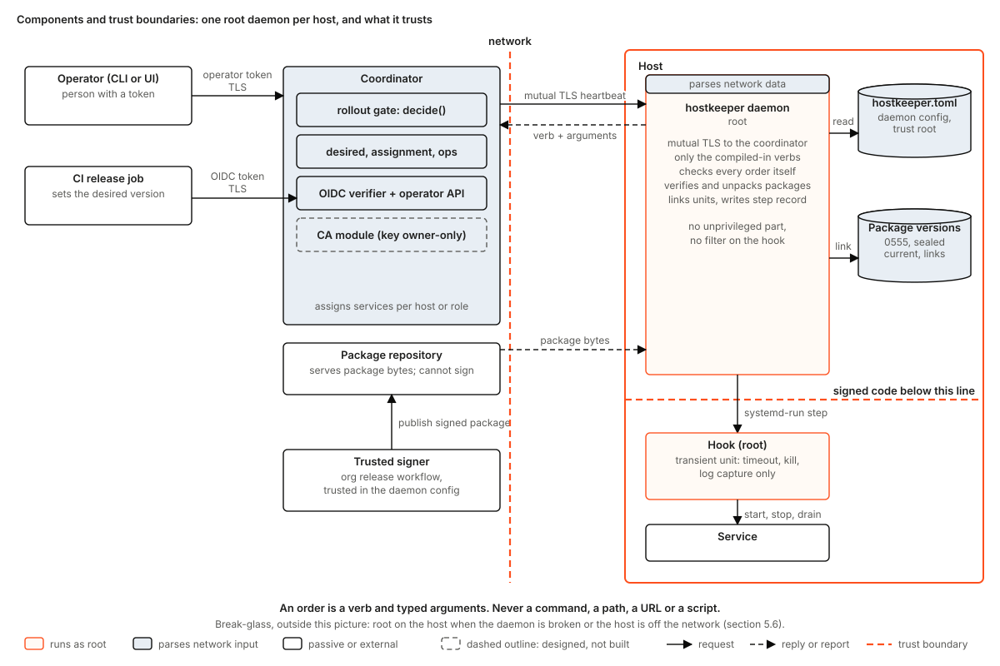
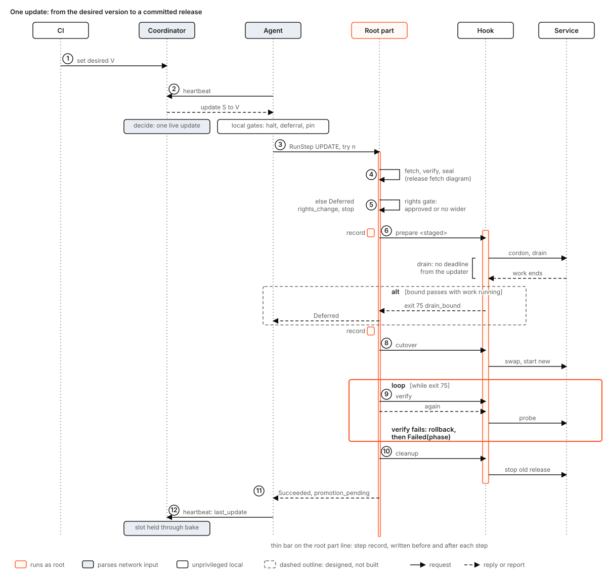
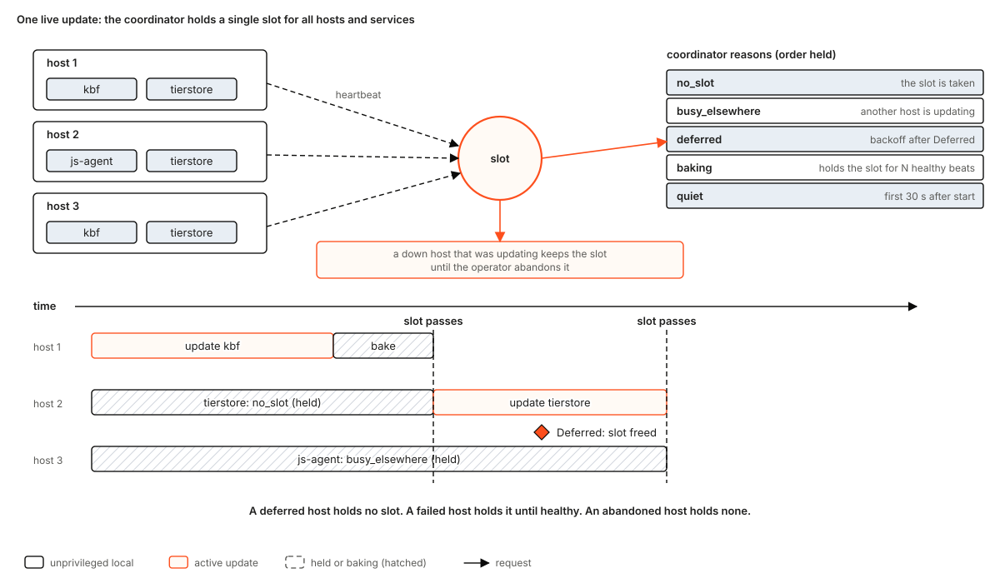
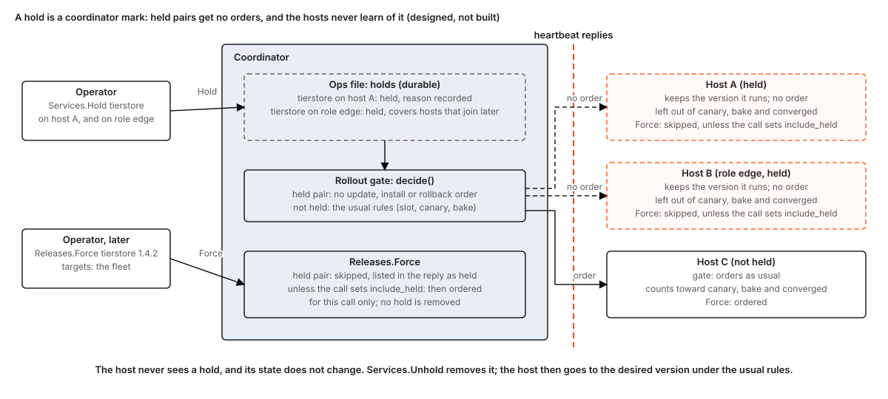
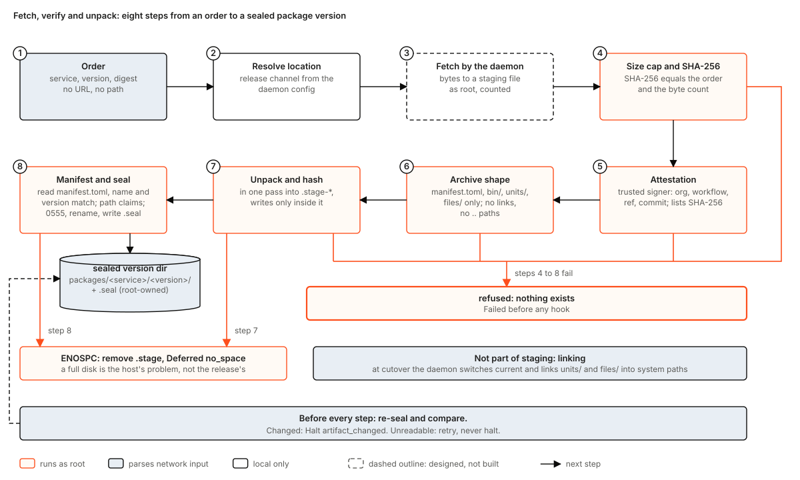
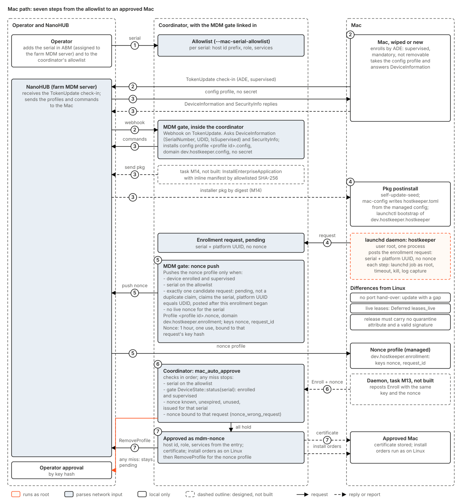
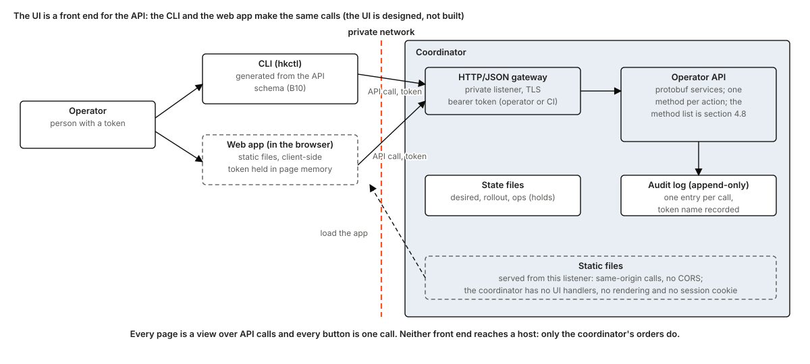
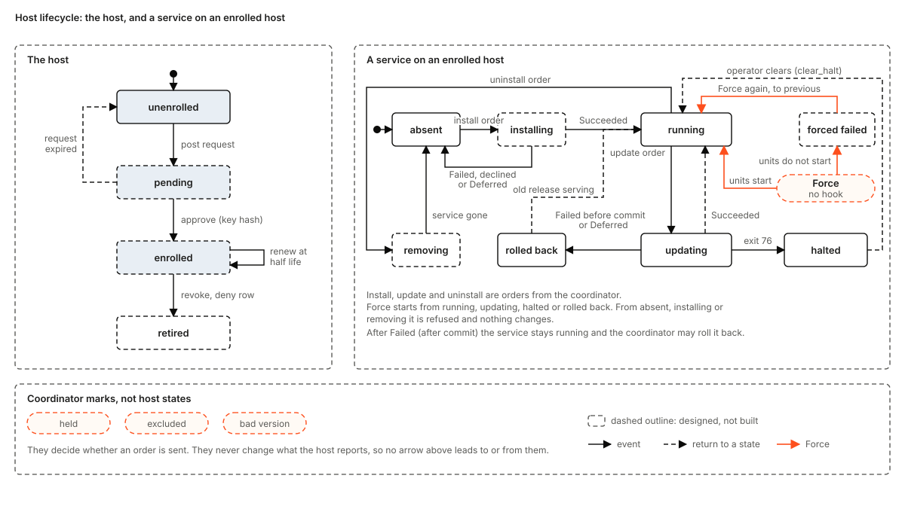

# hostkeeper design

Status: design, for the maintainers' comments. This is the single current design for hostkeeper and the entry point for every other hostkeeper document.

hostkeeper is the generic host lifecycle system: it installs, updates, rolls back, health-observes and retires the services that run on a host. kbf, tierstore and jobscheduler hosts are installed and updated by it. It knows no service by name. Each service tells it what to do through a hook that ships in the service's own package.

## What changed in this revision

- **One trust root on the host: the daemon config** (`/etc/hostkeeper/hostkeeper.toml`, shipped in the boot image): coordinator, release channel, one org-level set of trusted signers, daemon bounds. The per-host services file and per-service signer pins are deleted.
- **The coordinator owns which services each host runs,** per host or role, with the desired version and `min_version` of each.
- **A service ships as a hostkeeper package:** an attested archive holding `manifest.toml`, `bin/`, `units/` and optional `files/`. The daemon unpacks each version read-only, switches `current` atomically and links units and files itself (section 4.7).
- **A host keeps two versions of a service,** `current` and `previous` (section 4.7).
- **One package per operating system and CPU family, found through one release index** (section 5.5). The platforms are `linux-x86_64`, `linux-arm64` and `macos-arm64`; the daemon knows its own from the target it was compiled for. The desired state names the version's release index by its SHA-256, and the coordinator orders each host the package digest its own platform has in that index; the order carries the index digest and the package digest, and the size the daemon checks comes from the version's `index.json`, which it checks against the index digest first. Instruction-set variants live inside a package and are the build system's business.
- **Force is the primary fix, and it is hookless** (section 5.6). The local pin, the `activate` verb and the hold file are replaced by a coordinator-side hold (section 5.4).
- **The UI is a static app over the operator API** (sections 5.10, 4.8). Sections 5.5, 5.6 and 6.1 are rewritten to explain first.
- **Kept:** `decide()` as the rollout gate (section 5.4), one root process per host, compiled-in verbs, no rights filtering, a simple coordinator. Q3, Q4 and Q14 are settled; their numbers stay so earlier references stay valid.

## How to read this document

Each statement is tagged where it matters:

- **Built** means the code is on `main` of this repository, with a path.
- **Open PR** means the code exists in a pull request that is not merged: PR #3 (the protobuf crate) and PR #5 (the coordinator import).
- **In kbf** means the code exists today in the kbf repository and has not moved yet (the hostkeeper crates on `main` are an import of kbf's updater at one release tag; kbf `main` has moved past it).
- **Designed** means nothing implements it yet. Section 12 says which build item does.

Counts and line numbers are not carried here, because they rot. A test name in code font is a test that exists on `main` today unless tagged **(to build, Bn)**, **(open PR #n)** or **(in kbf)**. Places where this document deliberately differs from a ruling are marked **Deviation**.

## What this document replaces

| Document | Status after this one |
|---|---|
| `docs/design/host-updates.md` | Superseded as the entry point. It stays as the long-form reference for the hook contract (its section 3.2), the step record and dead-man (3.5), and the tierstore and jobscheduler hooks (4.1, 4.2). Void: the declaration with rights (2.4), "Which binary runs" trust and rights (3.3, 3.4), the registration socket (2.1 to 2.3, 3.7), per-service slots, and its migration order (8). Where it disagrees with this document, this document wins. |
| An earlier draft of the hostkeeper design, never published | Superseded entirely. |
| `README.md`, `MIGRATION.md`, `AGENTS.md` | Remain. `README.md` and `MIGRATION.md` still describe the agent, root part and rights crate and are updated with the first build item that changes them. |

---

## 1. Problem

A farm of machines runs several long-lived services. Today each service has found its own way to be updated, and the ways differ in the ways that hurt:

- Update scripts run per release, are written for that release, and are tested only by running them on the farm.
- A service with live work is updated by cutting that work, or by a script that waits for it in a way nobody can see.
- Two services updated at once on one machine, or on two machines that depend on each other, can take the farm down together.
- A broken release of the system that builds the releases cannot build its own fix.
- A new machine is installed by hand, with a setup tool per product.
- Nothing says in one place which code may run as root on a host and who vouched for it.

hostkeeper replaces all of that with one daemon per host, one coordinator per farm, and a small contract that every service meets.

## 2. Goals and non-goals

### 2.1 Goals

1. **One updater that knows no service.** Per-service behaviour lives in a hook shipped in the service's own package.
2. **A fixed, small contract.** Five steps, four exit codes, one JSON line. Every step is safe to run twice. A hook is a subcommand of the service's own binary.
3. **Trust is the signed package.** Code runs as root on a host only if it came from a package whose digest and attestation verified against the trusted signers in the host's daemon config, the host's only trust root. There is no filter between the root daemon and the hook.
4. **Each service rolls out by an update plan,** stages of a growing share of its eligible hosts (by default 1, 10, 50 and 100 percent), every stage baked before the next starts. The hosts of a stage update in parallel, capped per role by the desired state's `max_updating` and never below its `min_up`; a stage can wait for an operator, and an operator can pause a plan. One service's rollout is live at a time unless the coordinator is started with `--live-rollouts N`. The one exception is an operator's `Force`, which is hookless, passes the plan, and may target the whole fleet at once (sections 5.4, 5.6; `rollout-update-plans.md`).
5. **A package's hook never runs code from the version it leaves, except `rollback` when the new hook cannot start at all; `Force` runs no hook. A bad version can be put back fleet-wide with one call.** The previous version stays on the host, so putting it back needs no fetch.
6. **Work is never cut to finish an update.** A service with live work drains in its own `prepare`. The default is to wait with no deadline; a deadline is a per-service option. `Force` is the one sanctioned exception (section 5.6).
7. **Enrollment and remote install.** A host that boots a hostkeeper image appears as pending; an operator approves it; the coordinator installs the services it assigns to the host through the same path that updates them.
8. **macOS hosts follow the same flow** (section 5.9).
9. **Service health is observed, not reported by the service.**
10. **Every failure has a stated outcome and a test.** Section 8.

### 2.2 Non-goals

- Not a package manager in the distribution sense, a configuration management tool, a scheduler, or a high-availability coordinator (one coordinator, section 11). Not a Windows product.
- No protection of a host from its own root, and none of the trusted signers' repositories (section 5.1 says what a compromise of each gets).
- No remote way to widen what a hook may do. There is nothing to widen: hooks run as root, and the only way to put code on a host is a package signed by a trusted signer.
- No network boot of Macs (Apple silicon cannot net-boot; section 5.9). Network install of new Linux machines is in scope and designed in [network-install.md](network-install.md), which replaces the earlier non-goal "no network boot service".

## 3. The design in one picture



- **The coordinator** (`hostkeeper-coordinator serve`) holds which services each host or role runs, the desired version and `min_version` of each service, the farm's membership and the operator's marks (excluded hosts, holds, halts, bad versions). The rollout gate (section 5.4) decides, per heartbeat, whether to order a host to do something. An order is a verb and typed arguments. It also serves the operator API (section 4.8), which the generated CLI and the UI both call.
- **The daemon** (`hostkeeper`) runs on every host as root. It connects out to the coordinator over mutual TLS, heartbeats, and executes orders. It listens on no network port. Its local interface is a root-only unix socket for three verbs (`status`, `abort`, `clear_record`, section 4.1). It executes only the verbs compiled into it (section 4.1).
- **The daemon config** (`/etc/hostkeeper/hostkeeper.toml`) is root-owned and ships in the boot image: the coordinator's address, the release channel, the trusted signers as one org-level entry, and the daemon's bounds. It is the only trust root on the host, and the coordinator cannot change it (section 4.1).
- **The package** is the attested archive of one service version: `manifest.toml`, `bin/`, `units/` and optional `files/`. The daemon unpacks it read-only, links its units and files, and runs the hook the manifest names (section 4.7).
- **The hook** is an executable in the package. The daemon runs it, one step at a time, as root, in a transient unit that exists for timeout, kill and log capture (section 5.3).

Trust is placed in three things: the package whose digest and attestation verified against the trusted signers, the root-owned daemon config, and the coordinator's authority to assign services and order the compiled verbs. Section 5.1 states what each compromise gets.

### 3.1 What is built

| Piece | State | Where |
|---|---|---|
| Hook contract, exit codes, last-line JSON, params file, next-step table, conformance harness | Built | `crates/hostkeeper-hook` |
| Declaration with rights, loader, widening check, approval store and gate, `approve` command, transient-unit launch with user, capabilities and sandbox properties | Built, and the build order deletes or shrinks it: the daemon-config and manifest loaders replace the declaration loader, and the widening check, gate, approval store, `approve` command, account and reserved-path checks and the rights properties of the launch go (B2, B3) | `crates/hostkeeper-rights` |
| Step runner, step record, artifact seal, dead-man, self-update layout for a single binary: `versions/<v>` files with `current` and `previous` symlinks, atomic switch by rename, staging, unit generation helpers. `Layout::stage`, `check_binary` and `switch` take one executable file, so they cannot be reused as they are for a package of directories: B5 and B27 generalise them (a tree check in place of `check_binary`, the seal for `Staged::check`) and a test pins the on-disk names `current`, `previous` and `<v>.seal` (the model for the package layout, section 4.7) | Built for one binary; Designed for packages | `crates/hostkeeper-steps` |
| Test scratch directories | Built | `crates/hostkeeper-testkit` |
| 99% line and branch coverage gate, workflow lint, layering and hygiene tests | Built | `crates/coverage-gate`, `crates/xtask` |
| Coordinator (HTTP/JSON over TLS), wire types, OIDC verifier, TLS reload | Open PR #5 | `crates/hostkeeper-coordinator`, `-wire`, `-oidc`, `-tls` |
| Protobuf APIs, descriptor compatibility check (today including the root-part and approval services that this revision removes) | Open PR #3 | `crates/hostkeeper-proto` |
| Root program (boot pass, `Locked` error and lock file, `Update` and `Status`), agent loop, enrollment client, renew | In kbf (`kbf-updater root` and `agent`, two processes), to be imported and merged into one daemon (B4, B9) | |
| Package fetch, verify, unpack, seal | Designed (kbf has the fetch only inside its own installer) | section 5.5 |
| Daemon config and manifest loaders, placed-path linking, compiled verbs, hookless force, local admin socket, pruning to two versions, enrollment surface, service assignment, holds, remote install, uninstall | Designed | sections 4, 5 |
| The UI (a static app over the operator API) | Designed | section 5.10 |
| macOS daemon | Designed | section 5.9 |
| Boot image, packaging, privileged workflow, release automation | Designed | sections 4.6, 12 |

The imported crates keep kbf's wire and disk names on purpose: exit codes 0/1/75/76, the `update-hook` default argument, the reserved `updater.*` parameter keys, `/var/lib/updater/{state,hooks}`, unit names `updater-<service>-<step>-<generation>`, step record schema 1. Tests pin them (`constants_match_kbf_at_the_tag`, `reads_step_record_written_by_kbf_tag`). Renaming a stored format in place is forbidden; formats change by adding fields only. The package tree under `/var/lib/hostkeeper/packages` is new and replaces kbf's `releases` tree; nothing in the imported crates pins that name.

### 3.2 Naming

Names that carry the product move to `hostkeeper`: binaries, the `hostkeeper.*.v1` protobuf packages, `/run/hostkeeper/`, `/etc/hostkeeper/`, the macOS reverse-DNS prefix. Names that are product-neutral and already stored on disks stay `updater` (section 10).

## 4. Configurations

### 4.1 A Linux host

One unit, `hostkeeper.service` (root, `Type=notify`), one binary. The unit is written twice, with the same keys: the bootstrap unit of the deb, the rpm and the boot image starts `/usr/bin/hostkeeper daemon`, which gives the binary directory of section 6.6 its first binary and execs `current`; the package unit of hostkeeper's own package, which its install links in `/etc/systemd/system/`, starts `current` itself (`packaging/linux/README.md`). Neither names the admin socket or a `RuntimeDirectory=`. The unit starts the daemon again a second after it ends, however it ends (`Restart=always`), and never leaves it failed: the unit has no start limit (`StartLimitIntervalSec=0`), so a daemon that cannot start is retried every second for good; the releases before the hand-over of section 6.6 wrote a drop-in with a start limit and an `OnFailure=` fallback unit, which no release reads or removes any longer. And its watchdog (`WatchdogSec=60`, four heartbeat periods) restarts a daemon whose heartbeat loop hangs: the loop sends `WATCHDOG=1` after each heartbeat, and nothing else sends it. The daemon binds no socket: a host's status, abort and clear-record go through the coordinator (`docs/admin.md`).

**The daemon config** is the host's only configuration and only trust root. `/etc/hostkeeper/hostkeeper.toml` is root-owned, not writable by group or others, and ships in the boot image (section 4.6). Local root can edit it; the coordinator cannot. It holds no secret. **Designed format**: the loader on `main` reads the older per-service declaration with rights, not this; B2 replaces it.

```toml
coordinator     = "https://coordinator.example:8443"
ca_sha256       = "<SHA-256 of the farm CA certificate>"
release_channel = "https://releases.example"

[trusted_signers]          # one org-level entry; no per-service pins
organisation = "komira-ai"
workflow     = ".github/workflows/release.yml"
refs         = ["refs/tags/*"]
hosted_runner = true

[bounds]
max_package_bytes      = 536870912
max_unpacked_bytes     = 2147483648
max_entries            = 20000
fetch_timeout_secs     = 2100   # total fetch bound; the loader refuses a config where max_package_bytes cannot finish at 256 KiB/s in it
attestation_timeout_secs = 60
force_start_secs       = 60
```

Every table refuses unknown keys. A config that fails to load stops the daemon with an error naming the key; nothing changes on the host. There is no list of services in it: a host runs the services the coordinator assigns (section 5.7), and the daemon learns each service's lifecycle from the manifest of a package whose signature verified.

**The verbs** are code. The coordinator can send every row, `clear_record` only to a daemon that announces `clear-record-v1` ([two-programs.md](two-programs.md) section 3.2); the local CLI runs only the three marked local. No verb names a platform. An order carries the digest of the package of the host's platform and the digest of the release index; the daemon takes the package of its own platform and that package's size from the version's release index, which it checks against the index digest, and checks the package against the index entry and against the order's package digest (section 5.5). There is no other way to make the daemon do anything:

| Verb | Typed arguments | Meaning |
|---|---|---|
| `update` | service, version, try | fetch, verify, unpack, read the manifest, run the five steps; refused below the running version |
| `install` / `uninstall` | service (+ version for install) | add a service the coordinator assigned, through the update path with no previous version; or stop its units, run its `uninstall` hook, unlink and remove its package directories, placed paths and step records, in the order of section 4.7. The daemon never deletes `/var/lib/<service>`; that is the hook's business |
| `force_rollback` | service, version | a hooked update to a lower version (used by automatic rollback, section 5.4) |
| `force` | service, version, halt generation | hookless: stop the service's units, switch `current`, link, start the units, report (section 5.6); refused for the service `hostkeeper` |
| `abort` (also local) | service | stop the running step and end the order `Halt` |
| `clear_halt` | service, halt generation | lift a halt |
| `status` (also local) | none | report; also sent with every heartbeat |
| `clear_record` (also local) | service | clear a corrupt step record; its verdict, `succeeded` with the reason `record_cleared`, names the version the service runs |

Updating hostkeeper itself is `update` for the service named `hostkeeper`, or `install` on a host the deb or the pkg bootstrapped (no package of hostkeeper is installed there), followed by the self-update follow-on (section 6.6).

An order never carries a command, a path, a URL or a script. The release channel comes from the daemon config; the hook command, units, timeouts and files come from the manifest of the package whose digest verified; the order gives a service name and a version that match their grammars; the size of the package comes from the release index of that version, which must have the SHA-256 the order names, and the package must have the digest the order names and the index lists (section 5.5).

Per service on the host: its package directory `/var/lib/hostkeeper/packages/<service>/` with `current` and `previous` (section 4.7), a step record directory under `/var/lib/updater/state/<service>/`, a hook record directory `/var/lib/updater/hooks/<service>`, and the service's own data in `/var/lib/<service>`, which the daemon never touches.

### 4.2 A macOS host

One launchd daemon, `com.<reverse-dns>.hostkeeper`, as root. Paths follow macOS conventions. Section 5.9 states what differs.

### 4.3 The coordinator

One process with two listeners (and an optional third, a LAN listener serving only the agent service to network-installed hosts: network-install.md section 7): a **heartbeat listener** (mutual TLS, client certificate chaining to the farm CA; host identity from the certificate only) and one **private listener** (TLS, bound to the private network, off the public one) that serves the operator API (section 4.8) to the generated CLI and the UI, and serves the UI's static files (section 5.10). On it a CI OIDC token may set a desired version for services its allow-list entry names; every other action needs an operator token. A token either operates or does not; there are no per-token grants.

Operator tokens are one per person, listed by name in a tokens file the coordinator reads, each revocable and replaceable without a restart; every action records the token's name in the audit log (an append-only file, `<ops-file>.audit`; an append-only table once the state is in Postgres, **Designed**, [coordinator-storage.md](coordinator-storage.md)). A shared anonymous token is not supported (**Designed, B6**; PR #5 has one token today).

State: the desired file, the rollout file (below), the ops file and its halts file, and the enrollment store, all files written whole by temp file, `fsync` and rename (section 10, **Built**). They move into a Postgres database that runs beside the coordinator as a second container (**Designed**, [coordinator-storage.md](coordinator-storage.md), which supersedes "there is no database"); the rollout file, the tokens file, the TLS files and the CA key stay files. The coordinator owns which services each host runs. Its **rollout file** (`--rollout-file`) lists the services: for each its `version_scheme` (`semver` by default), canary, bake and backoff settings, `min_version` (enforced here: `set-desired` and every order below it are refused), and the roles that run it. A per-host addition or removal, and every hold (section 5.4), is set through the API and kept in the ops file. It has no built-in service. The heartbeat lists the services a host has installed with their versions; an order is made only for a service assigned to that host or role (**Designed, B6, B23**). The host holds no list of its own, so a service is added by a coordinator change, with nothing to touch on the hosts.

### 4.4 The CA

Designed. Certificate issuance is a module of the coordinator, not a second process (Q5 asks whether it should stay a separate process). It signs two things: a host client certificate (7 days) and the coordinator's server certificate. It enforces its own profile: P-256 keys only, subject `host:<id>`, the matching extended key usage, a validity cap, and one certificate per request id (section 5.7).

### 4.5 A CI client

A release job in a service's repository downloads the hostkeeper release, verifies its provenance (checksums, attestation, signer workflow, attested source commit equal to the pin), and only then requests an OIDC token and runs `hostkeeper ctl releases set-desired --service X --version V`, then polls convergence.

hostkeeper's own release planner holds releases from a commit whose privileged run on `main` failed: that commit is never released, a later commit whose ci, privileged and artifacts runs all succeeded is released and lifts the hold, and a ci success alone never lifts it.

A release is published before its image is pushed and before it is set as the desired version, so a release run can publish a release and then fail. When the planner releases no newer commit, it plans the newest published release again if the latest release run that published it did not succeed; every job after the plan is idempotent for a release already published, and after three such runs in a row that did not succeed the planner leaves the release and says so.

### 4.6 The boot image and installers

Linux: a network-installed Ubuntu 24.04 system ([network-install.md](network-install.md)) carries the daemon, its unit and `/etc/hostkeeper/hostkeeper.toml`; a host built from it needs nothing else to enroll. A deb and an rpm carry the daemon and unit for hosts not built from the image, and `hostkeeper-pxe` with no unit of its own, both the static build of [packages.md](packages.md) section 5.4 (`packaging/linux/nfpm.yaml`, built and checked by `.github/workflows/artifacts.yml`); whoever installs them places the config. macOS: a signed pkg whose daemon writes `hostkeeper.toml` at its start from the config profile the MDM installed first (section 5.9, [hostkeeper-mdm.md](hostkeeper-mdm.md) section 4). Both publish into the operator's shared package repositories. Network boot is served by the optional `hostkeeper-pxe` (network-install.md section 3). Designed.

### 4.7 The package

(Retired by [packages-native.md](packages-native.md), which installs every service from a native package; this section is what is built until then.) A hostkeeper package is one archive per service version and platform, e.g. `tierstore-1.5.0-linux-x86_64.tar.zst` (compression is Q10; the platforms are in section 5.5). It is attested rather than signed inside: CI builds one archive per platform, attests each, and lists each archive's size and SHA-256 in the version's release index; the daemon accepts the archive of its own platform only if its size and digest match the index entry and its own attestation names a trusted signer (section 5.5); an order may instead carry the picked entry of a release set with targets, which names the bytes by digest and locations (docs/design/packages.md section 7). It is **not a tarball unpacked into `/`**: the daemon extracts only inside the version directory and places units and files itself.

```
tierstore-1.5.0-linux-x86_64.tar.zst
  manifest.toml     the service's lifecycle config; never named hostkeeper.toml, which is the daemon config
  bin/              the service's files; the hook is a subcommand of one of them
  units/            systemd units (launchd plists on macOS)
  files/            optional: files that must sit at fixed system paths

on the host
  /var/lib/hostkeeper/packages/tierstore/
    1.4.2/          unpacked read-only (0555), root-owned; only current and previous stay
    1.5.0/
    1.5.0.seal      tree digest and package digest, written when the version was verified
    current  -> 1.5.0     switched atomically (rename), as selfupdate.rs does for the daemon binary
    previous -> 1.4.2
  /var/lib/hostkeeper/placed.json    which package owns each placed path
  /var/lib/tierstore/                the service's data: outside the package, kept across versions
  /etc/systemd/system/tierstore@.service -> .../packages/tierstore/current/units/tierstore@.service
```

**Two versions are kept: `current` and `previous`.** A rollback to `previous` is a local switch with no fetch; anything older is fetched again. No setting changes this. `previous` is whatever the host ran before the last switch of `current`, so after a rollback it names the version rolled back from, and the way to go further back is a force to a version the host fetches again.

| Event | `current` | `previous` | On disk afterwards |
|---|---|---|---|
| Updates to A, then B, then C | C | B | B, C (A was deleted when C was confirmed) |
| Roll back to B (a local switch) | B | C, the broken one | B, C |
| Repair: force to A (fetched again) | A | B | A, B (C is deleted) |

A switch is confirmed when an update ends `Succeeded` (one with `promotion_pending` counts) or a force moves `current`, whatever its verdict. The daemon then deletes every other version directory of that service, with its seal, under the service lock. A hooked update holds that lock for its step and a force takes it at step 7 of section 5.6, so a prune never races a switch; it also never removes the `previous_release` of an unfinished record or the target of a switch under way. The one tree allowed besides the two is a version staged by an update that did not switch: it stays until the next confirmed switch, so a retry needs no fetch. Disk need: two trees per service, plus the one being staged (Q7).

```toml
# manifest.toml
schema         = 1
name           = "tierstore"
version        = "1.5.0"
platform       = "linux-x86_64"   # one of linux-x86_64, linux-arm64, macos-arm64
min_hostkeeper = "0.4.0"          # oldest daemon that can run this package

[hook]
command = ["bin/tierstore", "update-hook"]    # relative to the version directory
boot    = "restore"                           # optional: additive hook step run from current at daemon start; absent means none
verify_deadline_secs   = 1600
promotion_ceiling_secs = 3600
cleanup_retries        = 3
[hook.timeout_secs]
prepare = 0        # drain: no deadline (the default stance, section 8.9)
cutover = 300
verify  = 1000
rollback = 600
cleanup = 1300
uninstall = 300

[units]
run = ["tierstore@9301.service", "tierstore@9302.service"]   # started, stopped and observed (5.8) by the daemon

[health]
url = "http://127.0.0.1:{port}/healthz"   # one probe per run instance; {port} is the number after @ in the instance name

[[files]]
source = "files/tierstore.conf"
path   = "/etc/tierstore/tierstore.conf"

[params]           # opaque scalars handed to the hook in its params file
```

**The manifest is trusted only because the package signature verified.** The daemon reads it after the digest and attestation checks and the archive shape check (section 5.5), never before. Load rules: `name` and `version` equal the order's, and `platform` is required and equals the daemon's own platform; every table refuses unknown keys; `prepare = 0` is the unbounded form and valid for `prepare` only, every other step needs a bound from 1 up; `verify_deadline_secs` is at least the verify and rollback bounds together; every `[[files]]` source exists under `files/`; a `min_hostkeeper` above the running daemon is `Deferred`, class environment, `daemon_too_old` (update hostkeeper first). There is no `user`, `capabilities`, write-path or signer field, no release URL and no `min_version`: a hook is root (section 5.3), the signer is the daemon config's, the URL is the channel's and the floor is the coordinator's.

**Units, enable and boot.**

- *Linking and enabling.* Every file in `units/` is linked. Each entry of `[units] run` must equal a linked unit or be an instance of a linked template; the loader checks it. The daemon enables the `run` units by writing their `WantedBy` links itself and recording them in `placed.json`, so they start at host boot. A `WantedBy` link that is already there, that `placed.json` does not list and that links to a unit file of the same name (the `systemctl enable` of a distribution package that installed the unit, as the deb and the rpm of hostkeeper enable `hostkeeper.service`) already enables the unit: systemd reads a `.wants/` link by its name and starts the unit of that name from `/etc/systemd/system` before `/usr/lib`. The daemon leaves it as it is and does not claim it, so it is no `path_conflict`, and never removes it.
- *`ExecStart`.* A unit's `ExecStart` may name files of the package only through `/var/lib/hostkeeper/packages/<service>/current/…`. The loader rejects any other absolute path under `packages/`, because a version path would pin a unit to a version and defeat the switch (a running process survives a switch only until its unit restarts).
- *Who starts and stops the `run` units.* In a hooked update the hook does, in `cutover` and `rollback`, because the service decides its own hand-over; in `force` and at daemon start the daemon does. `boot` is optional and means none when absent; otherwise it names an additive hook step the daemon runs from `current` at start, after the units are enabled.
- *The health URL.* For `[health].url` the daemon makes one probe per `run` instance and replaces `{port}` with the number after `@` in the instance name (`tierstore@9301` gives `9301`); a URL with `{port}` and a `run` unit with no instance is refused at load.

**Paths.** A `[[files]] path` is absolute, has no `..`, and is refused under `/etc/hostkeeper`, `/etc/updater`, `/var/lib/hostkeeper`, `/var/lib/updater`, `/etc/systemd/system` (units go through `units/` only), `/usr`, `/boot` and `/var/lib` (service data is the service's own). A unit file name starts with the service name, so one package cannot claim another's unit. These are guards against mistakes, not a security boundary: a hook is root. They settle Q11 to the narrow reading until the maintainers rule otherwise.

**Placed paths.** The daemon, not the hook, links the package into the system, from `current`, immediately before `cutover` and back before `rollback` (section 5.2). Units go to `/etc/systemd/system` (plists to `/Library/LaunchDaemons`), each `[[files]]` entry to its declared path. Each placed path is a symlink into `current`, so one switch of `current` re-points all of them. The daemon refuses, before it switches or stops anything, a package that claims a path another package owns, or a path occupied by something the record does not list (`Failed`, class release, `path_conflict`). Order of writes, write-ahead so that a crash never leaves a link the record does not list:

1. Write `placed.json` with the target's paths marked `pending`, each with the owning service and version (temp file, `fsync`, rename).
2. Create each link under a temporary name and rename it into place.
3. Switch `current` (set `previous` first, `current` second; a repeat after a crash between them changes nothing).
4. `systemctl daemon-reload`.
5. Mark the paths `placed`, written the same way.

At start, a `pending` entry whose link points into this package's directories is ours: the step record or the `force` record names the `from` and target versions, and start finishes the switch to the recorded side or undoes it. A path occupied by anything else is the `path_conflict` case. A version that no longer lists a path has the link removed after `cleanup` (hooked update) or at step 10 of `force`; a unit no longer listed is stopped, disabled, its link removed and `daemon-reload` run, in that order.

**Uninstall.** Refused with `uninstall_unsupported` if the manifest has no way to run it, before anything changes. Otherwise each step is durable before the next and resumable:

1. Write a tombstone `uninstalling` for the service in `placed.json`.
2. Stop the `run` units. A unit that will not stop ends the uninstall `Failed`, `unit_stuck`, with nothing removed.
3. Run the hook's additive `uninstall` step, bound by `[hook.timeout_secs] uninstall`.
   - Exit 0: done. Exit 1: failed, the service is left stopped and tombstoned. Exit 75: try again later.
4. Disable the units, remove the placed links, run `daemon-reload`.
5. Drop the paths from `placed.json`.
6. Remove `current`, `previous`, the seals, the version directories and the step records, last.

A crash resumes at the tombstone; every step is idempotent.

### 4.8 The operator API

The operator API is protobuf services (`operator.proto`, PR #3) with an HTTP/JSON gateway on the private listener. The generated CLI and the UI are its only clients; each sends the operator's token, and each action is one method call, audited under the token's name. A CI token reaches only the methods its allow-list names.

| Service | Methods | State |
|---|---|---|
| `Hosts` | `List`, `Get` (role; each service's installed version, health, hold and excluded marks; the last update with verdict, phase, class, reason, `detail`, try number and log lines), `Exclude`, `Include`, `SetLabels` | PR #3 |
| `Releases` | `SetDesired`, `Converge`, `Force`, `UnmarkBad`, `ClearHalt`, `Status` | PR #3 |
| `Releases` | `WaitConverged`: one held read that ends at convergence, a halt, another desired version or its `wait_secs` ([two-programs.md](two-programs.md) section 3.1); `SetDesired` with `targets` and `GetRelease` ([packages.md](packages.md) section 3) | Built (`crates/hostkeeper-coordinator/src/wait.rs`, `src/releases.rs`) |
| `Releases` | `MarkBad`, `Halt`; `Force` gains targets (fleet, role or hosts) and `include_held` (section 5.6) | Designed (B1, B7) |
| `Services` | `List` (includes holds), `Assign`, `Unassign`, `SetMinVersion` (per role or host), `Hold`, `Unhold` (host, role or fleet, section 5.4) | Designed (B1, B7, B23) |
| `Hosts` | `Abort` (queued as an order for the host's next heartbeat; takes no slot), `Exclude --abandon` | Designed (B7) |
| `Enrollment` | `List`, `Approve` | Built (`crates/hostkeeper-coordinator/src/enrollment/list.rs`, `approve.rs`) |
| `Enrollment` | `List` shows each pending request's match against the host inventory; `AddRecord`, `ListRecords`, `RemoveRecord` keep the inventory (section 5.7) | Built (`crates/hostkeeper-coordinator/src/inventory.rs`) |
| `Enrollment` | `Reject`: a pending request leaves the queue and its key is refused (section 6.1, `pending` -> `unenrolled`) | Built (`crates/hostkeeper-coordinator/src/enrollment/reject.rs`) |
| `Hosts` | `Retire`: the deny row of an enrolled host, its own assignments dropped, its slot freed when its update is final (section 5.7 step 7, section 6.1) | Built (`crates/hostkeeper-coordinator/src/hosts.rs`) |
| `Audit` | `List` | Designed (B7) |
| `Rollouts` | `Advance` (enters the next stage of a plan that waits for an operator), `Pause`, `Resume`: each names a service and a reason, takes the operator token only and is one audit entry (`rollout_advance`, `rollout_pause`, `rollout_resume`); `Releases.Status` answers each service's `plan` (section 5.4) | Built (`crates/hostkeeper-coordinator/src/rollouts.rs`) |

CI or an operator token sets the desired version (Q6): the operator through the API, the CLI and the UI's Rollout page.

## 5. How each operation works

### 5.1 Who may do what, and what a compromise gets

| Actor | Credential | May |
|---|---|---|
| Daemon | host client certificate (7 days) | heartbeat, renew, execute the verbs on its own host |
| Coordinator | server certificate chaining to the CA pinned in the daemon config | order any verb for any enrolled host, assign services; supply no command, path or URL |
| Operator | personal token | exclude, include, label, hold and unhold, clear halt, force, mark and unmark bad, approve enrollment, assign services, set `min_version`, set the desired version of any managed service, read convergence |
| CI | OIDC token, single-use `jti` | set the desired version and read convergence, only for services its allow-list entry names |
| Local root | uid 0 on the host | everything, including editing the daemon config |
| Trusted signer | the organisation's release workflow named in the daemon config | publish packages (binaries and hooks) that run as root on every host the coordinator assigns them to |

**The daemon checks every order itself,** from its own files, because the coordinator can order anything: the service name and version match their grammars; after the package verified against its index entry and attestation, its manifest `name` and `version` equal the order's and its `platform` is the daemon's own and `min_hostkeeper` is not above the running daemon; the target is not below the running version unless the verb is `force_rollback` or `force`; no unfinished record of a different package (`busy`); no standing halt; no path conflict (section 4.7). `force` skips exactly two of these: `busy` (it interrupts the running step of that service instead, section 5.6) and the standing halt (the order carries a halt generation greater than the one the host holds, and the daemon lifts its hold on it, section 5.4). Every other check applies to `force` unchanged: the grammars, the index, size and digest checks, `min_hostkeeper`, the shape and path-claim checks, and the refusal of the service `hostkeeper`. It does not know the coordinator's holds, bad marks, `min_version`, canary or the update plan: those are the coordinator's. The package is verified against its index entry and the trusted signers regardless (section 5.5).

**Threat model, plainly.**

- **A compromised daemon is root on that host.** It is root's own program. Nothing here contains it. It holds the host certificate, so it can also falsify its heartbeat and verdicts, which are the inputs of the one slot, bake and automatic rollback: a lying host can hold the slot or advance bake.
- **A compromised coordinator, or a stolen operator token, can put any of our signed packages on any host and force-switch versions.** In detail: `install`, `update`, `force_rollback` and `force` of any package a trusted signer signed, for any service name and any version the channel holds, downgrades included, because the floor (`min_version`) and the services per host are the coordinator's own and nothing on the host re-checks them (Q13); `uninstall`, which runs the package's signed `uninstall` hook and deletes its directories and placed paths; `abort` (a denial of service) and `clear_halt`; update of `hostkeeper` itself to any signed version; and, at the coordinator, exclude, halt, hold (a service held where it is is ordered nothing, so a fleet-wide hold keeps the fleet on a vulnerable version; the Fleet and Holds pages and the audit log show every hold) and approving a rogue enrollment (which receives fleet information and can take a place in a service's rollout). It **cannot run code that was not signed by a trusted signer, and cannot add a signer, change the release channel or the coordinator address**: those live in the daemon config. Every byte that executes comes from a package whose digest and attestation verified against the daemon config, and no order field can carry a command (a descriptor test, B1). The CA key sits with the coordinator (Q5), so a coordinator compromise includes certificate issuance.
- **Force, the widest case.** A compromised coordinator or operator token can, in one call, stop and switch any service on every host, cutting running work, past the update plan and canary, and can switch to a signed version the operator never released (the package comes from the version's release index and the release channel holds what signers published, section 5.5). The daemon-side checks of an update apply, so the blast radius is bounded by what signers signed; it cannot run unsigned code or change the trust root.
- **A compromised trusted signer** (the release workflow of any repository the org-level entry covers) can sign a package for any service name, so it is root on every host that is assigned that service, and a root hook can touch any file, so this is root-equivalent on those hosts for every service. For `hostkeeper` itself that is every host. Because the entry is org-level, every release workflow in the organisation counts (Q12). A signer cannot choose which hosts get its package: only the coordinator assigns. A compromised signer together with a compromised coordinator is root on any host.
- **Holds are an operational control, not a security boundary.** The old local pin could not be overridden remotely; a hold is a coordinator mark, so a compromised coordinator or token sets and removes holds freely, and a host can no longer refuse the coordinator's orders. Local break-glass is root switching `current` by hand (section 5.6).
- **A stolen CI token** can set the desired version of the services on its allow-list, to a version that has a signed package. A stolen operator token can do the same for every managed service, under its own name in the audit log.
- **A compromised release channel** can only serve bytes; the digest and attestation checks refuse any that a trusted signer did not sign.
- **The daemon is the only process that parses network data, and it is root.** That is the coordinator's messages, the package bytes from the channel, the attestation bundle, the archive and its decompressor, and the manifest. What limits it: it listens on no port and connects out; the coordinator's certificate must chain to the CA pinned in the daemon config (section 5.7), so a message needs the CA key or the coordinator; messages are protobuf decoded by Rust code with size caps and a small fixed message set; the archive and manifest are parsed only after the package's size and digest equal its release index entry and its attestation verified; the index itself, small JSON, is read by a strict parser before that, and is not trusted (section 5.5). What does not limit it: the release channel and the attestation bundle are not CA-bound (the attestation is parsed before it verifies, the channel's TLS is the web's), nothing sandboxes the daemon, and the TLS, protobuf, attestation and decompression parsers read bytes from parties that may be compromised. A memory-safety bug in one of them would be root on the host. We claim no more than that. The one exception, opt-in: with `--release-channel` the coordinator also reads the release index of each version a set names from the channel (at most 64 KiB of JSON, of which it reads the service, the version and each package's `sha256`), bounded by its own deadlines, and acts on it only by refusing the set; a compromised channel can make sets refused, never accepted.

### 5.2 One update, end to end



1. CI publishes V of service S to the release channel (one attested archive per platform and the index of V, section 5.5), then sets the desired version of S to V. The coordinator refuses, as its own check, a V below the service's `min_version`, a V it cannot parse and a V marked bad. With `--release-channel` (opt-in per deployment) it first fetches `S/V/index.json` from that channel and refuses the set `not_in_channel` (retryable: nothing changed, set again once the channel holds V) when the channel does not hold it or it cannot be read, and `channel_digest_mismatch` when that index is of another service or version or lists no package with the package digest the set names, or, for a set over a release index, is not that index (its SHA-256 is not `release_index_digest`); without the flag it fetches nothing.
2. At the next heartbeat of a host that is assigned S and is behind, the rollout gate (section 5.4) checks its rules and, if every one passes, the reply carries the order `update S V try`. `try` is assigned by the coordinator per host and service, as the daemon keys it (section 8.3): one more than the highest try the host's heartbeats carried for S, whatever order the verdict ended (an install, an earlier update, a force), and the try the service's step record holds, which the daemon sends in every heartbeat whether or not a verdict is sent (`ServiceBeat.record_try`), kept per host and service and never lowered by a later heartbeat (an acknowledged verdict is no longer sent; one may name no try). So the update after an install is try 2, a resend before the host reports keeps its try, and a restarted coordinator, which rebuilds the highest try from the heartbeats and the verdicts file (section 8.2), never re-issues a lower one, even to a host whose last order's verdict it never heard (the install of a self-update, which the daemon runs across its own restart). A refusal for the try alone (`try_conflict`, `stale_try`: failed, no phase, no class) is a disagreement on the try, not a release failure: the coordinator orders the host again past the refused try (and past the record's try, when sent), and it marks no version failed on the host, counts toward no rollback and fails no stage. An `abort` is always try 1: the daemon keys it by its own order id, not by the step record.
3. The daemon runs its own checks (section 5.1).
4. The daemon fetches the index of V and the package for its own platform from the release channel (the order names a service and a version, never a URL or a platform), verifies the size and digest against the index entry and the archive's attestation against the trusted signers, unpacks it into the staged read-only version directory `/var/lib/hostkeeper/packages/<S>/<V>/`, writes the seal and reads `manifest.toml` (section 5.5). Fetch and verify have their own deadlines and do not use the dead-man.
5. The step runner writes the step record, then runs `prepare <version directory>`. The daemon then switches `current` to V and links the package's units and `files/` (section 4.7), and runs `cutover`, `verify` and `cleanup` in order. Each step is a transient unit running as root (section 5.3) and is preceded by a re-check of the version directory against its seal. The hook is the new package's hook, the command the manifest names.
6. After each step the runner reads the exit code and last stdout line, and `next()` (a pure function, `crates/hostkeeper-hook/src/next.rs`) says what follows. Failure before commit makes the daemon switch `current` back to the previous version and relink (if cutover had begun), then run `rollback`, and report Failed. Deferral does the same for what `prepare` did and reports Deferred.
7. The verdict goes in the step record and in `last_update` of each heartbeat until the coordinator acknowledges it (section 5.4). The first of those heartbeats does not wait for the period: while an order runs, the heartbeat loop waits a second at a time and beats once the order has ended, so the coordinator hears the verdict, and the service an install lists (`Hosts.Get`, `Hosts.List`), within a second of its end; then it waits a whole period again.
8. If the last `verify` said `promotion_pending`, a watcher keeps running `verify` until it passes without the flag, or the promotion ceiling passes (Failed after commit), or a new order replaces it.

Signer and bounds come only from the daemon config; from a package the daemon takes only what its manifest says about that service. This limits what the daemon does, not what a hook can do: a hook runs as unrestricted root, so a compromised signed package can overwrite the daemon config and the installed daemon (section 5.1). The step contract:

| Step | Argument | Meaning |
|---|---|---|
| `prepare` | staged version directory | check preconditions, drain, stage anything that can be undone |
| `cutover` | none | make the new release serve; if this makes the old release unrecoverable, say `reversible:false` here |
| `verify` | none | observe; may be repeated; success means the new release is serving |
| `rollback` | none | return to the state before `prepare`, or say `reversible:false` |
| `cleanup` | none | remove what is no longer needed; if the irreversible act can wait, it belongs here |

Exit codes: 0 success, 1 failure, 75 deferred (nothing irreversible happened), 76 halt (no version can repair this). A signal or timeout is failure. The last non-blank stdout line is one JSON object `{class: release|environment, reason, retry_after_secs, reversible, promotion_pending, detail}`; a missing line is `{}`; a non-boolean `reversible` reads as false. The updater, not the hook, assigns the phase (`before_commit`, `gate_release`, `gate_environment`, `after_commit`, `halt`).

**Commit point.** The update commits at the first step whose line says `reversible:false`. A hook that never says so never commits: a failed `verify`, or a failed `cleanup` that states `reversible:true`, is rolled back. After a commit, a failed `verify` still selects `rollback`, and the verdict is `Failed(after_commit)` when it completes; if `rollback` itself fails the verdict is `Failed(after_commit)` when its line says `reversible:false` and Halt otherwise (`next.rs`; test `a_failed_verify_rolls_back_and_cleanup_never_runs`). A cleanup that fails without stating `reversible` is retried forward, never rolled back.

All five steps use the hook in the **new** release. The **previous** release's hook runs `rollback` only if the new hook cannot start at all. A hook's record must be readable one version back: a contract rule, not yet checked by the conformance suite (**to build**, B3).

Parameters: the daemon writes one TOML file per update and passes it to every step: the manifest's opaque `[params]` plus reserved keys `updater.staged_release`, `updater.previous_release`, `updater.target_version`, `updater.previous_version`, `updater.artifact_digest`, `updater.promotion_ceiling_secs`. A manifest may not set an `updater.*` key; a hook ignores unknown `updater.*` keys.

### 5.3 How a hook runs

A hook runs as root. Each step is a transient unit, `systemd-run --system --wait --collect --pipe --unit=updater-<service>-<step>-<generation>`, with `RuntimeMaxSec` set to the step's timeout (`infinity` for an unbounded `prepare`) and nothing else: no user, no capability set, no sandbox property, no `ReadOnlyPaths` or `ReadWritePaths`, no polkit rule. The unit exists for three reasons only: the timeout (the dead-man stops the unit by name), the kill (the whole cgroup goes), and the capture of the exit code, last stdout line and log. On macOS the same three come from a launchd job (section 5.9).

Why there is no filter. A root daemon that launches a root hook cannot meaningfully limit the hook: any allow-list of what a root program may do is only as complete as the list's author's imagination, and the hook already writes the files it will run. What makes the hook safe to run is that it came, byte for byte, from the package a trusted signer attested. The daemon fetches the package, verifies its digest and attestation against the trusted signers in the daemon config, unpacks and seals it, and only then runs the hook its manifest names. This is the trust apt gives a package's maintainer scripts. The conformance suite (idempotence, the hook writes only its record directory, exit codes) runs in the service's own CI; at runtime nothing confines a hook.

**Built (B3)** in `crates/hostkeeper-steps/src/systemd.rs`: `SystemdLauncher` runs `systemd-run --system --quiet --wait --collect --pipe --unit=<unit> --property=RuntimeMaxSec=<secs|infinity> -- <hook> <args>`, and stops a unit with `systemctl stop --system <unit>` (exit 5, not loaded, is stopped). The runner accepts `prepare = 0` as unbounded and does not arm the dead-man for it. The launch of `hostkeeper-rights` with its user, capability and sandbox properties is deleted. An unbounded step is ended by the hook returning or by `abort` (section 8.5). The daemon does not use it yet: `hostkeeper-daemon` still starts with a launcher that refuses every step.

### 5.4 The rollout gate: which hosts may update now

 *Superseded figure: the farm-wide single in-flight token that this section described before the update plans (`rollout-update-plans.md`). It still shows how a host's slot is taken and freed, and what a service waits for when another service's rollout is the live one (`--live-rollouts 1`, the default); it does not show stages.*

The rollout gate is the coordinator's pure function `decide()` (`crates/hostkeeper-coordinator/src/decide.rs`, open PR #5). Per host and service, the first failing rule wins and its name is the reason shown to the operator. The rules, cut to what the gate is for (the update plan, below, is the last of them; its design is `rollout-update-plans.md`, which replaces the single live update of earlier revisions):

- **Halts, holds and bad versions:** `halted`, `held`, `bad`.
- **Excluded and unenrolled hosts:** an excluded host, a host pending approval (`waiting_for_operator`) and a cloned disk (`duplicate`) get no order.
- **One update on a host, and the quiet start:** `updating`, `busy_elsewhere`, and `quiet` (a restarted coordinator orders nothing until it has heard the fleet, so the slots held are known).
- **The update plan of the service:** `paused`, `rollout_elsewhere`, and, for a host that has no place in the current stage yet, `advance_wait`, `stage_failed`, `baking` and `stage_wait`; for a host that has one, `no_slot` (the role's `max_updating` is reached) and `below_min_up` (ordering it would leave fewer of the role's live hosts up than `min_up`). A canary is the plan's first stage, so `canary_wait` is no longer given.

Not rules of the gate: order construction and retry bookkeeping, which the code does around it. `up_to_date` (nothing to order), the choice between `install` (a service assigned to the host and not installed; it replaces `no_definition` and `absent`) and `update`, `failed_here` (this host failed this exact version; a new desired version lifts it) and `deferred` backoff (from the rollout file, capped at 1 hour). If the maintainers want any of them counted as gate rules, the list above gains it (Q6). Cut in this revision: `waiting_for_role`, `waiting_for_service` and the `after` graph (Q6); the plan orders the stages of a service, and `--live-rollouts` the services. `max_updating` and `min_up`, cut with them at B6, are read again per role by the plan.

**The update plan.** Each service rolls out by a plan: a list of stages, each the cumulative percent of the service's eligible hosts that run the new version once the stage is done (the rollout file's `stages`, by default `[1, 10, 50, 100]`; `canary = { count = n }` is a first stage of `n` hosts). A stage of percent `p` over `n` eligible hosts holds `max(1, ceil(p * n / 100))` hosts, and stages that come out the same size collapse into one, so one host gets one stage and eight hosts get three (1, 4 and 8). The hosts of a stage are ordered in parallel, as each heartbeats, under two limits per role read from the desired state: `max_updating` and `min_up`. A stage is done when it is full and every eligible host that started is up at the desired version and has baked; only then does the next stage start. A stage whose `advance` is `manual` waits for an operator's `Rollouts.Advance`; `Rollouts.Pause` stops a plan from ordering new hosts (updates already running finish and bake) and `Rollouts.Resume` lets it go on. A host that failed the desired version stops its stage from being done until an operator holds or excludes it, clears its halt or sets a version by hand; the rollback threshold (below) is unchanged and is reached within a stage, as the failures arrive. The plan's position (the stages entered, the hosts recorded done, the pause) is kept per service in the halts file (section 10) and survives a coordinator restart; a new desired version starts the plan over. `Releases.Status` answers each service's plan: its stages and their hosts, with the state of each host, the current stage and why the plan waits (`paused`, `halted`, `rollout_elsewhere`, `quiet`, `manual_advance`, `failed_host`, `below_min_up`, `updating`, `deferring`, `baking`).

> **The slot rule still matters.** **A host holds an update slot** while it is updating, while its last success has promotion pending, after a failed update until it beats healthy, and from the moment the order is issued until the host reports it. A host that holds an order and then goes silent keeps the slot; the order's age (`ORDER_AGE`, 120 seconds) frees it only while the host is still heartbeating without `updating`. As many hosts of a role hold slots of one service as the desired state's `max_updating` of the role lets, and no more are ordered (`no_slot`); a role the state does not name has the default, 1, or 2 for `daemon` and `mac-daemon`. Across services, **one service's rollout is live at a time by default**: a rollout is live while one of its hosts runs an update (updating, promotion pending, or ordered) or bakes the desired version, or while its plan has started a host and still has one to order, and a service whose rollout is not live is told `rollout_elsewhere` while `--live-rollouts N` (default 1, at most 16) others are; `Releases.Status` names them. A failed host holds a slot of its own service only: a halted service, or one whose only occupants are failed hosts, is not live and holds no other service's rollout.

Promotion-pending and failed-until-healthy extend the slot past the update itself, and the bake keeps the stage open past it, because a release that passes verify and fails shortly after must not reach the next stage (Q8 asks whether to keep bake). A host that bakes holds no slot; its stage is not done, and its service's rollout stays live, until it has baked. Consequence: a slow drain on one host keeps its stage from being done, so the service's later stages wait, and by default holds every other service's rollout (section 8.9, Q1). `Force`, verbs that change no release (`abort`, `clear_halt`) and holds do not take a slot (sections 5.6, 4.8). `quiet` is the first 30 seconds after coordinator start by default; B7 makes it a flag the coordinator refuses to set below two heartbeat intervals; a canary that reports `Failed` of class `release` meets the rollback threshold on its own and raises an alert; `baking` holds the stage until each of its hosts has N further healthy heartbeats at the desired version.

**Holds.** An operator can hold a service on one host, on a role or on the whole fleet, with a reason (`Services.Hold`; `Services.Unhold` releases it).

- A hold freezes the pair where it is. The host keeps running the version it runs now, and the coordinator orders it nothing: no `update`, `install` (a service not installed stays not installed), `force_rollback`, `uninstall` or `force`. A hold carries no version; the UI shows the version the host reports beside the mark.
- Automatic rollback and `MarkBad` do not reach a held pair. A held host that runs a bad version raises an alert and the UI flags it.
- A held pair is left out of the plan (it takes no place in a stage and does not count towards one being done), bake and the converged count, so it never blocks the others and is never the canary. `hostkeeper` itself can be held like any service.
- `Unhold` releases the pair to the then-desired version at its next heartbeat.
- A hold is a coordinator mark in the ops file. It survives a restart, the host never learns of it, and it covers hosts that later join the held role (a host whose role label changes follows the new label). It takes no slot; an update already running finishes (`abort` stops it).
- **Force and holds.** A force skips a held pair and lists it in the reply as `held`, unless the call sets `include_held`. Then the force orders the held pairs it targets, for this call only. It removes no hold: the pair is still held afterwards, at the version the force left.

Holds show on the Fleet and Holds pages and in `Hosts.Get` and `Services.List`.



**Replayed verdicts.** The daemon resends its newest `last_update` per service until the coordinator acknowledges it; a service its step records do not list (an install refused before it placed anything writes no record) is listed `absent`, at the order's target, with that verdict until then and with none after, which the coordinator reads as still reporting it, until the records list the service; a verdict is counted once per (host, order id, try). The acknowledgement is the answer's list of acks, one per verdict, each naming the service, the order id and the try (`HeartbeatResponse.acks`; `acks` in the JSON answer). The service is named because an order id is the coordinator's per service: two services may each have a `force-1`. Acks go only to an agent that announced `verdict-acks-v1`: an older agent's strict reader refuses a field it does not know, so it gets the answer it always got, byte for byte, and resends each verdict until it reports another, as before. The coordinator acknowledges a verdict only once its write to `<state-file>.verdicts` (section 10) has returned: the verdict standing for that host and service, and the verdicts it counts toward a rollback, in one atomic write under the fleet's lock; when the write fails, nothing is acknowledged, the failure is logged, and the resend at the next heartbeat writes again. A verdict with no order id or no try is never acknowledged, and it ends the one standing. Once a verdict is acknowledged the daemon stops sending it, and the coordinator reads that agent's service entry with no `last_update` as still reporting the verdict it acknowledged last: the gate's `failed_here`, the halt, the bake and the end of an order read what they read while the daemon resent it, across a coordinator restart too, so the coordinator does not order the version the host failed again. The verdict heard last replaces the standing one, so the daemon sends a service's verdicts oldest first to a coordinator that advertises `verdict-acks-v1` (newest first otherwise, as before), and an ack also ends the verdicts of that service older than the one it names: an older one heard after a newer would stand in its place. Tests: `a_verdict_is_acknowledged_only_once_it_is_stored`, `a_restart_after_an_ack_does_not_order_the_version_again`, `a_duplicate_verdict_is_counted_once`, `without_the_feature_on_both_sides_nothing_is_acknowledged_or_kept`, `a_service_entry_is_acknowledged_by_its_service_and_still_read_as_failed`, and `the_json_and_grpc_answers_acknowledge_the_same_verdicts` over the golden cases of `crates/hostkeeper-coordinator/tests/fixtures/acks/answers.json`.

**Automatic rollback** (`rollback = "automatic"`): when failures with phase `after_commit` or `gate_release` and class `release` reach the larger of the configured percent of live hosts and `min_hosts` (defaults 25% and 2), the coordinator marks the desired version bad first, then sets the desired version to `last_good`, if `last_good` is at or above `min_version`; hosts get `force_rollback`, a hooked update to the lower version. Environment failures, deferrals and halts do not count. `last_good` advances only when the desired version has converged and baked with no slot held; a restart forgets the bake count and it is rebuilt from heartbeats.

**Halt.** A host reporting `Failed{phase: halt}` halts the service for every host. A halt raised by the hook's exit 76 is lifted only by the operator's `clear_halt`. A halt the updater itself raised (a rollback that failed before commit, `artifact_changed`) is also lifted by a new desired version from CI, since a fix-forward version is the remedy. Every halt is an alert. **Designed (B4):** the mechanism is a per-service generation sent in the reply and persisted by the daemon beside its step records; the daemon lifts its hold only on a strictly greater generation.

### 5.5 Fetching, verifying and unpacking a package



**Retired by [packages-native.md](packages-native.md).** The package this section and section 4.7 describe, hostkeeper's own `tar.zst` format with `manifest.toml`, its release index and the release channel, is retired: once the farm has moved (its section 10.6), every service and hostkeeper itself install only from native packages, `.deb` through `apt` and a signed `.pkg` through `macos-pkg`, and the archive, the index and the channel are deleted (its section 10.7). Until then this section is what is built: the fetch, proof, unpack and seal (`crates/hostkeeper-package`, `crates/hostkeeper-unpack`, `crates/hostkeeper-steps/src/artifact.rs`), and the release index and platforms (`crates/hostkeeper-config/src/index.rs` and `platform.rs`).

**One package per operating system and CPU family.** (An order that carries the picked entry of a release set with targets names its package by that entry; the platform is still the daemon's own, and the entry is the one picked for it, docs/design/packages.md section 7.) A version of a service is built once for each platform it supports, and each build is its own package. There are exactly three platforms: `linux-x86_64`, `linux-arm64` and `macos-arm64`. The set is closed in the code. The daemon knows its own platform from the target it was compiled for, never from a config file or from asking the machine at run time.

**The release channel.** An order without an entry fetches through the channel as described here; an order with one makes the daemon fetch through its `/etc/hostkeeper/stores.toml` and the entry's locations (docs/design/packages.md section 7). For service S at version V the channel holds:

```
{release_channel}/S/V/index.json
{release_channel}/S/V/S-V-{platform}.tar.zst                 one per platform built
{release_channel}/S/V/S-V-{platform}.tar.zst.sigstore.json   that archive's own attestation bundle
```

The index lists the packages of that version, one entry per platform, with each file's size and SHA-256:

```json
{"packages":[{"bytes":1048576,"file":"tierstore-1.5.0-linux-x86_64.tar.zst","platform":"linux-x86_64","sha256":"<64 hex digits>"}],"schema":1,"service":"tierstore","version":"1.5.0"}
```

It is canonical JSON: keys sorted, packages sorted by platform, each platform at most once, at least one entry. The daemon refuses an index with a key it does not know, a schema other than 1, another service or version than it asked for, no package, a platform outside the three, a platform listed twice or out of order, a `file` other than `S-V-{platform}.tar.zst`, or a `sha256` that is not 64 hex digits.

**The index is a lookup, not a trust anchor.** It is not signed. It says which file to fetch and what size and digest that file must have, nothing more. What the daemon trusts is the archive's own attestation, checked against `[trusted_signers]` as before, and then the archive's own manifest, which must name the service, version and platform the daemon asked for. So a tampered index can at most cause a refusal: it can never get anything unsigned installed, nor a package of another service, version or platform. The order also names the index by its SHA-256, which the coordinator took from CI's desired state, so an index other than the one CI released is refused before it is parsed.

**Instruction-set variants are the build system's business.** A package may carry several builds for one CPU family, for example glibc-hwcaps directories, per-instruction-set shared objects, or a launcher that picks a binary at start. Choosing among them happens inside the package, by the dynamic loader or by the package's own launcher. hostkeeper picks only the platform; it never inspects or selects variants within a package.

The order names a service and a version, the SHA-256 of the version's release index (`index_digest`; empty from an older coordinator, which is not checked) and the package digest the index lists for the host's platform. It names no platform, URL or place: the coordinator reads each host's platform from its heartbeat and picks the entry of the index CI set (a version set with one package digest orders that digest to every host, as before), and a host whose platform the index lists no package for is ordered nothing and shows `no_package_for_platform` (not a failed update). The daemon still takes the package from its own platform's entry, never from the order. It does four things, in this order:

1. **Download** `S/V/index.json` from the release channel, check its SHA-256 against the order's `index_digest` when the order has one, take the entry for its own platform, and download that entry's archive and its attestation bundle.
2. **Prove it is ours.** The byte count and SHA-256 of the archive equal the index entry, and the archive's attestation names a trusted signer. The channel is not trusted, and neither is the index; only bytes a trusted signer built go further.
3. **Unpack it safely** into a staging directory, in one streaming pass. The decompressor and the archive parser are the first code in a root process to read untrusted bytes, so they run only after step 2 and under hard bounds.
4. **Publish it.** Read the manifest, whose `name`, `version` and `platform` must be the ones asked for, seal the tree, and rename it into `packages/<service>/<version>/`. A version directory is whole or absent. Nothing is linked and `current` is untouched; linking happens at cutover (section 5.2), or in a force (section 5.6).

The bounds and refusals. A check that fails stops everything after it.

| Step | Check | Bound or rule | If it fails |
|---|---|---|---|
| 1 Download | Fetch | The daemon fetches the index, the archive and the bundle into staging files, counting bytes. Connect timeout 30 s; total `fetch_timeout_secs`. The config is refused at load if `max_package_bytes` cannot be read in that time at 256 KiB/s | `Deferred`, `environment`, `fetch_failed` |
| 1 Download | Index digest | When the order carries an `index_digest`, the SHA-256 of the fetched index equals it; checked before the index is parsed, and nothing further is fetched | `Failed`, `release`, `index_digest_mismatch` |
| 1 Download | Index | Parsed by the rules above, for the service and version of the order | `Failed`, `release`, `index_invalid` |
| 1 Download | Platform | The index has an entry for the daemon's own platform | `Failed`, `release`, `no_package_for_platform` |
| 2 Prove | Size and digest | At most `max_package_bytes`; the byte count and the SHA-256 of the bytes read equal the index entry's `bytes` and `sha256` | `Failed`, `release`, `package_digest_mismatch`; nothing is unpacked |
| 2 Prove | Attestation | The archive's own bundle, within `attestation_timeout_secs`; verified offline by a pinned verifier: the attested repository belongs to the organisation, the signing workflow is the named one, hosted runner, allowed ref, source commit equal to the package's; the provenance lists the archive's SHA-256 | Verifier unreachable or timed out: `Deferred`, `environment`, `attestation_unavailable`. Verification failed: `Failed`, `release` |
| 3 Unpack | Unpack | One pass that also hashes, into `packages/<service>/.stage-*`, root-owned, writing only inside it. The two checks below run on each entry as it streams, so a bound is enforced while unpacking. Tar uid, gid and mtime are ignored; the mode is normalised to 0555 when any execute bit is set and 0444 otherwise. The tree hash covers sorted names, kind, normalised mode, size and bytes. Compression: Q10 | `Deferred`, `environment`, `no_space` on a full disk (the staging directory is removed) |
| 3 Unpack | Archive bounds | Decompressed bytes at most `max_unpacked_bytes`; entries at most `max_entries`; a name at most 255 bytes; depth at most 16; `manifest.toml` at most 64 KiB, with a nesting limit in the TOML parser | `Failed`, `release`, `bad_archive` |
| 3 Unpack | Archive shape | Top-level entries only `manifest.toml`, `bin/`, `units/`, `files/`; regular files and directories only; no links, devices, absolute or `..` paths; no duplicate name and no two names equal after case folding; no extended attributes or ACLs; no setuid, setgid or sticky bit (as `artifact.rs` refuses them); nothing after the archive end; on macOS no quarantine attribute and a valid code signature on the binaries | `Failed`, `release`, `bad_archive` |
| 4 Publish | Manifest | Load rules of section 4.7, with `name`, `version` and `platform` equal to the ones asked for; the path-claim check against `placed.json` | `Failed`, `release`, `manifest_mismatch` or `path_conflict` |
| 4 Publish | Publish | Mode 0555 on every directory below the staging directory, write `<version>.seal {tree_digest, package_digest}` root-owned, rename the tree into the version directory, then make the version directory 0555 (it is renamed while still writable by its owner: macOS refuses to rename a directory its caller cannot write). Only now does the version exist | None: a crash before the rename leaves no version directory; one after it leaves the version sealed, and the next unpack makes its directory 0555 |

`Deferred` means nothing changed on the host and the order is retried later. `Failed`, class `release`, means this package is bad. The *seal* is the digest of the unpacked tree (glossary).

No privilege-dropped helper does the fetch: it would be a filter between the daemon and the code it runs, which this design does not have (section 5.3), and the bytes are not parsed until step 3, except the index, which is small JSON read by a strict parser.

Before every later step the daemon recomputes the digest of the version directory and compares it with the seal written at publish. If the tree changed, the service halts (`artifact_changed`). If the tree cannot be read right now, the step is retried and never halts. Orphan `.stage-*` directories are removed at daemon start and before each new fetch of the same service.

Nothing on the host refuses an older attested package: the downgrade bound is the coordinator's `min_version` (Q13). Residual trust: the trusted signers' repositories are the trust root (section 5.1).

**The coordinator reads the index too.** `Releases.SetDesired` takes the index text and its SHA-256 (`release_index`, `release_index_digest`), checks the digest, parses the index for the service and version (`index_digest_mismatch`, `index_invalid`), and keeps the index digest and each platform's package digest. Before a rollout reaches a host, the coordinator skips a host whose platform has no entry, with the same reason, `no_package_for_platform`: it is shown as the host's hold, orders nothing for update, install, force or automatic rollback, and is never counted as failed. The daemon's own `no_package_for_platform` check stays, for an older coordinator. For a release set with targets the coordinator reads no index: it picks an entry (docs/design/packages.md section 3.3) and sends it in the order.

### 5.6 Force: the fleet-wide fix


A broken version must be fixable on every host with one call, with no hook, because a broken hook is often the thing that is broken. `Releases.Force` names a service and a target version; every targeted host stops the service, switches to that version, starts it and reports. It passes the update plan (its stages, `max_updating` and `min_up`, a pause and the other services' rollouts) and may cut running work.

**Status.** `Releases.Force` is in `operator.proto` (PR #3), not in the imported coordinator. Targets and `include_held` are Designed (B1, B7).

**What the coordinator does.**

- Takes the service, the target version, a reason and the targets: the whole fleet, a role, or a list of hosts.
- Refuses the service `hostkeeper` (self-update has its own path, section 6.6) and any version below `min_version` (lowering that is a separate, audit-logged change).
- Records the force.
- Lifts the bad mark of the target.
- Clears the halt, by sending a halt generation greater than the held one.
- Sets desired to the target.
- On a downgrade, marks bad each version it leaves, computed from the installed versions the targeted hosts last reported.
- Orders a `force` on each target at its next heartbeat, ignoring the update plan, the canary, the bake, deferral, bad marks, halts and failed-here, so one call may reach every host in the same heartbeat round.
- Skips a held pair and lists it in the reply as `held`.
- If the call sets `include_held`, orders the held pairs it targets, for this call only. No hold is removed (section 5.4).
- Stands until CI writes a newer desired version or an operator clears it; automatic rollback of that service is suspended meanwhile.
- Needs a second confirmation of the service name for a fleet-wide force.

**What each host does.** The verb is `force`; no hook runs. The daemon-side checks of section 5.1 apply.

*Before anything changes.* Failure in steps 1 to 3 (`package_digest_mismatch`, `path_conflict` and the like) changes nothing on the host and is reported.

1. Fetch, verify and unpack the target version if it is not on the host (section 5.5).
2. Read its manifest.
3. Check its paths against `placed.json`.

*Interrupt a running step of this service.*

4. If a hooked step of this service is running, set `forced` in the service's step record, under the state-directory lock.
5. Stop that step's unit by name.
6. Wait for the runner to yield. The record is closed `Failed`, reason `forced_over`.

*Switch.*

7. Take the service lock (lock order in section 8.7).
8. Write the `force` record: service, target, from, phase (optional fields added to step record schema 1).
9. Stop the units the current manifest's `[units] run` names.
10. Stop, disable and unlink any unit of the old version that the target does not list, and unlink any placed file it does not list.
11. Switch `current` to the target atomically; `previous` becomes the version left.
12. Link the target's units and `files/` by the write-ahead protocol of section 4.7.
13. Run `systemctl daemon-reload`.
14. Start the units the target manifest's `run` names.
15. Wait until every one is `active` and the daemon has seen it so once, within `force_start_secs` on an injected clock.
16. Record the verdict: `Forced{Succeeded}`, or `Forced{Failed}` with `link_failed`, `daemon_reload_failed` or `start_failed`.

*Report.*

17. Report the verdict in the next heartbeat.
18. If `current` moved (step 11 ran), delete every version directory of the service except `current` and `previous` (section 4.7).

**What it costs.**

- A force may cut running work: the units stop without a drain, and an update that was mid-`prepare` or mid-`cutover` is not undone by its hook, because no hook runs. This is **the one sanctioned exception to "drains never cut work"**: the farm is already broken, and the operator chose speed.
- The audit log records the token, the targets and which slot holders the force passed. Because a force is not limited to one host, the UI asks for confirmation naming the number of hosts.
- A force is never held behind another service's step: it takes no step lock (section 8.7).

**If it fails.**

- At steps 1 to 3 nothing has changed, and the host reports why.
- At step 15 the host stays on the target with its units as they are. It reports `Forced{Failed}`, the UI and the gate show it as `forced failed`, and the gate does not order it again. The repair is a second force, to the previous version, which is on disk. Nothing is rolled back and nothing waits for the observer (section 5.8).

> **Break-glass, not the plan.** If the daemon itself is broken, root on the host switches `current` by hand to `previous`, which is on disk, runs `systemctl daemon-reload` and restarts the daemon; at start the daemon relinks any placed path that differs from the manifest of `current` (section 6.5). The only local tool is the admin socket of section 4.1 (status, abort, clear a corrupt step record); it cannot switch a version. A healthy daemon on a host that cannot reach the coordinator waits for it; that is accepted, because the hand switch covers the rare case. hostkeeper's self-update already rolls itself back if the new binary does not start (section 6.6). A coordinator that is down delays a fleet-wide Force until it returns.

### 5.7 Enrollment and remote install


Designed. The boot image or package carries the daemon and `/etc/hostkeeper/hostkeeper.toml` with the coordinator address, the SHA-256 of the CA certificate, the release channel and the trusted signers. No secret.

1. **Request.** On first start the daemon generates a P-256 key, collects claims (machine id, DMI serial and product uuid, network addresses, the BMC MAC; Mac: serial and platform UUID), persists the key, and only then posts `{csr, claims, image}` to the coordinator, whose certificate is checked against the pinned CA hash. The request id is the SHA-256 of the public key. The host is pending; nothing is installed. A second host presenting the same machine id or key, or a MAC already bound to an enrolled host (below), is `duplicate_claim`, pending with an alert.
2. **Claims are not proof.** They help an operator recognise a machine. They authorise nothing alone.
3. **Approval.** The operator approves a request in the UI or CLI, naming host id, role, optional services, and the SHA-256 of the pending CSR's public key. An approval for a different key is refused; host ids are unique (re-enrollment uses `--replace`), checked under the store lock that records the approval. A request that matches an open inventory record exactly is approved by the coordinator itself, as the record's host id and role (below); any other match fills in the host id and role the operator sees and approves nothing, and a request that matches one record is approved by hand as that record's host id (below). On a Mac the one automatic path is the MDM nonce (section 5.9).
4. **Certificate.** The daemon polls with a signed nonce and receives a 7-day certificate, its host id and the CA bundle. Issuance is idempotent per request id. The daemon renews at half life, signing with the key it holds. A host offline past expiry posts a new request marked `renewal_of <host id>` with the same key; one approval returns it. A cloned disk is seen as two live daemons on one host id with different machine ids: the host is `duplicate`, ordered nothing, with an alert.
5. **Assignment.** The coordinator assigns services to the host or its role (section 4.3); this is a coordinator change, not a host change. For each assigned service not installed, the rollout gate emits `install S V` under the same rules as an update.
6. **Install.** The same path as an update with no `updater.previous_*` keys and no previous version to switch back to. A failed first install rolls back or declines with `no_previous_release`. Its rollback takes it off the host: its `run` units are stopped and every path it placed is removed, except that a first install of `hostkeeper` stops no unit, since its unit is the daemon that runs the order; once its links are gone, systemd starts the unit the deb or the rpm installed.
7. **Remove.** A retiring host with an update in flight finishes or aborts that step, frees its slot when the record is final (or by `Exclude --abandon` if the host is gone), and is sent no `uninstall`: retiring revokes the host and leaves its services as they are. `uninstall S` is a separate order that runs the additive `uninstall` hook step if the hook has one (otherwise `uninstall_unsupported`), then removes the package directories, placed paths and `state/<service>` in the order of section 4.7; the daemon deletes no data directory.

**Host inventory.** Built (`crates/hostkeeper-coordinator/src/inventory.rs`, `crates/hostkeeper-enrollment/src/names.rs`, `crates/hostkeeper-enroll/src/claims.rs`). The operator notes down each server's data MAC and BMC MAC when building it; when the server comes online its request is mapped to that note.

- **The record.** Per server: host id, optional role, one to 16 data MACs, optional BMC MAC, optional serial, optional notes and an optional platform (`linux-x86_64` or `linux-arm64`, the platform network boot installs the server as; a Mac's platform and a number no release knows are refused `invalid_request`, and it is named in the `record_add` audit reason); at least one data MAC or a serial. The operator adds it before the server first boots, through `Enrollment.AddRecord` (so through the generated CLI, `hostkeeper ctl enrollment add-record`, and the UI's Inventory page), lists it with `Enrollment.ListRecords`, opens its window again with `Enrollment.OpenRecord` and removes it with `Enrollment.RemoveRecord`. A record that names a role carries an approval window (`approve_until_unix`, 24 hours from `AddRecord` unless given, at most 7 days: the coordinator's `--record-approve-for` and `--record-approve-max`) and one use (`used`, the request and the time); `ListRecords` says `state` OPEN, CLOSED or USED. Records live in the ops file (`inventory`) with the other operator state and change under its lock, each change one audit entry; a record's platform is the exception, kept in the halts file under `platforms` by host id, so that the ops file stays one the release before reads. A second record for a host id is refused (`record_exists`), and so is a MAC or serial another record holds (`record_conflict`): the operator removes and adds again, and no two records can claim one machine by the same identifier. At most 10,000 records.
- **MACs.** A MAC is six octets of two hex digits, separated all by `:` or all by `-`, or twelve hex digits with no separator, in either case; it is kept and compared as lower-case `aa:bb:cc:dd:ee:ff`. A claimed address of another shape (an InfiniBand address) matches nothing and is not an error.
- **The match.** `Enrollment.List` shows each pending request with its match against the records. A record matches a Linux request when one of its data MACs is among the request's claimed addresses, and the request claims no BMC MAC or the record's BMC MAC. A record matches a Mac request when its serial equals the claimed Mac serial (letters compared without case). Exactly one matching record shows the request `matched`, with that record's host id and role filled in; none shows `unmatched`; several show `ambiguous` with every candidate's host id, and none is chosen. A request that claims a BMC MAC other than the record's does not match that record: contradicting claims are never guessed through. A missing BMC claim still matches on the data MAC.
- **Enrolled hosts.** A host is enrolled while the store holds an approval of its key and its host id is not denied. It is matched against the records as a pending request is, by the claims of the request its key was approved from, at each call (a record added after the host enrolled is matched too). `Hosts.Get` and `Hosts.List` answer the record it matches (`inventory_record_id`, with that record's `data_macs`, `bmc_mac` and `serial`; all empty when none or several match) when its approval was made (`enrolled_unix`, 0 for a host not enrolled), and when the coordinator accepted the host's first heartbeat since that approval (`first_heartbeat_unix`, by the enrollment's clock; absent for a host not enrolled or not heard since). It also answers `first_serving_unix`, by the same clock and kept the same way: the first heartbeat since that approval that reported a service the coordinator manages for the host (not the agent itself) healthy with no update of it under way (network-install.md section 11, N11). The first heartbeat time is written once into the host's file in the enrollment store, so it survives a restart; every approval of the host id (a new key, or a renewal) writes that file anew without it. `Enrollment.ListRecords` marks each record a host is enrolled against (`enrolled`) and, with its `enrolled` filter set, lists only those or only the others. Each record also says what the enrollment store holds for its host id (`host_held`: none, approved, denied or retired, read from the store by host id, so the same after a restart and for a host not heard from; unspecified without enrollment), which `hostkeeper-pxe` reads as its install rule (network-install.md section 3). The UI's Host page shows the record as a link to the Inventory page, which has an Enrolled column and filter. `Hosts.List` also lists each enrolled host that is not denied and has not been heard since the coordinator started (not live, no heartbeat time), and every host answers `running` (the services its daemon said it runs, not those it reported absent, each with version and installer) and `running_unix`: from the last heartbeat for a host heard, and for one not heard from what the enrollment kept, written into the host's file (the Postgres store: the table `enrollment_host_running`) when the daemon or a service changes, and cleared by an approval of the host id (packages-native.md section 10.6). A store that cannot be read is `store_failed`, never an empty answer.
- **Duplicates.** A MAC is bound to an enrolled host when it is among the claimed addresses or the BMC MAC of the request that host's key came from, and the host is not denied. A new request (not a renewal) claiming a bound MAC is `duplicate_claim`, pending with an alert (`duplicate enrollment claim`, reason `a MAC is bound to an enrolled host`). Only universally administered unicast MACs bind: a locally administered address (a bridge, a veth, a VM's) is made up on the host and may repeat across hosts. A re-built server enrolling with a new key is therefore a duplicate claim until the operator approves it with `--replace`, which the taken host id needs anyway. A live daemon's clone check stays on the machine id (step 4).
- **Approval.** A manual approval names the key hash (step 2: claims are not proof). A match against an operator record also approves by itself (Q15 (b), built): a request (not a renewal, not a `duplicate_claim`) that matches exactly one record, with no other pending request contesting it, whose data MAC is among its claims and, when the record holds a BMC MAC, whose claimed BMC MAC equals it (a Mac: its serial), is approved by the coordinator as the record's host id and role with no services, while the record's window is open and the record unused. The store approves under its lock, so one host id and one use go to one key; the record is then marked used and `enrollment.auto_approved` is audited by `inventory` in one ops change, which the next start repeats if a crash lost it. Every other match decides the host id: a request (not a renewal) that matches exactly one record is approved as that record's host id, read from the ops file when `Enrollment.Approve` is called. An approval naming no host id takes it, and `ApproveResponse.host_id` answers it; an approval naming another host id is refused `record_mismatch` unless it sets `replace`. Two pending requests that match one record are each listed `contested_by` the others, and an approval of either is refused `record_contested`, `replace` or not, until all but one are rejected (network-install.md section 7). A request that matches no record or several, or is a renewal (held to the host id it renews), is approved as the host id the operator names, which it must name; so a farm with no inventory approves as before.
- **The BMC MAC claim.** On Linux the daemon asks the BMC for parameter 5 (MAC address) of the LAN configuration parameters (IPMI `Get LAN Configuration Parameters`, network function 0x0C, command 0x02) on channels 1 to 11, and claims the first that answers with a non-zero MAC. The request goes through an IPMI port (`Ipmi` in `hostkeeper-enroll`, built). The daemon's reader sends it to the kernel's IPMI device, `/dev/ipmi0` (`DevIpmi` in `crates/hostkeeper-daemon/src/ipmi.rs`, built), through the `ioctl`s of the `ipmi-rs` crate, so the workspace stays free of `unsafe`; the daemon's Linux claims are given it (`host_claims`). Only root can open the device. No BMC, no device, a daemon that is not root, a refused command, no answer within a second (each channel is asked once, so a BMC that answers nothing holds the request at most 11 seconds) or a zero MAC is an absent claim, never an error, like the other Linux claims, and the request then matches on its data MACs alone. Redfish is not used: it needs a route and a credential the host does not have at first boot.
- **Macs.** A Mac has no BMC; its record holds the serial, which the MDM path already allowlists (section 5.9).
- **The BMC MAC's later use.** It becomes the host's out-of-band handle (power cycle through the BMC); it is recorded now and used later (section 12.1).

### 5.8 Service health: observed, not reported

Designed (B8); replaces kbf's registration socket (`/run/updater/register.sock`), which is not carried; a new daemon unlinks an old one at start. The daemon makes the probes and reports the result in the heartbeat.

- **Liveness** from the service manager: systemd `ActiveState`/`SubState` of the manifest's `[units] run`; launchd job state on macOS.
- **Version** from the step record, verified against the main process's executable: the pair (pid, start time) is read before and after hashing `/proc/<pid>/exe`; if they differ the round is discarded. A wrapper binary shows `version_mismatch`. The `/proc` hash check is the first to drop if it proves costly.
- **Health** from the manifest's `[health] url`: scheme `http`, loopback literal host, no redirects, 4 KiB read cap, only 2xx is healthy.
- States: `absent`, `stopped`, `transitioning`, `unobserved`, `unmonitored` (no `run` units), live-with-version-unknown. **An observation failure is `unobserved` and is never read as absent or stopped.**

### 5.9 macOS



The figure is the order of [hostkeeper-mdm.md](hostkeeper-mdm.md): the nonce is pushed after the daemon's request is pending, and bound to it.

The flow is the same; these differ (a Linux host under OpenRC, an Alpine host, in the last column; [two-programs.md](two-programs.md) section 4.6):

| Aspect | Linux | macOS | Linux under OpenRC (Alpine; [two-programs.md](two-programs.md) 4.6) |
|---|---|---|---|
| Daemon | systemd unit | one launchd daemon, root | one supervise-daemon service, `/etc/init.d/hostkeeper`, root |
| Hook run | transient systemd unit | one launchd job per step, as root, for timeout, kill and log capture only; no sandbox profile, no rights | a child process group of the daemon per step, bounded and killed by the daemon |
| Placed units | symlinks in `/etc/systemd/system` | symlinks to plists in `/Library/LaunchDaemons` | `/etc/init.d`; no package ships an init script yet |
| Process identity | `/proc/<pid>/exe` | `proc_pidpath` plus device and inode check (to verify) | `/proc/<pid>/exe` |
| Enrollment | operator approval | device enrollment through MDM, a package install, then auto-approval | operator approval |
| Hand-over of ports | nft redirect | none; tierstore on a Mac updates with a gap | as Linux |
| Live leases | the hook drains in `prepare` | a Mac with live leases defers, reason `leases_live` | as Linux |
| Package verification | attestation, archive shape | plus no quarantine attribute and a valid code signature | as Linux |
| Self-update | the hand-over: the old binary execs the new one, three tries (no unit) | the same, under launchd `KeepAlive` (no timer job) | the same, under supervise-daemon's respawn of the packaged binary, which execs `current` |

Mac enrollment auto-approval, designed: the gate installs a managed config profile (coordinator, CA hash, release channel and trusted signers; no secret), then the hostkeeper installer pkg by allowlisted digest; the pkg's postinstall loads the launchd job, whose daemon writes `hostkeeper.toml` from that profile at its start; once the daemon's request is pending the gate pushes a per-device one-time nonce, bound to that request, as a managed configuration profile; the daemon enrolls with the nonce; the coordinator auto-approves only if the nonce is valid, unexpired (one hour), unused, consumed in the same durable transaction as the approval, issued for the claimed serial and the request, the gate reports the device enrolled and supervised, and the serial is on the allowlist. **MDM is part of hostkeeper, decided:** the policy gate and installer kit are components of this repository with their own design document, [hostkeeper-mdm.md](hostkeeper-mdm.md); this document states only the interface the enrollment path needs. The MDM profile identifier is renamed to `com.komira.hostkeeper.mdm`, the farm's setting, before any Mac enrolls (a build gate on B18).

### 5.10 The UI

Designed, not built. The UI is a front end for the operator API and nothing more: a static web app that runs in the operator's browser and calls the coordinator's HTTP/JSON gateway (section 4.8) with the operator's token, exactly as the CLI does. The coordinator has no UI-specific handlers, renders no pages and exchanges no session cookies. The supported deployment serves the app's static files from the coordinator's private listener, so its calls are same-origin; the gateway allows no cross-origin access. Every page is a view over API calls and every button is one call. A test requires each call the app makes to be a method in the protobuf descriptors **(to build, B25)**.



Pages:

- **Fleet:** hosts and alerts (the conditions of section 6.7).
- **Host:** one host's services, holds and last update.
- **Rollout:** per service, desired against converged, the update plan (its stages and their sizes, "stage k of n", why it waits, and a table of the stages with each host's state), halts, bad versions, and who holds the update slots; with buttons to Advance, Pause and Resume a plan, each asking for a reason and a confirmation (`Rollouts`, section 4.8).
- **Holds:** every hold with its reason; set and release.
- **Enrollment:** pending requests with claims and key hash; Approve is one `Enrollment.Approve` call.
- **Audit:** filterable by token, host and service.

The fields on each page are the fields the API returns (`Hosts.Get`, section 4.8). A force names the host count in its confirmation.

**Sign-in.** The operator pastes a token. It is held in page memory only (no cookie, no storage) and sent in the `Authorization` header on each call. Reloading or closing the tab asks for it again. The listener is on the private network only (section 4.3), so the page is never public.

## 6. Background work

### 6.1 The host lifecycle



**The host.**

- `unenrolled` -> `pending`: the host posts its request.
- `pending` -> `enrolled`: the operator approves, naming the key hash; the certificate is issued. An enrolled host renews at half life.
- `pending` -> `unenrolled`: the request expired, or the operator rejected it (`Enrollment.Reject`): it leaves the pending queue and its key is refused from then on, so the host enrolls again only under a new key.
- `enrolled` -> `retired`: the operator revokes (`Hosts.Retire`) and a deny row is written; the host's own service assignments are dropped. The host is refused at handshake at once and loses its certificate by expiry within 7 days. An update in flight finishes or is aborted locally; its slot is freed when the record is final, or by `Exclude --abandon` if the host is gone (section 8.4).

**A service on a host.** Each row is one edge of the diagram.

| From | Event | To |
|---|---|---|
| absent | install order | installing |
| installing | `Succeeded` | running |
| installing | `Failed`, declined (`no_previous_release`) or `Deferred` | absent |
| running | update order | updating |
| updating | `Succeeded` | running |
| updating | `Failed` before commit, or `Deferred` (exit 75) | rolled back: the old release is serving |
| updating | `Failed` after commit | running (the coordinator may roll it back) |
| updating | exit 76 | halted |
| rolled back | none: it is already serving | running |
| halted | the operator clears the halt (`clear_halt`) | running |
| running | uninstall order | removing |
| removing | service gone | absent |
| running, updating, halted, rolled back | Force, units start | running |
| the same four | Force, units do not start | forced failed |
| forced failed | Force again, to the previous version | running |
| absent | Force, units start | running: the force installs it (the package is fetched if absent, then `current` is switched, linked and started) |
| absent | Force, units do not start | forced failed |
| installing, removing | Force | refused (`installing`, `uninstalling`); nothing changes |

**Not host states:** a hold, an exclusion and a bad version are coordinator marks. They decide whether an order is sent, not what the host reports.

### 6.2 The step runner

`StepRunner::run` (`crates/hostkeeper-steps/src/runner.rs`) drives one order of one service to a `Finished{verdict, reason}`:

- It writes `step-record.json` and `params.toml` in the service's private state directory (owned by root, mode with no group or other bits).
- Before each step it writes the record with state `running` and a deadline; after it, `done` with the exit code and last line. Writes are temp file, `fsync`, rename, directory `fsync`.
- On resume the rule is one table (section 6.5). The unit-name `<generation>` is a count of step runs persisted before the unit is launched, so a resumed run can stop the unit it launched.
- A finished record answers the same order again without running anything. A `Halt` record holds every later order for that service until cleared by `clear_halt` (an order carrying a higher halt generation than the record's). A corrupt record is cleared only by `clear_record` (local, B20). `Deferred` runs again when the order returns.
- Time is injected: a `Clock` supplies monotonic seconds, boot id and sleep. Elapsed time across a different boot id counts as zero. A boot id that cannot be read is an error, never an empty id, and a stamp of an unknown boot is of no boot's: the host may have rebooted.

### 6.3 The dead-man

On its own thread, `Watch` arms with a unit and a monotonic deadline; at the deadline it stops the unit by name. A stop under way blocks `disarm`. A unit that cannot be stopped stops the runner with `Unstopped` and leaves the step `running`; the next run stops it first. The dead-man also bounds verify as a whole (`verify_deadline_secs`). A step declared unbounded (`prepare = 0`, B2) has no deadline. The `Watch` and `RunError::Unstopped` behaviour is Built. **Designed (B4, B20):** after `Unstopped` the daemon keeps serving and holds the service lock; `abort` retries the stop, and if it still fails marks the record `Finished{Halt, unstoppable}` and logs an alert. The farm slot stays held until then, which is intended.

### 6.4 The post-success watcher

After `cleanup` succeeds with `promotion_pending`, the runner keeps running `verify` every `retry_after_secs` (30 seconds when the hook gives none; at most 3600) until it succeeds without the flag, the promotion ceiling passes, or `verify` fails. **The watcher never runs `rollback`** (Built, `StepRunner::watching` in `runner.rs`): a failing `verify` ends it with `Failed(after_commit)` (or Halt on exit 76), and the coordinator's automatic rollback is the remedy. This is narrower than "the updater never rolls back after a commit": a failed `cutover` or `verify` earlier in the same update does run `rollback` even when a step has committed (section 5.2).

### 6.5 Boot

**In kbf** (`kbf-updater/src/root/mod.rs` for the `Locked` error and lock file, `root/boot.rs` for the boot-id pass); hostkeeper `main` has only the runner side. B4 imports the rest.

At daemon start, before any unit: lock the state directory, load the daemon config (one that fails to load stops the daemon), read `placed.json` and finish or undo any link left half done (section 8.10), compare every placed link with the manifest of `current` and relink any that differ (which also completes a switch of `current` made by hand), then read every step record against the boot id. A `force` record (service, target, from, phase) is run again from its top. One table, the same for a crash of the daemon and for a reboot:

| Record | Daemon died, host did not reboot | Host rebooted (boot id changed) |
|---|---|---|
| `prepare` pending or running | stop the unit by name, run `prepare` again | run `rollback`, then report Deferred `rebooted` |
| `cutover` pending or running, nothing committed | stop the unit, run `cutover` again | run `rollback` before any unit starts, then Failed `before_commit` |
| `cutover` or later, a step has committed | run the step again | restart of the new release; continue with the next step |
| `verify` running | run `verify` again | nothing committed: `rollback`, Failed `gate_release`; committed: continue `verify` with a fresh window |
| `rollback` or `cleanup` running | run it again | run it again |
| `done` | recompute the next step | recompute the next step |

The new boot id is written only after every record was read. Then each unfinished update runs to its verdict, watchers restart, and the manifest's `[hook] boot` step, if it has one, runs from `current` (tierstore's `restore`). Then `sd_notify` ready. The daemon flips `current` and relinks immediately before `cutover` and flips back before `rollback`; the step record says which side a crash left.

### 6.6 Updating hostkeeper itself

Never inside the trial it guards. **Built** (`crates/hostkeeper-steps/src/selfupdate.rs`, the model the package layout generalises from one binary to directories, B5 and B27; hostkeeper's own package uses the generalised layout): the binary directory layout, staging the new binary under `versions/<v>`, repointing `current` (keeping `previous`) by symlink rename and directory `fsync`, and `follow_on` returning a restart request. **The hand-over (Built, [two-programs.md](two-programs.md) section 4.3, S2a):** `follow_on` no longer switches `current`: it stages the new binary as `versions/<N>`, points the link `next` at it, writes the record as waiting for the restart into `N` with `next` and a start count of 0, and the daemon exits 0; the unit starts `current`, the old binary, which at its start execs `next` while the count is below three (`crates/hostkeeper-steps/src/handover.rs`, `crates/hostkeeper-daemon/src/handover.rs`), and the new binary's start finishes the switch and confirms; three starts that do not settle the update make the old binary settle it `Failed`, mark `N` bad and run, so there is no fallback unit and no job to write. **Designed (B22):** the restart confirmation, i.e. the step record reporting Succeeded for version V only after the new binary has run (an `awaiting_restart` state the new binary confirms on first start); the fallback verb writing `Failed(after_commit)` for V and marking V bad locally so the coordinator stops re-ordering it; the refusal to self-update while another service's step record is `pending` or `running`, with the swap taken under the step lock; and the self-update that clears an `updater_old` deferral (the deferral itself is Built in `crates/hostkeeper-steps/src/runner.rs`). Nothing in `selfupdate.rs` implements these today. **The start path (Built):** the daemon has two units ([two-programs.md](two-programs.md) section 4.1). The package unit, `packaging/linux/units/hostkeeper.service`, which hostkeeper's own package carries and its install links in `/etc/systemd/system`, starts `<state-dir>/hostkeeper/bin/current` with `Restart=always`, so the clean exit after the switch starts the new binary; it has no `ExecStartPre=` line, and a `current` that starts nothing is repaired by running the packaged binary as the daemon once by hand ([runbook](../operations/self-update-after-bootstrap.md)). The bootstrap unit the deb, the rpm and the boot image install, `packaging/linux/hostkeeper.service`, starts `/usr/bin/hostkeeper daemon` with `Restart=always`, and a daemon started from that packaged path seeds the binary directory the same way and execs `current` with its own arguments (`crates/hostkeeper-daemon/src/packaged.rs`), so the first start works before any update and every later one runs the binary the update chose. On macOS the daemon's launchd job (the pkg's plist, `hostkeeper_launchd::plist::daemon_plist`) starts `/usr/local/bin/hostkeeper daemon` with `KeepAlive` true, which seeds and execs `current` the same way at each start, and the pkg's `postinstall` only loads the job when launchd does not have it loaded (`crates/xtask/src/release/macos_pkg/scripts.rs`); a release before 0.1.194 cannot update to a build that has no fallback unit or job to remove. The daemon asks nothing of a new binary: a release is judged by its floor and the daemon's oldest reader alone ([two-programs.md](two-programs.md) section 4.2). **A bootstrapped host (Built):** a daemon the deb or the pkg installed runs, but no package of hostkeeper is installed, so its heartbeat lists no `hostkeeper` and it refuses an `update` of it (`not_installed`). The coordinator counts such a host at its agent's version and orders it `install` of the desired release (`crates/hostkeeper-coordinator/src/agent_service.rs`), and the daemon runs an `install` of hostkeeper as it runs an `update`: the steps, then the follow-on, whose success the new binary records (`crates/hostkeeper-daemon/src/selfupdate.rs`). hostkeeper's package names `bin/hostkeeper update-hook` as its hook, a bounded table the loader requires, which no daemon runs and the binary no longer answers; it asks for a daemon of 0.1.194 or later (`min_hostkeeper`, the oldest reader of the release that writes it), since the daemon that takes it is older than it. A daemon released before this installs the package without switching to it; the coordinator then does not order it the update to that release, which it would run without a restart, and its self-update is the next release ([runbook](../operations/self-update-after-bootstrap.md)).

### 6.7 Coordinator background work

Reconcile on every heartbeat: advance `last_good`, mark bad, plan automatic rollback. Reload TLS certificate and key every 60 seconds; a bad pair keeps the one in use. The coordinator has no pager and calls out to nothing: every condition that needs a person (`halt`, `waiting_for_operator`, `duplicate`, `duplicate_claim_pending`, `failed_canary`, `held_on_bad_version`, `abandoned_while_updating`, `silent_host`, `cert_near_expiry`, `store_unreachable` while the Postgres store's session is lost, and `trusted_root` for each host whose last gRPC heartbeat said its Sigstore trusted root is stale, missing or unparseable) is derived by one pure function of the coordinator's state and the time (`crates/hostkeeper-coordinator/src/alerts.rs`), answered by `Alerts.List` (which the UI's Fleet page shows) and logged at error level with an `alert=` field once when it appears. The field is the kind's name but for four kinds that keep the tokens they were logged with before `Alerts.List`: `duplicate_claim_pending` is `alert=duplicate_claim`, `failed_canary` is `alert=canary_failed`, `abandoned_while_updating` is `alert=exclude_abandon`, and `halt` stays `alert=halt`. The coordinator observes them every 15 seconds and at every `Alerts.List`; the silent-host threshold and the certificate window are `--alert-silent-host-secs` (300) and `--alert-cert-window-secs` (14 days).

## 7. Edge cases handled

| Case | Behaviour | Where |
|---|---|---|
| Hook prints nothing or garbage | `{}`: class release, reversible true; exit 0 with no line is a success | `line.rs` |
| `reversible` is not a boolean | read as false: treated as committed | `line.rs` |
| Unknown exit code | failure | `exit.rs` |
| `cutover` exits 75 after a step reported `reversible:false` | treated as failure; `verify` and `cleanup` retry on 75 | `next.rs` |
| Old hook never states `reversible` | a failed cleanup is retried forward, never rolled back | `reversible_stated` |
| `prepare` returns 75 | everything it placed is undone first; if undo fails it must exit 1 | contract |
| Rollback itself defers | run again up to three times, then treated as failure | `ROLLBACK_ATTEMPTS` |
| Rollback fails before commit | Halt | `next.rs` |
| Rollback fails after commit | Failed after commit if the hook says `reversible:false`, else Halt | `next.rs` |
| Hook-requested wait too long | clamped to 3600 seconds | `MAX_RETRY_SECS` |
| Newer-schema step record | read, reported, never rewritten | `RecordNewer` |
| Corrupt step record | the run fails; the operator clears it with `hkctl hosts clear-record` (two-programs.md 3.2; off-line, docs/admin.md) | `RecordError::Corrupt` |
| First start of a daemon not yet enrolled | logs once, calls nothing, retries every few seconds, finishes a half-written enrollment under the store lock | designed from kbf `enrolled.rs` |
| Package whose manifest `name`, `version` or `platform` differs from the one asked for | `manifest_mismatch`, nothing is linked | `a_manifest_for_another_name_version_or_platform_is_manifest_mismatch` (unpack), `a_manifest_for_another_platform_is_manifest_mismatch` (loader) |
| Order carrying a version that is not a version | refused by grammar | `crates/hostkeeper-wire/src/version.rs` (open PR #5) |
| Coordinator restarted | quiet 30 seconds, fleet rebuilt from heartbeats | `crates/hostkeeper-coordinator/src/fleet.rs` (open PR #5) |
| Hold set while an update runs | the update finishes; `abort` stops it; the hold applies from the next order | `a_hold_set_during_an_update_lets_it_finish` **(to build, B7)** |
| Automatic rollback would plan a rollback for a held pair | skipped; an alert is raised and the UI flags the held host as running a bad version | `automatic_rollback_skips_a_held_pair_and_alerts` **(to build, B7)** |
| Role hold, a host joins the role later | held from its first heartbeat | `a_hold_on_a_role_covers_a_host_that_joins_later` **(to build, B7)** |
| Stolen operator token holds a service everywhere | the fleet stays on the version it runs; the hold shows on the Fleet and Holds pages and in the audit log; `Unhold` ends it (section 5.1) | `a_hold_is_audited_under_the_token_name` **(to build, B7)** |
| Heartbeat with a bad optional fact | the fact is dropped, the rest is read | `crates/hostkeeper-wire/src/wire.rs` (open PR #5) |

## 8. Races and failures

Each case has a decision and a test. A test in `code font` with no tag exists on `main` today; others are tagged. Every test is hermetic and asserts no elapsed time: clocks are injected.

### 8.1 Two updates at once

**One host.** The coordinator orders a host only if it is not updating and has no outstanding order. The daemon holds a per-service lock and one step lock; a second order for a different release while one is unfinished is refused `busy`; a repeat of the same order is a resend. Tests: the `decide` table test for `updating` and `busy_elsewhere`; `a_second_order_while_one_runs_is_busy` **(to build, B4)**.

**Different hosts.** The slots of a service are counted per role and the places of the current stage are taken, under one lock that heartbeat decisions, CI writes and rollback planning all take: as many hosts of a role as `max_updating` lets hold slots, and the next host's order is `no_slot`; a host that asks when no place of the current stage is free waits (`stage_wait`). Across services, one rollout is live at a time unless `--live-rollouts` says more, and the others are told `rollout_elsewhere`. Tests: the decision tests over a fleet built from injected heartbeats at explicit times (`rollout-update-plans.md`, section 6); `a_host_that_leaves_a_service_mid_update_still_holds_the_slot`.

**Two coordinators or two daemons.** Not supported. A second `serve` on the same state files is refused by their lock (`a_second_coordinator_on_the_same_files_does_not_start`, **to build, B7**), and on the same database by its advisory lock (**Designed**, coordinator-storage.md section 5); a second daemon exits `Locked` (**in kbf**, B4).

**CI against automatic rollback.** A `set-desired` for a version marked bad is refused; only the operator's unmark or a `Force` lifts a mark (`set_desired_of_a_bad_version_is_refused`, **to build, B7**).

### 8.2 The coordinator dies mid-roll

The daemon does not need the coordinator to finish a step; it writes its verdict and resends it until acknowledged. The coordinator restarts with an empty fleet and a quiet start (section 5.4), and rebuilds from the first heartbeats: the fleet, each host's `updating` state (so the slot), bake (from zero; `last_good` waits), deferral backoff (reset, with a per-host floor of one retry per `initial`), outstanding orders (forgotten). Durable: desired state (version and digest), ops file (including holds), halts file (which also keeps each service's plan position: the stages entered, the hosts recorded done and an operator's pause), enrollment store, and the verdicts file (all of them tables once the state is in Postgres, **Designed**, coordinator-storage.md section 3): the verdict acknowledged last to each host per service, and the verdicts counted toward a rollback (section 5.4). `order_try` is derived from the highest try heard in heartbeats, an acknowledged verdict's and the step record's (`record_try`) among them: the restarted coordinator reads the verdict again from the verdicts file as the host's report, and the record's try from the host's first heartbeat. **Decision:** a restart costs the quiet start plus one heartbeat round and restarts bake; it never loses a halt, a hold, a bad mark or the plan's position. A plan resumes at the stage it had entered, a host recorded done counts as baked while it is up at the version (it is neither ordered again nor made to bake again), and a host of the current stage that had not finished its bake bakes again from zero. Nor does it lose an acknowledged verdict, which the daemon no longer sends: the restarted coordinator reloads the verdicts file, counts each verdict counted before once more and no more, however often it is resent, and reads a host it acknowledged a failure as still reporting it, so it does not order the same version again on a try 1 that holds an update slot. A halt whose write fails is held in memory and retried every heartbeat, and the coordinator refuses to start if a previous halt write was unfinished. Tests **(to build, B7)**: `a_restart_forgets_orders_and_a_beating_host_takes_its_slot_back`, `a_restart_resets_bake_and_last_good_waits`, `an_unwritten_halt_is_retried_and_blocks_start`; the `a_crash_*_reached_the_ops_file_*` family (open PR #5). Tests: `a_restart_after_an_ack_does_not_order_the_version_again`, `a_duplicate_verdict_is_counted_once`, `a_change_that_is_not_written_is_not_kept`.

### 8.3 The daemon dies mid-step, or the host reboots

The step's transient unit continues in its own cgroup. The restarted daemon reads the record and applies the table of section 6.5: a `running` step's unit is stopped by name and the step run again. Before commit a reboot is an abort (rollback runs before any unit starts); `cleanup` and `rollback` run again; after commit it is a restart of the new release, and a committed update's `verify` window restarts. For `force`, which has no trial, a reboot after the links moved leaves the target active, and `force` resumes from its record. The coordinator's resend of the same order (same `try`) is answered from the record; same try with different fields is `try_conflict`; a higher try is a new order once the last has ended; a lower is `stale_try`. The hook's own lock on its record directory is the backstop: a second copy exits 1 and changes nothing. **Decision:** steps are re-run, never skipped, and a committed step is never undone by resume. Tests: `tests/crash.rs` sweeps a crash before and after every record write; `a_launcher_failure_stops_the_runner_and_resume_stops_the_unit_first`; `the_verify_window_restarts_after_a_reboot`; conformance checks 5 and 8; `resend_after_daemon_death_returns_the_recorded_verdict`, `same_try_with_a_different_version_is_try_conflict` and a boot-id sweep over all step positions **(to build, B4)**.

### 8.4 Network partition between coordinator and daemon

The daemon keeps running whatever step it is in. The coordinator declares the host down after 45 seconds without a heartbeat. **Decision:** a host that was updating, or holds an order, **keeps its slot** while down; it cannot be known whether the host is mid-cutover. The operator ends the wait with `Hosts.Exclude --abandon` (**Designed, B7**), which records in the audit log that the host may still be mid-update; plain `Exclude` keeps the slot. Tests **(to build, B7)**: `a_down_host_that_was_updating_keeps_the_slot_until_abandoned`, `abandon_frees_the_slot_and_is_audited`.

### 8.5 A hook hangs or lies

**Hangs.** Every step has `RuntimeMaxSec`, the dead-man stops the unit by name, timeout is failure, and verify has an overall deadline. An unbounded `prepare` has neither: the only endings are the hook returning or `abort`, which stops the unit, retries the stop if needed, and ends the order `Finished{Halt, aborted_by_operator}` (B20). Tests: `a_step_past_its_own_bound_is_stopped`; `an_unbounded_prepare_is_never_stopped_by_the_dead_man`; `the_loader_accepts_zero_for_prepare_only` **(to build, B2, B4)**; `abort_stops_an_unbounded_prepare_and_halts_the_order` **(to build, B20)**.

**Lies.** Class is the hook's call and is not trusted for promotion: `baking` counts healthy heartbeats from the observation of section 5.8. If `verify` exits 0 and the service is dead, the observer reports `stopped` or `unhealthy`, the host holds its slot and bake does not advance (`a_hook_that_says_ok_while_the_service_is_down_never_bakes`, **to build, B8**). A hook that says `reversible:true` and cannot roll back halts the service; conformance check 4 catches it in the service's CI. A hook that writes outside its record directory is caught by conformance check 3 in CI; nothing confines it at runtime (section 5.3).

### 8.6 A bad release that passes health, then fails

`verify` succeeded, `cleanup` committed, `promotion_pending` is true. The watcher runs `verify` until it passes without the flag or the ceiling passes (`Failed(after_commit)`; the watcher never runs `rollback`, section 6.4). The coordinator holds the plan's stage open through bake: the next stage does not start until each of its hosts has baked. If the service later fails after commit on enough hosts, automatic rollback marks the version bad and sets `last_good`; with `rollback = "manual"` the operator uses `Force` (section 5.6). Tests: (**open PR #5**) `release_failures_past_the_threshold_roll_desired_back_and_mark_the_version_bad`, `environment_before_commit_deferred_and_halt_outcomes_never_roll_back`; `the_watcher_never_runs_rollback` **(to build, B4)**.

### 8.7 Force

`Force` is hookless and passes the update plan, the canary and the bake (section 5.6). On a host, a hooked step that is running is stopped and its record closed `forced_over`; the switch then proceeds. **Decision:** a `force` never queues behind a step of its own service, because the case it exists for is a hung or broken one: it interrupts that step (section 5.6, steps 4 to 6), and the runner launches no `rollback` or `cleanup` for a record it finds closed. It does not touch another service's step and takes no step lock. A held pair is skipped by the coordinator unless the call sets `include_held`, so the daemon never sees an order for it otherwise.

**Locks and resume.** Lock order everywhere is the service lock, then the step lock. A force takes only the service lock (step 7); pruning takes only the service lock; `placed.json` and `daemon-reload` have their own short lock. The runner checks the `forced` flag after every step and before launching any step. Every sub-step of a force is safe to run twice, so a crash resumes the force from the top of its record (section 6.5).

Tests are the Force rows of section 8.10 and, **(to build)**: `force_interrupts_an_unbounded_prepare_and_the_runner_launches_no_rollback`, `force_does_not_wait_for_another_services_step`, `force_is_refused_for_hostkeeper`, `force_over_a_standing_halt_lifts_the_halt`, `force_with_unit_that_fails_to_start_reports_failed_and_a_second_force_recovers`, `force_reaches_every_target_in_one_heartbeat_round_and_passes_the_slot`, `a_forced_host_that_crashes_resumes_the_force`, `the_runner_checks_the_forced_flag_before_launching_a_step` (B7, B28); for holds, `a_held_pair_is_never_ordered`, `force_skips_a_held_pair_unless_include_held_and_then_removes_no_hold`, `a_force_with_include_held_leaves_a_role_hold_in_place`, `a_hold_on_a_role_covers_a_host_that_joins_later`, `a_hold_survives_a_coordinator_restart`, `a_held_pair_is_left_out_of_canary_bake_and_converged` (B7); for pruning, `a_confirmed_switch_leaves_exactly_current_and_previous`, `a_switch_after_a_rollback_keeps_the_version_rolled_back_from`, `a_prune_racing_a_force_never_removes_the_target` (B13).

### 8.8 Enrollment and CI replay

Each approval names the SHA-256 of the pending request's key, so a different key cannot ride it. The pending queue is capped (`pending_full`); host ids are unique under the store lock; the key is durable before the request is posted; issuance is idempotent per request id; an expired host returns through a `renewal_of` request; a cloned disk is detected as `duplicate`; Mac nonces are consumed in the approval's transaction. Tests (**to build, B16, B17**): `approval_for_a_different_key_is_refused`, `a_full_pending_queue_keeps_existing_requests`, `a_nonce_is_consumed_with_the_approval_across_a_restart`, `two_approvals_for_one_host_id_admit_one`, `a_reposted_request_is_the_same_request`, `a_crash_between_approval_and_issue_yields_one_certificate`, `a_host_offline_past_expiry_returns_as_a_renewal_request`, `two_live_daemons_on_one_id_are_duplicate`. Host inventory (section 5.7): a match fills in the form and approves nothing, so `a_matched_request_still_refuses_another_key` holds an approval of a matched request with another key hash refused; `a_new_key_claiming_a_bound_mac_is_a_duplicate_claim` and `concurrent_record_edits_keep_every_record_and_refuse_the_second_of_one_host_id` cover the duplicate rule and the lock. CI replay: OIDC `jti` values are spent once and persisted until their expiry, so a restart opens no replay window (`a_spent_jti_stays_spent_across_a_restart`, **to build, B7**).

### 8.9 A service with live work that must drain

The hook drains inside `prepare`; the updater does not cut work at a deadline. The service chooses: (1) **wait without bound** (`prepare = 0`): the order holds its slot, and its stage stays open, as long as work remains; (2) **wait to a bound, then defer:** `prepare` returns 75 `drain_bound` after undoing its drain, the slot is freed, the coordinator backs off; (3) **drain in the service's own stop path** (tierstore): the new release starts beside the old. **Decision:** the default is 1. A bound is an opt-in with no ceiling the updater imposes; the 3600-second clamp is a polling interval, not a drain deadline. Q1 asks whether the farm may move on while an unbounded drain waits. The other hosts of the same stage update in parallel, up to the role's `max_updating`; the service's next stage waits for the drain, and with the default `--live-rollouts 1` so do the other services' rollouts. Tests: `an_unbounded_prepare_holds_the_slot_and_a_bounded_one_frees_it` **(to build, B7)**; conformance check 6 (`a_hook_that_ignores_a_fault_or_keeps_state_after_a_deferral_is_refused`).

### 8.10 Further cases

| Case | Decision | Test |
|---|---|---|
| Version directory changed after verification | re-seal before every step; mismatch halts `artifact_changed` | runner tests with a mutated tree |
| Channel serves other bytes for a version | `package_digest_mismatch` against the index entry, nothing staged | `a_changed_artifact_for_a_version_is_refused` **(to build, B5)** |
| Channel serves another index than the one CI released | `index_digest_mismatch` against the order's `index_digest`, checked before the index is parsed, nothing further fetched; `Failed`, class `release` | `an_index_that_is_not_the_one_the_order_names_is_refused_before_anything_else_is_fetched` (`crates/hostkeeper-daemon/tests/real_packages.rs`) |
| Index missing the host's platform | `no_package_for_platform`, nothing fetched past the index | `entry_for_finds_a_listed_platform_and_refuses_another` (the lookup); the fetch step **(to build, B5)** |
| Index malformed, of another schema, service or version, or with a platform twice | `index_invalid`, nothing fetched past the index | one test per refusal in `crates/hostkeeper-config/tests/index.rs`; the fetch step **(to build, B5)** |
| Fetch or attestation hangs | per-stage deadlines; `Deferred`, slot freed | `a_stalled_fetch_defers_and_frees_the_slot` **(to build, B5)** |
| `set-desired`, `Force` or an order below the coordinator's `min_version` | refused at the coordinator; the host has no floor of its own (Q13) | `an_order_below_min_version_is_never_issued` **(to build, B7)** |
| Two packages claim one placed path, or a path is occupied by an unlisted file | refused before any switch: `Failed`, class release, `path_conflict`; the file is never overwritten | `a_second_package_claiming_a_placed_path_is_refused_before_any_switch` **(to build, B27)** |
| A `WantedBy` link a distribution package's `systemctl enable` wrote for the same unit (the deb of hostkeeper) | left as it is, not claimed and never removed; no `path_conflict` | `a_link_a_distribution_package_enabled_for_the_same_unit_is_left_and_not_claimed` (`crates/hostkeeper-placed/tests/enabled_by_other.rs`) |
| Crash mid-unpack | no version directory exists until the rename; `.stage-*` is removed at start | `a_crash_during_unpack_leaves_no_version_directory` **(to build, B5)** |
| Crash mid-link | write-ahead `pending` entries in `placed.json` and the step or force record say which links belong to which side; start finishes the switch or undoes it to the recorded side, each link idempotent | `a_crash_between_two_links_is_finished_or_undone_at_start` **(to build, B27)** |
| The switch before `cutover` or `rollback`, or the confirming one, fails for a moment (launchd refuses a `bootout` or `print` of a job it is spawning, the placed lock is held) | the daemon tries the switch again, up to 5 tries 2 seconds apart, each failure but the last logged `alert=switch_retried` with what failed; the last failure stops the update `link_failed` with the step still pending (after the confirming switch, `cleanup` done and the verdict not written), which a resend resumes, and is logged `alert=order_interrupted` | `a_refused_bootout_in_the_switch_back_is_tried_again_and_the_rollback_runs_once`, `a_switch_back_that_keeps_failing_is_tried_five_times_then_stops_the_update_link_failed` |
| Force during a hooked update | the running step is stopped, its record closed `forced_over`, then the switch (the update's partial work is not undone by a hook) | `force_stops_a_running_step_and_closes_its_record_forced_over` **(to build, B28)** |
| Force of a version not on the host | fetch, verify, unpack first; any failure there stops nothing | `force_fetches_and_verifies_before_it_stops_anything` **(to build, B28)** |
| Archive over a bound, duplicate or case-folded names, setuid bits, xattrs | `Failed`, class release, `bad_archive`, before anything is unpacked past the bound; modes normalised | `archive_bounds_and_shape_rules_refuse_each_violation` **(to build, B5)** |
| Crash during `uninstall` | resumes at the tombstone; each step idempotent; version directories go last | `a_crash_during_uninstall_resumes_at_the_tombstone` **(to build, B23)** |
| An order field that could name a command, path or URL | no such field exists in the order messages | descriptor test **(to build, B1)** |
| Clock skew | nothing the updater decides reads the wall clock (monotonic time plus boot id); it is used only for certificate, OIDC and nonce validity, so a host with a wrong clock cannot handshake, is silent and keeps its release | `no_decision_reads_the_wall_clock` (an `xtask` lint, **to build, B19**); `a_token_that_expires_while_its_keys_are_fetched_is_refused` (**open PR #5**) |
| Disk full while staging, or the record cannot be written | `ENOSPC` removes the staging directory and returns `Deferred`, class environment, `no_space`, before any hook runs; nothing is pruned to make room, and `current` and `previous` are never removed (the volume is sized for two versions and the one being staged); if the step record cannot be written no hook runs (`journal_unavailable`) | `enospc_during_staging_defers_with_no_space_and_leaves_no_partial_tree`, `enospc_writing_the_record_runs_no_hook`, `a_crashed_staging_directory_is_removed_at_start` **(to build, B5, B4)** |
| Hook output unbounded | keep the last 1 MiB in a ring; a last line over 64 KiB reads as `{}` and the exit code decides | `a_hook_that_prints_without_limit_is_bounded_and_its_exit_code_stands` |
| Daemon resends or the fleet resends verdicts | counted once per host, order id and try; stored before it is acknowledged, and counted once more after a restart, not twice | `a_resent_verdict_counts_once`, `a_duplicate_verdict_is_counted_once` |
| Halt raised by the updater, fix released | a CI write of a new version lifts it; a hook's exit-76 halt needs `clear_halt` | `ci_write_lifts_an_updater_halt_but_not_a_hook_halt` **(to build, B7)** |
| `set-desired` below `min_version`, unparseable, or bad | refused | `set_desired_refuses_below_floor_unparseable_and_bad` **(to build, B7)** |
| Retiring host mid-update | the step finishes or is aborted; slot freed when the record is final, or by `Exclude --abandon` if the host is gone | `a_retired_host_mid_update_frees_its_slot_when_final` **(to build, B16)** |
| Self-update during another service's step | refused; the swap takes the step lock | `self_update_waits_for_an_idle_step_lock` **(to build, B22)** |
| Self-update new binary cannot start | the old binary settles the update `Failed` and marks V bad | `a_fallback_marks_the_version_bad_and_the_coordinator_stops_ordering_it` **(to build, B22)** |
| Old daemon with a new coordinator, and the reverse | features negotiated; new reply fields and verbs (`force`) go only to daemons that announced them; roll the coordinator first | **(to build, B7)** |
| Mac service-manager error, or path replaced while running | `unobserved`; a Mac with live leases defers | fake launchd port in the pull-request set; device run in the privileged workflow (B18) |

## 9. Assumptions

- systemd 250 or newer on Linux for `systemd-run --wait --pipe`.
- The release channel and the CI provider's attestation service are reachable at update time; neither is needed to force back to the previous version, which is on the host.
- The trusted signers' repositories are protected enough that a commit on a release branch is trusted. Nothing here defends against a compromised signer (section 5.1).
- Hosts have a monotonic clock and a boot id that changes on every boot.
- A host's root account is the operator's. hostkeeper defends the host against the network and the coordinator only as far as section 5.1 states.
- Hooks are idempotent and decide from their own durable record; the conformance suite checks this for hooks that run it.
- One coordinator per farm, on a host whose disk survives a restart (with the state in Postgres, coordinator-storage.md: the database's volume).
- The operator has root access to each host by other means, for the footnote of section 5.6.

## 10. State: where each thing lives and who writes it

| Thing | Location | Writer | Reader | Notes |
|---|---|---|---|---|
| Daemon config | `/etc/hostkeeper/hostkeeper.toml` | boot image or installer; local root | daemon | root-owned, not group or other writable; the only trust root; the coordinator cannot write it |
| Package version directory and seal | `/var/lib/hostkeeper/packages/<service>/<version>/`, `<version>.seal` | daemon unpack step | daemon, hooks (read-only) | mode 0555; only `current` and `previous` stay; contains `manifest.toml`, `bin/`, `units/`, `files/` |
| `current` and `previous` links | `/var/lib/hostkeeper/packages/<service>/current`, `previous` | daemon | daemon, units through the placed links | switched by rename; `current` = the version the host runs |
| Placed-path ownership record | `/var/lib/hostkeeper/placed.json` | daemon | daemon | path to owning service and source; temp, `fsync`, rename; the placed links themselves live at their system paths |
| Service data | `/var/lib/<service>` | the service | the service | outside the package; the daemon never touches it |
| Step record | `/var/lib/updater/state/<service>/step-record.json`, `params.toml` | daemon | daemon | schema 1; temp, `fsync`, rename, directory `fsync` |
| Boot id | beside the step records | daemon | daemon | written after all records were read |
| Hook record | `/var/lib/updater/hooks/<service>` | hook | hook | created by the daemon |
| Held halt generation | beside the step records | daemon | daemon | persisted so a restart cannot lift a halt wrongly |
| Host certificate and key | `/etc/updater/pki/gen-<n>/` with `current` link | daemon (renew) | daemon | key generated on host and never leaves |
| Desired state | coordinator `--state-file` | coordinator (CI writes through it) | coordinator | desired version per service, and every version CI has set |
| Rollout file | `--rollout-file` | operator | coordinator | services, roles that run each, `version_scheme`, `min_version`, canary, `stages` (the update plan), bake and backoff settings |
| Operator tokens and audit | `--tokens-file`, `<ops-file>.audit` | operator (tokens); coordinator (audit, append-only) | coordinator | one named token per person |
| Ops file, halts file | `--ops-file`, `<ops-file>.halts` | coordinator | coordinator | exclusions, labels, holds, bad marks, `last_good`, per-host service additions, force records, host inventory records (`inventory`, written only when there is one, so a file with none keeps the shape the release before reads); the platform of each inventory record that states one is in the halts file (`platforms`, by host id), not in the ops file; strict reader refuses unknown keys and newer schema. The halts file also keeps each service's update plan position under `rollouts` (the desired version it is for, the stages entered, the hosts recorded done, an operator's pause) and the record platforms under `platforms`, written in the same atomic commit as the ops file and read leniently: the release before skips either key and loses only that; this release passes over a platform it cannot read and the record reads with none |
| Verdicts acknowledged and counted | `<state-file>.verdicts` | coordinator | coordinator | per service: the verdict acknowledged last to each host, and the verdicts counted toward a rollback; JSON, written whole (temp, `fsync`, rename, directory `fsync`) before an answer acknowledges any of them, and only when it changes; a key it does not know is skipped, a value it cannot read stops the start; a coordinator of the release before ignores the file; an entry stays until the host reports another verdict of the service, at most one per host and service (section 5.4) |
| Fleet, outstanding orders, bake, deferral | memory | coordinator | coordinator | rebuilt from heartbeats, the counted verdicts from the verdicts file (section 8.2) |
| OIDC `jti` cache | file of spent ids until expiry, plus memory | coordinator | coordinator | capped at 10,000 |
| Enrollment requests, deny rows | files in the coordinator's state directory | coordinator | coordinator | designed; binary protobuf with a schema number |
| CA key | coordinator host, owner-only | coordinator setup | coordinator | one sealed offline backup |

Naming: `updater` names (`/var/lib/updater/{state,hooks}`, unit names, reserved keys) are stored formats and stay. `hostkeeper` names (`/run/hostkeeper`, `/etc/hostkeeper`, `/var/lib/hostkeeper`) are new. The coordinator's rows above (desired state, audit, ops and halts files, verdicts, `jti`, enrollment) move into Postgres tables (**Designed**, coordinator-storage.md section 2 maps each to its table).

## 11. Limits

1. **One service's rollout at a time, by default.** A service rolls out stage by stage, and a stage's hosts update in parallel only up to each role's `max_updating` (1, or 2 for `daemon` and `mac-daemon`, unless the desired state says more), so a role of N hosts with a ten-minute update and the default limit takes at least N times ten minutes for one service; the stages add a bake between them. Services wait for each other unless the coordinator is started with `--live-rollouts N` (an operator's `Force` is not held behind any of it, and may reach every host at once).
2. **A slow drain blocks the farm** unless the service declares a bound (8.9).
3. **Wire.** A heartbeat lists at most 16 services in the imported coordinator; the protobuf schema says 17. They must agree before the protobuf API is served (B1). Heartbeat bodies are capped at 16 KiB, control bodies at 4 KiB (a `SetDesired` at 256 KiB), a bearer at 8 KiB.
4. **Single coordinator,** no failover; its state is a handful of files, moving to one Postgres database (coordinator-storage.md, which also designs a standby, not built); a restart costs the quiet start and resets bake and deferral backoff.
5. **A global lock around decisions and disk writes:** a slow disk on the coordinator, or with the state in Postgres a slow commit, stalls heartbeats. Acceptable at the farm sizes this targets.
6. **One step at a time per host.** No parallel services on one host. Holds are per service, for one host, a role or the fleet.
7. **A hook is root and nothing confines it** (section 5.3). The limits on a bad hook are the trusted signers and the conformance suite, not the daemon. Likewise nothing on the host bounds the coordinator's choice of service, version or downgrade (section 5.1).
8. **Names.** Service names and versions are the POSIX portable filename characters (POSIX.1-2017, 3.282: `A-Z a-z 0-9 . _ -`), 1 to 255 bytes, not beginning with `-` (an option to a command) or `.` (so never `.`, `..` or a hidden file): a service name is `^[A-Za-z0-9_][A-Za-z0-9._-]{0,254}$` and a version `^[A-Za-z0-9_+][A-Za-z0-9._+-]{0,254}$`. A version adds `+` for semver build metadata (`1.4.0+g1a2b3c`); a service name does not, because it also names systemd units and systemd refuses `+` there. Each becomes one path component (`packages/<service>/<version>/`), so 255 is Linux's `NAME_MAX`, and every character is literal in bash without quoting. A name built from one (`.<version>.seal.tmp` beside the version, a unit name of the service) is checked where it is built and refused with its own error when it would pass 255 bytes. Roles 1 to 32 bytes, `a-z0-9-`.
9. **macOS** has no hand-over of ports.
10. **Wire compatibility.** Additive only: fields never removed, only reserved; every enum zero is `*_UNSPECIFIED`; breaking changes need a `v2` package. A compatibility test compares each release's descriptor set against a committed baseline. Existing JSON routes stay frozen as adapters over the same handlers until every host and the coordinator speak protobuf; daemons announce features (`deferred-v1`, `halt-v1`, `heartbeat-v2`, `forced-v1`) and the coordinator advertises only to those that announced.
11. **Output.** The last stdout line is parsed (at most 64 KiB); 1 MiB of each stream is kept (`crates/hostkeeper-steps/src/capture.rs`).

## 12. Future work and the build order

### 12.1 Not planned in this document

- Network install of Linux machines is no longer here: it is designed in [network-install.md](network-install.md), with its own build items (its section 12). Apple silicon cannot net-boot, so Macs stay on MDM.
- A coordinator high-availability build: coordinator-storage.md section 7 designs a standby by advisory lock, and does not build it.
- Automated rollback rehearsal in every release.
- TPM-based hardware identity for enrollment.
- Power control through the BMC. The BMC MAC of each inventory record (section 5.7) is kept for it: the host's out-of-band handle, to find the BMC's address and power-cycle a host that stopped answering.

### 12.2 Build order, from today's code to done

Today: the hook, rights and steps crates are on `main`; the protobuf crate and the coordinator are open pull requests. "After" lists prerequisites. Size: S under a day, M a few days, L a week or more.

| # | Item | Implements | After | Size |
|---|---|---|---|---|
| B1 | Rebase and merge the protobuf crate **with the root-part service, `ApproveDeclaration` and `declaration_digest` removed**; the order messages carry a verb and typed arguments only, including `force`, and no `pin`, `unpin`, `activate` or `fetch`; `Force` takes targets and `include_held`; `Services.{Hold,Unhold}` and the hold fields on `Hosts.Get` and `Services.List`; the heartbeat reports installed services, not file-named ones; one service-count limit; wire-name pins | 4.1, 4.8, 5.6, 11.3, 11.10 | none | S |
| B2 | **Replace the declaration with the daemon config and the manifest:** two loaders (`hostkeeper.toml`, `manifest.toml`) keeping the root-owned-file check and the name grammar; accept `prepare = 0` (kbf `main` already launches it with `RuntimeMaxSec=infinity`; test `unbounded_prepare` in kbf's `update-rights`; the import re-checks anything else kbf gained after the imported tag); **delete** the per-service declaration loader (no `services.toml` loader is built), the widening check, the gate, the approval store, the `approve` command, the account and reserved-path checks | 4.1, 4.7, 5.3 | none | M |
| B3 | Production `StepLauncher`: transient unit with `RuntimeMaxSec` only (no user, capabilities or sandbox), `infinity` for unbounded `prepare`; bounded output capture | 5.3, 6.2, 8.10 | B2 | M |
| B4 | **The daemon program:** one root unit that merges kbf's agent and root part; admin socket; the compiled verbs; per-service and step locks; try semantics; boot pass; watchers | 4.1, 5.2, 6.5, 8.1 to 8.3 | B1, B3 | L |
| B5 | Package fetch through the release index of the daemon's platform, verify, unpack (one-pass hash) with the archive bounds and normalisation of section 5.5 (after Q10 is decided), manifest read, seal; `no_space`; generalise the single-binary `Layout` to directories | 4.7, 5.5, 8.10 | B4 | L |
| B6 | Merge the coordinator import (PR #5); rollout file as data (with `min_version` and roles); legacy-service flag; named operator tokens file and append-only audit; one private listener; cut `waiting_for_role`, `waiting_for_service`, `after`, `max_updating` and `min_up`; rename `decide()` rules to the rollout gate's list | 4.3, 5.4 | none | M |
| B7 | Coordinator: file lock at start; `Hosts.Exclude --abandon`, `Releases.{MarkBad,Halt}`, `Hosts.Abort`; `Services.{Hold,Unhold}` with the `held` rule in the gate and holds in the ops file (section 5.4); `Releases.Force` with targets and `include_held` that passes the update plan, canary and bake (coordinator side of B28); desired state carries the package digest; `set-desired` refusals; persisted `jti`; unwritten-halt rule; replayed-verdict counting, and verdict acks over the verdicts file; canary rule; updater-halt lifted by CI; `quiet` flag floor; bake and slot tests | 4.8, 5.2, 5.4, 8.1, 8.2, 8.4, 8.7, 8.8, 8.9 | B6 | L |
| B8 | Service-state observer (systemd, launchd ports; health probe; bake from observation) | 5.8, 8.5 | B4 | M |
| B9 | Daemon heartbeat loop: order handling, resend, enrollment client hook-up | 4.1, 5.2, 8.3 | B1, B4, B6 | L |
| B10 | `ctl` generator from descriptors (including the methods named in 4.8); gRPC serving beside the JSON adapters | 3, 11.10 | B1 | M |
| B11 | Linux packaging: deb, rpm, unit, and the overlay with the `hostkeeper.toml` template; the network-installed system is built by items N5 to N9 of network-install.md | 4.6 | B4, B9 | M |
| B12 | Privileged workflow on `main`: real systemd, root rig, workload fixture | 8.3, 8.7 | B4 | M |
| B13 | **Pruning to two versions:** after a confirmed switch (section 4.7), under the service lock only, delete every version directory of the service except `current` and `previous`; a prune racing a force never removes the target | 4.7, 8.7 | B5 | S |
| B14 | Release automation: version rule, artifacts, attestation, release job | 4.5, 4.6 | B11 | M |
| B15 | Privileged proof: end-to-end update of a tierstore-shaped hook; a force back to the previous version with no fetch | 8.7 | B12, B13 | M |
| B16 | Certificate module in the coordinator, server certificate, daemon enrollment and renewal, deny rows | 4.4, 5.7, 8.8 | B9 | L |
| B17 | Enrollment approval: `Enrollment.{List,Approve}`, operator, Mac nonce; pending cap; security review | 5.7, 8.8 | B16 | M |
| B18 | macOS: launchd daemon, per-step job, device run | 5.9 | B4, B8 | L |
| B19 | Lint: no wall-clock reads outside TLS and OIDC | 8.10 | none | S |
| B20 | `abort`, `clear_halt`, `clear_record` | 6.2, 6.3, 8.5, 8.7 | B4 | S |
| B21 | Adopt hosts that run kbf's agent: one-window move with back-out (Q2) | 12.3 | B9 | L |
| B22 | Self-update of hostkeeper: restart confirmation, fallback verdict, refusal during other steps, protocol check | 6.6 | B4 | M |
| B23 | `install` and `uninstall` orders (the uninstall sequence of section 4.7, the `uninstall` hook step); **coordinator service assignment** per host or role (`Services.*`, ops file; the `absent` rule becomes install) | 4.3, 5.7 | B16, B5, B6 | M |
| B24 | Consumers: services' CI uses `ctl releases set-desired` after provenance check; conformance harness as a dev-dependency | 4.5, 3.1 | B10, B14 | M |
| B25 | **The UI:** a static client-side app over the API of section 4.8, with no coordinator code beyond serving its files; the test that lists its calls against the descriptors | 5.10 | B7, B10, B17 | M |
| B26 | Remove the `hostkeeper-rights` crate or fold what is left into the config and manifest crate; drop `/etc/updater.d/approved` from tests and docs; update `README.md` and `MIGRATION.md` | 3.1 | B2, B3, B4 | S |
| B27 | **Placed-path linking:** link `units/` and `files/` from `current` into their system paths, `placed.json` with the write-ahead protocol, unit enable and the `ExecStart` lint, `path_conflict` refusal, relink at cutover and before rollback, crash recovery, the boot comparison of every placed link with `current`, removal on `uninstall`, `daemon-reload` | 4.7, 5.2, 8.10 | B5 | M |
| B28 | **Hookless Force:** the daemon's `force` verb (fetch if absent, stop units, switch, link, start, report, resume from its record) and the coordinator's targets | 5.6, 8.7 | B4, B5, B27 | M |

**Deviation from the generate-the-CLI-from-the-API order:** the ruling is to define the protobuf first and generate the clients and CLI from it. Here the coordinator being imported is HTTP/JSON, so the JSON routes land first (B6) as adapters, and the generated CLI (B10) follows the protobuf crate (B1). Until B10 the `ctl` verbs named here are the allowed hand-written exception for daemon entry points and offline recovery, replaced by generated verbs without changing their names.

Critical path: B2, B3, B4, B5, B27, B8, B6, B9, B13, B11, B14, and the assignment the first proof orders for (the roles in B6's rollout file; `install` is B23, after B16); the hookless Force (B28) follows B27 and is the first fix to ship after the first release. The UI (B25) is off the critical path. First end-to-end proof (a CLI-set version reaches a hook through coordinator, daemon and staged release): B9, with B5. First release: B14.

### 12.3 Moving hosts that run kbf's agent

Decision: **a one-window move with a back-out.** For a host: place the hostkeeper program, stop kbf's agent and root part, start hostkeeper's with the shared state directory and certificates, confirm by the host's first heartbeat reporting the new daemon; back-out is stopping hostkeeper's unit and starting kbf's. The coordinator moves first on kbf's own state files so either family is served by the same bytes (`--legacy-service`). Downtime of the updater (not of the services) is minutes. Rules: kbf's `releases` trees are bare binary trees, not packages, and are not reused: a service moves by `install` of its first package. The two never run together (`Conflicts=` and a lock on the shared state directory); a host that has a kbf pin file is moved only after the operator has replaced it with a coordinator hold (section 5.4) and removed the file; certificates move to hostkeeper's CA only after an operator closes the back-out window, and the re-key is a point of no return. **Accepted cost:** after it a host cannot be served by kbf's frozen tools, so a rollback of that host is an older hostkeeper release. The alternative is Q2.

## 13. Open questions

Each has options and a recommendation. Until decided, the design behaves as the "now" column. Numbers are this document's own.

**Q1. May the farm move on while an unbounded drain waits?** Now: no for the service's later stages, and, by default, for the other services' rollouts (`--live-rollouts 1`); the slot is held. Options: (a) keep, and a service that cannot wait declares a bound and defers; (b) a host in `prepare` with only a drain pending releases the slot; (c) per-service lanes, which `--live-rollouts N` now offers as a coordinator setting (default 1). Recommendation: (a) until the maintainers rule, because (b) changes when a stage is done.

**Q2. How are hosts moved from kbf's agent?** Now: 12.3, the one-window move. Option: a journaled adopt with a reclaim timer and a frozen kbf-updater; or two CAs indefinitely. Recommendation: the one-window move with the one-way re-key; add the journal only if a host move is ever needed unattended.

**Q3. (Removed.)** It asked how to add a service fleet-wide. Adding a service is a coordinator change (section 4.3), so there is nothing to ask.

**Q4. (Decided.)** The UI is a static client-side app over the operator API, sharing no code with any other UI (section 5.10).

**Q5. Keep the CA signer a separate process?** Now: a coordinator module. The signer as a separate process protected the CA key from a coordinator compromise; under the threat model of section 5.1 a compromised coordinator can already order any verb on any host, and a host trusts the CA only to authenticate the coordinator and itself. Options: (a) module in the coordinator, key file owner-only, one sealed backup; (b) separate process on its own socket. Recommendation: (a).

**Q6. What else is cut or kept in the coordinator?** The coordinator's duties under this revision: which services each host or role runs, desired version and `min_version` per service, fleet membership, operator marks (exclude, hold, halt, bad, force), the rollout gate (`decide()`) including the update plan of each service, CI by OIDC, operator tokens and the operator API that the CLI and the UI call. Cut in this revision (reversible; adding one back is additive): (a) service identity certificates; (b) batch-token enrollment and the `operator`/`auto` assurance levels; (c) `waiting_for_role`, `waiting_for_service` and the `after` graph (`max_updating` and `min_up` were cut here and are read again, per role, by the update plan); (d) the earlier read-only page; (e) per-token set-desired grants and a third listener for the operator API (the LAN listener of network-install.md serves no operator call): tokens operate or do not, CI or an operator token sets desired (the operator through the API, the CLI and the UI's Rollout page) and the operator also uses Force, and the API and the UI's static files share one private listener. Kept, with a recommendation each: canary (keep: it is the first stage of the update plan and the only protection before bake); the safety rules `waiting_for_operator`, `duplicate` and `quiet` (keep, section 5.4; `install` for an assigned and absent service is order construction, not a gate rule); the pending-enrollment queue with `duplicate_claim` and `renewal_of` (keep: they are the enrollment safety rules); Force passing the update plan, now hookless and fleet-wide (keep, section 5.6); **automatic rollback with `last_good`** (recommend cut before the first release: the operator has Force and one click in the UI, and it is the largest piece of coordinator logic, and cutting it also removes the hooked `force_rollback` verb; it exists in PR #5); `deferred` backoff settings per service (bookkeeping outside the gate; recommend one fixed constant); the JSON adapters (keep until kbf's agent retires, then remove). The separate CA signer process is Q5.

**Q7. Add `min_free_bytes` to the daemon config?** Now: no; staging fails with `no_space`. Recommendation: no; size the volume.

**Q8. Keep bake?** Bake is N further healthy heartbeats at the desired version before the next stage, counted by the coordinator. Recommendation: keep; it stops a bad release reaching the next stage. It restarts on a coordinator restart.

**Q9. Do privileged and macOS tests count toward the 99% gate?** Now: no. Recommendation: not counted; keep real-OS code in thin adapter modules and fake the ports.

**Q10. Which compression does the package archive use?** Now: zstd in the examples (`.tar.zst`). The decompressor parses bytes in the root daemon, but only after the digest and attestation verified; it is the first parser of untrusted bytes, so this is decided before B5. Options: (a) zstd: small, fast; (b) gzip: ubiquitous, slower; (c) none: no decompressor in the daemon, larger transfers. Recommendation: (a).

**Q11. Where may `files/` write, and are files linked or copied?** Now: any declared absolute path except the refused prefixes of section 4.7, always a symlink into `current`. Options: (a) `/etc` only; (b) anywhere with collision refusal, linked; (c) (b), plus a per-file `copy = true` for software that refuses a symlinked file (copies are recorded in `placed.json` and compared at start). Recommendation: (b); add (c) when a service needs it. Either way this is a guard against mistakes, not a boundary: hooks are root.

**Q12. Does an org-level signer need a binding between repository and service?** Now: no; any release workflow of the organisation can sign a package for any service name, so one compromised repository reaches every host (section 5.1). Options: (a) as ruled; (b) the daemon requires the attested repository name to equal the manifest `name`, a convention with no per-service configuration, but wrong for a repository that ships several services; (c) a repository list per service carried by the coordinator (a compromised coordinator defeats it). Recommendation: (a) is the ruling; (b) is a one-line check, the maintainers' call.

**Q13. Does the host keep a downgrade floor of its own?** Now: no; `min_version` is the coordinator's, so a compromised coordinator can order any older signed version. Options: (a) none; (b) a root-owned local floor per service that only a local command raises, which `update`, `force_rollback` and `force` all respect (it brings back a per-host file, though a tiny one); (c) the same in the daemon config (per-service entries return, rejected). Recommendation: (a) until a signed version must never run again on a compromised coordinator's say-so; then (b).

**Q14. (Decided.)** A host keeps two versions of a service, `current` and `previous` (section 4.7).

**Q15. May a match against an operator's inventory record approve a Linux host by itself?** Now: yes, for an open record, once ((b) below, built): entering a record that names a role is the approval, within its window and for one request (section 5.7). Any other match fills in the host id and role, and the operator approves by the key hash. The risk either way is the same fact: a MAC is a claim the requester writes, not proof. A data MAC is on the wire in every frame the host sends (any host on its segment learns it from ARP), a BMC MAC on the management network and on the chassis label, and the enrollment port takes a request from anyone who can reach it, with no certificate. Whoever posts a recorded server's MACs before that server first boots is the match.
- (a) **No automatic approval (the manual path, still the rule for every request an open record does not approve).** The match only saves typing. The operator still sees the request's key hash, image and claims, and approves one key. A spoofed request is at worst a second pending request the operator must tell apart; when both arrive, the second claiming a MAC already bound is `duplicate_claim`. Cost: one approval per server.
- (b) **Approve on a match (built).** A request is approved with the record's host id and role when it matches exactly one record by a data MAC and the BMC MAC together (a BMC claim required), is not a duplicate claim and not a renewal, no host holds the record's host id, and the record is younger than a window (say 24 hours) and unused; the approval consumes the record in the same transaction, as a Mac nonce is consumed (section 5.9), and is audited under the record's author. Risk: an attacker on the build network who reads the two MACs (or a label) before the real server boots gets that host's certificate and role, and with them every service and secret the role is ordered; the real server then shows as `duplicate_claim` with an alert, but only after the fact. The BMC MAC narrows it to someone on the management network or at the chassis, and the window to the hours between recording and first boot. It removes the operator's last look at a server that is not the one expected.

Built as (b), with the BMC MAC required only of a record that holds one, and the window set per record. The earlier recommendation was (a) until the build and management networks are trusted, or a hardware-rooted claim (a TPM endorsement key, section 12.1) can be recorded with the MACs; then (b) with the TPM claim in place of the BMC MAC.

### Decided

| Was open | Decision | Where |
|---|---|---|
| Rights model for hooks, on Linux and macOS | None: hooks run as root from a verified release; the transient unit or launchd job is for bounds and capture only (the maintainers' ruling on this design) | 5.3, 5.9 |
| Remote approval of a declaration | Gone with the declaration's rights; nothing to approve | 5.1 |
| Agent and root part as two processes | One root daemon; the CLI on a root-only socket | 3, 4.1 |
| Does a privilege-dropped helper fetch or self-report? | No: the daemon fetches and runs the verified binary itself; a helper is a filter | 5.5 |
| May an order go below `min_version`? | No: the coordinator refuses, and `min_version` is its own setting; the host has no floor (Q13) | 5.1, 5.4, 5.6 |
| Per-host services file and per-service signer pins | Deleted: the daemon config has one org-level trusted-signers entry; the coordinator assigns services per host or role, so adding a service is a coordinator change | 4.1, 4.3, 5.7 |
| What is a service's release | An attested package: `manifest.toml`, `bin/`, `units/`, optional `files/`; unpacked read-only, linked by the daemon | 4.7 |
| How many package versions does a host keep? | Two: `current` and `previous`; a rollback to the previous version needs no fetch | 4.7 |
| Pinning a service on a host | Replaced by a coordinator hold on a host, role or fleet: the host keeps the version it runs and the gate orders it nothing; a Force skips a held pair unless the call sets `include_held`, and then removes no hold. An operational control, not a security boundary: a host can no longer refuse the coordinator | 5.4, 5.6 |
| What is the UI? | A static client-side app over the operator API, token on each call; nothing UI-specific in the coordinator | 5.10 |
| Fix for a broken version | Hookless fleet-wide `Force` from the coordinator; break-glass access on the host is not the plan | 5.6 |
| Is MDM part of hostkeeper? | Yes; own document; profile identifier renamed before any Mac enrolls | 5.9 |
| Is hostkeeper built in kbf first or here? | Here; kbf is frozen against hostkeeper-like work | 3.1, 12.3 |
| Abort, force, `jti`, halt-write failure, digest source, version order | `abort` exists; `Force` passes the update plan; `jti` persisted; refuse to start on an unfinished halt write; the release index supplies the digest (section 5.5); `version_scheme` | 4.3, 5.2, 5.4, 6.3, 8.2 |

## 14. Glossary

- **Bake:** the number of healthy heartbeats at the desired version a host must send before its stage of the update plan is done.
- **Canary:** the first stage of an update plan when the service sets `canary = { count = n }`: `n` hosts, updated alone; a release failure among them before they have baked rolls the version back by itself.
- **Commit point:** the first step that reports `reversible:false`.
- **Coordinator:** the farm's single process that decides which host updates next, and serves the operator API.
- **Daemon:** the one root process on each host; speaks to the coordinator, executes the compiled verbs, runs hooks.
- **Deferred:** exit 75: nothing irreversible happened; try later; holds no slot.
- **Dead-man:** the thread that stops a step at its deadline.
- **Halt:** exit 76: stop the service everywhere until an operator clears it. A halt the updater raised itself is also lifted by a CI write of a new version.
- **Daemon config:** `/etc/hostkeeper/hostkeeper.toml`, root-owned, shipped in the boot image: coordinator address, release channel, trusted signers, bounds. The only trust root on a host.
- **Force:** the coordinator's hookless fix: each targeted host stops the service's units, switches `current`, starts the units and reports; it ignores the update plan, skips held pairs unless `include_held` is set, and may cut running work.
- **Hook:** the executable in a package that implements the five steps; runs as root.
- **Hold:** the operator's coordinator-side mark that a service on a host, a role or the fleet stays at the version it runs and is ordered nothing; not a host state.
- **Kept versions:** the two a host retains unpacked, `current` and `previous`; the rest are deleted after a confirmed switch. `previous` is the version the host ran before the last switch, so after a rollback it names the version rolled back from.
- **Manifest:** `manifest.toml` in a package: the service's lifecycle config. Trusted only because the package signature verified.
- **Live rollout:** a service's rollout while one of its hosts runs an update or bakes the desired version, or while its plan has started a host and still has one to order and is neither halted nor held by a failed host. A failed host alone never makes a rollout live. The coordinator's `--live-rollouts` (default 1) is how many may be live at once. This replaces the earlier "live update", one in the whole farm.
- **`min_version`:** the lowest version of a service the coordinator will order, set in the coordinator; the only downgrade bound, and not checked on the host.
- **Order:** a verb plus typed arguments, sent by the coordinator in a heartbeat reply.
- **Package:** the attested archive of one service version for one platform (its size and digest are those of its release index entry, and its own attestation names a trusted signer): `manifest.toml`, `bin/`, `units/`, optional `files/`. Not a tarball unpacked into `/`.
- **Placed path:** a system path (a unit, or a `files/` entry) that the daemon links from `current`; `placed.json` records which package owns it, and a second claim is refused.
- **Platform:** one operating system and CPU family a package is built for: `linux-x86_64`, `linux-arm64` or `macos-arm64`. The daemon's own is the target it was compiled for.
- **Promotion pending:** the update succeeded but the hook cannot yet call it final; the coordinator holds the slot.
- **Release channel:** where packages are served (the daemon config's `release_channel`), at `S/V/index.json`, `S/V/S-V-{platform}.tar.zst` and its `.sigstore.json` bundle (section 5.5).
- **Release index:** `index.json` of one service version in the release channel: per platform, the package file, its size and its SHA-256. A lookup, not signed and not trusted.
- **Rollout gate:** the coordinator's `decide()`: halts, excluded hosts, holds, bad versions, the quiet start, one update on a host at a time, then the service's update plan (pause, the other services' live rollouts, the stage, `max_updating`, `min_up`, bake). Order construction (`install` or `update`, up to date, backoff) is outside it.
- **Role:** a label on a host (1 to 32 bytes, `a-z0-9-`) used by service assignment and Force targets.
- **Quiet start:** the time after coordinator start in which nothing is ordered: 30 seconds by default, never below two heartbeat intervals.
- **Seal:** the digest of an unpacked version directory, written when it was verified.
- **Trusted signers:** the one org-level entry in the daemon config (organisation, release workflow, refs); a package it attests may run as root on any host the coordinator assigns it to.
- **Slot:** a host's hold on an update of a service: while it updates, from the order until the host reports it, and until a failed update beats healthy. A role's `max_updating` caps how many hosts hold one for a service at once.
- **Stage:** one step of an update plan: the cumulative share of a service's eligible hosts that run the desired version once it is done. A stage is entered by itself when the one before it is done (`advance = "auto"`) or by an operator's `Rollouts.Advance` (`"manual"`).
- **Step record:** the durable file that lets the runner resume.
- **Update plan:** the stages a service rolls out by (`stages` in the rollout file, by default 1, 10, 50 and 100 percent), where it stands, and the pause an operator may put on it (`rollout-update-plans.md`).
- **Verb:** one of the fixed operations compiled into the daemon; an order is a verb plus typed arguments.
