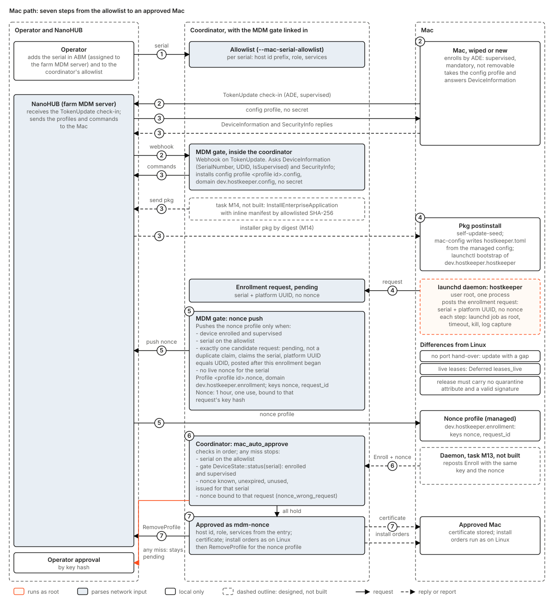

# hostkeeper-mdm design

Status: design, for the maintainers' comments. Nothing in this document is built unless it is
tagged **Built** with a path. It is the separate document that
[hostkeeper-design.md](hostkeeper-design.md) section 5.9 refers to. That section states the
interface the enrollment path needs. This document states how a Mac gets to that interface: the
MDM server stack, the policy gate, the delivery of the daemon and its config, the one-time nonce,
and the order of the work.

Two points are decided and are not reopened here:

- **MDM is part of hostkeeper.** The MDM server kit and the policy gate are components of this
  repository (design section 5.9, and its "Decided" table).
- **The farm's MDM profile identifier is `com.komira.hostkeeper.mdm`,** set before any Mac
  enrolls. It is a value of the kit's settings file (`com.example.hostkeeper.mdm` in the example),
  not a constant of the code. The live stack still carries the identifier of the kit it was
  installed with. Changing it is free while no Mac is enrolled. After the first enrollment it
  costs a re-enrollment of every Mac, because a Mac keeps one profile per identifier.

The launchd label prefix, `dev.hostkeeper` (**Built**: `crates/hostkeeper-launchd/src/label.rs`),
is a different identity: the product's, the same in every farm. It names the daemon's job, the
pkg identifier, and the managed preference domains of this design (`dev.hostkeeper.config`,
`dev.hostkeeper.enrollment`). This design keeps it, which is the confirmation `docs/macos.md`
asks the maintainers for. **Deviation:** before this document, design 5.9 said the profile
identifier would take the hostkeeper reverse-DNS prefix. The two are kept apart because the
profile identifier belongs to whoever runs the MDM, and the label to the product.

## 1. What an operator sees

A Mac is managed end to end in seven steps. Only step 1 needs a person, and it is a few clicks in
Apple Business Manager (ABM).

1. **The operator adds the Mac's serial number in ABM and assigns it to the farm's MDM server.**
   A Mac bought on the organisation's account is in ABM already. Otherwise Apple Configurator for
   iPhone adds it while the Mac sits at Setup Assistant (section 6). The operator also adds the
   serial to the coordinator's Mac allowlist with its host id prefix, role and services
   (`--mac-serial-allowlist`, **Built**: `crates/hostkeeper-coordinator/src/enrollment/mac_nonce.rs`).
2. **The Mac is wiped, or is new, and enrolls by Automated Device Enrollment (ADE).** At Setup
   Assistant, Apple tells it to enroll in the farm's MDM. The ADE profile is supervised, mandatory
   and not removable, and it skips every Setup Assistant pane. The Mac gets a device identity from
   the farm's SCEP server and checks in with the MDM server.
3. **The gate installs the hostkeeper pkg by an allowlisted digest.** The policy gate sees the new
   device and asks it for its serial number and its supervision state. It installs the config
   profile (section 4), then sends `InstallEnterpriseApplication` with an inline manifest. The
   manifest names one pkg by its SHA-256, and that digest must be on the gate's allowlist. The Mac
   checks the digest itself before it installs.
4. **The pkg's postinstall writes `hostkeeper.toml` and loads the launchd job.** It writes the
   daemon config from the managed config profile of step 3, seeds the binary directory as it does
   today, and bootstraps `dev.hostkeeper.hostkeeper`. The daemon starts, makes its key and posts
   an enrollment request that claims the Mac's serial. The request carries no nonce yet.
5. **The gate pushes a one-time nonce profile.** It does this only once a request from that
   Mac is pending (it claims the Mac's serial and platform UUID and was posted after this
   enrollment), which proves the pkg installed and the daemon runs. The nonce is good for one
   hour and one approval, and it is bound to that request's key (section 5).
6. **The daemon enrolls with the nonce, and the coordinator checks it.** The daemon reads the
   nonce from the managed profile and posts its request again, with the same key and the nonce. The
   coordinator approves it only if four things hold. The serial must be on the allowlist. The gate
   must say the device is enrolled and supervised. The nonce must be known, unexpired, unused,
   issued for that serial and bound to that key. All checks run in the order the code has today
   (**Built**: `Enrollment::mac_auto_approve`).
7. **Auto-approval follows, and services are assigned as on Linux.** The approval is recorded under
   the approver `mdm-nonce` with the allowlist entry's host id and role, and the entry's services
   are assigned to the host as an operator's approval assigns its own (**Built**, task M9:
   `Coordinator::enroll`). The host then receives its certificate. Its services come from its
   role or host assignment, through `install` orders on the same path as a Linux host (design
   section 5.7). The gate removes the nonce profile.

The operator's single question about a Mac is whether its serial is on the allowlist. A Mac that
fails any condition does not fail closed into a broken state. Its request waits, pending, for an
ordinary operator approval by key hash, exactly as a Linux host's does
(`docs/operations/enrollment.md`).

The figure was drawn for design section 5.9 before this document and shows the earlier order:
the nonce before the request, and a gate call named `CheckSerial` where the code has
`DeviceState::status(serial)`. The text here is current. Task M12 redraws it.

## 2. State today

| Piece | State |
|---|---|
| MDM server stack (NanoHUB, NanoDEP `depserver`, SCEP server, Caddy proxy) | Running on the farm's MDM host, on the Macs' LAN, as systemd units. It was installed by kbf's kit and reinstalled under the jobscheduler kit's paths, so its unit names are still `kbf-mdm-*` while its paths and user are `js-mdm`. |
| TLS certificate for the MDM host name | Valid, renewed by `lego` (DNS-01) from a timer. |
| APNs push certificate | Uploaded to NanoHUB, valid for a year. It is renewed yearly with the Apple Account that created it. |
| ABM server token | The upload is probably done (the depserver log shows the upload and account check calls) but unconfirmed. The token expiry has not been read. A read-only check with root on the MDM host settles both before the ADE profile is defined (task M7). |
| ADE profile | Not defined. The `depsyncer` unit is disabled. |
| Enrolled Macs | None. NanoHUB's log has no `/mdm` check-in, and the farm's Macs report no DEP and no MDM enrollment. |
| Policy gate | **Built**, the device side (task M8): `crates/hostkeeper-mdm-gate`, linked into the coordinator with `--mdm-api-url` (section 6.1). Its enrollment side (config profile, nonce, pkg) is not built, and it runs on no host yet. kbf has one (`kbf-mdm`, binary `kbf-mdm-gate`) that was never deployed. Its server speaks JSON over HTTP while the kbf server's client calls it as gRPC, so the two cannot talk. It also has no eligibility check. |
| Coordinator side | **Built**: the nonce store (32 bytes, one hour, one use, consumed in the approval's own write), the serial allowlist, the `DeviceState` port and its nine decline tokens, the nonce's binding to its request, the replacement of a wiped Mac's own host id, and the allowlist entry's services assigned at a nonce approval (task M9; `crates/hostkeeper-coordinator/src/enrollment/`, `crates/hostkeeper-enrollment/src/enroll/mac_nonce.rs`). With `--mdm-api-url` the `DeviceState` is the gate's (`crates/hostkeeper-coordinator/src/mdm.rs`); without it, `NoDeviceState`. No nonce is issued yet, so no Mac is approved by a nonce today. |
| MDM kit | **Built**: its pure core, `crates/hostkeeper-mdm-core` (task M2): the settings, the enrollment and ADE profiles, the units and Caddyfile of the stack, the pins, under hostkeeper's names and with M2's fixes of komira-ai/kbf#2248. Its host-step layer is `crates/hostkeeper-mdm-step` (task M3). **Not built**: the binary with its verbs (M4, M5), so nothing in this repository installs the stack yet. |
| Daemon side | **Built**: the launchd daemon, the claims of serial and platform UUID, the pkg with its postinstall of the seed, `mac-config` and the load of the job (`docs/macos.md`), and the pkg writes the config (**Built**: `crates/hostkeeper-daemon/src/mac_config.rs`, `crates/hostkeeper-launchd/src/postinstall.rs`). The enroller reads the nonce from the managed preferences and posts it once for its own request (**Built**, task M13: `crates/hostkeeper-enroll/src/managed.rs`, `crates/hostkeeper-enroll/src/enroller.rs`). |
| Pkg signature | None. The pkg is attested, and the binary in it carries the linker's ad-hoc code signature (`crates/xtask/src/release/macos_pkg.rs`). |

The kit's code is in three places:

| Copy | Where | State |
|---|---|---|
| kbf-deploy's `mdm` module | komira-ai/kbf `crates/kbf-deploy/src/mdm` | The oldest. It has `push-cert`, `dep` (`get-cert`, `upload-token`, `define-profile`, `assign`) and `erase-request`, under the `kbf-mdm` names. |
| `mdm-core`, `host-step`, `mdm-host` | komira-ai/kbf `crates/` (moved in by komira-ai/kbf#2238) | The newest: a pure core, a dry-run-by-default host planner, and `fetch`, `install`, `tls`, `verify`. It has no `push-cert`, `dep` or `erase` yet. komira-ai/kbf#2248 lists 9 suspected defects, two API-shape items and the test gaps carried over in the move. None of the 9 is fixed. |
| `js-mdm-core`, `js-host-step`, `js-mdm` | komira-ai/jobscheduler `crates/` | The snapshot before the move, and still built into jobscheduler's releases as `js-mdm`. kbf's copy is newer: beyond renames and comments it has a typed `DownloadError` in `net.rs` (one API-shape item of komira-ai/kbf#2248, done), a fallible `AdeProfile::to_json`, and changes in `cli.rs`, `verify.rs` and `pins.rs`. No jobscheduler commit touches these crates after the move. |

## 3. Components

| Component | What | Runs where |
|---|---|---|
| The MDM server stack | NanoHUB (NanoMDM with its command queue and the KMFDDM declarative API), `depserver` and `depsyncer` (ADE), the SCEP server, and Caddy (TLS on the LAN address only). The tools are third-party, pinned by version and SHA-256. | The MDM host |
| `hostkeeper-mdm` kit | One binary that installs, checks and migrates that stack: `fetch`, `install`, `tls`, `verify`, `push-cert`, `dep`, `migrate`. Every verb that changes the host dry-runs by default and acts only with `--apply`. Ported from kbf (section 8). It reads its settings from a file named by a flag (`--settings`). The `MDM_*` names are keys of that file, and the environment files it writes are the third-party units' own input: no hostkeeper code reads configuration from the environment (rule S2). | The MDM host, run by the operator |
| The policy gate | A crate linked into the coordinator. It holds the NanoHUB API key, keeps a durable record per device, implements `DeviceState`, installs the config profile and the pkg, and issues and pushes nonces. | Inside `hostkeeper-coordinator serve` |
| The daemon's Mac additions | Reading the nonce from its managed profile, and the postinstall verb that writes `hostkeeper.toml` from the managed config | Each Mac |

**The gate is linked into the coordinator, not a separate service.** `Enrollment::issue_mac_nonce`
is a library call, and the built code says the gate is "a component linked into the coordinator,
so this is a library call and no RPC". A separate gate process would need a second mutual-TLS
API, a protobuf service and a deploy unit, all for one caller. kbf's never-deployed gate shows that
cost: its two ends drifted apart. The coordinator runs on the MDM host, so the NanoHUB API stays
on loopback, as both NanoHUB and kbf's gate require. A coordinator elsewhere is a later change: it
would widen the gate's API URL to HTTPS with a pinned CA, and it is not built speculatively.

**What a compromise gets.** The MDM server can install any pkg it accepts as root on every
enrolled Mac, and it can erase a Mac. So whoever holds the NanoHUB API key holds root on the Macs.
Under design section 5.1 a compromised coordinator can already order any verb on any host. Linking
the gate adds erase to that list, plus the install of any pkg the Mac accepts (a Developer ID pkg,
if section 7 ends there). The gate's own code enqueues only five command types: `DeviceInformation`,
`SecurityInfo`, `InstallProfile`, `RemoveProfile` and `InstallEnterpriseApplication`. A test
pins that list (**Built**: `the_gate_enqueues_only_its_five_command_types` in
`crates/hostkeeper-mdm-gate/tests/gate.rs`). This bounds the code, not a thief of the key.
The key is a file, mode 0600 and owned by the coordinator's user, named by a flag (rule S2).

## 4. Where the daemon config comes from (decided first)

Before this document the two disagreed, and nonce delivery depends on the answer:

- Design section 5.9 said "the pkg's postinstall writes the whole daemon config
  (`hostkeeper.toml`: coordinator, CA hash, release channel and trusted signers)", and section 4.6
  said the same. Neither said where a generic release pkg would get those values.
- `docs/macos.md`, matching the code at that time, said: "The script starts nothing and writes no
  config. The operator's bootstrap places `hostkeeper.toml` and loads the job."

**Decision: the postinstall writes the config, from a managed config profile that the gate
installs before the pkg.** The pkg itself carries no config. The steps:

1. The gate installs the farm's config profile. It is one profile, the same for every Mac, with
   the identifier `com.komira.hostkeeper.mdm.config`. Its one payload is a
   `com.apple.ManagedClient.preferences` payload for the preference domain
   `dev.hostkeeper.config`. The keys are those of `hostkeeper.toml` (design section 4.1):
   `coordinator`, `ca_sha256`, `release_channel`, the `trusted_signers` dictionary
   (`organisation`, `workflow`, `refs`, `hosted_runner`) and an optional `bounds` dictionary. Holds
   no secret.
2. On that profile's `Acknowledged`, the gate sends the pkg (section 7).
3. The pkg's postinstall runs three commands of the installed binary, in order. Each command stops
   the install with its message if it fails.
   - `self-update-seed`, unchanged (**Built**).
   - `mac-config`, a new verb (**Built**: `crates/hostkeeper-daemon/src/mac_config.rs`). It reads the managed preferences of the domain, which macOS
     writes to `/Library/Managed Preferences/dev.hostkeeper.config.plist` (a binary or XML
     plist). The path, the file's owner and its mode are to verify on a device (tasks M11 and
     M16), because Apple's payload schema does not state them. The verb accepts the file only when
     root owns it and no one else can write it. It renders the plist as TOML and runs the daemon
     config loader on that text, so the managed values are judged by the same rules as a
     hand-written file. That loader is **Built**: `crates/hostkeeper-config/src/daemon.rs` reads
     exactly the keys above, and design 4.1's note that `main` reads the older format is stale.
     The verb then writes `/etc/hostkeeper/hostkeeper.toml` atomically, root's and mode 0600.
     - The verb writes only when no `hostkeeper.toml` exists. An existing file is kept and named
       on standard error: a reinstall never changes a Mac's trust root.
     - When there is neither a managed config nor a file, it fails, and so does the install. The
       gate's re-send (section 5.4) then gets another chance once the profile is in place.
       Installing the pkg by hand without a config is an error the operator sees at once.
   - `launchctl bootstrap system /Library/LaunchDaemons/dev.hostkeeper.hostkeeper.plist`, only
     when a config file exists after `mac-config`, and after any earlier copy of the job is booted
     out.

   The three commands are **Built** as the pkg's postinstall
   (`crates/hostkeeper-launchd/src/postinstall.rs`), and `check-macos-pkg` holds the script to its
   exact bytes (`crates/xtask/src/release/macos_pkg.rs`).

Why the profile and not the pkg:

- **The pkg stays one release asset.** It has one digest for every farm, and the release
  workflow attests that digest. A pkg built per farm would need a per-farm build, a per-farm
  signature (section 7) and a per-farm digest that no attestation covers.
- **The MDM plays the boot image's part.** Design 5.9 says "the flow is the same" as on Linux,
  where the boot image carries the config.
- **No new trust.** An MDM that can write the config can already install any pkg as root.

The daemon still reads only `hostkeeper.toml`. Its Linux and Mac config paths stay one code path,
and the file stays the host's only trust root (design section 4.1). After the first write, local
root changes the file and the MDM does not: the gate never sends the config profile again to a Mac
it has seen approved. A changed farm config, or a wrong first one, reaches a Mac only when local
root replaces the file and restarts the job (`launchctl kickstart -k
system/dev.hostkeeper.hostkeeper`), as on a Linux host.

The gate sends the pkg on the config profile's `Acknowledged`. Whether macOS has written the
managed preferences file by the time it answers is to verify in M16. If it has not, `mac-config`
fails, and the re-send covers it.

**The manual path.** A Mac without MDM, or one being debugged, is installed by hand. The operator
places `hostkeeper.toml` first, then installs the pkg. `mac-config` finds the file, keeps it, and
the job is loaded. This is the "operator's bootstrap" of the earlier `docs/macos.md`, with the job
load moved into the pkg. The Mac is then approved by an operator, as a Linux host is.

Design sections 4.6 and 5.9 were changed with this document. Task M10 changed `docs/macos.md`
and the postinstall check of `check-macos-pkg` (**Built**: `docs/macos.md`,
`crates/xtask/src/release/macos_pkg.rs`).

## 5. The nonce

**Built today:** 32 random bytes, of which the store keeps only the SHA-256. A nonce is issued for
one serial and is good for 3600 seconds (3601 is expired). It works for one approval. It is checked
under the store's lock and consumed in the approval's own write. A declined attempt does not use
it. The built code fixes all of this. Two things are new: when the gate pushes the nonce, and what
it is bound to.

### 5.1 When it is pushed

The nonce is pushed after the daemon is demonstrably running, never before. The gate issues a
nonce for a serial only when every one of these holds:

1. The gate's record of the device says enrolled (a `TokenUpdate` check-in and no `CheckOut`
   since) and supervised (section 6.1).
2. The serial is on the allowlist.
3. The coordinator holds exactly one *candidate* request for the device. A candidate is pending,
   is not a duplicate claim, claims the serial, claims the platform UUID equal to the device's
   UDID, and was posted after the device's current enrollment began (its first `TokenUpdate`).
   On a Mac the UDID of the device channel is the hardware UUID, which `IOPlatformUUID` reads;
   this is to verify in M16. A request posted before the current enrollment is stale: a wipe makes
   a new key, and the old key's request stays pending without blocking the new one.
4. No nonce issued for the serial is still unexpired and unconsumed.

So the nonce's one hour starts when the daemon has already posted. A slow pkg install, or one that
fails, cannot use up a nonce, because none has been issued. The one hour then covers only the
push of one profile and the daemon's next read of it. The enroller loop steps every 5 seconds
(`RETRY_SECS`, **Built**), and reading the profile in each step is new (section 5.3), so the hour
is ample.

**A Mac wiped after it was approved** has the allowlist entry's host id already approved under
its old key. The built approval refuses a new key for a taken host id (`host_id_taken`) unless it
replaces. A nonce approval replaces the host when all three hold (**Built**, task M9:
`EnrollmentStore::approve_recorded`, under the store's lock, with the time the gate gives as
`DeviceStatus::enrolled_since_unix`):

- the host id is the allowlist entry's;
- the approved host's own request claimed the same serial;
- the gate saw the device enroll anew (a new enrollment id, or a `TokenUpdate` after a `CheckOut`)
  after that approval: the current enrollment began in a later second than the approval was
  recorded in. A gate that does not say when it began replaces nothing.

A denied host id is never replaced this way (`denied`), and a request flagged `duplicate_claim`
is still refused. A Mac claims no machine id and no MAC, so a wiped Mac's new request is not one.

The replacement is audited as one, and the old key's certificate is revoked as for `--replace`
(design 5.7). Without that, every re-enrolled Mac would wait for an operator.

The gate checks the conditions at each event that can change them:

- a NanoHUB webhook event for the device (a check-in, or a command result);
- a request posted to the coordinator, which the gate is told of in-process;
- a periodic tick, once a minute.

The tick is how an expiry is noticed. The gate reads the time from the coordinator's injected
`Clock`, so no test waits on the clock.

### 5.2 What it is bound to

**The nonce is bound to the key of the pending request it was issued for** (**Built**, task M9).
The store record has an optional `request_id` (the request's key hash, field 6 of `MacNonce` in
`crates/hostkeeper-enrollment/proto/hostkeeper/enrollment/store/v1/store.proto`). It is written
by the issue call, `Enrollment::issue_mac_nonce(serial, request_id)`, which always binds, and is
absent on nonces issued before. A store reader that predates the field ignores it.
`mac_auto_approve` has one more decline, `nonce_wrong_request`, checked after
`nonce_wrong_serial`. A nonce with no `request_id` is judged as before; one whose `request_id` is
not 32 bytes approves no request.

Why: on a Mac where other users run, build jobs for instance, a local user may be able to read
the managed preferences file. Whether macOS makes it readable to all is to verify on the device
(task M16). Without the binding, a local user who reads the nonce first could post a request with
their own key and be approved as the Mac. With it, the nonce approves only the request the gate
saw. A local user can read the Mac's serial and platform UUID, so their request can be a
candidate. Condition 3 then finds two candidates (theirs and the daemon's) and the gate pushes
nothing: the operator sees both, pending, and approves by key hash.

The attacker models:

- **Remote, on the network that reaches the enrollment port.** They can learn or guess a serial.
  The platform UUID travels only inside the daemon's TLS connection to the coordinator, so
  their request is no candidate and changes nothing. They cannot read the nonce either.
- **Remote, knowing a Mac's platform UUID.** For instance from an old log. They can make a second
  candidate and so hold the Mac at operator approval for as long as they keep a request pending.
  That is a denial of the automatic path, never an approval, and the operator ends it by
  denying their request.
- **Local.** As above: two candidates, so the operator decides.

### 5.3 How it reaches the daemon

The gate sends `InstallProfile` with a profile identified `com.komira.hostkeeper.mdm.nonce`, one
per device. Its one `com.apple.ManagedClient.preferences` payload, for the domain
`dev.hostkeeper.enrollment`, holds two keys:

- `nonce`: the 32 bytes as data;
- `request_id`: the hex key hash.

A new profile with the same identifier replaces the old one on the Mac.

In the payload the keys sit where Apple's `com.apple.ManagedClient.preferences` schema puts
them: under the domain, then `Forced`, then `mcx_preference_settings`. The path, owner and mode
of the file macOS writes are to verify in M16.

**The enroller changes (task M13, **Built**: `crates/hostkeeper-enroll/src/managed.rs`,
`crates/hostkeeper-enroll/src/enroller.rs`).** Before it, the enroller posted `Enroll` once per key
and then only polled (the `posted` cache); its `EnrollRequest` had no nonce field, and the gRPC
adapter always sent `mac_nonce` empty. Now:

- The daemon reads `/Library/Managed Preferences/dev.hostkeeper.enrollment.plist` in each step,
  through a port with a fake for tests.
- It accepts the file only when root owns it and no one else can write it.
- When the file holds a nonce for its own request (the file's `request_id` equals its pending
  key's hash) and that nonce has not been posted, the step posts `Enroll` again: the same key,
  with `mac_nonce` set. `EnrollRequest.mac_nonce` is field 5, **Built** on the wire. The
  coordinator already approves on such a repost (**Built**: `Enrollment::enroll` runs
  `mac_auto_approve` for a still-pending request that carries a nonce).
- After that one post the step polls as before. The coordinator answers the post of a request
  it has approved (by the nonce, or earlier) with `ENROLL_STATE_UNSPECIFIED`, which the gRPC
  adapter reads as decided, so the step's poll brings the certificate.
- A missing file, a malformed one, a file of the wrong owner, or another request's nonce means
  nothing more is posted. Enrollment never fails over the file, because the operator path must
  keep working.
- The nonce is never logged. Its type's `Debug` shows no byte of it, as the coordinator's
  `MacNonce` does.

The postinstall's `mac-config` and the daemon's nonce read use the same plist reader, the
`plist` crate. It is already declared in the root `Cargo.toml` (rule R5) and used by xtask's
`check-macos-pkg` and by tests. M10 added the production use (**Built**:
`crates/hostkeeper-daemon/src/mac_config.rs`), updated the root comment that called it
test-only, and tests that it reads both binary and XML plists
(`crates/hostkeeper-daemon/tests/mac_config.rs`).

### 5.4 Re-issue and clean-up

| Case | What happens |
|---|---|
| The pkg install is slow | No request is pending, so no nonce is issued (condition 3). Nothing expires. |
| The pkg install fails, or never happens | The device stays enrolled with no candidate request. `InstallEnterpriseApplication` reports only that it accepted the command, never the install's end. So the gate sends it again while three things hold: no candidate request has appeared, no host is approved for the serial in this enrollment, and the previous send's result (`Acknowledged` or `Error`) arrived at least an hour ago. A command that has not been answered, for instance on a Mac that is off, is never sent again, so nothing piles up in NanoHUB's queue. The hour is a constant, not a flag. Each send is audited `mdm_install_sent` with its count, and the gate's device list shows the count and the last send. Sending stops at the first candidate request, and a new enrollment starts the count again. A re-sent install is safe: the seed and `mac-config` do nothing the second time. |
| The nonce's `InstallProfile` fails (an `Error` result) | The nonce stays issued. The gate sends the same nonce again at the next tick, at most once a minute, while it is unexpired. |
| The nonce expires before use (the Mac was off, or the profile never arrived) | Condition 4 holds again, so the gate issues a new nonce, bound to the same request, and replaces the profile. The old nonce is dead by expiry. A new one is issued at most once an hour per serial. |
| The daemon's key changes without a new enrollment (its state was removed by hand) | Two candidates, so no nonce. The operator denies the stale request or approves by key hash. A wipe is not this case: it is a new enrollment, so the old request is stale and is not a candidate (condition 3). |
| An approval is declined, for instance `device_not_supervised` | The request stays pending for the operator, and the nonce is not used. The daemon posts the nonce once (section 5.3). A re-issued nonce is a new nonce and is posted once more. |
| The approval succeeds | The gate sees the host approved for the serial and sends `RemoveProfile` for the nonce profile. A nonce left on disk is consumed already, so the removal is tidiness, not security. |
| The Mac is erased or re-enrolled later | NanoHUB sees a new enrollment. The gate's record goes back to "new" and the whole flow runs again. The nonce approval replaces the Mac's own host id (section 5.1). |

## 6. Enrollment, supervision, and a Mac that is already set up

### 6.1 How the gate knows "enrolled and supervised"

**Enrolled.** NanoHUB sends the gate a webhook event (to a loopback listener of the coordinator)
for each check-in: `Authenticate`, `TokenUpdate`, `CheckOut`. A device is enrolled from its first
`TokenUpdate` until a `CheckOut`. The serial comes from `Authenticate` when it carries one: the
key is optional in Apple's schema, and needs the `AllowQueryDeviceInformation` access right,
which the kit's enrollment profile grants. Either way the gate asks `DeviceInformation` for
`SerialNumber`, `UDID` and `IsSupervised`, and the answer decides. A device whose answer has no
serial is `device_state_unavailable`.

**Supervised.** The gate reads it from that `DeviceInformation` answer. It also sends
`SecurityInfo`, whose `ManagementStatus` says whether the Mac `EnrolledViaDEP` and whether the
enrollment is user-approved. The gate shows both in its device list and passes neither to the
coordinator: the built condition is enrolled and supervised, and it stays so.

**Confirmed against NanoHUB 0.2.0** (task M8, read from its source at `v0.2.0` and the NanoMDM
`v0.9.0` its `go.mod` pins). The webhook (`-webhook-url`) is NanoMDM's MicroMDM-compatible one,
with no signature: a JSON object with a `topic` (`mdm.Authenticate`, `mdm.TokenUpdate`,
`mdm.CheckOut`, `mdm.Connect` for a command result, and others the gate passes over), and a
`checkin_event` or an `acknowledge_event` carrying `ids` (the enrollment id and its type, `Device`
for the device channel), `udid`, `raw_payload` (the base64 of the device's plist),
`token_update_tally` on a `TokenUpdate`, and `command_uuid` and `status` on a result. Commands are
queued by `PUT /api/v1/nanomdm/enqueue/<id>` with the raw command plist, behind basic
authentication as `nanohub`; the answer is NanoMDM's `APIResult` JSON. Because the webhook is not
signed, the gate reads a result only for a command UUID it sent that device and is still waiting
on. Its tests read NanoMDM's recorded payloads (`crates/hostkeeper-mdm-gate/tests/fixtures/nanohub/`).

The device record is durable, one per enrollment id, behind the gate's `DeviceStore` (**Built**).
While the coordinator's state is files, it is a file, `<--enrollment-dir>/mdm-devices/<enrollment
id>.pb`, which the coordinator's backup copies with the enrollment store. Once the Postgres store is
built (task C3 of [coordinator-storage.md](coordinator-storage.md)), it is a row of the table
`mdm_devices` that M8's migration adds there, as a second `DeviceStore`; the gate does not change. It holds the enrollment id, serial,
enrolled, supervised, ADE, user-approved, the times of the last check-in, and the commands sent
and not answered. The config profile's state, the install tries and the nonce pushes are fields
the tasks that send them add (M12, M14). `status(serial)`
answers from the record and never asks the Mac live. A serial the gate has no record of is
`device_state_unavailable`, as `NoDeviceState` answers. A serial seen under two
enrollment ids is also `device_state_unavailable`, until a `CheckOut` of the older one.

### 6.2 Path A: wipe (or a new Mac), then ADE

The flow of section 1. It is the only path with no person at the Mac after step 1.

- **Supervised, automatically.** Apple supervises a Mac enrolled through ADE (macOS 10.14.4 and
  later).
- **No clicks.** The ADE profile can skip every Setup Assistant pane, and on Ethernet with the MDM
  server reachable Apple's Auto Advance completes setup "without touching it" (Apple Platform
  Deployment, "Setup Assistant"). Whether the farm Macs' macOS stops at a pane that no profile
  skips is to verify in the device run (task M16). A pane that stops it is recorded as a manual
  step in the measurement.
- **Self-repairing.** After any later erase, the Mac enrolls again at Setup Assistant, because ADE
  is mandatory and the profile not removable.

The profile kbf's kit renders already has these properties (`is_supervised`, `is_mandatory`, not
`is_mdm_removable`, and a long `skip_setup_items` list), and the kit's parser refuses anything
weaker. The port keeps that check and sets the existing `auto_advance_setup` to
true (**Built**: `AdeProfile::from_config` in `crates/hostkeeper-mdm-core/src/profile.rs`).

The cost: a wipe. On Apple silicon, "Erase All Content and Settings" or the MDM `EraseDevice`
erases every user's data and every extra volume. On a farm Mac that means its build state, its
caches and the work of setting it up for builds. The OS is kept when Apple's conditions hold (it
starts from its first partition, with a signed system volume).

### 6.3 Path B: keep the Mac as it is

Two routes give management without a wipe.

- **B1: the Mac is in ABM and assigned to the farm's server.** An administrator runs
  `sudo profiles renew -type enrollment` on the Mac. Apple's supervision page says such a Mac can
  "have their supervision reset by using the `profiles` command": it enrolls through ADE and is
  supervised, with its data kept. On macOS 14 and later the Mac shows a full-screen enrollment
  prompt, so a person (or a screen-sharing session) clicks once. Whether the command completes
  unattended over SSH is not documented, and the device run checks it. Apple limits the command
  to 10 runs a day per device.
- **B2: the Mac is not in ABM.** It is not added without a wipe, because Apple Configurator adds a
  Mac only at Setup Assistant. The Mac enrolls by the profile instead: the operator downloads the
  enrollment profile from the MDM host (the kit serves it at `/enroll`, to build in M5), opens it, and approves it
  in System Settings. That is a person at the Mac, or screen sharing, because Apple documents no
  scripted approval. Apple's supervision page says a Mac on macOS 11 or later enrolled by
  profile-based Device Enrollment and approved by a local administrator is supervised too. The
  page's wording needs a check on the device before anything depends on it. The gate reports what
  the Mac says (`IsSupervised`), whichever way it goes.

What Path B loses against Path A:

| | Path A (ADE after a wipe) | B1 (`profiles renew`) | B2 (profile, approved by hand) |
|---|---|---|---|
| Person at the Mac | none after the ABM step | one click | open the profile and approve it |
| Supervised | yes | yes | yes per Apple's page; to verify |
| `InstallEnterpriseApplication`, `InstallProfile`, managed preferences, certificate payloads | yes | yes | yes. None needs supervision: Apple's schema marks `InstallEnterpriseApplication` `supervised: false`, `requiresdep: false`, device channel |
| OS update commands (`ScheduleOSUpdate`, `ScheduleOSUpdateScan`, `OSUpdateStatus`), Remote Desktop, Activation Lock bypass, `UserList`/`DeleteUser` | yes | yes | only if supervised |
| ADE-only commands (`AccountConfiguration`, `SetAutoAdminPassword`, `DeviceConfigured`) | yes | not needed: the Mac is set up | no |
| Re-enrolls by itself after an erase | yes | yes | no: an erase drops it out of management |
| Auto-approval of hostkeeper's enrollment | yes | yes | only if supervised; otherwise the request waits for an operator, and nothing else changes |
| Manual steps, measured (section 11) | the ABM assignment | one click at the Mac | the profile and its approval at the Mac, plus an operator approval if unsupervised |

None of the commands this design needs requires supervision. The supervised condition on
auto-approval stays because it is a claim only Apple's enrollment makes. With it, an
auto-approved Mac is known to be one the organisation enrolled, not one where someone installed
a profile.

**Recommendation.**

- New Macs, and any Mac that is being reinstalled anyway, take Path A.
- The farm's existing Macs take Path B now, with no wipe. First check whether ABM lists them (the
  verification step M7 reads it). If it does, B1. If not, B2, with an operator approval by key
  hash if the Mac turns out not to be supervised.
- Such a Mac moves to Path A at its next reinstall.
- One Path A run on a real Mac is still needed, once, to prove the zero-touch flow and to measure
  it (section 11). It needs a Mac that may be wiped (question Q1).

## 7. The pkg: delivery and signature

### 7.1 Delivery by digest

The gate holds an allowlist of pkg digests: a root-owned TOML file named by
`--mdm-pkg-allowlist`. Each entry gives the SHA-256, the version, and the path of the pkg file in
the gate's pkg directory. The gate sends only a pkg on the list. Its
`InstallEnterpriseApplication` carries an inline `Manifest`, not a `ManifestURL`. With an inline
manifest the Mac fetches nothing but the pkg, and Apple's pinning options do not apply. The
manifest has one item:

- `assets`: one `software-package` asset;
- its `url`: `https://<MDM host>/pkg/<sha256>.pkg`, served by the kit's proxy from the gate's pkg
  directory;
- the hash: the single whole-file `sha256` key, the pkg's digest. Apple's schema
  (`other/manifesturl.yaml`) calls it "The SHA-256 hash value the device uses when verifying the
  hash of the manifest item data", and the device then ignores the chunked keys;
- `metadata`: `bundle-identifier` (the pkg identifier), `bundle-version`, `kind = software` and a
  `title`.

The digest the gate allowlists is checked twice: by the gate when it builds the command, and by
the Mac when it downloads. The Mac's check is what makes "by allowlisted digest" true.
`InstalledApplicationList` lists `.app` bundles, and the hostkeeper pkg installs none, so the gate
learns of the install from the daemon's request (section 5.1), not from MDM.

### 7.2 Does `InstallEnterpriseApplication` need a signed pkg?

What Apple states:

- **Signature.** Apple's Platform Deployment guide
  (<https://support.apple.com/guide/deployment/dep873c25ac4/web>) says: "A package needs to be
  signed with a signature verifiable by the device for distribution using a device management
  service." So an unsigned pkg is not delivered. The page names no identity type, no package
  format and no notarization. The attested pkg of today needs a
  signature before step 3 works.
- **No supervision, no ADE.** Apple's command schema
  (<https://github.com/apple/device-management>, branch `release`,
  `mdm/commands/application.install.enterprise.yaml`) marks the command `supervised: false`,
  `requiresdep: false`, `devicechannel: true`, `userchannel: false`. It works on any enrolled Mac,
  by Path A or B.
- **Completion is not reported.** The same file says the Mac answers `Acknowledged` "after
  validating the parameters, but before downloading and installing the app", and does not tell
  the server about errors during the install. Section 5.4 handles that.

What Apple does not state:

- which signing identities qualify;
- whether a distribution pkg (`productbuild`) is required over a component pkg (`pkgbuild`);
- whether notarization is required.

Third-party MDM vendors write "Developer ID" and "distribution-style". Neither claim is Apple's.
"Verifiable by the device" admits at least two identities:

1. **Developer ID Installer.** The certificate comes from the Apple Developer Program, a paid
   yearly membership. It is separate from ABM, and enrolling an organisation in it needs a D-U-N-S
   number. Every Mac trusts it out of the box. It is the identity every vendor documents.
2. **A farm installer identity that the MDM makes trusted.** The farm makes its own installer
   signing certificate. The config profile (section 4) gains a `com.apple.security.root` payload
   with that root, and `productsign` signs the pkg on the MDM host. Nothing is bought, but whether
   `installer` under MDM accepts a root trusted only by a profile is not documented anywhere.

**Decision: the identity is chosen by a device test, not by assumption (task M11).** The test
needs one enrolled Mac, a Path B Mac being enough. It sends four pkgs with
`InstallEnterpriseApplication` and records which install:

1. today's pkg, unsigned;
2. the same pkg wrapped by `productbuild`, unsigned;
3. the `productbuild` pkg signed by a farm identity whose root a profile installs;
4. the same pkg signed by a farm identity whose root is not installed.

Pkg 4 is the negative case that shows the root payload is what makes pkg 3 pass. If pkg 3
installs, the farm identity is the answer. If it does not, Developer ID Installer is required, and
question Q4 asks for it.

**Built: the kit and its runbook.** The kit is `cargo xtask mdm-signing-test`
(`crates/xtask/src/mdm_signing_test.rs`) and the runbook is
[docs/operations/pkg-signing-test.md](../operations/pkg-signing-test.md). The run itself needs
an enrolled Mac and has not happened yet.

The kit has four verbs:

- `build` runs on a Mac that is not the one under test.
- `send` runs on the MDM host. It sends the root's profile, each pkg and the profile's removal
  through NanoHUB's API on loopback, with the inline manifest of section 7.1, and sends nothing
  without `--apply`.
- `record` writes what the operator read: the Mac's answer from NanoHUB's log, and whether the
  Mac holds the pkg's receipt.
- `report` prints the run and its verdict.

How the kit carries out the four pkgs:

- **The farm identity is a test CA the build makes.** It is a root, `A`, with an installer
  identity under it (RSA, `codeSigning`). The pkg 4 identity sits under a second root, `B`, which
  the build deletes. Every private key is deleted with the build's scratch directory, so the
  repository and the kit hold no secret.
- **Root A comes in a profile of its own,** `<profile identifier>.signing-test.root`, holding
  one `com.apple.security.root` payload. It does not go into the config profile of section 4,
  because the test must install and remove it alone. If the farm identity is chosen, task M15
  moves the payload into the config profile.
- **Each pkg carries one marker file under its own identifier,**
  `dev.hostkeeper.signing-test.pkg<n>`, not the hostkeeper payload. "Today's pkg" in the list
  above is read as this unsigned component pkg. The marker has two purposes. First, a receipt
  names exactly one pkg. Second, the release pkg's postinstall fails on a Mac with no managed
  config (`mac-config`), and that failure would hide the signature's outcome. The signing is the
  release pkg's: `productsign` over a `productbuild` distribution pkg.
- **The order holds by construction.** `send` refuses pkg 3 and pkg 4 until the root's profile
  is recorded `Acknowledged`, and refuses them again after its removal.
- **An outcome is read on the Mac** (`pkgutil --pkg-info`, the install log), because
  `Acknowledged` comes before the install. For pkg 3 the operator also records whether
  `pkgutil --check-signature` on the Mac reads its chain as trusted.
- **A run that cannot decide says so.** The report names it inconclusive, not a refusal of the
  signature, in three cases: a command the Mac answered with an error, pkg 4 installing, or pkg 3
  refused with a chain the Mac was not shown to trust.

Two facts are to verify in the run:

- whether `productsign` signs with an identity whose root the build Mac does not trust (the
  runbook stops if it does not);
- whether the Mac's installer accepts the `codeSigning` extended key usage for a pkg (the
  `--trusted` record tells this case apart from a refusal by the MDM).

**Results:** none yet. The run writes its table, its verdict, the Mac's macOS version and the
enrollment path here.

Whatever the test says, the release pkg becomes a distribution pkg (`productbuild` around the
component pkg). It costs one tool call in `cargo xtask release macos-pkg`, every source that
names a format names that one, and `check-macos-pkg` reads both layers (**Built**:
`crates/xtask/src/release/macos_pkg.rs`, `crates/xtask/src/release/macos_pkg/distribution.rs`).

### 7.3 Who signs, for each outcome

- **Farm identity.** The signature is the operator's, not the release's. A new kit verb,
  `hostkeeper-mdm pkg add <release pkg>`, does four things:
  1. verifies the release pkg's attestation against the trusted signers, as the daemon verifies a
     package;
  2. signs a copy with `productsign` and the farm key (a 0600 file on the MDM host);
  3. puts the signed copy in the gate's pkg directory under its new digest;
  4. adds the digest to the allowlist with the release pkg's digest beside it.

  The attestation still vouches for every byte the farm did not add, and the release workflow
  holds no farm secret.
- **Developer ID.** The release workflow signs. A job in `artifacts.yml`, on the hosted macOS
  runner, runs on a push to `main` only, never on a pull request (rule B9). It gets the identity
  from repository secrets and signs before the attestation, so the attested digest is the signed
  pkg's. This changes release trust: whoever can push to `main` can then make an Apple-trusted pkg.
  It goes to the maintainers after one independent review. The workflow lint gains the job by
  name, with a negative case (rule T15).

Notarization is not in either plan. Nothing Apple states requires it for an MDM install. The
device test (pkg 3, or a Developer ID pkg if it comes to that) shows whether the install is
refused without it, and notarization is added only then.

## 8. Migrating the live stack while no Mac is enrolled

No Mac is enrolled, so every identity can still change for free: the profile identifier, the SCEP
CA, the ADE profile, the unit and path names. The order:

1. **Port the kit (tasks M2 to M5).** It comes from kbf's `mdm-core`, `host-step` and `mdm-host`,
   which are newer than jobscheduler's copy. The `push-cert` and `dep` verbs come from
   kbf-deploy's `mdm`. Each item of komira-ai/kbf#2248 is fixed in the port, with a test that fails
   on the code as it was moved (rule T5). The task table names which task takes which item. The
   gate, `kbf-mdm`, is not ported. It was never deployed, its two ends do not agree on a protocol,
   and its OS-update and erase verbs are not v1 work. The design takes only its lessons: the
   loopback-only NanoHUB URL, the trusted-file checks, and profiles by allowlisted digest.
   **Built** for M2: `crates/hostkeeper-mdm-core`, recorded in `MIGRATION.md`.
2. **Rename to hostkeeper names.**
   - user `hostkeeper-mdm`;
   - `/var/lib/hostkeeper-mdm`, `/etc/hostkeeper-mdm`, `/opt/hostkeeper-mdm/bin`;
   - unit prefix `hostkeeper-mdm` and slice `hostkeeper-mdm.slice`;
   - ADE `org_magic` `hostkeeper-mdm`;
   - temporary-file suffix `.hostkeeper-mdm.tmp`.

   The example settings use `com.example.hostkeeper.mdm` for the profile identifier. The farm's
   settings file says `com.komira.hostkeeper.mdm`. `MDM_SCEP_CA_CN` takes its final value here:
   replacing the CA later re-enrolls every Mac.
3. **`hostkeeper-mdm migrate --from <old settings file>` (task M5).** It reads the old kit's
   settings and state, as root, and plans the move. The plan:
   - copies the NanoHUB push certificate and key, and the depserver's ABM token, its key pair and
     the server name it knows them by, to the new state directory;
   - makes a fresh SCEP CA under the final name, because no device holds the old one;
   - writes the new settings with the final profile identifier;
   - stops and disables the `kbf-mdm-*` units;
   - installs the `hostkeeper-mdm-*` units.

   It dry-runs by default. With `--apply` it keeps the old state directory untouched, so a back-out
   is stopping the new units and starting the old ones. Carrying the depserver's key pair means
   ABM needs no new token. If the copy cannot be made, the operator downloads the token from ABM
   again, which is a step only the owner of the ABM account can take.
4. **Run it on the MDM host.** This is a held step, which only the owner of the MDM host runs
   (task M7). First the read-only check of
   the live state. Then `migrate --apply`. Then `verify`. Then `dep define-profile`, which defines
   the ADE profile and enables `depsyncer`. ABM's own name for the server is a label, and can be
   renamed in ABM at any time.
5. **Freeze the old copies (tasks M6a, M6b).**
   - **kbf:** `docs/mdm-host.md` and the crates' headers say the kit moved to hostkeeper. Its
     issue komira-ai/kbf#2248 gets a note that its items are fixed in hostkeeper's port. `kbf-mdm` and
     `kbf-mdm-api` are deleted with their server-side client, because nothing runs them. kbf's
     own `mdm-core`, `host-step`, `mdm-host` and `kbf-deploy mdm` are deleted once task M7 has run
     on the live host.
   - **jobscheduler:** `js-mdm-core`, `js-host-step` and `js-mdm` are deleted in one change
     pointing at hostkeeper, once task M7 has run, because the live stack was installed from
     jobscheduler's `js-mdm` release. That change also takes `js-mdm` out of jobscheduler's release
     workflow, its xtask release plan and release tests, and its coverage baseline.

   Until each deletion, a line in each crate's header says it is frozen and names its successor.

## 9. DNS for the MDM host on the Macs' LAN

A Mac must resolve the MDM host's name at Setup Assistant, before anyone can touch it. It uses
the DNS server its DHCP lease names, so a hosts-file entry is no answer for a wiped Mac. Today the
name resolves to the MDM host's LAN address only on the MDM host itself.

Two answers:

- **(a) A public DNS record with the private address.** It goes at the same provider that already
  serves the DNS-01 challenge for the certificate. It works from any network the Mac is on, needs
  nothing on the LAN, and reveals only that a private address exists. It fails when the LAN's
  resolver drops public answers that carry private addresses (DNS-rebinding protection), which
  some routers do by default.
- **(b) A local record in the LAN's resolver** (the router, or a resolver it points at). It is
  private and fails nowhere on the LAN, but it needs whoever controls the router and is lost when
  the router is replaced.

**Decision: (a), checked from a Mac on the LAN before task M16.** Fall back to (b) if the
resolver drops the answer. Either way the record is added by whoever controls the DNS provider or
the router (question Q3).
The same name serves the enrollment profile URL, the ADE profile URL, the SCEP URL and the pkg
URL, and the proxy's certificate already carries it.

The Mac also needs the internet at Setup Assistant (Apple's activation and APNs). The coordinator
needs a name or address on the LAN that its server certificate carries, as for Linux hosts.

## 10. Tests

Every test below is in Rust, in the crate it tests, and is to build in the task of its row. None
reads the wall clock or sleeps against a timeout: time comes from the injected `Clock`, and
progress from explicit events. NanoHUB is a fake: an in-process HTTP server on `127.0.0.1`, port
0, fed recorded webhook bodies. No test starts a shell or touches `/Library`: the real-OS adapters
(the managed preferences reader, `launchctl`) are thin and run only in the device run.

| Test | Proves | Task |
|---|---|---|
| `a_device_is_enrolled_from_token_update_until_check_out` | the device record follows the check-ins, including a `CheckOut` and a later re-enrollment | M8 |
| `supervised_comes_from_device_information_and_nothing_else` | a check-in alone never makes a device supervised; `IsSupervised` false answers `device_not_supervised` | M8 |
| `a_device_without_a_serial_is_unavailable` | an `Authenticate` and a `DeviceInformation` answer with no serial approve nothing | M8 |
| `a_serial_under_two_enrollments_is_unavailable` | an ambiguous serial approves nothing | M8 |
| `the_gate_enqueues_only_its_five_command_types` | the command list of section 3; a sixth type is refused before NanoHUB is called | M8 |
| `a_device_record_survives_a_coordinator_restart` | the record is durable; a row that does not parse is refused at start, not read as enrolled | M8 |
| `no_nonce_for_a_device_that_is_not_enrolled_and_supervised` | condition 1 | M12 |
| `no_nonce_for_a_serial_off_the_allowlist` | condition 2 | M12 |
| `no_nonce_before_a_candidate_request_is_pending` | condition 3: enrolled, supervised and allowlisted are not enough | M12 |
| `two_candidates_for_one_device_get_no_nonce` | the binding's guard: the operator decides | M12 |
| `a_request_with_the_serial_and_another_uuid_is_no_candidate` | a remote claim of the serial changes nothing | M12 |
| `a_request_older_than_the_enrollment_is_no_candidate` | a stale request from the key before a wipe does not block the nonce | M12 |
| `a_live_nonce_blocks_a_second_issue` | condition 4 | M12 |
| `an_expired_nonce_is_reissued_once_per_hour` | re-issue at 3600 and 3601 seconds of the injected clock, and no second issue within the hour | M12 |
| `a_failed_profile_install_is_resent_with_the_same_nonce` | an `Error` result resends; it issues no new nonce | M12 |
| `the_nonce_profile_is_removed_after_the_approval` | clean-up | M12 |
| `no_byte_of_a_nonce_reaches_a_log_or_the_audit` | the whole log and audit output, compared by equality | M12, M13 |
| `a_nonce_approves_only_the_request_it_was_bound_to` | `nonce_wrong_request` for another key, approval for the bound one | M9 |
| `a_nonce_without_a_request_id_is_judged_as_before` | a record written before the field still approves; a record with the field is read by a reader before it (both directions of the format change) | M9 |
| `a_wiped_mac_replaces_its_own_host_id` | the replacement of 5.1 when its three conditions hold, and `host_id_taken` when any is false | M9, M12 |
| `a_nonce_approval_assigns_the_entry_services` | the allowlist entry's services are assigned as an operator approval's are | M9 |
| `a_pending_host_reposts_once_with_the_nonce_for_its_request` | the enroller posts again once the profile appears, then polls; a second step does not post again | M13 |
| `the_daemon_ignores_a_profile_it_cannot_trust` | a profile for another `request_id`, a missing file, a malformed one and a file that is not root's each post nothing more, and enrollment goes on | M13 |
| `mac_config_writes_the_toml_the_loader_accepts` | managed plist to TOML, then the same loader: every key; each missing required key and each unknown key refused | M10 |
| `mac_config_keeps_an_existing_file` | a reinstall never replaces the trust root; the message names the file | M10 |
| `mac_config_fails_with_neither_a_managed_config_nor_a_file` | the install fails and loads no job | M10 |
| `check-macos-pkg` tests | the distribution layer, the three-command postinstall by its exact bytes, and the refusal of any other script | M10 |
| `the_pkg_is_resent_an_hour_after_its_last_answer` | the re-send of 5.4 at 3599 and 3600 seconds after the last result | M14 |
| `no_resend_while_the_previous_install_is_unanswered` | a Mac that is off accumulates no commands | M14 |
| `an_approved_mac_is_not_sent_the_pkg_again` | re-sending stops at the first candidate request and after approval | M14 |
| `only_an_allowlisted_digest_is_sent` | an unlisted digest, a file whose bytes differ from its listed digest, and a listed one | M14 |
| `the_manifest_carries_the_digest_the_mac_checks` | the inline manifest golden: `sha256` equals the allowlisted digest, `url` names it | M14 |
| `crates/xtask/src/mdm_signing_test/` tests | the kit's CA, pkg and signing commands in order; no key, keychain or root B left after a build, a failed one included; the manifest's digest and URL; the order of the steps; each send's own command UUID; NanoHUB's answers; the verdict of every outcome | M11 |
| `pkg_add_refuses_an_unattested_pkg` | the farm-signing verb verifies first (only if M11 chooses the farm identity) | M15 |
| `the_enrollment_profile_is_served_mode_0640` | the SCEP challenge it carries is readable by the service group only | M5 |
| `migrate_dry_runs_and_keeps_the_old_state` | without `--apply` nothing changes; with it the old state directory is untouched | M5 |
| one test per komira-ai/kbf#2248 item, named by its behaviour | each fails on the moved code and passes on the port | M2 to M4 |

Why this list of failure and boundary cases is complete. Every input the gate acts on is one of
these, and each has a row:

- a check-in or `CheckOut`;
- a `DeviceInformation` answer, with or without a serial, supervised or not;
- a command result, `Acknowledged`, `Error`, or none yet;
- a request posted, with the right or wrong platform UUID, before or after the enrollment, alone
  or with a second candidate;
- an approval, a decline, or a re-enrollment after approval;
- a tick of the clock across the 3600-second boundaries;
- a restart.

Every input the daemon acts on is the profile file: present for its own request, present for
another, missing, malformed, or of the wrong owner. The postinstall's input is the managed config,
the existing file, or neither.

**The device run (task M16)** is manual, on a farm Mac, and outside the pull-request check. A
GitHub-hosted macOS runner cannot enroll in an MDM by ADE. Its script is a checklist,
`docs/operations/mac-enrollment.md` (to build, M16), run once per path:

- Path A on a wiped Mac;
- Path B on a Mac that is kept.

It records each Apple-side fact this design marks as to verify:

- Auto Advance completes with no pane left;
- the path, owner and mode of the managed preferences files, and whether they exist when
  `InstallProfile` is acknowledged;
- the UDID equals `IOPlatformUUID`;
- `profiles renew` with no person present;
- B2's `IsSupervised`;
- the M11 signing results, if M11 has not run.

The results go in a report under `docs/report/`, and this document is corrected where a fact
proves different.

## 11. Measuring the Mac path

Two numbers per path: the time from the wipe (or the start of enrollment, for Path B) to the first
service healthy on the Mac, and the count of manual steps.

**The time** comes from records that exist anyway, never from a stopwatch:

| Event | Source |
|---|---|
| ADE enrollment | the gate's device record: the first `TokenUpdate` |
| config profile acknowledged | the gate's device record |
| pkg sent | audit `mdm_install_sent` |
| request posted | audit `enroll_requested` (**Built**) |
| nonce pushed | audit `mdm_nonce_pushed` |
| approved | audit `enroll_approve` by `mdm-nonce` (**Built**) |
| first service healthy | the observer's first healthy report of the assigned service (design 5.8) |

The start is the one manual timestamp: the time the operator begins the erase, written in the
run's checklist. The intervals are read off these entries in the report. No new verb computes
them.

**Manual steps** are counted from the checklist: each action a person takes at the Mac, in ABM,
at a DNS provider or at a terminal. The one-time setup (DNS, ABM token, ADE profile) is counted
separately. Path A's target is one step, the ABM assignment, plus the allowlist entry when that is
not made in advance. The Path B counts are those in the table of section 6.3.

## 12. Tasks, one pull request each, in order

"After" lists prerequisites. Size: S under a day, M a few days, L a week or more. The repository
is hostkeeper unless one is named. Each task updates the docs its change makes stale in the same
pull request.

| # | Task | After | Size |
|---|---|---|---|
| M1 | This design. Design 5.9 and 4.6 point at it and say the config comes from a managed profile | none | S |
| M2 | `hostkeeper-mdm-core`: port of `mdm-core`, pure, hostkeeper names. Fixes from komira-ai/kbf#2248: the three loopback ports checked together; checked constructors and read-only accessors for `MdmConfig` and `Cidr`; DNS label and name length limits; authorities with whitespace, queries and fragments. ADE profile with `auto_advance_setup` true. **Built**: `crates/hostkeeper-mdm-core` | M1 | M |
| M3 | `hostkeeper-mdm-step`: port of `host-step`. Fixes: the path's trusted owners include the operator's and the service's (a filesystem-backed test); a unique temporary name per writer; an existing account that resolves to uid 0 refused; whole-output redaction tests. **Built**: `crates/hostkeeper-mdm-step`; the owners are granted per directory with `RealHost::trust_below`, which M4 calls for `--bin-dir` and the state directory | M1 | M |
| M4 | `hostkeeper-mdm` binary, verbs `fetch`, `install`, `tls`, `verify`: port of `mdm-host`. Fixes: restarts planned from the installed state, not only this run's changes; malformed ACME settings refused, not skipped; `lego --help` exit status checked; archive limits exact and safe at `u64::MAX`; environment files read by systemd's rules; a typed error for `Tool::named`. The test gaps of komira-ai/kbf#2248 as tests: download redirects (HTTPS to HTTP, cycles, exhaustion), bodies of exactly the limit, chunked and interrupted bodies; TLS with a directory or link at the certificate path, a malformed certificate, a missing or mismatched key, renewal and the proxy reload; install with a damaged SCEP depot, failures part-way through a plan and the retry, uninstall during the certificate or reload job, two uninstall snapshots in one second, an unsupported architecture refused first; whole-output redaction | M2, M3 | L |
| M5 | Verbs `push-cert`, `dep` (`get-cert`, `upload-token`, `define-profile`, `assign`), the enrollment profile at `/enroll` (mode 0640, the service group's), the pkg directory and `/pkg/` route in the proxy, and `migrate --from` (section 8), from kbf-deploy's `mdm` | M4 | M |
| M6a | komira-ai/kbf: freeze notes; delete `kbf-mdm`, `kbf-mdm-api` and their client in `kbf-server`; later, after M7, delete `mdm-core`, `host-step`, `mdm-host` and `kbf-deploy mdm` | M5 | S |
| M6b | komira-ai/jobscheduler: after M7, delete `js-mdm-core`, `js-host-step`, `js-mdm` and their release workflow, release plan, test and coverage-baseline entries, with a pointer to hostkeeper | M7 | S |
| M7 | Held, run by the owner of the MDM host: the read-only check of the live state, `migrate --apply`, `verify`, `dep define-profile`; the DNS record (section 9); the ABM checks (question Q2) | M5 | S |
| M8 | The gate's device side: NanoHUB client (loopback, API key file), webhook listener on loopback, durable device records, `DeviceInformation` and `SecurityInfo`, the `DeviceState` implementation; coordinator flags `--mdm-api-url`, `--mdm-api-key-file`, `--mdm-webhook-listen`; `Mdm.ListDevices` in the operator API and its generated CLI verb; `docs/enrollment-coordinator.md` no longer says the gate is outside the coordinator; the table `mdm_devices` by its own migration, once C3 is built. **Built**: `crates/hostkeeper-mdm-gate`, wired in by `crates/hostkeeper-coordinator/src/mdm.rs`, its records files behind `DeviceStore` until the table is | M1; C3 of coordinator-storage.md for the table | L |
| M9 | Coordinator: the nonce's `request_id` (an added store field), `nonce_wrong_request`, the replacement of a wiped Mac's own host id, and the allowlist entry's services assigned at a nonce approval as at an operator's; `docs/enrollment-coordinator.md` and `docs/operations/enrollment.md` | M1 | M |
| M10 | Pkg: the `productbuild` distribution layer, the `mac-config` verb, the three-command postinstall, `check-macos-pkg`, the `plist` dependency comment, `docs/macos.md` | M1 | M |
| M11 | Device test of pkg signing (section 7.2) on one enrolled Mac; the results are written into this document, and they decide M15. **Built**: the kit and its runbook (section 7.2); the run waits for the Mac | M7, M8, M10 | S |
| M12 | The gate's enrollment side: the config profile, nonce issue and push under the conditions of 5.1, re-issue, removal; the redrawn `mac-path.svg` | M8, M9 | M |
| M13 | Daemon: the enroller reads the nonce from the managed profile and posts once with it for its own request; `wire::EnrollRequest` and the gRPC adapter carry it; `docs/operations/enrollment.md` | M9 | M |
| M14 | The gate's install: the pkg allowlist, the inline manifest, the re-send of 5.4 | M5, M8, M10 | M |
| M15 | Signing, as M11 decides: `hostkeeper-mdm pkg add` (farm identity), or the Developer ID job in `artifacts.yml` with its workflow-lint entry | M11, M14 | M |
| M16 | Device run on Path A and Path B: the checklist and the report with the measurement | M7, M12, M13, M14, M15 | M |

M2, M3, M9 and M10 can proceed in parallel after M1, and M8 once coordinator-storage.md's C3 has landed. The critical path is M1, M8, M12, M16,
with M10, M11, M14 and M15 joining before M16.

## 13. Questions for the maintainers

These need someone with an account, a Mac or a budget. Everything else in this document is
decided, with its reason in the section that decides it.

**Q1. Which Mac may be wiped for the one Path A run, and when?** Path A must run once on a real
Mac to prove zero touch and to give the measurement of section 11. Recommendation: a new Mac if one
is due. Otherwise a farm Mac whose build lane can be down for a working day, at its next planned
reinstall. Every other Mac takes Path B.

**Q2. The ABM checks** (task M7), which only the owner of the ABM account can make. Confirm that
the farm's MDM server exists in ABM and that its token is current. Say whether the farm's Macs
are listed, which decides route B1 or B2. Assign the serials to the server. Recommendation: do
these with M7, before the ADE profile is defined.

**Q3. The DNS record of section 9,** at the provider that already serves the certificate's
DNS-01 challenge, or in the router if the LAN's resolver drops it. Only whoever controls the
provider or the router can add it. Recommendation: the public record, checked from a Mac on the
LAN.

**Asked only if task M11 fails:**

**Q4. Join the Apple Developer Program for a Developer ID Installer certificate?** This arises
only if the device test shows that a Mac refuses a pkg signed by a farm identity the MDM made
trusted. Apple requires a signature "verifiable by the device" and does not say Developer ID.
Joining costs a yearly fee and an organisation enrollment with a D-U-N-S number, which takes days
to weeks. It also puts a signing secret in the release workflow, a release-trust change.
Recommendation: wait for M11, which needs one enrolled Mac and a day, and join only if it fails.
