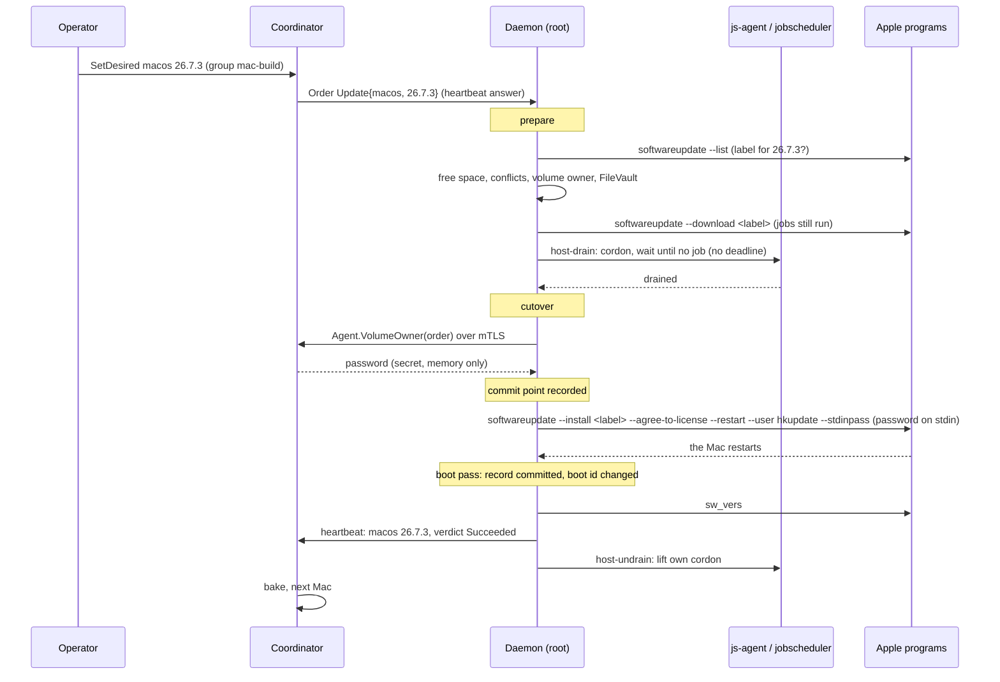

# macOS and Xcode as desired versions

Status: design, for the owner's ruling. Nothing here is built. Two decisions are open and are
listed in section 13: the volume-owner credential model (section 8) and whether the build Macs run
with FileVault on (section 9). Xcode delivery (section 10) is decided: the `.xip` as Apple ships it,
in our private store, installed only on our own Macs.

This design extends the desired-version loop of packages (`docs/design/hostgroups.md`,
`docs/design/rollout-update-plans.md`) and the Mac work of `docs/design/host-prerequisites.md`. It
needs no SSH to a Mac and no update pushed by device management: the coordinator learns what Apple
offers from the Macs themselves, an operator sets a version on the host group, and the hostkeeper
daemon on each Mac runs Apple's own programs (`softwareupdate`, `startosinstall`, `xip`,
`xcode-select`, `xcodebuild`) to reach it.

## 0. The problem

A Mac of the build farm runs a macOS release and one or more Xcode releases, and a build depends
on both. Today:

- **Nobody can see them.** The heartbeat carries no macOS version, no Xcode version, no free disk
  and no FileVault state. The only Apple fact a Mac reports is the version of the Command Line
  Tools, from the host prerequisite `xcode-command-line-tools`.
- **Nobody is told when a Mac is behind.** Apple releases a macOS update; nothing notices.
- **Nothing installs them.** A macOS update or a new Xcode reaches a Mac only by a person at it,
  and the Macs of the farm are zero-touch: no person types a command on one.
- **The one Mac prerequisite fails on every build Mac**, with `softwareupdate --list offered no
  Command Line Tools for Xcode` (section 2).

Apple adds three constraints that shape everything below:

- **Root is not enough for a macOS update on Apple silicon.** Installing a macOS update or upgrade
  needs the credentials of a *volume owner*: an administrator who holds a Secure Token.
  `softwareupdate --install <label> --user <name> --stdinpass` and `startosinstall --user <name>
  --stdinpass` read that password on standard input. The bootstrap token, which would avoid the
  password, can be redeemed only by a device-management server, not by a local daemon.
- **Only what Apple offers now can be installed.** A version is installable when the Mac's own
  `softwareupdate --list` (or `--list-full-installers`, for a major upgrade) offers it; a
  superseded version answers "Update not found". So a target must come from what the hosts report,
  never from a free-typed pin.
- **Xcode is not a software update.** `softwareupdate` cannot install it, and its `.xip` is
  downloaded only by a signed-in Apple ID. Everything after the file is on the Mac runs as root,
  headless.

## 1. What changes

**Before.** A Mac reports no OS or Xcode facts; its macOS and Xcode change only by hand; the
Command Line Tools prerequisite fails with a reason that does not say why.

**After.**

1. Every Mac reports, in its heartbeat, its macOS version and build, every Xcode on it (version,
   build, path, whether selected, licence and first-launch state), the Command Line Tools, the
   updates Apple offers it, FileVault's state, the free space of its data volume, the volume-owner
   account's state, and any device-management setting that conflicts with hostkeeper's updates
   (section 3).
2. The coordinator lists, per host group, the macOS and Xcode versions its Macs are offered or
   run. An operator sets a host group's desired `macos` and `xcode` versions the way a package's
   desired version is set, with `hkctl releases set-desired` (section 4).
3. The coordinator rolls them out like a package, but one Mac at a time and never more than one
   rollout in the cluster: it orders a Mac; the Mac's daemon downloads what it needs while the Mac
   still builds, drains its jobs with no deadline, runs Apple's installer with the volume owner's
   password on standard input, restarts, reports the new version from its first heartbeat after
   the restart, and lifts its drain (sections 5 to 7).
4. Alerts: `apple_behind` for a Mac below its group's target that nothing is moving, and
   `apple_update_not_taken` for an update that ran but left the Mac on its old version (section
   11).
5. The Command Line Tools prerequisite reports why it fails, and no longer fails when the tools are
   on disk without their receipt or come with a selected Xcode (section 2.3).
6. js-agent advertises the Xcodes hostkeeper installed, from the host's facts file, so a build can
   require one (section 10.5).

**What does not change.** Packages, their rollouts and every other host are as before. A Linux
host reports none of this and is never ordered `macos` or `xcode`. Device management (Apple
Business) still enrolls a Mac and installs the bootstrap package (`docs/design/mac-bootstrap.md`);
it does not update macOS or install Xcode, and section 12 says what it must not configure.

## 2. The Command Line Tools failure

### 2.1 What the Macs report

Read from the coordinator (`hkctl hosts list`, `hkctl alerts list`; read-only, no shell on a Mac):

- Every Mac of the build group reports `xcode-command-line-tools` `FAILED`, reason `softwareupdate
  --list offered no Command Line Tools for Xcode`, several failures in a row, and raises
  `prerequisite_failed`.
- The Remote Login probe in each heartbeat shows the daemon running as root under launchd with no
  Full Disk Access (its read of the TCC database is refused), which does not matter here:
  `pkgutil`, `xcode-select` and `softwareupdate` need none.

So the daemon ran `pkgutil --pkg-info=com.apple.pkg.CLTools_Executables` and got a non-zero exit
(no receipt), made the marker `/tmp/.com.apple.dt.CommandLineTools.installondemand.in-progress`,
ran `softwareupdate --list` (exit 0), and found no `* Label: Command Line Tools for Xcode-...` line
in its standard output (`crates/hostkeeper-daemon/src/xcode_clt.rs`, `install_label`).

### 2.2 The candidate causes

None is confirmed: confirming needs one more fact from the Mac. The first pull request of this work
(section 14, step 1) puts that fact into the failure reason, so every Mac reports it at once, with
no shell on any of them.

| # | Cause | What it would look like | How the report tells |
|---|---|---|---|
| C1 | The tools are on disk but their receipt is not: `pkgutil` says absent, `softwareupdate` sees nothing to offer. | `/Library/Developer/CommandLineTools/usr/bin/clang` exists; no `com.apple.pkg.CLTools_*` receipt. | `apple.clt.files` true, `apple.clt.receipt` false. |
| C2 | A full Xcode is installed and selected, and the Mac is offered no separate tools. | `xcode-select -p` names `/Applications/Xcode*.app/Contents/Developer`. | `apple.xcodes[]` holds a selected Xcode. |
| C3 | A device-management deferral hides the tools. Apple's `softwareupdate.settings` declaration's `Deferrals.SystemPeriodInDays` "defer[s] system or non-OS updates ... updates only appear after the specified delay"; the older restrictions key `enforcedSoftwareUpdateNonOSDeferredInstallDelay` did the same. | The newest tools were released inside the deferral window. | `apple.conflicts[]` names the key (section 12). |
| C4 | Apple's catalog has no tools for this macOS build (a new or beta build). | The listing offers a macOS update and no tools. | `apple.macos` and `apple.available[]`. |
| C5 | The daemon's child environment (empty, standard input closed) changes what `softwareupdate` prints. | The labels go to standard error, or nothing is listed. | The failure reason carries the first line of both streams. |
| C6 | The label's spelling changed: the parser takes only `* Label: Command Line Tools for Xcode-<version>`. | A `* Label:` line holds "Command Line Tools" in another form. | The failure reason carries every `* Label:` line that holds "Command Line Tools". |

### 2.3 The fix

1. **"Offered none" says why** (first, alone, in `xcode_clt.rs`). The failure reason keeps its first
   sentence and adds the macOS version and build, the first line of each of `softwareupdate`'s
   streams, and every `* Label:` line that holds "Command Line Tools", cut to the reason's bound.
   That tells C3 to C6 apart.
2. **The look reads the disk, not only the receipt.** The tools are `PRESENT` when the receipt is
   there (as now), or when `/Library/Developer/CommandLineTools/usr/bin/clang` is a regular file and
   `xcode-select -p` exits 0 (C1); the reported version is the receipt's when there is one, else
   empty, and `apple.clt.receipt` says which. A selected Xcode that passes `xcodebuild -license
   check` and `-checkFirstLaunchStatus` also satisfies the prerequisite (C2): it carries the
   compilers and SDKs the tools do, and `/usr/bin/clang` resolves into it.
3. **A setting is fixed at its source.** For C3 the reason names the device-management key, and the
   fix is the profile (section 12). For C4, the `macos` target brings the tools back into the
   catalog; the prerequisite waits as now. For C6 the parser learns the new spelling, pinned to a
   fixture.

The `PRESENT` rule of `docs/design/host-prerequisites.md` section 4 changes with item 2; that
document is updated in the same pull request.

## 3. The facts in the heartbeat

A new optional field of `HeartbeatRequest`, `apple` (the next free number, 18 today; message
`AppleReport`, feature `apple-v1`), sent over gRPC by a Mac's daemon in every heartbeat once its
first look has finished, to a coordinator that advertises `apple-v1`. A Linux daemon never sends
it. Its lists are bounded so that the report stays under 4 KiB, inside the heartbeat's 16 KiB
(`hostkeeper_link::beat::MAX_HEARTBEAT_BYTES`); the coordinator decides on it, so it is never in
`DROP_ORDER`.

| Field | Source on the Mac | Refreshed |
|---|---|---|
| `macos { version, build, extra }` | `sw_vers` (`ProductVersion`, `BuildVersion`, `ProductVersionExtra` for a Background Security Improvement) | at start, after every Apple step |
| `model` | `sysctl -n hw.model` (for example `Mac15,14`) | at start |
| `xcodes[] { path, version, build, selected, license_ok, first_launch_ok, managed }` | each `/Applications/*.app` whose `Info.plist` `CFBundleIdentifier` is `com.apple.dt.Xcode`: `CFBundleShortVersionString`, `version.plist` `ProductBuildVersion`; `xcode-select -p`; `xcodebuild -license check`; `xcodebuild -checkFirstLaunchStatus`; `managed` when hostkeeper installed it. At most 8. | at start, hourly, after every Xcode step |
| `clt { version, receipt, files }` | `pkgutil --pkg-info`, the file test of section 2.3 | with the prerequisite's look |
| `available[] { label, title, version, kind, restart }` | `softwareupdate --list` (`kind` is `macos_minor`, `macos_major`, `clt`, `security` or `other`); `softwareupdate --list-full-installers` (`kind` `macos_major`, no label). At most 8, titles cut to 96 bytes. | at start, every `apple_list_secs` (6 h by default), before an order |
| `list_error` | the step, exit code and first line of standard error of a list that failed, and the count of lines the parser did not know | with the list |
| `filevault` (`ON`, `OFF`, `ENCRYPTING`, `DECRYPTING`, `UNKNOWN`), `authrestart` | `fdesetup status`, `fdesetup supportsauthrestart` | at start, hourly |
| `data_volume { free_bytes, total_bytes }` | `statvfs` of `/System/Volumes/Data` | every heartbeat (no program run) |
| `volume_owner { account, present, admin, secure_token, filevault_user }` | `dscl . -read` of the account, `dseditgroup -o checkmember`, `sysadminctl -secureTokenStatus`, `fdesetup list` | at start, hourly |
| `conflicts[]` | the keys of section 12 found in `/Library/Managed Preferences/com.apple.SoftwareUpdate.plist`, `.../com.apple.applicationaccess.plist`, and the software-update declarations the Mac reports | at start, hourly |
| `seen_unix` per group of fields | the daemon's clock | |

Every program runs through the `Launchctl` port (`hostkeeper_launchd::LaunchctlProcess`: empty
environment, standard input closed, 64 KiB of output, a deadline), one port per program and
deadline as `CommandLineTools::at_host` builds them. `softwareupdate` has no JSON output: each
listing is parsed by one function pinned to fixtures captured from every macOS release we run
(section 15.1); a line the parser does not know is skipped and counted in `list_error`, never
guessed at.

The coordinator keeps each host's last report beside the beat it already keeps per host in
Postgres (`fleet_hosts.beat`, shared by every coordinator instance), so that every instance answers
`Hosts.Get` and `Hosts.List` (the field `apple` of the host's heartbeat), the per-group view of
section 4.2 and the `not_offered` check. Unlike the prerequisites report, which is kept in memory
only, a coordinator decides on this one. The host page of the web app shows it.

The facts file (`/var/lib/hostkeeper/facts.json`, `crates/hostkeeper-daemon/src/facts_file.rs`)
gains one key, which a reader of schema 1 ignores: `"apple": {"macos": {...}, "xcodes": [...]}`.
Today the file is written only from the facts the coordinator sends; the writer gains a second
input, the daemon's own Apple facts, and a write from either keeps the other's part. The file is
still written whole and only when its content changes. This is how js-agent learns the Xcodes
(section 10.5).

## 4. Targets per host group

### 4.1 `macos` and `xcode` are built-in services

A host group opts in by listing `macos` and `xcode` in its packages, after `hostkeeper`
(`hkctl host-groups put --if-generation <n> --request group.json`, with `"packages": ["hostkeeper",
"macos", "xcode", ...]` in the group). Neither needs a service definition. Both names become
reserved: `Services.Put` refuses them with a new refusal, `reserved_service`. No deployment has a
service of either name; a coordinator that finds one in its state at start refuses to start and
names it, rather than read it as the built-in. A Linux host of a group that lists them is skipped
as a host with no entry for its platform.

Each has an installer kind of its own, which only a Mac daemon of this design lists, so an older
daemon is never ordered it (the coordinator picks an entry by equality of installer names,
`crates/hostkeeper-release/src/installer.rs`):

- `macos`: installer `apple-softwareupdate`. Its version is Apple's `ProductVersion` (`26.7.3`).
  Its entry has no location and no attestation, because Apple supplies the bytes; its `digest` is
  the SHA-256 of the text `macos <version>`, which the daemon recomputes, so the entry still names
  exactly one release; its `bytes` is 1; its manifest holds `installer_bounds` alone. The
  coordinator writes this entry itself.
- `xcode`: installer `xcode-xip`. Its version is `<CFBundleShortVersionString>+<ProductBuildVersion>`
  (`26.2+17C52`): a release candidate and the release of the same version are different versions,
  and the semver scheme orders them by their numbers. Its entry is an artifact: one location in the
  private store and the `.xip`'s SHA-256 and size, with no attestation (as a `macos-pkg` entry has
  none); trust is the pin and Apple's own signature (section 10.4).

These are new rules of `crates/hostkeeper-release/src/target.rs` (`check_entry`) for these two
installers, which today refuses an artifact entry with no location or no attestation; the proto
does not change. They are additive because a daemon of an older release never receives either
entry. Two compatibility tests show it: a daemon of the previous release against a coordinator
holding both entries is never ordered them and its heartbeat is read as before; a daemon of this
design against a coordinator of the previous release sends no `apple` field (the coordinator does
not advertise `apple-v1`) and is never ordered either service.

Removing `macos` or `xcode` from a group stops managing it: the uninstall of both changes nothing on
the Mac (macOS cannot be uninstalled; an Xcode a build may still use is not deleted).

### 4.2 Learning what exists, and setting the version

**macOS.** The coordinator reads `available[]` from every Mac of a group and answers a new read,
`Releases.Offered { service, host_group }`: each version with its kind, the hosts that are offered
it, and the hosts that run it. Apple's catalog servers decide what a Mac is offered, so the hosts'
answer is the authority. The coordinator does not read `gdmf.apple.com/v2/pmv`: its certificate
chain is not publicly trusted, and it lists builds per model, which each Mac resolves for itself.

**Xcode.** No Mac learns of a new Xcode: `softwareupdate` does not offer it, and its `.xip` comes
from an operator (section 10.2), who learns of the release from Apple. `Releases.Offered { service:
"xcode" }` lists the releases registered and the hosts that run each.

**Setting.** An operator sets the target with the existing call:

```
echo '{"desired": {"version": "26.7.3"}}' |
  hkctl releases set-desired --service macos --host-group mac-build --request -
hkctl releases set-desired --service xcode --host-group mac-build --request xcode-26.2+17C52.json
```

For `macos` the coordinator builds the entry itself and refuses a version that no host of the group
is offered (`not_offered`). For `xcode` the request carries the `xcode-xip` entry (section 10.3).
Both are audited `set_desired`, kept per version, and lead to a plan like any package.

**A host that is not offered the target** (another model, an older build) is not ordered it: it is
skipped `not_offered`, holds no slot, does not keep a stage from finishing, and `apple_behind` names
it. When Apple withdraws the target because a newer version supersedes it, every host still below
it is `not_offered`, and `apple_behind` says `target_withdrawn`: the operator sets the newer
version.

### 4.3 One Mac at a time

- **In a group.** `macos` and `xcode` take at most one updating host per group, whatever the
  group's `max_updating` says (an exception to the group policy of `docs/design/hostgroups.md`,
  which paces every package of the group alike); the stages, `bake_beats`, pause and advance of the
  group's policy apply as to any package.
- **In the cluster.** An Apple rollout is a rollout: under `--live-rollouts 1` it is the only one
  live, every other service's rollout queues behind it (`rollout_elsewhere`), and it queues behind
  theirs. The drain wait of section 6 is part of the rollout, so a long job on the Mac holds the
  queue: that is the cost of drains that never cut work. An operator who wants a package to go
  first pauses the Apple rollout (`hkctl rollouts pause`).
- **On a host.** A Mac runs one update at a time already (`busy_elsewhere`). A new gate,
  `apple_order`: a host is not ordered `xcode` while its `macos` is below the group's desired
  `macos` or is updating, so macOS goes first and Xcode's minimum-OS rule is met.
- **No macOS rollback.** The coordinator never sends `ForceRollback` for `macos` (macOS does not go
  back); a failed `macos` update fails its stage as any failure does, and the group's automatic
  rollback skips it. `xcode` rolls back to the previous Xcode, which stays on the Mac (section 5.3).

## 5. The reconcile on the Mac

`apple-softwareupdate` and `xcode-xip` are installers of the daemon, as `apt` and `macos-pkg` are:
their steps are daemon code dispatched by installer kind
(`crates/hostkeeper-daemon/src/installers.rs`), not a per-service hook. That keeps the updater
generic (rule B17): macOS and Xcode are software Apple installs on the host, with no package that
could carry a hook. The steps run under the existing step runner, so the step record
(`crates/hostkeeper-steps/src/record.rs`), its boot id and the resume table
(`crates/hostkeeper-steps/src/resume.rs`) carry the update across the restart. Their bounds are
the entry's `installer_bounds`, from the coordinator's flags for `macos` and from the release for
`xcode`; `prepare`, which holds the drain wait, is unbounded, as a manifest's `prepare = 0` is
today.

The commit point (`reversible: false`) is recorded immediately before Apple's installer is
started, after everything that can fail without changing the Mac. After a restart the resume
table's committed row continues with `verify`. A daemon that dies during cutover without a restart
reruns the step, which first reads `sw_vers`: a Mac already at the target goes on to `verify`
rather than install again.

**Undrain runs at every end** but a committed restart: after `verify`, after a failure or a
deferral at any step, and after an abort.

### 5.1 macOS, a minor update



1. **prepare.** Refresh the list: the label whose version is the target must be offered, else
   `Deferred not_offered`. Free space of the data volume at least `apple_macos_min_free_bytes`
   (daemon config, 40 GiB by default), else `Deferred low_disk`. No `conflicts`, else `Failed
   mdm_conflict` (environment class: it never counts toward a rollback). The volume owner present,
   an administrator with a Secure Token, else `Failed no_volume_owner`; with FileVault `ON`, also a
   FileVault user and `authrestart` true, else `Failed filevault_no_authrestart`. Then download
   while the Mac still builds: `softwareupdate --download <label>`, bounded by `apple_download_secs`
   (2 h by default), run at background priority. Then drain (section 6). A prepare cut by a
   restart reports `Deferred rebooted`, as the resume table already does.
2. **cutover.** Fetch the password (section 8.3); if the coordinator does not answer, `Deferred
   credential_unavailable`. Record the commit point and run the install with the password written to
   its standard input. FileVault `OFF`: `softwareupdate --install <label> --agree-to-license
   --restart --user <account> --stdinpass`. FileVault `ON`: the same without `--restart`, then an
   authenticated restart, `fdesetup authrestart -inputplist`, with the account and password in the
   plist on standard input (section 9). The step's bound is `apple_install_secs` (3 h by default);
   a bound passed without a restart is `Failed install_timeout`.
3. **The restart.** The daemon's launchd job (`RunAtLoad`, `KeepAlive`) starts it again; the boot
   pass finds the record committed and the boot id changed, and continues.
4. **verify.** `sw_vers`: the version must be the target, else `Failed not_taken` (release class,
   with the version found). The heartbeat then reports `macos` at the target, which is the
   coordinator's confirmation, then `bake_beats` healthy beats.
5. **cleanup.** Undrain (section 6), refresh the facts and the list.

### 5.2 macOS, a major upgrade

The same steps, with two differences, because Apple documents the major path through the full
installer:

- prepare fetches the installer instead of the update, `softwareupdate --fetch-full-installer
  --full-installer-version <version>` (an `Install macOS <name>.app` in `/Applications`), which also
  proves Apple still offers the version; free space at least `apple_major_min_free_bytes` (60 GiB by
  default).
- cutover runs that app's `startosinstall --agreetolicense --nointeraction --user <account>
  --stdinpass`, which restarts the Mac itself. Whether that restart is an authenticated one on a
  FileVault Mac is a test item (section 15.2); until it is shown, a FileVault Mac is refused a major
  upgrade (`Failed filevault_major`). cleanup deletes the installer app.

The daemon chooses the path itself: major when the target's first number differs from the Mac's.

### 5.3 Xcode

1. **stage** (no drain; the Mac keeps building). Check free space first: at least
   `apple_xcode_min_free_bytes` (60 GiB by default, enough for the `.xip`, its expansion and the
   previous Xcode). Fetch the `.xip` by its pin through the streaming fetch
   (`hostkeeper_package::entry::fetch_pinned`: SHA-256 and size in the pass that writes, no
   whole-file buffer), extended to `xcode-xip` entries, into the service's package directory, and
   keep it as one file. Check Apple's signature on it (section 10.4).
2. **prepare.** `xip --expand`, at background priority and bounded by `apple_expand_secs` (2 h by
   default), into a hidden directory on the data volume (`/Applications/.hostkeeper-xcode-<build>/`),
   then the checks of section 10.4 on the expanded app; its `LSMinimumSystemVersion` above the Mac's
   macOS is `Deferred macos_too_old` (the coordinator's `apple_order` gate makes this rare). Then
   drain.
3. **cutover** (commit point). Rename the app to `/Applications/Xcode-<version>-<build>.app` (one
   rename on one volume, which moves it and changes none of its bytes), `xcode-select -s <that
   app>/Contents/Developer`, `xcodebuild -license accept`, `xcodebuild -runFirstLaunch`. No restart.
4. **verify.** `xcodebuild -version` prints the target's version and build; `-license check` and
   `-checkFirstLaunchStatus` exit 0; `xcrun --find clang` resolves inside the new app. A failure is
   `Failed xcode_verify`, then rollback.
5. **cleanup.** Write the facts file, undrain, and delete managed Xcodes other than the selected
   one and the one before it. An Xcode hostkeeper did not install is never deleted.
6. **rollback** (a failed verify, or `ForceRollback` to the previous version): `xcode-select -s`
   back to the kept Xcode; the failed app is deleted.

One Xcode per group is the target; a group that needs two Xcodes at once (a build pinned to an
older one) is later work, as a list of desired builds.

### 5.4 What each failure ends as

| Where | What happened | Verdict | The coordinator |
|---|---|---|---|
| prepare | target not offered to this Mac | `Deferred not_offered` | host skipped; `apple_behind` |
| prepare | free space below the bound | `Deferred low_disk` | backoff; `apple_behind` names it |
| prepare | conflicting device-management key | `Failed mdm_conflict` (environment) | not counted toward rollback; `apple_behind` |
| prepare | volume owner missing, not an admin, or without a token | `Failed no_volume_owner` (environment) | as above |
| prepare | FileVault on and no authenticated restart possible | `Failed filevault_no_authrestart` (environment) | as above |
| prepare | the drain still waiting | nothing yet: `updating`, step `prepare` | slot held; the queue waits |
| prepare | a drain hook fails | `Failed drain_failed`, undrain | `failed_here` |
| prepare | the Mac restarted during prepare | `Deferred rebooted` (resume table), undrain | backoff |
| prepare | the Xcode `.xip` fails a check | `Failed xcode_mismatch` (release class) | stage fails |
| cutover | the coordinator gives no password | `Deferred credential_unavailable`, undrain | backoff |
| cutover | the installer exits non-zero before restarting | `Failed install_failed`, its first stderr line, undrain | `failed_here` |
| cutover | no restart within `apple_install_secs` | `Failed install_timeout`, undrain | `failed_here` |
| cutover | the Mac is silent (restarting) | nothing; last beat said `updating` | slot held; `silent_host` waits `--alert-apple-restart-secs` |
| verify | the version did not change | `Failed not_taken`, undrain | `apple_update_not_taken` |
| verify | Xcode checks fail | `Failed xcode_verify`, rollback, undrain | `failed_here`, `apple_update_not_taken` |
| any | an operator aborts during prepare | `Halt aborted_by_operator`, undrain | `halted` until `clear_halt`, as an abort is today |
| any | the daemon restarts without a reboot | the step reruns (see section 5) | no change |

An abort during cutover is refused: once Apple's installer has started, nothing stops it safely.

## 6. Draining: the host-drain hook

hostkeeper does not talk to jobscheduler: the updater runs no per-service logic (rule B17). A
service that runs work on the host says so with a new optional manifest field, `Hook.host_drain`
(bool). The daemon then runs that service's hook command with two new steps:

- `host-drain`: before an Apple cutover (inside `prepare`), on every installed service that
  declares it. Exit 0: the service holds no work and takes none until `host-undrain`, including
  across a restart of the host. Exit 75: not yet; the daemon runs it again after
  `retry_after_secs`, with no deadline. Any other exit: `Failed drain_failed`, and `host-undrain`
  runs on every service that was drained. A service that cannot reach its own server answers 75,
  never 0.
- `host-undrain`: at the ends listed in section 5, on each service that was drained, in reverse
  order. It lifts only the hold its `host-drain` placed.

The names hold a hyphen, which a boot step's name (`[a-z0-9_]`) cannot, so no manifest of today can
already name a step so (`docs/design/host-updates.md`'s five-step contract is extended, not
changed). A Mac with no service that declares `host_drain` is updated undrained: there is nothing
on it to drain.

**js-agent's side** (a change in the jobscheduler repository, listed in section 14): `js-agent
update-hook host-drain` cordons the host with its own credential, records the cordon as its own in
its state root, and exits 75 while the host holds a lease and 0 when it holds none; `host-undrain`
lifts a cordon its state root records as its own. Because jobscheduler's cordon is a lease (at most
3600 s a request), the running js-agent renews a cordon its state root marks as its own for as
long as the mark is there; and at its own start, before it registers or takes a lease, it re-places
that cordon. So a long install or the restart cannot let the cordon lapse into a job before the
update is confirmed. The existing `update-hook prepare` already cordons, marks and renews this way
while it runs; `host-drain` is that logic without the unit stop, held past the hook's own exit.

## 7. Restart and confirmation

- **The daemon survives the restart.** It is a launchd job with `RunAtLoad` and `KeepAlive`, and
  the step record lives in its state directory. The boot pass (`Daemon::boot_pass`,
  `crates/hostkeeper-daemon/src/boot.rs`) sees the changed boot id (`kern.bootsessionuuid`) and,
  for a committed record, continues with `verify`.
- **Power loss mid-install** is a restart like any other (`pmset autorestart 1` is already set):
  the record decides.
- **Confirmation is the heartbeat.** The coordinator does not trust the installer's exit: the
  update is done when the Mac's heartbeat after the restart reports `macos` at the target and the
  verdict `Succeeded`, then `bake_beats` healthy beats, as for a package.
- **The slot is held while the Mac is silent.** A host updating holds its slot
  (`docs/design/rollout-update-plans.md`), and a host that holds an order and goes silent keeps it;
  nothing else of the group is ordered meanwhile. `silent_host` is not raised for a Mac whose last
  heartbeat said it was in an Apple cutover until `--alert-apple-restart-secs` (4 h by default, more
  than `apple_install_secs`) has passed.

## 8. The volume-owner credential (open decision)

### 8.1 Why a credential at all

On Apple silicon the install needs a volume owner's password. Root has none, the bootstrap token is
for device-management servers only, and updates are not pushed by device management. So each Mac
needs one account that is an administrator with a Secure Token, whose password the daemon can
supply.

### 8.2 The options

| | A: per-Mac account, password held by the coordinator (recommended) | B: per-Mac account, password held by the Mac | C: the existing human administrator's account |
|---|---|---|---|
| The account | `hkupdate`, made by the daemon: admin, hidden (`IsHidden 1`), shell `/usr/bin/false`, not in `com.apple.access_ssh` | the same | the account made at Setup Assistant |
| The password | 32 random bytes per Mac, made by the coordinator, kept sealed in Postgres | made by the daemon, kept in a root-only file | a person's password |
| Reaches the daemon | only during a cutover, over the daemon's mutual-TLS link, held in memory | read from the file | as A |
| A lost Mac disk | nothing on it | the file is on it (encrypted only with FileVault on) | nothing on it |
| Recovery at the console (a Mac stopped at the pre-boot login) | an operator can read the password with `hkctl` (audited) | none | the person knows it |
| Rotation and audit | central; every release audited | none | none |
| Root on the Mac | can ask the coordinator during a cutover of its own | reads the file | as A |

A and B protect equally against root on the Mac (root can always act as the daemon) and differ in
escrow, rotation and audit. C ties the farm to a person. **Recommendation: A.** The escrow matters
most on a FileVault Mac (section 9). Its risk: anyone with operator access to the coordinator can
read every Mac's update password, so the read is operator-only, audited and printed, never logged,
and the key that seals the rows is a file outside the database.

The hidden flag also keeps the account out of the rule by which the daemon finds the Mac's login
account for operator keys (`crates/hostkeeper-daemon/src/login_account.rs`: an administrator that
is not hidden).

### 8.3 Option A in detail

- **Storage.** Postgres table `volume_owner_credentials (host_id, account, sealed, created_unix)`
  (a new migration, additive). `sealed` is AES-256-GCM of the password under the key in
  `--volume-owner-key-file` (32 bytes, a 0600 file read with `hostkeeper_wire::secret::read_secret`),
  with the host id as associated data, so a row copied to another host does not open. A database
  dump alone reveals no password.
- **The password** is 32 random bytes written as 43 characters of base64url: printable, with no
  newline, no quote and nothing an XML plist must escape.
- **Delivery.** A new agent call, `Agent.VolumeOwner { order_id }` (feature `volume-owner-v1`),
  made by the daemon and answered only while that host holds an Apple order with that id in
  `cutover`, or a pending grant (section 8.4); at any other time `not_now`. The answer's `password`
  is `bytes` marked `(hostkeeper.secret) = true`, which the proto layout test checks. Each answer is
  audited `volume_owner_released` with the host and order.
- **On the Mac.** The daemon holds it in a type with no `Display` and a `Debug` of `<secret>`,
  zeroed on drop, and gives it to the child through a new `Launchctl` implementation whose standard
  input is a pipe (the existing one gives `/dev/null`): the password and a newline for
  `softwareupdate`, `startosinstall` and `sysadminctl`; for `fdesetup authrestart -inputplist`, a
  plist with `Username` and `Password` built in memory. It is never an argument, never in the
  child's environment (which stays empty), never in a log line, a step record, a heartbeat or a
  failure reason; a failed step's reason carries the step and exit code only, as `run_ok_named` does
  today for steps that name an account.
- **Reading it** for console recovery: `hkctl hosts volume-owner --node-id <host>`, operator only,
  audited.

### 8.4 Making the account, with a Secure Token

A Secure Token is granted only by an existing token holder: on these Macs, the administrator made at
Setup Assistant. That is one step per Mac that needs that administrator's password, once:

1. The operator runs `hkctl hosts grant-volume-owner --node-id <host> --admin-name <name>
   --admin-password-stdin` (the password read from the terminal, never an argument).
2. The coordinator makes and seals the new password, and keeps the administrator's password in
   memory only (never stored, logged or audited) as a pending grant for that host, for at most
   `--volume-owner-grant-secs` (10 minutes by default).
3. The host's next heartbeat answer carries a `grant` order; the daemon fetches both passwords with
   `Agent.VolumeOwner`, and the coordinator drops the pending grant once answered.
4. The daemon runs `sysadminctl -addUser hkupdate -password - -admin` and `sysadminctl
   -secureTokenOn hkupdate -password - -adminUser <name> -adminPassword -`, both passwords on
   standard input, hides the account, and reports `volume_owner.secure_token`.

Two facts are not proven yet and gate this step (section 15.2): whether `sysadminctl` reads `-` from
a pipe or only from a terminal (if only a terminal, the daemon gives it a pseudo-terminal it owns,
still never an argument), and whether an account made by root from launchd with no one logged in
gets the token. A Mac whose Setup Assistant password nobody knows cannot be granted; it is erased
and set up again.

## 9. FileVault (open decision)

With FileVault on, a Mac that restarts stops at the pre-boot login until someone types a volume
owner's password, unless the restart is an authenticated one (`fdesetup authrestart`, which needs
the same password). The design supports both:

- **Off (recommended for the build Macs).** Unattended restarts, including after a power cut
  (`pmset autorestart 1`, already set), come back with no person. Data on Apple silicon is still
  encrypted at rest by the hardware, bound to the Mac's chip.
- **On.** A minor update ends in `fdesetup authrestart -inputplist` with the volume owner's
  credentials (who must be a FileVault user), a major upgrade waits for the proof of section 15.2,
  and a restart hostkeeper did not make (power, panic) stops at the pre-boot login: the Mac goes
  silent, `silent_host` stands, and a person types the password from `hkctl hosts volume-owner` at
  the console.

The state is reported per Mac (`apple.filevault`). Apple Business's API reports it too
(`MdmDeviceDetail.isFileVaultEnabled`, see the appendix).

## 10. Xcode delivery (decided)

### 10.1 The rule

The `.xip` is kept unmodified in our private store and installed only on our own Macs: never public,
never offered to anyone else. It is installed as Apple ships it: its signature is checked before
anything is placed in `/Applications`, and nothing is repackaged, patched or stripped. The rename
of section 5.3 moves the app; `xcode-select`, the licence acceptance and the first launch are
configuration of the installed app, not changes to it.

### 10.2 Who downloads it

An operator who holds the organisation's Apple developer account downloads the `.xip` in a browser
(two-factor sign-in; there is no unauthenticated URL, and automating the sign-in would put an Apple
ID's session in a robot). That is a few times a year. They then:

1. put the file into the private store at `pool/<group>/Xcode_<version>_<build>.xip` (the store's
   origin, as any private package: `docs/deploy/package-repositories.md`, "Private repositories").
   The store is read only by the coordinator, with its credential, and its files reach only the
   hosts of the group the path names, over their mutual-TLS link;
2. write the release file (10.3) with the file's SHA-256 and size;
3. run `hkctl releases set-desired --service xcode --host-group <group> --request <file>`.

### 10.3 The release entry

```json
{"desired": {"version": "26.2+17C52"},
 "targets": {"macos-arm64": {"entries": [{
   "installer": "xcode-xip",
   "locations": [{"store": "coordinator",
                  "locator": "repositories/apple/pool/mac-build/Xcode_26.2_17C52.xip"}],
   "digest": "<64 hex>", "bytes": "<size>",
   "manifest": {"installerBounds": {"stageSecs": 21600, "activateSecs": 3600}}}]}}}
```

The Macs fetch it through the coordinator, which streams it from the private origin and never
buffers it (`crates/hostkeeper-coordinator/src/repository_serve.rs`). The daemon's `[bounds]` gain
one table for this installer, `[bounds.xcode-xip]` with `max_package_bytes` (16 GiB by default) and
`fetch_timeout_secs` (6 h), so the 512 MiB bound of every other package is unchanged.

### 10.4 Checks on the Mac

1. The pin: size and SHA-256, in the fetch.
2. Apple's signature on the `.xip`: `pkgutil --check-signature` exits 0 and names a chain that ends
   at Apple's root and is signed by Apple itself, not by a Developer ID. `xip --expand` checks the
   signature again; either refusing is `Failed xcode_mismatch`. The exact text is pinned to a
   fixture per macOS release.
3. On the expanded app, before the rename: `codesign --verify --deep --strict`, a designated
   requirement of `anchor apple`, `CFBundleIdentifier` `com.apple.dt.Xcode`, and
   `CFBundleShortVersionString` and `ProductBuildVersion` equal to the release's version. A
   mismatch is `Failed xcode_mismatch` (release class).

### 10.5 Builds can require an Xcode

js-agent builds its Xcode catalog from `--xcode BUILD=PATH` flags and surveys each one
(`xcodebuild -version`, `-license check`, `-checkFirstLaunchStatus`, `xcrun --find clang`), and
advertises the builds of the ready ones. The change (jobscheduler repository): js-agent also reads
`apple.xcodes` from the host's facts file at start and at `host-undrain`, adds each to the same
survey, and advertises, beside the builds, the `xcode` versions and the `os_version` of its
capabilities design, so a build can say `xcode has 26.2` or `os_version ge 26.7`. Because
`host-undrain` runs after verify, a Mac advertises a new Xcode exactly when it takes jobs again.

## 11. Alerts

Two new kinds (the next free numbers, 17 and 18 today), derived from what the coordinator holds,
like every other kind (nothing stored):

- `apple_behind` (warning): a host of a group with a desired `macos` or `xcode` runs a lower
  version, no update of it is in flight (it is not updating, not ordered, and not waiting its turn
  in the plan: `no_slot`, `stage_wait`, `baking`, `quiet`, `rollout_elsewhere`, `advance_wait`), for
  `--alert-apple-behind-secs` (one day by default). It names why the host is not moving: the
  deferral or failure reason, `not_offered`, `target_withdrawn`, `halted`, `held` or `paused`. An
  update stuck in flight shows as the host's step and its time in it (`ServiceBeat.step`,
  `step_secs`), and as `silent_host` once the restart grace has passed.
- `apple_update_not_taken` (critical): the coordinator saw the host's update of `macos` or `xcode`
  start, and the host now runs, not updating, a version below the target (whatever verdict it
  sent, or none), or its last verdict is `not_taken` or `xcode_verify`. It stands until the host
  runs the target or its record is cleared. `failed_here` alone does not say this: it covers every
  failure, most of which leave the Mac untouched.

## 12. What device management must not configure

On a Mac that hostkeeper updates, Apple Business (or any device management) leaves software
updates to hostkeeper. It must not set (names from Apple's published device-management schema):

- the declaration `com.apple.configuration.softwareupdate.enforcement.specific`
  (`TargetOSVersion`, `TargetBuildVersion`, `TargetLocalDateTime`): it forces an install and a
  restart at its deadline, in the middle of a job;
- in `com.apple.configuration.softwareupdate.settings`: `Deferrals` (any period: they hide updates
  from `softwareupdate --list`, the tools of section 2 included), `AutomaticActions` that install
  (`InstallOSUpdates`, `InstallSecurityUpdate`), and `Beta` enrollment;
- the restrictions keys (`com.apple.applicationaccess`) `forceDelayedSoftwareUpdates`,
  `forceDelayedMajorSoftwareUpdates`, `forceDelayedAppSoftwareUpdates`,
  `enforcedSoftwareUpdateDelay`, `enforcedSoftwareUpdateMajorOSDeferredInstallDelay`,
  `enforcedSoftwareUpdateMinorOSDeferredInstallDelay`,
  `enforcedSoftwareUpdateNonOSDeferredInstallDelay` (deprecated in macOS 26, removed in 27);
- in `com.apple.SoftwareUpdate`: `CatalogURL`, `AllowPreReleaseInstallation`,
  `AutomaticallyInstallMacOSUpdates` true, `restrict-software-update-require-admin-to-install`.

The profile is fixed at its source, in Apple Business. The daemon reports each of these it finds
(`apple.conflicts`) because the Mac is the only place that shows what reached it, and refuses an
Apple update while one is present (`Failed mdm_conflict`), so the report names the cause instead of
the update failing in Apple's installer. How a declaration shows on the Mac, for the daemon to read
it, is a test item.

## 13. Decisions

**Open:**

1. The credential model: A (recommended), B or C of section 8.2.
2. FileVault on the build Macs: off (recommended) or on (section 9).

**Made in this design** (each the option most consistent with the packages' loop and the code):

| Decision | Why |
|---|---|
| `macos` and `xcode` are built-in services set with `Releases.SetDesired`, not keys of a per-group file. | That is the packages' loop; a file (like `--host-prerequisites-file`) has no plan, halt, audit or one-at-a-time. |
| Each has an installer kind of its own; the steps are installer code in the daemon. | An older daemon is never ordered them, by the existing pick rule; no package exists to carry a hook (B17). |
| The `macos` entry's digest is the SHA-256 of `macos <version>`. | Keeps "one entry names one release" without a proto change. |
| An Xcode version is `<version>+<build>`. | A release candidate and the release share a version; the build tells them apart and semver still orders them. |
| Targets are refused unless offered to a host of the group; hosts not offered are skipped. | Apple installs only what it offers now. |
| At most one updating host per group for these two services, whatever the group's policy. | One Mac at a time, while the group's policy also paces its packages. |
| Drain is a generic host-level hook step that js-agent implements. | No per-service logic in the updater; reuses js-agent's cordon code. |
| Download before drain; drain before install; commit point right before Apple's installer. | Keeps the Mac building as long as possible; nothing that fails before the commit has changed the Mac. |
| Minor by `softwareupdate --install`, major by `startosinstall`. | Apple's documented path for each. |
| Keep the previous managed Xcode; delete older managed ones. | Rollback needs one; disk does not allow many. |
| Reports kept with the host's beat row in Postgres. | Every coordinator instance must answer the per-group view and `not_offered`. |
| Every number above is a flag or a config key with that default. | Tunables are configuration. |

## 14. Work, in pull requests

1. **The Command Line Tools reason** (`xcode_clt.rs`): section 2.3 item 1. Read-only on the Mac;
   it answers section 2.
2. **Facts** (hostkeeper): `AppleReport`, its row, the host page, the facts-file key; section 2.3
   item 2, with `docs/design/host-prerequisites.md`, `docs/operations/host-prerequisites.md` and
   `docs/macos.md` updated.
3. **The Mac proof** (section 15.2), before any of the steps below is built.
4. **Targets and alerts** (coordinator): the two built-in services, the entry rules,
   `Releases.Offered`, the gate `apple_order`, the cap, the two alert kinds.
5. **Drain** (hostkeeper): `Hook.host_drain` and the two steps; **js-agent** (jobscheduler):
   `host-drain`/`host-undrain`, the cordon held across a restart, the facts-file Xcodes.
6. **Credential** (hostkeeper): the sealed table, `Agent.VolumeOwner`, the stdin runner, the grant,
   after the decision of section 8.
7. **macOS steps**, then **Xcode steps** (daemon and install crates).

## 15. Tests

### 15.1 Ordinary tests (no Mac, no network, no timing)

The daemon's logic runs over the fake `Launchctl` port (`crates/hostkeeper-launchd/src/fake.rs`,
scripted per argument list, one per program, counting its calls), an injected clock, a fake boot
id and a dispatcher that runs each pass at once. The stdin runner is tested on Linux against a real
child that echoes its input. Tests that need a Mac run in `release.yml`'s `macos-test` and
`macos-device` jobs, never in a pull request's checks.

- **Parsing**, pinned to fixtures captured from each macOS release we run: `sw_vers`,
  `softwareupdate --list` (minor, major, tools, security, none, a line it does not know),
  `--list-full-installers`, `fdesetup status` (each state), `fdesetup list`, `sysadminctl
  -secureTokenStatus`, `xcodebuild -version`, `pkgutil --check-signature`, Xcode `Info.plist` and
  `version.plist`.
- **The tools**: receipt present; receipt absent and files present (C1) is `PRESENT`; a selected,
  ready Xcode (C2) is `PRESENT`; "offered none" carries the version, both streams' first lines and
  the tools' label lines, cut to the bound, compared by exact equality.
- **macOS steps**: target not offered defers; low disk defers; conflict, missing volume owner and
  FileVault without authenticated restart fail with their reasons; the install's argv holds no
  password and its environment is empty, while its standard input is exactly the password and a
  newline; FileVault on runs `fdesetup authrestart` with the plist and never `--restart`; a
  committed record after a changed boot id runs verify; a rerun cutover on a Mac already at the
  target goes to verify; a version unchanged after the restart is `not_taken`; a prepare cut by a
  restart undrains and defers `rebooted`; the bound passing with no restart is `install_timeout`.
- **No leak**: every log line, failure reason, step record and heartbeat produced in those runs is
  compared by exact equality with its expected text, and none holds the password.
- **Xcode steps**: wrong digest, wrong signature, wrong bundle id, version or build each fail with
  their reason, and nothing is placed in `/Applications`; the app is renamed into place only after
  the checks; `xcode-select` names the new app; rollback selects the kept one; cleanup deletes only
  managed Xcodes older than the kept one.
- **Drain**: undrain runs on each drained service in reverse order after success, failure,
  deferral and abort; a drain that answers 75 runs again after its retry, with no deadline; any
  other exit fails and undrains; a Mac with no draining service is updated undrained.
- **Coordinator**: `not_offered` refusal and skip; the cap of one per group; `apple_order`; no
  `ForceRollback` for `macos`; both alert kinds raised and cleared from fleet states;
  `Agent.VolumeOwner` answers only during that host's cutover or pending grant, and audits each
  answer; a sealed row does not open under another host id; a pending grant is dropped once
  answered or expired; the entry rules accept the two new entries and refuse them for any other
  installer; the compatibility tests of section 4.1.

### 15.2 On one Mac (a drained Mac in a group of its own, before any group target)

Each item is a fact this design rests on that has not been seen on our Macs:

1. A minor update by `softwareupdate --install --user --stdinpass --restart`, as root from launchd,
   with no one logged in, on the macOS the Macs run; `softwareupdate --download` first.
2. A major upgrade by `startosinstall --user --stdinpass`, same conditions.
3. Both with FileVault off, and with it on through `fdesetup authrestart -inputplist`; whether
   `startosinstall` or `softwareupdate --restart` makes an authenticated restart by itself.
4. Whether an install on macOS 26 or later stops on a step that needs the screen.
5. `sysadminctl` reading passwords from a pipe; the Secure Token grant from launchd.
6. An Xcode install, a swap to a second Xcode, and a rollback, with js-agent surveying it before
   and after.
7. How each setting of section 12 shows on the Mac.

The results go into a measurements section of this document, and a fact that turns out otherwise
changes the steps above before they are built.

## Appendix: Apple Business's API

Whether Apple Business exposes per-device update status, per its published reference ("Apple
Business API", `https://developer.apple.com/documentation/applebusinessapi`; not called from our
account):

- `GET /v1/orgDevices/{id}` (every device of the organisation): serial, model, product family,
  capacity, colour, order and assignment. No OS version, no update.
- `GET /v1/mdmDevices/{id}/details` (devices enrolled in Apple Business's own built-in management;
  our Macs enroll there): `osVersion`, `isFileVaultEnabled`, `storageFreeCapacity`,
  `storageTotalCapacity`, `lastCheckInDateTime`, MAC addresses, lock and erase status. No available
  or pending update.

The device-management protocol's update queries (`AvailableOSUpdates`, `OSUpdateStatus`) and the
declarative status reports run between Apple's management service and the Mac, and the API does not
pass them on. So Apple Business shows a Mac's current version and FileVault state, but not what it
is offered; the daemon's own `softwareupdate --list`, which needs no administrator, is the source of
truth.
