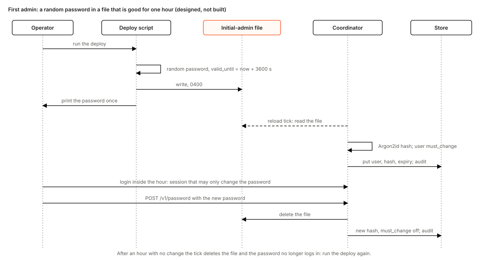
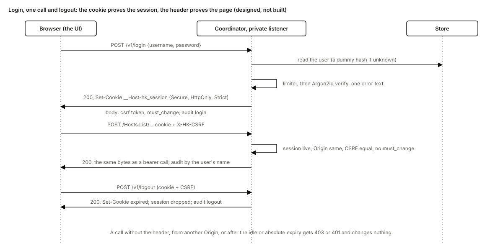

# Operator login: a username and a password, a browser session, and tokens for automation

Status: design, for the maintainers' comments. Nothing here is built. The tags are those of
[hostkeeper-design.md](hostkeeper-design.md): **Built** names code on `main` with a path, **Designed** means nothing
implements it yet. This document changes one thing of [hostkeeper-design.md](hostkeeper-design.md) section 4.8 and
[ui-serving.md](../ui-serving.md): the operator API is no longer reached only with a pasted bearer token, and the UI
gains a cookie and a session, which `ui-serving.md` says it has not. Where they disagree with this document on who
may sign in to the UI and how, this document wins. The coordinator's MDM design
([coordinator-mdm.md](coordinator-mdm.md), on its own branch, not yet merged) depends on it: setting up MDM is an
action of a signed-in admin, and the coordinator's port-443 listener must not serve the sign-in routes (section 12).

Ruling (the owner's, 2026-11-10): "really simple login with username and password to get started; bells and whistles
later." The first admin is made the way GitLab makes its root: the deploy creates the user `admin` with a random
password, prints it once, and the password is only good for one hour. The first login forces a change. After that, a
person signs in with a username and a password and gets a session; admins create the other users and the API tokens in
the UI. There is no single sign-on, no passkey and no role now.

## 1. What changes for the operator

**Before.** Everyone who operates the farm holds a bearer token from the coordinator's tokens file
(`--tokens-file`: named tokens such as `ceo` and `engineering`, SHA-256 in the file). The UI's sign-in is a box that
says "Paste your operator token". The token lives in a JavaScript variable until the tab closes. A new person means
someone with shell access on the coordinator host generating a token, hashing it and editing a root-owned file, and a
revoked person means editing it again. Nothing records a sign-in or a sign-out.

**After.**

- The deploy script, on the first run, creates the user `admin`, prints its password once and keeps it in a file for
  an hour (section 4). The password stops working after that hour; the way to get another is to run the deploy again.
- Opening the UI shows a username and password form. The first login with the initial password shows only a
  "choose a new password" page; nothing else works until it is done, and the initial password and its file are gone
  after that.
- A person who has signed in holds a session in a cookie the page cannot read. It ends after 30 minutes idle or 12
  hours, whichever comes first, or when the person signs out, or when an admin disables the user or resets the password.
- Any admin creates and disables users, sets a temporary password for a user who forgot theirs, and creates and
  revokes API tokens, all in the UI (section 7). Every one of those, and every login, is in the audit log (section 8).
- API tokens stay what they are, named bearer tokens for `hkctl`, CI and scripts. They can now be created and
  revoked in the UI, and the ones in the tokens file are listed there too, read-only.

**What does not change.** Every operator method, its request and its answer. A bearer call is authenticated exactly
as today and never reads the cookie. The tokens file, its format and its read rule. The heartbeat, LAN and health
listeners. The CI OIDC path. Every operator is still equal: a token or a user either operates or does not, as
[hostkeeper-design.md](hostkeeper-design.md) section 4.8 says; there are no per-user rights, and "admin" below means
any signed-in user.

## 2. Today

All of this is **Built** and was read from `main`.

- **Tokens file** (`crates/hostkeeper-coordinator/src/tokens.rs`, flag `--tokens-file`). One `[[token]]` table per
  token with a `name` (1 to 32 bytes of `a-z`, `0-9`, `-`) and the `sha256` of the token. It is read under the
  secret-file rule (regular file, owner the coordinator's user, mode 0600 or 0400, at most 64 KiB), refuses duplicate
  names and hashes and an empty list, and is re-read on the `--tls-reload-secs` tick; a rejected file keeps the tokens
  in use. `--operator-token-file` is the single-token alternative, and exactly one of the two flags is required.
  The names `coordinator`, `ci` and the audit actors `MAC_APPROVER`, `INVENTORY_APPROVER` and `GATE_AUDITOR` are
  reserved. The hash is plain SHA-256 with no salt, which is right for a 256-bit random token and wrong for a password
  a person chose.
- **The caller.** `bearer_in()` (`http.rs`) and `bearer()` (`grpc/mod.rs`, limited to `MAX_BEARER_BYTES`, 8192) read
  the `Authorization` header; `Coordinator::caller()` (`operator.rs`) gives `Caller::Operator(TokenName)`,
  `Caller::Ci` or `Caller::Anonymous`, and every operator call takes its audit `by` from the name.
- **The UI** (`ui.rs`, `ui/`). A static file server for `/ui/`: it parses no token, holds no state, and its header
  says "no cookie and no session". Every answer carries `Cache-Control: no-store`, `X-Content-Type-Options: nosniff`,
  `Referrer-Policy: no-referrer` and the policy `default-src 'self'; frame-ancestors 'none'`; there are no
  `Access-Control-*` headers. The page keeps the token in `ui/session.js` and `ui/api.js` posts JSON to
  `/<package>.<Service>/<Method>` with `Authorization: Bearer`.
- **Listeners.** The private listener (TLS, one interface) serves the operator API, the gateway and `/ui/`; the
  heartbeat and LAN listeners never serve them. The access path carries the peer's TLS identity and no client address.
- **The audit** (`ops.rs`, `audit_file.rs`): `AuditEntry` has `by`, `action`, and the optional `service`, `node_id`,
  `host_group` and `reason`. A login, a failed login, a password change, and the creation of a user or token are not
  recorded, because none exists.
- **Not present.** No session, cookie, CSRF check, password hash, rate limit or lock-out exists in the coordinator.
  The tests that say so (`http_tests/ui.rs`, `tests/ui_default.rs` and the `hostkeeper-ui-tests` crate) are the ones
  this change rewrites (section 13).
- **Storage.** The store trait has a files backend and a Postgres one (migrations `0001` to `0008`);
  [coordinator-storage.md](coordinator-storage.md) leaves the tokens file a file. Time is read through an injected
  clock (`now_unix`), which the tests of enrollment expiry already replace.

## 3. Components

All of it runs in `hostkeeper-coordinator serve`; hostkeeper adds no process, no port and no daemon on a host.

| Part | What it does | Where it keeps state |
| --- | --- | --- |
| Login routes | `POST /v1/login`, `POST /v1/logout`, `GET /v1/session`, `POST /v1/password`, on the private listener only | none |
| Session table | one entry per signed-in browser: the SHA-256 of the session id, the user, the CSRF token, the times | memory |
| Login limiter | failures per user name, lock-out, and a cap on password hashes in flight | memory |
| Password module | Argon2id hash and verify, the policy, a dummy verify for an unknown user, rehash when the parameters grew | none |
| Users and API tokens | the user records and the tokens made in the UI | the store (files or Postgres) |
| Tokens file | the named tokens of today, read-only | the file, as today |
| Initial-admin file | the first password and its deadline | a file in the state volume |
| Operator API | the methods of today plus the `Users` and `ApiTokens` services | none |

Sessions live in memory, not in the store. A coordinator restart signs everyone out, which is a minute's cost on a
service that restarts rarely and keeps a table, its migration and a write per request out of the design. If the
standby of [coordinator-storage.md](coordinator-storage.md) section 7 is ever built, sessions are the first thing it
revisits.

## 4. The first admin

**The deploy step (Designed).** `coordinator_docker.sh` (komira-ai/komira, `tools/held/hostkeeper`) gains a step that
runs when the store has no user and no initial-admin file exists, and, with `--reset-admin <name>`, whenever the
operator asks (section 6.4). It

1. makes a password of 24 characters from `/dev/urandom` over an alphabet without look-alikes (no `0O1lI`), about 117
   bits;
2. makes a random `id`, and a `valid_until` of now plus 3600 seconds;
3. writes `initial-admin.toml` into the state volume next to `files/tokens.toml`, owner the coordinator's user, mode
   0400, holding `id`, `user` (`admin`, or the name given to the flag), `password` and `valid_until`;
4. prints the password once, to the terminal of the person running it, with the sentence "valid until HH:MM, change it
   at the first login". It prints nothing else of the file, and it never writes the password to a log or to the
   script's own output files.

The file is "root-only" in the sense that matters: the state volume's directory on the host is root's, and inside the
container only the coordinator's own user can read the file. The plaintext is there for the person who missed the
terminal, and for one hour only.

**The coordinator side (Designed).** A new flag `--initial-admin-file <path>` names the file. On start and on every
`--tls-reload-secs` tick (the tick that already reloads the tokens file, `listen::reload_every`) the coordinator reads
it under the secret-file rule and:

- file absent: nothing;
- `valid_until` in the past (by the injected clock): deletes the file, and if that file's `id` is the one the user
  record last adopted, voids the record's initial credential (section 6.3); audits `initial_password_expired` under
  `coordinator`;
- `valid_until` in the future and `id` not yet adopted: hashes the password with Argon2id, puts the user (a new record,
  or an existing one under break-glass) with the hash, `must_change` on, `initial_expires_at = valid_until` and the
  adopted `id`, drops that user's sessions, and audits `user_bootstrap` under `coordinator`;
- `id` already adopted: nothing; a restart does not reset a password twice.

The valid time is a key with a default from the start: `--initial-password-secs`, default 3600, and the coordinator
refuses a file whose `valid_until` is more than that past its own clock, so the file cannot grant more than the flag.
The flag also cannot be set above 3600: the owner's rule is one hour, and a larger number would have to be a decision.

**The first login.** The initial password logs in only while `now < initial_expires_at`. The session it makes has
`must_change` set, ends no later than `initial_expires_at`, and may call only `/v1/password`, `/v1/logout` and
`/v1/session` (section 5.3). A successful change sets the new hash, clears `must_change` and `initial_expires_at`,
ends the user's other sessions, deletes the file, and audits `password_changed`.

**Start rule.** Today exactly one of `--tokens-file` and `--operator-token-file` is required
(`StartError::TokenFlags`). The rule becomes: at least one of those two, or `--initial-admin-file`, is required. A
configuration that started before still starts and means the same; one that was refused before may now start. That
change is additive in the sense of B8. A coordinator with no tokens file, no user in its store and no live
initial-admin file starts and cannot be operated, which is the same state as a coordinator whose tokens are all
revoked, and the deploy run mints the way out.

## 5. Login, session, logout and CSRF

### 5.1 Login (Designed)

`POST /v1/login` with the JSON body `{"username": ..., "password": ...}` on the private listener. The body is limited
to 4 KiB; the username must follow the token-name grammar (1 to 32 bytes of `a-z`, `0-9`, `-`), so the audit's `by`
is always a valid name; the password is 1 to 256 bytes.

1. Check the limiter (section 5.4). A locked user, or no free hashing slot, answers 429 `try_later`.
2. Read the user. If it does not exist, is disabled, or has an initial credential past its deadline, the coordinator
   still runs one verify against a fixed dummy Argon2id hash of the same parameters, so the time does not say which.
3. Verify the password in a blocking task, in constant time for the comparison.
4. On any failure: 401 `invalid_credentials`, one text for every cause; count the failure.
5. On success: make a session, 32 random bytes from `getrandom`, store only its SHA-256 and a fresh CSRF token (32
   random bytes), answer `200` with `Set-Cookie` and the body `{"csrf": ..., "must_change": ..., "username": ...}`,
   and audit `login`.

The cookie is `__Host-hk_session=<base64url id>; Secure; HttpOnly; SameSite=Strict; Path=/`, with no `Domain` and no
`Max-Age` (a browser session cookie; the server's expiry is what counts). The `__Host-` prefix makes a browser refuse
the cookie unless it came from a secure origin, with `Path=/` and no `Domain`, so a sibling host cannot set it.

### 5.2 Session

A session has an idle deadline (`--session-idle-secs`, default 1800) pushed out at each use, and an absolute one
(`--session-max-secs`, default 43200). Each is checked by the injected clock at each request. The table is capped
(`--session-max-count`, default 256); a login past the cap drops the oldest idle session. `GET /v1/session` answers
`{"username", "csrf", "must_change"}` for a live session, so a page reload gets its CSRF token back without a new
login; any other request gets 401 `sign_in_required`, the code `ui/api.js` already maps to the sign-in view.

### 5.3 Where the cookie is accepted, and CSRF

A cookie is **ambient authority**: the browser attaches it to a request that a hostile page caused. A bearer header is
not. So the two credentials are handled differently, in one place, where `bearer_in()` is read today:

- A request with an `Authorization: Bearer` header is authenticated as today and the cookie is ignored. No CSRF
  header is needed, because a hostile page cannot set that header.
- A request with the cookie and no `Authorization` is a session request. It is accepted only if all of these hold,
  and each failure is 403 `csrf` with no change made: the header `X-HK-CSRF` equals the session's CSRF token
  (constant-time compare); an `Origin` header, when present, is the listener's own origin; `Sec-Fetch-Site`, when
  present, is `same-origin`; the method is `POST` and the content type `application/json`.
- `must_change` sessions: every call except `/v1/password`, `/v1/logout` and `/v1/session` is 403
  `password_change_required`.
- `GET /v1/session` is the only `GET` that needs the cookie alone: its answer is readable only by a same-origin page,
  because the listener sends no `Access-Control-*` header.
- The gRPC path (`grpc/operator.rs`) keeps reading `Authorization` only. The gateway, which the UI uses, is the one
  place a cookie is read; nothing else in the coordinator learns that cookies exist.

`SameSite=Strict`, the Origin and Fetch-Metadata checks and the secret header are three independent defences; any one
of them stops the classic forged form post, and the header stops everything the other two let through (an old browser
without `Sec-Fetch-Site`, a same-site sibling).

**Headers.** The policy `default-src 'self'; frame-ancestors 'none'` stays as it is: the UI has no inline script and
the form is plain. The login routes answer `Cache-Control: no-store`.

### 5.4 Failures and limits

- Per-user failure count in memory: `--login-max-failures` (default 5) consecutive failures lock the user for
  `--login-lockout-secs` (default 900); a success clears the count; the lock ends by itself. This is a denial of
  service of one name for 15 minutes at the worst, from someone already on the private network (the listener is bound
  to one private address), and the way out for an admin who is locked is to wait or to use break-glass (section 6.4).
- A cap on password hashes in flight (`--login-max-hashes`, default 2): each Argon2id run uses about 19 MiB, so a flood
  of logins cannot take the coordinator's memory. Past the cap the answer is 429 and no hash is started.
- The peer's address goes into the audit entry of a failure, which needs it carried on the access path (today it is
  not; section 14, L1). It is not a key of the limiter now: the listener is private, and a per-address limit that a
  shared address (a bastion, a tailnet node) would trip is worse than none.
- The audit records the first failure of a window, the lock (`login_locked`) and the success, not every failure, so
  a guesser cannot fill the log.

### 5.5 Logout

`POST /v1/logout` drops the session and answers `Set-Cookie: __Host-hk_session=; Max-Age=0`. The page clears its
CSRF token and shows the sign-in form. A session that is simply abandoned ends at its idle deadline.

## 6. Passwords

### 6.1 Storage and policy

The hash is Argon2id in a PHC string (`$argon2id$v=19$m=...,t=...,p=...$salt$hash`), salt 16 random bytes from
`getrandom`. The defaults are the minimum the OWASP guidance gives for Argon2id, `m = 19456` KiB, `t = 2`, `p = 1`,
and each is a key from the start (`--password-memory-kib`, `--password-iterations`, `--password-parallelism`). The
parameters are in each hash, so a later increase is picked up: a successful login whose hash is weaker than the
current setting stores a new hash. SHA-256 is not used for passwords anywhere; API tokens use it because they are 256
random bits.

The policy is a length and nothing else: at least 12 characters (`--password-min-length`, default 12), at most 256
bytes, not equal to the user name, not equal to the current password. No composition rule, no rotation. Checking
against a list of breached passwords is future work: it needs a list the coordinator would have to carry, and it must
not call out.

The dependency is the RustCrypto `argon2` crate (with `password-hash`). Its licence is, to my knowledge, MIT or
Apache-2.0, which `deny.toml` allows; that is unchecked here and the first pull request runs
`cargo deny check licenses bans sources` before relying on it (R6). The crate is pure Rust, so no `unsafe` is added (R2).

### 6.2 Changing your own

`POST /v1/password` with `{"current": ..., "new": ...}`, cookie and CSRF required. It verifies `current` like a login
(and counts a failure the same way), checks the policy, stores the new hash, clears `must_change`, ends every other
session of this user, keeps this one, and audits `password_changed`. The UI's page is the same form.

### 6.3 Reset by another admin

An admin opens a user in the UI and chooses "Set a temporary password" (`Users.ResetPassword`). The coordinator makes
a random password, stores its hash with `must_change` on and `initial_expires_at` one hour ahead (the same rule as the
first password; the owner's reason applies to any password an operator has seen), ends the user's sessions, returns
the password **once** in the answer, and audits `password_reset` with the admin's name as `by` and the user as
`subject`. The coordinator keeps no plaintext, and the reset password is not in a file. An admin cannot reset their
own password this way (that is section 6.2), and the last enabled user cannot be disabled or deleted, so a farm is not
locked out by its own admin.

If the hour passes before the user logs in, the temporary password stops working and the admin makes another. The
void is a field on the record, not a deletion: the user stays, with the old password invalid.

### 6.4 Break-glass

There is no admin who can sign in: all passwords are lost, or the admin is locked, or the only user was disabled in
error. The recovery is `coordinator_docker.sh --reset-admin <name>` on the host, which needs root there, and is
therefore the same trust as every other secret on the host. It writes a new initial-admin file (section 4) for the
named user, which may be an existing one. The coordinator adopts it on its next tick: the user gets a new hash,
`must_change` on, its sessions end, its lock clears, and the audit holds `user_bootstrap`. If the name does not
exist it is created. The script prints the password once. Nothing else needs a restart or a second process on the
store, which is why this goes through a file the running coordinator reads rather than a verb that opens the store.

## 7. Users and API tokens in the UI

### 7.1 Users (Designed)

A new operator service `Users` (additive, B8) with `List`, `Create`, `Disable`, `Enable`, `ResetPassword` and
`Delete`. `Create` takes a name (the token-name grammar, not a reserved name, not already a user or a token), and
returns a generated temporary password once, under the rule of section 6.3. A `List` row has the name, whether it is
enabled, whether it must change its password, when and by whom it was created, and when it last signed in.
`Disable` ends the user's sessions at once. `Delete` removes the record; the audit rows that name it stay. The UI page
"Users" is a table with these buttons.

### 7.2 API tokens (Designed)

A new service `ApiTokens` with `List`, `Create` and `Revoke`. `Create` takes a name under the same grammar and the same
no-clash rule as a user's, makes a token of 32 random bytes shown as `hkt_` and 43 base64url characters (the prefix
lets a secret scanner find a leaked one), returns it **once**, and stores its SHA-256 and the creator and time.
`Revoke` removes it. `List` shows each token's name, its source (`store` or `tokens file`), who made it and when.
Tokens from the tokens file show as read-only: removing one means editing the file, which the list says.

A bearer is resolved against the tokens file and the store's tokens, in constant time over all of them (as
`OperatorTokens::name_of` does now, extended over a second list). A duplicate hash across the two is refused when a
token is created. An API token acts as the operator named by its name; it can call `ApiTokens` and `Users` too, as
the existing tokens can call every operator method, and that is the same "every operator is equal" rule. A token
cannot log in: the login route reads passwords only.

Names are one namespace for users and tokens, because the audit's `by` is the name and `alice` must not mean two
things. A token or user named like an existing one is refused, and the files' own check (no duplicate names) covers
the tokens file side.

## 8. Audit

New actions, all additive strings of the existing `action` field, with two new optional fields on `AuditEntry`:
`subject` (the user or token an action concerned) and `source` (the peer address of a login). A reader of an older
build ignores both, and the existing `Audit.List` filters work unchanged.

| Action | by | subject | When |
| --- | --- | --- | --- |
| `login` | the user | | a successful login |
| `login_failed` | `coordinator` | the name, if it is a valid name | first failure of a window |
| `login_locked` | `coordinator` | the name | the lock starts |
| `logout` | the user | | explicit logout |
| `password_changed` | the user | | section 6.2 |
| `password_reset` | the admin | the user | section 6.3 |
| `user_bootstrap` | `coordinator` | the user | a file was adopted (section 4) |
| `initial_password_expired` | `coordinator` | the user | the hour passed |
| `user_create`, `user_disable`, `user_enable`, `user_delete` | the admin | the user | `Users` calls |
| `api_token_create`, `api_token_revoke` | the admin | the token | `ApiTokens` calls |

Every other operator call is audited as today, `by` the user's name or the token's, so "who did that" has the same
answer for a person and for a script. A password, a hash, a session id and a token are never in an entry, and a
failure's audit text does not say which part was wrong. `Actor::of(by)` already maps any other name to Operator.

## 9. Migration from the tokens file

1. Deploy the new coordinator build with the new flags (section 10). Nothing in a running setup changes: the tokens
   `ceo` and `engineering` still log in as bearers, `hkctl` and CI still work, and the UI lists them read-only.
2. The deploy script mints the first admin (section 4). The admin changes the password, creates a user for each person,
   and gives each their temporary password.
3. For automation, the admin creates API tokens in the UI, hands them to their users, and removes the matching entries
   from the tokens file. The deploy script's tokens-file step becomes optional (a komira change, K1 below), so a farm
   whose tokens are all in the store runs without `--tokens-file`.
4. The pasted-token form leaves the UI in the same pull request that adds the password form (L6): a person with only a
   token uses `hkctl`, which has always been the supported way for a script.

No format changes: the tokens file is read as now, the new store tables are new tables, the operator messages gain
only new services and fields. Running the previous release on a store the new one wrote works because the old
build never reads the new tables and the files backend's new file is ignored by it; running the new release on an
older store finds no users and no stored tokens, which is the state it starts in (B8). The tests that prove both
directions are in section 13.

## 10. Configuration

Every number is a flag with a default from the start (S2: flags, never environment). All are `serve` flags.

| Flag | Default | Meaning |
| --- | --- | --- |
| `--initial-admin-file` | none | the file of section 4 |
| `--initial-password-secs` | 3600 | how long an initial or reset password is good; at most 3600 |
| `--session-idle-secs` | 1800 | idle deadline |
| `--session-max-secs` | 43200 | absolute deadline |
| `--session-max-count` | 256 | sessions held |
| `--login-max-failures` | 5 | consecutive failures before a lock |
| `--login-lockout-secs` | 900 | lock length |
| `--login-max-hashes` | 2 | password hashes at once |
| `--password-min-length` | 12 | policy |
| `--password-memory-kib`, `--password-iterations`, `--password-parallelism` | 19456, 2, 1 | Argon2id |

The deploy script passes the file flag when the state volume has the file, and the rest are left at their defaults.

## 11. Threat model

The listener is private and bound to one address, so the attacker is first of all someone on that network: a compromised
laptop on the tailnet, a malicious page in an admin's browser, someone who reads a screen or a shell history.

| Threat | What stops it | What is left |
| --- | --- | --- |
| Guessing a password | Argon2id with a length policy; 5 failures lock a name for 15 minutes; hashes are capped at 2 in flight | a slow online guess of a weak password, as with any password |
| Learning which names exist | one error text; a dummy verify with the same cost for an unknown name | timing noise below what a network sees |
| A forged request from another site | `SameSite=Strict`, Origin and Fetch-Metadata checks, the CSRF header | nothing known |
| Script injection stealing the session | `HttpOnly`, a policy of `default-src 'self'`, no inline script, `nosniff` | an injection in the UI's own scripts could make calls as the user for the session's life, as with any web app |
| The session id leaking | `Secure`, `__Host-`, only a hash stored, 30-minute idle, 12-hour cap, sign-out and disable end it at once | a stolen live cookie works until then |
| The initial password leaking | one hour, must change at first login, file deleted at change or expiry, 117 random bits | whoever reads the terminal or the file within that hour, who is root on the host in the file's case |
| A stolen database or state volume | hashes are Argon2id; tokens are 256-bit SHA-256; the plaintext file is gone after an hour | the file within its hour; the tokens file's hashes as today |
| A user who left | disable ends sessions at once; the admin revokes their API tokens | a token they copied elsewhere is revoked with the token, not the user |
| A malicious admin | every action audited by name | admins are equal, as in [hostkeeper-design.md](hostkeeper-design.md) section 4.8; a compromised admin can still operate every host, bounded by what trusted signers signed, as that section says |
| The coordinator itself compromised | nothing here | it holds the CA key (Q5 of hostkeeper-design.md); a session or hash store does not add to that |
| Password reuse across sites | the policy cannot see it | future work: a breached-password list, SSO |

Passwords sent in a login body are protected by the listener's TLS only, as the bearer token is today. The coordinator
never logs a request body.

## 12. Edge cases

| Case | What happens | Mechanism |
| --- | --- | --- |
| The hour passes before the first login | the password no longer logs in; the file is deleted; run the deploy again | tick check on `valid_until`, and the record's `initial_expires_at` checked at login |
| The hour passes while the admin is on the change page | the change is refused 401; the session ends | a `must_change` session's deadline is `initial_expires_at` |
| The coordinator restarts after the file was adopted | nothing is reset | adopted `id` stored with the record |
| The file is edited or malformed | rejected, the old state keeps; one log line with the reason, never the content | secret-file rule, as the tokens file |
| Two admins change a password at once | one wins by the store's write; the other sees `current` fail | the store's single-writer commit |
| An admin disables themself | refused if it is the last enabled user | check in `Users.Disable` |
| A user is disabled while signed in | their next call is 401 | sessions end at disable |
| A coordinator restart | every session ends; the sign-in form shows | sessions are in memory |
| Postgres is down | login answers 503 `store_unreachable`; bearer tokens from the tokens file still work; stored tokens and users do not | tokens file is a file; the store's health gate (coordinator-storage.md section 5) |
| A clock steps back | sessions live longer until the clock catches up; no session is created with a past deadline | deadlines are absolute times from the injected clock, with a saturating compare |
| The same name as a token and a user | refused at creation | one namespace |
| A reserved name (`coordinator`, `ci`, the audit actors) | refused | `TokenNameError::Reserved`, reused |
| The sign-in routes asked on the LAN or heartbeat listener | 404, as every operator route is today | routes registered on the control surface only; the coordinator-mdm design's port 443 listener is the LAN surface |
| A password with Unicode | accepted as bytes, NFKC normalised before hashing | one normalisation in the password module, tested |

## 13. Tests

All are Rust tests in the crate, with the injected clock, no sleeps, no network and no fixed port (T10, T12). Time
assertions use a stepped clock: the one-hour rule is "login at `valid_until - 1` works, at `valid_until` does not".

- **Password module**: the PHC string round-trips; a wrong password fails; a stronger parameter setting makes a login
  rehash; an unknown user spends one dummy verify (the count of verifies, not the time); the policy rejects 11
  characters and accepts 12, the name, the current password, 257 bytes; two hashes of one password differ.
- **Initial-admin file**: adopted once; adopted again after a restart does nothing; an expired file is deleted and the
  user cannot log in; an `id` change adopts again under break-glass and clears a lock; a file that asks for more than
  `--initial-password-secs` is rejected; a bad mode or owner is rejected with the secret-file error.
- **Login**: success sets the cookie with exactly the attributes of section 5.1 and a body with the CSRF token; an
  unknown name, a wrong password, a disabled user and an expired initial credential all give the same bytes; the fifth
  failure locks and the lock ends by the clock; a 6th hash in flight is refused 429.
- **Session and CSRF**: a call without the header, with a wrong header, with another `Origin`, with
  `Sec-Fetch-Site: cross-site` is 403 and changes nothing; a bearer call with a cookie of another user is made as the
  bearer; idle and absolute expiry; `must_change` allows exactly three routes; logout and disable end sessions;
  `GET /v1/session` for a live and a dead session.
- **Passwords**: change needs the current one, ends other sessions, keeps this one; reset by another admin returns the
  password once, is refused for oneself, expires after an hour, and the last enabled user cannot be disabled.
- **Tokens**: a stored token authenticates as its name; a revoked one does not; a duplicate hash or a name that is a
  user is refused; the tokens file and the store resolve in one constant-time pass; a token cannot log in.
- **Audit**: every action of section 8, by whom, with `subject`; no entry holds a password, hash, session id or
  token (asserted by exact equality of the entries, T13); `login_failed` is once per window.
- **Compatibility** (B8): an `OpsState` and an audit file of the previous release load; the previous release's audit
  reader accepts entries with `subject` and `source`; a store with no user table starts with no users; the start rule
  accepts every old flag combination and refuses the one that was refused before (neither token flag, no initial-admin
  file).
- **Store**: the conformance suite of the store trait runs the user and token methods on the fake, the files backend
  and Postgres.
- **UI**: the tests that say "no cookie and no session" are rewritten to the new rule: the static server still parses
  nothing, and only the control surface has the four login routes; `ui-tests` drive the sign-in form, the forced
  change, the users page and the tokens page against the real handlers; the pasted-token form is absent.
- **Deploy script**: the existing script test (`crates/xtask/tests/coordinator_deploy.rs`) gains the cases that the
  mint step makes a 0400 file, prints the password exactly once, never writes it to the script's other output, refuses
  to overwrite a live file without `--reset-admin`, and that `--reset-admin` names an existing or a new user.

## 14. Tasks, one pull request each, smallest first

Sizes are changed lines of code and tests together, my estimate from the size of the neighbouring modules, not a
measurement. Each pull request updates the docs and goldens it touches (T19), keeps its crate at 99% (T1) and ships
the negative case of any new check (T15). An item that needs another says so; none needs a flag day.

| Item | Pull request | Size | Needs |
| --- | --- | --- | --- |
| L0 | This document, and its links from the design index and the README | S, docs | |
| L1 | Carry the peer address on the access path (`Peer`), unused except by the audit | S, about 150 | |
| L2 | `AuditEntry.subject` and `.source`, the new action constants, the exact-equality tests | S, about 200 | |
| L3 | Password module: Argon2id, policy, rehash, dummy verify, hash cap, its dependency and `cargo deny` | M, about 450 | |
| L4 | Users and tokens in the store: trait methods, fake, files backend, migration `0009`, conformance, export and import | M, about 700 | L2 |
| L5 | Initial-admin file: `--initial-admin-file`, `--initial-password-secs`, the tick, the start rule, expiry | M, about 500 | L3, L4 |
| L6 | Login, session, CSRF, limiter, the four routes, `Caller` resolution from cookie or bearer, and the rewrite of the "no session" tests | L, about 1200 | L1, L2, L3, L4 |
| L7 | `Users` and `ApiTokens` services: proto, handlers, `name_of` over the store, the generated client and the CLI | M, about 800 | L4, L6 |
| L8 | The UI: sign-in form, forced change, users and tokens pages, session without a token, `ui-tests` | L, about 900 | L6, L7 |
| L9 | Docs sweep: `ui-serving.md`, `gateway.md`, `docs/operations`, the `ui-api-cli.svg` caption ("no session cookie"), `hostkeeper-design.md` section 4.8 | S, docs | L8 |
| K1 | komira-ai/komira `tools/held/hostkeeper/coordinator_docker.sh`: the mint step, `--reset-admin`, the tokens file optional, and its tests | M, about 400 | L5 |

L6 is the one to split if review asks: the session table and limiter (memory only, no route) can land first as L6a, then
the routes and the `Caller` change as L6b. L1 to L3 are independent and can be reviewed in any order. The farm's
first admin is minted by K1 after L5 is deployed; L6 to L8 can wait for it.

## 15. What is not here

- Single sign-on and passkeys. The login route and the session are the seam: a second way to get a session is added
  beside the password, and nothing after the session changes.
- Roles and per-user rights. A user is an operator, as a token is.
- A breached-password list, password rotation, multi-factor authentication, per-address limits, expiry of API tokens,
  a "last used" time on tokens, and sessions that survive a restart. Each is a later addition; none changes a format
  that this document fixes.
- Serving the UI or the login on the LAN listener. It stays on the private listener, where the operator API is.
