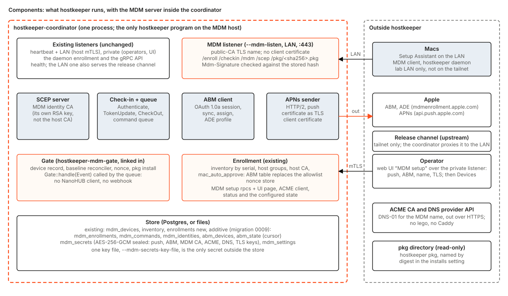
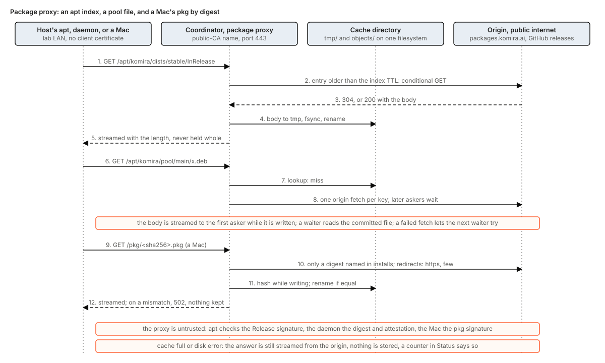

# Package proxy: the coordinator serves packages to the lab LAN

Status: design, for the maintainers' comments and the owner's. Nothing here is built unless it is tagged **Built** with a path. It is a
living document: when a task below lands, its row changes from **Designed** to **Built** with the path, and the text of the decision
stays. It is the second half of [coordinator-mdm.md](coordinator-mdm.md) (decision of 2026-11-10), which has the listener and the setup
this builds on.

The owner's direction: kill the tailnet-only download server; hosts and Macs pull packages over the public internet, and the coordinator
offers a caching pass-through on the lab LAN so that Macs, wiped hosts and bulk updates use the lab network (a 5G uplink against 25 to
100 Gbit inside), with no object-store cache for now.

## 1. What changes for an operator

| | Today | After this design |
|---|---|---|
| The download server | a tailnet-only nginx container whose tree a sync job filled from each release | none. The container, its sync timer and its tree are removed (section 6) |
| Where a Linux host's apt reads packages | the host's repository entry, whose URL is whatever the group names | `https://<mdm name>/apt/<repo>/`, the coordinator, which reads the public repository once and keeps it |
| Where a Mac gets the hostkeeper pkg | the MDM host's `/pkg/<sha256>.pkg`, from a directory the host provides (**Built** as a design in coordinator-mdm.md 4.7) | the same URL; the coordinator fetches the file from its public origin the first time and keeps it |
| What the operator sets | a directory of pkg files, a channel's address in every daemon config | a cache directory flag and, in the setup page, the origins (section 3) |

What does not change: no client trusts the coordinator for package contents. apt checks the signed `Release` file against the key in the
host's keyring, the daemon checks every package's digest and attestation against its own trusted signers, and the Mac checks the pkg's
signature before it expands it. The proxy can only serve bytes or refuse to.

## 2. What exists today, and what does not

Facts, with the file that says them (paths under `crates/`).

- **Built, repository side.** `hostkeeper-coordinator/src/repository_serve.rs` serves `GET /repositories/<name>/dists/<group>/<rest>` and
  `.../pool/<group>/<rest>` for a **private** repository, to a host that presents its client certificate, streaming the origin's body
  with its `Content-Length` and parsing and signing nothing. It does not cache, serves no public repository (404), and requires the
  certificate. Its origin client is `repository_origin.rs`: one HTTPS GET per read, 30 seconds to connect and receive headers, 30 seconds
  idle per body frame, no redirect followed.
- **Built, client side.** `hostkeeper-install/src/repository/` writes `/etc/hostkeeper/repositories/<name>.sources` with `URIs:` an
  `https://` or `file:/` URI, `Signed-By:` a keyring beside it, and refuses every apt option that weakens a check. apt trusts the system
  roots, **not** the host CA that daemons pin. The consequence drives section 3: the proxy's name must carry a public-CA certificate.
- **Built, Mac side.** `hostkeeper-install/src/macos_pkg/` checks the pkg's signature before it expands it, and
  `hostkeeper-mdm-gate/src/pkg.rs` names the pkg by SHA-256 in the manifest it sends.
- **Built, the channel is gone from the repository.** The archive format, the release indexes, `cargo xtask release channel-sync` and the
  coordinator's `--release-channel*` flags were deleted by #262 and #267 (test `the_release_channel_flags_are_gone` in
  `hostkeeper-coordinator/tests/config.rs`). No daemon fetches from `release_channel`; the loader still requires the key
  (`hostkeeper-config/src/daemon.rs`), so every host config still carries one.
- **Not built, and not evidenced as done.** The operator's step in packages-native.md 10.5 item 3 (stop the sync, delete the channel's
  tree), which is a step on the farm and not in this repository, and A25 (deleting the last readers). Section 6 owns the first.
- **Built, CM11c:** `GET`/`HEAD /pkg/<sha256>.pkg` from `--mdm-pkg-dir` alone at that step (coordinator-mdm.md 4.7): streamed, digest-checked, with `Range` and `If-None-Match`, and 404 for a digest the current `installs` do not name.
- **Not there:** any cache, any route for a public repository, any by-digest pkg route that fetches from an origin.

## 3. Components and where it listens

The diagram is the one of coordinator-mdm.md; the proxy is the box at the bottom of the coordinator and the origins are on its right.
Everything hostkeeper runs is the one process.

**Decision: the proxy's routes are on the MDM listener** (`--mdm-listen`, port 443, the public-CA certificate of the MDM name, which the
coordinator obtains and renews itself, coordinator-mdm.md 4.10).

- **Why that listener.** apt, which trusts only public roots (above), and a freshly erased Mac, which trusts only public roots too, can
  both reach it with no new trust. The heartbeat and LAN listeners use the host CA and would need a second trust path on every host.
- **What it costs, and what it does not.** The proxy needs a name and a public-CA certificate for it, and nothing else of MDM: no push
  certificate, no ABM token. The setup's TLS step (coordinator-mdm.md 4.10, an uploaded certificate or the in-process ACME DNS-01 with the
  GoDaddy credential) is separate from the push and ABM steps, and each route family is served when its own prerequisites are set: `/apt`
  and `/pkg` when the name and certificate exist, `/enroll`, `/scep`, `/checkin` and `/mdm` when MDM is *configured*. So a Linux-only
  farm sets the name and the certificate up and never uploads an Apple credential; the status shows the proxy line apart from the MDM line.
  The listener's flag keeps the name `--mdm-listen`, since it ships first for MDM and a name once shipped is a lock-in.
- **The proxy is a choice per group, not a requirement.** The owner's direction is that hosts and Macs pull over the public internet and
  the proxy is the LAN pass-through, so a host-group may keep the public URL (`packages.komira.ai`) in its repository entry and never touch
  the proxy; pointing a group at the proxy is a per-group URL choice made where the repository entry is made. If a group is pointed at the
  proxy and the coordinator is down, or its certificate has expired, those hosts' `apt update` fails until it is back or the group is
  repointed. A deb822 stanza that lists two URIs is, as I read apt, two sources and not a fallback, so no second URI is written; the failure
  mode is accepted and listed in section 5 (not verified, section 11 item 4).
- **Admission.** No client certificate is asked. The routes serve public bytes (a public repository, a pkg whose digest the operator
  named), a wiped host before its first enrollment and a Mac before its identity are both admitted, and the listener is bound to the LAN
  interface address only. The guard against an open proxy is the route shape, not the caller: the origin is chosen by the repository
  name or the digest, never by anything in the request.

| Route | Answers | Origin |
|---|---|---|
| `GET /apt/<repo>/dists/<suite>/<rest>` | an index (`Release`, `InRelease`, `Packages*`, `Sources*`) | the repository's base URL, the same path |
| `GET /apt/<repo>/pool/<rest>` | a package file | the same |
| `GET /pkg/<sha256>.pkg` | the pkg whose digest an `installs` entry **of the current manifest** names; any other digest is 404 with no origin request | the entry's `url`, if it has one; else only the file in `--mdm-pkg-dir` |
| `HEAD` on the routes above | the headers of the same answer, no body, from the cache or one origin `HEAD` | as above |
| anything else, or any method but `GET` and `HEAD` | 404 or 405 | none |

apt sends conditional and range requests, so both are part of the routes and not left to chance. `If-None-Match` and `If-Modified-Since`
are answered `304` from the cache's validator when it still matches, with no origin request inside the index TTL; `Range` on a cached file
is served as `206` from the file, and on a miss a range request is passed through to the origin without being stored (a partial body is
never committed), after which a full request fills the cache.

`<repo>` must be a name in the registry of repositories (**Built**; `hostkeeper-release/src/registry.rs` says what an entry is) whose
`access` is public. Its `uri` is the base URL of the origin, so the proxy has no setting of origins (answered in section 11 item 1; PP2).
The path passes the locator grammar `repository_serve.rs` already uses
(`hostkeeper_release::grammar::check_locator`: no empty, `.` or `..` segment, no `%`), after the escapes of `+` (`%2b`) and `~` (`%7e`), which apt writes, are read as those characters: `+` and `%2b` are one file, one cache entry and one origin path. Every other escape, `%2f`, `%2e` and `%25` among them, is still refused.

## 4. Decisions

**What is cached, and for how long.**

- *Indexes* (`Release`, `InRelease`, `Packages*`, `Sources*`, anything under `dists/`) change in place, so an entry is served without
  asking the origin while its age is under `proxy_index_ttl_s` (default 300), and after that revalidated with a conditional GET
  (`If-None-Match` or `If-Modified-Since`); a `304` renews the entry. A host that runs `apt update` just after a release therefore sees it
  within one TTL.
- *Pool files and pkgs* are immutable under their name (a version, a digest), so they are kept until evicted.
- *The cache* is a directory flag, `--proxy-cache-dir` (a directory the host provides; unset means the proxy answers 404 to the routes
  above, which is the state before a deployment opts in). Files are written to `tmp/` and renamed into `objects/` in the same
  filesystem, named by the SHA-256 of the key (origin and path); a sidecar holds the origin's validator, the fetch time and the length.
  Leftover `tmp/` files are removed at start, and so are a body whose length is not its sidecar's and a sidecar with no body (nothing is synced to disk, so a crash can leave them). A commit renames the sidecar first and the body last. Recency is kept in memory; a start orders the objects by fetch time.
- *Eviction* is least recently used when a commit would pass `proxy_cache_max_bytes` (default 20 GiB), deleting only committed objects.
  Every number here is a setting of the setup page with its default from the start (coordinator-mdm.md 4.9): `proxy_index_ttl_s`,
  `proxy_cache_max_bytes`, `proxy_fetches` (concurrent origin fetches, default 8), `proxy_redirects` (default 3), `proxy_wait_s`.

**One origin fetch per key.** A miss starts one fetch. The first asker gets the body streamed while it is written; a second asker for the
same key (a rack of hosts running the same update) waits at most `proxy_wait_s` (default 10) for the commit and then reads the file; a
waiter whose wait ends first is given a direct pass-through of its own, uncached, so one slow fill cannot stall fifty hosts for the whole
fill, and if the fetch failed the next waiter starts its own. A direct pass-through counts against `proxy_fetches`. This is what turns
fifty hosts into one pull over the uplink in the usual case and bounds the worst one. Nothing is held whole in memory, and no size cap is put on
a file, the pattern of `repository_serve.rs`.

**Redirects.** GitHub releases answer with a redirect to a storage host, and `repository_origin.rs` follows none, so the proxy's origin
client follows up to `proxy_redirects` redirects, https only, and never to a host named by the client. The pkg digest check below is what
makes that safe.

**Digest rule for the pkg.** The coordinator hashes the body while it reads it, and the file is renamed into `objects/` only if the
SHA-256 equals the one in the path (the origin's body ends in an error instead of its end when it does not, so the cache discards the
fill). A pkg digest is the capability, so only digests an `installs` entry names are fetched at all. This is a second check, not the
first: the Mac still verifies the pkg's signature, and the daemon still verifies what it fetches.

**How the pkg route differs from the other files (PP3).** A status can be `502` only before the first byte, so a pkg is read from its
origin to the end, and judged, before the Mac is answered at all; the Mac is then answered from the committed file (its ranges,
`ETag` and `304` as for a provided pkg). Three consequences, each a deliberate departure from the streaming of 4's other files:
the first Mac waits for the whole read (a pkg of tens of MB, over the uplink); a Mac whose wait for another's read ends first
(`proxy_wait_s`) is answered `503 pkg_pending` with `Retry-After` and not given a read of its own, since fifty second reads of the
same file are what the single flight prevents; and a pkg the cache cannot keep (disk trouble, or larger than `proxy_cache_max_bytes`)
is `503 pkg_not_stored`, since there is no file to answer from. The cache's key for a pkg is its digest (`pkg/<digest>.pkg`), not the
`url`, so a changed `url` does not fetch the same bytes again. A file in `--mdm-pkg-dir` is served first and the origin is not read.

**Failure of the cache is not failure of the answer.** If the disk is full or a write fails, the body is still streamed from the origin and
nothing is stored; `Status` counts the pass-throughs. If the origin is down and the entry is in the cache, an immutable entry is served; an
index older than its TTL is not (a stale index could hide a release), the client gets `502 origin_failed`.

**Where the origins come from.** A public repository's base URL (the registry entry's `uri`; no `proxy_origins` setting, section 11 item 1), and for a pkg, the `url` of its `installs` entry: the signed macOS pkg is published to packages.komira.ai (section 10).

**Host configuration.** A group's repository entry names `https://<mdm name>/apt/<repo>/` as its URI. The daemon config's `release_channel`
key is optional in the loader since PP5 (a config with it and one without both load; a present value is still checked as an `https://`
URL). A daemon of the previous release still refuses a config without it (B8: the change is additive for readers only), so until the
loader of PP5 has shipped for a release every generated config sets it to `https://<mdm name>/`, so no config names the dead server.
Dropping it from the generated configs is a separate change one release later.

## 5. Edge cases, with the mechanism

| Case | Mechanism |
|---|---|
| A wiped host's first `apt update`, before any enrollment | the routes need no certificate; the name is public-CA, so apt trusts it |
| The coordinator is down or the proxy's certificate has expired | `apt update` fails for the groups pointed at the proxy; groups on the public URL are unaffected; the operator repoints a group (one entry) or restores the coordinator; the certificate's expiry is alerted by 4.10 |
| `apt` asks with `Range` or `If-Modified-Since`, or sends `HEAD` | served from the cache as `206`, `304` or headers only (section 3); a partial origin body is never stored |
| One slow fill and fifty waiters | each waiter waits `proxy_wait_s` at most, then is passed through directly; the fill still commits. A pkg is the exception: its waiter is answered `503 pkg_pending` with `Retry-After` (section 4, PP3). A first asker the cache cuts for reading slower than the origin gives asks again and is answered from the committed file |
| An arbitrary digest asked of `/pkg/` | 404, and no origin request is made, since only digests of the current manifest's `installs` are fetched; so too a digest whose entry has no `url`, and any digest on a coordinator without `--proxy-cache-dir` |
| The origin's pkg is not the digest's | the read ends in an error, nothing is stored, the Mac gets `502 origin_failed`; the next ask reads the origin again |
| A pkg redirect | followed at most `proxy_redirects` times, to `https://` or a path of the same host only; a redirect to `http://` or to another form of `Location` is `502`. No URL is in any answer or error text (a release host's redirect carries a signed query) |
| The origin serves a poisoned or truncated file | apt rejects a bad hash or signature; the daemon rejects a bad digest; the coordinator rejects a pkg whose digest differs from its path; a truncated body (length short) is not committed |
| A client disconnects mid-fill | the fill continues to its end (bounded by the 30 s idle deadline per frame) so the next asker hits; a fill that fails leaves only a `tmp/` file, removed at start; a client that stays connected but stops reading is cut when its eight-frame buffer is full (its body ends with an error, `FetchError::Behind`) and the fill goes on, so one stuck client holds neither the flight nor a place of `proxy_fetches` |
| Two coordinators on one cache directory | not supported: the proxy is part of the single-node MDM listener (coordinator-mdm.md 4.9); the directory is the coordinator's |
| A request for an arbitrary URL, or a `..` segment | the route shape and the locator grammar refuse it with 404 or 400; nothing is fetched |
| The origin is slow | 30 s to headers and 30 s per frame, as `repository_origin.rs` has them; waiters share one fetch; `proxy_fetches` caps concurrent origin pulls and the next request gets `503` |
| A release is published and the index is cached | within `proxy_index_ttl_s` a host may miss it; the rollout waits for the next tick, which the coordinator controls |
| The cache directory is wiped | the next requests refill it; nothing in the store refers to a cached file |
| An index and a pool file from different times | apt re-reads `Release` and refuses a `Packages` file whose hash differs; the next `apt update` heals it |

## 6. Retiring the download server

The repository side is done (section 2). What remains is on the farm, in the komira repository's held scripts, which are the owner's and
are held scripts under S3 (dry-run default, never forcing):

The order matters, because packages-native.md 10.5 and its stage table say the channel is needed until stage 9 has converged: a daemon
before `target-v1` fetches its archive through it, an older binary requires `release_channel` after a fallback, and a rollback uses it.

1. **Confirm stage 9's two counts are zero**, by the two `hkctl` queries of
   [docs/operations/move-to-native.md](../operations/move-to-native.md) (stage 9): no registered host below the `target-v1` daemon, and no
   host whose desired release still lists an archive entry. The repository's own reading of the daemon is only part of the evidence (the
   loader reads `release_channel` and the daemon does not); the farm's configs and any older daemons are what the counts cover.
2. **Point `release_channel` in every host config at the proxy's name.** This needs no new code (the loader accepts the key, and PP5 makes it optional only for readers; a generated config keeps it until a release after PP5) and no host reads it for anything else.
3. **Repoint repositories and Mac profiles** to the proxy (per group, section 3), then check one `apt update` on a host and one pkg pull
   by a Mac through the proxy before going on.
4. **Stop the sync's timer first, and keep the channel container for one release**, then remove the container, its tree and its
   certificate, and the held script that wrote its configuration.
5. Remove the stale statements: packages-native.md 10.5 and 10.7 still read as future, and `hostkeeper-design.md` still draws the release
   channel in its components diagram (task PP4).

**Rollback.** Until step 4 is done: restart the container from its systemd unit, which is left installed (as the MDM design leaves Caddy's),
and repoint the groups' entries and `release_channel` back. After step 4 the rollback is a redeploy from the held script, which is why the
container waits one release.

**Status: Designed.** Nothing here is evidenced as done; the steps are the owner's.

## 7. Compatibility (B8)

New flag `--proxy-cache-dir`; new settings and routes; new optional `installs` field `url`. No shipped flag, format or wire field changes.
`--mdm-pkg-dir` keeps meaning "files the host provides". The previous release's daemons and Macs fetch from the same URLs as before.
An older coordinator does not have the routes: a host pointed at it gets `404` and keeps the sealed copy of what it has installed.

## 8. Tests (to build with each task)

- A fake origin and a fake clock: an index inside its TTL is not refetched; after it, one conditional GET, and a `304` renews it
  (T10: the clock is injected).
- Fifty concurrent askers of one file cause one origin fetch; a failed fetch lets the next waiter fetch.
- A pkg whose bytes differ from its path's digest is not stored and answers 502; an equal one is stored and a second request is a hit.
- A request outside the route shape, a path with `..`, a repository not in the registry, a non-GET: each refused with its status and no
  origin request. An arbitrary digest asked of `/pkg/` is 404 with no origin request; a digest of the current manifest's `installs` is
  fetched.
- `Range`, `If-None-Match`, `If-Modified-Since` and `HEAD` are answered as in section 3; a range miss stores nothing.
- Fifty askers with a fill that never finishes: each is passed through after `proxy_wait_s` on the fake clock.
- A full cache evicts the least recently used committed object only; a disk write failure still streams the answer.
- A redirect to http, or one past `proxy_redirects`, is refused.
- Hermetic: no network, no fixed port, the cache directory is a scratch directory (T12).

## 9. Tasks, one pull request each

| # | Task | After | Size |
|---|---|---|---|
| PP1 | (**Built**, `hostkeeper-coordinator/src/proxy_cache.rs` and `proxy_cache_disk.rs`) The cache: directory layout, atomic commit, LRU eviction, single-flight, with the settings and their defaults. It is a library with `--proxy-cache-dir` opening it at start; no route uses it until PP2. The settings built are `proxy_wait_s`, `proxy_redirects`, `proxy_index_ttl_s`, `proxy_cache_max_bytes` and `proxy_fetches`; `proxy_origins` comes with PP2 | coordinator-mdm.md CM20 | M |
| PP2 | (**Built**, `hostkeeper-coordinator/src/proxy_apt.rs`, `proxy_origin.rs` and `proxy_cache_stale.rs`; section 12) `GET /apt/<repo>/...` on the MDM listener: public-repository routes, index TTL and revalidation, redirect-following origin client | PP1, CM11a | M |
| PP3 | (**Built**, `hostkeeper-coordinator/src/mdm_server/pkg_pull.rs` and `pkg_origin.rs`) `GET /pkg/<sha256>.pkg` pulls through from the `installs` entry's `url`, digest-checked before commit; the settings are the PP1 ones (`proxy_redirects`, `proxy_wait_s`, `proxy_fetches`, `proxy_cache_max_bytes`) | PP1, CM11c | S |
| PP4 | Docs: the packages-native.md and hostkeeper-design.md statements about the channel | none | S |
| PP5 | The loader no longer requires `release_channel` (additive read), then configs stop carrying it one release later | PP2 | S |
| PP6 | Farm: retire the download server and repoint hosts and Macs (held scripts, the owner's), in the order of section 6 | PP2, PP3, and stage 9's counts at zero (packages-native.md A24 converged) | S |

## 10. Where the macOS pkg is published

The signed macOS pkg is published to packages.komira.ai, next to the apt repository, so every package a host or Mac installs has one
public origin. The release workflow uploads the pkg there (a task of the release side, alongside the apt publish; **not part of PP3**,
which reads whatever `url` the entry names and does not touch the release workflow); an `installs` entry's
`url` names it, and the proxy relays it like any other immutable file. GitHub release assets keep their copy for attestation and as a
fallback origin: an entry may name the asset's URL, and the proxy follows its redirect to the storage host within the rules of
section 4 (https only, `proxy_redirects` hops, the digest check). Until the upload exists, an entry names the GitHub asset or has no `url`.

## 11. Not verified

1. ~~Where the registry entry of a public repository keeps its base URL, or whether `proxy_origins` is needed.~~ Answered by PP2: the entry's `uri`
   is the base URL (`hostkeeper_release::registry::check` requires `https://`, a host, an optional port and path), and `proxy_origins` is not added.
2. **Not verified, for PP6.** That apt on the farm's hosts accepts the proxy's certificate with system roots alone (the farm's hosts have the
   public roots; confirm with one host before PP6). PP2's tests serve the routes over a certificate the test's own root signs and say nothing of apt.
3. That a GitHub release asset's redirect chain stays within https and three hops (only if the fallback origin is used).
4. **Not verified, for PP6.** That apt treats two URIs of one deb822 stanza as two sources and not as a fallback (section 3); check with one host
   before PP6. PP2 writes no repository entry, so nothing built depends on it.
6. **Not verified (PP2).** How the farm's apt behaves against the proxy's answers, none of which has been run against apt itself: `Range` with
   `If-Range` on a resumed download, `If-Modified-Since` on an index whose origin gives an `ETag` and no `Last-Modified` (the proxy then
   answers 200 and apt takes the index again), `Accept-Ranges: bytes` on a file served chunked (no `Content-Length`, no range support), and
   that apt takes a 200 to a `Range` request when the origin has a newer index than the stored one. Check with one `apt update` and one
   interrupted `apt install` on a host before PP6.
5. Whether the proxy's routes can be served with the name and certificate alone while the MDM routes still answer 503 (section 3):
   **yes, built in CM11a** (read in the listener): `MdmServer::serves(family)` is decided for each request; the proxy family needs the
   certificate and key of the name, the MDM family needs that and a push identity, and a family that is not served answers `503` for each
   of its routes while the other is served (coordinator-mdm.md 4.1; test `the_mdm_routes_answer_503_while_the_package_routes_are_served`).
   `/apt/` is mounted by PP2 and joins the switch with no change to it (test `the_apt_routes_are_served_without_any_mdm_credential`: with the
   certificate alone `/apt/...` is served and `/mdm` is `503`); `/pkg/` is served from `--mdm-pkg-dir` (CM11c), or pulled from the entry's `url` (PP3).

## 12. What PP2 built

Paths under `crates/hostkeeper-coordinator/src/`; the decisions above stand, and these are the facts of the code.

- **`proxy_apt.rs`**: `GET` and `HEAD` of `/apt/<repo>/<path>`, called by `grpc::route` on the MDM surface before the JSON router. A method
  other than `GET` and `HEAD` is 405; a `<repo>` that is not a repository name, is not in the registry or is private, a coordinator without
  `--proxy-cache-dir` and an entry whose `uri` cannot be read from are 404; a `<path>` outside the locator grammar (and the bare
  `/apt/<repo>/`) is 400. Each refusal is made before any origin is read. While the name has no certificate every `/apt/` path is 503
  (`MdmServer::serves`). The origin is the entry's `uri` and the cache key is that URL with the path, so a repository whose `uri` changes
  does not inherit the old URL's objects.
- **What is an index.** A file under `pool/` is immutable and kept until evicted. Every other file of the repository is an index: served
  while its age is under `proxy_index_ttl_s`, then revalidated (`proxy_cache_stale.rs`, `ProxyCache::get_index`). This takes in
  `dists/**/by-hash/`, which is immutable but gains nothing from being treated so, and whatever else a repository serves at its root.
- **Revalidation.** The first asker of a stale index leads one conditional read (`If-None-Match` from the stored `ETag`, `If-Modified-Since`
  from the stored `Last-Modified`; the sidecar keeps both, `Meta::last_modified` is additive and a sidecar written without it reads). A 304
  renews the fetch time in memory and in the sidecar (a temp file renamed over it). A 200 forgets the old object as the new body begins to
  stream, so no stale index is served while the replacement is written, and the commit replaces it. A 404 forgets the object and is the
  answer. Any other failure is the asker's, and the stored index stays for the next ask. Other askers of the key wait at most `proxy_wait_s`
  and ask again; a waiter whose wait ended first, or whose fill could not be stored, is passed through to the origin on its own. The cost: a
  range request of a stale index whose origin has a newer one is answered with the whole new index, 200.
- **Conditional requests of the client** are judged against the validators of the answer (`If-None-Match` before `If-Modified-Since`, weak
  comparison, `*`), after the cache has answered; 304 has no body, and for a stored file inside its TTL it costs no origin read. A
  conditional request of a file not held fills it all the same.
- **Ranges.** One span of `first-last`, `first-` or `-suffix`. A stored file answers 206 from the file, and 416 with
  `Content-Range: bytes */<length>` past its end. A file not held passes the range to the origin and stores nothing; the origin's
  `Content-Range` is the answer's. A suffix span of a file not held, several spans, an invalid span, another unit and a span with an
  `If-Range` that is not the stored file's strong tag or its `Last-Modified` are ignored, and the whole file is the answer.
- **`HEAD`** is answered from the stored file when it is held (a pool file, or an index inside its TTL), else by one `HEAD` of the origin
  under a place among `proxy_fetches`, and never stores anything.
- **`proxy_origin.rs`**: the origin client of the cache. HTTPS only, HTTP/1.1, one connection per hop (`Connection: close`), 30 s to the
  headers (`repository_origin::CONNECT`) and 30 s per body frame (`IDLE`). It follows 301, 302, 303, 307 and 308 up to `proxy_redirects`, to
  an `https://` URL (no user, a host TLS can check) or to a path of the same host; a redirect to `http://`, to another form, without
  `Location`, with more than 4096 bytes of it, or past the limit is a failure. Only `Range` and the validators are sent. A 200 needs a
  `Content-Length` or chunks (a body cut short must be seen as cut), a 206 needs a usable `Content-Range`, a 304 answers a conditional read,
  and 404 is `FetchError::NotFound`.
- **B16.** A body is streamed frame by frame from the origin (or the file) to the client, through the cache's fill; a body that breaks off
  after its headers ends the response in an error, so a client never takes it for whole. No size cap.
- **Compatibility (B8).** Additive: new routes, `Meta::last_modified` with a default in the sidecar, `httpdate` (already in the lock file
  through `hyper`) as a dependency of the coordinator. Nothing shipped is renamed or removed.
- **Tests** (section 8): `mdm_server/proxy_route_tests.rs` (the routes through the listener: refusals with no origin read, TTL and
  revalidation, conditional and range requests, HEAD, redirects, a crowd, failures), `proxy_cache_stale_tests.rs` (the revalidation:
  304, changed, withdrawn, failing, a crowd, a hung leader, an oversize replacement, a late renewal), `proxy_origin_tests.rs` (the origin
  client), `proxy_apt_tests.rs`. Not covered: the real apt (item 6 of section 11).
