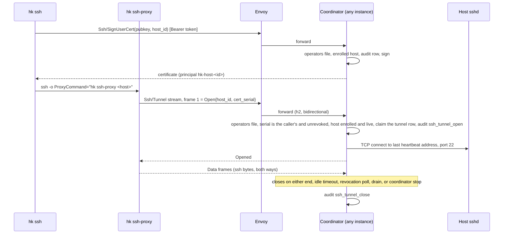

# SSH through the coordinator

> **Update 2026-11-19.** `hkssh` is folded into `hk`, the one operator command line, a Rust binary ([hk.md](hk.md)). `hk ssh`, `hk ssh-proxy`, `hk ssh-revoke` and `hk ssh-status` are built in; ssh's `ProxyCommand` runs `hk ssh-proxy` and its `KnownHostsCommand` runs `hk ssh-known-host`; the release assets `hkssh-<version>-<platform>.tar.gz` are withdrawn. Where this document says `hkssh`, or that the command line is a bash script that runs it, it describes the earlier layout; the wire, the certificates, the pins and the limits are unchanged. There is no `hkctl` and no `hkssh`; `hk` is the only program.

Status: built, but for the parts named here. C1 (wire), C2 (signing, `crates/hostkeeper-coordinator/src/ssh_sign.rs`), C3 and C3m (the daemon's sshd setup on Linux and on a Mac, `crates/hostkeeper-daemon/src/ssh_setup.rs`), C4 (the tunnel, `ssh_tunnel.rs`), C5 (the ssh commands of `hk`), C6 (the heartbeat's access, `ssh_heartbeat.rs`) and the UI's Remote SSH of section 13 (`ssh_terminal.rs`, `ui/sshpanel.js`) are on `main` with this document; section 13 is an amendment for the owner's review. Not built: the `source-address` option of `--ssh-source-pin`, `--ssh-keepalive-s`, the reading of the enrollment request's host key fingerprints, and the C0 measurements of PAM and the Linux node. The operator keys (`docs/design/operator-keys.md`, built) are a separate, simpler path: the coordinator's public keys in a managed block of each host's `authorized_keys`, with the macOS Remote Login step of section 3. It carries out the owner's direction of 2026-11-15: "we want hostkeeper to do this automatically. For all the hosts. That way we can remote ssh through the coordinator if necessary."

Tags: **Built** is code on `main` with a path. **Designed** is this document. **Verified** is read from the cited OpenSSH page (man.openbsd.org/sshd_config, fetched 2026-11-15). **Measured** is what the C0 probe (`crates/hostkeeper-daemon/src/remote_login_probe.rs`, `docs/macos.md` "The Remote Login probe") reported from the three Macs of the build group on hostkeeper 0.1.337, as root under launchd with no Full Disk Access (section 3). **Unverified** is a claim about macOS that Apple's pages, fetched the same day, do not state and C0 did not measure. The repository is public: no address or host name of the lab appears here.

## 1. What changes

**Before.** An operator reaches a host by a login on the host (a key in `authorized_keys`, or the lab's console), from a machine that can route to it. The coordinator carries no interactive byte stream (`docs/design/console-broker.md` section 4).

**After.** Every host the daemon runs on (the Linux build nodes, the NUC, the Macs) trusts the SSH user CA of its class (section 5), with no per-host file. An operator on the tailnet types `hk ssh <host-id>`: `hk` asks the coordinator for a one-hour certificate, good for that one host only, for a key of the operator's, and runs `ssh` through a tunnel the coordinator opens to the host's port 22. Only operators the owner listed in the operators file may do either, and only for the hosts their entry names (default deny). Every certificate and every tunnel is an audit line.

**What does not change.** Existing `authorized_keys` logins, the sshd port and listen addresses, the heartbeat, the update path and the operator token. A host the coordinator cannot reach is not reachable this way, and nothing here is a way in when the daemon or the network is down.

## 2. Decisions in brief

1. **OpenSSH user certificates** (sshd `TrustedUserCAKeys`), the standard way. No new protocol, no agent on the host, no host key trust change.
2. **The daemon sets up sshd by itself, on every host**, from one record in the heartbeat reply. No per-host file. Only trust is added (section 6).
3. **The CA key is a Swarm secret**, made once offline, read by all N coordinator instances (section 5). Never on one task's disk, never in Postgres. The control-plane host class has its own CA, which the coordinator need not hold at all (Q6), so a coordinator compromise is not root on the NUC.
3a. **A certificate is for one host.** Its principal is `hk-host-<host id>`, and each host's principals file lists only its own, so a certificate minted for one host is refused by every other (section 5).
3b. **Default deny.** Without an operators file the coordinator signs and tunnels nothing; the file names each operator and the hosts, groups or classes that operator may reach (section 5).
4. **The tunnel is a gRPC bidirectional stream** `Ssh/Tunnel` on the private listener, through Envoy, to `<host address>:22`. The host address is the peer address of the host's last heartbeat, never a name the host sends, and the operator's ssh checks the host key that was pinned at enrollment, so a misdirected dial fails before any credential is shown (section 7).
5. **`hk` carries the tunnel itself.** The calls that are unary (`Ssh/SignUserCert`, `Ssh/Revoke`) go through the gateway path of the generated command line. The byte stream cannot, so the ssh commands are built into `hk` (`crates/hostkeeper-hk/src/ssh/`, one Rust binary, one release asset `hk-<version>-<platform>.tar.gz`): `hk ssh-proxy` speaks the stream (section 8). There is no second program; an earlier version of this design had a separate `hkssh` binary that a bash `hkctl` ran, which is withdrawn ([hk.md](hk.md)).

## 3. Host setup (sequence)

```mermaid
sequenceDiagram
    participant C as Coordinator
    participant D as Daemon (root)
    participant S as sshd
    D->>C: Heartbeat(features += "ssh-v1", ssh status)
    C-->>D: HeartbeatResponse(ssh = {generation, ca keys, revoked serials, login user, principal, password policy})
    Note over D: generation differs from the one applied
    D->>D: read effective config (sshd -T -C for the login user and each user with keys), check lockout rules (section 6)
    D->>S: ensure sshd is enabled and active (Linux: unit; macOS: Remote Login)
    D->>D: write candidate drop-in + principals file beside the live ones
    D->>S: sshd -t on the candidate
    D->>D: rename into place (atomic), keep the previous copy
    D->>S: reload, then check banner and that the effective config still lets every earlier login in
    alt check fails
        D->>D: restore previous files, reload
    end
    D->>C: next Heartbeat(ssh status = {generation applied, state, detail})
```

The record is applied only when its `generation` differs from the one the daemon last applied, and applying is idempotent: the files are written only when their bytes differ. An absent `ssh` field means "keep what you have"; an `ssh` with `enabled = false` is the revert (section 6, rule 7).

**Linux.** Unit: `ssh.service` or `sshd.service`, whichever the host has. Where `ssh.socket` is the active unit (socket activation, Debian and Ubuntu from 22.10, **Unverified** per distro; C0 lists what the nodes run) the daemon changes nothing about which unit listens: `ListenAddress` and `Port` then belong to the socket unit, sshd is started per connection and reads the files at each start, so there is no reload; the check is `sshd -t` and the banner through the socket. Only when neither unit is enabled does it enable the one the package enables by default. If the package is missing the daemon reports `sshd_missing` and installs nothing: openssh-server is a package of the host group like any other.

Files (**Designed**):

- `/etc/ssh/sshd_config.d/10-hostkeeper.conf`:
  ```
  TrustedUserCAKeys /etc/ssh/hostkeeper/user_ca.pub
  AuthorizedPrincipalsFile /etc/ssh/hostkeeper/principals.%u
  RevokedKeys /etc/ssh/hostkeeper/revoked
  ```
  There is no `Match` block, so nothing in the file can reach a later stock line on any sshd version.
- `/etc/ssh/hostkeeper/user_ca.pub`: the CA public keys of the host's class, one per line.
- `/etc/ssh/hostkeeper/principals.<login-user>`: the single line `hk-host-<host id>`. No other `principals.*` file is ever written, and the daemon removes any it finds there that it did not write.
- `/etc/ssh/hostkeeper/revoked`: certificate serials the coordinator has revoked (section 5), in `RevokedKeys` format.

Per sshd_config(5) (**Verified**): `TrustedUserCAKeys` accepts a certificate signed by a listed key; `AuthorizedPrincipalsFile` set means the certificate must carry one listed principal, with `%u` replaced by the login name, and it is consulted only for CAs from `TrustedUserCAKeys`, not for a CA named in `authorized_keys`, so a user's own `cert-authority` lines keep working. Why `%u` and not a `Match User` block: with `TrustedUserCAKeys` and no principals file, an account accepts a certificate naming its own account name as principal, so a CA signature could log in as any account whose name the signer writes as principal. With `principals.%u` the only accounts whose file exists is the login user's; for every other account the file is absent, no principal is listed, and the certificate is refused. The signer is also never given a way to pick the principal (section 5). The first value of a keyword wins and files of an `Include` are read in lexical order (**Verified**); Debian's `sshd_config` includes the directory at its top, and some distros (RHEL family) include it at the bottom (**Unverified**: C0 checks each distro). So after the reload the daemon reads `sshd -T -C user=<login-user>,host=<h>,addr=<a>` and requires the effective `trustedusercakeys`, `authorizedprincipalsfile` and `revokedkeys` to be ours; if a stock line shadows one, the state is `shadowed_by_stock`, not `applied`, and nothing else is edited. The file sets nothing the stock file sets (section 6).

**macOS.** The daemon runs as root under launchd (**Built**: `crates/hostkeeper-launchd/src/plist.rs`). `sshd_config` has the line `Include /etc/ssh/sshd_config.d/*` on all three Macs (**Measured**). Whether macOS keeps `/etc/ssh` across a major update is **Unverified**; the daemon checks the Include at each apply. If the Include is absent the daemon does not edit `sshd_config`; it reports `no_include` and the Mac stays untrusted (an edit of a file Apple owns is a lockout risk). Same three files as Linux.

Remote Login, the macOS switch for sshd, is turned on by `launchctl`, never by `systemsetup`. C0 tried both ways on the three Macs (**Measured**, the same on each):

| step | exit | what it said |
|---|---|---|
| `systemsetup -getremotelogin`, before | 0 | `Remote Login: Off` |
| `launchctl print system/com.openssh.sshd`, before | 113 | `Could not find service "com.openssh.sshd" in domain for system` |
| connect to `127.0.0.1:22`, before | | refused |
| `systemsetup -setremotelogin on` | 1 | `setremotelogin: Turning Remote Login on or off requires Full Disk Access privileges.` |
| `systemsetup -getremotelogin`, after that | 0 | `Remote Login: Off` |
| `launchctl enable system/com.openssh.sshd` | 0 | |
| `launchctl bootstrap system /System/Library/LaunchDaemons/ssh.plist` | 0 | |
| `launchctl print system/com.openssh.sshd`, after | 0 | loaded, socket-activated, not running |
| `systemsetup -getremotelogin`, after | 0 | `Remote Login: On` |
| connect to `127.0.0.1:22`, after | | banner `SSH-2.0-OpenSSH_10.3` |
| privacy database, open for reading | | `EPERM`: the daemon holds no Full Disk Access |
| `codesign -dvv` of the daemon | 0 | ad hoc, no Team ID |

So `systemsetup -setremotelogin on` needs Full Disk Access, and the `launchctl` way does not: it turns Remote Login on as `systemsetup -getremotelogin` reports it, and sshd answers on port 22. Whether the System Settings toggle shows On, and whether a later change in System Settings undoes it, is **Unverified**; the ensure step below puts it back at the daemon's next run of it. The daemon therefore needs no Full Disk Access, no privacy profile and no Developer ID Application signature (section 4).

The macOS ensure step of the sequence above: `launchctl print system/com.openssh.sshd`; when it exits non-zero (the service is not loaded), `launchctl enable system/com.openssh.sshd`, then `launchctl bootstrap system /System/Library/LaunchDaemons/ssh.plist`, then `launchctl print` again, which must exit 0, else the state is `reload_failed` (nothing reloads on macOS; the state names a failed start of sshd, as on Linux) with the step `remote_login` in `detail`, and nothing else is written. A loaded service is left as it is: the daemon never runs `launchctl disable` or `bootout` on it (section 6, rule 6). `enable` is what keeps the service loaded at the next boot (**Unverified**: C0 ran once, with no reboot after; the daemon runs the ensure step at each apply and, at each start of the daemon, once more for the generation it last applied, without writing a file, so a Mac that lost it gets it back). launchd starts sshd per connection (socket activation, **Measured**: loaded, not running), so as with `ssh.socket` on Linux there is no reload: sshd reads the files at each start, and the check is `sshd -t` and the banner. The daemon does not run `systemsetup` at all.

macOS login also depends on the account being allowed for SSH: when the `com.apple.access_ssh` group exists, only its members may log in over SSH (**Unverified**; that the group exists on all three Macs is **Measured**), and on the PAM account stack. The daemon never edits a group: if the group exists and the login user is not a member it reports `blocked_by_access_group` and Q5 asks the owner whether it may add the one login user. With no login user named, the daemon on macOS uses the single local administrator account (uid of 501 or more, member of `admin`, not hidden); with none or more than one it reports `no_login_user` and changes nothing. So every Mac works with no per-host input in the common case, and `--ssh-login-user-macos` overrides it. The login user is Q1.

## 4. No Full Disk Access profile

An earlier version of this design planned for a privacy (PPPC) profile, pushed by device management, that would grant the daemon Full Disk Access so that `systemsetup -setremotelogin on` could run, and for a Developer ID Application signature of the daemon's binary that such a profile could name. C0 shows the `launchctl` way of section 3 turns Remote Login on without that right, so neither is needed for SSH: the profile was removed from the repository, and no Mac needs anything from device management for SSH beyond what the bootstrap installs (`docs/design/mac-bootstrap.md`). This section keeps its number so the later sections keep theirs. A privacy profile, and the Developer ID Application signature of the release's programs it names, have since been added for other host operations (`docs/operations/mac-full-disk-access.md`), and the daemon reports in its heartbeat whether the grant is in force (`docs/macos.md`, "Full Disk Access"); Remote Login still needs none, and nothing in this design reads that state.

## 5. Coordinator: the CA and the signing call

**Who may sign, for which host.** The operators file (`--ssh-operators-file`, required; without it the coordinator signs and tunnels nothing) is TOML:

```
[[operator]]
name = "<operator name as the token or user shows it>"
classes = ["fleet"]            # host classes (below), host groups ("mac-build") or host ids; any of the three
hosts = ["<host id>"]
```

An operator not listed, or a host outside the lists, is refused `not_permitted`. CI tokens are never listed. The class of a host is `control-plane` when the owner names it in `--ssh-control-plane-host` (repeatable), `fleet` otherwise. The file is read at start and at each SIGHUP, so a removal takes effect in one signal, and signing and `Open` both read it again at the call.

**Where the keys live.** One Ed25519 key per class, made once, offline, by `hostkeeper-coordinator ssh-ca init --out <dir>` (a new verb: writes the private key, mode 0600, and prints only the public key). The owner loads the `fleet` key as a Swarm secret (`docker secret create hostkeeper-ssh-ca`), mounted read-only at `/run/secrets/` in every instance and read with `hostkeeper_wire::secret::read_secret` (**Built**: owner-only mode check). Why not make it at first start: N instances would each make one. Why not Postgres: the database's backups and the key's would then travel together, which `docs/operations/ca-backup.md` keeps apart for the other CA. Why not a task's volume: the service update contract replaces tasks. The offline copy follows `ca-backup.md`. Postgres holds only the certificate table, the serial sequence and the audit (below).

**The control-plane class.** The NUC runs the coordinator, so the fleet CA must not be trusted there. `control-plane` hosts trust a second key. The coordinator is given its public half only (`--ssh-cp-ca-public-file`, sent to those hosts in `SshAccess`), and, by owner choice (Q6), its private half too (`--ssh-cp-ca-secret-file`, a second Swarm secret). Without the private half the owner signs for the NUC offline with `hostkeeper-coordinator ssh-ca sign` (same certificate rules, run on the owner's machine) and reaches the NUC directly or through a tunnel the other path opens.

**Blast radius, stated.** The fleet key is readable by every coordinator task, by anyone who can read the Swarm secret or the manager's raft store, and held in memory by all N instances. A coordinator compromise is therefore root on every `fleet` host from then on, until the key is rotated (below) and hosts apply the list; it is not root on the NUC unless Q6 is answered with the private half. The audit of a compromised coordinator is not evidence (below); the independent witnesses are each host's own sshd log and the offline copy of the CA. Nothing here defends against a coordinator operator with Swarm manager access; it narrows the damage from a stolen operator token (scoped, short-lived, revocable) and from a coordinator bug (which cannot sign for a principal it does not compute, and cannot sign without an audit row).

**Rotation** without lockout. Swarm secrets are immutable, so rotation uses a new secret name holding two keys (`current`, `next`) and a service update. `SshAccess` lists every key in the secret, so hosts trust both before anything is signed with `next`. A separate flag, `--ssh-signing-key` (`current` or `next`), says which signs; the owner flips it in a later service update, only after `hk ssh-status` shows every live host reporting an `applied_generation` at least the one that carried both keys (a read of the table of reports; the gate is the runbook line plus that read, not a mechanism). During the rolling update of the flip, instances sign with either key and hosts trust both. Removal of a leaked key is a new secret without it: hosts that are up apply the new list at their next heartbeat. A host that is down keeps trusting the leaked key until its first heartbeat after it starts, so for that window a holder of the leaked key could reach it directly (not through the coordinator, which refuses a tunnel to a host that is not live). That window is the stated limit of CA removal, and nothing more is built for it.

**Signing.** `Ssh/SignUserCert` (unary, JSON gateway): the operator sends a public key (`ssh-ed25519`, `ecdsa-sha2-nistp256` or `rsa` of at least 3072 bits), a `host_id` and an optional reason. Steps, in this order:

1. The coordinator checks the caller (token or user, `not_permitted` per the operators file) and that the host is enrolled and approved.
2. It inserts a row in `ssh_cert` (serial from a Postgres sequence, operator, host id, key fingerprint, expiry, reason) and the `ssh_cert_signed` audit line in one transaction. If either write fails, no certificate is made: an unaudited certificate cannot exist.
3. It signs, then returns the certificate.

The certificate: type user, serial, key id `<operator name>/<serial>` (built from nothing the caller controls but the key; sshd logs `ID` and serial on accept, **Unverified**: the C3 privileged test greps it, so the host's own log says who and which certificate), principal `hk-host-<host id>` only (never a value from the request), validity `now - 60 s` to `now + ttl`, extensions `permit-pty` only (no agent, port or X11 forwarding, no `permit-user-rc`), and the `source-address` critical option set to the coordinator's tunnel source when `ssh_source_pin` is on. The reason is stored, never put in the key id: it must be at most 200 printable ASCII characters without control characters, else `bad_reason`; audit lines escape it. Signing uses the `ssh-key` crate (RustCrypto; licence MIT or Apache-2.0, **to verify with `cargo deny` in C2**). The per-host principal means "who may sign for which host" is the operators file, and the host side cannot be tricked by a certificate for another machine. Per-operator host-side principals are not used: the host would need to know the operators, which is a per-host file; the operator's identity is in the key id and the audit instead (Q2). No instance holds state: any of the N signs.

**Revocation.** `Ssh/Revoke` (operator verb `hk ssh-revoke --operator <name>` or `--serial <n>`) inserts rows in `ssh_revocation`. Effects: (1) the coordinator refuses new certificates for that operator when the operators file no longer lists them (the removal is the first step of a runbook line); (2) the revoked serials are in the `revoked_serials` of every host's `SshAccess`, applied to `/etc/ssh/hostkeeper/revoked` at the next heartbeat; (3) every open tunnel of that operator, on any instance, is closed within `ssh_revoke_poll_s` (section 7). A certificate that was not revoked is valid up to `ssh_cert_ttl_s` (default one hour, maximum 28800); that remains the stated limit for a host that is down or a heartbeat not yet applied. Established ssh sessions stay up until their tunnel closes, which closing the tunnel does. Token revocation (the existing Postgres state) is read by the same poll, so a revoked token closes its tunnels with cause `token_revoked`.

**Audit.** The existing audit is a by-product of an `OpsStore` change with no audit-only append (`docs/design/console-broker.md` section 4). C2 adds an append in Postgres (additive table, a migration after `0018`) with the same `AuditEntry` shape plus a `prev_hash` column (SHA-256 of the previous row's hash and this row's content, written under one advisory lock), so a deleted or edited row breaks the chain; that is tamper evidence for the database, not proof against a coordinator that holds the key, and the file line follows from the row on whichever instance wrote it. Actions: `ssh_cert_signed` (by, host id, reason, serial, key fingerprint, expiry; written before the signature, section above), `ssh_tunnel_open` (by, host id, address dialled, the cert serial the client says it uses, checked against `ssh_cert`; written before the first byte moves, and the open fails if the write fails), `ssh_tunnel_close` (bytes each way, duration, cause). A close is written by the instance that held the tunnel; when that instance dies, the reaper of another instance finds the tunnel's row (section 7) and writes the close with cause `instance_lost` and unknown byte counts, so every open has a close. `ssh_denied` is written for every refusal after the caller is known; for an unknown caller (a failed token) one row per source address per minute with a count is written, so probes appear. The content of the session is not recorded: it is the host's own accounting, and the key id ties a host log line to the `ssh_cert` row and, by serial, to the tunnel open that presented it.

## 6. The lockout-safety rule

The daemon adds trust and removes none. Eight rules, each with a test (C3 and C4):

1. **Existing paths are untouched.** `authorized_keys` (but for the managed block of the operator keys, `docs/design/operator-keys.md`, which is not this design's and which it leaves as it finds it), host keys, `Port`, `ListenAddress`, `AllowUsers`, `AllowGroups`, `DenyUsers`, `DenyGroups`, `PermitRootLogin`, `PubkeyAuthentication` and `AuthenticationMethods` are never written by hostkeeper, and neither is any file outside the three named in section 3 (plus the `principals.*` and `revoked` files).
2. **Validate before install.** Candidate files are checked with `sshd -t` (with the candidate in place of the live one); on failure nothing is installed and the heartbeat says `config_invalid`.
3. **Prove the cert path before saying applied.** Before any change the daemon records, with `sshd -T -C user=<u>,host=<h>,addr=<a>`, the auth-relevant effective settings (`pubkeyauthentication`, `authenticationmethods`, `permitrootlogin`, `allowusers`, `allowgroups`, `denyusers`, `denygroups`, `passwordauthentication`, `kbdinteractiveauthentication`, `usepam`) for the login user and for every account whose home has a non-empty `authorized_keys`. After the change, and before reporting, it requires:
   - for the login user: `pubkeyauthentication yes`; `authenticationmethods` any or containing an alternative that is `publickey` alone (so `publickey,password` fails: a certificate alone would not log in); not excluded by the Allow or Deny lists; `permitrootlogin` not `no` when the login user is `root`, and not `forced-commands-only`; and the effective CA, principals file and revoked file being ours (section 3);
   - for every other recorded account: the recorded settings unchanged, except the two password keywords under rule 5.

   Any failure of the first set gives `cert_login_not_possible` with the failing keyword in `detail`, installs nothing, and is a **not applied** state; any failure of the second restores the previous files and reports `reload_failed`. `applied` therefore means the effective configuration permits the certificate login and every earlier login's configuration is unchanged. It does not mean a login was tried; the privileged tests try one.
4. **Reload, not restart; and look.** A reload keeps established sessions; a restart is used only to start a stopped unit. After the reload the daemon opens a connection to the sshd's own listening address and reads the banner, and then repeats rule 3's reads on the live configuration; no banner restores the previous files and reloads again, and reports `reload_failed`. Under socket activation there is no reload (section 3), only the check.
5. **Passwords: keep.** `PasswordAuthentication` and `KbdInteractiveAuthentication` are left as found by default. The drop-in sets them to `no` only when the record's `password_auth` is `off` (config key `ssh_password_auth`, default `keep`) and only when, for every account with a login shell and a usable password hash (read from the shadow database; Linux only, and on macOS `off` is not applied and reports `unsupported`), the same account has a non-empty `authorized_keys` or is the login user. An account with a password and no key path gives `would_lock_out` and nothing is written; a key for some other account does not count. The keywords are in the drop-in, which the stock file wins over where it comes first; the effective check of rule 3 says `shadowed_by_stock` then.
6. **Never stop or disable sshd, or switch what listens.** The daemon starts a stopped sshd and enables it; it never stops one, and never enables the service where the socket is the active unit or the reverse.
7. **Revert.** `enabled = false` (or the daemon at a version before the feature, which ignores the field) removes the files and reloads. sshd is left running as found; on macOS Remote Login stays on (`launchctl enable` is not undone), since turning it off could cut a login that came by `authorized_keys`.
8. **Allow lists win.** If the effective Allow or Deny lists exclude the login user, the daemon changes nothing and reports `blocked_by_allow_list`. It never widens a list.

## 7. Coordinator: the tunnel (sequence)



**Which host and address.** `host_id` must be enrolled and approved, and its last heartbeat must be within `ssh_live_s` (default 120; three heartbeat intervals is the bound to confirm in C4). The address is the TCP peer address of that heartbeat, written by whichever instance served it to an additive Postgres table together with the time taken from the database (`now()` in the statement), and read with the database's own `now()` for the liveness test, so a clock skew between instances does not matter and an older row from a lagging instance never replaces a newer one (the update is conditional on the row's time). The port is 22 only. A host never names an address, so a daemon cannot point the coordinator at another machine by what it sends.

Whether the peer address is the host's: the heartbeat listener is mutual TLS (`docs/design/hostkeeper-design.md` section 4), and where a load balancer or Envoy terminates or forwards it the peer may be the proxy. C4 reads the deployed path first. If the peer is not preserved (PROXY protocol or the equivalent is not available), C4 does not guess: the table stays empty, the open is refused `no_address`, and the owner decides (Q7). A host behind NAT, or with several interfaces or a changing address, may have a peer address that is not routable from the coordinator or is another machine's; the defence for that is not the address but the host key: `hk ssh` pins the host key from enrollment (section 8) and ssh checks it before it shows any credential, so a dial that lands on another machine ends in a host key mismatch and the certificate, which is for one host in any case, is never presented. The coordinator also records the address dialled in `ssh_tunnel_open` and writes `ssh_address_changed` when the address differs from the previous row's, so a host that heartbeats from someone else's address is visible.

**Tunnel table and limits.** A tunnel is a row in `ssh_tunnel` (additive table: id, operator, host id, instance id, opened time, last-seen time), created by an insert that a partial unique index on (operator, host id) over open rows makes fail when the operator already has a tunnel to that host on any instance: one tunnel per operator per host holds across N instances. Each instance refreshes `last-seen` of its tunnels and reaps rows whose `last-seen` is older than three polls (writing the close with `instance_lost`, section 5). The per-instance cap `ssh_max_tunnels` (default 16) is a count of the instance's own tunnels; `ssh_max_tunnels_per_operator` (default 4) is a count over the table, so with N instances neither limit is N times larger. Idle timeout `ssh_idle_s` (default 900, counted on bytes in either direction, so an ssh `ServerAliveInterval` keepalive holds it open: the client is told); `ssh_dial_timeout_s` (default 5); `ssh_revoke_poll_s` (default 10): each instance reads once per poll, in one query, the revoked tokens and `ssh_revocation` rows for the operators of its tunnels and the operators file, and closes the tunnels of any that no longer qualify with cause `token_revoked`, `revoked` or `not_permitted`. A poll rather than LISTEN/NOTIFY: a notification needs a dedicated connection and is lost across a reconnect, and ten seconds is the stated bound.

**Stream behaviour.** The private listener closes a connection 10 s after its handshake unless registered as a long wait (`crates/hostkeeper-coordinator/src/listen.rs`, `wait.rs`); `Ssh/Tunnel` is registered there. Envoy's stream idle and max duration for this route are set above `ssh_idle_s` and at least `ssh_max_session_s` (default 28800) in the deploy files (C4). Details a bidirectional stream needs, each with a test in C4 or C5:

- Frames carry at most 16 KiB. Each direction is a bounded channel; the coordinator reads from the host only when it can hand the frame on, so a slow reader slows the sender through HTTP/2 flow control and nothing is buffered without bound.
- Half-close: when `hk ssh-proxy` sees end of input from ssh it sends `Close{cause="eof"}`; the coordinator shuts down the write side of its TCP connection and keeps relaying until the host closes. `scp` and `rsync` over ssh need exactly this, and a test sends one and reads the reply after.
- Keepalive: `hk ssh-proxy` and the coordinator send HTTP/2 PING every 30 s (`ssh_keepalive_s`) so a quiet session is not dropped by Envoy or a NAT in between; PING does not count as bytes for the idle timeout.
- Rolling update: on stop signal an instance stops accepting `Open` (refused `draining`, which `hk ssh-proxy` retries once through Envoy before any data moves, reaching another instance) and lets its tunnels run up to `ssh_drain_s` (default 600), then closes the rest with `coordinator_stopping`. A transfer longer than the remaining drain is cut and the operator reconnects; `rsync` resumes, `scp` does not. The coordinator's stop grace must be at least `ssh_drain_s` (the deploy file says so, C4).

**Multi-instance.** Nothing is held in process that another instance needs: the CA is a secret, serials a sequence, the certificate table, revocations, tunnels, audit and addresses are in Postgres, and the clock is the database's. In-process there are only the tunnel's sockets, which cannot be anywhere else.

## 8. Operator side

- `hk ssh <host-id> [-- ssh args]`: uses `--identity <file>` or the first key of the ssh agent, else makes an Ed25519 key in `$HOME/.hostkeeper/ssh/` (mode 0600, no passphrase, never printed); calls `Ssh/HostKeys` and `Ssh/SignUserCert` (with the host id); runs `ssh -i <key> -o CertificateFile=<cert> -o ProxyCommand='<hk> --endpoint <url> --ca-file <ca> --token-file <token> --timeout-secs <n> ssh-proxy <host-id>' -o KnownHostsCommand='<hk> ssh-known-host <pins file> %H %t %K %f' -o StrictHostKeyChecking=yes <login-user>@<host-id> <args>`, where `<hk>` is the path of the running binary. No secret is in an argument or the environment: the token is a file name.
- `hk ssh-proxy <host-id>`: speaks `Ssh/Tunnel` with the operator token read from `--token-file`, stdin and stdout as the byte stream; usable as `ProxyCommand hk --endpoint URL --ca-file PATH --token-file PATH ssh-proxy %h` in `~/.ssh/config`. `hk ssh-known-host` is the verb only ssh runs, as its `KnownHostsCommand`.
- Host keys, pinned at enrollment and never from the heartbeat of the host being reached. The host's sshd host key is not under the CA (that would be a second CA and a host-side change). The enrollment request carries the fingerprints of the host's sshd host keys (`host_key_fingerprints`, additive, fields of the existing enrollment message), and the operator approves them with the host in the existing approval step (`docs/operations/enrollment.md`), which shows them; the coordinator stores them with the approval. `hkctl ssh` reads them from the coordinator (`Ssh/HostKeys`, a unary read, same operator check) into a known-hosts file of its own and runs with `StrictHostKeyChecking yes`. Later heartbeats may carry fingerprints too; one that differs from the pinned set does not replace it: it is shown on the host's page as `host_key_changed`, written to the audit as `ssh_hostkey_changed`, and `Ssh/HostKeys` returns the pinned set until an operator approves the new one. A host enrolled before this feature has no pin: its first `Ssh/HostKeys` read returns `no_pin`, `hkctl ssh` refuses, and the operator approves what the host reports at that moment (one explicit step, the same as approving at enrollment), which is trust on first use by a person, not by a script.
- The ssh commands are Rust in `hk`, with Rust tests; the gateway calls and the tunnel are one binary.

## 9. Wire additions (additive; C1)

All in the existing proto packages; no field renumbered, renamed or required (AGENTS.md B8). The previous release must read the new data and the new release the old: a test in C1 decodes a message of the new schema with the v0.1.221 fixture protos (`crates/hostkeeper-coordinator/tests/fixtures/`) and the reverse.

```proto
// agent.proto
message HeartbeatRequest { ... SshReport ssh = <next free>; }   // announced by feature "ssh-v1"
message SshReport {
  uint64 applied_generation = 1;
  string state = 2;            // "applied" | "disabled" | "blocked_by_allow_list" |
                               // "sshd_missing" | "no_include" | "config_invalid" | "reload_failed" |
                               // "would_lock_out" | "no_login_user" | "cert_login_not_possible" | "shadowed_by_stock" |
                               // "blocked_by_access_group" | "unsupported"; a closed set, unknown read as "other"
  repeated string host_key_fingerprints = 3;   // SHA256:... of sshd's host keys; compared with the pin, never replaces it
  string detail = 4;           // the failing keyword, account class or step (`remote_login`) of the state; no secret, no account name
}
message HeartbeatResponse { ... SshAccess ssh = <next free>; }   // 7 is operator_keys (docs/design/operator-keys.md)
message SshAccess {
  uint64 generation = 1;       // raised at any change of the rest
  bool enabled = 2;
  repeated string ca_public_keys = 3;  // authorized_keys syntax, 1 to 2, of the host's class only
  string login_user = 4;       // the account that takes certificates; empty: none (state no_login_user)
  string principal = 5;        // "hk-host-<host id>", computed by the coordinator per host
  repeated string revoked_serials = 7;
  string password_auth = 6;    // "keep" | "off"
}

// operator.proto
service Ssh {
  rpc SignUserCert(SignUserCertRequest) returns (SignUserCertResponse);  // unary: gateway and gRPC
  rpc HostKeys(HostKeysRequest) returns (HostKeysResponse);              // unary: the pinned fingerprints of a host
  rpc Revoke(RevokeRequest) returns (RevokeResponse);                    // unary: by operator or serial
  rpc Tunnel(stream TunnelFrame) returns (stream TunnelFrame);           // gRPC only, not in the gateway
}
message SignUserCertRequest  { string public_key = 1; string reason = 2; string host_id = 3; }
message SignUserCertResponse { string certificate = 1; string login_user = 2; uint64 expires_unix = 3; string key_id = 4; }
message TunnelFrame { oneof frame { Open open = 1; bytes data = 2; Close close = 3; Opened opened = 4; } }
message Open   { string host_id = 1; uint64 cert_serial = 2; }
message HostKeysRequest { string host_id = 1; }
message HostKeysResponse { repeated string fingerprints = 1; string state = 2; }  // state "pinned" | "no_pin" | "changed"
message RevokeRequest { string operator = 1; uint64 serial = 2; }
message RevokeResponse { uint64 revoked = 1; }
message Opened { string login_user = 1; }
message Close  { string cause = 1; }  // closed set, see section 5 and 7
```

The enrollment request gains `repeated string host_key_fingerprints` (additive, next free number). `Tunnel` is not a unary method, so the gateway and `hk`'s generated table skip it (`is_served` today covers unary methods; C1 confirms and adds a test). New audit actions are free strings (additive). The additive tables (`ssh_cert`, `ssh_revocation`, the audit chain column, host key pins, addresses, `ssh_tunnel`) and the serial sequence are C2 and C4 migrations.

## 10. Configuration (coordinator flags, each with a default; no environment)

| Key | Default | Meaning |
|---|---|---|
| `--ssh-ca-secret-file` | none; the feature is off without it | the `fleet` CA secret |
| `--ssh-cp-ca-public-file` | none | public key of the `control-plane` CA, sent to those hosts |
| `--ssh-cp-ca-secret-file` | none | the same CA's private key, only if Q6 says the coordinator holds it |
| `--ssh-control-plane-host` | none | host id of the `control-plane` class, repeatable |
| `--ssh-signing-key` | `current` | which key of the secret signs (rotation) |
| `--ssh-cert-ttl-s` | 3600 | certificate validity; maximum 28800 |
| `--ssh-login-user-linux` | `root` | account that takes certificates on Linux (Q1) |
| `--ssh-login-user-macos` | empty | the same on macOS; empty: the daemon uses the single local administrator account, else `no_login_user` (section 3) |
| `--ssh-password-auth` | `keep` | `keep` or `off`, sent to hosts (section 6, rule 5) |
| `--ssh-operators-file` | none; nothing is signed or tunnelled without it | TOML `[[operator]]` with `name`, `classes`, `hosts` (section 5) |
| `--ssh-source-pin` | on | `source-address` option in certificates |
| `--ssh-live-s` | 120 | how recent a heartbeat a tunnel needs |
| `--ssh-idle-s` | 900 | idle timeout of a tunnel |
| `--ssh-max-session-s` | 28800 | longest tunnel |
| `--ssh-dial-timeout-s` | 5 | connect timeout to the host |
| `--ssh-max-tunnels` | 16 | open tunnels per instance |
| `--ssh-max-tunnels-per-operator` | 4 | open tunnels per operator, over all instances |
| `--ssh-revoke-poll-s` | 10 | how often an instance re-reads revocations and the operators file |
| `--ssh-keepalive-s` | 30 | HTTP/2 PING interval of a tunnel |
| `--ssh-drain-s` | 600 | how long a stopping instance lets tunnels run |

Daemon: no key, no file, no flag. The feature is announced by `ssh-v1`; a daemon that does not announce it is sent nothing. Existing hosts get it by a coordinator setting `--ssh-ca-secret-file`; the whole fleet then applies it at its next heartbeat after its daemon update.

## 11. Build items (parallel after C1)

| Id | Scope | Depends on | Interface it fixes |
|---|---|---|---|
| C1 | proto and wire: section 9, generated code, the new-reads-old and old-reads-new tests, the `ssh-v1` feature string | none | the messages above |
| C0 | measurements on the Macs and one Linux node: Remote Login methods, FDA, Include, `com.apple.access_ssh`, PAM; settles the macOS text of section 3. The Mac part is done (the daemon's Remote Login probe; the table in section 3); PAM and the Linux node remain | none | a table of results in this document |
| C2 | coordinator CA and signing: `ssh-ca init` and `sign`, secret reader, operators file, `Ssh/SignUserCert`, `Ssh/Revoke`, `ssh_cert` and `ssh_revocation`, serial sequence, audit append with hash chain | C1 | `SshSigner` taking a public key and an operator name, returning a certificate; `Audit::append` |
| C3 | daemon, Linux: sshd ensure, drop-in files, the eight rules of section 6, report | C1 | `SshAccess` in, `SshReport` out; a port for sshd control with a scripted double |
| C3m | daemon, macOS: Remote Login by `launchctl` (section 3), Include check, the same files and rules | C1 | the same port, macOS adapter |
| C4 | coordinator tunnel: address table (DB clock), `ssh_tunnel` table and reaper, `Ssh/Tunnel`, `Ssh/HostKeys` and enrollment pins, liveness, limits, revocation poll, drain, listener registration, Envoy route | C1 (uses C2's `Audit::append` through a trait with a fake until C2 merges) | `Tunnel` semantics of section 7 |
| C5 | `hk ssh` / `ssh-proxy` (the tunnel client in `hk`) | C1 (tested against a fake coordinator) | the two RPCs; the files under `$HOME/.hostkeeper/ssh/` |
| C6 | heartbeat plumbing: the coordinator fills `SshAccess` per host class and host from config and revocations, and records `SshReport` and fingerprints | C1, C2 | `SshAccess` content |
| C7 | the UI's Remote SSH (section 13) | C4, C5, C6 | the route and messages of section 13 |

Stack: C1 first, alone, merged to `main`; C0, C2, C3, C3m, C4, C5 all branch from `main` after it and are mutually independent; C6 last, after C2. No stacked PRs beyond that. Each PR meets AGENTS.md: 99% line and branch coverage, behaviour tests named in the body, no new shell tests, files under 1000 lines, Refs and not Fixes. Real-sshd tests run in `privileged.yml` / `pr-device.yml` (as root, Linux) and `release.yml`'s `macos-device`, as for the other privileged tests; the ordinary tests use the scripted port.

Tests that matter most (named in each PR): a certificate signed by C2 is accepted by a real `sshd -T`-checked sshd in the privileged job for the login user, refused after its expiry, refused when its principal is another host's, refused for any other account (a certificate with principal `alice` for account `alice` is refused), and refused after its serial is in `revoked`; a stock config with `PermitRootLogin no`, `AuthenticationMethods publickey,password`, a `DenyUsers` naming the login user, or the Include at the bottom is reported as not applied with the keyword in `detail`;  a candidate config that fails `sshd -t` leaves the live files byte-identical; a reload whose banner check fails restores the previous files; a host with `AllowUsers` not naming the login user is left unchanged; `Tunnel` to a host with a stale heartbeat is refused and one with a fresh heartbeat carries bytes both ways against a local listener; a tunnel open with a failing audit write is refused; a signing with a failing audit write returns no certificate; two instances against one Postgres allow one tunnel per operator per host; a tunnel whose instance vanished is closed in the audit by the reaper; revoking an operator closes its tunnel on another instance within the poll; a tunnel dialled to a machine with another host key is refused by the client before a certificate is sent; half-close, backpressure and drain are asserted with progress events, not time.

## 12. Owner questions

- **Q1. Which local account takes the certificate?** Linux build nodes and the NUC: recommendation `root` (the daemon is root already; stock `prohibit-password` allows a certificate; the certificate is for one host and one hour, and the key id says who). Cost: sshd's own log shows `root` and the key id, not a person. Alternative: a named service account created on every host, which this design avoids. Macs: the daemon uses the single local administrator account unless `--ssh-login-user-macos` names one.
- **Q2. Who may open a tunnel?** Settled by the review: default deny. The operators file is required and scopes each operator to classes, groups or hosts. Question: the operator list and scopes you want at the start. Per-operator host-side principals are not used (they need a per-host file); the operator is the key id and the audit.
- **Q3. Settled by C0: no profile.** The question was whether Apple Business's device management would push a Full Disk Access profile; the `launchctl` way needs none (sections 3 and 4).
- **Q4. Turn passwords off?** Recommendation: leave `--ssh-password-auth keep` now; set `off` per rule 5 after every node has shown a key-based login in the heartbeat state. Not available on Macs.
- **Q5. May the daemon add the Mac login user to `com.apple.access_ssh` when that group exists and the user is not in it?** Without it, those Macs report `blocked_by_access_group`. Recommendation: yes, that one user, one group, nothing else, reverted with the feature. The operator keys (`docs/design/operator-keys.md` section 4) already do this for the one administrator account they write the keys of.
- **Q6. Does the coordinator hold the private key of the control-plane CA?** Recommendation: no. You sign for the NUC offline with `ssh-ca sign`; a coordinator compromise is then not root on the machine that holds the control plane. Cost: no tunnel-assisted certificate for the NUC without you.
- **Q7. If the heartbeat path hides the host's address (a proxy in front of the heartbeat listener), do we add PROXY protocol on it?** Recommendation: yes, in C4, if the deployed path needs it; the coordinator does not dial an address it cannot trust.

## 13. Amendment: Remote SSH from the coordinator UI

The owner's addition: on a host's page an operator signed in to the coordinator's UI clicks **Remote SSH**, and the coordinator gives that operator a terminal on the host, through the same certificate, tunnel, audit and revocation as `hk ssh` (sections 5, 7, 8). No static key, no token, no command on the host.

**Sequence.**

```mermaid
sequenceDiagram
    participant B as Browser (host page)
    participant C as Coordinator (any instance)
    participant H as Host sshd
    B->>C: GET /v1/ssh/terminal?host=<id>, Upgrade: websocket [session cookie, Origin]
    C->>C: live session, same origin, no Authorization header, password not due
    C-->>B: 101 Switching Protocols
    B->>C: first text message {csrf, cols, rows}
    C->>C: CSRF token is the session's; HostKeys(host): permitted, pin present
    C->>C: make an Ed25519 key in memory for this terminal
    C->>C: SignUserCert(public key, host, reason "coordinator UI terminal"): operators file, audit, sign
    C->>H: Tunnel Open{host, serial}: the same checks, row and audit line as hk ssh-proxy's
    C->>H: SSH client over the tunnel: host key in the pinned set, certificate login as the login user
    C->>H: pty (xterm-256color, cols x rows) and shell
    B-->>C: binary messages: keystrokes; text {resize}
    C-->>B: binary messages: the host's output; text {status} and a last {closed, cause}
```

**Who and what is checked.** The caller is the session's user, as the operator name of every other UI call (`docs/design/operator-login.md`); a bearer token is not taken on this route (a request with an `Authorization` header is refused), and CI tokens never reach it. The upgrade is refused before any byte is relayed unless the session cookie is live, the request's `Origin` is the coordinator's own (`https://<authority>`; a missing `Origin` is refused, as is a `Sec-Fetch-Site` other than `same-origin`) and the session's password is not due. A browser cannot set a header on a WebSocket, so the CSRF token travels as the first message, which must arrive within the listener's patience (10 s) and match the session's token; anything else closes the socket with nothing done. Then, in `hkctl ssh`'s order: the operators file must permit the host (`not_permitted`), the host must be enrolled (`unknown_host`) and have a pinned host key set (`no_pin`: the operator pins it first, on the same page or with `hkctl ssh pin-host-keys`), the certificate is signed and audited (`ssh_cert_signed`), the tunnel is opened and audited (`ssh_tunnel_open`, every refusal of section 7), and the host's sshd must present a host key whose `SHA256:` fingerprint is in the pinned set, else the terminal ends `host_key_mismatch` before the certificate is shown.

**The key.** The brief allows the key to live in the browser or in the coordinator process. It lives in the coordinator process: one Ed25519 key per terminal, made from the coordinator's random source when the terminal opens, held in memory by that terminal's task only, never written, logged or sent, and dropped when the terminal ends. The browser holds no key and runs no SSH: an SSH client in the page would be third-party code of a size the UI's rules (`docs/design/ui-shell-lab.md`: no third-party code, no build step, `default-src 'self'`) do not admit, and the certificate is good for one host only in either case. The certificate is the one `SignUserCert` makes (section 5: principal `hk-host-<id>`, `--ssh-cert-ttl-s`, `permit-pty` only), so a stolen copy is useless without the key, which never leaves the process.

**The SSH client.** The coordinator speaks SSH itself through the `russh` crate (Apache-2.0, `ring` backend only, so no C toolchain and no new licence), over the in-process end of the same tunnel `hk ssh-proxy` uses: the bytes go through `Tunnels` exactly as an `Ssh/Tunnel` stream's do, so the limits (`--ssh-max-tunnels`, per operator, idle, session), the revocation poll and the drain apply unchanged. The host key check is against the pin of section 8, never against what the host reports in its heartbeat.

**Ending.** A terminal ends when the shell exits, the operator closes the page or the socket, the tunnel ends for any cause of section 7 (idle, session limit, revoked certificate, operator no longer permitted, drain), or the login session ends: the revocation poll treats a terminal's session as its credential, so a sign-out, an expired session or a removed user ends the terminal with `token_revoked` at the next poll, as a revoked token does for `hk ssh-proxy`. The last text message names the cause; the audit has the close (`ssh_tunnel_close`) as for any tunnel.

**Wire and route (additive).** No proto change and no new flag. One new private-listener route, `GET /v1/ssh/terminal?host=<host id>` (HTTP/1.1 upgrade to WebSocket, RFC 6455; the heartbeat listener never serves it). Messages:

| direction | type | content |
|---|---|---|
| browser to coordinator | text, first | `{"csrf": "<token>", "cols": 1..500, "rows": 1..200}` |
| browser to coordinator | binary | keystrokes, at most 16 KiB per message |
| browser to coordinator | text | `{"type": "resize", "cols": n, "rows": n}` |
| coordinator to browser | text | `{"type": "status", "step": "signing" \| "connecting" \| "opened", "login_user": "<name>"}` (`login_user` on `opened` only) |
| coordinator to browser | binary | the host's output, at most 16 KiB per message |
| coordinator to browser | text, last | `{"type": "closed", "cause": "<token>"}`: a refusal token of `SshRefusal`, a close cause of section 7, `no_pin`, `host_key_mismatch`, `auth_refused`, `shell_refused`, `bad_request` or `exit` |

A proxy in front of the private listener must pass WebSocket upgrades on that path, with stream timeouts at least those of the `Ssh/Tunnel` route (section 7).

**The page.** The host page gets a **Remote SSH** tab with one button. The terminal is a small VT100/xterm-subset emulator of the UI's own (`ui/terminal.js`: text, colours of SGR, cursor movement, erase, scroll region, the alternate screen, bracketed paste ignored), drawn into the page's own elements with no inline style or script, so the CSP stays `default-src 'self'`. The page opens the socket through one injected function (`ctx.openSocket`, as `fetch` is injected), the only place in `ui/` where `WebSocket` is named, so the UI tests drive the page with a fake socket and no timing.

**Tests.** The coordinator side runs against a real `russh` server inside the test, on loopback port 0, as the host: a terminal carries bytes both ways and resizes; each refusal of the order above ends the socket with its cause and nothing after it (a missing or foreign `Origin`, a dead session, a wrong CSRF token, a host not permitted, no pin, a host key outside the pin, a certificate the host refuses); the audit holds the signing and the tunnel's open and close; a revoked certificate, a removed operator and an ended session each close the terminal at the poll. The page side runs in the UI tests' engine with a fake socket: the button opens one socket to the host's path, the first message carries the session's CSRF token and the size, bytes typed go out as binary, the host's bytes are drawn, every `closed` cause is shown in words. No test waits on a clock.

**Build item.** C7, after C4, C5 and C6: this section. It needs the owner's review.
