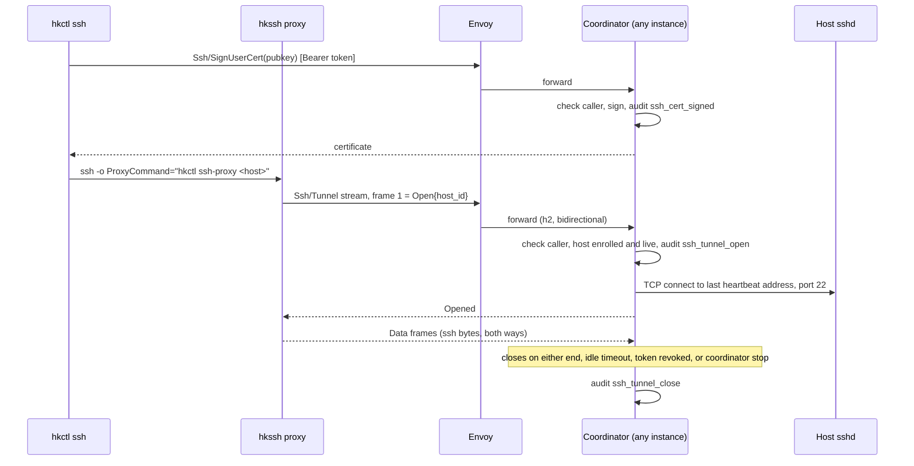

# SSH through the coordinator

Status: design, for the owner's comments. Nothing here is built. It carries out the owner's direction of 2026-11-15: "we want hostkeeper to do this automatically. For all the hosts. That way we can remote ssh through the coordinator if necessary."

Tags: **Built** is code on `main` with a path. **Designed** is this document. **Verified** is read from the cited OpenSSH page (man.openbsd.org/sshd_config, fetched 2026-11-15). **Unverified** is a claim about macOS that Apple's pages, fetched the same day, do not state; the build item C0 measures each on `mac-studio-01` before C3 is merged. The repository is public: no address or host name of the lab appears here.

## 1. What changes

**Before.** An operator reaches a host by a login on the host (a key in `authorized_keys`, or the lab's console), from a machine that can route to it. The coordinator carries no interactive byte stream (`docs/design/console-broker.md` section 4).

**After.** Every host the daemon runs on (the Linux build nodes, the NUC, the Macs) trusts one SSH user CA of the coordinator, with no per-host file. An operator on the tailnet types `hkctl ssh <host-id>`: `hkctl` asks the coordinator for a one-hour certificate for a key of the operator's, and runs `ssh` through a tunnel the coordinator opens to the host's port 22. Every certificate and every tunnel is an audit line.

**What does not change.** Existing `authorized_keys` logins, the sshd port and listen addresses, the heartbeat, the update path and the operator token. A host the coordinator cannot reach is not reachable this way, and nothing here is a way in when the daemon or the network is down.

## 2. Decisions in brief

1. **OpenSSH user certificates** (sshd `TrustedUserCAKeys`), the standard way. No new protocol, no agent on the host, no host key trust change.
2. **The daemon sets up sshd by itself, on every host**, from one record in the heartbeat reply. No per-host file. Only trust is added (section 6).
3. **The CA key is a Swarm secret**, made once offline, read by all N coordinator instances (section 5). Never on one task's disk, never in Postgres.
4. **The tunnel is a gRPC bidirectional stream** `Ssh/Tunnel` on the private listener, through Envoy, to `<host address>:22`. The host address is the peer address of the host's last heartbeat; no address is stored by hand (section 7).
5. **`hkctl` stays a bash script** (`crates/hostkeeper-hkctl/src/lib.rs`: generated, bash 3.2, `curl` only). The two calls that are unary (`Ssh/SignUserCert`) go through its existing gateway path. The byte stream cannot, so a small Rust binary, `hkssh`, ships beside `hkctl` and `hkctl ssh-proxy` execs it (section 8).

## 3. Host setup (sequence)

```mermaid
sequenceDiagram
    participant C as Coordinator
    participant D as Daemon (root)
    participant S as sshd
    D->>C: Heartbeat(features += "ssh-v1", ssh status)
    C-->>D: HeartbeatResponse(ssh = {generation, ca keys, login user, password policy})
    Note over D: generation differs from the one applied
    D->>D: read effective config (sshd -T), check lockout rules (section 6)
    D->>S: ensure sshd is enabled and active (Linux: unit; macOS: Remote Login)
    D->>D: write candidate drop-in + principals file beside the live ones
    D->>S: sshd -t on the candidate
    D->>D: rename into place (atomic), keep the previous copy
    D->>S: reload, then check it still answers on its port
    alt check fails
        D->>D: restore previous files, reload
    end
    D->>C: next Heartbeat(ssh status = {generation applied, state, reason})
```

The record is applied only when its `generation` differs from the one the daemon last applied, and applying is idempotent: the files are written only when their bytes differ. An absent `ssh` field means "keep what you have"; an `ssh` with `enabled = false` is the revert (section 6, rule 7).

**Linux.** Unit: `ssh.service` or `sshd.service`, whichever the host has; where `ssh.socket` exists and the service is not running, the socket is enabled (socket activation, Debian and Ubuntu from 22.10, **Unverified** per distro; C0 lists what the nodes run). If the package is missing the daemon reports `sshd_missing` and installs nothing: openssh-server is a package of the host group like any other.

Files (**Designed**):

- `/etc/ssh/sshd_config.d/10-hostkeeper.conf`:
  ```
  TrustedUserCAKeys /etc/ssh/hostkeeper/user_ca.pub
  Match User <login-user>
      AuthorizedPrincipalsFile /etc/ssh/hostkeeper/principals
  ```
- `/etc/ssh/hostkeeper/user_ca.pub`: the CA public keys, one per line.
- `/etc/ssh/hostkeeper/principals`: the single line `hostkeeper-operator`.

Per sshd_config(5) (**Verified**): `TrustedUserCAKeys` accepts a certificate signed by a listed key for any principal the certificate names; `AuthorizedPrincipalsFile` set means the certificate must carry one listed principal, and it is consulted only for CAs from `TrustedUserCAKeys`; it is not consulted for a CA named in `authorized_keys`, so a user's own `cert-authority` lines keep working. Inside the `Match User` block only the login user takes certificates by that rule; every other account still needs its own name as principal, which the coordinator never signs. The first value of a keyword wins and files of an `Include` are read in lexical order (**Verified**), and Debian's `sshd_config` includes the directory at its top (**Unverified**: C0 checks each distro), so `10-` is read before the stock settings. That is why the file sets nothing the stock file sets (section 6).

**macOS.** The daemon runs as root under launchd (**Built**: `crates/hostkeeper-launchd/src/plist.rs`). Recent macOS ships an `Include /etc/ssh/sshd_config.d/*` line and keeps `/etc/ssh` across minor updates but may replace `sshd_config` in a major one (**Unverified**: C0 reads it on `mac-studio-01`). If the Include is absent the daemon does not edit `sshd_config`; it reports `no_include` and the Mac stays untrusted (an edit of a file Apple owns is a lockout risk). Same three files as Linux.

Remote Login, the macOS switch for sshd, has two ways to turn on as root (both **Unverified**, C0 tries both):

- `systemsetup -setremotelogin on` (read back with `-getremotelogin`). Widely reported to refuse unless the calling process has Full Disk Access ("requires Full Disk Access privileges"); Apple's deployment pages do not document it.
- `launchctl enable system/com.openssh.sshd`, then `launchctl bootstrap system /System/Library/LaunchDaemons/ssh.plist` when not loaded. Needs no FDA as far as known, but whether System Settings then shows Remote Login on is not known.

Rule: C0 reports which works. If the `launchctl` way does, the daemon uses it and no profile is needed. If only `systemsetup` works, the Macs need the PPPC profile of section 4, and until it is pushed the daemon reports `needs_full_disk_access` and changes nothing. TCC matches a non-bundle program by path and code requirement; the daemon `exec`s the binary `current` names under `/var/lib/updater/state/hostkeeper/bin/` (`docs/macos.md`), so the path that asks may differ from `/usr/local/bin/hostkeeper` and a path entry could miss it (**Unverified**; C0 checks it). Fallback if so: run `systemsetup` from the stable installed path as a child.

macOS login also depends on the account being allowed for SSH (the `com.apple.access_ssh` group, when it exists) and on the PAM account stack (**Unverified**; C0 logs in with a certificate and records what it took). The login user is section 9, Q1.

## 4. The Full Disk Access profile (only if C0 says it is needed)

Apple's page on PPPC settings (support.apple.com/guide/deployment, fetched 2026-11-15) says: payload identifier `com.apple.TCC.configuration-profile-policy`; macOS only; delivered by device management, with supervision, through Device Enrollment or Automated Device Enrollment; Authorization Allow is true; a binary is identified by bundle id or path, with the code requirement from `codesign -dr -`. It does not give the key strings or say whether Apple Business's built-in management accepts a custom profile (Q3). The key strings below (`Services`, `SystemPolicyAllFiles`, `Identifier`, `IdentifierType`, `CodeRequirement`, `Authorization`) are from Apple's developer documentation as known, **Unverified** by fetch. The profile is `docs/deploy/mac/hostkeeper-full-disk-access.mobileconfig`; its code requirement uses the Team ID the bootstrap already pins (`docs/design/mac-bootstrap.md`) and its identifier must be replaced by the output of `codesign -dr -` on the released binary, which C0 records in the file's header.

## 5. Coordinator: the CA and the signing call

**Where the key lives.** One Ed25519 key, made once, offline, by `hostkeeper-coordinator ssh-ca init --out <dir>` (a new verb: writes the private key, mode 0600, and prints only the public key). The owner loads it as a Swarm secret (`docker secret create hostkeeper-ssh-ca`), mounted read-only at `/run/secrets/` in every instance and read with `hostkeeper_wire::secret::read_secret` (**Built**: owner-only mode check). Why not make it at first start: N instances would each make one. Why not Postgres: the database's backups and the key's would then travel together, which `docs/operations/ca-backup.md` keeps apart for the other CA. Why not a task's volume: the service update contract replaces tasks. The offline copy follows `ca-backup.md`. Postgres holds only the certificate serial counter and the audit (below).

**Rotation** without lockout: the secret may hold two keys (`current`, `next`). The heartbeat reply lists both public keys, so hosts trust both before the coordinator signs with `next`. The steps are a runbook line, not machinery.

**Signing.** `Ssh/SignUserCert` (unary, JSON gateway): the operator sends a public key (`ssh-ed25519`, `ecdsa-sha2-nistp256` or `rsa` of at least 3072 bits) and an optional reason. The coordinator checks the caller (section 9, Q2), and returns a certificate: type user, serial from a Postgres sequence (unique across instances), key id `<operator name>/<serial>` (sshd logs `ID`, so the host's own log says who), principal `hostkeeper-operator` only, validity `now - 60 s` to `now + ttl`, extensions `permit-pty` only (no agent, port or X11 forwarding, no `permit-user-rc`), and `source-address` critical option set to the coordinator's tunnel source when `ssh_source_pin` is on. Signing uses the `ssh-key` crate (RustCrypto; licence MIT or Apache-2.0, **to verify with `cargo deny` in C2**). A certificate is not revocable except by waiting; at one hour that is the design (no KRL). No instance holds state: any of the N signs.

**Audit.** The existing audit is a by-product of an `OpsStore` change with no audit-only append (`docs/design/console-broker.md` section 4). C2 adds an append in Postgres (additive table, a migration after `0018`) with the same `AuditEntry` shape, and the file line follows from it on whichever instance wrote it. Actions: `ssh_cert_signed` (by, node_id unset, reason, serial, key fingerprint, expiry), `ssh_tunnel_open` (written before the first byte moves; the open fails if the write fails), `ssh_tunnel_close` (best effort: bytes each way, duration, cause). A refusal after the caller is known is a best-effort `ssh_denied` with its cause. The content of the session is not recorded: it is the host's own accounting.

## 6. The lockout-safety rule

The daemon adds trust and removes none. Seven rules, each with a test (C3 and C4):

1. **Existing paths are untouched.** `authorized_keys`, host keys, `Port`, `ListenAddress`, `AllowUsers`, `AllowGroups`, `DenyUsers`, `DenyGroups`, `PermitRootLogin` and `AuthenticationMethods` are never written by hostkeeper.
2. **Validate before install.** Candidate files are checked with `sshd -t` (with the candidate in place of the live one); on failure nothing is installed and the heartbeat says `config_invalid`.
3. **Reload, not restart.** A reload keeps established sessions; a restart is used only to start a stopped unit. After the reload the daemon opens a connection to the sshd's own listening address and reads the banner; no banner restores the previous files and reloads again, and reports `reload_failed`.
4. **Allow lists win.** If `sshd -T` shows an `AllowUsers` or `AllowGroups` that excludes the login user, the daemon changes nothing and reports `blocked_by_allow_list`. It never widens a list.
5. **Passwords: keep.** `PasswordAuthentication` and `KbdInteractiveAuthentication` are left as found by default. The drop-in sets them to `no` only when the record's `password_auth` is `off` (config key `ssh_password_auth`, default `keep`), and even then only when `sshd -T` says at least one key-based path exists for some account (`authorized_keys` for a login with a key, or the CA now installed); with none, it reports `would_lock_out` and does not write. A host that is already key-only needs no line.
6. **Never stop or disable sshd.** The daemon starts a stopped sshd and enables it; it never stops one.
7. **Revert.** `enabled = false` (or the daemon at a version before the feature, which ignores the field) removes the three files and reloads. sshd is left running as found.

## 7. Coordinator: the tunnel (sequence)



**Which host and address.** `host_id` must be enrolled and approved, and its last heartbeat must be within `ssh_live_s` (default 120; three heartbeat intervals is the bound to confirm in C4). The address is the TCP peer address of that heartbeat (**Built** in `crates/hostkeeper-coordinator/src/listen.rs`: `peer_addr`), written by whichever instance served it to an additive Postgres table, so every instance dials the same address; the port is 22 only. A host never names an address, so a daemon cannot point the coordinator at another machine. An enrolled host that is not live is refused `host_not_live`.

**Limits.** One tunnel per operator per host and `ssh_max_tunnels` (default 16) per instance; idle timeout `ssh_idle_s` (default 900, counted on bytes in either direction, so an ssh `ServerAliveInterval` keepalive holds it open: the client is told); `ssh_dial_timeout_s` (default 5). The private listener closes a connection 10 s after its handshake unless registered as a long wait (`crates/hostkeeper-coordinator/src/listen.rs`, `wait.rs`); `Ssh/Tunnel` is registered there. Envoy's stream idle and max duration for this route are set above `ssh_idle_s` in the deploy files (C4). With N instances a tunnel lives on the instance that took it; a restart of that instance ends it with `coordinator_stopping`, and the operator reconnects through Envoy to another.

**Multi-instance.** Nothing is held in process that another instance needs: the CA is a secret, serials a sequence, audit and addresses in Postgres. The per-host and per-instance counters are in process and are limits, not state.

## 8. Operator side

- `hkctl ssh <host-id> [-- ssh args]`: uses `--identity <file>` or the first key of the ssh agent, else makes an Ed25519 key in `$HOME/.hostkeeper/ssh/` (mode 0600, no passphrase, never printed); calls `Ssh/SignUserCert`; runs `ssh -i <key> -o CertificateFile=<cert> -o ProxyCommand='hkctl ssh-proxy %h' -o StrictHostKeyChecking=... <login-user>@<host-id> <args>`. The ssh command line is built by the script; no secret is in an argument or the environment (the `scan` checks of `hostkeeper-hkctl` keep holding).
- `hkctl ssh-proxy <host-id>`: execs `hkssh proxy`, which speaks `Ssh/Tunnel` with the operator token read from `--token-file` as `hkctl` does, stdin and stdout as the byte stream; usable as `ProxyCommand hkctl ssh-proxy %h` in `~/.ssh/config`.
- Host keys: the host's sshd host key is not under the CA (that would be a second CA and a host-side change). The first connection per host is verified against the key the daemon reports in its heartbeat (`ssh.host_key_fingerprints`, additive) which `hkctl ssh` pins in a known-hosts file of its own. That makes `StrictHostKeyChecking yes` possible with no prompt.
- `hkssh` is a Rust binary with Rust tests; `hkctl` stays bash 3.2.

## 9. Wire additions (additive; C1)

All in the existing proto packages; no field renumbered, renamed or required (AGENTS.md B8). The previous release must read the new data and the new release the old: a test in C1 decodes a message of the new schema with the v0.1.221 fixture protos (`crates/hostkeeper-coordinator/tests/fixtures/`) and the reverse.

```proto
// agent.proto
message HeartbeatRequest { ... SshReport ssh = <next free>; }   // announced by feature "ssh-v1"
message SshReport {
  uint64 applied_generation = 1;
  string state = 2;            // "applied" | "disabled" | "needs_full_disk_access" | "blocked_by_allow_list" |
                               // "sshd_missing" | "no_include" | "config_invalid" | "reload_failed" |
                               // "would_lock_out" | "no_login_user"; a closed set, unknown read as "other"
  repeated string host_key_fingerprints = 3;   // SHA256:... of sshd's host keys
}
message HeartbeatResponse { ... SshAccess ssh = 7; }
message SshAccess {
  uint64 generation = 1;       // raised at any change of the rest
  bool enabled = 2;
  repeated string ca_public_keys = 3;  // authorized_keys syntax, 1 to 2
  string login_user = 4;       // the account that takes certificates; empty: none (state no_login_user)
  string principal = 5;        // "hostkeeper-operator"
  string password_auth = 6;    // "keep" | "off"
}

// operator.proto
service Ssh {
  rpc SignUserCert(SignUserCertRequest) returns (SignUserCertResponse);  // unary: gateway and gRPC
  rpc Tunnel(stream TunnelFrame) returns (stream TunnelFrame);           // gRPC only, not in the gateway
}
message SignUserCertRequest  { string public_key = 1; string reason = 2; }
message SignUserCertResponse { string certificate = 1; string login_user = 2; uint64 expires_unix = 3; string key_id = 4; }
message TunnelFrame { oneof frame { Open open = 1; bytes data = 2; Close close = 3; Opened opened = 4; } }
message Open   { string host_id = 1; }
message Opened { string login_user = 1; }
message Close  { string cause = 1; }  // closed set, see section 5 and 7
```

`Tunnel` is not a unary method, so the gateway and `hkctl`'s generated table skip it (`is_served` today covers unary methods; C1 confirms and adds a test). New audit actions are free strings (additive). The additive table of addresses and the serial sequence are C2 and C4 migrations.

## 10. Configuration (coordinator flags, each with a default; no environment)

| Key | Default | Meaning |
|---|---|---|
| `--ssh-ca-secret-file` | none; the feature is off without it | the CA secret |
| `--ssh-cert-ttl-s` | 3600 | certificate validity; maximum 86400 |
| `--ssh-login-user-linux` | `root` | account that takes certificates on Linux (Q1) |
| `--ssh-login-user-macos` | empty | the same on macOS; empty: Macs trust the CA but report `no_login_user` (Q1) |
| `--ssh-password-auth` | `keep` | `keep` or `off`, sent to hosts (section 6, rule 5) |
| `--ssh-operators-file` | none | TOML `[[operator]] name`; absent: every operator token or user may (Q2) |
| `--ssh-live-s` | 120 | how recent a heartbeat a tunnel needs |
| `--ssh-idle-s` | 900 | idle timeout of a tunnel |
| `--ssh-dial-timeout-s` | 5 | connect timeout to the host |
| `--ssh-max-tunnels` | 16 | open tunnels per instance |

Daemon: no key, no file, no flag. The feature is announced by `ssh-v1`; a daemon that does not announce it is sent nothing. Existing hosts get it by a coordinator setting `--ssh-ca-secret-file`; the whole fleet then applies it at its next heartbeat after its daemon update.

## 11. Build items (parallel after C1)

| Id | Scope | Depends on | Interface it fixes |
|---|---|---|---|
| C1 | proto and wire: section 9, generated code, the new-reads-old and old-reads-new tests, the `ssh-v1` feature string | none | the messages above |
| C0 | measurements on `mac-studio-01` and one Linux node (read-only, owner-run commands listed in the PR): Remote Login methods, FDA, Include, TCC path, `com.apple.access_ssh`, PAM; settles the macOS text of section 3 | none | a table of results in this document |
| C2 | coordinator CA and signing: `ssh-ca init`, secret reader, `Ssh/SignUserCert`, serial sequence, audit append and table | C1 | `SshSigner` taking a public key and an operator name, returning a certificate; `Audit::append` |
| C3 | daemon, Linux: sshd ensure, drop-in files, the seven rules of section 6, report | C1 | `SshAccess` in, `SshReport` out; a port for sshd control with a scripted double |
| C3m | daemon, macOS: Remote Login method, FDA fallback, Include check, the same files and rules; the `.mobileconfig` | C1 (and C0 for the method) | the same port, macOS adapter |
| C4 | coordinator tunnel: address table, `Ssh/Tunnel`, liveness, limits, listener registration, Envoy route | C1 (uses C2's `Audit::append` through a trait with a fake until C2 merges) | `Tunnel` semantics of section 7 |
| C5 | `hkssh` and `hkctl ssh` / `ssh-proxy` | C1 (tested against a fake coordinator) | the two RPCs; the files under `$HOME/.hostkeeper/ssh/` |
| C6 | heartbeat plumbing: the coordinator fills `SshAccess` from config, and records `SshReport` and host key fingerprints | C1, C2 | `SshAccess` content |

Stack: C1 first, alone, merged to `main`; C0, C2, C3, C3m, C4, C5 all branch from `main` after it and are mutually independent; C6 last, after C2. No stacked PRs beyond that. Each PR meets AGENTS.md: 99% line and branch coverage, behaviour tests named in the body, no new shell tests, files under 1000 lines, Refs and not Fixes. Real-sshd tests run in `privileged.yml` / `pr-device.yml` (as root, Linux) and `release.yml`'s `macos-device`, as for the other privileged tests; the ordinary tests use the scripted port.

Tests that matter most (named in each PR): a certificate signed by C2 is accepted by a real `sshd -T`-checked sshd in the privileged job and refused after its expiry; a candidate config that fails `sshd -t` leaves the live files byte-identical; a reload whose banner check fails restores the previous files; a host with `AllowUsers` not naming the login user is left unchanged; `Tunnel` to a host with a stale heartbeat is refused and one with a fresh heartbeat carries bytes both ways against a local listener; a tunnel open with a failing audit write is refused.

## 12. Owner questions

- **Q1. Which local account takes the certificate?** On Linux the build nodes and the NUC, on a Mac. Recommendation: `root` on Linux (the daemon is root already, `PermitRootLogin` is not changed by us and the stock `prohibit-password` allows a certificate), and on the Macs the local admin account that Setup Assistant makes, which you name once in `--ssh-login-user-macos`. A shared service account would need account creation on every host, which this design avoids.
- **Q2. Who may open a tunnel?** Recommendation: every operator token and user the coordinator already accepts, not CI tokens; add `--ssh-operators-file` the day a second class of operator exists. A host login is root-equivalent, so the alternative is default deny with the file, as the console does; it costs one file now.
- **Q3. Does Apple Business's built-in device management take a custom configuration profile (the PPPC `.mobileconfig`)?** Unknown from Apple's pages. Recommendation: let C0 decide whether the profile is needed at all (the `launchctl` route may not need it); if it is, upload it as a custom profile in the Blueprint and, if refused, ask Apple Business support before choosing anything else.
- **Q4. Turn passwords off?** Recommendation: leave `--ssh-password-auth keep` now; set `off` per rule 5 after every node has shown a key-based login in the heartbeat state.
