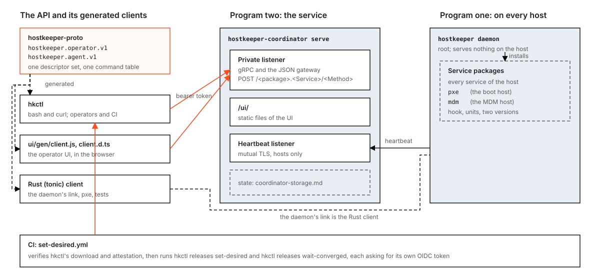

# hostkeeper is two programs

Status: design, for the maintainers' comments. Every statement about new code is **Designed** until its item lands;
**Built** names code on `main` with a path, as in [hostkeeper-design.md](hostkeeper-design.md). Section 9 lists the
build items, one pull request each.

The ruling: hostkeeper is two programs. `hostkeeper` is the daemon. The coordinator is the service. The service's API
is the protobuf, and every client is generated from it: a bash command line over the JSON gateway, and the TypeScript
client the operator UI uses. The plumbing verbs (`ci set-desired`, the self-update verbs, the hook of hostkeeper's own
package) and the daemon's local admin socket go. Status, abort and clearing a record go through the coordinator. For a
host the coordinator cannot reach, root stops the daemon (`systemctl stop hostkeeper`, `launchctl bootout
system/dev.hostkeeper.hostkeeper`), which ends the running step. The stale record is cleared through the coordinator
once the host is back.

This document supersedes, where they disagree: the verb list of `hostkeeper` in [hostkeeper-design.md](hostkeeper-design.md)
section 4.1 and its admin socket; the self-update fallback unit and the protocol probe of its section 6.6;
`hostkeeper ctl` and `hostkeeper ci` in [docs/ctl.md](../ctl.md) and [docs/deploy/ci-client.md](../deploy/ci-client.md);
the "separate binary, run in the foreground" answer of [network-install.md](network-install.md) section 3 and the
shipping of `hostkeeper-pxe` in the deb and the rpm in its sections 3 and 9; and the `hostkeeper-mdm` kit of
[hostkeeper-mdm.md](hostkeeper-mdm.md) section 3 (its row "`hostkeeper-mdm` kit", and the daemon's postinstall verb in
the row after the gate), which section 6.2 makes a service package. It does not change
[coordinator-storage.md](coordinator-storage.md); section 7 ties `backup` and `restore` to its items C5, C7 and C9.



## 1. What changes for the operator

**Before.** `hostkeeper` is one binary with fourteen verbs (`crates/hostkeeper-daemon/src/cli.rs`, **Built**): the
daemon, the admin socket's client (`admin status|abort|clear-record`), the coordinator client (`ctl`), the CI client
(`ci set-desired`), four self-update verbs (`self-update-protocol`, `self-update-fallback`, `self-update-seed`,
`mac-config`), the hook of its own package (`update-hook`) and five hidden step words. The CLI is a Rust library
(`crates/hostkeeper-ctl`) that runs only inside the daemon binary. The UI calls the gateway with hand-written
JavaScript (`ui/api.js`) and a hand-kept list of methods (`ui/calls.json`). `hostkeeper-pxe` ships inside the deb and
the rpm, and `hostkeeper-mdm` ships as its own tarball.

**After.**

- `hostkeeper daemon` is the only verb of `hostkeeper`. `hostkeeper --version` stays.
- `hostkeeper-coordinator serve` is the only verb of the coordinator once the storage move is done (section 7).
- `hkctl` is the command line. It is one bash script, generated from the protobuf, released as an attested asset. It
  calls the private listener's JSON gateway with `curl`. Its command tree is the one `hostkeeper ctl` has today
  (`hkctl releases set-desired ...` replaces `hostkeeper ctl releases set-desired ...`), with the same flag rules and
  the same exit codes.
- The UI calls the API through a generated client (`ui/gen/client.js` with its TypeScript declarations
  `ui/gen/client.d.ts`). `ui/calls.json` is derived from it, not kept by hand.
- CI sets a desired version with `hkctl`. The reusable workflow `set-desired.yml` keeps its inputs and outputs; the
  wait is one call to a new method, `Releases.WaitConverged`, instead of a loop in a client.
- The daemon serves nothing on the host. `hostkeeper admin` and its socket are gone. `hkctl hosts get`, `hkctl hosts
  abort` and a new `hkctl hosts clear-record` replace its three calls.
- The network-install server and the MDM stack become service packages, `pxe` and `mdm`, that hostkeeper installs like
  any other service (section 6).

**What does not change.** The heartbeat protocol and every existing RPC, request and response (only additions, section
3); the release channel, the attestation checks and the package format; the hook contract of every other service
(`hostkeeper-hook`, `hostkeeper-steps`, `examples/hello`, `docs/conformance.md`); the rollout gate; the self-update's
order of checks and its verdicts as the coordinator sees them (`awaiting_restart`, `self_update_fallback`,
`protocol_unsupported`); the paths of the unit, the plist, the state and binary directories; the reason tokens of every
refusal.

## 2. The end state

### 2.1 `hostkeeper`: the daemon

`hostkeeper daemon [flags]` is the one root process of a host, as today: enrollment, heartbeat, order executor, boot
pass, the settlement of a waiting self-update. It gains three things that today are verbs (section 4 says in which
release each lands):

- **The seed.** When the running image (`std::env::current_exe`) is one of the two packaged paths,
  `/usr/bin/hostkeeper` or `/usr/local/bin/hostkeeper`, the start takes the state directory's lock, gives the binary
  directory its first binary when `current` starts nothing (what `self-update-seed` does,
  `crates/hostkeeper-daemon/src/seed.rs`), releases the lock and `exec`s `current` with its own arguments. The process
  id stays, so `Type=notify`, `NOTIFY_SOCKET` and the watchdog carry over. The trigger is the packaged path and
  nothing else: a binary that runs from `versions/<v>` never execs `current`, so the exec happens at most once and the
  hand-over of 4.3 is not undone by it. Only the bootstrap unit and the Mac's plist start the packaged path (4.1).
- **The Mac's config.** On macOS, when `/etc/hostkeeper/hostkeeper.toml` is absent, the start builds it from the
  managed preferences, with the code `mac-config` runs today (`crates/hostkeeper-daemon/src/mac_config.rs`), before it
  reads it.
- **The fallback, by the binary that runs.** A self-update no longer switches `current` before the new binary has run
  (section 4.3). The binary `current` names (reached directly, or through the packaged binary's one exec) hands over to
  the next binary itself, so no unit or job runs an older binary with a verb of its own.

**The bare program or `daemon`.** The verb stays. Every live unit and plist starts `.../bin/current daemon ...`, and
hosts keep their unit text until a package replaces it (section 4.1). An old unit that started a binary which no longer
knows `daemon` would leave the host with no daemon. Bare `hostkeeper` as a second spelling would be a second way to do
one thing. So `hostkeeper` with no verb prints its usage and exits 2, as today. The unit stays
`hostkeeper.service`, the launchd job stays `dev.hostkeeper.hostkeeper`.

### 2.2 `hostkeeper-coordinator`: the service

`hostkeeper-coordinator serve [flags]` is the service: the heartbeat listener, the private listener (gRPC and the JSON
gateway), the optional LAN listener, the enrollment CA, the MDM policy gate and the static UI under `/ui/`. The file
keeps its name: the image's `ENTRYPOINT`, the release assets and every deployment name it, and "the coordinator" in this
document is that program. `serve` stays the one verb for the reason `daemon` does: the image sets no default arguments
(`packaging/container/Dockerfile`, held there by `crates/xtask/tests/packaging/container.rs`), so every deployment
passes `serve`.

### 2.3 The API is the protobuf

The operator API is the packages `hostkeeper.operator.v1` (services `Hosts`, `Releases`, `Services`, `Audit`, `Alerts`,
`Enrollment`, `Rollouts`, `Mdm`) and the host API `hostkeeper.agent.v1` (`Coordinator`), in
`crates/hostkeeper-proto/proto/` (**Built**). Three generated clients use them, all from the one descriptor set
`hostkeeper-proto` builds (`build.rs`, protox, no `protoc`):

| Client | Generated by | Used by | Transport |
|---|---|---|---|
| Rust (tonic) | `tonic_prost_build` in `hostkeeper-proto/build.rs` (**Built**) | the daemon's link, `pxe`, Rust tests | gRPC |
| `hkctl` (bash) | the command table of `hostkeeper-proto/src/ctl.rs` and a new bash emitter (item G1) | operators, CI | JSON gateway over HTTPS |
| `ui/gen/client.js` and `client.d.ts` | a new emitter over the same table (item G2) | the operator UI | JSON gateway, same origin |

The command table (`ctl.rs`, `ctl_gen.rs`, **Built**) already turns every unary RPC into a command with typed flags,
secret inputs and help text, and refuses what it cannot express (a streaming RPC, a clash, a secret on a non-string
field). Both new emitters read that table and nothing else, so a new RPC appears in both with no hand edit, as it does
in `hostkeeper ctl` today (`crates/hostkeeper-ctl/build.rs` shows it on fixture protos).

### 2.4 `hkctl`

- **One file, needing bash 3.2 or later and `curl` 7.55 or later** (for `--header @file`). These are stated minimums;
  bash 3.2 is the one macOS ships, so the emitter uses no construct newer than it (no associative arrays, no `mapfile`,
  no `${x,,}`), and a test of G1 refuses an emitted script that holds one. It needs no `jq`: it builds the request JSON
  itself (a generated string escaper) and prints the response body as the gateway sends it (canonical JSON).
- **Commands.** `hkctl <service> <method> [flags]`, kebab case, as `hostkeeper ctl` names them. The flag rules are the
  table's: a scalar or enum field is a flag, a repeated field repeats it, a `map<string,string>` repeats
  `--<field> key=value`, messages and oneofs come through `--request <file|->`, a secret field is read with
  `--<field>-file` or `--<field>-stdin` and never printed.
- **Global flags.** `--endpoint` (https only), `--ca-file` (the only trusted root of the coordinator call, passed to
  `curl --cacert`), `--token-file`, `--token-stdin`, `--github-oidc-audience` (below), `--response-file`,
  `--timeout-secs`, `--help`, `--version`. `--transport`, `--client-cert-file`, `--client-key-file` and `--output` go:
  there is one transport, the heartbeat listener's mutual TLS is the daemon's alone, and the output is the JSON body
  (pipe it to `jq`). The body goes to stdout, or to the file `--response-file` names; diagnostics go to stderr.
- **No token or secret is ever in a file the script writes, in an argument list, in a child's environment, or in a
  diagnostic.** The script reads a token from `--token-file` (refused when group or others may read it: a POSIX
  `find -perm` test) or stdin with the `read` builtin into a shell variable it never exports. `curl` gets
  `--header @<(printf 'Authorization: Bearer %s\n' "$token")`: bash's process substitution hands it a pipe named
  `/dev/fd/<n>`, filled by the `printf` builtin in a subshell that execs nothing, so the argument list holds only the
  pipe's name. A request with a secret field reaches `curl` the same way, as `--data-binary @<(...)`. There is no work
  directory and nothing to remove. Every `curl` runs with `-q` (no `.curlrc`), `--proto =https`, `--tlsv1.2` and
  `--max-redirs 0`.
- **CI's token.** `--github-oidc-audience <aud>` makes the script ask the runner for a fresh GitHub Actions ID token for
  that audience before its one call. It copies the two variables the runner sets (`ACTIONS_ID_TOKEN_REQUEST_URL` and
  `ACTIONS_ID_TOKEN_REQUEST_TOKEN`, secret material under rule S2) into unexported shell variables and `unset`s both
  before it starts any child. The request is `curl` with the system's roots (not `--ca-file`), `--noproxy '*'` and the
  options above, to `"$url&audience=<aud percent-encoded by the script>"` (the runner's URL already has a query, as
  `crates/hostkeeper-ci/src/token.rs` reads it), with the request token in a header pipe as above; its JSON answer is
  read into a variable by command substitution and its `value` taken by parameter expansion, refused unless it is
  non-empty visible ASCII. The script prints `::add-mask::<token>` on stdout before it uses the token, so the call
  steps of section 5 pass `--response-file` and stdout carries only workflow commands. One call, one token: the
  coordinator accepts each token id once (`crates/hostkeeper-oidc`, **Built**).
- **Exit codes**, as today's (`crates/hostkeeper-ctl/src/exit.rs`, **Built**), mapped from the gateway's error body
  `{"code":"<NAME>","reason":"..."}` by its `code`: 0 success; 2 a usage error, `INVALID_ARGUMENT` or
  `FAILED_PRECONDITION`; 3 `UNAUTHENTICATED` or `PERMISSION_DENIED`; 1 anything else, including a transport failure and
  a body that is not the gateway's. A refusal prints `refused: <reason>` on stderr, `<reason>` only when it matches
  `[a-z0-9_]{1,64}`, the rule `hostkeeper ci` holds a refusal to today (`crates/hostkeeper-ci/src/call.rs`).
- **Release.** `cargo xtask release hkctl --version V --commit C --out dist` writes `hkctl-<V>` with `hkctl --version`
  printing `hkctl <V>+<commit12>`, as the binaries do. It is one asset for every platform, in `SHA256SUMS`, attested
  by `artifacts.yml` like every other asset, listed in the release contract (`crates/xtask/src/release/contract.rs`) and
  in [verify-a-release.md](../deploy/verify-a-release.md). It is not in the deb, the rpm or the pkg: no host needs it.
- **Docs.** `docs/cli.md` is generated from the table, as `docs/ctl.md` is today, and replaces it.

### 2.5 The UI's client

`ui/gen/client.js` is an ES module with one function per unary method of `hostkeeper.operator.v1`
(`releases.setDesired(request)`), each a `POST` of canonical JSON to `/<package>.<Service>/<Method>` with the
operator's token, through the `fetch` and token the UI injects (as `ui/api.js` does today, **Built**).
`ui/gen/client.d.ts` declares each request and response as TypeScript types, from the same descriptors, with proto3
JSON's names and enum spellings. Both files are checked in, because the UI is static files with no build step and the
image copies `ui/` byte for byte (`cargo xtask release check-image-ui`, **Built**). A test regenerates them and fails on
any difference.

The repository runs no Node: the UI's tests run the real modules in `boa_engine` inside `cargo test`
(`crates/hostkeeper-ui-tests`, **Built**). So the client is JavaScript plus declarations rather than `.ts` sources that
need a compiler; `client.d.ts` is checked in a Rust test by a TypeScript parser crate from crates.io (item G2 picks it,
subject to `cargo deny`). `ui/api.js` keeps the error handling and the token rules and calls the generated functions;
the pages call `api.<service>.<method>`. `ui/calls.json` becomes the list of generated functions the pages call, derived
by the existing scanner (`call_sites`, **Built**) and checked against the real router as now (`real_router.rs`).

### 2.6 Every verb's fate

| Program | Verb | Fate |
|---|---|---|
| `hostkeeper` | `daemon` | Kept, the only verb. Gains the seed, the Mac config and the hand-over (2.1). |
| | `--version` | Kept (a flag). |
| | `admin status` | Deleted. `hkctl hosts get --node-id <id>`; on a host the coordinator cannot reach, the journal or `daemon.err.log`. |
| | `admin abort <service>` | Deleted. `hkctl hosts abort` (**Built**: `Hosts.Abort`, for daemons that announce `abort-v1`). Off-line: stop the daemon. |
| | `admin clear-record <service>` | Deleted. `hkctl hosts clear-record` (new method, 3.2). Off-line: root stops the daemon and renames the record by hand, which is all the verb does (3.2). |
| | `ctl <service> <rpc>` | Deleted. `hkctl <service> <rpc>`. |
| | `ci set-desired` | Deleted. The workflow calls `hkctl releases set-desired` and `hkctl releases wait-converged` (section 5). |
| | `self-update-protocol` | Deleted. The release's `min_hostkeeper` and the running daemon's compiled-in oldest reader decide (4.2). |
| | `self-update-fallback` | Deleted. The binary `current` names hands over and falls back itself (4.3). |
| | `self-update-seed` | Folded into `daemon` started from the packaged binary (2.1). |
| | `mac-config` | Folded into `daemon`'s start on macOS (2.1). |
| | `update-hook` (with its step argument, `uninstall` among them) and the five step words `prepare`, `cutover`, `verify`, `rollback`, `cleanup` | Deleted. No daemon runs a hook for the service `hostkeeper` (4.4). |
| `hostkeeper-coordinator` | `serve` | Kept, the only verb in the end. |
| | `backup`, `restore` | Kept for the file store; deleted with it by C9 of coordinator-storage.md (section 7). |
| | `import`, `export` (C4, designed) | Deleted with the file store by C9: they read and write it. |
| `hostkeeper-mdm` | `fetch` | Deleted. The pinned archives are fetched and checked when the `mdm` package is built (6.2). |
| | `install`, `install --uninstall` | The `mdm` package's hook steps and its `uninstall` step. |
| | `tls` | The package's own units (the ACME renewal timer). |
| | `verify` | The package's `verify` step and its `[health]`. |
| | `push-cert` | A verb of the `mdm` package's own program, `bin/mdm push-cert`, run by root on the MDM host as today (6.2). |
| | `dep get-cert`, `upload-token`, `define-profile`, `assign` | Verbs of `bin/mdm`, as `push-cert` (6.2). |
| | `migrate` | Deleted once MIGRATION.md records the move done; kept in `hostkeeper-mdm` until then. |
| `hostkeeper-pxe` | `fetch` | The `pxe` package's `prepare` step. |
| | `serve` | The `pxe` package's unit. |
| `hello` | all | Kept: the example service and the hook contract's example. |
| `xtask`, `coverage-gate`, test fixtures | all | Kept: build and test tooling, not shipped to hosts. `hostkeeper-selfupdate-daemon` follows the shipped CLI and loses the verbs with it. |

### 2.7 The coordinator's health, with no verb

The image already carries the UI (`packaging/container/Dockerfile` copies `ui/` to
`/usr/share/hostkeeper-coordinator/ui`, checked by `cargo xtask release check-image-ui`, **Built**). It has no health
check, and coordinator-storage.md section 9 says why: the image is distroless, with no shell and no client, so a
Docker `HEALTHCHECK` or a compose `healthcheck` could only run the coordinator binary itself, which would need a verb
such as `healthcheck`. That is the kind of plumbing verb this design removes, so there is none. Health is exposed as a
route, and the probe runs outside the container:

- **A health listener.** `serve --health-listen <loopback address:port>` binds one more listener, plain HTTP, that
  answers only `GET /healthz` (and `HEAD`) and 404 to everything else, with no authentication and no TLS. `serve`
  refuses an address that is not loopback (`127.0.0.0/8` or `::1`), as it refuses a wildcard for `--private-listen`
  today (`crates/hostkeeper-coordinator/src/config.rs`, **Built**), so nothing off the machine reaches it. Without the
  flag there is no such listener, as today.
- **What it says.** `200` with the body `ok` when every listener the flags name is bound and serving, the store is
  open and, with the Postgres store, this coordinator holds the single-writer lock (coordinator-storage.md section 5);
  `503` with one reason token otherwise (`store_unreachable`, `not_writer`, `starting`). The body is that token and
  nothing else: no version, no host, no count. It reads memory only and writes no audit line. The listener has the
  same limits as the others (handshake, head, connection count; `listen.rs`, **Built**).
- **Who probes it.** The deployment, from outside the container: the coordinator runs on the host's network
  (coordinator-storage.md section 9), so a probe on the same machine reaches the loopback listener, for example an
  orchestrator's HTTP probe or the machine's own monitoring. The compose file gets no `healthcheck` for the coordinator,
  because compose runs one inside the container; its restart policy still restarts a coordinator that exits, as
  section 9 of coordinator-storage.md says. The Dockerfile gets no `HEALTHCHECK` and keeps its rules
  (`crates/xtask/tests/packaging/container.rs`).
- **Why a route rather than the private listener.** The private listener needs a token for every call and serves TLS
  on one interface's address; a probe should need neither a secret nor the farm's CA, and must not widen the API.

This adds to coordinator-storage.md section 9's **Health** bullet; it does not change the database's health check.

## 3. API changes

Every change is an addition: new RPCs, messages, fields, enum values and one oneof case. The compatibility test
(`the_protos_keep_every_rule_against_the_baseline`, `crates/hostkeeper-proto/src/compat/tests.rs`, **Built**) passes
against the unchanged `crates/hostkeeper-proto/proto/compat/baseline.binpb`, which only a release rewrites. Each addition gets its round trip in
`crates/hostkeeper-proto/tests/additions*.rs`, its lines appended to the command golden (it may only grow), and the
regenerated `docs/cli.md`.

### 3.1 `Releases.WaitConverged`

```proto
rpc WaitConverged(WaitConvergedRequest) returns (WaitConvergedResponse);

message WaitConvergedRequest {
  string service = 1;
  // The version the caller set; any other desired version ends the wait as SUPERSEDED.
  string version = 2;
  // How long to hold the call, 1 to 1800 seconds.
  uint32 wait_secs = 3;
}
message WaitConvergedResponse {
  WaitOutcome outcome = 1;
  Convergence convergence = 2;   // as Releases.Converge answers at the end of the wait
}
enum WaitOutcome {
  WAIT_OUTCOME_UNSPECIFIED = 0;
  WAIT_OUTCOME_CONVERGED = 1;
  WAIT_OUTCOME_HALTED = 2;
  WAIT_OUTCOME_SUPERSEDED = 3;
  WAIT_OUTCOME_DEADLINE = 4;
}
```

- **What ends it.** The coordinator answers at once, and then after every change of the service's convergence (each
  heartbeat that changes it, each operator change), with `CONVERGED` when the state is converged on `version`,
  `HALTED` when the service is halted, `SUPERSEDED` when the desired version is not `version`, and `DEADLINE` at
  `wait_secs`. `BLOCKED` and `IN_PROGRESS` keep it waiting, as `hostkeeper ci` keeps polling today
  (`crates/hostkeeper-ci/src/flow.rs`, **Built**). It reads memory only, like `Converge`.
- **Who may call it.** Exactly who may call `Converge`: an operator token, or any CI token the OIDC allow-list admits
  (`grpc/operator.rs`, **Built**). The token is verified once, when the call is admitted, as every call's is; a held call
  is not checked again, so a token whose `exp` falls inside the wait still gets its answer. One CI token is spent for
  the whole wait.
- **Refusals.** `wait_secs` 0 or above 1800 is `invalid_wait` (`INVALID_ARGUMENT`); an unknown service is
  `unknown_service`, as `Converge` refuses it; a 17th wait held at once on a listener is `too_many_waits`
  (`FAILED_PRECONDITION`, so `hkctl` exits 2 with the reason). 16 is a chosen bound, the number of calls one HTTP/2
  connection may carry today (`MAX_STREAMS`, `crates/hostkeeper-coordinator/src/listen.rs`, **Built**): it keeps held
  calls a small share of the listener's 1024 connections. Any caller the API admits can take the slots, and a CI caller
  is one the allow-list names; that is accepted, and a refused wait says so by name. A wait is read-only and writes no
  audit line.
- **The listener and the call deadline.** Two limits cut a held call today, and both change for this one method. A gRPC
  call not answered within one patience (10 seconds, `CLIENT_PATIENCE`) is `DEADLINE_EXCEEDED`
  (`crates/hostkeeper-coordinator/src/grpc/mod.rs`, **Built**); a `WaitConverged` call's limit is its `wait_secs` plus
  one patience instead. An HTTP/2 connection takes new calls for one patience and is closed one patience later
  (`listen.rs`); a connection that holds a `WaitConverged` call is closed one patience after that call ends instead, and
  still takes no new call after the first patience. The gateway awaits the call with no deadline of its own and
  HTTP/1.1 has no connection age, so neither changes. `hkctl` gives `curl` `--max-time` of `wait_secs` plus
  `--timeout-secs`.
- **A cut wait.** A wait cut by a restart of the coordinator or by the network ends the call with a transport error,
  which the workflow reports as `no_answer` (section 5). Today's loop rides out such a gap by reading again with a new
  token; the held call does not, and the job is run again. This is the one thing the wait loses against today's.
- **The UI** does not call it. The CLI exposes it as `hkctl releases wait-converged`.

### 3.2 `Hosts.ClearRecord`, and the order that carries it

```proto
rpc ClearRecord(ClearRecordRequest) returns (ClearRecordResponse);   // service Hosts
message ClearRecordRequest { string node_id = 1; string service = 2; }
message ClearRecordResponse { string order_id = 1; }
```

- The coordinator orders the host the new verb `clear-record` for the service, in the next heartbeat answer, only to a
  daemon that announces the feature `clear-record-v1`; to any other it refuses `daemon_too_old`, as `Force` does
  (`crates/hostkeeper-coordinator/src/force.rs`, **Built**). The order is a new case of `Order`'s `oneof verb` in
  `hostkeeper.agent.v1` (`agent.proto`, **Built**), with the service as its argument; a daemon that does not announce
  the feature is never sent it.
- The daemon runs exactly what the admin socket's `ClearRecord` runs today
  (`crates/hostkeeper-daemon/src/verbs/clear_record.rs`, **Built**): under the service's lock without waiting
  (`busy`), it renames `step-record.json` to `step-record.json.corrupt` only when the record does not read; an absent
  record, one that reads and one of a newer schema are each `record_reads`; a store failure is `store_failed`. The
  verdict comes back in the heartbeat like any order's. Today an order carrying the verb is refused `forbidden`; that
  refusal goes. The executor dispatches `clear-record` before it reads the service's record, as the admin verb does, so
  a host whose record does not read still takes it; D1 proves that with a corrupt record in place.
- **A host the coordinator cannot reach.** Root stops the daemon, which ends the running step. If the record must go
  before the link is back, root renames it by hand, `step-record.json` to `step-record.json.corrupt` in the service's
  state directory: that rename is the whole of what the verb does. The runbook of K3 says so.
- **Audit.** `ClearRecord` writes the audit line `record_cleared` with the operator, the host and the service.
- **What a compromise gains.** A coordinator can already order any attested package installed, forced or uninstalled on
  any host. Renaming a record that does not read is less than that: it never clears a record that reads, so it cannot
  hide an update in progress.

### 3.3 What is not changed

`hostkeeper.local.v1` (the admin socket's package) is not deleted from the protos. Removing a package is a removal the
compatibility rule refuses (rule B8, and the test asserts the four packages), and the format shipped: an older
`/usr/bin/hostkeeper admin` on a host speaks it. Its file stays, frozen, with a header that no program serves it; no
code is generated from it. Deleting the file needs an exception to rule B8 that only the maintainers can grant; this
design does not ask for one. The command generator already skips the packages `hostkeeper.local.v<n>` (`ctl_gen.rs`,
**Built**).

No `Mdm` method is added: the Apple-facing verbs stay with the MDM stack's own program (6.2).

What the design removes are command-line verbs, one flag and release assets (`hostkeeper-mdm`'s tarball and SBOM, and
`hostkeeper-pxe` inside the deb and the rpm), not formats that data is kept or sent in. Each removal comes after its
replacement ships and its callers have moved (section 8), and the ones an older binary on a host can still call are
held to the floors of section 4.

## 4. The staged path for the daemon

The fleet's daemons are live, and a daemon updates itself. Every risk below comes from one fact: the binary that judges
or runs a step of the self-update is often not the binary that was built with the change. A self-update is run by the
**old** daemon, which runs the **new** release's hook and probes the **new** binary; the fallback, today, runs the
**previous** binary from a unit the **new** daemon wrote; and on Linux the unit that starts the daemon comes from
hostkeeper's own package, which the update links (`packaging/linux/hostkeeper.service` header, **Built**), so after a
fallback the old binary runs under the new release's unit.

The path is three stages. Releases are cut from `main` automatically; a stage is the set of pull requests listed for it
in section 9, and **R1** and **R2** below are the versions of the first release that holds every pull request of stage 1
and of stage 2. No stage-1 or stage-2 code needs to know R1 or R2 before it exists: stage 1 tells old releases from new
ones by the floor every release before stage 2 declares (4.2), and the floor pull requests, S2a and S3, are written
after R1 and R2 are released and name them.

| Stage | The new behaviour | What is still answered | The floor that makes it safe |
|---|---|---|---|
| 1, readers | The daemon understands everything stage 2 writes: the hand-over records and links, judging a release by its floor, hostkeeper's package with no hook command run, the start from the packaged binary, the Mac config at start. It writes, probes and runs exactly what it does today. | Every verb; the probe; the fallback units and job it still writes | none: hostkeeper's package keeps today's floor, 0.1.53, and every older daemon updates to R1 the old way |
| 2, writers | hostkeeper's package declares `min_hostkeeper = R1`. The self-update hands over instead of switching `current`, probes nothing and runs no hook command for itself. The daemon removes the fallback units and job it finds. New unit, plist and pkg scripts. | Every self-update verb, `update-hook` and its step words, `--admin-socket` (accepted, ignored), the start log of R1's Mac fallback job | R1: a daemon older than R1 defers R2 before it probes or runs a hook |
| 3, removal | hostkeeper's package declares `min_hostkeeper = R2`. The self-update verbs, `update-hook`, the probe verb, the fallback code, the start log and the `--admin-socket` flag are deleted. | nothing | R2 |

`ctl`, `ci` and `admin` are not in this table: no daemon and no unit invokes them, so they go as soon as their callers
have moved (K1 to K3, section 8), between stage 1 and stage 2. K3 deletes the socket and keeps the `--admin-socket`
flag accepted, because units that pass it are live until stage 3.

Before the floor of a stage is raised, the operator checks that every host of the service `hostkeeper` runs the
previous stage: `hkctl releases status --service hostkeeper` (or `hostkeeper ctl` before G3) shows every host at R1 (or
R2). A host that was down then and comes back older answers the next release `daemon_too_old`, an environment
deferral the status shows by name (`crates/hostkeeper-config/src/manifest.rs`, **Built**), never a release failure; the
operator sets the desired version back to the previous stage's release until it has moved, then forward again. Those
downgrades are allowed by the rule of 4.2.

### 4.1 Unit, plist and pkg texts

- **Linux, hostkeeper's package unit** (`units/hostkeeper.service`, linked by every update): it keeps
  `ExecStart=.../bin/current daemon ...` for good. It must: `/usr/bin/hostkeeper` is replaced only by a deb or rpm
  upgrade, so on most hosts it is an older binary, which would run itself and never hand over to the updated one.
  Stage 2 drops `--admin-socket` and `RuntimeDirectory=hostkeeper`. It keeps `ExecStartPre=-/usr/bin/hostkeeper
  self-update-seed ...`, today the only repair of a `current` that starts nothing on a host with a linked unit; the
  `-` already lets a start go on when the packaged binary lacks the verb. Stage 3 deletes the line with the verb.
- **Linux, the bootstrap unit** of the deb, the rpm and the boot image overlay
  (`/usr/lib/systemd/system/hostkeeper.service`): stage 2 makes it `ExecStart=/usr/bin/hostkeeper daemon ...`, with no
  `ExecStartPre`, so the packaged binary seeds and execs `current` (2.1). It is in effect only until hostkeeper's
  package is first installed, whose linked unit then takes its place in `/etc/systemd/system`. The binary and this unit
  come from the same deb, so they always match. From stage 2 the two units are two files in `packaging/linux/`, and the
  packaging tests hold each.
- **macOS.** The pkg is the only source of the plist and of `/usr/local/bin/hostkeeper` (hostkeeper's package carries
  no units on macOS), so the two always match. Stage 2 makes `daemon_plist` start `/usr/local/bin/hostkeeper daemon`,
  which seeds and execs `current` at each start, and the postinstall script two lines: `launchctl bootout` and
  `launchctl bootstrap` (`crates/hostkeeper-launchd/src/postinstall.rs`, held byte for byte by `check-macos-pkg`).
- **Why these texts need no floor.** The bootstrap unit, the plist and the postinstall arrive only with the binary of
  the same deb or pkg. The package unit of stage 2 differs from today's only in a flag every older daemon defaults to
  the same path (`--admin-socket`, `crates/hostkeeper-daemon/src/cli.rs`, **Built**) and the socket's runtime
  directory, so an older binary runs under it, and a newer binary under an older one, as today. So S2b depends only on
  S1b (the binary that seeds and execs) being released.
- **After stage 3, a `current` that starts nothing.** The linked unit has no repair line, and systemd logs
  `203/EXEC` every second. Root runs `/usr/bin/hostkeeper daemon` once by hand with the unit's flags (an older packaged
  binary answers `self-update-seed` instead): it seeds, execs `current` and can be stopped, and the unit starts again.
  The runbook of S3 says so. Today the same host is repaired by its unit only when its packaged binary is new enough to
  have the verb.
- **What the install loses on a Mac.** Today a pkg installed without the managed preferences fails in its postinstall.
  From stage 2 the install succeeds and the daemon refuses to start at each launchd relaunch, naming the missing file
  in `daemon.err.log`. There is no coordinator address to report it to. The MDM gate installs the managed preferences
  before the pkg (hostkeeper-mdm.md section 4), so this is a hand install done out of order.

### 4.2 The protocol probe and the floor

Today the old daemon runs `<new release>/bin/hostkeeper self-update-protocol` and accepts protocol `P` when
`SELF_UPDATE_PROTOCOL <= P <= SELF_UPDATE_PROTOCOL + 1` (`crates/hostkeeper-daemon/src/selfupdate.rs`, step 7,
**Built**). A release without the verb is `protocol_unreadable` on every older daemon. The manifest cannot carry a new
protocol field: an older loader refuses any key it does not know, as `manifest_mismatch` of class release
(`manifest.rs`, `unknown_key`, **Built**), so every older daemon would fail the release, not skip it.

What does carry it is the floor that already exists. `min_hostkeeper` is checked at step 5, before the probe at step 7
and before the hook, and an older daemon is `Deferred` `daemon_too_old`. The rule becomes one compiled-in version per
release, `OLDEST_READER`: the oldest release that reads every file this release writes.

- **Forward** (a newer release `T` ordered to a running daemon `D`): `T`'s package declares
  `min_hostkeeper = OLDEST_READER(T)`, which the release builder takes from the same constant, and `D`'s loader
  defers `T` when `D` is older. `D` is `T`'s fallback, so this is "can fall back from".
- **Backward** (an older release `T`): `D` refuses `T` before the commit, `protocol_unsupported` of class release, when
  `T` is older than `OLDEST_READER(D)`, because `T` could not read `D`'s files. This is the lower half of today's
  window.
- A release that is the running version is installed without either check, as without the probe today.

`OLDEST_READER` lives in a crate both `hostkeeper-daemon` and `xtask` read (`hostkeeper-steps`), and replaces
`MIN_HOSTKEEPER` (`crates/xtask/src/release/package.rs`, 0.1.53 today, the value `OLDEST_READER` starts at). The rule
of the module doc of `selfupdate.rs` keeps its words: a release that writes a new format sets `OLDEST_READER` to the
release that first read it.

- **Stage 1** keeps the probe for a target whose floor is 0.1.53 or lower, which every release before stage 2 is
  (`LEGACY_FLOOR`, a constant of stage 1), and judges a target with a higher floor by the rule above. Its own
  `OLDEST_READER` stays 0.1.53, so every daemon of today updates to it. The verb keeps printing `1`, and
  `SELF_UPDATE_PROTOCOL` stays 1, frozen, because every daemon before R1 probes R1 and later stage-1 releases and
  accepts only 1 or 2.
- **Stage 2** sets `OLDEST_READER = R1`. No daemon probes a stage-2 release: an older one defers it at step 5, R1 and
  later judge it by its floor. The probe call, `ProtocolProbe`, `LauncherProbe`, `ProbeCall`, `ProbeExit`,
  `run_probe`, `probe_command`, `Label::probe` and `PROBE_UNIT` go. A downgrade below R1 is refused by the backward
  rule, so nothing is left to probe. The verb is still answered, printing `1`.
- **Stage 3** sets `OLDEST_READER = R2` and deletes the verb and `SELF_UPDATE_PROTOCOL`. A daemon older than R2 defers
  the release before any probe.

### 4.3 The fallback: the hand-over

Today the follow-on switches `current` to the new binary and exits; systemd's start limit (a drop-in the daemon writes,
three starts in 300 seconds) or a 60-second launchd job (`<label>.fallback.plist`) runs
`<bin>/previous self-update-fallback --dir <bin>` (`crates/hostkeeper-steps/src/selfupdate.rs`,
`crates/hostkeeper-daemon/src/selfunits.rs`, **Built**). The new daemon writes those texts and the previous binary runs
them: a new text that the previous binary does not understand fails, and the `-` of `ExecStart=-` hides it, exactly
when the new binary crash-loops. The Mac fallback is not run by any device test today, because the job must be in
`/Library/LaunchDaemons` (header of `tests/device_mac_selfupdate.rs`).

**The hand-over.** From stage 2 the follow-on stages the new binary as `versions/<N>`, points the link `next` at it,
and only then writes the record as waiting for the restart into `N` with a start count of 0, and exits 0; `current` is
not moved. A crash between the link and the record leaves a link and no wait, which the next start removes. The unit
or job then starts the binary `current` names, the old one `O` (on a bootstrap unit or a Mac, the packaged binary
first, which execs `current` once, 2.1). The start of every binary, before it reads its configuration or takes the
state directory's lock, reads the record and decides:

1. **It is not `N`, the record waits for `N`, `next` names an executable `versions/<N>`, and the count is below 3:** it
   raises the count (written and synced) and `exec`s `next` with its own arguments. The process id stays.
2. **It is `N`:** it goes on to the settlement. Its start, under the lock, finishes the switch if `current` does not
   name it yet (`previous` to the old `current`, then `current` to `N`; each an atomic link replace, so a repeat is
   harmless), confirms `Succeeded`, and only then removes `next`.
3. **It is not `N` and step 1 does not apply** (the count has reached 3, `next` is missing or not executable, or the
   exec returned an error): it settles the update `Failed`, `self_update_fallback`, marks `N` bad, removes `next`, and
   runs as the daemon. Nothing was switched, so nothing switches back. It never leaves a wait standing.

A new binary that crashes, exits or is killed before it settles leaves the count raised, and the next start of the unit
starts `O` again. There is no clock, no start window, no fallback unit and no job: three starts of the new binary that
do not reach its settlement are the limit, on both systems. The unit's `RestartSec=1` and launchd's relaunch pause pace
the tries. Power lost at any point restarts into one of the three steps: before the count is written, the same try is
made again; after `current` moved but before the confirm, `N` starts directly and step 2 confirms it.

The settlement changes in stage 1. Today `settle_with` (`crates/hostkeeper-steps/src/selfupdate.rs`, **Built**)
confirms only when the running binary is the awaited version and `current` already names it, and records any other
start as a fallback. Stage 1 adds the case of step 2: a record that carries `next` and waits for the running version
is confirmed after the switch is finished. A record without `next`, written the old way, is settled exactly as today.

**The stages.**

- **Stage 1** writes the old way: it switches `current` and writes the fallback unit and job, which run R1 or an
  earlier binary, each of which answers `self-update-fallback`. It already reads the hand-over, as `O` (steps 1 and 3)
  and as `N` (step 2). It needs to: a stage-2 daemon may be downgraded to a stage-1 release, which must then settle
  itself and move `current`.
  **Built** (S1a): steps 1 to 3 in `crates/hostkeeper-steps/src/handover.rs`, run first in `hostkeeper daemon`,
  before the config and before the daemon's own lock; the state directory's lock is taken only around the writes of
  steps 1 and 3, and released by the exec (`crates/hostkeeper-daemon/src/handover.rs`); the settlement's case of step 2,
  and the removal of a `next` with no wait, in `settle_with` (`crates/hostkeeper-steps/src/selfupdate.rs`); the
  record's fields `next` and `starts` of `AwaitingRestart` (`crates/hostkeeper-steps/src/record.rs`). The
  fallback verb leaves a hand-over alone: it moved no link (`crates/hostkeeper-daemon/src/fallback.rs`).
- **Stage 2** hands over. At start, before it may run a self-update, it removes the fallback unit, the drop-in and the
  Mac job (drop-in first, so `OnFailure=` never names a missing unit), and reloads the service manager. Until they are
  gone it answers a self-update `busy` and raises the alert `self_update_units`, which exists today. So a fallback unit
  and the hand-over are never armed at once. With the drop-in gone the unit has `StartLimitIntervalSec=0` again, so a
  daemon that cannot start is restarted every second, as it is today before its first self-update. Every stage-2
  binary still writes its start to the start log at the top of `daemon` (`record_start`,
  `crates/hostkeeper-daemon/src/fallback.rs`, **Built**), as today: R1's Mac job, armed when R1 updates to a stage-2
  release the old way, falls back only on three starts of the new version recorded there.
- **Stage 3** deletes `self-update-fallback`, `fallback.rs` (the start log with it), `selfunits.rs`, `fallback_unit`,
  `main_dropin` and `launchd_fallback_job`. No release of stage 3 is ever run by a fallback unit or judged by a fallback
  job: stage 1 is the last that writes them, a stage-2 daemon removes them before it updates, and stage 3's floor of R2
  keeps it from any older daemon.

The record gains two optional fields, the start count and the next version, read as absent by an older reader; the
record is internal to the host, and stage 1 reads them before stage 2 writes them. A test of S1a has a stage-1 reader
load a record a stage-2 writer made, and an old-way record, and settle each.

### 4.4 The hook of hostkeeper's own package

Every manifest has a bounded `[hook]` (`manifest.rs`, `hook()`, **Built**). hostkeeper's package has a no-op one,
`command = ["bin/hostkeeper", "update-hook"]`, which the old daemon runs from the new release at step 8 through the
step runner, whose held success the follow-on needs (`follow_on` takes the runner's finished record).

- **Stage 1**, for a release of hostkeeper whose floor is above `LEGACY_FLOOR`, runs the step runner with a built-in
  step for each step that succeeds at once and runs no command. The record, the held success and the verdict are
  written as today, and a test holds the record byte for byte equal to the one the no-op command gives. Older
  daemons, and stage 1 for releases before stage 2, still run the command, which every release before stage 3 answers.
- **Stage 2.** A stage-2 release's floor is R1, so no daemon runs its hook command: an older one defers it first, a
  newer one runs the built-in steps.
- **Stage 3** deletes `update-hook` and the five step words from the binary (`crates/hostkeeper-daemon/src/update_hook.rs`).

**The `[hook]` table stays in hostkeeper's manifest, unchanged.** A daemon older than R2 that is ordered a stage-3
release must reach the floor check, which comes last in the loader; a manifest without `[hook]` is `manifest_mismatch`,
class release, before the floor, so the release would count as failed on that host. A manifest schema 2 that made the
table optional is refused the same way. The table is the existing `HOOK` text of the release builder
(`crates/xtask/src/release/package.rs`, **Built**), kept as it is with its bounds, which the loader requires; its
comment changes to say that no daemon runs the command. It keeps a straggler's answer `daemon_too_old`.

### 4.5 How each step is proven

Every pull request of the path runs the self-update device tests that exist today, unchanged in stage 1:

- **Linux, as root under systemd**, in `pr-device.yml`'s `privileged` job and `privileged.yml`
  (`crates/hostkeeper-privileged/tests/self_update.rs`): `a_next_binary_that_starts_settles_the_update_succeeded_and_is_what_the_unit_runs`,
  `a_daemon_the_deb_installed_is_installed_its_next_release_and_restarts_into_it`,
  `a_next_binary_that_cannot_start_spends_the_start_limit_and_the_fallback_puts_the_old_one_back`,
  `the_version_that_fell_back_offered_again_is_refused_from_the_bad_list_and_nothing_moves`,
  `a_daemon_killed_after_the_switch_is_settled_succeeded_by_the_new_binarys_start`,
  `a_daemon_killed_before_the_switch_is_settled_fell_back_by_the_old_binarys_start`,
  `a_unit_that_spends_its_start_limit_with_no_update_waiting_is_started_again`,
  `without_the_dash_the_fallback_leaves_the_unit_failed`.
- **macOS, as root under launchd**, in the `macos-device` job (`tests/device_mac_selfupdate.rs`):
  `an_installed_daemon_updated_to_the_next_version_restarts_into_it_under_launchd`,
  `a_daemon_the_pkg_installed_is_installed_its_next_release_and_restarts_into_it`,
  `an_install_of_the_running_version_is_succeeded_without_a_probe_or_a_restart`,
  `the_coordinator_bakes_and_converges_a_mac_that_updated_itself_under_launchd`; and in `tests/device_mac.rs`,
  `the_self_update_protocol_of_a_binary_is_probed_as_a_launchd_job` until stage 2 deletes the probe.

Those tests update one build to itself under two version names (`tests/support/self_update.rs`, `N` and `NEXT`): none
runs a released binary. The path needs that, so item X1 comes first:

- **X1, the previous release.** A test target `self_update_across_releases` in `hostkeeper-privileged` runs the
  end-to-end rig (`tests/e2e/`: the real coordinator in process, a release channel on loopback, the production
  attestation verifier against a trust root the test makes) with the daemon binary of a **pinned published release**
  and this build's hostkeeper package. The pin is a checked-in file, `crates/hostkeeper-privileged/previous-release.toml`:
  the tag, the tarball's URL and its SHA-256, for each platform. A workflow step before the test (in `privileged.yml`'s
  `privileged` and `macos-device` jobs, and the same step in their copies in `pr-device.yml`) downloads that URL with
  `curl` into `target/previous-release/` and checks the SHA-256 against the file: no token, no API call, one pinned
  URL, as rule B10 asks of an external tool. The test reads the binary from that path under the workspace, checks it
  against the pin again, and fails by name when it is missing or differs; the test itself fetches nothing. The pin
  moves only by a pull request: X1 pins the newest release when it lands, S2a moves it to R1 and S3 to R2, each in the
  same pull request as the floor. Its tests: the released daemon updates to this build and settles `Succeeded`; this
  build, made to fail its start, is fallen back from to the released binary (on macOS by the released binary's own
  fallback job, which the rig must place in `/Library/LaunchDaemons`: **[V]** below); this build updates to itself under a newer version name. **[V]** X1's first step is to check that a
  released daemon takes the rig's trust root through its config file; if it does not, X1 pins a release built with a
  test trust root by its own workflow run instead, and says which.
- **Stage 1** adds hand-over tests that need no root, each on fake links and records with the outcome it asserts: the
  old binary with a waiting record and a count of 0, 1 and 2 execs `next` and raises the count; with 3 it settles
  `Failed` and runs; `next` missing, `next` not executable and an exec that fails each settle `Failed` at once; `N`
  started with `current` still `O` finishes the switch and confirms; `N` started after the switch and before the
  confirm confirms with no exec; a link `next` with no wait is removed; a binary started from `versions/<v>` never execs
  `current`; an old-way record (no `next`) settles as today. The floor rule's unit tests: forward, backward, equal, a
  floor at `LEGACY_FLOOR` probed, one above it judged without a probe, the probe verb still printing `1`. X1 shows the
  release before stage 1 updates to it the old way and accepts its probe.
- **Stage 2** re-points the fallback tests at the hand-over (`a_next_binary_that_cannot_start_three_times_is_fallen_back_from_by_the_old_one`,
  `a_daemon_killed_after_the_exec_is_settled_succeeded_by_the_new_binarys_start`,
  `a_daemon_killed_before_the_exec_falls_back_after_three_starts`) and adds the Mac fallback test the job file prevented
  (`a_next_binary_that_cannot_start_is_fallen_back_from_under_launchd`); `without_the_dash_the_fallback_leaves_the_unit_failed`
  goes with the fallback unit it tested, which stage 2 removes. X1, pinned to R1, proves R1 updates to stage 2 the old
  way, R1's fallback unit and Mac job fall back from a stage-2 build that cannot start, and stage 2 removes R1's
  fallback files before its own update. A stage-2 binary started from the bootstrap unit seeds and hands over
  (`a_daemon_the_deb_installed_is_installed_its_next_release_and_restarts_into_it`, re-pointed at the bootstrap
  unit), and from the plist on a Mac (`a_daemon_the_pkg_installed_is_installed_its_next_release_and_restarts_into_it`).
- **Stage 3**: X1 pinned to R2; the binary's own tests (`crates/hostkeeper/tests/binary.rs`) assert that each deleted
  verb is a usage error, exit 2.
- **Between stages**: the status check above, on the farm, before the floor pull request merges.

## 5. CI without `hostkeeper ci`

The reusable workflow `set-desired.yml` keeps its trigger (`workflow_call` only), its inputs, its outputs
(`desired_version`, `converged`, `reason`) and their reason tokens, its one job's permissions (`contents: read`,
`id-token: write`) and its tailnet step. One input changes meaning: `max_polls` (1 to 1000 today, one read every 10
seconds) becomes the wait's budget in tens of seconds, 1 to 180, so the default of 180 still waits 30 minutes; a value
above 180 is refused by the coordinator as `invalid_wait`, which the job reports by name. Its steps become, each one
command:

1. `download`: `hkctl-<hostkeeper_version>` and `SHA256SUMS` from the release (today the tarball).
2. `checksum`, `attestation`, `commit`: as today, on `hkctl` (`gh attestation verify` with the same signer workflow,
   source ref, source digest and `--deny-self-hosted-runners`).
3. `version`: `hkctl --version` equals `hkctl <version>+<commit12>`.
4. `tailnet`: as today, only with `join_tailnet`.
5. `ca`, `request`: the CA file, as today; the request of the set built by `jq -n --arg ...` from the
   step's `env:` values (`{"desired":{"version":...}}`, with the one package digest, or the release index and its
   digest). It refuses neither way, both, or half of one, before any token, as `hostkeeper ci` does today. No
   `${{ inputs.* }}` is written into a script, as today.
6. `set-desired`, `continue-on-error: true`: `hkctl --endpoint ... --ca-file ... --github-oidc-audience "$AUDIENCE"
   --response-file "$RUNNER_TEMP/hkctl-set.json" releases set-desired --service "$SERVICE" [--package-digest ...]
   --request <file> 2> "$RUNNER_TEMP/hkctl-set.err"`.
7. `wait`, only when `wait` is true and step 6 succeeded, `continue-on-error: true`: `hkctl ... --response-file
   "$RUNNER_TEMP/hkctl-wait.json" releases wait-converged --service ... --version ... --wait-secs <max_polls times 10>
   2> "$RUNNER_TEMP/hkctl-wait.err"`.
8. `outputs`, `if: always()`: one `jq` program, held in the step's `env` (a reusable workflow runs
   in the caller's repository, where no file beside the workflow is checked out), reads those four
   files and the steps' outcomes and writes the three outputs, then exits 1 unless the reason is
   `converged` or `not_waited`, as `hostkeeper ci` does (`crates/hostkeeper-ci/src/flow.rs`,
   **Built**). Its table, in order:

| What the files say | `reason` | `converged` | `desired_version` |
|---|---|---|---|
| step 6 failed with `refused: <token>` | the token (only `[a-z0-9_]{1,64}`, as 2.4) | `false` | empty |
| step 6 failed otherwise (transport, no body) | `no_answer` | `false` | empty |
| the stored version differs from the requested one | `not_stored` | `false` | the stored one, when it is a version |
| `wait` is false | `not_waited` | `false` | the requested version |
| step 7 failed with `refused: <token>` (`invalid_wait`, `too_many_waits`, ...) | the token | `false` | the requested version |
| step 7 failed otherwise, or the outcome is absent or `UNSPECIFIED` | `no_answer` | `false` | the requested version |
| outcome `WAIT_OUTCOME_CONVERGED`, `_HALTED`, `_SUPERSEDED` | `converged`, `halted`, `superseded` | `true` only for `converged` | the requested version |
| outcome `WAIT_OUTCOME_DEADLINE` | `not_converged` | `false` | the requested version |

`desired_version` is empty whenever step 6 failed: the output is "the desired version the
coordinator stored; empty when it stored none", as `hostkeeper ci` writes it, and the first draft
of this table, which gave the requested version there, contradicted that contract. A version is
written only when it is a version, so no caller input reaches `GITHUB_OUTPUT` unchecked.

**The properties kept.**

- **A fresh token per call.** Steps 6 and 7 each run `hkctl` once, and each run asks for its own token.
- **Never in argv or another step's environment.** The token exists only in a shell variable of the one `hkctl`
  process that asked for it, and reaches `curl` through a pipe (2.4); the runner's request token is unset before any
  child starts. No step exports either. Step 8 reads only responses and diagnostics, which hold no token.
- **Removed in `always()`.** Today's `always()` step removes the token file the client wrote. `hkctl` writes no token
  file at all, so there is nothing left for a cancelled run to leave behind; the `always()` step is the outputs step.
- **Verified before the first token request.** Steps 1 to 3 come before the first step that may ask for a token, and
  no step before them names `ACTIONS_ID_TOKEN_REQUEST` or runs `hkctl` with a call. The workflow lint
  (`crates/xtask/tests/workflows/set_desired.rs`, **Built**) keeps its order rule with the new step names, keeps "no
  loop in a script", and adds rules, each with a workflow text that breaks it: the call steps run
  `$RUNNER_TEMP/hkctl-bin/hkctl` with `--github-oidc-audience` and `--response-file` and never `--token-file` or
  `--token-stdin`; `continue-on-error` only on steps 6 and 7; the outputs step has `if: always()`; no step sets an
  environment variable from a token. The outputs program is run by a Rust test of the lint through the `jaq` crate on
  one fixture per row of the table above, so it is tested without a shell (rule T11).
- **What a mistake costs.** A token printed or passed in argv lets anyone with the log set the desired version of a
  service the allow-list admits for that workflow, once (its id is spent on use) and only until it expires: the
  allow-list's `max_lifetime_secs`, 600 by default and at most 3600 (`crates/hostkeeper-oidc/src/config.rs`,
  **Built**). The runner's request token mints such tokens for the job's life. Each property above closes one way to
  either.

**Pinned revisions.** `release.yml` (at the revision of v0.1.66) and `hello-desired.yml` (v0.1.35) call
`set-desired.yml` by commit, and service repositories pin it the same way. Each pinned revision downloads its own
release and runs that release's `hostkeeper ci`, so it keeps working as long as the release stays published, the
coordinator serves `SetDesired` and `Converge` (the compatibility rule keeps both), and the allow-list keeps its
`job_workflow_ref`. CI1 lands the new revision; CI2 moves the two callers here to it; service repositories move when
they choose. Removing an old `job_workflow_ref` from the allow-list, a change of the deployment's configuration, is the
step that ends the old path, once the audit log shows no call from it. `hostkeeper ci` is deleted from new releases
after CI2: an old pin runs an old binary.

## 6. `pxe` and `mdm`: services on a host

**Recommendation: both become service packages that hostkeeper installs like any other service, and neither folds into
the coordinator.** They are services that run on one host of the farm, with root needs of their own; they are not
hostkeeper programs. That is what a service package is for: the daemon fetches, verifies and installs an attested
package, runs its hook as root, links its units and keeps two versions with rollback (hostkeeper-design.md section 4.7,
**Built**). Assigning the service to a host installs it there; unassigning uninstalls it.

Why not the coordinator: the coordinator is a non-root container (user 65532, coordinator-storage.md section 9). PXE
binds ports 67, 69, 80 and 4011 on the farm LAN as root and must sit on the LAN's segment; the MDM stack creates a user,
writes root-owned units and secrets and runs third-party servers. Neither fits the container, and the coordinator does
not have to be on the farm LAN. Why not the daemon: the daemon runs on every host, and a DHCP server or an MDM installer
in every host's root process widens every host for the sake of one.

### 6.1 `pxe`

- **The package** (`pxe`, `linux-x86_64` and `linux-arm64`): `bin/pxe` (today's `hostkeeper-pxe`, renamed with the
  service), the unit `pxe.service` running `pxe serve` with today's flags, `WantedBy=multi-user.target`, root to bind,
  then the drop to the numeric user it already does (`crates/hostkeeper-pxe/src/privilege.rs`, **Built**). Its
  settings (mode, address, coordinator URL, the token file) come from package parameters and a root-owned file on the
  host, as today's flags do; the token is a file, never a parameter.
- **`fetch` becomes the `prepare` step.** It downloads the boot set of the release the package belongs to into the
  version's directory and checks it as `fetch` does today (pins, attestation, seal). A failed check fails `prepare`, and
  the old version keeps serving.
- **Running only when wanted.** network-install.md section 3 runs `hostkeeper-pxe` only in the foreground, while the
  operator installs machines. As a service, that rule is the assignment: the operator assigns `pxe` to the boot host for
  an install and unassigns it after (`hkctl services assign` / `unassign`, **Built**). The boot menu rule of
  network-install.md section 4 (only recorded MACs get the install entry) is unchanged.
- **The deb and the rpm** stop carrying `/usr/bin/hostkeeper-pxe` in the same pull request that ships the package (P1).
  The binary was never release-checked and has no unit, so no host runs it unattended today.

### 6.2 `mdm`

- **The package** (`mdm`, `linux-x86_64`, the only platform `install` accepts today): the pinned third-party servers
  under `bin/` (NanoHUB, `depserver`, `depsyncer`, the SCEP server, Caddy, lego), the program `bin/mdm` (its hook and its operator verbs) built from
  `hostkeeper-mdm`, `hostkeeper-mdm-core` and `hostkeeper-mdm-step`, the units and the Caddyfile template. The release
  builder fetches the archives and checks them against `crates/hostkeeper-mdm-core/pins.txt` when it builds the
  package; the attested package is then what reaches the host, so `fetch` goes.
- **Hook steps.** `prepare` does what `install` does before it starts anything (user, directories, secrets, SCEP CA,
  rendered files); `cutover` starts the units; `verify` runs today's `verify` checks; `rollback` and `uninstall` stop the
  units and move files aside as `install --uninstall` does. `tls` is the package's own lego unit and timer. The settings
  file stays a root-owned file on the MDM host, named by a package parameter, because it holds secrets.
- **The Apple-facing actions stay with the stack.** `push-cert` and the four `dep` verbs become verbs of the package's
  own program, `/var/lib/hostkeeper/packages/mdm/current/bin/mdm`, run by root on the MDM host, with today's flags and
  their dry run unless `--apply`. They must run as root there: `push-cert` reads root-only files (the SCEP challenge),
  writes root-owned records and the enrollment profile (`crates/hostkeeper-mdm/src/push_cert.rs`, **Built**), and the
  `dep` verbs read the root-owned settings with Apple's server token. The coordinator is a non-root container that can
  do none of that, and it does not have to share the MDM host. A service's own program with operator verbs is the
  service's business, as for any other service; the ruling is about hostkeeper's programs. No `Mdm` method is added,
  and nothing Apple-facing becomes reachable with an operator token that today needs root on the MDM host.
- **`migrate`** stays in `hostkeeper-mdm` until MIGRATION.md records the move of the old stack done; the tarball
  `hostkeeper-mdm-<v>-<platform>.tar.gz` and its SBOM leave the release contract in the pull request that deletes the
  binary (M2).

## 7. Coordinator backup and restore

coordinator-storage.md moves the coordinator's state into Postgres and designs its backups (sections 10 and 11):
`pg_dump` on the deployment's timer while the coordinator runs (C5), restore into an empty database with `pg_restore
--single-transaction --exit-on-error` and the serial step, and a drill. None of that is a coordinator verb: the dump is
the database's, and a restore runs with no coordinator, by the store's own tools, as a runbook step. So:

- `backup` and `restore` stay, for the file store, until the cutover (C7) has run and its back-out window has closed.
  They are the only recovery path of a file-store coordinator, and C7's first step is a `backup`.
- C9 deletes them with the file store, as it says, and also `import` and `export` (C4), which read and write the file
  store and have no use once it is gone. After C9, `serve` is the coordinator's only verb.
- Nothing becomes an API method. A snapshot method on a live coordinator would duplicate `pg_dump`, and a restore
  cannot be one.

## 8. Order, and what the operator has at each point

The rule: the generated clients ship, and every caller moves to them, before anything they replace is deleted. An
operator always has a CLI: `hostkeeper ctl` until `hkctl` is released and the runbooks name it, then `hkctl`. The UI
switches to the generated client in one pull request, with its tests.

1. API additions (P1, P2) and the generators (G1, G2) in parallel; the cross-release rig (X1) and the coordinator's
   health listener (H1) beside them.
2. Runbooks and README name `hkctl` (G3); CI's new workflow revision (CI1) and the callers' move (CI2).
3. Stage 1 of the daemon (S1a, S1b) and the `clear-record` order (D1), released as R1; the farm converges on R1.
4. The deletions that no daemon or unit depends on: `ctl` and `hostkeeper-ctl` (K1), `ci` and `hostkeeper-ci` (K2),
   the admin socket (K3, which keeps the `--admin-socket` flag accepted). The hand-written UI calls go in G2 itself.
5. Stage 2 (S2a, then S2b or both together), released as R2; the farm converges on R2.
6. Stage 3 (S3).
7. `pxe` and `mdm` (N1, M1, M2) at any point after G1, independent of the daemon's stages.

## 9. Build items, one pull request each

| # | Pull request | After | Proof |
|---|---|---|---|
| P1 | `Releases.WaitConverged`: proto, coordinator (outcomes, refusals, the 16-wait cap, the call deadline and the HTTP/2 connection rule of 3.1), golden lines, docs | none | additions round trip; coordinator tests that end a wait by explicit fleet changes (converged, halted, superseded, blocked then converged) and by an injected clock (deadline), never by elapsed time; a gRPC call and a gateway call held past one patience on the injected clock and answered; a held HTTP/2 connection closed one patience after its call ends; refusals `invalid_wait` (0 and 1801), `unknown_service`, `too_many_waits` (the 17th); a CI token admitted as for `Converge`, and one whose `exp` passes during the wait still answered; `the_protos_keep_every_rule_against_the_baseline` unchanged |
| P2 | `Hosts.ClearRecord`, the order case `clear-record` and the feature `clear-record-v1`: proto and coordinator | none | refused `daemon_too_old` to a daemon without the feature, and nothing ordered; ordered once to one with it; audit line `record_cleared`; an unknown host `unknown_host`; compat test unchanged |
| D1 | Daemon: run the `clear-record` order, announce `clear-record-v1` | P2 | `crates/hostkeeper-daemon/tests/clear_record.rs` re-pointed from the socket to the order, each case kept: corrupt renamed and nothing else changed, `record_reads` for a record that reads, an absent one and a newer schema, `busy`, `store_failed` twice; `forbidden` replaced by the order accepted; the order taken by a daemon whose record of that service does not read |
| G1 | `hkctl`: the bash emitter over the command table, `cargo xtask release hkctl`, the asset in `artifacts.yml`, the release contract and `release check`, `docs/cli.md` | none | golden of the emitted script for fixture protos; a scan of the emitted script that refuses every construct newer than bash 3.2; `hkctl_integration` (Rust; runs the host's `bash` with a Rust fake `curl` first on `PATH` that records its argv, its environment and what it reads from each `@` argument, and forwards the request to the real gateway on a loopback listener of port 0): every flag kind, a secret field, `--request`, `--response-file`, the exit code of every gateway code, `refused:` lines and a reason outside the grammar dropped, the token and the request token absent from every argv, every child's environment and stderr by exact match, a token file others can read refused, `--github-oidc-audience` against a fake token endpoint (a URL with a query already, an audience with `&`, `#` and a space, a reply without `value`, `::add-mask::` before the call); a new RPC in the fixture protos appears with no edit |
| G2 | UI client: the JS and `.d.ts` emitter, `ui/gen/`, `ui/api.js` and the pages on it, `calls.json` derived | none | `ui/gen/` equals the emitter's output; `client.d.ts` parses; every existing UI test in `crates/hostkeeper-ui-tests` passes on the new client, `real_router.rs` included |
| G3 | Runbooks, README, CONTRIBUTING and diagrams name `hkctl`; `crates/xtask/tests/enrollment_doc.rs` checks the commands against `hkctl`'s table | G1 released | `enrollment_doc` and the hygiene lint pass on every changed doc |
| CI1 | `set-desired.yml` on `hkctl` (section 5), its outputs program, the workflow lint, `docs/deploy/ci-client.md` | P1, G1 released; the farm's coordinator runs P1 | the workflow lint's tests, each new rule with a workflow text that breaks it; the outputs program on one fixture per row of section 5's table; actionlint |
| CI2 | `release.yml` and `hello-desired.yml` call CI1's revision; `docs/deploy/github-actions.md` | CI1 released | `callers.rs` and `desired.rs` of the workflow lint |
| X1 | The cross-release rig, target `self_update_across_releases`, `previous-release.toml`, its download step in `privileged.yml` and its copy in `pr-device.yml` | none | its tests (4.5) against the pinned release on Linux and macOS; the workflow lint's `pr_device.rs` holds the copy; a binary that differs from the pin fails the test by name |
| S1a | Stage 1, the hand-over reader: the start's steps 1 to 3 (4.3), the settlement's new case, the record's two optional fields | X1 | the start's unit tests (4.5); a stage-1 reader settling a stage-2 record and an old-way record; every device test of 4.5; X1 |
| S1b | Stage 1, the rest: `OLDEST_READER` at 0.1.53, `LEGACY_FLOOR` and the floor rule, the built-in steps for hostkeeper's package, the start from the packaged binary (seed and exec), the Mac config at start | X1 | the floor rule's tests; the built-in steps' record byte-equal to the no-op command's; the seed's tests (`tests/seed.rs`) and `tests/mac_config.rs` re-pointed at the start, each case kept (in place, locked, a dangling `current`, a config already there, a link refused, no managed file); every device test of 4.5; X1 |
| K1 | Delete `hostkeeper ctl` and `crates/hostkeeper-ctl`; Rust callers use the tonic client through a `hostkeeper-testkit` helper | G1, G3 | `tests/cli_ctl.rs` replaced by `ctl` a usage error; the privileged e2e tests on the tonic helper; the layering test; `pr_device.rs` with the shorter crate list |
| K2 | Delete `hostkeeper ci` and `crates/hostkeeper-ci` | CI2 | `ci` a usage error; the layering test; `pr_device.rs` |
| K3 | Delete the admin socket, `hostkeeper admin`, `admin_client.rs`; freeze `local/v1/admin.proto` (3.3); keep `--admin-socket` accepted and ignored; runbooks to `hkctl` and the off-line rename of 3.2 | R1 converged (every daemon takes `clear-record`), G3 | `tests/admin.rs` and `tests/admin_cli.rs` replaced by: the daemon binds no socket, `admin` a usage error; the daemon starts with the exact argument list of today's unit and of the stage-2 unit; compat test unchanged |
| S2a | Stage 2: `OLDEST_READER = R1`, the hand-over follow-on, the probe call and its plumbing deleted, the fallback files removed at start; the pin of X1 moved to R1 | R1 converged | the re-pointed and new device tests of 4.5, Linux and Mac; X1 pinned to R1 |
| S2b | Stage 2: the package unit, the bootstrap unit, the plist and the postinstall (4.1) | S1b released | `crates/xtask/tests/packaging/{unit_file,daemon_flags,self_update}.rs`, `check-macos-pkg` and `crates/hostkeeper-launchd/tests/{plist,postinstall}.rs` on the new texts; the bootstrap-unit and pkg device tests of 4.5 |
| S3 | Stage 3: `OLDEST_READER = R2`; delete `self-update-protocol`, `self-update-fallback`, `self-update-seed` (and the linked unit's line that calls it), `mac-config`, `update-hook` and its five step words, `--admin-socket`, `SELF_UPDATE_PROTOCOL`, `fallback.rs`, `selfunits.rs` and their texts; the pin of X1 moved to R2; the runbook of 4.1 | R2 converged | `crates/hostkeeper/tests/binary.rs`: each deleted verb and the flag exit 2; X1 pinned to R2; every device test of 4.5 |
| H1 | The coordinator's `--health-listen` and `GET /healthz` (2.7); docs/deploy and coordinator-storage.md's **Health** bullet | none | coordinator tests on the router in process: `200 ok` serving; `503` with `store_unreachable`, `not_writer` and `starting` on the fake store; 404 for any other path and for `POST`; a non-loopback address and a wildcard refused at start by name; no listener without the flag; the packaging test still holds the Dockerfile to no `HEALTHCHECK` and no default arguments |
| N1 | The `pxe` package and its `prepare` step; `hostkeeper-pxe` out of the deb and rpm; network-install.md and its runbook | G1 | `cargo xtask release package --service pxe` tests (shape, units, manifest); a privileged install, assign and unassign of a fixture `pxe` package under systemd; the `fetch` tests re-pointed at `prepare` |
| M1 | The `mdm` package: build-time fetch against `pins.txt`, hook steps, units, `bin/mdm` with the `push-cert` and `dep` verbs | G1 | the `install`, `tls`, `verify`, `push_cert` and `dep` tests re-pointed at the package's program; the package tests |
| M2 | Delete `hostkeeper-mdm` and its release assets | M1, MIGRATION.md's move done | release contract tests without the MDM asset |

Parallel: P1, P2, G1, G2, H1 and X1 have no order among them; S1a and S1b are parallel; K1, K2 and K3 are parallel once their
callers have moved; N1 and M1 are independent of every daemon item. S2b may land before S2a (4.1 says why it needs no
floor); S2a waits for the farm.

## 10. Decisions

| Question | Decision | Why |
|---|---|---|
| Bare `hostkeeper` or `hostkeeper daemon` | `daemon`, the only verb | Every live unit, plist and fallback text names it; a bare form would be a second way. |
| The coordinator's file name | `hostkeeper-coordinator`, verb `serve` | The image, the assets and deployments name both; a rename buys nothing. |
| The CLI's name | `hkctl` | Short, distinct from both programs, and not a verb of either. |
| The CLI's transport | The JSON gateway only, bearer tokens only | The ruling's bash client; mutual TLS is the daemon's link alone. |
| `jq` in the CLI | Not needed | One fewer dependency on every operator machine; the response is printed as JSON. |
| Secrets in the CLI | Shell variables and process-substitution pipes, no files | Nothing on disk to protect or remove, nothing in an argument list. |
| Where CI's token is fetched | Inside `hkctl`, by `--github-oidc-audience`, once per run | One command per step, and the token never crosses a step or an argument list. |
| The wait | One held call, `Releases.WaitConverged`, at most 1800 seconds | No loop in the workflow or in the client; today's default budget kept. A cut wait is `no_answer`. |
| The job's outputs on a failure | `continue-on-error` on the two calls and one `always()` outputs step | Every reason token of today still reaches the caller. |
| TypeScript | Generated JS plus `.d.ts`, checked in | No build step and no Node in the repository; the UI's tests run the real module. |
| The protocol's carrier | The existing `min_hostkeeper` and one compiled-in `OLDEST_READER` | An older loader refuses any new manifest key as a release failure. |
| The fallback | The hand-over: the old binary starts and execs the new one, three tries | No unit or job written by one binary and run by another; the Mac fallback becomes testable. |
| The Linux package unit | Starts `current` for good; keeps the seed line until stage 3 | The packaged binary is as old as the host's last deb. |
| hostkeeper's `[hook]` table | Kept, inert | Its absence is a release failure on a straggler, before the floor is read. |
| `hostkeeper.local.v1` | Kept as a frozen file, served by nothing | Rule B8 refuses removing a shipped package; only the maintainers can make an exception. |
| The cross-release proof | A pinned release, moved by the floor pull requests | Deterministic, no API call, and it proves exactly the pair the next stage meets. |
| PXE and MDM | Service packages | Root services on one host, which the container cannot be and the daemon should not be. |
| `pxe` only while installing | Assign for an install, unassign after | The foreground rule of network-install.md, through the API that already exists. |
| MDM Apple actions | Verbs of the `mdm` package's program, run by root on the MDM host | They read and write root-owned files there; an API method would widen what an operator token reaches. |
| The coordinator's health check | A loopback-only `/healthz` listener probed from outside the container; no `HEALTHCHECK`, no verb | The image has no shell or client, and a `healthcheck` verb is the plumbing this design removes. |
| backup and restore | Deleted by C9 with `import` and `export` | The database's own tools replace them; restore cannot be an API call. |
