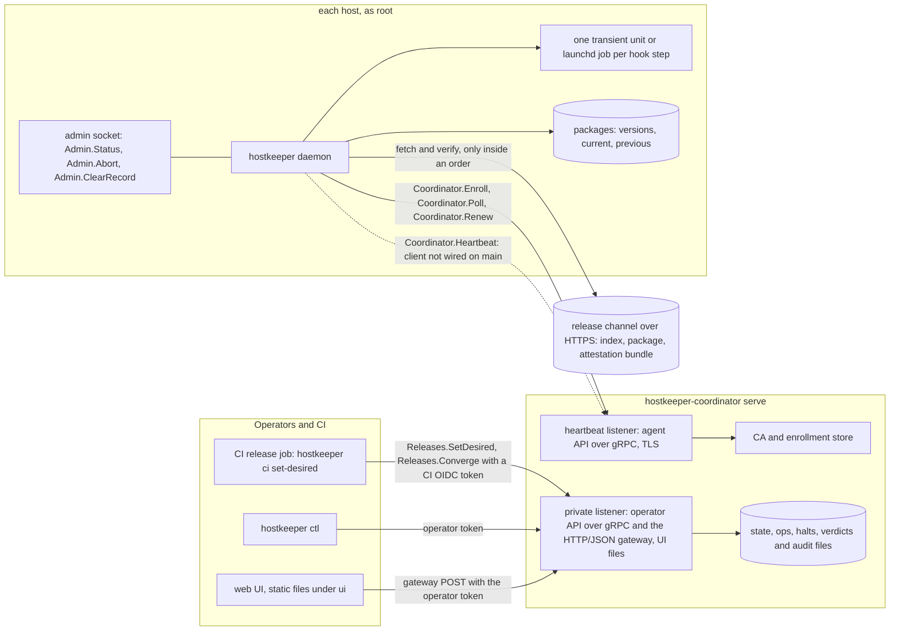
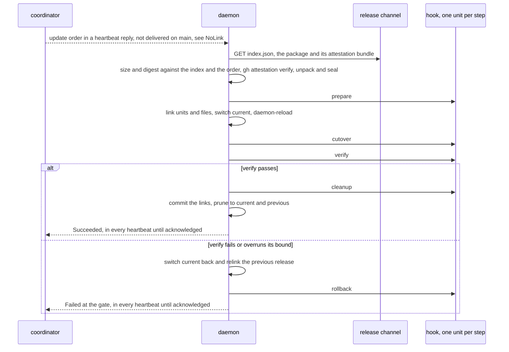

# hostkeeper: a technical report

This report is for an engineer deciding whether to run hostkeeper. It describes the design and the
code **as they are on `main` today**. Every claim links to the code, or to the section of the design
([docs/design/hostkeeper-design.md](../design/hostkeeper-design.md)) that states the intent. Where the
design says more than the code does, the report follows the code and says what is missing.

**How to read the numbers.** Every number in this report sits in a named cell. A cell of the code
names the constant it quotes, and a cell of a measurement names the result file that holds the run.
A measurement not yet taken is an open cell that prints `open` and no number. The test
`cargo test -p xtask --test report` ([crates/xtask/tests/report](../../crates/xtask/tests/report))
fails when a cell disagrees with its source: a constant changed in the code, a number with no row
in its result file, or a number written outside a cell. It lists the open cells. Result files live in
[docs/report/results](results).

## At a glance

hostkeeper is early. Releases are published from `main` as GitHub releases, and its parts are
built and tested one by one, but on `main` they are not yet joined into a path that updates a real
host. Before anything else, an engineer should know these facts:

| Piece | State on `main` |
|---|---|
| Coordinator: rollout gate, desired versions, holds, halts, force, audit, CA and enrollment | Built and tested in process |
| Operator API over gRPC and the HTTP/JSON gateway; generated `hostkeeper ctl`; web UI | Built; three declared methods answer `UNIMPLEMENTED` (see [The two APIs](#the-two-apis)) |
| Assignment of services to roles and hosts; `install` and `uninstall` orders | Built in the coordinator; sent only to a daemon that announces `install-v1`, which the shipped daemon does not |
| Daemon: start-up, boot pass, step runner, dead-man, admin socket, enrollment loop | Built and running in the shipped binary |
| Daemon: package fetch, attestation check, unpack, placed-path linking, force, prune | Built; reachable only through an order |
| Daemon heartbeat to the coordinator | **Not wired**: the shipped daemon gives its heartbeat loop `NoLink`, so it sends no heartbeat and receives no order |
| Linux unit control (daemon-reload, start, stop) for linked units; the step launcher is wired | **Not wired**: the Linux adapter set uses `Unwired`, which refuses every call |
| macOS daemon under launchd | Built; a device run starts it under launchd and asks its status; no update has run on a Mac |
| Releases | Published from `main` as GitHub releases by `release.yml`; no hosted release channel |

The measurements of this report (time to enroll, time to converge, resource use) are open cells
until a farm run fills them, and that run needs the gaps above closed first
([Measurements](#measurements)).

## Problem

A small fleet of Linux hosts (systemd) and macOS hosts (launchd) each runs a few long-lived
services. Each service must be on the right version, and an update must not take a host down
when it fails. hostkeeper does this with **one root daemon per host** and **one coordinator** for
the fleet. It knows no service by name. Each service ships an update hook in its own package, and
the daemon runs that hook through a fixed step contract
([design: Problem](../design/hostkeeper-design.md#1-problem),
[goals](../design/hostkeeper-design.md#21-goals)).

Two programs are built ([crates/hostkeeper](../../crates/hostkeeper),
[crates/hostkeeper-coordinator](../../crates/hostkeeper-coordinator)):

- `hostkeeper`, the host program. Its verbs are `daemon`, `ctl` (the generated command line),
  `ci set-desired` (the CI client), and two plumbing verbs of its own update
  ([crates/hostkeeper-daemon/src/cli.rs](../../crates/hostkeeper-daemon/src/cli.rs)).
- `hostkeeper-coordinator serve`, the coordinator, shipped as a tarball and a container image
  ([packaging/container/Dockerfile](../../packaging/container/Dockerfile)). No systemd unit for it
  is packaged, so the operator supervises it.

Both programs take their configuration from flags and files, not environment variables. The only
environment reads are platform-set: `NOTIFY_SOCKET` for `--notify-systemd`, and the GitHub Actions
token request variables in `hostkeeper ci`.

## Architecture



**The coordinator** has two TLS listeners
([crates/hostkeeper-coordinator/src/config.rs](../../crates/hostkeeper-coordinator/src/config.rs),
[design: The coordinator](../design/hostkeeper-design.md#43-the-coordinator)):

- the **heartbeat listener** serves the agent API, `hostkeeper.agent.v1.Coordinator`, with
  `Heartbeat`, `Enroll`, `Poll` and `Renew`, and the frozen JSON heartbeat route. A heartbeat
  needs a client certificate that names a host. Enrollment is switched on by `--enrollment-dir`
  (with the CA's flags); then `Enroll` and `Poll` need no certificate, because the caller proves
  it holds its key. Without it they answer `UNAVAILABLE` and every connection needs a client
  certificate.
- the **private listener** serves the operator API (`hostkeeper.operator.v1`), the HTTP/JSON gateway
  over the same methods, a few frozen JSON routes kept for compatibility, and, with `--ui-dir`, the
  web UI's files. It refuses a wildcard address, so it binds one interface.

Its state is plain files, not a database. The desired state is in `--state-file`. Exclusions,
labels, holds, assignments and minimum versions, uninstall intents, bad marks, the last good
version, a standing force and the inventory are in the ops file, and beside it sit the halts file
and an append-only audit file. Spent CI token ids and acknowledged verdicts have files of their
own. An exclusive lock file makes a second coordinator on the same files refuse to start. The fleet
itself (each host's last heartbeat, outstanding orders, bake counts) is in memory and is rebuilt
from heartbeats after a restart
([design: State](../design/hostkeeper-design.md#10-state-where-each-thing-lives-and-who-writes-it)).

**The daemon** is one root process. It listens on no network port and always dials the
coordinator, so the coordinator never connects to a host
([design: The design in one picture](../design/hostkeeper-design.md#3-the-design-in-one-picture)).
Its one trust root is the root-owned config `/etc/hostkeeper/hostkeeper.toml`. That file names the
coordinator's address, the SHA-256 of the fleet's CA certificate (`ca_sha256`), the release
channel, the trusted signers and the daemon's bounds. A strict loader refuses unknown keys
([crates/hostkeeper-config/src/daemon.rs](../../crates/hostkeeper-config/src/daemon.rs)).
The coordinator cannot change it. The daemon's local interface is a unix socket that serves
`hostkeeper.local.v1.Admin` (`Status`, `Abort`, `ClearRecord`) to root only
([crates/hostkeeper-daemon/src/admin.rs](../../crates/hostkeeper-daemon/src/admin.rs)).
`hostkeeper ctl` has no command for it, so a root user needs a gRPC client of their own.

**The gap that matters most.** The heartbeat client exists in
[crates/hostkeeper-link](../../crates/hostkeeper-link), with gRPC over mutual TLS
(`GrpcMtlsLink`), a JSON form and one that negotiates between them. Each call is bounded to
<span data-cell="c-call" data-source="crates/hostkeeper-link/src/dial.rs" data-item="CALL_SECS">10 s</span>.
The shipped daemon does not use it. `host_links` gives the heartbeat loop `NoLink`, whose every
call fails as unsupported
([crates/hostkeeper-daemon/src/cli.rs](../../crates/hostkeeper-daemon/src/cli.rs),
[crates/hostkeeper-daemon/src/links.rs](../../crates/hostkeeper-daemon/src/links.rs)). The
enrollment loop is wired and talks to the coordinator. The heartbeat loop runs but sends nothing,
so no order from the coordinator reaches a host built from `main`. Wiring a link would not be
enough for every order either: the heartbeat loop runs only `update` and `force` orders and drops
the rest, and the daemon announces neither `install-v1` nor `abort-v1`, the features the
coordinator requires before it sends an install, an uninstall or an abort
([crates/hostkeeper-link/src/beat.rs](../../crates/hostkeeper-link/src/beat.rs),
[crates/hostkeeper-link/src/order.rs](../../crates/hostkeeper-link/src/order.rs)).

## Identity and enrollment

**What a host's identity is.** A host is named by an **operator-chosen host id** (a DNS label of at
most
<span data-cell="c-host-id" data-source="crates/hostkeeper-wire/src/names.rs" data-item="MAX_LEN">63</span>
bytes of `a-z0-9-`, [crates/hostkeeper-wire/src/names.rs](../../crates/hostkeeper-wire/src/names.rs)). The id is bound
to the host's own key by the SHA-256 of that key, at the moment an operator approves the
request. The identity is not derived from a MAC address. MAC addresses, the DMI serial, the
machine id and (on a Mac) the serial number and platform UUID travel as **claims**. Claims help an
operator recognise the machine and match it against the inventory, but they authorise nothing
([crates/hostkeeper-enroll/src/claims.rs](../../crates/hostkeeper-enroll/src/claims.rs),
[crates/hostkeeper-coordinator/src/inventory.rs](../../crates/hostkeeper-coordinator/src/inventory.rs)).

**The inventory** is a table the operator keeps (`Enrollment.AddRecord`, `ListRecords`,
`RemoveRecord`, and the UI's Inventory page): host id, role, data MACs, BMC MAC, serial and notes,
at most
<span data-cell="c-inventory" data-source="crates/hostkeeper-coordinator/src/inventory.rs" data-item="MAX_RECORDS">10,000</span>
records. `Enrollment.List` marks each pending request as matched, unmatched or ambiguous against
it. A match fills the approval form but approves nothing. The daemon has the logic to read the BMC
MAC over IPMI, but no IPMI reader is built, so the shipped daemon never sends a BMC MAC
([design: Enrollment and remote install](../design/hostkeeper-design.md#57-enrollment-and-remote-install)).

**The CA** is a module of the coordinator, not a separate process
([crates/hostkeeper-enrollment/src/ca](../../crates/hostkeeper-enrollment/src/ca),
[docs/enrollment-coordinator.md](../enrollment-coordinator.md)). Its key is one P-256 `PKCS#8` file
of mode `0600` (`--ca-key-file`), made once with `--ca-init`. Its self-signed certificate is valid for
<span data-cell="c-ca" data-source="crates/hostkeeper-enrollment/src/ca/issue.rs" data-item="CA_VALIDITY_SECS">20 years</span>,
and every daemon pins its SHA-256. It issues host client certificates (subject `CN=host:<id>`,
client authentication only) valid for
<span data-cell="c-host-cert" data-source="crates/hostkeeper-enrollment/src/ca/issue.rs" data-item="HOST_VALIDITY_SECS">7 days</span>,
and the coordinator's own server certificate, valid for at most
<span data-cell="c-server-cert" data-source="crates/hostkeeper-enrollment/src/ca/issue.rs" data-item="SERVER_VALIDITY_CAP_SECS">90 days</span>.
The server certificate is remade only at a start that finds it missing or in the last third of its
life; nothing renews it while the coordinator runs, so the coordinator must be restarted within
that life. Rotating the CA, revocation lists and backups are not built: backup is a written procedure
([docs/operations/ca-backup.md](../operations/ca-backup.md)).

```mermaid
sequenceDiagram
  participant D as daemon, enrollment loop
  participant C as coordinator, heartbeat listener
  participant S as CA and enrollment store
  participant O as operator, ctl or UI
  D->>C: TLS probe; the CA's hash must equal ca_sha256, else nothing is sent
  D->>D: make a P-256 key and write it before posting
  D->>C: Coordinator.Enroll with the CSR, the claims and the image name
  C->>S: store the pending request, its id the SHA-256 of the key
  C-->>D: PENDING
  loop until an operator approves
    D->>C: Coordinator.Poll without a signature, to get a nonce
    D->>C: Coordinator.Poll with the nonce signed by the key
    C-->>D: PENDING
  end
  O->>S: Enrollment.List, then Enrollment.Approve with host id, key hash and role
  D->>C: Coordinator.Poll, signed
  C->>S: issue the certificate for host ID, once per request
  C-->>D: ISSUED with the certificate and the CA bundle
  D->>D: check it against the pinned CA and its own key, store a new generation
  Note over D,C: from half its life, Coordinator.Renew over mutual TLS, no operator step
```

The steps, in the code ([crates/hostkeeper-enroll](../../crates/hostkeeper-enroll),
[crates/hostkeeper-coordinator/src/enrollment](../../crates/hostkeeper-coordinator/src/enrollment)):

- The daemon checks the coordinator's CA against `ca_sha256` before it sends anything. It then
  makes a P-256 key, writes it durably, and posts `Enroll`. A reposted key is the same request.
- It polls every
  <span data-cell="c-enroll-retry" data-source="crates/hostkeeper-enroll/src/enroller.rs" data-item="RETRY_SECS">5 s</span>
  (each call bounded to
  <span data-cell="c-enroll-timeout" data-source="crates/hostkeeper-daemon/src/cli.rs" data-item="ENROLL_TIMEOUT">30 s</span>).
  A poll is signed over a fresh nonce of
  <span data-cell="c-nonce" data-source="crates/hostkeeper-coordinator/src/enrollment/nonce.rs" data-item="NONCE_BYTES">32</span>
  bytes, so polling needs no clock. The host does need a correct wall clock: it refuses a
  certificate that is not valid now, and it decides renewal and expiry by that clock. At most
  <span data-cell="c-pending" data-source="crates/hostkeeper-enrollment/src/enroll/store.rs" data-item="DEFAULT_MAX_PENDING">256</span>
  requests may be pending (`--max-pending-enrollments`). Pending requests do not expire.
- An operator approves with `Enrollment.Approve`, giving the request id, the key hash shown by
  `Enrollment.List`, the host id, the role, the services to assign to the host and a reason. The
  approval is one durable write, followed by an audit entry (`enroll_approve`, or `enroll_replace`)
  and an `assign` entry per service. The certificate is made at the next signed poll, once per
  request.
- The daemon checks the certificate against the pinned CA and its own key, then stores it as a new
  generation under `/etc/updater/pki` with a `current` link.
- From half its life the daemon renews over mutual TLS with no operator step. A host that was away
  past expiry posts a new request for the same host id with the same key, and an operator approves
  it again.

A request is marked `DUPLICATE_CLAIM` when it presents a machine id, or a globally unique MAC,
already bound to an enrolled host, as a re-imaged or cloned machine does; it is approved only with
`replace`. `Approve` with `replace` moves a host id to a new key, after which the old key's
certificate no longer identifies the host. There is no operator call to deny or retire a host.
The coordinator has the deny and retire states, but nothing outside its tests writes them. Mac auto-approval by a
one-use MDM nonce (valid
<span data-cell="c-mac-nonce" data-source="crates/hostkeeper-enrollment/src/enroll/mac_nonce.rs" data-item="MAC_NONCE_VALID_SECS">3600 s</span>)
is built in the coordinator's library. The shipped coordinator wires its device check to
`NoDeviceState` and the daemon never sends a nonce, so a Mac is approved by an operator like any
host.

**The daemon's certificate request.** The daemon builds every certificate request, for `Enroll`
and for `Renew`, with the one subject `CN=host:pending`
([crates/hostkeeper-enroll/src/key.rs](../../crates/hostkeeper-enroll/src/key.rs), `csr_der`):
the CA's profile accepts only a subject that is exactly one `CN=host:<id>`
([crates/hostkeeper-enrollment/src/ca/profile.rs](../../crates/hostkeeper-enrollment/src/ca/profile.rs),
`check_request`) and refuses anything else as `bad_csr`. The id is assigned at approval, and the CA
never takes it from the request: the certificate's subject is always the approved id. An earlier
daemon sent an empty subject, which the CA refused, so no daemon could finish enrollment. The tests
in [crates/hostkeeper-enroll/tests/enroll/coordinator.rs](../../crates/hostkeeper-enroll/tests/enroll/coordinator.rs)
hold the daemon's own requests to the CA's profile, and drive the daemon's enroller against the
coordinator's own enrollment and CA through approval, the first certificate and its renewal.

## The two APIs

Every API is a protobuf service in [crates/hostkeeper-proto](../../crates/hostkeeper-proto),
compiled in pure Rust with nothing generated checked in
([design: The operator API](../design/hostkeeper-design.md#48-the-operator-api)):

- `hostkeeper.agent.v1`: `Coordinator` with `Heartbeat`, `Enroll`, `Poll` and `Renew`;
- `hostkeeper.operator.v1`: `Hosts`, `Releases`, `Services`, `Enrollment` and `Audit`;
- `hostkeeper.local.v1`: `Admin` on the daemon's socket.

**gRPC and HTTP/JSON, both full.** The private listener serves every unary method of
`hostkeeper.operator.v1` a second time as `POST /hostkeeper.operator.v1.<Service>/<Method>`, with a
proto3 canonical JSON body and `Authorization: Bearer <token>`
([crates/hostkeeper-coordinator/src/grpc/gateway.rs](../../crates/hostkeeper-coordinator/src/grpc/gateway.rs),
[docs/gateway.md](../gateway.md)). The gateway is generic. A path is a gateway path when it names a
unary method of that package in the embedded descriptors, and the call goes to the same in-process
service as gRPC, through the same credential check. So no method exists on one surface and not the
other. A body is at most
<span data-cell="c-operator-bytes" data-source="crates/hostkeeper-coordinator/src/http.rs" data-item="MAX_OPERATOR_BYTES">4096</span>
bytes. A test holds [docs/gateway.md](../gateway.md)'s status table equal to the code's.

**What the operator API does not do yet.** Three declared methods answer `UNIMPLEMENTED`:
`Hosts.List`, `Hosts.Get` and `Releases.UnmarkBad` (the `PENDING` list in
[crates/hostkeeper-coordinator/src/grpc/mod.rs](../../crates/hostkeeper-coordinator/src/grpc/mod.rs)).
A test fails if any other method answers so.

**Credentials.** CI authenticates with a GitHub Actions OIDC token, checked against an allow-list
(`--oidc-config`) by [crates/hostkeeper-oidc](../../crates/hostkeeper-oidc). It allows a clock
leeway of
<span data-cell="c-oidc-leeway" data-source="crates/hostkeeper-oidc/src/config.rs" data-item="LEEWAY_SECS">60 s</span>
and a token lifetime of at most
<span data-cell="c-oidc-lifetime" data-source="crates/hostkeeper-oidc/src/config.rs" data-item="DEFAULT_MAX_LIFETIME_SECS">600 s</span>
by default, and each token is good once. Within the operator API, CI's token reaches only
`Releases.SetDesired` and `Releases.Converge` (and their two frozen JSON routes). An operator uses
a named bearer token (`--tokens-file`: names and SHA-256 hashes, re-read while running, so revoking one needs no restart). A token either operates or does
not, with no per-token grants. An operator token is refused on `SetDesired` and `Converge`: the
operator does not set the desired version, CI does.

**`hostkeeper ctl` is generated from the protos.** The build of `hostkeeper-proto` writes one
command per method of every non-local service. `hostkeeper ctl` builds its command tree from that
table at run time and calls over gRPC or the gateway (`--transport`)
([crates/hostkeeper-ctl](../../crates/hostkeeper-ctl), [docs/ctl.md](../ctl.md)). The test
`docs_ctl_md_is_current` regenerates [docs/ctl.md](../ctl.md) and fails when it differs, and a
golden command tree makes a removed flag or a changed exit code fail. `hostkeeper ci set-desired`
wraps `ctl releases set-desired` and `releases converge` for a release job
([docs/deploy/ci-client.md](../deploy/ci-client.md)).

**The web UI is built on the gateway.** [ui/](../../ui) is static HTML, one stylesheet and
JavaScript modules, with no framework and no build step. Its pages are Fleet, Host, Rollout, Holds,
Enrollment, Inventory and Audit, and each button is one gateway call made with the operator's token,
held in page memory only. The coordinator serves the files under `/ui/` of its private listener when
started with `--ui-dir` ([docs/ui-serving.md](../ui-serving.md)). The packages do not include the
files. Because `Hosts.List` and `Hosts.Get` are not served, the Fleet and Host pages and the Rollout
page's force dialog get a refusal instead of data. The Rollout page's convergence button sends
`Releases.Converge` with the operator's token, which the coordinator refuses, and its unmark button
calls `Releases.UnmarkBad`, which is not served. The UI tests run the app in a JavaScript engine
against a fake gateway ([crates/hostkeeper-ui-tests](../../crates/hostkeeper-ui-tests)), so they
catch none of these.

**Wire compatibility.** `the_protos_keep_every_rule_against_the_baseline` compares the compiled
descriptors with a committed baseline and fails on any removed, renumbered, renamed or retyped
field, method or enum value
([crates/hostkeeper-proto/src/compat.rs](../../crates/hostkeeper-proto/src/compat.rs)).

## Packages

A service version ships as **one package per platform**, `<service>-<version>-<platform>.tar.zst`.
A package is one zstd frame holding one tar archive whose top level is `manifest.toml`, `bin/`,
`units/` and `files/` ([docs/package-format.md](../package-format.md),
[design: The package](../design/hostkeeper-design.md#47-the-package)). The platforms are a closed
set, `linux-x86_64`, `linux-arm64` and `macos-arm64`. The daemon knows its own from the target it
was compiled for ([crates/hostkeeper-config/src/platform.rs](../../crates/hostkeeper-config/src/platform.rs)).

**The release index and the channel layout.** An order names a service and a version only. The
daemon reads `<release_channel>/<service>/<version>/index.json`, takes the entry for its platform,
then fetches the archive and its attestation bundle (`.sigstore.json`) beside it
([crates/hostkeeper-package](../../crates/hostkeeper-package),
[design: Fetching, verifying and unpacking](../design/hostkeeper-design.md#55-fetching-verifying-and-unpacking-a-package)).
The index is a lookup, not a trust anchor, and is read up to
<span data-cell="c-index" data-source="crates/hostkeeper-package/src/index.rs" data-item="MAX_INDEX_BYTES">64 KiB</span>.
`cargo xtask release channel-stage` lays one release out in that tree and checks it with the
daemon's own parser ([docs/deploy/release-channel.md](../deploy/release-channel.md)). No workflow
uploads a channel. The operator stages it and serves it over HTTPS.

**Fetch.** HTTPS only, no redirects, no proxy, a connect timeout of
<span data-cell="c-connect" data-source="crates/hostkeeper-package/src/stage.rs" data-item="CONNECT_TIMEOUT">30 s</span>
and a whole-fetch deadline from the config's `[bounds]`. The archive is hashed as it arrives and the
transfer stops once it passes the indexed size. Its size and SHA-256 must equal the index entry,
and its SHA-256 must also equal the order's `package_digest`
([crates/hostkeeper-daemon/src/real_packages.rs](../../crates/hostkeeper-daemon/src/real_packages.rs)).
The config is refused when its largest package could not arrive in its fetch deadline at
<span data-cell="c-min-rate" data-source="crates/hostkeeper-config/src/daemon.rs" data-item="MIN_FETCH_BYTES_PER_SEC">262,144</span>
bytes per second.

**Signing.** Packages are attested in CI. Per commit, `artifacts.yml` builds the binaries, the
packages, deb and rpm, an SBOM, a coordinator image built twice and compared, and an unsigned
macOS installer. It attests every file it sums, with a bundle beside each archive, package and
installer, and SBOM attestations for the binaries. `release.yml` publishes a release from `main`
with no manual tag step, once `ci`, `privileged` and `artifacts` have passed on the commit; a
failed `privileged` run holds later releases
([.github/workflows/artifacts.yml](../../.github/workflows/artifacts.yml),
[.github/workflows/release.yml](../../.github/workflows/release.yml),
[docs/deploy/verify-a-release.md](../deploy/verify-a-release.md)). On the host, a pinned `gh
attestation verify` runs offline against the Sigstore trusted root and the config's one
`[trusted_signers]` entry (organisation, workflow, ref globs, hosted runner). There is no unsigned
mode. The bundle is read up to
<span data-cell="c-bundle" data-source="crates/hostkeeper-package/src/bundle.rs" data-item="MAX_BUNDLE_BYTES">1 MiB</span>.
The pinned `gh` and the trusted root are expected under `/usr/lib/hostkeeper/`
([crates/hostkeeper-daemon/src/cli.rs](../../crates/hostkeeper-daemon/src/cli.rs)), but no
package of this repository installs them. Until an operator places them, every package check ends
`attestation_unavailable`.

**Unpack.** One streaming pass (zstd, tar, a SHA-256 per file) writes into a private staging
directory, under hard bounds: a zstd window of at most
<span data-cell="c-window" data-source="crates/hostkeeper-unpack/src/archive.rs" data-item="MAX_WINDOW_BYTES">8 MiB</span>,
names at most
<span data-cell="c-depth" data-source="crates/hostkeeper-unpack/src/archive.rs" data-item="MAX_DEPTH">16</span>
components deep, a manifest of at most
<span data-cell="c-manifest" data-source="crates/hostkeeper-config/src/manifest.rs" data-item="MAX_MANIFEST_BYTES">65,536</span>
bytes, and the config's bounds on unpacked bytes and entries. Only regular files and directories
are accepted, with no setuid bits and no names that collide when case is folded. The tree is made
root-owned and read-only, then sealed: a seal file records its tree digest and package digest, and
the version directory appears by rename
([crates/hostkeeper-unpack](../../crates/hostkeeper-unpack)). Before every step the runner
re-hashes the staged tree and compares it with the digest taken when the order began.

**Versions and links.** Each service keeps `current` and `previous` links under
`/var/lib/hostkeeper/packages/<service>/`. After a confirmed switch the daemon prunes every other
version that nothing still needs. Units are linked from `current` into the unit directory
(`/etc/systemd/system`, or `/Library/LaunchDaemons` on a Mac) and files to the paths the manifest
names, so one switch of `current` re-points them all. A write-ahead record, `placed.json`, lets
a crash be repaired at the next start
([crates/hostkeeper-placed](../../crates/hostkeeper-placed)).

## Rollout

**Roles and assignment.** The coordinator reads a rollout file at start, with one `[[service]]`
table per managed service and at most
<span data-cell="c-services" data-source="crates/hostkeeper-wire/src/wire.rs" data-item="MAX_SERVICES">16</span>
services ([crates/hostkeeper-coordinator/src/services.rs](../../crates/hostkeeper-coordinator/src/services.rs)).
A change to it needs a restart. The rollout file assigns each service to the hosts of its `roles`,
or to the hosts its selector of roles and operator-set labels picks. The operator's entries go on
top, and the first that applies decides: an entry of the host itself, then an entry of the host's
role, then the rollout file (`Services.Assign`, `Services.Unassign`, kept in the ops file;
[docs/operations/assignments.md](../operations/assignments.md),
[crates/hostkeeper-coordinator/src/assignment.rs](../../crates/hostkeeper-coordinator/src/assignment.rs)).
An enrollment approval assigns the services it names to the new host the same way.
`Services.SetMinVersion` sets a floor for a role or a host. A host assigned a service it does not
run is ordered `install` of the desired version, under every rule of an update. `Unassign` with
`uninstall` orders the hosts that lose the service to uninstall it. Both orders go only to a daemon
that announces `install-v1`, and the shipped daemon does not announce it (its features are in
[crates/hostkeeper-link/src/beat.rs](../../crates/hostkeeper-link/src/beat.rs)).

**Desired versions.** CI sets a service's desired version with `Releases.SetDesired` and its OIDC
token. The coordinator keeps it, and the package digest of every version CI has set, in the
state file. It refuses a version marked bad or below the service's `min_version`. A new desired
version ends a standing force and lifts a halt the updater raised, but not one a hook or an
operator raised ([crates/hostkeeper-coordinator/src/desired.rs](../../crates/hostkeeper-coordinator/src/desired.rs),
[design: The rollout gate](../design/hostkeeper-design.md#54-the-rollout-gate-which-hosts-may-update-now)).

**One live update at a time, fleet-wide.** Each heartbeat is decided under one lock, and a reply
carries at most one order. The gate allows **one ordinary update at a time across every service and
every host** ([crates/hostkeeper-coordinator/src/decide.rs](../../crates/hostkeeper-coordinator/src/decide.rs)).
A host holds that slot from the moment it is ordered until it has finished and baked. An order the
host never reports frees the slot after
<span data-cell="c-order-age" data-source="crates/hostkeeper-coordinator/src/fleet.rs" data-item="ORDER_AGE">120 s</span>.
The gate's rules, first closed rule wins, are halted, held, quiet start, bad version, below
`min_version`, updating, busy with another service, failed here, deferred, canary wait, no slot and
baking. `Releases.Status` shows each host's reason. There is no group size: `max_updating` and
`min_up` are stored but no decision reads them. A rollout is therefore serial across hosts and
services, and its length grows with the fleet.

**Canary, bake and automatic rollback.** `canary = { count = n }` offers the version to the first
`n` hosts by node id before the rest. `bake_beats` keeps an updated host's slot until it sends that
many healthy heartbeats in a row at the desired version, at most
<span data-cell="c-bake" data-source="crates/hostkeeper-coordinator/src/bake.rs" data-item="MAX_BAKE_BEATS">100</span>.
The count is kept in memory, so after a coordinator restart every host bakes again.
With `rollback = "automatic"`, release-class failures reaching the larger of a percentage of live
hosts and a minimum count mark the desired version bad and set desired back to the last version that
converged and baked ([crates/hostkeeper-coordinator/src/reconcile.rs](../../crates/hostkeeper-coordinator/src/reconcile.rs)).
That rollback goes out as an ordinary `update` to the lower version. The daemon refuses an `update`
below the version it runs (`below_running`), so a host that already took the bad version is not
moved back by it. `Releases.Force` is the operator's repair.

**Holds.** `Services.Hold` holds one service on one host, on a role or on the whole fleet, with a
reason ([docs/operations/holds-and-force.md](../operations/holds-and-force.md)). A held pair is
ordered nothing, takes no slot and is never a canary. At most
<span data-cell="c-holds" data-source="crates/hostkeeper-coordinator/src/holds.rs" data-item="MAX_HOLDS">4096</span>
holds are kept in the ops file, and they survive a restart. `Hosts.Exclude` takes a host out of a
service (with `abandon`, it also frees the host's slot at once).

**Force and abort.** `Releases.Force` orders a hookless `force` of a service to a version on the
whole fleet, a role or named hosts, at each target's next heartbeat, past the single slot, canary,
bake, bad marks and halts. The daemon fetches the package if needed, stops the old units, switches
`current`, links, starts the new units and reports, running no hook
([crates/hostkeeper-coordinator/src/force.rs](../../crates/hostkeeper-coordinator/src/force.rs),
[crates/hostkeeper-daemon/src/verbs/force](../../crates/hostkeeper-daemon/src/verbs/force),
[design: Force](../design/hostkeeper-design.md#56-force-the-fleet-wide-fix)). A force reaches only
hosts that have already announced the service in a heartbeat. It is refused for the `hostkeeper`
service itself and for a version CI never registered a digest for. `Hosts.Abort` is accepted and
audited. The coordinator sends it only to a daemon that announced `abort-v1`, and the shipped daemon
announces no such feature, so today an abort is done on the host through the admin socket.

**The audit trail.** Every change to the ops store is one entry: who (operator token name, `ci` or
`coordinator`), the action, the service, the host and the reason. The entries go to an append-only
audit file, one JSON line each, fsynced, never rotated. The file is a copy, not a gate: a line
that cannot be appended is logged as an error and the change stands. The ops file keeps the last
<span data-cell="c-audit-ring" data-source="crates/hostkeeper-coordinator/src/ops.rs" data-item="AUDIT_RING">64</span>
entries for `Releases.Status`. `Audit.List` filters the whole file, at most
<span data-cell="c-audit-page" data-source="crates/hostkeeper-coordinator/src/operator.rs" data-item="MAX_AUDIT_PAGE">256</span>
entries a page ([crates/hostkeeper-coordinator/src/audit_file.rs](../../crates/hostkeeper-coordinator/src/audit_file.rs)).
A plain `SetDesired` by CI writes no audit entry (only the force it ends, `force_ended`, and the
halt it lifts, `lift_halt`, are audited as `ci`), and a wire entry carries no time: the time is
only in the file.

## Update hooks

**The step contract** is in [crates/hostkeeper-hook](../../crates/hostkeeper-hook)
([design: How a hook runs](../design/hostkeeper-design.md#53-how-a-hook-runs),
[host-updates: The step contract](../design/host-updates.md#32-the-step-contract)). A service's
hook is an executable in its package, named by the manifest's `[hook] command`. An update runs
`prepare`, `cutover`, `verify` and `cleanup`, and runs `rollback` after a failure. Each step gets
the step word, the staged release (to `prepare` only) and `--params <file>`, a TOML file of the
manifest's `[params]` plus reserved `updater.*` keys. The leading arguments of the manifest's
`command` are not passed to these steps, only to the `boot` and `uninstall` steps
([crates/hostkeeper-daemon/src/verbs/update.rs](../../crates/hostkeeper-daemon/src/verbs/update.rs)),
so a hook must accept the bare step word. Its exit code is
<span data-cell="c-exit-ok" data-source="crates/hostkeeper-hook/src/exit.rs" data-item="EXIT_OK">0</span>
for success,
<span data-cell="c-exit-failure" data-source="crates/hostkeeper-hook/src/exit.rs" data-item="EXIT_FAILURE">1</span>
for failure,
<span data-cell="c-exit-deferred" data-source="crates/hostkeeper-hook/src/exit.rs" data-item="EXIT_DEFERRED">75</span>
for deferred and
<span data-cell="c-exit-halt" data-source="crates/hostkeeper-hook/src/exit.rs" data-item="EXIT_HALT">76</span>
for halt. Any other code, a signal or a timeout is a failure. The last stdout line, read up to
<span data-cell="c-last-line" data-source="crates/hostkeeper-steps/src/capture.rs" data-item="LAST_LINE_MAX">64 KiB</span>,
is an optional JSON report: class `release` or `environment`, a reason, `retry_after_secs`,
`reversible` and `promotion_pending`. The last
<span data-cell="c-ring" data-source="crates/hostkeeper-steps/src/capture.rs" data-item="RING_BYTES">1024 KiB</span>
of each stream is kept. Each step's bound comes from the manifest's `[hook.timeout_secs]`. Only
`prepare` may be unbounded, and the daemon has no default. The phase of a failure is decided by the
updater, never by the hook: before commit, at the gate, after commit (once a step said
`reversible: false`), or halt.

**The step launcher.** On Linux, `SystemdLauncher` runs each step as root in a transient unit,
`systemd-run --system --wait --collect --pipe --unit=updater-<service>-<step>-<generation>
--property=RuntimeMaxSec=<secs|infinity>`, with no other property: no user, no capabilities, no
sandbox ([crates/hostkeeper-steps/src/systemd.rs](../../crates/hostkeeper-steps/src/systemd.rs)). A
dead-man thread polls every
<span data-cell="c-deadman" data-source="crates/hostkeeper-daemon/src/cli.rs" data-item="DEADMAN_POLL_SECS">1 s</span>
and stops a unit by name at its deadline, and `RuntimeMaxSec` still ends it if the daemon has died
([design: The dead-man](../design/hostkeeper-design.md#63-the-dead-man)). On macOS,
`LaunchdLauncher` runs each step as a transient launchd job in the system domain. launchd has no
`RuntimeMaxSec`, so the launcher polls the job every
<span data-cell="c-launchd-poll" data-source="crates/hostkeeper-launchd/src/launcher.rs" data-item="POLL">500 ms</span>
and boots it out at its bound ([crates/hostkeeper-launchd/src/launcher.rs](../../crates/hostkeeper-launchd/src/launcher.rs)).
That bound is the launcher's alone: if the daemon dies, a bounded step runs on until the restarted
daemon finds it in its record and stops it.
Either way a step stopped at its bound has no exit code and is a failure. Neither launcher runs the
"additive" steps yet (a manifest's `boot` step, the hook's `uninstall` step, the self-update probe):
both refuse to start them.

**The step record** (`step-record.json` under `/var/lib/updater/state/<service>/`) is written
`running` before each step and `done` after it, with an fsync and a rename. After a daemon crash the
running step's unit is stopped by name and the step runs again. After a reboot (a new boot id), an
uncommitted update is rolled back and a committed one goes on to `verify` with a fresh window
([crates/hostkeeper-steps/src/resume.rs](../../crates/hostkeeper-steps/src/resume.rs),
[design: The step runner](../design/hostkeeper-design.md#62-the-step-runner)).



**How a failed verify rolls back** ([crates/hostkeeper-hook/src/next.rs](../../crates/hostkeeper-hook/src/next.rs),
[crates/hostkeeper-daemon/src/place.rs](../../crates/hostkeeper-daemon/src/place.rs)):
`verify` has its own window, from the end of `cutover` to `verify_deadline_secs`. A `verify` that
exits non-zero, or still defers when the window ends, sends the runner to `rollback`. Before
running the hook's `rollback`, the daemon points `current` back at the previous version and relinks
that release's units and files. On a first install it removes the links instead. Then it runs the
new release's `rollback` step, and the host reports `Failed` at the gate phase (after the commit, if a step had said
`reversible: false`) with the rollback's reason, or else `verify`'s. Restarting the old service is the hook's job. A deferred `rollback` is retried
<span data-cell="c-rollback-attempts" data-source="crates/hostkeeper-steps/src/runner.rs" data-item="ROLLBACK_ATTEMPTS">3</span>
times, after `retry_after_secs` or
<span data-cell="c-retry" data-source="crates/hostkeeper-steps/src/runner.rs" data-item="DEFAULT_RETRY_SECS">60 s</span>
by default, and never more than
<span data-cell="c-max-retry" data-source="crates/hostkeeper-steps/src/runner.rs" data-item="MAX_RETRY_SECS">3600 s</span>.
A `rollback` that fails, or still defers after those retries, is a halt (the service takes no
further order until the halt is cleared), unless its report says `reversible: false`, which makes it
`Failed` after the commit; a first install whose `rollback` declines with `no_previous_release`
ends `Failed`. A failed `cleanup` that says `reversible: true` before any commit sends the update to
`rollback`; any other failed `cleanup` is retried
<span data-cell="c-cleanup-retries" data-source="crates/hostkeeper-config/src/manifest.rs" data-item="DEFAULT_CLEANUP_RETRIES">3</span>
times by default (the manifest's `cleanup_retries`), then ends `Failed` after the commit. A hook
that reports `promotion_pending` is watched after success: `verify` runs again after its
`retry_after_secs`, or every
<span data-cell="c-watch" data-source="crates/hostkeeper-steps/src/runner.rs" data-item="WATCH_POLL_SECS">30 s</span>
by default, until it passes without the flag. Any other result, or the ceiling, ends the update
`Failed` after the commit (or a halt), and the watcher never rolls back
([design: The post-success watcher](../design/hostkeeper-design.md#64-the-post-success-watcher)).

**On a Linux host built from `main` a hooked update stops before `cutover`.** The switch before
`cutover` runs `daemon-reload` through the adapter set's unit control, and on Linux that is
`Unwired`, which refuses every call
([crates/hostkeeper-daemon/src/adapters.rs](../../crates/hostkeeper-daemon/src/adapters.rs)).
`hostkeeper-placed` has a `systemctl` unit control, but the daemon does not use it. The macOS
adapter set has a real launchd unit control.

**The example service.** [examples/hello](../../examples/hello) is a loopback HTTP server with an
update hook and two unit slots that it swaps at `cutover` ([docs/hello.md](../hello.md)). Its
`-fail-ready` build answers its readiness check with an error, so its `verify` fails and its
`rollback` restarts the old slot. That is the case the rollback measurement uses. `hello` is not
run through the conformance harness in this repository.

## macOS specifics

The same daemon runs on Apple silicon (`macos-arm64`; an Intel Mac is not a platform). The adapter
set is chosen when the binary is compiled
([crates/hostkeeper-daemon/src/adapters.rs](../../crates/hostkeeper-daemon/src/adapters.rs),
[docs/macos.md](../macos.md), [design: macOS](../design/hostkeeper-design.md#59-macos)):

- launchd runs the daemon as `dev.hostkeeper.hostkeeper` from `/Library/LaunchDaemons`, with
  `KeepAlive`. Hook steps are transient launchd jobs bounded by the launcher, as above
  ([crates/hostkeeper-launchd](../../crates/hostkeeper-launchd)).
- Service state comes from `launchctl print`. A process is identified by its pid and start time,
  and its executable by the device and inode of the image it runs, so a binary renamed over while it
  runs is not mistaken for the running one.
- Every unpacked package is checked for the quarantine attribute, and every Mach-O file must carry
  a valid code signature (ad-hoc accepted; no team identity or notarisation check).
- Enrollment claims are the serial number and platform UUID from `ioreg`.
- Self-update: launchd has no start limit, so `hostkeeper self-update-fallback` counts starts
  itself and falls back after
  <span data-cell="c-burst" data-source="crates/hostkeeper-steps/src/selfupdate.rs" data-item="START_LIMIT_BURST">3</span>
  starts within
  <span data-cell="c-burst-window" data-source="crates/hostkeeper-steps/src/selfupdate.rs" data-item="START_LIMIT_WINDOW_SECS">300 s</span>.
  The timer job meant to run it is rendered but not installed.
- The installer is an unsigned `.pkg` holding the binary and the daemon's plist, with no scripts. The
  operator writes `hostkeeper.toml`.

The `macos-device` job of [.github/workflows/privileged.yml](../../.github/workflows/privileged.yml)
runs as root on a hosted Mac after each merge to `main`. It shows real `codesign` and quarantine
verdicts, the process identity check, launchd job states, a fixture hook stopped at its bound, and
the daemon started under launchd answering `Status`. No update, no linked unit and no enrollment has
run on a Mac. Not built for Macs: MDM, the boot id that tells a reboot from a daemon restart (it is
read from a Linux path), version confirmation by executable digest, and support files at macOS
paths (the CA bundle, `gh` and the trusted root use their Linux paths).

## Failure model

What the code does, by failure
([design: Races and failures](../design/hostkeeper-design.md#8-races-and-failures)):

- **The coordinator dies or is unreachable.** Steps already running need no coordinator. Each runs
  on its own thread, bounded by the dead-man and its unit, and its verdict waits in memory to be sent
  with a heartbeat that works. The heartbeat loop beats on a fixed period, with no backoff. A
  restarted coordinator keeps its files (desired state, ops, halts, verdicts, spent tokens,
  enrollment store) and forgets the fleet. Its rollout gate and automatic rollback order nothing
  for a quiet start of at least
  <span data-cell="c-quiet" data-source="crates/hostkeeper-coordinator/src/fleet.rs" data-item="QUIET_START">30 s</span>,
  while it hears every host again; a standing force is resent at once. Bake counts, deferral
  backoff and queued aborts start from zero. A halt is written under a marker, and a start that finds the marker is refused until an operator
  settles it. There is one coordinator and no failover.
- **A host dies or reboots mid-step.** The step record and the boot id decide (see
  [Update hooks](#update-hooks)). A second daemon on the same state directory exits at once on the
  state lock. On the coordinator, a host silent for
  <span data-cell="c-down" data-source="crates/hostkeeper-coordinator/src/fleet.rs" data-item="DOWN_AFTER">45 s</span>
  is `down`. A down host that was updating keeps the one update slot until it returns or an operator
  excludes it with `abandon`.
- **A hook hangs, fails or lies.** A hang is stopped at its bound and is a failure. A failure before
  commit is rolled back. The halt exit code, or a rollback that fails (see
  [Update hooks](#update-hooks)), halts the service on that host until cleared, and the
  coordinator halts the service fleet-wide. A step that cannot be stopped keeps the service locked until an operator aborts it through the host's admin socket (the coordinator's
  `Hosts.Abort` does not reach the shipped daemon), and an abort tries the stop
  <span data-cell="c-abort" data-source="crates/hostkeeper-daemon/src/verbs/abort.rs" data-item="ABORT_STOP_ATTEMPTS">3</span>
  times. A hook that passes `verify` while its service is down is not caught by the daemon. The
  coordinator notices it only through bake (`bake_beats` above zero), and automatic rollback reads
  reported failures, never unhealthy heartbeats. Nothing confines a hook: it is root, and its limits
  are the trusted signers and the conformance suite, not the daemon.
- **The network fails.** The daemon resends a verdict in every heartbeat until the coordinator
  acknowledges it, but the resend queue is in memory, so after a daemon restart the verdict comes
  back from the step record when the coordinator orders again. A heartbeat is at most
  <span data-cell="c-heartbeat-bytes" data-source="crates/hostkeeper-link/src/beat.rs" data-item="MAX_HEARTBEAT_BYTES">16 KiB</span>.
  A host away past its certificate's expiry must be approved again, and a coordinator left running
  past its server certificate's life is refused by every daemon until it restarts.
- **A bad package.** Fetch, digest, attestation and unpack failures refuse the order before any hook
  runs. One difference from the design: on a hooked order, a transient fetch or attestation failure
  reaches the coordinator as `Failed` with the reason, not as `Deferred`
  ([crates/hostkeeper-daemon/src/link_adapters.rs](../../crates/hostkeeper-daemon/src/link_adapters.rs)).
- **Two updates at once.** A host runs one order per service at a time and one step at a time. The
  fleet runs one ordinary update at a time. A force takes over from a running update by stopping its
  step, with no rollback.

## Testing

Every crate of the workspace must reach `Percent::TARGET`,
<span data-cell="c-coverage" data-source="crates/coverage-gate/src/lib.rs" data-item="TARGET">9,900</span>
hundredths of a percent, of its lines and of its branches, judged by `coverage-gate` in CI's
`test` job with no exclusion list
([crates/coverage-gate](../../crates/coverage-gate), [AGENTS.md](../../AGENTS.md)).

- **The privileged real-systemd suite.** [.github/workflows/privileged.yml](../../.github/workflows/privileged.yml)
  runs as root on a hosted Ubuntu runner after each merge to `main`. It is never run on a pull
  request and counts toward no coverage gate, but a release waits for it to pass on its commit.
  Its tests ([crates/hostkeeper-privileged/tests](../../crates/hostkeeper-privileged/tests)) drive the
  production adapters against real systemd: a step in a real transient unit ended at its bound with
  its whole control group, `RuntimeMaxSec` as the only property, an unbounded `prepare`, the
  dead-man stopping a unit by name, a unit name reused after a failure, long output kept to its last
  bytes, and the observer reading a real unit's state and its main process's executable digest.
  The workload is `hostkeeper-fixture-hook`. This suite does not run the daemon, an enrollment or a
  whole update under systemd. On macOS, the `macos-device` job above is the only test that runs the
  daemon binary under a real service manager.
- **End to end, in process.** [crates/hostkeeper-daemon/tests/end_to_end.rs](../../crates/hostkeeper-daemon/tests/end_to_end.rs)
  runs the real coordinator, heartbeat loop, executor, step runner and boot pass together, with
  fakes for the transport, the service manager and the package source: a desired version set on
  the coordinator reaches a fixture hook and reads converged.
  [crates/hostkeeper-daemon/tests/hello.rs](../../crates/hostkeeper-daemon/tests/hello.rs) runs
  hello's real hook through the daemon for an install, an update and a failed update that rolls back.
  [crates/hostkeeper-coordinator/tests/farm.rs](../../crates/hostkeeper-coordinator/tests/farm.rs)
  runs the coordinator behind real mutual TLS over in-memory streams. No test runs a daemon and a
  coordinator as two processes over a network.
- **Conformance.** A service tests its own hook with the harness behind the `conformance` feature
  of `hostkeeper-hook` ([docs/conformance.md](../conformance.md)). The harness runs the real hook
  executable against the service's fake and checks exit codes and reports, repeated steps,
  rollback restoring the world, a kill at every kill point, the updater's next-step table, and the
  record-directory lock. It is shown refusing deliberately flawed hooks
  ([crates/hostkeeper-hook/tests/conformance.rs](../../crates/hostkeeper-hook/tests/conformance.rs)).
- **Lints run as tests in `xtask`.** The workflow lint pins runners, triggers, permissions and action
  pins, and keeps root jobs in `privileged.yml`. The wall-clock lint allows a wall-clock read only
  where a reason is listed. The hygiene lint covers this public repository's text. The layering
  lint holds each crate's dependencies. This report's own check is also among them.

## Measurements

Every cell below is open: no farm run has measured hostkeeper yet. The farm run writes its rows to
a result file in [docs/report/results](results) and fills each cell from it.

| Measurement | Result |
|---|---|
| Time to enroll a host, from the daemon's first `Enroll` to its certificate | <span data-cell="m-enroll" data-open="farm run">open</span> |
| Desired-version change to converged: hello v1 install | <span data-cell="m-converge-install" data-open="farm run">open</span> |
| Desired-version change to converged: hello v1 to v2 update | <span data-cell="m-converge-update" data-open="farm run">open</span> |
| Desired-version change to rolled back: hello failed `verify`, automatic rollback | <span data-cell="m-converge-rollback" data-open="farm run">open</span> |
| tierstore forced first deploy, from `Releases.Force` to every target running | <span data-cell="m-tierstore-force-first" data-open="farm run">open</span> |
| Coordinator CPU at the six-node fleet | <span data-cell="m-coordinator-cpu" data-open="farm run">open</span> |
| Coordinator memory at the six-node fleet | <span data-cell="m-coordinator-memory" data-open="farm run">open</span> |
| Daemon resident memory per host | <span data-cell="m-daemon-rss" data-open="farm run">open</span> |

**Where the numbers will come from.** hostkeeper exports no metrics, and the daemon does not fill
the step durations its wire format has room for. So the times come from outside: the time between
the CI client's poll lines and the audit file's `at_unix` stamps (for `last_good`, `mark_bad` and
`force`) on the coordinator, and each host's journal. CPU and memory come from the hosts' own
process or cgroup accounting. The coordinator's six-host behaviour (canary, one host at a time,
rollback at two failures of six) is already tested in process
([crates/hostkeeper-coordinator/src/tierstore_service_tests.rs](../../crates/hostkeeper-coordinator/src/tierstore_service_tests.rs)).
That test asserts behaviour, not time.

**What the farm run needs first, from the code on `main`:**

- a heartbeat link in the shipped daemon in place of `NoLink`;
- a systemd unit control in the Linux adapter set in place of `Unwired`;
- a daemon certificate request the CA accepts (see [Identity and enrollment](#identity-and-enrollment));
- a first-install path the daemon takes: the coordinator orders `install` only to a daemon that
  announces `install-v1`, the shipped daemon does not, and its heartbeat loop runs only `update`
  and `force`; a force reaches only hosts that already announce the service;
- the pinned `gh` and the Sigstore trusted root on every host, and a staged release channel.

## Limitations and future work

What is not built, plainly:

- **The daemon does not talk to the coordinator after enrollment,** and on Linux the unit control
  (daemon-reload, start, stop) is not wired; the step launcher is. Together these mean no host
  built from `main` can be updated by the coordinator.
- **Orders the daemon takes:** the coordinator orders `install` and `uninstall` for assigned and
  unassigned services, but only to a daemon that announces `install-v1`. The shipped daemon does
  not, and its heartbeat loop runs only `update` and `force`. `Hosts.Abort` likewise reaches only a
  daemon announcing `abort-v1`, which the shipped daemon does not. The coordinator never orders
  `force_rollback` or `clear_halt`.
- **Host listing and unmarking:** `Hosts.List`, `Hosts.Get` and `Releases.UnmarkBad` answer
  `UNIMPLEMENTED`.
- **Additive steps:** a manifest's `boot` step, the hook's `uninstall` step and the self-update
  probe cannot start on either real launcher, so uninstall and self-update do not complete on a
  host.
- **Rollout shape:** one ordinary update at a time across the whole fleet, with no groups. Automatic
  rollback cannot move a host back below the version it runs.
- **Identity:** no BMC reader, no operator call to deny or retire a host, no expiry of pending
  requests, no CA rotation or revocation lists.
- **Operations:** a single coordinator with no failover; the rollout file is read only at start; the
  audit file is never rotated; there is no metrics endpoint and no pager (conditions that need a
  person are `alert=` log lines).
- **macOS:** no MDM, no update run on a device, no signed installer.
- **A hook is root and is not confined.** This is by design: the trust is in the signed package and
  the conformance suite ([design: Limits](../design/hostkeeper-design.md#11-limits)).
- **Distribution:** releases are published as GitHub releases, but no release channel is hosted,
  and no package installs the pinned `gh` and trusted root the daemon's attestation check needs.

The design's plan for the rest is its build order
([design: Build order](../design/hostkeeper-design.md#122-build-order-from-todays-code-to-done)).
High availability for the coordinator, hardware-backed identity and power control through the BMC
are not planned there ([design: Not planned](../design/hostkeeper-design.md#121-not-planned-in-this-document)).
